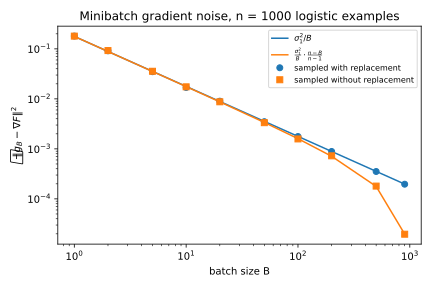
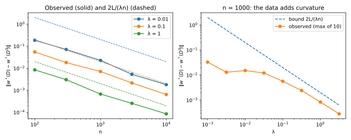
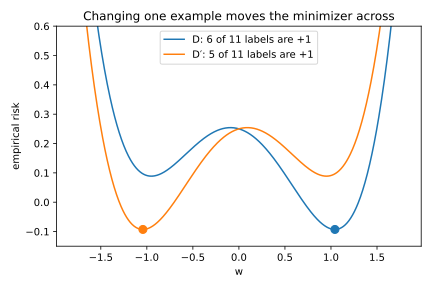

# Optimization

## Why this matters

Training a model means finding the parameters that make its average loss over the training set as small as possible. Almost all training in machine learning is done by gradient descent (GD), or by its cheaper and noisier variant, stochastic gradient descent (SGD), and two questions come up every time. The first is how fast these methods get there, how to pick their step size, and how much the noise in SGD slows them down. The second is how much the answer depends on any one training example. If you replace one example and train again, does the best model barely move, or can it jump somewhere else entirely? The first question is about the algorithm and the second about the problem, and the next chapter uses the second to explain when a model generalizes.

Both questions are answered by four constants, three of which describe the loss. The **Lipschitz constant** $L$ says how steep the loss can be, and the **smoothness constant** $\beta$ says how fast its slope can change. The **strong convexity constant** $\lambda$ says how much the loss curves upward at least. The fourth constant belongs to the optimizer rather than the loss. It is the variance $\sigma^2$ of SGD's random gradients, which measures how far they scatter around the true gradient. Every result in this chapter is stated in these constants, so knowing which ones a result uses tells you whether it applies to your model.

## Convexity, Lipschitz continuity and smoothness {#sec-opt-definitions}

Throughout the chapter, the training set has $n$ examples, and the model is a vector of parameters $w$. Write $\ell(w, z)$ for the loss of the model on an example $z$, and $z_1, \dots, z_n$ for the training examples. The **empirical risk** is the average of these losses over the training set,
$$F(w) = \frac1n\sum_{i=1}^n\ell(w, z_i),$$
and training minimizes it. This chapter writes $w^*$ for a minimizer, a point where the risk is smallest, and $F^*$ for that smallest value.

The gradient of the risk, written $\nabla F(w)$, points in the direction in which the risk increases fastest. Write $\langle a, b\rangle$ for the inner product of two vectors, the sum of the products of their coordinates, and $\|a\|$ for the length of a vector. An optimizer follows the gradient downhill, so the shape of the loss decides how fast it reaches the minimizer. This section defines convexity and the three constants that describe that shape.

A function is **convex** when it curves upward everywhere, with no dents. The tangent at a point predicts the value elsewhere by following the slope in a straight line. Convexity says that this prediction never overshoots, so the graph of a function $f$ lies above every one of its tangents. In symbols, the value of $f$ at any point $w'$ is at least the tangent's prediction from a point $w$,
$$f(w') \ge f(w) + \langle\nabla f(w), w' - w\rangle.$$
For example, the tangent of $w^2$ at the point 1 has slope 2. At the point 3 it therefore predicts 5, below the true value there.

This is what makes convex problems easy to optimize. Take the tangent at your current point and use it to predict the risk at the minimizer. Convexity says that this prediction is at most the true smallest value. Rearranged, that says the gradient's component along the line from the minimizer to your point is at least your current error, the gap between the risk and its smallest value. So a step against the gradient makes progress in proportion to how far from optimal you are.

A function is **$L$-Lipschitz** when it never changes faster than $L$ per unit of distance, so that for any two points
$$|f(w) - f(w')| \le L\|w - w'\|.$$
For a differentiable function, this means that the gradient never has length more than $L$.

A function is **$\beta$-smooth** when its gradient changes by at most $\beta$ per unit of distance. Because the slope cannot change quickly, the tangent stays a good prediction nearby, and its error grows at most like a parabola with curvature $\beta$. This upper bound is the **descent lemma**:
$$f(w') \le f(w) + \langle\nabla f(w), w' - w\rangle + \frac\beta2\|w' - w\|^2.$$ {#eq-opt-descent-lemma}
The first two terms on the right are the tangent's prediction, and the last is the parabola that bounds its error.

A function is **$\lambda$-strongly convex**, for a constant $\lambda > 0$, when it lies above each tangent by at least a parabola with that curvature,
$$f(w') \ge f(w) + \langle\nabla f(w), w' - w\rangle + \frac\lambda2\|w' - w\|^2.$$
This is convexity with a margin that grows with the distance from the tangent point. Equivalently, along any straight line the slope grows by at least $\lambda$ per unit of distance. Now take a differentiable function whose minimizer is not on the edge of a constrained region, so that the gradient there is zero. Moving away from the minimizer, the gradient then grows at least in proportion to the distance. So a point where the gradient is small lies close to the minimizer, within the gradient's length divided by $\lambda$,
$$\|w - w^*\| \le \frac{\|\nabla f(w)\|}{\lambda},$$
and the minimizer is unique.

In practice, strong convexity usually comes from a **ridge** term $\frac\lambda2\|w\|^2$, a bowl with curvature exactly $\lambda$ in every direction. Adding it to a convex function adds that curvature everywhere, which makes the sum $\lambda$-strongly convex.

The curvatures can also be read off the Hessian, the matrix of second derivatives, since each of its eigenvalues is the curvature along the matching eigenvector. Convex means that no eigenvalue is negative, and $\lambda$-strongly convex means that every eigenvalue is at least $\lambda$. Smooth means that every eigenvalue lies between $-\beta$ and $\beta$. The ratio $\beta/\lambda$ is called the **condition number**, written $\kappa$, and it says how much more steeply the function rises in its steepest direction than in its flattest one.

Lipschitz and smooth bound different derivatives, so neither implies the other (@fig-opt-lipschitz-smooth). The absolute value $|w|$ is 1-Lipschitz but not smooth, because its slope jumps from $-1$ to $+1$ at zero. The parabola $w^2/2$ is 1-smooth but not Lipschitz, because its slope $w$ grows without bound. Every strongly convex function is like the parabola, since its slope grows at least in proportion to the distance from the minimizer. That is why the SGD results for strongly convex losses below keep the parameters in a bounded set, where the slope stays bounded.

The two constants also do different jobs. The Lipschitz constant bounds the gradient of one step, so it governs SGD on losses that are not smooth, and how far one example can move the minimizer. The smoothness constant instead bounds how far you can trust the tangent. That sets the standard safe step size, $1/\beta$, at which each step keeps at least half of its progress, and it also drives the analysis of non-convex losses.

{#fig-opt-lipschitz-smooth}

Logistic regression shows how the constants are found in practice. Take an example with a feature vector $x$ of length at most 1, and a label $y$ that is $\pm1$. The **margin**, written $m$, is $y\langle w, x\rangle$, which is large and positive when the model classifies the example correctly and confidently. The logistic loss turns the margin into a penalty,
$$\ell = \ln(1 + e^{-m}).$$
The sigmoid function maps a number $s$ to $1/(1 + e^{-s})$, a value between 0 and 1. Write $p$ for the sigmoid of the margin, which is the probability the model gives to the correct label.

Differentiating the loss with respect to $w$ gives its gradient and its Hessian,
$$\nabla\ell = -(1 - p)\,y\,x, \qquad \nabla^2\ell = p(1-p)\,xx^\top.$$
In the gradient, both $1 - p$ and the length of the features are at most 1, so the loss is 1-Lipschitz. In the Hessian, the matrix $xx^\top$ has eigenvalue $\|x\|^2$ along the features and zero orthogonal to them. The factor in front, $p(1-p)$, is never negative, so the loss is convex. It is also at most $\frac14$, so the loss is $\frac14$-smooth.

The logistic loss is not strongly convex, because it has no curvature orthogonal to the features, and even along them the curvature vanishes for a confidently classified example. The risk averages many examples with different features, so it can still curve in every direction. The full edition's experiments use a synthetic dataset with 1,000 examples in 5 dimensions, and at its minimizer the smallest curvature of the risk is only $0.0233$. A ridge term supplies the missing curvature, making the loss $\lambda$-strongly convex and $(\frac14 + \lambda)$-smooth. Its gradient then grows with the parameters, though, so it is Lipschitz only on a bounded set. On the ball of radius $r$ around zero, for example, the gradient has length at most $1 + \lambda r$.

The squared loss of least squares, $\frac12(\langle w, x\rangle - y)^2$, has the Hessian $xx^\top$, so it is convex and smooth. But it is not Lipschitz, because its gradient is the prediction error times the features, and the prediction error grows with the parameters. Its risk is strongly convex exactly when the average of the matrices $xx^\top$ is invertible. That fails when there are more features than examples, and the risk then has a whole space of minimizers. A ridge term fixes this, making the risk strongly convex for any data.

## Gradient descent and SGD {#sec-opt-gd}

**Gradient descent** repeatedly steps against the full gradient of the risk. Write $w_t$ for the parameters after $t$ steps, and $\eta$ for the step size, a positive number you choose. Each step then sets
$$w_{t+1} = w_t - \eta\nabla F(w_t),$$
which costs one gradient evaluation per training example.

SGD replaces the full gradient with the gradient of one example chosen uniformly at random, so each step is cheap. With a **minibatch**, it averages the gradients of a small random batch instead. Either way, the random gradient is **unbiased**, meaning that it equals the true gradient on average, and it is the uniform sampling that makes this hold. A scheme that favoured some examples would minimize a reweighted risk instead.

Being right on average does not make the random gradient as good as the true one. To see why, write it as the true gradient plus an error. Its squared length is then the two squared lengths plus twice their inner product, and since the error averages to zero, that cross term averages to zero too. Writing $g$ for the random gradient, its average squared length is therefore
$$\mathbb E\|g\|^2 = \|\nabla F(w)\|^2 + \mathbb E\|g - \nabla F(w)\|^2,$$
the squared length of the true gradient plus a **variance**, the average squared length of the error.

Take a training set of three numbers, $(1, 2, 6)$, and the loss $\frac12(w - z)^2$, where $z$ is the example. The mean of the data is 3, so the gradient of the risk is $w - 3$. At the point $w = 4$, the true gradient is therefore 1. SGD instead picks one example at random and uses its gradient $w - z$, which takes the three values in @tbl-opt-toy.

| Example picked | $z_1 = 1$ | $z_2 = 2$ | $z_3 = 6$ | Average |
| --- | --- | --- | --- | --- |
| Gradient $g = w - z_i$ | 3 | 2 | −2 | 1 |
| $g^2$ | 9 | 4 | 4 | 17/3 |
| $(g - \nabla F)^2$ | 4 | 1 | 9 | 14/3 |

: SGD gradients for the risk $\frac13\sum_i\frac12(w - z_i)^2$ at $w = 4$, where the true gradient is 1. {#tbl-opt-toy}

The three gradients average to the true gradient, but their average square splits into the squared true gradient plus the variance, $17/3 = 1 + 14/3$. Averaging removed the error from the gradient but not from its square, and every SGD rate in this chapter pays for that variance.

GD, which uses the exact gradient, shows what a fast rate looks like. On a quadratic risk, the gradient is a linear function of the displacement from the minimizer, so each GD step multiplies that displacement by a fixed matrix. With the step $1/\beta$, the error along a direction of curvature $h$ shrinks by the factor $1 - h/\beta$ per step. Along the steepest direction this factor is zero, so that part of the error disappears in one step. The flattest direction shrinks slowest, by the factor $1 - 1/\kappa$, so the distance to the minimizer shrinks by at least that factor at every step:
$$\|w_t - w^*\| \le \left(1 - \frac1\kappa\right)^t\|w_0 - w^*\|.$$ {#eq-opt-gd-linear}

This is called **linear convergence**. Shrinking the error to a fraction $\epsilon$ of its starting size takes about $\kappa\ln(1/\epsilon)$ steps, so a large condition number makes GD slow. That is because the step must be small enough for the steepest direction. With that small step, the flattest direction closes only a fraction $1/\kappa$ of its gap per step. On a test problem with condition number $9.58$, the bound is nearly exact.

@fig-opt-gd-sgd-paths shows GD first removing the error along the steep direction, then crawling along the flat valley. SGD with a constant step follows roughly the same route but keeps jittering around the minimizer.

{#fig-opt-gd-sgd-paths}

The jitter has a simple cause. Near the minimizer the true gradient vanishes, but the gradients of single examples do not. In @tbl-opt-toy, for example, the minimizer is 3, and there the three examples still have gradients 2, 1 and −3. So with a constant step the iterates keep jumping around the minimizer. Averaging the iterates cancels the jumps, and shrinking the step over time makes them smaller, but both give slower rates than GD's, as the next sections show.

## SGD for convex Lipschitz objectives {#sec-opt-sgd}

The cleanest guarantee for SGD needs only convexity and bounded gradients, with no smoothness. It therefore covers losses with kinks, such as the hinge loss, as well as the logistic loss. At a kink, SGD uses a **subgradient**, any slope whose straight line stays below the graph.

The guarantee runs **projected SGD**, which keeps the parameters inside a set, such as a ball. Whenever a step leaves the set, the **projection** pulls it back to the nearest point of the set. The set must be closed, meaning that it contains its boundary, so that a nearest point exists. It must also be convex, so that the segment between two of its points stays inside, and then projection never moves a point farther from anything in the set. So it never undoes progress towards a minimizer inside the set.

The guarantee returns the **averaged iterate** $\bar w_T$, the average of the parameter vectors over a run of $T$ steps, and it needs three conditions. The risk must be convex, because convexity turns the progress of a step into progress on the error. The set must contain the minimizer, or projection could pull you away from it. And the random gradients must have an average squared length of at most a constant $G^2$, because that bounds how far a step overshoots. Now write $R$ for the distance from the start to the minimizer, or any upper bound on it. With a constant step size $\eta$, the averaged iterate satisfies
$$\mathbb E[F(\bar w_T)] - F^* \le \frac{R^2}{2\eta T} + \frac{\eta G^2}{2}.$$ {#eq-opt-sgd-convex}

The two terms pull the step size in opposite directions. The first is the cost of travel, because small steps take long to cover the distance $R$. The second is the cost of noise, because each step overshoots by an amount that grows with the step size. The step that balances them, and the bound it gives, are
$$\eta = \frac{R}{G\sqrt T}, \qquad \mathbb E[F(\bar w_T)] - F^* \le \frac{RG}{\sqrt T}.$$
A longer run lowers the travel term, so it can afford a smaller step, which lowers the noise term. That is why the best step shrinks like $1/\sqrt T$. For an $L$-Lipschitz loss, every single-example gradient has length at most $L$, so the bound becomes $RL/\sqrt T$.

The proof follows the squared distance to the minimizer. On average, by convexity and unbiasedness, each step reduces it by at least a multiple of the current error, and overshoot adds back at most $\eta^2G^2$. The total reduction over the run cannot exceed the starting value $R^2$, and that bounds the average error over the run. The last step passes this bound to the averaged iterate. It uses **Jensen's inequality**, which says that for a convex function the value at an average of points is at most the average of the values.

So return the averaged iterate, which the bound covers, not the last one. The rate $1/\sqrt T$ cannot be improved for this class of losses, because some convex Lipschitz functions force an error of order $RL/\sqrt T$ on any method that only queries gradients. Smoothness does not help either, because the noise term comes from the randomness of the gradient, not from the shape of the loss.

The bound is a worst case, and the full edition measures how loose it is on the logistic dataset. It runs projected SGD on the ball of radius 5 around zero, starting from zero. Since the minimizer is inside the ball, $R = 5$ bounds the starting distance.

| Steps $T$ | Step $\eta$ | Observed $F(\bar w_T) - F^*$ | Bound $RL/\sqrt T$ |
| --- | --- | --- | --- |
| 100 | 0.5000 | $4.44\times10^{-2}$ | 0.500 |
| 1,000 | 0.1581 | $6.46\times10^{-3}$ | 0.158 |
| 10,000 | 0.0500 | $7.71\times10^{-4}$ | 0.050 |

: Projected SGD on logistic regression against the convex Lipschitz bound @eq-opt-sgd-convex, averaged over 20 runs. {#tbl-opt-sgd-convex}

The bound in @tbl-opt-sgd-convex holds in every row, loose by a factor of 11 for the shortest run and 65 for the longest. The gap grows because the observed error falls almost like $1/T$, by $57.6$ times over a hundredfold longer run. That faster fall comes from curvature in the data, which the bound ignores. Even without a ridge term, the risk has the smallest curvature $0.0233$ at its minimizer, so it is strongly convex near there. The left panel of @fig-opt-sgd-convex shows the comparison over a range of run lengths.

{#fig-opt-sgd-convex}

## Strongly convex objectives {#sec-opt-strong}

Strong convexity pulls the iterates towards the minimizer, since the farther you are from it, the larger the gradient pointing back. With matching step sizes and averaging, that turns the $1/\sqrt T$ rate into a $1/T$ rate. The setting is the same as before, except that the risk is now $\lambda$-strongly convex on the set.

Two schemes work, and both shrink the step like $1/(\lambda t)$ at step $t$, a size at which the starting distance cancels out of the argument. The first scheme uses the steps $1/(\lambda t)$ and the uniform average of the iterates, and after $T$ steps its expected error is at most
$$\frac{G^2(1 + \ln T)}{2\lambda T}.$$
The second scheme uses the steps $2/(\lambda(t + 1))$ and weights iterate $t$ in proportion to $t$. This removes the $\ln T$, and the expected error is at most
$$\frac{2G^2}{\lambda(T + 1)}.$$ {#eq-opt-sgd-strong}

The argument is the convex one with an extra term. Strong convexity adds to each step's progress a term proportional to the current squared distance. With steps $1/(\lambda t)$, the distance terms of consecutive steps cancel in pairs, which leaves the starting distance with the coefficient zero. Only the noise terms remain, with step $t$ contributing $G^2/(2\lambda t)$, and these add up to a harmonic sum of at most $1 + \ln T$. That is where the $\ln T$ comes from.

The uniform average pays this price because the early steps are huge, so the early iterates are bad, and yet it gives them full weight. In the weighted scheme, iterate $t$ has the noise term $G^2/(\lambda(t + 1))$. Multiplied by its weight $t$, this is at most $G^2/\lambda$, so every step contributes at most the same amount and no harmonic sum appears. Averaging only the last half of the iterates also gives the $1/(\lambda T)$ rate, by dropping the bad early ones.

With a $1/T$ rate, halving the error takes twice the steps, not four times. The price is the factor $1/\lambda$, so a weak regularizer gives a fast rate only after many steps. The schedule also needs a value of $\lambda$ no larger than the true strong convexity. If you overestimate it, the guarantee no longer holds, because the argument counts on more pull than there is. Worse, the steps shrink too fast, and the iterates can stall far from the minimizer.

The constant $G$ depends on the set, because a strongly convex function has no bound on its gradient over the whole space, which is the reason for the projection. For an $L$-Lipschitz loss plus a ridge term, for example, the gradient on the ball of radius $r$ has length at most $L + \lambda r$.

Add a ridge term of $\lambda = 0.1$ to the logistic problem. On the ball of radius 5, this gives $G = 1.5$. After a run of 10,000 steps, the uniform average has an error of $9.09\times10^{-5}$, against a bound of $1.15\times10^{-2}$. The weighted average has an error of $7.85\times10^{-5}$, against a bound of $4.50\times10^{-3}$. So both bounds are loose, by factors of about 130 and 60. The main reason is that $G$ is the worst case over the whole ball, while the actual gradients near the minimizer are much smaller. In the right panel of @fig-opt-sgd-convex, all three iterates fall like $1/T$, with the weighted average slightly ahead.

## Gradient noise and minibatches {#sec-opt-noise}

Every SGD bound so far pays for the average squared length of the random gradients, which is the squared true gradient plus the variance. That variance comes from sampling examples, but also from low-precision arithmetic or from compressing gradients to send between machines. In later parts, noise is also sometimes added to gradients on purpose. Two practical questions follow. How does the batch size change the variance, and how should the step size change when the gradients get noisier?

Write $\sigma_1^2$ for the variance of a single-example gradient, the average squared distance of the $n$ per-example gradients from the true gradient. A batch of $B$ independent draws divides that variance by $B$, as for any sample mean. Drawing without replacement does a little better, because the deviations of the per-example gradients from their mean sum to zero. Once you have drawn an example that deviates one way, the rest deviate, on average, slightly the other way, so the draws partly cancel. For the average gradient $g_B$ over the batch, the variance is
$$\mathbb E\|g_B - \nabla F(w)\|^2 = \begin{cases}\dfrac{\sigma_1^2}{B} & \text{with replacement,}\\[2ex] \dfrac{\sigma_1^2}{B}\cdot\dfrac{n - B}{n - 1} & \text{without replacement.}\end{cases}.$$ {#eq-opt-minibatch}
The extra factor is 1 for a batch of one example, and 0 for a batch of the whole dataset, whose gradient is exact.

On the logistic data, the single-example variance at the minimizer is $0.1722$, and the formula matches simulated batches of every size. At a batch of 500, half the dataset, the extra factor is about one half, so sampling without replacement halves the variance (@fig-opt-minibatch-variance).

{#fig-opt-minibatch-variance}

Larger batches are not free. A batch of $B$ examples costs $B$ gradient evaluations and divides the variance by $B$, so per evaluation the gain is exactly cancelled. Batches help mainly because the evaluations can run in parallel.

Now suppose that each random gradient gets extra noise of mean zero, independent of everything else. Write $\sigma^2$ for the average squared length of that noise, summed over all coordinates. Its cross term with the gradient averages to zero, so the noise simply adds $\sigma^2$ to the average squared length of the gradient. The convex Lipschitz bound @eq-opt-sgd-convex then holds with $G^2 = L^2 + \sigma^2$, which makes the balanced step and the bound
$$\eta^* = \frac{R}{\sqrt{(L^2 + \sigma^2)T}}, \qquad \mathbb E[F(\bar w_T)] - F^* \le \frac{R\sqrt{L^2 + \sigma^2}}{\sqrt T}.$$

Noisier gradients call for smaller steps and longer runs. For the bound to reach a fixed accuracy, the number of steps must grow in proportion to $L^2 + \sigma^2$, so noise multiplies the steps the bound needs by $1 + \sigma^2/L^2$. Noise of size $\sigma = 3L$, for example, multiplies them by 10.

The full edition tests this on the logistic problem, adding normal noise to every single-example gradient for 10,000 steps. @tbl-opt-noise compares the bound's step with the best step on a grid.

| Noise $\sigma$ | $\eta^*$ from the bound | Bound at $\eta^*$ | Observed at $\eta^*$ | Best $\eta$ on the grid | Observed there |
| --- | --- | --- | --- | --- | --- |
| 0 | 0.0500 | 0.050 | $4.99\times10^{-4}$ | 0.178 | $1.85\times10^{-4}$ |
| 1 | 0.0354 | 0.071 | $1.58\times10^{-3}$ | 0.056 | $1.38\times10^{-3}$ |
| 3 | 0.0158 | 0.158 | $9.58\times10^{-3}$ | 0.056 | $5.10\times10^{-3}$ |

: Projected SGD with added gradient noise, $T = 10{,}000$: error of the averaged iterate at the step size the bound recommends and at the best step size on the grid. {#tbl-opt-noise}

The table and @fig-opt-noise-step-size show three things. First, noise costs accuracy, since at the bound's step the error grows about 20-fold as the noise goes from none to size 3. Second, noise pushes the best step down, from $0.178$ to $0.056$, so retune the step size whenever the gradient noise changes. Third, the bound's step is conservative, because it assumes the gradient is as large as $L$ and the distance as large as $R$. The actual run has smaller gradients and starts closer, so its best step is larger, by a factor of $3.6$ without noise.

{#fig-opt-noise-step-size}

## Non-convex objectives: convergence to stationary points {#sec-opt-nonconvex}

The losses of neural networks are not convex, and no method that only uses gradients can promise to find their global minimum. What SGD can still guarantee is a point where the gradient is small, an **approximate stationary point**. The argument uses smoothness instead of convexity.

Put a GD step of size $1/\beta$ into the descent lemma @eq-opt-descent-lemma. The tangent term promises a decrease of $\|\nabla F\|^2/\beta$, and the parabola term, which charges for overshooting, takes back half of that. So each step lowers the risk by at least
$$F(w_t) - F(w_{t+1}) \ge \frac{\|\nabla F(w_t)\|^2}{2\beta}.$$
For SGD the same holds on average, minus a penalty for the noise. Since a risk that is bounded below cannot fall forever, the squared gradients must be small on average over the run.

Each piece of this argument is a condition of the result. The risk must be $\beta$-smooth, or the descent lemma does not hold. It must also be bounded below, or it could keep falling while its gradients stay large, and this chapter writes $\Delta$ for the most it can fall from the start. The random gradients must be unbiased, so that the expected progress of a step depends on the true gradient. And their variance must be at most some $\sigma^2$, which sets the noise penalty, where $\sigma^2$ counts the whole variance, from sampling and any added noise together.

Finally, the step size must be at most $1/\beta$, because such a step keeps at least half of its progress, and the constants of the bound come from that half. A step between $1/\beta$ and $2/\beta$ still makes progress, but less, while from $2/\beta$ on the descent lemma promises none, and a step can raise the risk. Under these conditions, SGD with a constant step size $\eta \le 1/\beta$ satisfies
$$\frac1T\sum_{t=1}^T\mathbb E\|\nabla F(w_t)\|^2 \le \frac{2\Delta}{\eta T} + \beta\eta\sigma^2.$$ {#eq-opt-nonconvex}
The left side is the average squared gradient over the run. Ghadimi and Lan (2013) proved this bound. They return an iterate chosen at random from the run, whose expected squared gradient equals that average.

The two terms are again the cost of travel and the cost of noise, and the best step balances them, up to the cap of $1/\beta$. Without noise, the step is $1/\beta$ and the rate is of order $1/T$, as for GD. With noise, the balanced bound falls like $1/\sqrt T$, so the gradient's length falls only like $T^{-1/4}$. Batches help here as well, since with batches of $B$ examples the variance becomes $\sigma^2/B$.

A small gradient is all you get. A stationary point can be a local minimum, a saddle point, or a flat region far from anything good. The convex bounds could say how far the risk is from its smallest value, because convexity links the gradient to the error, but without convexity that link is gone.

The full edition tests the bound on the **sigmoid loss**, the sigmoid of the negative margin. It is a smooth stand-in for counting mistakes, and it is not convex, because the sigmoid curves up on one side of zero and down on the other. Its curvature is at most $1/(6\sqrt3) = 0.0962$, which is its smoothness constant (@fig-opt-lipschitz-smooth, right). The loss lies between 0 and 1 and starts at $\frac12$, so the risk can fall by at most $\frac12$. Because the features have length at most 1, the gradient has length at most $\frac14$. The variance is therefore at most its squared length, $\frac1{16}$.

| Steps $T$ | Step $\eta$ | Observed $\frac1T\sum_t\Vert \nabla F(w_t)\Vert ^2$ | Bound @eq-opt-nonconvex |
| --- | --- | --- | --- |
| 100 | 1.289 | $1.64\times10^{-3}$ | $1.55\times10^{-2}$ |
| 1,000 | 0.408 | $5.22\times10^{-4}$ | $4.90\times10^{-3}$ |
| 10,000 | 0.129 | $1.87\times10^{-4}$ | $1.55\times10^{-3}$ |

: SGD on the non-convex sigmoid loss against the stationarity bound, with the balancing step, averaged over 5 runs. {#tbl-opt-nonconvex}

The bound in @tbl-opt-nonconvex is loose by a factor of 8 to 10. Even so, it falls at the right rate, like $1/\sqrt T$. The slack comes from the worst-case constants, since the possible fall, the variance and the smoothness constant are all upper bounds that the run does not reach. @fig-opt-nonconvex-sgd shows more run lengths.

{#fig-opt-nonconvex-sgd}

## Sensitivity of regularized ERM {#sec-opt-erm}

The previous sections asked how fast an optimizer reaches the minimizer. This one asks how much the minimizer depends on the data. Regularized **empirical risk minimization (ERM)** minimizes the average training loss plus a ridge term,
$$J(w; D) = \frac1n\sum_{i=1}^n\ell(w, z_i) + \frac\lambda2\|w\|^2,$$
where $D$ is the training set, and $w^*(D)$ is its minimizer. If you replace one training example and retrain, how far can the minimizer move? The question is about the exact solution, not about the optimizer that finds it.

The answer has two steps. First, replacing one example swaps one of the $n$ terms of the average. The old loss leaves and the new one enters, each with weight $1/n$ and a gradient of length at most $L$. So the gradient of the objective moves by at most $2L/n$ at every point. The new objective has zero gradient at its own minimizer, so the old objective's gradient there has length at most $2L/n$. Second, by strong convexity, a point with a gradient that small lies within the gradient's length divided by $\lambda$ of the old minimizer. So for two training sets that differ in one example,
$$\|w^*(D) - w^*(D')\| \le \frac{2L}{\lambda n}.$$ {#eq-opt-erm-sensitivity}

The conditions are that each loss is convex and $L$-Lipschitz, and that the ridge term is there. The Lipschitz constant caps how much one example can tilt the gradient. Convex losses plus the ridge term make the objective $\lambda$-strongly convex, which converts a small tilt into a small move. With subgradients, the argument also covers losses with kinks.

The bound is tight for a loss with no curvature of its own, where the ridge term is the only curvature. For example, take a single parameter $w$ and labels $z$ that are $\pm1$. The linear loss $zw$ is convex and 1-Lipschitz, and the minimizer of the regularized risk is then the negative mean label divided by $\lambda$. Flipping one label lowers the mean label by $2/n$, so the minimizer moves by exactly $2/(\lambda n)$. With $\lambda = 0.1$ and a thousand examples, the move is $0.02$.

The influence of one example shrinks like $1/n$, because each example carries weight $1/n$. Regularization buys stability, because its curvature turns a small tilt of the gradient into a small move, and halving $\lambda$ can double the movement. Since the loss is $L$-Lipschitz, the loss on any example then changes by at most
$$\frac{2L^2}{\lambda n}.$$
A bound like this, on how much replacing one example can change the loss anywhere, is called **uniform stability**. The next chapter, [Algorithmic stability and generalization](07-stability-generalization.md), turns it into a generalization bound, and later parts call the same per-example influence sensitivity.

The bound is loose in two ways. First, it counts only the ridge term's curvature, while real data add their own. With a larger total curvature, the same argument gives the bound with that curvature in place of $\lambda$. Second, it assumes that the two examples' gradients point in opposite directions at full length, which actual examples rarely do.

The full edition measures this on regularized logistic regression, recording the largest movement of the exact minimizer over 20 single-example replacements. The logistic loss is 1-Lipschitz, so the bound is $2/(\lambda n)$.

| $n$ | $\lambda = 0.01$: observed / bound | $\lambda = 0.1$: observed / bound | $\lambda = 1$: observed / bound |
| --- | --- | --- | --- |
| 100 | $2.52\times10^{-1}$ / 2.00 | $5.98\times10^{-2}$ / 0.200 | $8.55\times10^{-3}$ / 0.0200 |
| 1,000 | $2.13\times10^{-2}$ / 0.200 | $6.66\times10^{-3}$ / 0.0200 | $8.54\times10^{-4}$ / 0.00200 |
| 10,000 | $2.06\times10^{-3}$ / 0.0200 | $6.35\times10^{-4}$ / 0.00200 | $7.80\times10^{-5}$ / 0.000200 |

: Largest movement of the regularized logistic minimizer over 20 single-example replacements, against $2L/(\lambda n)$ with $L = 1$. {#tbl-opt-erm}

Down a column of @tbl-opt-erm, ten times the data gives a tenth of the movement, as the $1/n$ predicts. Across a row, the ratio of observed movement to bound falls from about 0.4 for the strongest ridge term to about 0.1 for the weakest. That is because the weaker the ridge term, the more of the curvature comes from the data, which the bound ignores. So in @fig-opt-erm-sensitivity, as $\lambda$ goes to zero the bound blows up, while the observed movement levels off.

{#fig-opt-erm-sensitivity}

Convexity alone is not enough, because a convex function can be flat, and on a flat stretch a tiny change in the data can move the minimizer a long way. The absolute loss shows this. It is convex and 1-Lipschitz, and the minimizer of its average is the median. Take an odd number of 0s and 1s, with one more 0 than 1s, so that the median is 0. Replacing one 0 by a 1 then switches the majority and moves the median to 1, however many examples there are. A ridge term would prevent this, since @eq-opt-erm-sensitivity caps the move at $2/(\lambda n)$.

For a non-convex loss, one example can decide which of two valleys is deeper. The full edition shows this with the double-well loss $\frac14(w^2 - 1)^2 - zw$, where the labels $z$ are $\pm1$. Its first term has valleys at $-1$ and $+1$, and its second term tilts the risk towards the sign of the mean label. With 11 examples, six of them labelled $+1$, the minimizer is $1.0427$. Flipping one label flips the tilt, which moves the minimizer by $2.0854$ into the other valley (@fig-opt-nonconvex-jump). With 1,001 examples the move is still $2.0010$.

{#fig-opt-nonconvex-jump}

A ridge term fixes this only if it makes the whole objective convex. Without strong convexity, the minimizer can jump when the data change slightly, or fail to be unique, and no bound on its movement can hold. So for non-convex models, statements about the influence of one example must be about the algorithm. One such algorithm is a fixed number of SGD steps from a fixed start, and [Algorithmic stability and generalization](07-stability-generalization.md) analyses SGD this way for convex losses.

## Code

The variance split and the minibatch formula are easy to check on the three examples of @tbl-opt-toy. This snippet does it with exact fractions.

```python
from fractions import Fraction
from itertools import combinations

data = [Fraction(1), Fraction(2), Fraction(6)]
w = Fraction(4)
grads = [w - z for z in data]  # gradient of (w - z)^2 / 2 for each example
true_grad = sum(grads) / len(grads)
second_moment = sum(g * g for g in grads) / len(grads)
variance = sum((g - true_grad) ** 2 for g in grads) / len(grads)
print(true_grad)  # 1
print(second_moment, "=", true_grad**2, "+", variance)  # 17/3 = 1 + 14/3

# Batches of two different examples, drawn without replacement.
pairs = list(combinations(grads, 2))
batch_var = sum(((a + b) / 2 - true_grad) ** 2 for a, b in pairs) / len(pairs)
n, b = len(grads), 2
print(batch_var, variance / b * (n - b) / (n - 1))  # 7/6 7/6
print(variance / b)  # 7/3
```

The batch variance without replacement, $7/6$, matches the formula and is half of the $7/3$ that drawing with replacement would give. The full edition's script [optimization.py](../../code/part01-prerequisites/optimization.py) runs every experiment in this chapter and draws every figure. Run it from the repository root.

```bash
uv run python code/part01-prerequisites/optimization.py
```

## Cheat sheet

| Result | Assumptions | Bound |
| --- | --- | --- |
| Descent lemma | $\beta$-smooth | $f(w') \le f(w) + \langle\nabla f(w), w' - w\rangle + \frac\beta2\lVert w' - w\rVert^2$ |
| Small gradient, close to minimizer | $\lambda$-strongly convex | $\lVert w - w^*\rVert \le \lVert\nabla f(w)\rVert/\lambda$ |
| Logistic loss | $\lVert x\rVert \le 1$ | 1-Lipschitz, $\frac14$-smooth, convex, not strongly convex |
| Ridge term $\frac\lambda2\lVert w\rVert^2$ | Added to a convex loss | $\lambda$-strongly convex; Lipschitz only on a bounded set |
| GD, quadratic | Curvatures in $[\lambda, \beta]$, step $1/\beta$ | $\lVert w_t - w^*\rVert \le (1 - 1/\kappa)^t\lVert w_0 - w^*\rVert$ |
| SGD, convex | Set contains $w^*$, $\mathbb E\lVert g\rVert^2 \le G^2$, start within $R$, $\eta = R/(G\sqrt T)$ | $RG/\sqrt T$, averaged iterate |
| SGD, strongly convex | $\eta_t = 1/(\lambda t)$, uniform average | $G^2(1 + \ln T)/(2\lambda T)$ |
| SGD, strongly convex | $\eta_t = 2/(\lambda(t+1))$, $t$-weighted average | $2G^2/(\lambda(T + 1))$ |
| Minibatch variance | $B$ of $n$, uniform | $\sigma_1^2/B$; times $\frac{n - B}{n - 1}$ without replacement |
| Added gradient noise | Mean zero, $\mathbb E\lVert\xi\rVert^2 = \sigma^2$ | $G^2 = L^2 + \sigma^2$; $\eta^* = R/\sqrt{(L^2 + \sigma^2)T}$ |
| SGD, non-convex | $\beta$-smooth, bounded below, unbiased gradients with variance $\le \sigma^2$, $\eta \le 1/\beta$ | $\frac1T\sum_t\mathbb E\lVert\nabla F(w_t)\rVert^2 \le \frac{2\Delta}{\eta T} + \beta\eta\sigma^2$ |
| Regularized ERM | Convex $L$-Lipschitz loss | Minimizer moves $\le 2L/(\lambda n)$; loss $\le 2L^2/(\lambda n)$ |

: The results of this chapter. {#tbl-opt-cheat}

**Rules of thumb**

- Lipschitz bounds the gradient, and smooth bounds how fast the gradient changes. Convex SGD on losses with kinks needs the first. Step sizes and non-convex analysis need the second.
- Without curvature, SGD's error falls like $1/\sqrt T$. With $\lambda$-strong convexity it falls like $1/(\lambda T)$. Average the iterates either way.
- Noise multiplies the steps needed by $1 + \sigma^2/L^2$ in the convex bound. Lower the step size when the gradients get noisier.
- One example moves a $\lambda$-regularized minimizer by at most $2L/(\lambda n)$. Without strong convexity there is no such bound.

## Further reading

- Shalev-Shwartz & Ben-David, *Understanding Machine Learning* (2014), ch. 12–14: convexity, regularization and stability, and SGD, at the level of this chapter.
- Bubeck, "Convex Optimization: Algorithms and Complexity" (2015), ch. 3 and §6.1: the rates for each combination of assumptions, with the lower bound on SGD's rate.
- Lacoste-Julien, Schmidt & Bach (2012) and Rakhlin, Shamir & Sridharan (ICML 2012): the weighted and last-half averages that remove the $\ln T$ for strongly convex losses.
- Bottou, Curtis & Nocedal, "Optimization Methods for Large-Scale Machine Learning" (SIAM Review 2018): noise, step sizes and batch sizes in practice.

**Derivations.** Every result in this chapter is derived step by step in [the full edition's chapter](../../book-full/part01-prerequisites/06-optimization.md), except two that it cites: the lower bound on SGD's rate (Bubeck 2015) and the rate for averaging the last half of the iterates (Rakhlin, Shamir & Sridharan 2012).
