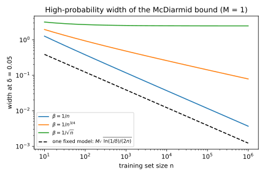

# Algorithmic stability and generalization

## Why this matters

You train a model and its training loss is low, but what matters is whether its loss on new data will be low too. The difference between the two losses is the **generalization gap**, and a model with a large gap looks better on its training data than it really is.

The classical way to bound the gap measures how rich a set of models the training algorithm could output. The argument is that a set that is not too rich cannot fit noise. For a large model that set is enormous, so the bound is useless. This chapter takes a different route and looks at the training algorithm itself. Its one idea is that **a model generalizes when it does not depend much on any single training example.**

That idea gives three results. The first says that the expected gap is exactly the average effect of swapping one training example for a fresh one. The second says that if no single example can move the trained model much, the gap is small on average. If that effect also shrinks fast enough as the data grow, the gap is small with high probability, for the one model you actually trained. The third shows that this per-example effect is controlled by two knobs you already turn, the strength of the regularizer and how long you train with stochastic gradient descent (SGD). Later parts of this book return to how much a trained model depends on a single example, and they reuse the quantities defined here.

## Training loss, test loss and the gap {#sec-stability-risk}

Training lowers the loss on the data you have, but you care about the loss on data you will see later. To make this precise, take a training set $S$ that is a list of $n$ examples. Its $i$-th example is written $z_i$. Each is drawn independently from the same distribution $\mathcal D$, the source of all data, past and future. From these examples, a learning algorithm $A$ returns a model $A(S)$. Then a loss $\ell(w, z)$, which is never negative, measures how badly a model $w$ does on an example $z$.

The quantity you care about is the average loss on a new example from $\mathcal D$, called the **test loss**, or population risk, and written $R(w)$. You cannot compute it, because you do not know $\mathcal D$. What you can compute is the average loss over the training set, the **training loss** or empirical risk, written $\hat R_S(w)$. The generalization gap of the trained model is its test loss minus its training loss,
$$\mathrm{gap} = R(A(S)) - \hat R_S(A(S)).$$
It is positive when the model looks better on its training data than it is.

For a model fixed before the data were drawn, the training loss is unbiased, meaning that its average over the random draw of the training set equals the test loss. The reason is that each training example is then a typical draw from $\mathcal D$, as far as that model is concerned. So the model's average loss on each example is its test loss, and so is the average over all $n$ examples. This needs the training examples to come from the same distribution as the future data. If they came from a different source, the training loss would estimate the loss on that other source instead.

For a model fitted to the data, the argument breaks, because the algorithm picked the model that does well on these particular examples. From the model's point of view the training examples are no longer typical draws, so its training loss is biased downward. The gap is this bias. It is not noise that averages out but a systematic error, which comes from using the same data both to choose a model and to judge it.

The running example of this chapter shows the size of the effect. Its features are uniform on the unit sphere in 10 dimensions, and its label is $+1$ or $-1$. The label tends to follow the sign of the first feature but is noisy when that feature is near zero. The model is logistic regression with a penalty on the size of its weights, whose strength, written $\lambda$, is 0.01. With training sets of 50 examples, the average training loss is 0.4603 while the average test loss is 0.5781. The expected gap, estimated as described in @sec-stability-erm, is about 0.119, and with 1,000 examples it shrinks to about 0.006.

The tool for studying the gap is a training set that differs from $S$ in one example. Write $z_i'$ for a fresh draw from $\mathcal D$, independent of $S$. The **replace-one neighbour** $S^{(i)}$ is then the training set with example $i$ replaced by $z_i'$. Replacing rather than removing keeps $n$ examples, all drawn from $\mathcal D$, so the neighbour is just as typical a training set as the original.

## The gap and uniform stability {#sec-stability-gap}

The first result says the expected gap is exactly an average per-example effect. To see why, measure the test loss in an unusual way.

The test loss of the model $A(S)$ is its average loss on a point it has not seen. The fresh point $z_i'$ is such a point, so the average loss of $A(S)$ on $z_i'$ is the test loss. Now rename the two points, calling $z_i$ the fresh one and $z_i'$ the training example, which turns $S$ into $S^{(i)}$. Both points are independent draws from the same distribution, so the renamed situation has exactly the same probabilities as the original one. Single outcomes change, but every average stays the same. After the renaming, the average loss of $A(S)$ on $z_i'$ therefore becomes the average loss on $z_i$ of the model trained on $S^{(i)}$, a model that never saw $z_i$.

So the expected test loss is the average loss of each example under a model trained without it. The training loss, by contrast, averages each example's loss under a model trained with it. Their difference is the expected gap, so for any algorithm,
$$\mathbb E[\mathrm{gap}] = \frac1n\sum_{i=1}^n\mathbb E\Big[\ell\big(A(S^{(i)}), z_i\big) - \ell\big(A(S), z_i\big)\Big].$$ {#eq-stability-identity}
Each term in the brackets says how much worse example $i$ does when the model is trained without it. The identity says that this effect, averaged over examples, is the expected gap. In other words, overfitting is dependence on individual examples.

The renaming is the step readers find hardest, so here it is on the smallest possible case. Take a single example $z_1$ that is 1 with probability 0.3 and 0 otherwise, and a fresh copy $z_1'$. The algorithm returns half the example, $w = z_1/2$, and the loss is the squared error $(w - z)^2$. @tbl-stability-renaming lists the four possible outcomes.

| $(z_1, z_1')$ | Probability | Training loss | Test loss | Renamed |
| --- | --- | --- | --- | --- |
| $(0, 0)$ | $0.49$ | $0$ | $0$ | $0$ |
| $(0, 1)$ | $0.21$ | $0$ | $1$ | $0.25$ |
| $(1, 0)$ | $0.21$ | $0.25$ | $0.25$ | $1$ |
| $(1, 1)$ | $0.09$ | $0.25$ | $0.25$ | $0.25$ |
| **Average** | | $0.075$ | $0.285$ | $0.285$ |

: Every outcome of the one-example case. The training loss is the model's loss on $z_1$, the test loss its loss on $z_1'$, and the renamed column the loss on $z_1$ of the model trained on $z_1'$. {#tbl-stability-renaming}

The rows $(0, 1)$ and $(1, 0)$ are mirror images, holding the same two values with the example and the fresh copy exchanged. They are the only rows where the test and renamed columns differ, and there the renamed column holds the test column's values with the two rows swapped. Since both rows have the same probability, 0.21, the averages agree.

The renaming needs one condition, that the two points be interchangeable, which holds when they are drawn independently from the same distribution. If $z_1'$ came from a different distribution, the two mirror-image rows would have different probabilities. The averages would then differ, and the identity would fail.

To bound the gap, bound each term of @eq-stability-identity. An algorithm is **$\beta$-uniformly stable** if replacing any one training example by any other moves the loss of the trained model by at most $\beta$, at every test point. In symbols, for every training set $S$, every index $i$, every replacement $z_i'$ and every test point $z$,
$$\big|\ell(A(S), z) - \ell(A(S^{(i)}), z)\big| \le \beta.$$
So the bound must hold in the worst case, not just on average. The number $\beta$ often shrinks as $n$ grows, since each example then carries less weight. For a randomized algorithm such as SGD, the condition applies to the loss averaged over the algorithm's own randomness.

@fig-stability-neighbours shows the definition at work. When one label is flipped, the fitted model moves a lot under weak regularization and barely under strong regularization.

{#fig-stability-neighbours}

If the algorithm is $\beta$-uniformly stable, every term in the brackets lies between $-\beta$ and $\beta$ (for a randomized algorithm, once averaged over its randomness). So does their average, which means the expected gap is at most $\beta$ in size:
$$\big|\mathbb E[\mathrm{gap}]\big| \le \beta.$$ {#eq-stability-expected}
What makes this bound useful is what it leaves out. No set of models appears in it, so it holds for any algorithm, however rich the set of models it could output. This is why stability gives guarantees for SGD on large models, where measuring that richness gives nothing useful.

The price is that uniform stability is a worst case. The identity averages over examples and data, while $\beta$ takes the worst training set, replacement and test point, so it can be far above the true gap. Weaker notions of stability that use averages also exist (Bousquet & Elisseeff 2002).

At the opposite end from a stable algorithm sits a memorizing lookup table, which stores the training set. It predicts the stored label at a training point and $+1$ everywhere else. Score it with the **0-1 loss**, which is 1 for a wrong prediction and 0 for a right one. With continuous features, a fresh point almost surely misses the table and gets the prediction $+1$. In the running example half the labels are $-1$, so the test error is one half, while the training error is 0, for every $n$.

Now take a training example whose label is $-1$, and replace it by a point elsewhere. Because the table no longer stores the old point, the prediction there falls back to $+1$, and the loss on the old example jumps from 0 to 1. So $\beta = 1$, and the gap of one half obeys the bound but never shrinks.

## High probability: the Bousquet–Elisseeff bound {#sec-stability-high-probability}

@eq-stability-expected controls the gap on average over training sets. But you train once, on one training set, so you need the gap of your model to be small with high probability. The tool for that is McDiarmid's inequality from [Concentration inequalities](02-concentration.md). It says that a function of many independent inputs stays close to its average if none of the inputs can move it by much. The chance of a large deviation falls exponentially in the square of its size.

The gap is such a function, since it depends on $n$ independent examples and uniform stability limits how much one example can move it. Replacing an example moves the test loss by at most $\beta$, because it moves the loss at every point by at most $\beta$.

It also moves the training loss, and this is where a second condition enters. The training loss is an average of $n$ terms, one per example. For the other examples, the term is evaluated at the same point under two models, so stability limits its change. The replaced example's own term is different, because before the replacement it is a loss at $z_i$ and after it a loss at $z_i'$, a different point. Stability compares two models at the same point, so it says nothing about this term, and only a bound on the loss itself limits it. The result therefore assumes that every loss lies between 0 and a maximum $M$. Without such a bound, one example could move the training loss by any amount, and McDiarmid's inequality would not apply.

Write $\delta$ for the failure probability, the chance that the guarantee does not hold. Suppose the algorithm is $\beta$-uniformly stable and the loss lies between 0 and $M$. Then with probability at least $1 - \delta$ over the training set,
$$R(A(S)) \le \hat R_S(A(S)) + \beta + (2n\beta + M)\sqrt{\frac{\ln(1/\delta)}{2n}}.$$ {#eq-stability-be}
This is the bound of Bousquet & Elisseeff (2002). They define stability by removing an example rather than replacing it, and the form above restates their bound for replacement. Applying the same argument to the gap with its sign reversed gives a matching lower bound.

The bound adds two things to the training loss you observe. The first is $\beta$, the bound on the expected gap. The second is a deviation term, which says how far one training set can stray from the average, and together the two make up the bound's width. Inside the deviation term, the part with $M$ is what Hoeffding's inequality gives for one fixed model. That model's training loss is an average of $n$ independent losses between 0 and $M$. Call it the **fixed-model term**. It falls like $1/\sqrt n$, and you pay it even without any learning.

The part with $2n\beta$ is the price of learning. Multiplied out, it equals $\beta\sqrt{2n\ln(1/\delta)}$, so it goes to zero only if $\beta$ shrinks faster than $1/\sqrt n$ as the training set grows. @fig-stability-high-probability shows three cases. When $\beta$ falls like $1/n$, as for regularized empirical risk minimization (ERM) below, the width falls like $1/\sqrt n$, only a constant factor above the fixed-model term. When $\beta$ falls like $n^{-3/4}$, the width still falls, but only like $n^{-1/4}$. And when $\beta$ falls like $1/\sqrt n$, the width does not fall at all, so the bound is useless, although @eq-stability-expected still says the expected gap is at most $\beta$.

{#fig-stability-high-probability}

The bound is loose because McDiarmid's inequality charges every example the full worst case, while in reality the effects of different examples largely cancel. Later work removed most of this slack. Feldman & Vondrák (2018) proved a bound that is useful whenever $\beta$ goes to zero, at any rate. Two later papers went further for losses between 0 and 1 (Feldman & Vondrák 2019; Bousquet, Klochkov & Zhivotovskiy 2020). Their bound is $\beta$, multiplied by logarithmic factors, plus the fixed-model term. With it, a $\beta$ of order $1/\sqrt n$ also gives a gap of order $1/\sqrt n$, up to logarithmic factors.

For a sense of scale, apply @eq-stability-be to regularized logistic regression with 10,000 examples and $\delta = 0.05$. With features of size 1, the next section shows that $\beta$ is $2/(\lambda n)$. The logistic loss has no upper limit in general, since it grows as a prediction gets more confidently wrong. Here it is bounded, because the penalty keeps the weights at size at most $1/\lambda$, as the next section also shows. With features of size 1, no prediction can then be more wrong than $1/\lambda$ allows, so the largest loss $M$ is $\ln(1 + e^{1/\lambda})$. That is 1.313 for $\lambda = 1$ and 10.000 for $\lambda = 0.1$.

With $\lambda = 1$, the bound adds 0.065 to the training loss, and with $\lambda = 0.1$ it adds 0.614. In both cases the stability term $2n\beta$ makes up three quarters or more of the width. The expected gap itself is far smaller. For $\lambda = 1$ it is already $2.53\times10^{-4}$ with 1,000 examples, a tenth as many, and it keeps falling like $1/n$.

## Regularized ERM is stable {#sec-stability-erm}

The bounds above need an algorithm with small $\beta$. The first such algorithm is regularized ERM, which covers ridge regression, regularized logistic regression and support vector machines. It picks the weights that minimize the training loss plus a penalty on their size,
$$w_S = \arg\min_w \Big(\hat R_S(w) + \frac\lambda2\|w\|^2\Big).$$

Stability gives a new reading of the regularizer. With a convex loss, the penalty makes the objective a bowl whose curvature is at least $\lambda$ everywhere. Replacing one example changes only one term of the objective, a term that carries weight $1/n$. Such a small change can only tilt a steep bowl a little, so the bottom of the bowl moves only a little.

Two properties of the loss turn this picture into a number, and [Optimization](06-optimization.md) defines both. A loss is **$L$-Lipschitz** when its gradient never exceeds $L$ in size, so that moving the weights changes the loss by at most $L$ times the distance moved. A loss is convex when its curvature is never negative. If the loss is convex and $L$-Lipschitz for every example, then replacing one example moves the minimizer by at most $2L/(\lambda n)$. The loss at every test point then moves by at most $L$ times that, which gives
$$\beta = \frac{2L^2}{\lambda n}.$$ {#eq-stability-erm}

Each condition has a job. The Lipschitz bound limits how hard the one changed term can tilt the bowl, since its gradient changes by at most $2L/n$. It also turns a movement of the weights into a change of the loss. Convexity of the loss keeps the whole objective a bowl with curvature at least $\lambda$. Without it, the data term can cancel the curvature of the penalty. For example, [Optimization](06-optimization.md) shows a non-convex loss with two valleys where flipping one label makes the minimizer jump from one valley to the other, however large $n$ is. Squared loss is convex but not Lipschitz everywhere, yet you can still use the result for ridge regression when the features and labels are bounded. The minimizer then lies in a bounded region, and the squared loss is Lipschitz there.

The same reasoning bounds the size of the weights. At the minimizer the gradient of the objective is zero, which says that $\lambda w_S$ equals minus the average gradient of the losses. That average has size at most $L$, so $\|w_S\|$ is at most $L/\lambda$. With bounded features this also bounds every prediction, which is how the previous section found the largest loss $M$ of regularized logistic regression.

Because $\beta$ falls like $1/n$, faster than $1/\sqrt n$, both the expected-gap and the high-probability bounds go to zero as the training set grows. Regularization buys stability linearly, since doubling $\lambda$ halves $\beta$. But it is not free, because a larger $\lambda$ also pulls the weights towards zero and away from the best fit. The test loss is therefore U-shaped in $\lambda$, with too little regularization overfitting and too much underfitting.

The running example tests the bound. The gradient of the logistic loss is the feature vector scaled by a probability, a number between 0 and 1. With features of size 1 its size is at most 1, so the loss is 1-Lipschitz and $\beta = 2/(\lambda n)$. The script fits the model on $S$ and then on $S^{(i)}$ for 10 random examples, each replaced by the same point with its label flipped. It records the largest change in the weights and in the loss. To find the test point where the loss changes most, it checks 2,000 random test points and the points that lie in the direction the weights moved.

| $n$ | $\lambda$ | Weight bound $2L/(\lambda n)$ | Largest weight change | Loss bound $2L^2/(\lambda n)$ | Largest loss change | Ratio |
| --- | --- | --- | --- | --- | --- | --- |
| 100 | 0.01 | 2.0 | 0.406 | 2.0 | 0.340 | 0.17 |
| 100 | 1 | 0.02 | 0.00976 | 0.02 | 0.00505 | 0.25 |
| 1,000 | 0.1 | 0.02 | 0.00809 | 0.02 | 0.00499 | 0.25 |
| 10,000 | 0.01 | 0.02 | 0.00336 | 0.02 | 0.00285 | 0.14 |

: Replace-one changes of regularized logistic regression against the bounds in @eq-stability-erm, for selected settings. Ratio is the largest loss change divided by the loss bound. {#tbl-stability-replace-one}

@tbl-stability-replace-one shows the predicted $1/(\lambda n)$ scaling closely where the penalty dominates the curvature, for $\lambda$ at least 0.1. The rows with 100 examples at $\lambda = 1$ and 1,000 examples at $\lambda = 0.1$ share $\lambda n = 100$, and they have nearly the same loss change, 0.00505 and 0.00499. The row with 10,000 examples at $\lambda = 0.01$ also has $\lambda n = 100$, but its loss change is only 0.00285. With a weak penalty the data add curvature of their own, which also resists movement but which the bound ignores. That is also why the ratio is lowest, about 0.15, at $\lambda = 0.01$.

With $\lambda = 1$ the ratio is a quarter, which comes from two factors of 2. The first comes from the gradients. The bound allows the two examples' gradients to differ by $2L$, as if each had full length $L$ and they pointed in opposite directions. For a flipped label they do point in opposite directions, but their lengths are two probabilities that add up to 1. So their difference has length 1, and the weights move about half the bound. The second factor comes from the test point. With strong regularization the weights are small, so predictions are close to even odds, where the logistic loss changes at half its largest rate. The loss therefore moves about half as much as the weights.

The expected gap is smaller still. The script averages it over 100 training sets for each setting and computes the test loss exactly. To cancel most of the noise from the random training sets, it also subtracts, on the same training set, the gap of a fixed reference model. That gap averages to zero, because a fixed model's training loss is unbiased, so subtracting it leaves the expected gap unchanged. But it rises and falls with lucky and unlucky training sets, so subtracting it removes much of the variation. This is why the gap column differs slightly from the test loss minus the training loss.

| $\lambda$ | $n$ | Train loss | Test loss | Expected gap | Bound $2/(\lambda n)$ | Gap / bound |
| --- | --- | --- | --- | --- | --- | --- |
| 0.01 | 50 | 0.4603 | 0.5781 | 0.119 | 4.0 | 0.030 |
| 0.01 | 1,000 | 0.5311 | 0.5381 | 0.00596 | 0.2 | 0.030 |
| 0.1 | 1,000 | 0.6346 | 0.6365 | 0.00178 | 0.02 | 0.089 |
| 1 | 50 | 0.6806 | 0.6854 | 0.00459 | 0.04 | 0.115 |
| 1 | 1,000 | 0.6852 | 0.6855 | 0.000253 | 0.002 | 0.127 |

: Expected generalization gap of regularized logistic regression, averaged over 100 training sets, against the stability bound, for selected settings. {#tbl-stability-gap}

The gap falls like $1/n$, as the bound predicts, and stays a fixed fraction of the bound for each $\lambda$ (@tbl-stability-gap). That fraction is about 3% for $\lambda = 0.01$ and 11% to 13% for $\lambda = 1$. Part of the slack is the factor of about 4 already seen in @tbl-stability-replace-one. The rest comes from averaging, since the gap averages over test points and replacements while the bound takes the worst of both. @fig-stability-gap also shows the U-shape in $\lambda$.

{#fig-stability-gap}

## SGD is stable if you stop early {#sec-stability-sgd}

Large models are not trained to an exact minimizer but by SGD, for a number of steps. At each step $t$, SGD picks one training example $z$ uniformly at random and moves the weights against the gradient of its loss, scaled by a step size $\eta_t$,
$$w_{t+1} = w_t - \eta_t\nabla\ell(w_t, z).$$
The sum of the step sizes over all steps is the **total step size**. Hardt, Recht & Singer (2016) showed that SGD itself is stable, with a $\beta$ that grows with the total step size. This turns "train for fewer epochs" into a guarantee.

The idea is to run SGD twice, once on $S$ and once on $S^{(i)}$, with the same starting point and the same sequence of random picks. Sharing the picks is allowed, because stability compares the average loss of each run, and sharing does not change either average. The two runs can then drift apart only on the steps that pick example $i$, since only there do they step on different examples.

The other steps must not push the runs apart, which needs three conditions. The loss must be convex, because on a non-convex loss a gradient step can push two points apart. It must also be **$\rho$-smooth**, meaning that its gradient changes by at most a constant $\rho$ per unit of distance. ([Optimization](06-optimization.md) writes this constant as $\beta$, but here $\beta$ is the stability.) Finally, every step size must be at most $2/\rho$, for the reason the next paragraph shows. Under these conditions, a gradient step on the same loss never moves two points farther apart than they were.

A one-dimensional loss shows why the step size matters. For the parabola $\frac\rho2w^2$, a gradient step with step size $\eta$ multiplies every distance by $|1 - \eta\rho|$, a factor that is at most 1 exactly when $\eta$ is at most $2/\rho$. A larger step overshoots the minimum and blows differences up.

The steps that pick example $i$ need a fourth condition, that the loss be $L$-Lipschitz, so that its gradient has size at most $L$. Such a step moves each run by at most $\eta_t L$, so it pushes the runs apart by at most $2L\eta_t$. Because the picks are uniform, it happens with probability $1/n$, so on average the distance grows by at most $2L\eta_t/n$ per step. Adding up the steps and multiplying by $L$ to turn distance into loss gives
$$\beta \le \frac{2L^2}{n}\sum_{t=1}^T\eta_t,$$ {#eq-stability-hrs}
where $T$ is the number of steps. The bound holds on average over the random picks. Many implementations instead shuffle the data once per epoch, and the argument as stated does not cover them.

@fig-stability-sgd-divergence shows this as a staircase. A single run jumps when example $i$ is picked, which happens about once per epoch, and otherwise does not grow. In practice, a gradient step on a curved loss often brings two points closer together, so single runs also shrink between jumps.

{#fig-stability-sgd-divergence}

Stability therefore degrades with training time. Take a constant step $\eta$ and train for a number of epochs $E$, which is $En$ steps with a total step size of $\eta En$. @eq-stability-hrs then becomes
$$\beta \le 2L^2\eta E.$$
The $n$ cancels, so for a fixed number of epochs more data does not improve the bound, and one pass over the data gives $\beta \le 2L^2\eta$.

This makes early stopping a trade-off rather than a trick. Training longer lowers the optimization error, the excess of the training loss over that of the best weights. But it also raises $\beta$, and the excess test loss pays for both. To see the balance, take averaged SGD, which outputs the average of the weights along the way rather than the last ones. For convex Lipschitz losses, its optimization error falls like one over the total step size $\eta T$, while the stability bound grows like $\eta T/n$. Balancing the two puts the best total step size at order $\sqrt n$. There the bound on the expected excess test loss falls like $1/\sqrt n$, plus a term proportional to the step size. Training much longer buys optimization accuracy that the growing stability term gives back.

The running example shows the trade-off without regularization, using 100 examples and a constant step $\eta = 0.25$. The logistic loss with features of size 1 is $\frac14$-smooth, so the condition $\eta \le 8$ holds, and with $L = 1$ the loss bound is $0.5E$. The script averages over 100 pairs of runs, with the first example replaced by a fresh draw.

| Epochs | Train loss | Test loss | Gap | Bound $2L^2\eta E$ | Mean $\lVert w_T - w_T'\rVert$ | Bound $2L\eta E$ |
| --- | --- | --- | --- | --- | --- | --- |
| 1 | 0.559 | 0.596 | 0.036 | 0.5 | 0.130 | 0.5 |
| 5 | 0.478 | 0.557 | 0.079 | 2.5 | 0.277 | 2.5 |
| 20 | 0.467 | 0.582 | 0.115 | 10.0 | 0.355 | 10.0 |
| 40 | 0.467 | 0.588 | 0.121 | 20.0 | 0.395 | 20.0 |

: SGD on unregularized logistic regression, $n = 100$, $\eta = 0.25$, averaged over 100 runs, for selected epochs. With $L = 1$ the two bounds coincide. {#tbl-stability-sgd}

The direction of the prediction holds, because the gap grows with the number of epochs (@tbl-stability-sgd, @fig-stability-sgd-epochs). The test loss is lowest after about 5 epochs and rises afterwards, while the training loss keeps falling.

{#fig-stability-sgd-epochs}

The size of the bound, however, is far off. After one epoch the bound is 14 times the measured gap, and after 40 epochs it is 165 times. The reason is that the argument uses only the fact that a step does not push points apart. In fact the distance between the runs levels off near 0.4, while the bound grows linearly.

Convexity is the condition that fails for neural networks. Without it, a gradient step can push two points apart. Hardt, Recht & Singer still get a bound in that case, but it grows polynomially in the number of steps rather than linearly in the total step size.

## An unstable algorithm: 1-nearest neighbour {#sec-stability-nn}

Seeing an algorithm without stability makes clear what stability rules out. The nearest neighbour (NN) rule with one neighbour, 1-NN, predicts the label of the closest training point. It fits every training example using that example itself, which is exactly the dependence that stability forbids.

Its training error is 0, since each training point is its own nearest neighbour when the points are distinct. Its $\beta$ under the 0-1 loss is 1, the largest possible value. To see this, replace a training example by the same point with the opposite label. The prediction at that point flips, so the loss there changes from 0 to 1.

Its gap does not close when the labels are noisy. Write $p(x)$ for the probability that the label at the point $x$ is $+1$. As the training set grows, the nearest neighbour of a test point lies almost on top of it, so its label is an independent draw with the same probability $p(x)$. The two labels then disagree with probability $2p(x)(1 - p(x))$, and the average of this over $x$ is the limit of the test error (Cover & Hart 1967). Since the training error is 0, this limit is also the limit of the gap.

1-NN is still a reasonable classifier. The best possible classifier, the Bayes classifier, predicts the more likely label at each point, and the limiting error of 1-NN is at most twice its error. But the training error of 1-NN says nothing about how close it gets to that best error. With a majority vote over more neighbours, a prediction rarely changes when one example is replaced. Its uniform stability is still $\beta = 1$, though, because replacing one neighbour can flip a vote that is split as evenly as possible. Average-case notions of stability explain it instead (Devroye & Wagner 1979).

In the running example the best possible error is 0.250, and the 1-NN limit is 0.338. @tbl-stability-nn compares 1-NN with the regularized logistic regression, averaging over 10 training sets and measuring the 0-1 error on 2,000 test points.

| $n$ | 1-NN train | 1-NN test | Logistic ($\lambda = 0.01$) train | Logistic test |
| --- | --- | --- | --- | --- |
| 50 | 0.000 | 0.404 | 0.170 | 0.301 |
| 200 | 0.000 | 0.380 | 0.232 | 0.274 |
| 1,000 | 0.000 | 0.367 | 0.244 | 0.266 |
| 4,000 | 0.000 | 0.352 | 0.249 | 0.259 |

: 0-1 error of 1-nearest neighbour and of regularized logistic regression. {#tbl-stability-nn}

The gap of 1-NN is its test error, which falls towards 0.338 and no further. The gap of the stable logistic regression, by contrast, falls from 0.131 with 50 examples to 0.010 with 4,000 (@fig-stability-nearest-neighbour). A training error of 0 is a warning, not a result.

![Train (dashed) and test (solid) 0-1 error of 1-nearest neighbour and of regularized logistic regression against $n$, with the Bayes error and the 1-NN limit $\mathbb E[2p(1-p)]$.](figures/stability_nearest_neighbour.svg){#fig-stability-nearest-neighbour}

## Overfitting is memorization of individual examples {#sec-stability-memorization}

The identity of @sec-stability-gap says which examples carry the gap. Each term of @eq-stability-identity is the **self-influence**, or **memorization score**, of one example. It is the example's loss under the model trained without it, minus its loss under the model trained with it:
$$\mathrm{mem}_i(S) = \ell\big(A(S^{(i)}), z_i\big) - \ell\big(A(S), z_i\big).$$
The expected gap is the average of these scores, and each score can be measured directly, by retraining with the example replaced. Feldman (2020) uses the same idea with accuracy in place of loss and with the example removed rather than replaced.

The script checks the identity on training sets of 40 examples. It fits the model, then for each example replaces it by a fresh draw, refits, and records the score. It repeats this over 100 training sets and reports each average with its standard error, written after a ± sign. At $\lambda = 0.01$ the measured gap is $0.1482 \pm 0.0073$ and the average self-influence is $0.1422 \pm 0.0025$. At $\lambda = 0.1$ the two are $0.0420 \pm 0.0017$ and $0.0416 \pm 0.0003$. In both cases they agree within their errors, as the identity requires.

The scores are uneven, and the reason is redundancy. A typical example is fitted well whether or not it is in the training set, because its neighbours carry the same information. An atypical example, such as a mislabelled point or a member of a rare subgroup, is fitted only if it is there itself. So the atypical examples carry most of the gap.

The running example makes this visible, since about a quarter of its examples have a label that goes against the trend. At $\lambda = 0.01$ their average self-influence is 0.284, three times the 0.097 of the other examples, while at $\lambda = 0.1$ the two are 0.055 and 0.037. Regularization flattens the profile, because it limits how far any one example can pull the weights, and atypical examples pull hardest (@fig-stability-self-influence).

{#fig-stability-self-influence}

A small average leaves room for a few heavily memorized examples, because the expected gap needs only the average score to be small. Uniform stability is a stronger requirement, since it caps every score at $\beta$.

Memorization is not always a defect. Feldman (2020) shows that it can be necessary when the data have a long tail of rare subpopulations, each seen about once. On such data, an algorithm that does not memorize those rare examples loses accuracy on the tail, so a large gap can come with good test accuracy. The empirical evidence points the same way. Zhang et al. (2017) found that deep networks fit even randomly relabelled training data perfectly. Later, Feldman & Zhang (2020) measured memorization scores on image benchmarks and found the highest scores on atypical and mislabelled examples. In practice, expect the rarest examples to be the most memorized, and measure them rather than only the average.

## Code

There is no snippet, because every number here comes from retraining models. The full edition's script [stability.py](../../code/part01-prerequisites/stability.py) runs every experiment and draws every figure in this chapter. Run it from the repository root.

```bash
uv run python code/part01-prerequisites/stability.py
```

Its results support four lessons. The $1/(\lambda n)$ scaling of regularized ERM holds, but the measured changes and gaps sit between 4 and more than 30 times below the bound. The gap identity, unlike the bounds, is exact. The SGD bound gets the direction right and the size wrong. And 1-NN has training error 0 and test error 0.35, while the training and test errors of regularized logistic regression meet.

## Cheat sheet

| Result | Assumptions | Statement |
| --- | --- | --- |
| Gap identity | Examples drawn independently from one distribution | $\mathbb E[\mathrm{gap}] = \frac1n\sum_i\mathbb E[\mathrm{mem}_i]$ |
| Expected gap | $\beta$-uniformly stable | $\lvert\mathbb E[\mathrm{gap}]\rvert \le \beta$ |
| High probability (Bousquet–Elisseeff) | Also $0 \le \ell \le M$ | $\mathrm{gap} \le \beta + (2n\beta + M)\sqrt{\ln(1/\delta)/(2n)}$ with probability at least $1 - \delta$ |
| Regularized ERM | Convex, $L$-Lipschitz loss, penalty $\frac\lambda2\lVert w\rVert^2$ | Weights move $\le 2L/(\lambda n)$; $\beta = 2L^2/(\lambda n)$ |
| SGD (Hardt–Recht–Singer) | Convex, $\rho$-smooth, $L$-Lipschitz, $\eta_t \le 2/\rho$, examples picked uniformly at random | $\beta \le (2L^2/n)\sum_t\eta_t$; $2L^2\eta E$ for $E$ epochs at constant step $\eta$ |
| Lookup table, 1-NN | 0-1 loss | $\beta = 1$; training error 0 |

: The results of this chapter. {#tbl-stability-cheat}

**Rules of thumb**

- A gap bound from stability needs $\beta$ to go to zero. The Bousquet–Elisseeff bound needs $\beta$ to fall faster than $1/\sqrt n$.
- Regularization strength and training time are the two stability knobs. For ERM, $\beta$ is proportional to $1/\lambda$, and for SGD to $\eta T$.
- A training error of 0 is a warning, not a result. The model may depend entirely on individual examples.
- The examples a model memorizes most are the atypical ones.

## Further reading

- Bousquet & Elisseeff, "Stability and Generalization" (JMLR 2002): uniform stability, weaker notions, and the high-probability bound.
- Shalev-Shwartz & Ben-David, *Understanding Machine Learning* (2014), ch. 13: the clearest textbook treatment of the gap identity and the stability of regularized ERM.
- Hardt, Recht & Singer, "Train Faster, Generalize Better: Stability of Stochastic Gradient Descent" (ICML 2016): SGD stability and early stopping.
- Feldman & Zhang, "What Neural Networks Memorize and Why" (NeurIPS 2020): memorization scores measured on image benchmarks.

**Derivations.** Every result in this chapter is derived step by step in [the full edition's chapter](../../book-full/part01-prerequisites/07-stability-generalization.md), except a few that it cites. These are the sharper high-probability bounds of Feldman & Vondrák and of Bousquet, Klochkov & Zhivotovskiy, Hardt, Recht & Singer's bound for non-convex losses, and Feldman's result on long-tailed data.
