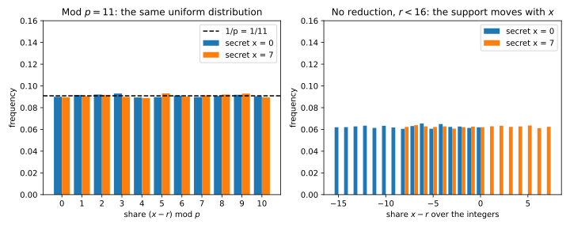

# Cryptography basics

## Why this matters

Some computations must hide a key, a message or a value split among several holders. **What does it mean that an observer with limited computing power learns nothing it was not supposed to learn?**

The one idea is that **security is a game.** A challenger picks one of two worlds by a fair coin and shows the result to an adversary, who guesses the world. The adversary's **advantage** is how much better than the coin it does, and a scheme is secure when every efficient adversary's advantage is tiny. @tbl-crypto-overview maps the results to the sections.

| Question | Result | Section |
| --- | --- | --- |
| How do I measure "learns nothing"? | Advantage; total variation caps it; bits of security | @sec-crypto-advantage |
| How do proofs chain steps together? | Advantages add along a chain of hybrids | @sec-crypto-hybrid |
| How long must random identifiers be, and how much data may one key protect? | Birthday bound: collisions after about $\sqrt N$ draws | @sec-crypto-birthday |
| What does encryption promise? | Pseudorandomness; encryption must be randomized | @sec-crypto-encryption |
| How do I show a participant learns only what it may? | Simulation; additive secret sharing | @sec-crypto-simulation |
| What do lattice schemes cost? | Learning with errors: noise is a budget | @sec-crypto-lwe |

: The questions of this chapter, and where each is answered. {#tbl-crypto-overview}

## Advantage and security levels {#sec-crypto-advantage}

**Idea.** A **distinguisher** sees one sample and outputs a bit. Its skill at telling $X$ from $Y$ is how much more often it says 1 on one than on the other.

**Result.** The advantage is
$$\mathrm{Adv}_A(X, Y) = \big|\Pr[A(X) = 1] - \Pr[A(Y) = 1]\big|,$$
and in the coin game the adversary wins with probability $\frac12 + \frac12\mathrm{Adv}$. No distinguisher, however much time it has, beats the **total variation (TV) distance**, the probability $X$ puts on outcomes in excess of $Y$. TV distance 0 is **perfect** security, a small one **statistical** security; **computational** security allows a large TV distance that no efficient adversary exploits. "Tiny" means **negligible** (eventually below one over every polynomial in the key length) or, concretely, **$\kappa$-bit security**: time $t$ buys advantage at most about $t/2^\kappa$, the success of brute force.

**Example.** Saying 1 on heads tells a fair coin from one with heads probability 0.6 with advantage $0.6 - 0.5 = 0.1$, winning with probability 0.55. A classifier of real against generated images is a distinguisher with advantage equal to its true positive rate minus its false positive rate. A year at $10^{18}$ keys per second tries $2^{84.7}$ keys and finds a 128-bit key with probability $9.3\times10^{-14}$.

**Pitfalls.** "Negligible" says nothing at a fixed key length: $2^{-\sqrt\lambda}$ is negligible but still $3.9\times10^{-4}$ at $\lambda = 128$. Ask for concrete numbers. A proof that loses a factor $2^{20}$ turns a 128-bit primitive into a scheme with about 108 bits.

## Hybrid arguments {#sec-crypto-hybrid}

**Idea.** Walk from one world to the other through intermediate **hybrids**, changing one thing at a time; the advantages of the steps add up.

**Result.** $\mathrm{Adv}(H_0, H_m) \le \sum_{i=1}^m\mathrm{Adv}(H_{i-1}, H_i)$. So $m$ independent samples give at most $m$ times the one-sample advantage.

**Example.** For $m$ flips of a coin with heads probability 0.51 against fair flips (@tbl-crypto-coin-hybrid), the hybrid bound $m\delta$, with $\delta = 0.01$, is tight for one flip and loose afterwards: the best advantage grows like $\delta\sqrt m$.

| Flips $m$ | Majority vote (simulation) | Best possible (TV) | Hybrid bound $\min(1, m\delta)$ |
| --- | --- | --- | --- |
| 1 | 0.008 | 0.010 | 0.010 |
| 100 | 0.082 | 0.080 | 1.000 |
| 10,000 | 0.481 | 0.683 | 1.000 |

: Advantage in telling $m$ flips of a $0.51$-coin from $m$ fair flips; the majority vote is simulated over 200,000 games per entry, so at $m = 100$ it exceeds the best possible by sampling noise. {#tbl-crypto-coin-hybrid}

**Pitfalls.** Hybrid bounds are safe but can overstate the advantage by a factor up to $\sqrt m$. A reasonable-looking test can also be far from the best one: majority vote stalls near 0.48.

## The birthday bound {#sec-crypto-birthday}

**Idea.** Among $q$ random values there are about $q^2/2$ pairs, each colliding with probability $1/N$, so collisions become likely after about $\sqrt N$ draws, not $N$.

**Result.** For $q$ independent uniform draws from $N$ values,
$$1 - e^{-q(q-1)/(2N)} \le \Pr[\text{collision}] \le \frac{q(q-1)}{2N},$$
and the 50% point is $q \approx 1.18\sqrt N$. A block cipher on $n$-bit blocks differs visibly from a random function only through collisions, which costs at most $q^2/2^{n+1}$ after $q$ blocks.

**Example.** @tbl-crypto-birthday gives three cases, computed in @sec-crypto-code. For 128-bit blocks, $2^{32}$ blocks (64 GiB) cost at most $2^{-65}$; at $2^{64}$ blocks the bound reaches $\frac12$.

| Case | $q$ | $N$ | Exact | Union bound | $1 - e^{-q(q-1)/(2N)}$ |
| --- | --- | --- | --- | --- | --- |
| Shared birthday in a class | 23 | 365 | 0.507 | 0.693 | 0.500 |
| Hashing trick: 1,000 features into $2^{20}$ buckets | 1,000 | $2^{20}$ | 0.379 | 0.476 | 0.379 |
| Random 32-bit identifiers for 100,000 records | 100,000 | $2^{32}$ | 0.688 | 1.164 | 0.688 |

: Collision probability, exact against the two bounds. {#tbl-crypto-birthday}

**Pitfalls.** Anything random of $\kappa$ bits starts colliding after about $2^{\kappa/2}$ draws: random 32-bit identifiers for 100,000 records are more likely than not to clash. A $q$-query bound is a data limit, so change keys long before it.

## Pseudorandomness and encryption {#sec-crypto-encryption}

**Idea.** A short random key can stand in for a lot of randomness if no efficient adversary can tell the difference.

**Result.** A **pseudorandom generator (PRG)** stretches a short random seed into a longer string that no efficient distinguisher tells from uniform. A **pseudorandom function (PRF)** $F_k$ is a keyed function that no efficient adversary, choosing its own queries, tells from a truly random function. The **one-time pad** $m \oplus K$, with a uniform key as long as the message, has **perfect secrecy**: the ciphertext is uniform whatever the message. Practical schemes aim for indistinguishability under **chosen-plaintext attack (CPA)**: an adversary who can get any message encrypted picks two, receives the encryption of one, and must not tell which. The scheme $(r, m \oplus F_k(r))$, with a fresh random $r$ from a set $\mathcal R$, achieves this up to twice the PRF advantage plus $q/\lvert\mathcal R\rvert$ after $q$ encryptions.

**Example.** A deterministic scheme loses the game with advantage 1.000: the adversary asks for the encryption of $m_0$ and compares. With 8-bit nonces and 16 encryptions, the attack that waits for a repeated $r$ wins with advantage 0.0607, against the bound 0.0625.

**Pitfalls.** Encryption must be randomized: deterministic encryption of a column of labels reveals how often each label occurs. Never reuse a one-time pad, since $(m_1 \oplus K) \oplus (m_2 \oplus K) = m_1 \oplus m_2$, and make nonces long enough never to repeat.

## Simulation and secret sharing {#sec-crypto-simulation}

**Idea.** Many procedures must reveal something to a participant, such as the final result, and nothing else. If the participant could fake everything it sees from what it may learn, what it sees contains nothing more.

**Result.** A procedure reveals nothing beyond $L(x)$ to a participant if an efficient **simulator** $S$, given only $L(x)$, produces output with the same distribution as the participant's real **view** (perfectly, statistically or computationally). **Additive secret sharing** splits a secret $x$ in $\mathbb Z_p$, the integers mod $p$, among $h$ holders: $h - 1$ uniform random shares, and a last share equal to $x$ minus their sum mod $p$. All shares sum to $x$, shares of two secrets add to shares of their sum, and any $h - 1$ shares are independent and uniform whatever $x$ is. Their simulator outputs uniform numbers: perfect security.

**Example.** Reduced mod $p = 11$, the shares of $x = 0$ and $x = 7$ are both uniform. Over the integers, with $r$ uniform below 16 and the share $x - r$ unreduced, the share's range moves with the secret, and the TV distance between the two secrets is $7/16 = 0.4375$ (@fig-crypto-shares).

{#fig-crypto-shares}

**Pitfalls.** Reduce mod $p$: integer shares leak, at a TV distance of $|x - x'|/R$ for a mask range $R$. All $h$ shares together reveal $x$. And simulation only proves that nothing beyond $L(x)$ leaks; check that $L(x)$ itself is acceptable to reveal.

## Learning with errors {#sec-crypto-lwe}

**Idea.** **Learning with errors (LWE)** hides a secret vector $s$ behind linear equations with slightly wrong right-hand sides. Without the errors, linear algebra recovers $s$; with them, the problem is as hard as worst-case lattice problems, and no efficient quantum attack is known. Encryption built on it can add ciphertexts, at the price of growing noise.

**Result.** An LWE sample is $(a, \langle a, s\rangle + e \bmod p)$ with $a$ uniform and a small error $e$. **Regev encryption** of a bit $m$ adds $m\cdot\frac p2$ to a sample, and decryption is correct when $|e| < p/4$. Adding $k$ ciphertexts gives an encryption of the XOR of their bits with the sum of their errors, so with errors bounded by $B$ it is guaranteed to decrypt when
$$k < \frac{p}{4B}.$$
Independent errors with standard deviation $\sigma$ partly cancel, so the summed error typically grows like $\sigma\sqrt k$, not $kB$.

**Example.** Gaussian elimination recovers all 16 coordinates of an LWE secret without noise and 0 of 16 with errors in $\{-1, 0, 1\}$. With $p = 4096$ and $B = 32$, the guarantee covers $k < 32$ additions. @tbl-crypto-regev shows the real failure rate.

| Ciphertexts added $k$ | Empirical failure rate | Normal approximation |
| --- | --- | --- |
| 31 | 0.0000 | 0.0000 |
| 256 | 0.0007 | 0.0006 |
| 1,024 | 0.0868 | 0.0881 |
| 4,096 | 0.3814 | 0.3833 |

: Decryption failure rate of a sum of $k$ Regev ciphertexts, $p = 4096$, errors uniform on $\{-32, \dots, 32\}$. {#tbl-crypto-regev}

**Pitfalls.** Noise is a budget: every operation spends some, and once it nears $p/4$ decryption becomes a coin flip. A larger modulus relative to the noise buys more operations. The worst-case budget is very conservative, but going beyond it trades a guarantee for a failure probability.

## Code {#sec-crypto-code}

The birthday bound needs one product:

```python
from math import exp, prod


def collision_probability(q: int, n: int) -> float:
    """Exact probability that q uniform draws from n values contain a repeat."""
    return 1 - prod(1 - i / n for i in range(q))


def union_bound(q: int, n: int) -> float:
    return q * (q - 1) / (2 * n)


def lower_bound(q: int, n: int) -> float:
    return 1 - exp(-union_bound(q, n))


print(f"{collision_probability(23, 365):.3f} {union_bound(23, 365):.3f}")  # 0.507 0.693
print(f"{collision_probability(1_000, 2**20):.3f} {lower_bound(1_000, 2**20):.3f}")  # 0.379 0.379
print(f"{collision_probability(100_000, 2**32):.3f} {union_bound(100_000, 2**32):.3f}")  # 0.688 1.164
```

The lines are the three rows of @tbl-crypto-birthday.

The full edition's script, [crypto_basics.py](../../code/part01-prerequisites/crypto_basics.py), computes every number in this chapter. Its schemes are toys: never use them to protect anything.

```bash
uv run python code/part01-prerequisites/crypto_basics.py
```

## Cheat sheet

| Result | Statement |
| --- | --- |
| Advantage | $\lvert\Pr[A(X) = 1] - \Pr[A(Y) = 1]\rvert = 2\lvert\Pr[\text{win}] - \frac12\rvert \le \mathrm{TV}(X, Y)$ |
| $\kappa$-bit security | Time $t$ buys advantage at most about $t/2^\kappa$ |
| Hybrids | Advantages add along a chain; $m$ samples cost at most a factor $m$ |
| Birthday bound | $\Pr[\text{collision}] \le q(q-1)/(2N)$; 50% at $q \approx 1.18\sqrt N$ |
| Encryption | One-time pad: perfect, never reuse. CPA security needs randomness: $(r, m \oplus F_k(r))$ |
| Simulation | Secure if a simulator fakes the view from the allowed leakage |
| Additive sharing mod $p$ | Any $h - 1$ shares uniform: perfect security |
| Regev sums | Correct while $kB < p/4$; typical noise grows like $\sigma\sqrt k$ |

: The results of this chapter. {#tbl-crypto-cheat}

**Rules of thumb**

- $\kappa$ bits of security means an attacker with time $t$ succeeds with probability about $t/2^\kappa$.
- Random values of $\kappa$ bits collide after about $2^{\kappa/2}$ draws: size identifiers, nonces and key lifetimes accordingly.
- Encryption that hides equality must be randomized.
- In LWE schemes, noise is a budget that each operation spends.

## Further reading

- Katz & Lindell, *Introduction to Modern Cryptography* (3rd ed., 2020), ch. 2–3: perfect secrecy, pseudorandomness and CPA security.
- Boneh & Shoup, *A Graduate Course in Applied Cryptography*: the same in the concrete-security style, with the birthday and switching bounds.
- Lindell, "How to Simulate It — A Tutorial on the Simulation Proof Technique" (2017): the simulation paradigm step by step.
- Peikert, "A Decade of Lattice Cryptography" (2016): LWE, its variants and their parameters.

**Derivations.** Every result in this chapter is derived step by step in [the full edition's chapter](../../book-full/part01-prerequisites/08-crypto-basics.md).
