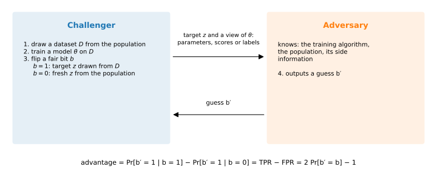

# Threat models and privacy games

## Why this matters

A hospital trains a model on patient records and offers it to doctors through a web service. The question whether the model is private has no answer until you say **against whom**. One attacker can only read predicted labels, while another holds the weights. One knows the other patients in the training set, while another knows only the population, and one may slip crafted records into the training data. They also want different things, from learning that one person was a patient to rebuilding the whole table. A **threat model** pins all of this down. Without one, "the model leaks" and "the model is safe" are both claims nobody can test, and two attack results cannot be compared.

Once the threat model is fixed, an attack can be written down as a **game**, as cryptographers do for encryption. One party, the challenger, runs the training pipeline with a hidden **secret**, such as whether one patient's record was used. It hands the adversary what the threat model allows it to see, and the adversary guesses the secret. An attack is good only if it guesses better than someone who never saw the model.

That is the one idea of this chapter: an attack is a guess about a hidden secret. When the secret is a single yes-or-no answer, such as whether this patient was in the training set, the game is a hypothesis test. Everything in [Hypothesis testing](../part01-prerequisites/04-hypothesis-testing.md) then carries over, including a limit on how well any attack can guess. The chapter also shows that what matters is how many people an attack identifies while almost never accusing the wrong person. And tests on typical records can badly understate the risk to the most exposed person.

## Scoring an attack {#sec-threat-scoring}

The simplest games ask the adversary to guess one hidden bit. Before anything else happens, the challenger picks one of two worlds at random, and the bit records which. It is 1 in the world where the target's record is used for training, which makes the target a **member**, and 0 in the world where it is not. Write $b$ for this bit. The adversary sees what the threat model allows, which this chapter calls its **view**, and then guesses whether $b$ is 1 or 0. The view includes everything the adversary knew beforehand.

Two numbers describe how an attack behaves. Its **true positive rate (TPR)** is the fraction of members that it flags as members. Its **false positive rate (FPR)** is the fraction of non-members that it wrongly flags. Each rate is measured inside one world, so neither depends on how often the challenger picks that world.

How often the attack wins does depend on that, though. Write $\pi_1$ for the probability that the challenger picks the member world, and $\pi_0 = 1 - \pi_1$ for the other. The attack wins a member game when it says "member", and a non-member game when it says "not a member". So its chance of winning is the weighted sum of its success in the two worlds:
$$\Pr[\text{win}] = \pi_1\,\mathrm{TPR} + \pi_0\,(1 - \mathrm{FPR}).$$ {#eq-threat-win}

@tbl-threat-win-count makes this concrete for an attack whose TPR is 0.6 and whose FPR is 0.2.

| Prior $\pi_1$ | Games with $b = 1$ | Wins there | Games with $b = 0$ | Wins there | Wins in total |
| --- | --- | --- | --- | --- | --- |
| $\frac12$ | 500 | $0.6 \times 500 = 300$ | 500 | $0.8 \times 500 = 400$ | 700 |
| 0.1 | 100 | $0.6 \times 100 = 60$ | 900 | $0.8 \times 900 = 720$ | 780 |

: Expected wins in 1,000 games of an attack with TPR 0.6 and FPR 0.2. {#tbl-threat-win-count}

The attack wins more often in the second row, but only because most games are played in the world where saying "not a member" is easy. Always saying "not a member", with no attack at all, would win 900 of those games. So a win rate alone cannot tell a good attack from simply knowing which world is more common. Every game in this chapter is therefore scored against a **baseline**, the best score of a guess that never looks at the view.

Most evaluations use a fair bit, so that half the targets are members. An adversary who ignores its view then wins exactly half the time, whatever it answers. Putting one half for both priors in @eq-threat-win gives $\frac12\mathrm{TPR} + \frac12(1 - \mathrm{FPR})$, which is one half plus half the difference between the two rates. That difference is the attack's **advantage**:
$$\mathrm{Adv} = \mathrm{TPR} - \mathrm{FPR}.$$ {#eq-threat-adv}
In a fair game the attack therefore wins with probability $\frac12 + \frac12\mathrm{Adv}$.

The advantage measures how much more often the attack says "member" when the target is a member than when it is not. An attack that ignores its view, such as "always say member", says "member" equally often in both worlds, so its advantage is 0. A perfect attack has advantage 1, and the attack of @tbl-threat-win-count has advantage $0.6 - 0.2 = 0.4$. Because both rates are measured inside one world, the advantage does not change with the prior. That solves the problem of the second row, where an attack that ignores its view wins 0.9 of the games but still has advantage 0.

How large can the advantage be? Write $P$ for the distribution of the view when the target is not a member, and $Q$ for its distribution when it is. For a particular view $x$, write $p(x)$ for its probability in the non-member world. Its probability in the member world is $q(x)$, and for a continuous view both are densities. An attack that says "member" on a set of views gains $q(x)$ in TPR and $p(x)$ in FPR from each view it includes. Each view therefore adds $q(x) - p(x)$ to the advantage, and the best attack includes exactly the views where this is positive, those more likely in the member world. Its advantage is the sum of those positive differences, which is the **total variation (TV)** distance between $P$ and $Q$ ([Divergences](../part01-prerequisites/03-divergences.md)). No attack in a two-world game can have a larger advantage, whatever it does.

## Threat models {#sec-threat-models}

An attack's reported number means nothing until you know what the attacker was assumed to see, know and do. A threat model fixes these assumptions by answering five questions.

1. **Goal: what is the secret?** A membership attack asks whether a record was in the training data, and an attribute attack seeks a sensitive field of a known record. A reconstruction attack seeks the records themselves, and a property attack a statistic of the whole dataset.
2. **Access: what does the adversary observe?** The weakest is **label-only** access, the model's decisions on inputs the adversary chooses, such as a predicted class. Next is **black-box** access to the model's scores, such as confidences or losses. Then comes **white-box** access to the parameters. The strongest is the **transcript**, everything training exposed along the way, such as per-step gradients.
3. **Behaviour: does it follow the rules?** An **honest-but-curious** adversary follows the protocol and only analyses what it legitimately sees. A **malicious** adversary may deviate, for example by choosing its queries adaptively or by inserting crafted records into the training data, which is called **poisoning**.
4. **Trust: who sees the raw data?** In the **central** model a trusted curator, a party that holds everyone's raw data, runs the training, and the adversary sees only what is released. In the **local** model nobody is trusted, so each person's data are protected on their own device, for example by adding noise, before the collector sees them. Distributed settings sit in between.
5. **Side information: what does it know already?** It may know the population, a public dataset, some or all of the other records, or the target's non-sensitive fields.

Of these questions, access has the most natural order, and the reason is a general fact about views. Suppose the adversary throws information away, or adds noise of its own. Then it cannot do better, because whoever holds the original view could have done the same processing and run the same attack. For instance, if a service returns a confidence score and you look only at whether it exceeds 0.5, you can do no better than someone who sees the score itself. This is the data processing inequality of [Divergences](../part01-prerequisites/03-divergences.md), seen from the attacker's side.

The fact has one condition. Any randomness the adversary adds must be independent of the hidden bit. Randomness that depended on the secret would carry information about it, and then the processed view could reveal more than the original.

Each level of access lets the adversary compute the level below it. A label is a function of the scores when the service computes it from them, and a score is a function of the weights and the input. The final weights are the last entry of the transcript. So every attack with less access can be copied, with the same TPR and FPR, by an adversary with more access. For the same model and the same side information, the best advantage can therefore only grow along the chain
$$\text{labels} \;\le\; \text{scores} \;\le\; \text{weights} \;\le\; \text{transcript}.$$ {#eq-threat-access-chain}

Since the copies keep both rates, the same chain holds for the best TPR at every fixed FPR. Side information is ordered in the same way, because an adversary can always forget what it knows. Behaviour is ordered too, since an honest adversary is a malicious one that chooses not to deviate. And an output tweak, such as noising the returned scores, is processing the adversary could have done itself, so it can only lower the best advantage, perhaps not by much.

@tbl-threat-deployments places four common deployments on all the axes. Its last row is federated learning, where clients train on their own data and a server that collects their updates holds the transcript, the setting of [Gradient inversion](06-gradient-inversion.md). The same trained model can sit in several rows at once, and its risk is set by the most exposed of those rows.

| Deployment | Access | Behaviour | Trust | Typical side information |
| --- | --- | --- | --- | --- |
| Prediction service that returns the top class | label-only | honest-but-curious user, adaptive queries | central | public data from the same population |
| Service that returns confidences or log-probabilities | black-box | honest-but-curious user, adaptive queries | central | public data; the target's record |
| Model weights published for download | white-box | anyone; can run any computation | central | public data; possibly some training records |
| Federated training with a coordinating server | transcript (per-client updates) | server may be malicious | distributed | the global model at every round |

: Four deployments read as threat models. {#tbl-threat-deployments}

Trust works differently from the other axes, because it decides who the adversary is rather than how strong it is. In the central model the threat is whoever sees the released model, and the curator is outside the threat model. In the local model the curator is inside it, so protection has to be applied before the data leave the user. [Local, shuffle and distributed trust models](../part03-dp-foundations/08-trust-models.md) in Part 3 compares the two.

Side information is the hardest axis to bound, because the defender usually does not know what the adversary knows. That is why a privacy guarantee, such as the one Part 3 defines, should survive the strongest assumption, an adversary who knows every record except the target's (@sec-threat-average).

The chain compares the *best* attack at each level, not the attacks people actually run, and the gap inside one access level can be larger than the gap between levels.

A security team fits the simplest anomaly detector there is, whose parameters $\theta$ are the mean of the training records. Write $n = 100$ for the number of training records. Each record is drawn from a standard normal distribution with $d = 50$ features. A point $x$ gets the anomaly score $\|x - \theta\|^2$, its squared distance from the mean. The detector flags the point when the score exceeds a threshold, written $\tau$ and set to $d$, roughly the score a typical point gets. The adversary holds a target record $z$ and plays the membership game, in which $z$ is either a training record or a fresh draw.

Training on a record pulls the mean a little towards it, so a member sits a little closer to $\theta$ than it otherwise would. With the weights, the best attack compares how likely this exact $\theta$ is in the two worlds. That ratio is the **likelihood ratio**, and by the Neyman–Pearson lemma of [Hypothesis testing](../part01-prerequisites/04-hypothesis-testing.md) no attack catches more members at a given FPR than one that thresholds it. Here the likelihood ratio depends on the weights only through the quantity $2\langle z, \theta\rangle - \|\theta\|^2$, which grows when training has pulled the mean towards $z$.

A black-box adversary sees only the score of $z$. A simple attack says "member" when that score is low, and the table below calls it the raw-loss attack. It is confused by targets that are simply far from the mean, because they have a high score whether or not they were used. So the raw score mixes how unusual a record is with whether it was a member.

A better black-box attack uses the **calibrated score** $\|z\|^2 - \|z - \theta\|^2$. Expanding the square shows that this is exactly $2\langle z, \theta\rangle - \|\theta\|^2$, the quantity the white-box likelihood ratio needs. The likelihood ratio also contains a term that depends only on the length of $z$. Leaving it out moves the attack's cut-off a little from one target to the next, so the calibrated attack is almost, but not exactly, the white-box one. A label-only adversary sees only the flag, and says "member" when $z$ is not flagged.

| View | Attack | Best advantage $\mathrm{TPR} - \mathrm{FPR}$ |
| --- | --- | --- |
| White-box | likelihood ratio of $\theta$ | 0.2789 |
| Black-box | calibrated score $\|z\|^2 - \|z - \theta\|^2$ | 0.2789 |
| Black-box | raw loss $-\|z - \theta\|^2$ | 0.0407 |
| Label-only | not flagged, $\tau = d$ | 0.0400 |

: Membership advantage against the centroid detector with $n = 100$ and $d = 50$, from 100,000 games per world. {#tbl-threat-access}

@tbl-threat-access respects the chain, but the large gap is *inside* the black-box level, between two attacks on the same view. Calibrating each target against its own typicality multiplies the advantage by about seven, so "the attack we tried failed" proves little. That is the idea behind the per-example attacks of [Membership inference](02-membership-inference.md). Sablayrolles et al. (2019) prove a general version, on condition that training draws the parameters with a probability that decreases exponentially in the training loss. Under that condition, the best membership attack depends on the parameters only through the target's loss, so white-box access adds little.

The leak also grows with the number of features, because a single record then moves the model in more directions at once. With a single feature the best advantage is 0.0326, but with 500 features it climbs to 0.7407 (@fig-threat-access).

{#fig-threat-access}

## Privacy games {#sec-threat-games}

The same name, such as "membership inference", is used for attacks with different assumptions and scoring. Salem et al. (2023) write each attack in the literature as a game with the same four steps. The challenger draws a secret, and a dataset whose distribution may depend on it. It trains a model and gives the adversary the view the threat model allows. The adversary guesses and earns a **gain**, usually 1 for a correct guess and 0 otherwise. Finally, the gain is compared with the baseline, the best gain of a guess made from the side information alone. @fig-threat-game draws the membership game. @tbl-threat-games lists the others, including the distinguishing game, in which the adversary picks the two datasets itself.

| Game | Secret | Data in the two worlds | Gain | Baseline |
| --- | --- | --- | --- | --- |
| Membership | bit $b$ | $b = 1$: target drawn from the dataset; $b = 0$: target fresh from the population | 1 if the guess is right | $\frac12$ |
| Attribute | sensitive field of a known member | target in the dataset; adversary knows its other fields | 1 if the guess is right | best guess from the other fields and the population; or the same attack on non-members |
| Reconstruction | the records of the dataset (or one column) | dataset drawn from the population | fraction of entries recovered | guessing from the population |
| Distinguishing | bit $b$ | adversary chooses two datasets differing in one record; challenger trains on one | 1 if the guess is right | $\frac12$ |
| Property | bit $b$ | dataset drawn from one of two populations that differ in a statistic | 1 if the guess is right | $\frac12$ |

: The privacy games of this part. The first three are average-case, because the data come from the population. The distinguishing game is worst-case, because the adversary picks the data. {#tbl-threat-games}

{#fig-threat-game}

The baseline is part of the game, not an afterthought. A model that lets an attacker guess a rare diagnosis "with 90% accuracy" reveals nothing if 90% of people do not have that diagnosis. So what does the best attack look like when the secret bit is not equally likely to be 0 or 1?

The formula below assumes that 1 is the rarer value, so that $\pi_1$ is at most one half. Only then is guessing 0 the best blind guess, and if 1 is the more likely value you swap the labels. This default already wins with probability $\pi_0$. Saying 1 on a view instead wins games in proportion to $\pi_1 q(x)$ and loses them in proportion to $\pi_0 p(x)$. So the view should overturn the default only where it is strong evidence for 1. Write $\gamma = \pi_0/\pi_1$ for the prior odds against the bit being 1. The view should then be more than $\gamma$ times as likely in the world where the bit is 1. With $\pi_1 = 0.1$, that means 9 times as likely.

On each such view, the net gain $\pi_1 q(x) - \pi_0 p(x)$ equals $\pi_1$ times the excess $q(x) - \gamma\,p(x)$. Adding up these excesses over the views where they are positive gives the **hockey-stick divergence** of [Divergences](../part01-prerequisites/03-divergences.md), written $E_\gamma(Q\|P)$ with the rarer world first, as on that page. So the best attack wins with probability
$$\max_{\text{attacks}}\Pr[\text{win}] = \pi_0 + \pi_1\,E_\gamma(Q\|P), \qquad \gamma = \frac{\pi_0}{\pi_1}.$$ {#eq-threat-bayes}
The first term is the baseline of always guessing 0, and the second is everything the view adds. A randomized attack does no better, because it only mixes the choices of flagging a view or not. With a fair bit, the factor $\gamma$ is 1, the hockey-stick divergence is the total variation distance, and the formula gives back the fair-game ceiling of @sec-threat-scoring.

Attribute inference needs particular care, because it has two possible baselines that answer different questions. Comparing with a guess from the population asks whether the model helps at all. Comparing members with non-members asks whether it helps *because this person was in the training data*, and only that is a breach of the person's privacy. An attack that is right 75% of the time on members, and just as often on non-members, infers the attribute from the population, not from the person's participation. [Attribute inference and model inversion](03-attribute-inference.md) develops this.

The games also differ in where the data come from. Drawing the data from the population gives an average over datasets and targets, while letting the adversary choose them gives a worst case (@sec-threat-average).

One released number can be attacked in all three of the first games. A data team publishes how many people in a dataset have a sensitive condition, with Gaussian noise of standard deviation 1 added. The adversary knows every record except the target's, so it knows the rest of the count.

In the membership game, the target has the condition. Without the target, the released count is a bell curve centred on the known rest. With it, the curve is the same but shifted right by one. The best attack says "member" on counts more likely in the member world, those above the crossing point half a unit above the known rest. It is right whenever the noise does not push the count more than half a unit towards the other world, which happens with probability 0.6915.

In the attribute game with a fair prior, the target is known to be in the dataset, and its bit is the secret. The view has the same two distributions, so the best guess is again right with probability 0.6915. Now make the condition rare, with $\pi_1 = 0.1$, so that always guessing "no" already wins with probability 0.9. The hockey-stick divergence at $\gamma = 9$ is only 0.0134, and @eq-threat-bayes weights it by the prior. The best accuracy is therefore $0.9 + 0.1 \times 0.0134 = 0.9013$, about a tenth of a percentage point above the baseline. One record shifts the count by just one standard deviation of noise, which rarely yields evidence strong enough to overturn 9-to-1 odds.

In the reconstruction game, release instead the exact count of $m$ independent bits, each 0 or 1 with equal chance. Given the count, every arrangement of that many ones is equally likely, so each bit is 1 with probability equal to the count divided by $m$. The best guess for every bit is therefore the majority value, which beats a coin flip only by as much as the count strays from half of $m$, and that margin shrinks like $1/\sqrt m$. With 10 bits, the best reconstruction recovers a fraction 0.6230 of them. With 100 bits the fraction falls to 0.5398. With 1,000 bits it is only 0.5126, barely better than a coin flip. Many aggregates are a different matter. [Reconstruction attacks](09-reconstruction.md) shows how a few times as many noisy subset counts as there are bits give away almost every bit.

## Advantage, total variation and the trade-off curve {#sec-threat-advantage}

A two-world game is a test of "not a member" against "member", so everything [Hypothesis testing](../part01-prerequisites/04-hypothesis-testing.md) says about tests becomes a statement about attacks. The first, the total-variation ceiling on the advantage, appeared in @sec-threat-scoring.

The second ceiling goes further. It bounds the attack's TPR at *every* FPR, not just at the one point where the advantage is largest. It comes from the **trade-off function** of the two view distributions $P$ and $Q$, written $T(P, Q)$. For each false positive rate $\alpha$, the value $T(P, Q)(\alpha)$ is the smallest fraction of members that any attack with that FPR must miss. An attack can catch at most the rest. So for every attack in a two-world game,
$$\mathrm{Adv} \le \mathrm{TV}(P, Q), \qquad \mathrm{TPR} \le 1 - T(P, Q)(\mathrm{FPR}).$$ {#eq-threat-tv}
Both ceilings are reached by likelihood-ratio attacks. Such an attack flags views in decreasing order of the likelihood ratio until the FPR reaches its budget, so each false positive it spends buys the most members.

The plot of an attack's TPR against its FPR, as its threshold varies, is its **receiver operating characteristic (ROC)** curve. The advantage is the height of that curve above the diagonal. The total variation distance is the largest such height, and it says nothing about what happens where false positives are rare. Yet that end of the curve is where privacy breaks. An attack that flags 1% of members with no false alarms has an advantage of only about 0.01, but it identifies those members with certainty. An attack that flags 55% of members and 45% of non-members has advantage 0.1. But almost as many of the people it flags are non-members, so it identifies nobody with confidence.

A person who is flagged cares about a third quantity, the chance that the verdict "member" is true. A fraction $\pi_1$ of targets are members, and the attack flags a fraction TPR of them. The other targets, a fraction $\pi_0$, are not members, and the attack flags a fraction FPR of those. The **precision** is therefore the members' share of everyone flagged:
$$\Pr[\text{member} \mid \text{flagged}] = \frac{\pi_1\,\mathrm{TPR}}{\pi_1\,\mathrm{TPR} + \pi_0\,\mathrm{FPR}}.$$ {#eq-threat-precision}
When members are rare, non-members far outnumber them, so even a small fraction of non-members flagged swamps the true positives. If only one target in a hundred is a member, even a good attack produces mostly false alarms (Jayaraman et al., 2021). Only a small FPR keeps the precision high. Carlini et al. (2022) argue from this that membership attacks should be reported by their TPR at a low FPR, such as $10^{-3}$, on ROC curves with log axes. The rest of this part does so.

The two ceilings depend only on $P$ and $Q$, so they bound every attack, including attacks nobody has invented yet. That is what makes them the right target for a defence. A **mechanism**, any procedure that turns data into a release, defeats every attack at once if its trade-off curve stays close to the diagonal for every target.

Take the noisy count again, with the other 100 records known. Say 50 of them have the condition, so the count is centred on 50 without the target and on 51 with it. The best attack says "member" when the count is above 50.5, where the two curves cross, and its advantage is the total variation distance, 0.3829.

Now hold the FPR at $10^{-3}$ instead. The attack still flags large counts, but it has to raise its threshold until only one non-member in a thousand passes it, which happens at 53.09. A member's count, centred one higher, passes that threshold with probability 0.0183. That is the TPR, and by the Neyman–Pearson argument above it is the best possible at this FPR. The attack now catches fewer than 2% of members. But when it fires at a fair prior, it is right with precision 0.948. If only one target in a hundred is a member, the precision drops to 0.156, so state the prior whenever you report a precision.

The black curve in @fig-threat-tradeoff is this ROC curve on log axes, and the green one is the next section's adversary, who does not know the other records.

{#fig-threat-tradeoff}

## Average case and worst case {#sec-threat-average}

A membership game can be scored in two ways. In the **average case**, the data and the target come from the population, which is all the adversary knows, so the advantage is an average over that randomness. In the **worst case**, the adversary knows, or even picks, the rest of the data and the target, so the advantage is the largest one over those choices. Evaluations of real models usually measure the first, but privacy guarantees have to control the second.

The two differ because not knowing something works like extra noise. Often the adversary's view depends on something it does not know, such as the other records in the dataset. Then it sees an average of several possible situations, and averaging two distributions can only blur the difference between them. An adversary who knows the unknown removes that blur, and one who may choose it picks the situation where the two worlds differ most.

A tiny case shows how much the unknown can hide. Let there be one other record, whose bit is 0 or 1 with equal chance. The mechanism releases the exact sum of that bit and the target's bit $b$. An adversary who knows the other bit subtracts it and reads off $b$, so its best advantage is 1. An adversary who does not know it sees a sum of 0 or 1 when $b$ is 0. When $b$ is 1 it sees 1 or 2, each with equal chance. A sum of 1 could come from either world, so the best advantage drops to one half.

In general, the unknown part of the game is everything the average-case game draws at random and a worst-case adversary may fix, such as the other records and the target. The best advantages of the three adversaries are ordered:
$$\text{does not know it} \;\le\; \text{knows it} \;\le\; \text{chooses it}.$$ {#eq-threat-avg-worst}
The first step holds because averaging blurs, as above. The second holds because the adversary who knows the unknown gets, on average, the advantage of each situation, and an average is at most its largest term.

Both gaps can be as large as possible. Release the exact count of the target's bit plus $m$ other bits. An adversary who knows the other bits reads off the target's bit, so its advantage is 1. For one who does not, the advantage equals the largest single probability of the unknown count, which tends to 0 as $m$ grows. The random-record release below shows the second gap.

Now return to the noisy count, with noise of standard deviation 1 and a target who has the condition. This time the $m = 100$ other bits are fresh random draws that the adversary does not see. In the two worlds the count has the same shape, shifted by one. That shape is a binomial count plus normal noise, and for shapes of this kind, called log-concave, a larger count is always more evidence of membership. The best attack is still a threshold on the count, at 50.5. @tbl-threat-avg-worst compares the adversaries of @eq-threat-avg-worst, and adds the case where the target's own condition is random.

| Adversary | Best advantage (exact) | Simulated (200,000 games per world) |
| --- | --- | --- |
| Knows the other records ($\sigma = 1$) | 0.3829 | 0.3809 |
| Does not know them, target's bit 1 | 0.0779 | 0.0751 |
| Does not know them, target's bit random | 0.0390 | 0.0398 |
| Knows the other records, exact count ($\sigma = 0$) | 1 | — |
| Does not know them, exact count ($\sigma = 0$) | 0.0796 | — |

: Membership advantage on a count with 100 other records, for adversaries with different knowledge. Here $\sigma$ is the standard deviation of the added noise. {#tbl-threat-avg-worst}

Not knowing the crowd cuts the advantage by a factor of five. Each unknown bit has variance one quarter, so together they act as extra noise with variance $m/4$, which is 25 here, on top of the released noise. A normal approximation with that combined variance gives 0.0781, close to the exact 0.0779. When the target's own bit is random, the count does not depend on membership for the half of targets whose bit is 0. The advantage therefore halves, to 0.0390.

The gap shows up at a low FPR too. At an FPR of $10^{-3}$ the average-case attack has a TPR of 0.0019, while the adversary who knows the rest reaches 0.0183 (@fig-threat-tradeoff). @fig-threat-average-worst shows the average-case advantage falling as the crowd grows, while the worst case does not move.

{#fig-threat-average-worst}

Averaging over datasets hides the target in a crowd, but only from an adversary who does not know the crowd. A defence that relies on that blur fails against an adversary who knows the other records, or who planted them, as a malicious adversary can. If it controls every other record, it knows the rest of the count, and the advantage goes back to 0.3829.

Averaging over targets hides the worst-treated person in the same way. A mechanism publishes one record of a dataset, chosen at random among $n = 1000$ records that are all different, and the attack says "member" if the published record is the target. A member is published with probability $1/n$, so the TPR is 0.001. A non-member is never published, so the FPR is 0. By the average-case measure the advantage is therefore 0.001, and the mechanism looks almost perfectly safe. Yet every run exposes one person completely, because when the attack fires its precision is 1. For the person whose record is published, the attack is always right, so the worst-case advantage is 1.

Privacy is a promise to each person, so the number that matters is the advantage against the most exposed one, usually an outlier or a duplicated record ([Membership inference](02-membership-inference.md)). Average-case numbers still measure the risk a typical record faces, and they are what an audit can estimate from data. But they are lower bounds on the worst case, never upper bounds. An audit that reports an advantage of 0.01 on random examples shows only that the worst case is at least 0.01. Audits narrow the gap by playing the adversary who chooses the target. They plant **canaries**, records built to be as exposed as possible, and measure the attack on those ([Memorization and training-data extraction](05-memorization-extraction.md)).

This is where the book is heading. [The definition of differential privacy](../part03-dp-foundations/01-definition.md) in Part 3 is a guarantee for every pair of datasets that differ in one record. It therefore bounds the worst case of @eq-threat-avg-worst for every game in this part whose two worlds differ in one record. Games whose worlds differ in many records, such as the property games of [Property inference](04-property-inference.md), are bounded only through a weaker guarantee for groups, which degrades as the group grows.

## Code {#sec-threat-code}

When the attack's score is standard normal for non-members and shifted for members, the best TPR at any FPR takes a few lines. A shift of 1 is the noisy count with the other records known, whose curves cross at 0.5.

```python
from statistics import NormalDist

Z = NormalDist()


def tpr_at_fpr(fpr: float, shift: float) -> float:
    """Best TPR at a given FPR when the attack score is N(0, 1) for non-members, N(shift, 1) for members."""
    return 1 - Z.cdf(Z.inv_cdf(1 - fpr) - shift)


def precision(tpr: float, fpr: float, prior: float) -> float:
    """Fraction of 'member' verdicts that are right when a fraction `prior` of targets are members."""
    return prior * tpr / (prior * tpr + (1 - prior) * fpr)


advantage = 2 * Z.cdf(0.5) - 1  # best TPR - FPR for a shift of 1: the total variation distance
tpr = tpr_at_fpr(1e-3, 1.0)
print(f"{advantage:.4f}")  # 0.3829
print(f"{tpr:.4f}")  # 0.0183
print(f"{precision(tpr, 1e-3, 0.5):.3f}")  # 0.948
print(f"{precision(tpr, 1e-3, 0.01):.3f}")  # 0.156
```

The full edition's script, [threat_models.py](../../code/part02-attacks/threat_models.py), computes every number in this chapter and checks it by simulation.

```bash
uv run python code/part02-attacks/threat_models.py
```

## Cheat sheet

| Result | Statement | Notes |
| --- | --- | --- |
| Winning probability | $\pi_1\mathrm{TPR} + \pi_0(1 - \mathrm{FPR})$; fair prior: $\frac12 + \frac12\mathrm{Adv}$ | Compare with the baseline $\max(\pi_0, \pi_1)$ |
| Advantage | $\mathrm{Adv} = \mathrm{TPR} - \mathrm{FPR}$ | Independent of the prior; 0 for an attack that ignores its view |
| Processing | Throwing away or noising the view never helps | Added randomness must be independent of the secret |
| Access chain | labels $\le$ scores $\le$ weights $\le$ transcript, for the best attack | Same for more side information and for malicious behaviour |
| Best guess, rare bit | $\pi_0 + \pi_1E_\gamma(Q\|P)$ with $\gamma = \pi_0/\pi_1$, for $\pi_1 \le \frac12$ | Overturn the default only on views $\gamma$ times likelier under $Q$ |
| Ceilings | $\mathrm{Adv} \le \mathrm{TV}(P, Q)$; $\mathrm{TPR} \le 1 - T(P, Q)(\mathrm{FPR})$ | Reached by likelihood-ratio attacks; bound every attack |
| Precision | $\pi_1\mathrm{TPR}/(\pi_1\mathrm{TPR} + \pi_0\mathrm{FPR})$ | Falls fast when members are rare |
| Average and worst case | not knowing the others $\le$ knowing them $\le$ choosing them | An average-case number is a lower bound |
| Noisy count, shift 1, noise $\sigma$ | With $\Phi$ the standard normal distribution function. Rest known: $2\Phi(\frac1{2\sigma}) - 1$. $m$ unknown others: $\approx 2\Phi\big(1/(2\sqrt{m/4 + \sigma^2})\big) - 1$ | The unknown others add variance $m/4$ |

: The results of this chapter. {#tbl-threat-cheat}

**Rules of thumb**

- Before reading an attack's number, read its threat model and its game.
- Compare every attack with its baseline. Accuracy near the prior is no attack.
- Report the TPR at a low FPR, with the ROC curve on log axes, and state the prior with any precision.
- Treat an average-case number as a lower bound on the worst case. A defence has to hold for the worst record, the worst dataset and the best-informed adversary.
- A better attack on the same view can matter more than more access, so calibrate scores per target.

## Further reading

- Salem et al., "SoK: Let the Privacy Games Begin! A Unified Treatment of Data Inference Privacy in Machine Learning" (IEEE S&P 2023): every inference attack written as a game, with the relations between them. Read §§3–5.
- Carlini, Chien, Nasr, Song, Terzis & Tramèr, "Membership Inference Attacks From First Principles" (IEEE S&P 2022): why attacks should be reported by TPR at a low FPR on log-scaled ROC curves.
- Jayaraman, Wang, Knipmeyer, Gu & Evans, "Revisiting Membership Inference Under Realistic Assumptions" (PETS 2021): rare members, priors, precision and threshold choice.

**Derivations.** Every result in this chapter is derived step by step in [the full edition's chapter](../../book-full/part02-attacks/01-threat-models.md), except the result of Sablayrolles et al. on when white-box access adds little, which it cites.
