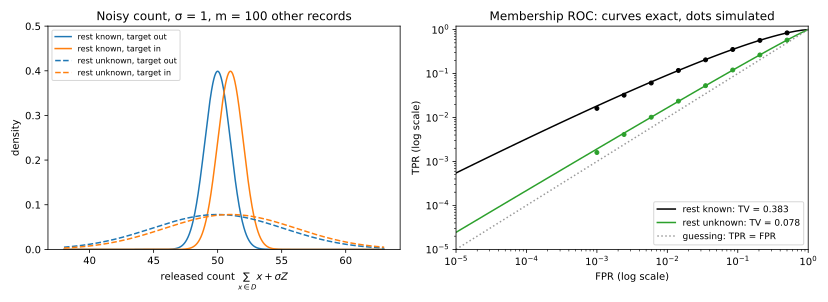

# Threat models and privacy games

## Why this matters

A hospital trains a model on patient records and offers it to doctors through a web service. Is the model private? The question has no answer until you say **against whom**. An attacker who reads only predicted labels sees far less than one who downloads the weights, and one who knows every other patient in the training set can isolate a single record far better than one who knows only the population. A **threat model** fixes these assumptions. Without one, "the model leaks" and "the model is safe" are both untestable, and two attack numbers cannot be compared.

Once the threat model is fixed, an attack becomes a **game**. A **challenger** runs the pipeline with a hidden **secret**, such as whether one patient's record was used, hands the **adversary** what the threat model lets it see, its **view**, and the adversary guesses the secret. The one idea of this chapter: an attack is worth only its margin over a guess made without the view. When the secret is one bit, the game is a hypothesis test: the best attack can be worked out and caps every real one, and what matters is how it does when it almost never accuses the wrong person.

## Threat models {#sec-threat-models}

A threat model answers five questions.

1. **Goal**: the secret. Membership of a record, a sensitive field of a known record (attribute), the records themselves (reconstruction), or a statistic of the whole dataset (property).
2. **Access**: from least to most, the model's decisions on chosen inputs (**label-only**), its scores such as confidences or losses (**black-box**), its parameters (**white-box**), or everything training exposed, such as per-step gradients (the **transcript**).
3. **Behaviour**: an **honest-but-curious** adversary only analyses what it legitimately sees; a **malicious** one may query adaptively, insert crafted records into the training data (**poisoning**) or tamper with the protocol.
4. **Trust**: a trusted curator holds the data (**central** model), or nobody is trusted (**local** model).
5. **Side information**: the population, a public dataset, some or all of the other records, the target's non-sensitive fields.

Access is the one axis with a natural order, because each level lets the adversary compute the level below: from the weights it can compute any score, from a score the label, and the final weights are the last entry of the transcript. Whatever an attack does with less access, an adversary with more access can do too, by first throwing the extra away. So for the best attack at each level,
$$\text{best advantage from labels} \le \text{from scores} \le \text{from weights} \le \text{from the transcript},$$
and likewise for the best true positive rate (TPR) at every false positive rate (FPR), defined in @sec-threat-games. More side information or permission to cheat never weakens the best adversary either, since it can ignore what it knows and choose to behave. The same reasoning tells you what output tweaks do: noising or rounding returned scores, or returning labels only, is processing the adversary could have done itself, so it can lower the best attack but never raise it.

A service returning the top class gives label-only access, one returning confidences black-box access, published weights white-box access, and a federated-training server sees the transcript; a model exposed in several ways is as risky as the most exposed. Side information is the axis you control least, so a guarantee should survive the strongest assumption: an adversary who knows every record except the target's, which a malicious one approaches by planting records.

The chain compares the *best* attacks, not the ones people run. A security team fits the simplest anomaly detector: the mean $\theta$ of $n = 100$ records with $d = 50$ normal features, flagging a point $x$ when its score $\|x - \theta\|^2$ exceeds $\tau = d$. Training on a record pulls $\theta$ slightly towards it, so a member sits a little closer to $\theta$ than it otherwise would. But some targets are far from the mean whether or not they were used, so the raw score mixes "unusual record" with "not a member". The **calibrated score** $\|z\|^2 - \|z - \theta\|^2$ subtracts the target's own distance from the origin and leaves how far $\theta$ leans towards $z$. That is almost exactly the white-box likelihood ratio: it drops only a term that shifts the threshold from one target to the next, and in this model the score carries everything about $\theta$ the decision needs.

| View | Attack | Best advantage $\mathrm{TPR} - \mathrm{FPR}$ |
| --- | --- | --- |
| White-box | likelihood ratio of $\theta$ | 0.2789 |
| Black-box | calibrated score $\|z\|^2 - \|z - \theta\|^2$ | 0.2789 |
| Black-box | raw loss $-\|z - \theta\|^2$ | 0.0407 |
| Label-only | not flagged, $\tau = d$ | 0.0400 |

: Membership advantage against the centroid detector with $n = 100$ and $d = 50$, from 100,000 games per world. {#tbl-threat-access}

@tbl-threat-access respects the chain, but the large gap is inside the black-box level: calibrating each target against its own typicality multiplies the advantage by about seven, after which the weights add nothing. So "the attack we tried failed" proves little. The leak also grows with the number of directions one record can move the model in, to 0.7407 at $d = 500$ (@fig-threat-access).

{#fig-threat-access}

## Privacy games and baselines {#sec-threat-games}

A game pins down how the secret and data are drawn, what the adversary sees, and how its guess is scored against a **baseline**, the best guess from the side information alone. The baseline is part of the game: a model that lets an attacker guess a rare diagnosis "with 90% accuracy" reveals nothing if 90% of people do not have it.

In the membership game a hidden bit $b$ decides the world: $b = 1$ means the target's record is in the training set (it is a **member**), $b = 0$ that it is a fresh draw from the population. The attack's **true positive rate (TPR)** is the fraction of members it flags, its **false positive rate (FPR)** the fraction of non-members it wrongly flags. With prior $\pi_1$ that $b = 1$ and $\pi_0 = 1 - \pi_1$, it wins with probability $\pi_1\,\mathrm{TPR} + \pi_0(1 - \mathrm{FPR})$, since the prior decides how many games are played in each world. That is the trap. An attack with TPR 0.6 and FPR 0.2 wins 0.7 of games at a fair prior and 0.78 at $\pi_1 = 0.1$, which looks better but is worse: always saying "not a member" wins 0.9 there.

The fix is to score the attack inside each world. The **advantage**
$$\mathrm{Adv} = \mathrm{TPR} - \mathrm{FPR}$$
is how much more often the attack says "member" to members than to non-members. An attack that ignores its view says "member" equally often in both worlds and scores 0 at any prior; a perfect attack scores 1; and at a fair prior the winning probability is $\frac12 + \frac12\mathrm{Adv}$. The attack above has advantage 0.4 whatever the prior.

When the bit is rare, the best attack keeps the default guess "0" and overturns it on a view only when that gains more than it costs. Saying "1" on a view wins the games where $b = 1$, in proportion to $\pi_1$ times the view's probability in that world, and loses those where $b = 0$, in proportion to $\pi_0$ times its probability there. So it says "1" only on views more than $\pi_0/\pi_1$ times as likely when the bit is 1: 9 times at $\pi_1 = 0.1$. Take a count of people with a sensitive condition, published with unit Gaussian noise, and an adversary who knows every other record. At a fair prior the best guess of the target's bit is right with probability 0.6915. At prior 0.1 the baseline is 0.9 and the best guess reaches only 0.9013: one record shifts the count by one standard deviation of noise, which rarely yields 9-to-1 evidence.

The other games change the secret and the baseline. In the **attribute** game the secret is a sensitive field of a known member, and comparing with a guess from the population asks only "does the model help?". Comparing the attack's success on members with its success on non-members asks "does it help *because this person was in the data*?", and only that is a breach of the person's privacy ([Attribute inference and model inversion](03-attribute-inference.md)). The **reconstruction** and **property** games target the records and a statistic of the population; like membership, they draw data from the population and so measure an average case. The **distinguishing** game lets the adversary choose two datasets that differ in one record, a worst case (@sec-threat-average).

## Advantage, total variation and TPR at a low FPR {#sec-threat-advantage}

A two-world game is a test of "not a member" against "member", so the results of [Hypothesis testing](../part01-prerequisites/04-hypothesis-testing.md) become ceilings on every attack. Write $P$ and $Q$ for the distributions of the adversary's view without and with the target. Flagging a set of views costs its probability under $P$ in false positives and earns its probability under $Q$ in true positives, so with a fixed budget of false positives the best attack flags the views with the largest likelihood ratio $q/p$ first. That gives two ceilings:
$$\mathrm{Adv} \le \mathrm{TV}(P, Q), \qquad \mathrm{TPR} \le 1 - T(P, Q)(\mathrm{FPR}).$$
The **total variation (TV)** distance is the advantage of flagging exactly the views more likely under $Q$. The **trade-off function** $T(P, Q)(\alpha)$ is the smallest fraction of members any attack with FPR $\alpha$ must miss. The first ceiling caps one point of the **receiver operating characteristic (ROC)** curve, the plot of TPR against FPR as the threshold moves; the second caps the whole curve. Both depend only on $P$ and $Q$, so they bound attacks nobody has invented yet, which makes them the right target for a defence.

But the advantage is the wrong point of the curve to report. It is where TPR − FPR is largest, while privacy breaks at the end where the attack almost never accuses a non-member. An attack that flags 1% of members with no false alarms has advantage about 0.01, yet identifies them with certainty; one right on 55% of members and wrong on 45% of non-members has advantage 0.1 and identifies nobody with confidence. What a flagged person cares about is the **precision**, the share of "member" verdicts that are right: a fraction $\pi_1$ of targets are members and the attack flags TPR of them, a fraction $\pi_0$ are not and it flags FPR of those, so
$$\Pr[\text{member} \mid \text{flagged}] = \frac{\pi_1\,\mathrm{TPR}}{\pi_1\,\mathrm{TPR} + \pi_0\,\mathrm{FPR}}.$$
Only a small FPR keeps this high, and the rarer members are, the smaller it must be.

The noisy count with the other 100 records known shows the trade. The best attack says "member" where the two bell curves cross, with advantage $\mathrm{TV} = 0.3829$ (0.3809 over 200,000 simulated games per world). Hold the FPR at $10^{-3}$ instead: the threshold rises until one non-member in a thousand passes, and the TPR falls to 0.0183. The attack catches fewer than 2% of members, but when it fires it is right with precision 0.948 at a fair prior, or 0.156 if one target in a hundred is a member. So report the TPR at a low FPR such as $10^{-3}$, draw the ROC curve on log axes where that end is visible (@fig-threat-tradeoff), and state the prior with any precision.

{#fig-threat-tradeoff}

## Average case and worst case {#sec-threat-average}

An **average-case** game draws the data and the target from the population, and the adversary knows only the population. A **worst-case** game lets the adversary know, or choose, the other records and the target. The noisy count shows why they differ. An adversary who does not know the other 100 records sees an average over all the crowds they might form, and the target's single unit of shift is buried under their uncertainty, which acts like extra noise of variance 25 on top of the released noise of variance 1. Knowing the crowd removes that blur, and choosing it picks the crowd where the target stands out most. So the best advantage only grows from not knowing, to knowing, to choosing (@tbl-threat-avg-worst).

| Adversary | Best advantage (exact) | Simulated (200,000 games per world) |
| --- | --- | --- |
| Knows the other records ($\sigma = 1$) | 0.3829 | 0.3809 |
| Does not know them, target's bit 1 | 0.0779 | 0.0751 |
| Does not know them, target's bit random | 0.0390 | 0.0398 |
| Knows the other records, exact count ($\sigma = 0$) | 1 | — |
| Does not know them, exact count ($\sigma = 0$) | 0.0796 | — |

: Membership advantage on a noisy count with 100 other records, for adversaries with different knowledge. {#tbl-threat-avg-worst}

Not knowing the crowd cuts the advantage by a factor of five, and turns an exact count from a complete giveaway into a small leak; as the crowd grows the average case falls further while the worst case does not move (@fig-threat-average-worst). A defence that relies on that blur fails against an adversary who knows the other records or planted them.

{#fig-threat-average-worst}

Averaging over targets hides people in the same way. A mechanism that publishes one record chosen at random among $n = 1000$ has an average advantage of $1/n = 0.001$ and looks almost perfectly safe, yet every run exposes one person completely. Privacy is a promise to each person, so what matters is the advantage against the worst-off one.

Average-case numbers, which are what an audit can estimate, are therefore lower bounds on the worst case, never upper bounds. Audits narrow the gap by playing the adversary who chooses the target: they plant **canaries**, records built to be as exposed as possible, and attack those ([Memorization and training-data extraction](05-memorization-extraction.md)). The guarantee of [The definition of differential privacy](../part03-dp-foundations/01-definition.md) goes all the way: it bounds the worst case for every pair of datasets that differ in one record, and so every membership-style game at once.

## Code {#sec-threat-code}

When the attack score is a unit normal for non-members and shifted for members, the best TPR at any FPR and the precision take a few lines:

```python
from statistics import NormalDist

Z = NormalDist()


def tpr_at_fpr(fpr: float, shift: float) -> float:
    """Best TPR at a given FPR when the attack score is N(0, 1) for non-members, N(shift, 1) for members."""
    return 1 - Z.cdf(Z.inv_cdf(1 - fpr) - shift)


def precision(tpr: float, fpr: float, prior: float) -> float:
    """Fraction of 'member' verdicts that are right when a fraction `prior` of targets are members."""
    return prior * tpr / (prior * tpr + (1 - prior) * fpr)


advantage = 2 * Z.cdf(0.5) - 1  # best TPR - FPR for a shift of 1: the total variation distance
tpr = tpr_at_fpr(1e-3, 1.0)
print(f"{advantage:.4f}")  # 0.3829
print(f"{tpr:.4f}")  # 0.0183
print(f"{precision(tpr, 1e-3, 0.5):.3f}")  # 0.948
print(f"{precision(tpr, 1e-3, 0.01):.3f}")  # 0.156
```

The full edition's script, [threat_models.py](../../code/part02-attacks/threat_models.py), computes every number in this chapter and checks it by simulation:

```bash
uv run python code/part02-attacks/threat_models.py
```

## Cheat sheet

| Result | Statement | Notes |
| --- | --- | --- |
| Winning probability | $\pi_1\mathrm{TPR} + \pi_0(1 - \mathrm{FPR})$; fair prior: $\frac12 + \frac12\mathrm{Adv}$ | Compare with the baseline $\max(\pi_0, \pi_1)$ |
| Advantage | $\mathrm{Adv} = \mathrm{TPR} - \mathrm{FPR}$ | Independent of the prior; 0 for an attack that ignores its view |
| Access chain | labels $\le$ scores $\le$ weights $\le$ transcript, for the best attack | A better attack on the same view can matter more than more access |
| Ceilings | $\mathrm{Adv} \le \mathrm{TV}(P, Q)$; $\mathrm{TPR} \le 1 - T(P, Q)(\mathrm{FPR})$ | Bound every attack, including future ones |
| Precision | $\pi_1\mathrm{TPR}/(\pi_1\mathrm{TPR} + \pi_0\mathrm{FPR})$ | Falls fast when members are rare |
| Average and worst case | not knowing the others $\le$ knowing them $\le$ choosing them | An average-case number is a lower bound |

: The results of this chapter. {#tbl-threat-cheat}

**Rules of thumb**

- Read an attack's threat model before its number.
- Compare every attack with its baseline. Accuracy near the prior is no attack.
- Report the TPR at a low FPR, with the ROC curve on log axes.
- Treat an average-case audit as a lower bound on the worst case.
- Calibrate scores per target before asking for more access.

## Further reading

- Salem et al., "SoK: Let the Privacy Games Begin! A Unified Treatment of Data Inference Privacy in Machine Learning" (IEEE S&P 2023): every inference attack written as a game, with the relations between them.
- Carlini, Chien, Nasr, Song, Terzis & Tramèr, "Membership Inference Attacks From First Principles" (IEEE S&P 2022): why attacks should be reported by TPR at a low FPR on log-scaled ROC curves.
- Jayaraman, Wang, Knipmeyer, Gu & Evans, "Revisiting Membership Inference Under Realistic Assumptions" (PETS 2021): rare members, priors, precision and threshold choice.

**Derivations.** Every result in this chapter is derived step by step in [the full edition's chapter](../../book-full/part02-attacks/01-threat-models.md).
