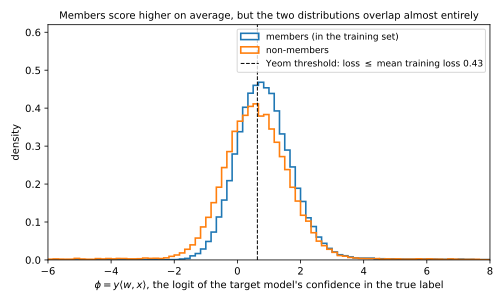
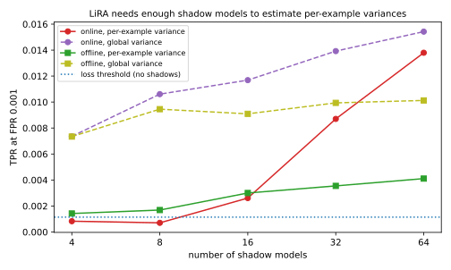
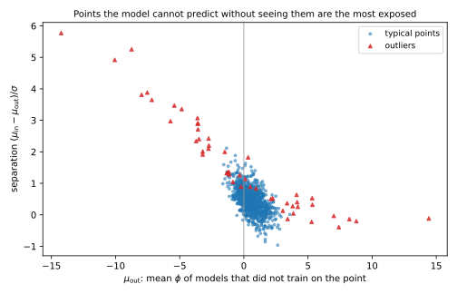

# Membership inference

## Why this matters

A hospital trains a model to predict a disease and publishes it. You hold one patient's record. **Was that record in the training set?** If it was, you have learned that the patient was treated there for that disease. This is **membership inference**, the standard way to measure leakage: if an attacker cannot even tell whether a record was used, it can do little else with it. An attack is scored by its **true positive rate (TPR)**, the fraction of members it flags, and its **false positive rate (FPR)**, the fraction of non-members it wrongly flags; its **advantage** is TPR minus FPR ([Threat models and privacy games](01-threat-models.md)).

The one idea: **membership inference is a test about one record.** Train a model many times on data containing a target record and look at its output on that record; train it without the record and look again. Training is random, so each case gives a distribution, the record's **IN** and **OUT** distributions, and the attacker must say which one an output came from. A typical record is predicted well whether or not the model saw it, so its two distributions nearly coincide; an atypical record is predicted badly unless the model saw it, so they are far apart. So one threshold for every record confuses "easy record" with "member", strong attacks compare each record with itself, and the exposed records are the atypical ones.

The numbers come from one experiment, the setup of Carlini et al. (2022) scaled down to a linear model: a pool of 950 typical points and 50 outliers whose label is a coin flip, so a model gets an outlier right only by fitting it; regularized logistic regression trained on random halves of the pool, 128 target and 64 shadow models; 64,000 member and 64,000 non-member pairs.

## The loss attack and the generalization gap {#sec-mia-loss}

A model fits its training data better than other data, so the simplest attack, due to Yeom et al. (2018), says "member" when the loss is low. Its advantage is a number you already know. Let the loss $\ell$ lie in $[0, B]$ and say "member" with probability $1 - \ell/B$. Then the TPR is one minus the average member loss over $B$, the FPR the same with the non-member loss, and their difference is the gap between the two average losses, which are the training and test loss:
$$\mathrm{Adv} = \frac{\text{expected test loss} - \text{expected training loss}}{B}.$$
With the 0-1 loss the attack is "member if classified correctly", with advantage test error minus training error.

In the running example the training error is 0.1495 and the test error 0.2663, and "member if correctly classified" has TPR 0.8505, FPR 0.7337 and advantage 0.1168, exactly the gap. Yet it identifies nobody, flagging almost three non-members in four (@fig-mia-loss-distributions).

{#fig-mia-loss-distributions}

So **overfitting implies leakage**, and you can read a lower bound off train and test error without running anything. The converse fails because of what the gap averages: it equals the average **self-influence** of the training records, how much each record's own loss rises when it is left out. An average hides who is memorized, and an attack that ignores which record it is looking at cannot find them. **A small gap does not mean a private model.**

## Shadow models {#sec-mia-shadow}

A better attack needs to know what members' outputs look like, without seeing the target's training set. Shokri et al. (2017) had the attacker train **shadow models** of its own, with the same recipe on data from the same population, so that it knows who was a member of each. It labels their outputs "in" and "out" and trains an **attack model** to classify them. With enough shadow data the attack model learns the probability of membership given the output, which is the best test that output allows. But the output is pooled over records, so this is the best attack *among those that treat all records alike*: it cannot know that a given confidence is high for one record and low for another. Here it amounts to a per-class loss threshold.

What shadow models really buy is **calibration**: the attacker sets its threshold where a chosen fraction of its own shadow non-members pass, and trusts the real non-members to behave the same. Set for an FPR of 1% on the shadows, the threshold gives 0.0095 on the target models, but its TPR there is 0.0098, chance. Imitate the target's recipe, since it sets how strongly each record is fitted; a mismatch mostly spoils calibration, because "lower loss means member" transfers across tasks (Salem et al. 2019).

## LiRA: a likelihood-ratio test per record {#sec-mia-lira}

The right comparison is with the *same record's* output under models that did and did not train on it. The **likelihood ratio attack (LiRA)** of Carlini et al. (2022) collects each record's outputs on IN and OUT shadow models, summarizes each set by a Gaussian, and asks which better explains the target model's output. The output is $\phi = \ln\frac{p_y}{1 - p_y}$, the log-odds of the confidence $p_y$ in the true label. Any threshold on confidence, loss or $\phi$ is the same rule, but for fitting Gaussians $\phi$ is the right scale: confidences pile up against 1 while their log-odds keep spreading out, and over retrainings $\phi$ is close to Gaussian.

Let $\mu_{\mathrm{in}}, \sigma_{\mathrm{in}}$ be the mean and standard deviation of $\phi_z$ over the shadow models that trained on record $z$, and $\mu_{\mathrm{out}}, \sigma_{\mathrm{out}}$ over those that did not. **Online LiRA** scores the observed $\phi_z$ by the log of how much more likely it is under the IN fit than under the OUT fit,
$$\ln\Lambda_z = \ln\mathcal N\big(\phi_z;\, \mu_{\mathrm{in}}, \sigma_{\mathrm{in}}^2\big) - \ln\mathcal N\big(\phi_z;\, \mu_{\mathrm{out}}, \sigma_{\mathrm{out}}^2\big),$$ {#eq-mia-lira-online}
where $\mathcal N(\phi; \mu, \sigma^2)$ is the normal density at $\phi$, and says "member" above a threshold **the same for every record**. That is optimal for a simple reason. The attacker sees a record and an output, and the record is drawn the same way whether or not it ends up in training, so it carries no evidence and cancels from the likelihood ratio, leaving the record's own ratio. Thresholding that is the Neyman–Pearson test, so when the fits are right no attack has a higher TPR at any FPR. Online LiRA needs shadows trained *with* each target; **offline LiRA** uses OUT models only, trained once and reused, and scores $(\phi_z - \mu_{\mathrm{out}})/\sigma_{\mathrm{out}}$, how many OUT standard deviations the output lies above its usual value.

| Kind | Share | OUT: $\phi \sim$ | IN: $\phi \sim$ | Separation $s$ | Best TPR at FPR $10^{-3}$, this kind alone |
| --- | --- | --- | --- | --- | --- |
| Typical | 95% | $\mathcal N(3, 1)$ | $\mathcal N(3.5, 1)$ | 0.5 | 0.0048 |
| Atypical | 5% | $\mathcal N(-2, 1)$ | $\mathcal N(2, 1)$ | 4 | 0.8185 |

: Two kinds of record. A typical record is predicted confidently whether or not it was trained on; an atypical one is predicted wrongly unless it was. {#tbl-mia-two-types}

Two kinds of record show what each step buys (@tbl-mia-two-types), with every attack set to a pooled FPR of $10^{-3}$. One threshold on $\phi$ must sit high, because typical non-members score high and are 95% of non-members, so atypical members almost never reach it and the TPR is 0.0048. Offline LiRA gives every record FPR $10^{-3}$, so each kind gets its own best TPR: $0.95 \times 0.0048 + 0.05 \times 0.8185 = 0.0455$. Online LiRA reaches 0.0503, the best possible, by moving false-positive budget from typical records, where it buys almost nothing because the curves overlap, to atypical ones, where it buys a lot (@fig-mia-lira-example).

{#fig-mia-lira-example}

In practice LiRA fails through its fits: an underestimated per-record spread makes an ordinary output look extreme, a false positive exactly at the strict thresholds that matter. With few shadow models, use one **global variance**, estimated from all records at once (@fig-mia-shadow-count). And compute $\phi$ from the logits $f$ as $f_y - \ln\sum_{y' \ne y}e^{f_{y'}}$, never from $1 - p_y$, which rounds to 0 for a confident model.

{#fig-mia-shadow-count}

## Evaluating attacks: TPR at a low FPR {#sec-mia-eval}

Accuracy and the **area under the curve (AUC)**, the probability that a random member outscores a random non-member, average over everyone. A breach is not an average: it is a confident verdict about one person, which requires a low FPR. Attack A recognizes 5% of members with certainty and nobody else; attack B shifts every member's score slightly. Since the AUC weighs every member–non-member pair equally, a tiny edge on everyone buys as much of it as certainty about a few, and the two have the same AUC (@tbl-mia-same-auc). At FPR $10^{-3}$ they differ by a factor of 38: A is a severe breach for one person in twenty, B a negligible one for all.

| | AUC | Best advantage | TPR at FPR $10^{-3}$ |
| --- | --- | --- | --- |
| A: 5% of members exposed | 0.5250 | 0.0500 | 0.05095 |
| B: every member shifted by $\mu = 0.0887$ | 0.5250 | 0.0354 | 0.00134 |

: Two attacks with the same AUC. Only the TPR at a low FPR tells them apart. {#tbl-mia-same-auc}

So report the TPR at a low FPR such as $10^{-3}$, and the receiver operating characteristic (ROC) curve on log axes, where chance is the diagonal at every scale. Measuring that end takes data: an FPR is a count of false positives, a count of $k$ has a relative error of about $1/\sqrt k$, and seeing $k$ of them at FPR $\alpha$ takes about $k/\alpha$ non-members. Give each rate a confidence interval, such as the exact **Clopper–Pearson interval**. With 5,000 non-members and no false positives you can only bound the FPR by about $3/5{,}000 = 6\times10^{-4}$.

| Attack | AUC | Best advantage | TPR at FPR $10^{-3}$ | TPR at FPR $10^{-2}$ |
| --- | --- | --- | --- | --- |
| Loss threshold (Yeom) | 0.577 | 0.122 | 0.0009 | 0.0103 |
| Shadow attack model (Shokri) | 0.577 | 0.121 | 0.0008 | 0.0104 |
| LiRA offline | 0.632 | 0.189 | 0.0030 | 0.0273 |
| LiRA online | 0.629 | 0.175 | 0.0149 | 0.0386 |
| LiRA online, global variance | 0.623 | 0.169 | 0.0177 | 0.0396 |

: Every attack on the running example: 128 target models, 64 shadow models, 64,000 member and 64,000 non-member pairs. {#tbl-mia-attacks}

By AUC the attacks in @tbl-mia-attacks are close, and by best advantage offline LiRA looks strongest. At FPR $10^{-3}$ the loss and shadow attacks are at chance, while online LiRA finds 952 of the 64,000 members, 17.0 times the loss attack, with TPR interval $[0.0140, 0.0158]$. It uses the same statistic as the loss attack; comparing each record with itself is the whole gain. Its FPR rests on 64 false positives, interval $[0.00077, 0.00128]$. (As in most papers, the threshold was set on the data that measure the rates; a real attacker sets it on its shadows.)

{#fig-mia-roc}

## Why outliers are most exposed {#sec-mia-outliers}

Only records whose IN and OUT distributions are far apart pass a strict threshold, so they make up the low-FPR end of the curve. Standardize a record's output against its OUT distribution: if both are Gaussians of common width $\sigma_z$, a non-member's output becomes a standard normal and a member's the same curve shifted by the **separation** $s_z$. The best test on that record then has
$$\mathrm{TPR}_z(\alpha) = 1 - \Phi\big(\Phi^{-1}(1 - \alpha) - s_z\big), \qquad s_z = \frac{\mu_{\mathrm{in}} - \mu_{\mathrm{out}}}{\sigma_z},$$
where $\Phi$ is the standard normal cumulative distribution function (CDF), so $\Phi^{-1}(1 - \alpha)$ is the cut-off a non-member exceeds with probability $\alpha$, about three standard deviations at $10^{-3}$. A separation of 0.5 leaves a member's mean far below that cut-off, for a TPR of 0.0048; a separation of 4 puts it beyond, for 0.8185. The numerator is the record's self-influence, how much training on $z$ raises the model's output on $z$, and it is large when the rest of the data predict the record wrongly.

| | Typical points (950) | Outliers (50) |
| --- | --- | --- |
| Mean separation $s_z$ | 0.461 | 1.539 |
| Online LiRA at pooled FPR $10^{-3}$: TPR | 0.0020 | 0.2597 |
| Online LiRA at pooled FPR $10^{-3}$: FPR | 0.00086 | 0.00375 |

: The running example, split into typical points and outliers. {#tbl-mia-outliers}

At FPR $10^{-3}$, online LiRA flags 26% of outlier members and 0.2% of typical ones (@tbl-mia-outliers), so 87% of the members it finds are outliers, from 5% of the pool. Outliers whose coin-flip label happens to agree with the trend are predicted correctly unseen and are not exposed (@fig-mia-outliers). So a low loss is normal for an easy record and strong evidence for a hard one.

{#fig-mia-outliers}

The loss attack measures the average self-influence, but the low-FPR end is governed by the largest, so a model with a small gap can still expose a few records completely. **Removing the outliers does not fix it.** A record's OUT distribution depends on what the other records predict about it, so exposure is relative: Carlini et al. (2022b) removed the most exposed records, retrained, and found the next layer exposed. A defence has to bound the influence of the worst record, which is what [differential privacy](../part03-dp-foundations/01-definition.md) does.

## Running LiRA on a real model {#sec-mia-cifar}

On an image classifier trained on CIFAR-10, the protocol is the running example's, with hours of training in place of seconds; Carlini et al. report online LiRA about ten times more powerful than earlier attacks there at low FPR.

1. **Split.** For each of $N + 1$ models choose a random half of the pool. One model plays the target; rotating it gives many (model, record) pairs.
2. **Train** every model with the target's exact recipe, including augmentation.
3. **Statistic.** Compute $\phi$ from the logits, on each record and a few augmented copies.
4. **Fit** IN and OUT Gaussians per record over the shadow models.
5. **Score** each (target model, record) pair with @eq-mia-lira-online, or the offline score.
6. **Evaluate.** Pool all pairs, sweep one threshold, plot the ROC curve on log axes, and report the TPR at FPR $10^{-3}$ with the number of non-member pairs behind it.

With 16 shadow models each record is IN for about 8, too few for per-record variances: on the running example 16 shadows give a TPR at FPR $10^{-3}$ of 0.0023 per-record and 0.0151 with a global variance. One target with 25,000 non-member images allows only 25 false positives at that FPR, so rotate over targets. To audit the worst case, plant **canaries**, records built to be as exposed as possible, as members.

## Code {#sec-mia-code}

This reproduces the two-kinds example; the last two lines score a typical record's output 3.244 OUT standard deviations above its OUT mean, exactly on online LiRA's threshold.

```python
from math import log, pi, sqrt
from statistics import NormalDist

Z = NormalDist()


def log_normal_pdf(x: float, mu: float, sd: float) -> float:
    return -0.5 * ((x - mu) / sd) ** 2 - log(sd * sqrt(2 * pi))


def lira_online(phi: float, mu_in: float, sd_in: float, mu_out: float, sd_out: float) -> float:
    """Log of how much more likely the target's phi is under the IN fit than under the OUT fit."""
    return log_normal_pdf(phi, mu_in, sd_in) - log_normal_pdf(phi, mu_out, sd_out)


def lira_offline(phi: float, mu_out: float, sd_out: float) -> float:
    """How many OUT standard deviations the target's phi lies above its OUT mean."""
    return (phi - mu_out) / sd_out


def tpr_at_fpr(fpr: float, separation: float) -> float:
    """Best TPR at a given FPR for a record whose IN and OUT scores are unit normals `separation` apart."""
    return 1 - Z.cdf(Z.inv_cdf(1 - fpr) - separation)


typical, atypical = tpr_at_fpr(1e-3, 0.5), tpr_at_fpr(1e-3, 4.0)
print(f"{typical:.4f}")  # 0.0048
print(f"{atypical:.4f}")  # 0.8185
print(f"{0.95 * typical + 0.05 * atypical:.4f}")  # 0.0455
print(f"{lira_offline(6.244, 3.0, 1.0):.3f}")  # 3.244
print(f"{lira_online(6.244, 3.5, 1.0, 3.0, 1.0):.3f}")  # 1.497
```

The full edition's script, [membership_inference.py](../../code/part02-attacks/membership_inference.py), runs every attack and prints every number in this chapter:

```bash
uv run python code/part02-attacks/membership_inference.py
```

## Cheat sheet

| Result | Formula | Notes |
| --- | --- | --- |
| Loss attack | $\mathrm{Adv}$ = expected gap $/B$; 0-1 loss: test error $-$ train error | Average-case; a lower bound on leakage |
| Shadow attack model | Learns the membership probability of the output | Best record-blind attack; its real use is calibrating thresholds |
| Online LiRA | $\ln\mathcal N(\phi; \mu_{\mathrm{in}}, \sigma_{\mathrm{in}}^2) - \ln\mathcal N(\phi; \mu_{\mathrm{out}}, \sigma_{\mathrm{out}}^2)$, one threshold for all records | Optimal when the fits are right; needs IN models per target |
| Offline LiRA | $(\phi - \mu_{\mathrm{out}})/\sigma_{\mathrm{out}}$ | OUT models only, reusable |
| Per-record best TPR | $1 - \Phi(\Phi^{-1}(1 - \alpha) - s_z)$, $s_z = (\mu_{\mathrm{in}} - \mu_{\mathrm{out}})/\sigma_z$ | Large separation: outliers |
| Measuring FPR $\alpha$ | About $k/\alpha$ non-members for $k$ false positives | Relative error about $1/\sqrt k$ |

: The results of this chapter. {#tbl-mia-cheat}

**Rules of thumb**

- Audit with LiRA, not with a global loss threshold, which is near chance at low FPR.
- Report the TPR at FPR $10^{-3}$ or lower, on log-scaled ROC curves, with the number of non-members behind it. Never accuracy or AUC alone.
- With fewer than about 64 shadow models, use a global variance.
- Expect the exposed records to be outliers, rare subgroups and mislabelled points; removing them exposes the next ones.
- Overfitting implies leakage; no overfitting does not imply its absence.

## Further reading

- Carlini, Chien, Nasr, Song, Terzis & Tramèr, "Membership Inference Attacks From First Principles" (IEEE S&P 2022): LiRA online and offline, the global variance, and the case for TPR at low FPR. The protocol to follow in an audit.
- Shokri, Stronati, Song & Shmatikov, "Membership Inference Attacks against Machine Learning Models" (IEEE S&P 2017): shadow models and attack models.
- Yeom, Giacomelli, Fredrikson & Jha, "Privacy Risk in Machine Learning: Analyzing the Connection to Overfitting" (IEEE CSF 2018): the loss attack and its link to the generalization gap.
- Carlini, Jagielski, Zhang, Papernot, Terzis & Tramèr, "The Privacy Onion Effect: Memorization is Relative" (NeurIPS 2022): why removing the most exposed records does not help.

**Derivations.** Every result in this chapter is derived step by step in [the full edition's chapter](../../book-full/part02-attacks/02-membership-inference.md).
