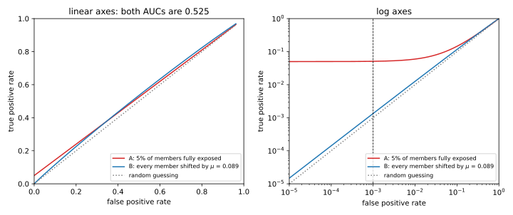

# Membership inference

## Why this matters

A hospital trains a model to predict a disease and publishes it. You hold one patient's record. **Was that record in the training set?** If it was, you have learned that the patient was treated at that hospital for that disease, even though the model never output a diagnosis. This question, the simplest and most common one an attacker can ask about a trained model, is called **membership inference**.

Membership inference is also the standard measure of leakage, because an attacker that cannot even tell whether a record was used can do little else with it. Leaking membership is therefore the first sign of a leak, not the worst one. The later chapters of this part show what more a model can leak.

The one idea of this chapter is that membership inference is a test about one record. Some records are predicted well whether or not the model trained on them, and their outputs reveal almost nothing. Others are predicted well only if the model trained on them, and their outputs can reveal membership with confidence. An attack that applies the same rule to every record mixes the two kinds, and it identifies almost no member with confidence. The strong attacks compare the model's output on a record with how that same record fares under models trained with and without it. The records they expose are the outliers.

## Membership as a test about one record {#sec-mia-test}

Membership inference is scored as a game ([Threat models and privacy games](01-threat-models.md)). A challenger trains a model and flips a fair coin. On heads it hands the attacker a record from the training set, and on tails a fresh record from the same population. The attacker then guesses whether the record is a member. Its **true positive rate (TPR)** is the fraction of members it calls members, and its **false positive rate (FPR)** is the fraction of non-members it wrongly calls members.

An attack's **advantage** is the TPR minus the FPR. Half the games have a member, which the attacker wins with probability TPR. The other half have a non-member, which it wins with probability one minus the FPR. So the attacker wins a share $\frac12 + \frac12\mathrm{Adv}$ of the games, where $\mathrm{Adv}$ is the advantage. An attack that ignores the model has advantage 0 and wins half the games, so any win rate above one half comes from what the model reveals.

Now fix one target record, which this chapter calls $z$. Train a model on data that contains $z$, and look at the model's output on $z$, such as its loss or its confidence in the true label. Train another on data without $z$, and look again. Training is random, because each run draws the rest of the training data afresh, and the starting weights and the order of the examples also change. So each case gives a distribution of outputs rather than a single value. Call them the **IN distribution** and the **OUT distribution** of $z$. The attacker sees one output and must say which of the two it came from.

That is a test between two fully specified distributions, and the Neyman–Pearson lemma says how to do it best ([Hypothesis testing](../part01-prerequisites/04-hypothesis-testing.md)). Compute the **likelihood ratio**, the density of the observed output under IN divided by its density under OUT, and say "member" when it is above a threshold. For any FPR you allow, no test flags more members. The reason is a budgeting argument. Every output you call "member" has a cost, its OUT probability, which adds to the false positives. It also has a gain, its IN probability, which adds to the true positives. With a fixed budget of false positives, you gain the most by spending it first on the outputs with the best ratio of gain to cost. That ratio is the likelihood ratio.

The IN and OUT distributions differ from record to record, as the introduction said. They nearly coincide for a typical record and lie far apart for an atypical one, and the rest of the chapter follows from taking that difference seriously.

Most of the chapter reduces to one simple case. Suppose the attacker turns the output into a single number, its score, and that this score is normal with standard deviation 1 for members and for non-members alike. For non-members its mean is 0. For members, it is the same bell curve shifted to the right by an amount $s$, called the **separation**. A large separation means that the two curves barely overlap. The log of the likelihood ratio then works out to the score times $s$, minus $s^2/2$, so the ratio grows with the score. The best test therefore says "member" when the score is above a cut-off, set by the FPR you allow, which this chapter writes $\alpha$.

Write $\Phi$ for the standard normal cumulative distribution function (CDF), so that $\Phi(t)$ is the chance that a standard normal draw falls below $t$. To flag a fraction $\alpha$ of non-members, the cut-off must be $\Phi^{-1}(1 - \alpha)$, the point a standard normal draw exceeds with probability $\alpha$. A member's score is shifted by $s$, so it passes that cut-off with probability
$$\mathrm{TPR}(\alpha) = 1 - \Phi\big(\Phi^{-1}(1 - \alpha) - s\big).$$ {#eq-mia-gauss-tpr}
This is the Gaussian trade-off curve of [Hypothesis testing](../part01-prerequisites/04-hypothesis-testing.md), written as the TPR against the FPR. It gives the most members any test can catch at each FPR.

Take an FPR of $10^{-3}$. A standard normal draw exceeds 3.0902 one time in a thousand, so that is the cut-off. With a separation of 0.5, a member's score must still clear 2.59 standard deviations above its own mean. Its TPR is then only 0.0048, barely five times the chance rate of 0.001. With a separation of 4, the cut-off sits below the member mean, so most members pass and the TPR is 0.8185.

Every number in this chapter comes from one experiment, small enough to run in seconds. Its **pool** has 1,000 labelled points with 100 features each. The 950 typical points have labels that follow their first feature, with some noise. The 50 outliers have feature vectors with five times the length, and a label drawn by a fair coin. So a model can get an outlier's label right only by fitting that point itself.

Each model is logistic regression with a penalty that keeps its weights small, trained on a random half of the pool. The models come in complementary pairs, one trained on a random half and the next on the rest, so every point is a member of exactly half the models. The attacker attacks 128 such target models. It knows the pool and the training recipe but not which half each target used. It also trains 64 models of its own, the shadow models of a later section. Asking one target model about one pool point is one game, which gives 64,000 member games and as many non-member games. This is the setup of Carlini et al. (2022), scaled down from an image classifier to a linear model.

## The loss attack and the generalization gap {#sec-mia-loss}

A model is fitted to its training data, so its loss on a training point is usually lower than on a fresh one. Yeom et al. (2018) turned this into an attack that says "member" when the loss is low, which needs no shadow models. They also showed that its advantage is exactly the generalization gap divided by the range of the loss. The gap is the model's average loss on fresh data minus its average loss on its training data. For this attack, overfitting and membership leakage are the same number.

The cleanest version turns the loss directly into a probability of saying "member". It needs the loss to have a known range, from 0 to some maximum $B$, because otherwise the rule below is not a probability. The **bounded-loss attack** says "member" with probability one minus the loss divided by $B$, so it always says "member" at loss 0 and never at loss $B$. Its TPR is then one minus the average member loss divided by $B$, and its FPR is the same with the average non-member loss. The advantage is their difference, which is the gap between the two average losses divided by $B$:
$$\mathrm{Adv} = \frac{\text{expected test loss} - \text{expected training loss}}{B}.$$ {#eq-mia-yeom}

The two averages are the expected training and test losses. A member target is a random training point, and a non-member target is a fresh draw that the model never saw. The randomized rule makes only these averages matter, because its chance of saying "member" falls in a straight line as the loss grows. A plain threshold would give an advantage that depends on the whole distribution of the loss.

The most familiar case is the 0-1 loss, which is 0 on a correct prediction and 1 on a wrong one. With $B = 1$ the rule becomes deterministic. It says "member" exactly when the model classifies the record correctly. Its advantage is then the test error minus the training error.

In the running example, averaged over the target models, the training error is 0.1495 and the test error is 0.2663. "Member if correctly classified" flags the members it gets right, so its TPR is 0.8505. It also flags the non-members it gets right, so its FPR is 0.7337. Its advantage is 0.1168, exactly the gap between the two errors.

The logistic loss has no maximum, so the bounded-loss attack needs it clipped, here at $B = 2$. The mean clipped loss is then 0.4158 on members and 0.5433 on non-members. @eq-mia-yeom predicts an advantage of 0.0638, and simulating the randomized rule gives 0.0639. Yeom et al. also propose a deterministic version, which says "member" when the loss is below the mean training loss. It has an FPR of 0.4834 and an advantage of 0.1102.

These advantages mean winning between 53% and 56% of the games, and none of the three attacks identifies anyone with confidence. The two deterministic attacks, for example, flag about half of the non-members or more. @fig-mia-loss-distributions shows why. It plots $\phi$, the log of the odds that the model gives to the true label, which rises as the loss falls and so carries the same information. The distributions of $\phi$ over members and over non-members are shifted, but they almost entirely overlap.

{#fig-mia-loss-distributions}

The first lesson is that **overfitting implies leakage.** Any model with a generalization gap leaks membership through its loss, by at least the gap divided by the loss range. You can read this off from the training and test errors alone, without running any attack.

The converse fails, because of what the gap averages. [Algorithmic stability and generalization](../part01-prerequisites/07-stability-generalization.md) shows that the expected gap equals the average **self-influence** of the training records. The self-influence of a record is how much its own loss rises when it is left out of training and replaced by a fresh one. So the loss attack's advantage is the average, over records, of how much each one is memorized, and an average hides who is memorized. When a lower loss always makes membership more likely, a threshold on the loss is the best attack that ignores the record's identity, as the next section shows. But an attack that uses the identity of the record can beat it by a wide margin. Yeom et al. even construct models that leak membership with no generalization gap at all. **A small gap does not mean a private model.**

## Shadow models {#sec-mia-shadow}

A better rule than "low loss means member" requires knowing what members' outputs look like, and the attacker cannot see them because it does not know the target's training set. Shokri et al. (2017) solved this with **shadow models**, which the attacker trains itself to imitate the target. They use the same architecture and recipe, and data from the same population. For its own models the attacker knows who was a member. It labels their outputs on members "in" and on non-members "out", and trains an **attack model**, one per class, to tell the two apart.

With enough shadow data and a flexible enough attack model, it learns the best rule available from the output alone. Trained with the usual cross-entropy loss, a classifier learns to predict, at each output, the true fraction of members among the shadow pairs with that output. If those pairs look like the real game, that fraction is the probability that a record is a member given its output. With a fair coin, Bayes' rule makes the odds of membership given the output equal to the likelihood ratio. So a threshold on the attack model is a threshold on the likelihood ratio, and by the Neyman–Pearson lemma no attack that sees only the output does better.

That the shadow pairs look like the real game is a condition of the result. It assumes that each shadow model is trained exactly as the target is, on data from the same population. If the shadow data came from a different hospital, or the shadows used a different recipe, the attack model learns the membership probability for the wrong game. The attack is not useless, because "lower loss means member" usually still holds, but thresholds set on the shadows no longer give the intended FPR on the target.

The attack model is optimal, but for the wrong question. "Sees only the output" means that its input is the output, not the identity of the record that produced it. So the likelihood ratio it learns is pooled over all records, and it is the best attack only among those that treat all records alike. In the running example, that pooled ratio rises with $\phi$, so the attack reduces to the loss attack with a threshold for each class. It cannot know that a given value of $\phi$ is high for one record and low for another.

What shadow models really buy is **calibration**. They let the attacker set a threshold that gives a chosen FPR on the real model, without knowing any member of the real training set. The attacker picks the threshold at which the desired fraction of its own shadow non-members pass, and then trusts that the real non-members behave the same way. LiRA, in the next section, keeps shadow models for exactly this job. The imitation can also be crude. Salem et al. (2019) found that one shadow model is often enough, and that shadow data from another distribution still works.

In the running example, the labels have two classes, and each class's attack model is a logistic regression on $\phi$, trained on about 32,000 shadow pairs. In both classes, its predicted chance of "in" rises with $\phi$. An attack's **area under the curve (AUC)** summarizes how well its score separates members from non-members. It equals the chance that a random member gets a higher score than a random non-member. The attack model's AUC is 0.577, the same as the loss attack's (@tbl-mia-attacks).

Calibration works here. Setting the threshold on the shadow models for an FPR of 1% gives an FPR of 0.0095 on the target models, which the attacker never saw. But the TPR at that threshold is 0.0098, no better than the fraction of non-members flagged. At a low FPR, a threshold on $\phi$ shared by all records has nothing to work with.

## LiRA: a likelihood-ratio test per example {#sec-mia-lira}

The pooled attacks compare a record's output with everyone else's outputs. The right comparison is with the same record's output under models that did and did not train on it. Carlini et al. (2022) built the likelihood ratio attack (LiRA) on that idea. For each target record, the attacker estimates the IN and OUT distributions from shadow models trained with and without it, and computes the likelihood ratio of the target model's output.

The output LiRA uses is $\phi$, the logit of the confidence. If $p_y$ is the probability the model gives to the true label, then $\phi$ is the log of the odds the model gives to that label:
$$\phi = \ln\frac{p_y}{1 - p_y}.$$

As decision rules, the confidence, the loss and $\phi$ are interchangeable, because the confidence and $\phi$ rise together and the loss falls as they rise. A threshold on one is a threshold on the others. They differ only when a statistic is combined across models, as when LiRA fits a distribution to it.

For fitting, $\phi$ is the right scale. A confidence of 0.9 gives a $\phi$ of 2.197. Raising the confidence to 0.999 raises $\phi$ to 6.907, so the confidence crowds against 1 while $\phi$ keeps spreading the values out. For logistic regression, $\phi$ is the margin, which measures how far the point lies on the correct side of the decision boundary. The margin is a linear function of the weights, and the trained weights are close to normal over retrainings, because they solve an equation that averages many independent terms. So $\phi$ is close to normal too, and for deep networks Carlini et al. found the same.

Write $\phi_z$ for a model's $\phi$ on the record $z$. The attacker has only a few dozen shadow values of $\phi_z$, so it summarizes each set by a normal distribution. Write $\mu_{\mathrm{in}}$ and $\sigma_{\mathrm{in}}$ for their mean and standard deviation over the shadow models that trained on the record. Write $\mu_{\mathrm{out}}$ and $\sigma_{\mathrm{out}}$ for the same over the shadow models that did not. In the running example, each fit uses 32 values, because each point is in exactly half of the 64 shadow models.

**Online LiRA** asks how much more likely the target model's $\phi_z$ is under the IN fit than under the OUT fit. Its score is the log of that ratio, where $\mathcal N(\phi; \mu, \sigma^2)$ denotes the normal density at $\phi$:
$$\ln\Lambda_z = \ln\mathcal N\big(\phi_z;\, \mu_{\mathrm{in}}, \sigma_{\mathrm{in}}^2\big) - \ln\mathcal N\big(\phi_z;\, \mu_{\mathrm{out}}, \sigma_{\mathrm{out}}^2\big).$$ {#eq-mia-lira-online}
It says "member" when this score exceeds a threshold that is the same for every record.

One threshold for all records is optimal because the attacker knows which record it is testing. Its observation is a pair, the record and the model's output on it, and the Neyman–Pearson lemma applies to the pair. The likelihood ratio of the pair has two factors. The first is the chance of being handed this record, which cancels because the challenger draws it the same way whether or not it ends up in training. The second is the record's own ratio. So the best test of the whole game puts one common threshold on each record's own ratio. When the normal fits are exact, no attack that sees the record and its output has a higher TPR at any FPR.

The condition that the record is drawn the same way in both worlds matters. If members were drawn from one hospital and non-members from another, the record alone would reveal the answer.

**Offline LiRA** uses only OUT models. These can be trained before the target record is known, and then reused for every query. Without IN models it cannot compute an IN density. It asks instead how far above its usual OUT value the observed output lies, measured in OUT standard deviations, again with one threshold for all records:
$$\frac{\phi_z - \mu_{\mathrm{out}}}{\sigma_{\mathrm{out}}}.$$ {#eq-mia-lira-offline}
This works as a one-sided test because training on a record raises its $\phi_z$, as the model moves to fit the record.

When do the two scores agree? Suppose the two fits have the same width. Write $t_z$ for the offline score of a record, and $s_z$ for the distance between its IN and OUT means in units of that width. Then $t_z$ is standard normal under OUT and shifted by $s_z$ under IN, which is the simple case of @sec-mia-test. As there, the online score of @eq-mia-lira-online simplifies to
$$\ln\Lambda_z = s_zt_z - s_z^2/2.$$
For one record, the separation is a fixed positive number, so both scores rank that record's outputs the same way. Across records they differ. Online LiRA multiplies $t_z$ by $s_z$, so it treats a given offline score as strong evidence when the separation is large and as weak evidence when it is small.

| Kind | Share | OUT: $\phi \sim$ | IN: $\phi \sim$ | Separation $s$ | Best TPR at FPR $10^{-3}$, this kind alone |
| --- | --- | --- | --- | --- | --- |
| Typical | 95% | $\mathcal N(3, 1)$ | $\mathcal N(3.5, 1)$ | 0.5 | 0.0048 |
| Atypical | 5% | $\mathcal N(-2, 1)$ | $\mathcal N(2, 1)$ | 4 | 0.8185 |

: Two kinds of record. A typical record is predicted confidently whether or not it was trained on; an atypical one is predicted wrongly unless it was. The last column is @eq-mia-gauss-tpr. {#tbl-mia-two-types}

A population with two kinds of record shows what each step buys (@tbl-mia-two-types). Now set three attacks, a single threshold on $\phi$, offline LiRA and online LiRA, so that each flags one non-member in a thousand, counting all non-members together.

One threshold on $\phi$ is the loss attack. Typical non-members score high, and they are 95% of the non-members, so the threshold must sit high, at $\phi = 6.075$. Atypical members score around 2 and almost never reach it. Only typical members occasionally do, and the TPR is 0.0048.

One threshold on the offline score gives every record its own FPR of $10^{-3}$. Each kind then gets its own best TPR from the table. The overall TPR is their average weighted by the shares, which is 0.0455.

Both per-record tests catch about ten times as many members as the single threshold on $\phi$. One threshold on the online score does slightly better than the offline one, with a TPR of 0.0503. That is the best possible at this FPR, because one common threshold on each record's own ratio is the best test of the game. It gets there by moving the false-positive budget between the kinds, so that typical records get an FPR of $5.90\times10^{-4}$ and atypical ones get 0.0088. The trade pays because a typical record's extra false positives buy almost no true positives, while an atypical record's buy many.

{#fig-mia-lira-example}

@fig-mia-lira-example shows the two distributions for a typical point and an outlier of the running example. The choice between online and offline LiRA is a choice about cost. Online LiRA needs models trained with each target record, so attacking a new record means training new shadow models. Offline LiRA's OUT models are trained once and reused, which is why it matters in practice, at some cost in power.

In practice LiRA can fail through its fits. Each record's variance is estimated from half the shadow models, and with few shadow models these estimates are noisy. If a record's spread is underestimated, its OUT curve is drawn too narrow, and an ordinary output looks far out in the tail. Its likelihood ratio is then inflated, and it becomes a false positive exactly at the strict thresholds that matter. Carlini et al. recommend one **global variance**, shared by all records, when shadow models are few. It is estimated from every record's values at once, so it is stable (@fig-mia-shadow-count).

{#fig-mia-shadow-count}

## Evaluating attacks: TPR at a low FPR {#sec-mia-eval}

Older papers on membership inference report the attack's accuracy and its AUC, which both average over all members and non-members. A privacy breach is not an average. It happens when an attacker can say with confidence that a particular person was in the data, and that requires a low FPR. So Carlini et al. (2022) argued that attacks should be reported by their TPR at a fixed low FPR, such as $10^{-3}$. They should also be shown by their full receiver operating characteristic (ROC) curve on log axes. That curve plots the TPR against the FPR as the threshold moves from strict to lenient.

Two constructed attacks show what an average can hide. Attack A recognizes a fraction $q$ of members with certainty, here 5%, and gives every other record, member or not, the same random score. Its AUC is 0.525. The recognized members always win the comparison with a non-member, and the others win only half the time, because their scores have the same distribution as the non-members'. Attack B gives every member a score slightly higher than a non-member's on average, using normal scores with a shift of 0.0887. That shift is chosen to give B the same AUC as A.

| | AUC | Best advantage | TPR at FPR $10^{-3}$ |
| --- | --- | --- | --- |
| A: 5% of members exposed | 0.5250 | 0.0500 | 0.05095 |
| B: every member shifted by $\mu = 0.0887$ | 0.5250 | 0.0354 | 0.00134 |

: Two attacks with the same AUC. Only the TPR at a low FPR tells them apart. {#tbl-mia-same-auc}

@tbl-mia-same-auc compares them, and their best advantages differ by only about 0.015. At an FPR of $10^{-3}$, though, A catches 38 times as many members as B. At any FPR $\alpha$, A's TPR is $q + (1 - q)\alpha$, because the recognized members always pass and the others pass as often as non-members. B is barely above chance, because a tiny shift moves almost no member past a strict cut-off. So A is a severe breach for one person in twenty, and B a negligible one for everyone, and only the low-FPR end of the ROC curve shows the difference.

{#fig-mia-same-auc}

Log axes are how you see that end. On linear axes, every FPR below 0.01 is squeezed into a narrow strip at the left edge (@fig-mia-same-auc). On log axes, chance is the diagonal at every scale, and a useful attack stays well above it.

Measuring a low FPR takes many non-members, because an FPR is estimated by counting false positives. A count of $k$ events has a relative error of about $1/\sqrt k$. Seeing $k$ false positives at an FPR $\alpha$ takes about $k/\alpha$ non-members. That is why the running example evaluates many target models, whose 64,000 non-member pairs give about 64 false positives at an FPR of one in a thousand.

The **precision** of an attack is the fraction of its "member" verdicts that are right. When members and non-members are equally many, the precision is $\mathrm{TPR}/(\mathrm{TPR} + \mathrm{FPR})$, because the right verdicts are proportional to the TPR and the wrong ones to the FPR. At a TPR of 0.05 and an FPR of one in a thousand, that is 0.98. Real targets are rarely members with probability one half, and [Threat models and privacy games](01-threat-models.md) shows how the prior changes the precision.

| Attack | AUC | Best advantage | TPR at FPR $10^{-3}$ | TPR at FPR $10^{-2}$ |
| --- | --- | --- | --- | --- |
| Loss threshold (Yeom) | 0.577 | 0.122 | 0.0009 | 0.0103 |
| Shadow attack model (Shokri) | 0.577 | 0.121 | 0.0008 | 0.0104 |
| LiRA offline | 0.632 | 0.189 | 0.0030 | 0.0273 |
| LiRA online | 0.629 | 0.175 | 0.0149 | 0.0386 |
| LiRA online, global variance | 0.623 | 0.169 | 0.0177 | 0.0396 |

: Every attack on the running example: 128 target models, 64 shadow models, 64,000 member and 64,000 non-member pairs. "Best advantage" is the largest TPR minus FPR over all thresholds. {#tbl-mia-attacks}

@tbl-mia-attacks scores every attack on the running example, and @fig-mia-roc draws their ROC curves on log axes. By AUC the attacks are close, at 0.577 against about 0.63, and by best advantage offline LiRA even looks the strongest. At an FPR of $10^{-3}$, though, they are not close at all. The loss and shadow attacks are at chance there, since their TPRs are no higher than the FPR. Online LiRA finds 952 of the 64,000 members. Its TPR is 17.0 times the loss attack's, although both use the same statistic $\phi$, so comparing each record with itself is the whole gain.

How precise are these numbers? The **Clopper–Pearson interval** is an exact 95% confidence interval for a rate estimated from a count ([Hypothesis testing](../part01-prerequisites/04-hypothesis-testing.md)). For online LiRA's TPR it runs from 0.0140 to 0.0158. The FPR is far less certain, because it rests on only 64 false positives. Its interval runs from 0.00077 to 0.00128, which is as wide as the square-root rule above predicts.

One caveat applies to the whole table. Its thresholds were chosen on the same data that measure the rates, as is usual in this literature, whereas a real attacker would set them on its shadow models.

{#fig-mia-roc}

## Why outliers are most exposed {#sec-mia-outliers}

The two-kinds example already shows that the low-FPR end of the ROC curve is made of the records whose IN and OUT distributions are far apart. This section asks which records those are.

For one record, the best test is the simple case of @sec-mia-test, so its best TPR is set by its own separation. Suppose the record's IN and OUT distributions are normal with a common width $\sigma_z$. Its separation $s_z$ is then the distance between the two means, measured in units of that width. The best TPR of any test on that record alone, at an FPR $\alpha$, is
$$\mathrm{TPR}_z(\alpha) = 1 - \Phi\big(\Phi^{-1}(1 - \alpha) - s_z\big), \qquad s_z = \frac{\mu_{\mathrm{in}} - \mu_{\mathrm{out}}}{\sigma_z}.$$ {#eq-mia-per-example}
The numerator of $s_z$ is the record's self-influence, measured with $\phi$ instead of the loss. It is the average amount by which training on the record raises the model's $\phi$ on that record. That is the mirror image of the earlier definition, in which the loss rises when the record is left out.

Which records have a large self-influence? If the rest of the data already predict a record's label, its OUT mean is high, and training on it adds little. If the rest of the data predict the opposite label, its OUT mean is low, and the model must move toward the record to fit it. The regularization penalty limits how far one record can move the weights ([Algorithmic stability and generalization](../part01-prerequisites/07-stability-generalization.md)). Within that limit, a long feature vector can pull the weights harder, and it also turns a given change in the weights into a larger change in its own margin. The outliers of the running example have both an unpredictable label and a long feature vector.

So **leakage is concentrated.** The loss attack's advantage is the average self-influence. The low-FPR end of the ROC curve is governed by the largest ones, because a strict threshold is passed only by the records with the largest separations. A model can have a small generalization gap and still expose a few records completely.

| | Typical points (950) | Outliers (50) |
| --- | --- | --- |
| Mean separation $s_z$ | 0.461 | 1.539 |
| Mean loss self-influence, $\mathbb E[\ell \mid \text{out}] - \mathbb E[\ell \mid \text{in}]$ | 0.0897 | 2.0999 |
| Mean of @eq-mia-per-example at $\alpha = 10^{-3}$ | 0.0074 | 0.2145 |
| Online LiRA at pooled FPR $10^{-3}$: TPR | 0.0020 | 0.2597 |
| Online LiRA at pooled FPR $10^{-3}$: FPR | 0.00086 | 0.00375 |

: The running example, split into typical points and outliers. Separations and self-influences are estimated from the 64 shadow models; TPR and FPR are measured on the 128 target models. {#tbl-mia-outliers}

@tbl-mia-outliers splits the running example by kind of point, and it shows first that the outliers carry the generalization gap. Their mean loss self-influence is 2.0999, against 0.0897 for typical points. The average over all points is 0.1902. Although outliers are only 5% of the pool, they supply a share of 0.552 of it.

The outliers are also the true positives. At a pooled FPR of one in a thousand, online LiRA flags 26% of outlier members and 0.2% of typical members. Counting its flags on the target models, a share of 0.873 of the members it finds are outliers. As in the two-kinds example, the likelihood ratio gets there by moving FPR budget to the outliers (@tbl-mia-outliers).

Not every outlier is exposed. An outlier's label is a coin flip, so about half the time it happens to agree with the trend in the first feature. Those outliers are predicted correctly without being seen, and they are no more exposed than typical points (@fig-mia-outliers). It follows that two records with the same loss under the target model can be exposed very differently. A low loss is normal for an easy record and strong evidence for a hard one.

{#fig-mia-outliers}

Memorizing outliers can be what makes a model accurate. Feldman (2020) shows that on long-tailed data, where many subpopulations are rare, a subpopulation seen only once in training must be memorized for good test accuracy. The next example from it will look like that one. So the records a model needs to memorize are the ones it exposes.

**Removing the outliers does not fix the problem.** Carlini et al. (2022b) removed the most exposed records and retrained, and the next layer of records became exposed. They call this the onion effect. Exposure is relative to the rest of the dataset, because a record's OUT distribution depends on what the other records predict about it.

This is the gap between average-case and worst-case games of [Threat models and privacy games](01-threat-models.md), seen from the data. A score averaged over records is never more than the score on the worst record, and it can be far less. So a guarantee that protects every record has to bound the self-influence of the worst record, not the average. That is what [differential privacy](../part03-dp-foundations/01-definition.md) does, in Part 3.

## The full-size pipeline: LiRA on CIFAR-10 {#sec-mia-cifar}

The usual full-scale experiment trains an image classifier on CIFAR-10, a standard benchmark of small colour images in ten classes. It runs LiRA with 16 shadow models and reports the TPR at an FPR of 0.1%. That takes hours of GPU time, so this book runs the same protocol with logistic regression in place of a deep network.

1. **Split the data.** Take the 50,000 CIFAR-10 training images as the pool. For each of $N + 1$ models, where $N$ is the number of shadow models, choose a random half of the pool. One model plays the target and the others are shadows, and rotating the target gives many pairs to evaluate.
2. **Train** every model with the same recipe, including the architecture, optimizer, number of epochs and data augmentation. Augmentation, for example, changes how strongly the model fits each image, and so it changes the IN mean and the variances.
3. **Compute the statistic.** For each model and image, compute the model's outputs on the image and on a few augmented copies. Convert each to $\phi$ directly from the logits $f$, the raw class scores the network produces before the softmax:
   $$\phi = f_y - \ln\sum_{y' \ne y}e^{f_{y'}}.$$
   This equals $\ln\frac{p_y}{1 - p_y}$ but never forms $1 - p_y$, which rounds to 0 for a confident model.
4. **Fit** IN and OUT normal distributions for each image over the shadow models, a multivariate one over the augmented copies, so that each copy adds evidence.
5. **Score** each pair of target model and image with the online score @eq-mia-lira-online, or the offline score @eq-mia-lira-offline.
6. **Evaluate.** Pool all pairs, sweep one threshold, and plot the ROC curve on log axes. Report the TPR at an FPR of $10^{-3}$, with the number of non-member pairs it rests on.

With 16 shadow models, use a global variance. Each image is then in about half the shadows and out of the other half, and variances estimated from 8 values are too noisy for the low-FPR end. In the running example with 16 shadow models, for instance, online LiRA reaches a TPR of only 0.0023 at an FPR of one in a thousand with per-record variances. With a global variance it reaches 0.0151.

Carlini et al. report that online LiRA is about ten times more powerful than earlier attacks at a low FPR on CIFAR-10. They also find that the loss attack is close to chance there, which is what @tbl-mia-attacks shows in miniature. The exact TPR depends on the model, its training length and the augmentations. A single target model with 25,000 non-member images allows only 25 false positives at an FPR of one in a thousand. Rotating over several target models multiplies that count and tightens the interval.

The auditing part of the book reuses this pipeline, with a privately trained model as the target and inserted **canaries** as the members. Canaries are records chosen to be as exposed as possible, such as mislabelled or unusual images, so that the attack measures the worst case rather than the average.

## Code {#sec-mia-code}

The snippet below reproduces the two-kinds example. The last two lines score a typical record's output that lies 3.244 OUT standard deviations above its OUT mean. Its online score is 1.497, which is exactly online LiRA's threshold in the two-kinds example.

```python
from math import log, pi, sqrt
from statistics import NormalDist

Z = NormalDist()


def log_normal_pdf(x: float, mu: float, sd: float) -> float:
    return -0.5 * ((x - mu) / sd) ** 2 - log(sd * sqrt(2 * pi))


def lira_online(phi: float, mu_in: float, sd_in: float, mu_out: float, sd_out: float) -> float:
    """Log of how much more likely the target's phi is under the IN fit than under the OUT fit."""
    return log_normal_pdf(phi, mu_in, sd_in) - log_normal_pdf(phi, mu_out, sd_out)


def lira_offline(phi: float, mu_out: float, sd_out: float) -> float:
    """How many OUT standard deviations the target's phi lies above its OUT mean."""
    return (phi - mu_out) / sd_out


def tpr_at_fpr(fpr: float, separation: float) -> float:
    """Best TPR at a given FPR for a record whose IN and OUT scores are unit normals `separation` apart."""
    return 1 - Z.cdf(Z.inv_cdf(1 - fpr) - separation)


typical, atypical = tpr_at_fpr(1e-3, 0.5), tpr_at_fpr(1e-3, 4.0)
print(f"{typical:.4f}")  # 0.0048
print(f"{atypical:.4f}")  # 0.8185
print(f"{0.95 * typical + 0.05 * atypical:.4f}")  # 0.0455
print(f"{lira_offline(6.244, 3.0, 1.0):.3f}")  # 3.244
print(f"{lira_online(6.244, 3.5, 1.0, 3.0, 1.0):.3f}")  # 1.497
```

The full edition's script, [membership_inference.py](../../code/part02-attacks/membership_inference.py), trains every model of the running example, runs every attack and prints every number in this chapter. It runs in about ten seconds:

```bash
uv run python code/part02-attacks/membership_inference.py
```

## Cheat sheet

| Result | Formula | Notes |
| --- | --- | --- |
| Advantage | $\mathrm{Adv} = \mathrm{TPR} - \mathrm{FPR}$; win rate $\frac12 + \frac12\mathrm{Adv}$ | Fair coin |
| Loss attack (Yeom) | $\mathrm{Adv}$ = expected gap $/B$; 0-1 loss: test error $-$ train error | Average-case; ignores which record it is |
| Shadow attack model | Learns the membership probability of the output | Best among record-blind attacks; its real use is calibrating thresholds |
| Online LiRA | $\ln\mathcal N(\phi; \mu_{\mathrm{in}}, \sigma_{\mathrm{in}}^2) - \ln\mathcal N(\phi; \mu_{\mathrm{out}}, \sigma_{\mathrm{out}}^2)$, one threshold for all records | Best possible when the fits are right; needs IN models for each target |
| Offline LiRA | $(\phi - \mu_{\mathrm{out}})/\sigma_{\mathrm{out}}$ | OUT models only, reusable across targets |
| Equal variances | $\ln\Lambda_z = s_zt_z - s_z^2/2$ | Online and offline rank one record alike, but records differently |
| Per-record best TPR | $1 - \Phi(\Phi^{-1}(1 - \alpha) - s_z)$, $s_z = (\mu_{\mathrm{in}} - \mu_{\mathrm{out}})/\sigma_z$ | The numerator is the self-influence in $\phi$; outliers have the largest |
| Same AUC, A vs B | A: $\mathrm{TPR} = q + (1 - q)\alpha$ for exposed fraction $q$ | AUC hides who is exposed |
| Measuring FPR $\alpha$ | About $k/\alpha$ non-members for $k$ false positives | Relative error about $1/\sqrt k$ |

: The results of this chapter. {#tbl-mia-cheat}

**Rules of thumb**

- Audit with LiRA, not with a global loss threshold, which is near chance at a low FPR.
- Report the TPR at an FPR of $10^{-3}$ or lower, and the ROC curve on log axes, with the number of non-members behind it. Never report accuracy or AUC alone.
- With fewer than about 64 shadow models, use a global variance in LiRA.
- Expect the exposed records to be outliers, rare subgroups and mislabelled points. Removing them exposes the next ones.
- Overfitting implies membership leakage, but no overfitting does not imply its absence.

## Further reading

- Carlini, Chien, Nasr, Song, Terzis & Tramèr, "Membership Inference Attacks From First Principles" (IEEE S&P 2022): LiRA online and offline, the global variance, and the case for TPR at a low FPR. The protocol to follow in an audit.
- Shokri, Stronati, Song & Shmatikov, "Membership Inference Attacks against Machine Learning Models" (IEEE S&P 2017): shadow models and attack models.
- Yeom, Giacomelli, Fredrikson & Jha, "Privacy Risk in Machine Learning: Analyzing the Connection to Overfitting" (IEEE CSF 2018): the loss attack and its link to the generalization gap.
- Carlini, Jagielski, Zhang, Papernot, Terzis & Tramèr, "The Privacy Onion Effect: Memorization is Relative" (NeurIPS 2022): why removing the most exposed records does not help.

**Derivations.** Every result in this chapter is derived step by step in [the full edition's chapter](../../book-full/part02-attacks/02-membership-inference.md), except two kinds. Some come from earlier chapters: the Neyman–Pearson lemma and confidence intervals for counts from Hypothesis testing, and the gap as an average self-influence and the limit on how far one record moves the weights from Algorithmic stability and generalization. Others are findings cited from the literature: Yeom et al.'s models that leak with no generalization gap, Salem et al.'s results on crude shadow models, Carlini et al.'s finding that $\phi$ is close to normal for deep networks, their use of augmented copies and their CIFAR-10 results, Feldman's memorization result and the onion effect.
