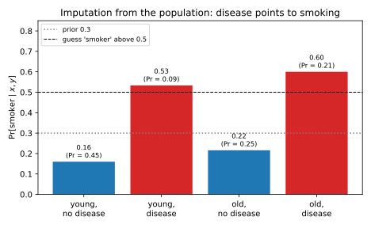

# Attribute inference and model inversion

## Why this matters

A hospital trains a model that predicts a lung disease from a patient's age band and whether they smoke, and puts it behind an interface anyone can query. An insurer knows your age and, from a claim, that you have the disease. Can it use the model to find out whether you smoke? It can guess better than without the model. But that is not yet a privacy failure: if smokers get the disease more often, a published study saying so would allow the same guess about anyone with the disease. The question that matters for *you* is **whether the model reveals more about your attribute because your record was in its training data.**

**Attribute inference** asks an adversary to recover one sensitive field of a record, such as smoking status, a genotype or an income band, from the other fields and access to a model. **Model inversion** is the classic way to do it: query the model once for each candidate value of the sensitive field, and keep the value that best explains the label you already know.

The one idea: **compare with the guesser who never sees the model.** Picture a second insurer with no model but perfect knowledge of the population; its best guess from the visible fields is the **imputation baseline**. A model trained without your record was built from other people's data only, so it can teach the adversary about the population but nothing about you, and the baseline already assumes the population is known. So for a non-member no attack beats the baseline, while for a member it can. Success up to the baseline is population inference; success on members beyond what non-members get is the leak about individuals. Measuring it means comparing members with non-members, which makes attribute inference a membership question in disguise.

Throughout, a record is $(s, x, y)$: a sensitive attribute $s$ with a few values, public features $x$ and a label $y$. The model's **confidence** $f_y(x, s)$ is the probability it gives label $y$ at input $(x, s)$.

## The attribute inference game {#sec-attr-game}

"The attack recovered 78% of smoking statuses" sounds alarming, but it means nothing until you know how often the attribute could be guessed without the model, and how often the attack succeeds on people who were not in the training set. Yeom et al. (2018) built both comparisons into a game. A challenger trains a model, then flips a fair coin to pick the target either from the training set (a **member**) or fresh from the population (a **non-member**). The adversary sees the target's $x$ and $y$ and the model, and guesses $s$. The score is the difference,
$$\mathrm{Adv}^{\mathrm{attr}} = \Pr[\text{guess right} \mid \text{member}] - \Pr[\text{guess right} \mid \text{non-member}].$$
Whatever the attack learned about the population helps members and non-members equally and cancels. What is left is what the model knows about its own training records.

The difference also ties attribute inference to membership. Hand an adversary the whole record and let it say "member" exactly when the attribute attack's guess is right. Its true positive rate (TPR) is the success on members, its false positive rate (FPR) the success on non-members, and its advantage TPR − FPR is the attribute advantage. So the attribute advantage obeys the membership ceiling, the total variation distance between what the adversary sees for members and for non-members, and a model that leaks nothing about membership leaks nothing about attributes either.

In this chapter's toy experiment, a logistic regression with a binary sensitive attribute (prior 0.3), ten public features and a binary label is trained on $n = 100$ records, 200 times. The inversion attack of @sec-attr-inversion is right on 0.7832 of members and 0.7262 of non-members, an advantage of 0.0569 with a standard error of 0.0045. Read as a membership test, its likelihood ratio when it fires is only 1.08 and its balanced accuracy 0.5285. Most of its 78% success would be there if the person had never been in the data. This is also why an attribute attack is a weak membership test at a low FPR: it outputs one bit and is right on most people either way, so a "right" verdict is barely evidence. To measure membership, use the attacks of [Membership inference](02-membership-inference.md); to report an attribute attack, give its success on members, on non-members and the imputation baseline, never one rate.

## The imputation baseline {#sec-attr-imputation}

Population inference is worth measuring directly, since any model of the population, or any published statistic, gives it away. Filling in a missing field from the others is **imputation**, and the best possible imputation, by a guesser who knows the population exactly, picks for each visible $(x, y)$ the value of $s$ most probable in the population: the **maximum a posteriori (MAP)** guess. It is the best because, for each visible $(x, y)$, any guess is right exactly on the probability of the value it names, so naming the most probable value wins the most. Many published attribute attacks do no better than imputation from similar data (Jayaraman & Evans 2022).

For a non-member, the model was trained on other people only, so as far as this record goes it is an observation independent of it, and an independent observation cannot change which value of $s$ is most likely. Every attack therefore satisfies the **non-member ceiling**
$$\Pr[\text{guess right} \mid \text{non-member}] \le V(S \mid X, Y) = \sum_{x, y}\max_s p(s, x, y),$$
where $p(s, x, y)$ is the population probability of a record, and $V$, the **vulnerability**, is the success of the MAP guess: for each visible $(x, y)$, the probability of its most likely $s$, summed. An attack that ignores the model cannot tell the worlds apart at all, because a member, ignoring the model, is just a record drawn from the population. So model-free attacks have zero advantage, and Bayes imputation reaches the ceiling for members and non-members alike.

A worked population makes this concrete. Smoking has prior 0.3; a fraction 0.4 of non-smokers and 0.6 of smokers are old; the disease has probability 0.1, 0.3, 0.4 and 0.7 for young non-smokers, old non-smokers, young smokers and old smokers. The probability of a record is the chance of its smoking status, times the chance of its age band given that, times the chance of its disease outcome given both, which gives @tbl-attr-smoking.

| $p(s, x, y)$ | young, no disease | young, disease | old, no disease | old, disease |
| --- | --- | --- | --- | --- |
| non-smoker ($s = 0$) | **0.378** | 0.042 | **0.196** | 0.084 |
| smoker ($s = 1$) | 0.072 | **0.048** | 0.054 | **0.126** |
| $\Pr[\text{smoker} \mid x, y]$ | 0.1600 | 0.5333 | 0.2160 | 0.6000 |

: The smoking table: the joint distribution of smoking status, age band and disease, with the column maxima in bold and the posterior probability of smoking in each column. {#tbl-attr-smoking}

With no observation the best guess is "non-smoker", right 0.7 of the time. Age alone changes the probability of smoking but never pushes it past one half, so the guess stays "non-smoker" and the success stays 0.7. Adding the disease pushes the posterior past one half in both disease columns (@fig-attr-smoking), the guess becomes "smoker" there, and the success is the sum of the bold entries, $V(S \mid X, Y) = 0.748$, a min-entropy leakage of 0.0957 bits. A good model trained on 10,000 patients from this population lets an insurer reach 0.748 on *anyone*, and no non-member can be attacked better.

{#fig-attr-smoking}

The ceiling is a property of the population, not of the model, and it can be high: if $x$ and $y$ nearly determine $s$, every model and every statistic "reveals" $s$. That is the "smoking causes cancer" case of Dwork & Roth (2014): the study disclosed a fact about the world, not about its participants. It can still harm people, but no mechanism that limits what one record contributes can prevent it, since the harm would remain with your record removed; it is a question for policy and fairness. In an audit, estimate the baseline with the best imputation model you can fit on data from the same population, and run the attack on held-out non-members too.

## Model inversion: the MAP attack {#sec-attr-inversion}

Imputation needs the link $p(y \mid x, s)$ between label and attribute, and the adversary usually does not know it. But a model that predicts $y$ from $x$ and $s$ is an estimate of exactly that link. Fredrikson et al. (2014) used this on a warfarin dosing model to infer patients' genetic markers from their demographics and dose, and called it **model inversion**; confidences make it stronger (Fredrikson, Jha & Ristenpart 2015). The attack is Bayes' rule: the value of $s$ that best explains what you see maximizes "how plausible is $s$ for someone with these features" times "how likely is the known label if the attribute were $s$". The adversary supplies the first factor from what it knows about the population and gets the second by querying the model at each candidate:
$$\hat s(x, y) = \arg\max_s\; p(s \mid x)\, f_y(x, s).$$ {#eq-attr-map-inversion}
Use $p(s \mid x)$, not the marginal $p(s)$ that Fredrikson et al. used, or the attack throws away what $x$ says about $s$.

Everything the attack does comes from how the model's confidences differ from the population's probabilities. If the model is **calibrated**, its confidences equal those probabilities, and inversion *is* imputation, with success $V(S \mid X, Y)$ on members and non-members alike. Take an old patient with the disease in the smoking table. The adversary knows $\Pr[\text{smoker} \mid \text{old}] = 0.3913$ and queries a calibrated model, which returns 0.7 for a smoker and 0.3 for a non-smoker. The scores are 0.2739 for "smoker" and 0.1826 for "non-smoker", so it guesses "smoker", and normalized they give exactly the posterior 0.6000 of @tbl-attr-smoking.

A trained model differs from the population in two ways, one per world. On members it is too sure of the truth: training raises the confidence in each record's label at its *true* $s$, while the other value was never paired with that record, so the confidence there stays closer to honest. The ratio that decides the attack is tilted towards the truth, which is overfitting, the generalization gap of [Membership inference](02-membership-inference.md) seen through the sensitive attribute. On non-members the model's confidences carry the noise of a small training set rather than the population's exact probabilities, so the attack does *worse* than imputation. On the toy model, Bayes imputation is right 0.7517 of the time. MAP inversion with the trained model is right on 0.7832 of members, 0.0315 *above* that ceiling, which no knowledge of the population could produce, and on 0.7262 of non-members, 0.0254 below it. So weak results on fresh records say nothing about members.

More data closes both gaps, because the model approaches the population: the advantage is 0.1610 at $n = 25$, 0.0111 at $n = 400$ and 0.0052 at $n = 1600$ (@fig-attr-success-vs-n).

{#fig-attr-success-vs-n}

The same idea can invert a whole input: on a face recognition model whose classes are people, searching for the image that maximizes one class's confidence recovers a blurred, recognizable face. That is population inference about the class, and a privacy problem because the class is one person.

## Confidence masking {#sec-attr-masking}

If confidences make inversion stronger, why release them? Rounding them, or returning only the top label, is cheap and leaves the prediction unchanged. Such **confidence masking** only coarsens what the adversary sees, and whoever sees the full answers could apply the mask themselves, so it can never help the best attacker. For any masking function $g$ applied to the answers $F$ the adversary gets by querying every candidate $s$,
$$V\big(S \mid X, Y, g(F)\big) \le V\big(S \mid X, Y, F\big),$$
on members and on non-members separately. But the inequality says nothing about the *difference* between the two worlds, which is the leak, and masking lowers each by amounts that need not match.

Labels alone still leak, for the same reason confidences do. On a member, the model usually predicts the training label at the true $s$, because it fit that record, and an honest label at the other value, so "the label matches at only one candidate" points to the truth. On a non-member the two predicted labels usually agree, and the attack falls back on the guess from $x$ alone. So masking hurts population inference more than the individual leak. @tbl-attr-masking attacks the same 200 models through three interfaces. Rounding to one decimal changes almost nothing, since the comparison between candidates rarely changes sign. Returning labels only drops non-member success to 0.7092, close to the 0.7045 of guessing from $x$ alone, while member success stays 0.0224 above the imputation ceiling, so the advantage *grows* from 0.0569 to 0.0650.

| Interface | Members | Non-members | Advantage |
| --- | --- | --- | --- |
| Full confidences | 0.7832 | 0.7262 | 0.0569 |
| Confidences rounded to one decimal | 0.7836 | 0.7253 | 0.0583 |
| Top label only | 0.7741 | 0.7092 | 0.0650 |

: MAP inversion success through three interfaces, averaged over 200 models trained on 100 records each. Guessing from $x$ alone gives 0.7045 and Bayes imputation 0.7517. {#tbl-attr-masking}

{#fig-attr-masking}

Masking is obfuscation, not a guarantee: it removes one attack's input without bounding what any attack learns about a member. So don't count a drop in overall attack success as a privacy gain; check the member/non-member gap. What shrinks the gap is less overfitting, for example more training data, and what bounds it for every attacker and every output format is [differential privacy](../part03-dp-foundations/01-definition.md).

## Code {#sec-attr-code}

The imputation baseline and the inversion scores of the smoking example take a few lines with the standard library:

```python
from itertools import product
from math import log2

P_SMOKER = 0.3
P_OLD = {0: 0.4, 1: 0.6}  # Pr[old | s]
P_DISEASE = {(0, 0): 0.1, (0, 1): 0.3, (1, 0): 0.4, (1, 1): 0.7}  # Pr[disease | s, old]


def joint(s: int, old: int, disease: int) -> float:
    """Probability of the record (smoker s, old, disease) in the population."""
    p_s = P_SMOKER if s else 1 - P_SMOKER
    p_x = P_OLD[s] if old else 1 - P_OLD[s]
    p_y = P_DISEASE[(s, old)] if disease else 1 - P_DISEASE[(s, old)]
    return p_s * p_x * p_y


def best_guess_success(sees_age: bool, sees_disease: bool) -> float:
    """Success of the MAP guess of s for a guesser who knows the population and sees the chosen fields."""
    cells: dict[tuple[int, int], list[float]] = {}
    for s, old, disease in product((0, 1), repeat=3):
        key = (old if sees_age else -1, disease if sees_disease else -1)
        cells.setdefault(key, [0.0, 0.0])[s] += joint(s, old, disease)
    return sum(max(cell) for cell in cells.values())


def inversion_scores(old: int, confidence: dict[int, float]) -> dict[int, float]:
    """MAP inversion: prior of s given the age band, times the model's confidence in the known label at s."""
    prior = {s: (P_SMOKER if s else 1 - P_SMOKER) * (P_OLD[s] if old else 1 - P_OLD[s]) for s in (0, 1)}
    total = sum(prior.values())
    return {s: prior[s] / total * confidence[s] for s in (0, 1)}


v0, vx, vxy = best_guess_success(False, False), best_guess_success(True, False), best_guess_success(True, True)
print(f"{v0:.4f} {vx:.4f} {vxy:.4f}")  # 0.7000 0.7000 0.7480
print(f"{log2(vxy / v0):.4f}")  # 0.0957
scores = inversion_scores(old=1, confidence={0: 0.3, 1: 0.7})  # a calibrated model, queried for an old patient with the disease
print(f"{scores[1]:.4f} {scores[0]:.4f}")  # 0.2739 0.1826
print(f"{scores[1] / (scores[0] + scores[1]):.4f}")  # 0.6000
```

The full edition's script, [attribute_inference.py](../../code/part02-attacks/attribute_inference.py), plays the game on the toy model and prints every number in this chapter:

```bash
uv run python code/part02-attacks/attribute_inference.py
```

## Cheat sheet

| Result | Statement | Notes |
| --- | --- | --- |
| Attribute advantage | Success on members $-$ success on non-members | Population inference cancels |
| Reduction to membership | "Member if the guess is right": TPR $-$ FPR $=$ attribute advantage | Bounded by the membership ceiling; weak at low FPR |
| Non-member ceiling | Success on non-members $\le V(S \mid X, Y) = \sum_{x, y}\max_s p(s, x, y)$ | Imputation reaches it; model-free attacks have zero advantage |
| MAP inversion | $\hat s = \arg\max_s p(s \mid x)\,f_y(x, s)$ | Calibrated model: inversion is imputation |
| Masking | $V(S \mid X, Y, g(F)) \le V(S \mid X, Y, F)$ | The member/non-member gap can grow |

: The results of this chapter. {#tbl-attr-cheat}

**Rules of thumb**

- Report success on members, on non-members, and the imputation baseline. One success rate says nothing about privacy.
- Success up to the imputation baseline is population inference; any model or statistic of the population gives it.
- Success on members beyond non-members is the individual leak. It comes from overfitting and shrinks as the training set grows.
- Rounding confidences or returning labels only changes the attack, not what the model memorized.

## Further reading

- Yeom, Giacomelli, Fredrikson & Jha, "Privacy Risk in Machine Learning: Analyzing the Connection to Overfitting" (IEEE CSF 2018): the attribute game with members and non-members, and its link to membership and overfitting.
- Fredrikson, Jha & Ristenpart, "Model Inversion Attacks that Exploit Confidence Information and Basic Countermeasures" (CCS 2015): inversion from confidences, face reconstruction, and rounding as a countermeasure.
- Jayaraman & Evans, "Are Attribute Inference Attacks Just Imputation?" (CCS 2022): the imputation baseline, and what it takes to beat it.

**Derivations.** Every result in this chapter is derived step by step in [the full edition's chapter](../../book-full/part02-attacks/03-attribute-inference.md).
