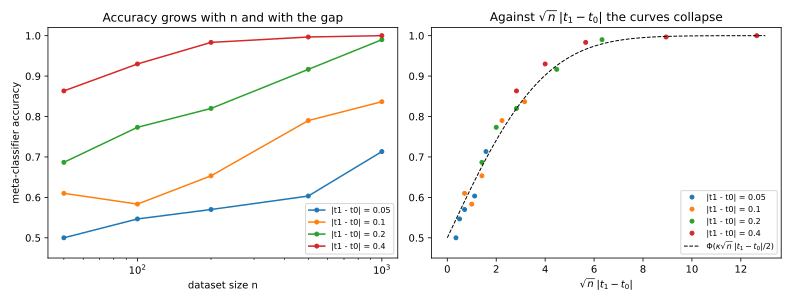

# Property inference

## Why this matters

A hospital trains a readmission model on its 1,000 patients and shares it with a research partner. You have checked that no attack can tell, much better than a coin flip, whether any one patient was in the training set. The partner can still learn whether 45% or 55% of the hospital's patients are over 65, and be right almost every time. None of these secrets is about a record. Each is a **property** of the training set as a whole, a statistic such as the fraction $t$ of records that belong to some subgroup. **Property inference** is the attack that recovers it from a trained model (Ateniese et al. 2015; Ganju et al. 2018).

You need to know whether a model you release or audit leaks such a property, how to measure it, and what would stop it. The one idea is a comparison of scales. A trained model behaves like an average over its $n$ records, plus noise of size about $1/\sqrt n$. One record moves it by about $1/n$, which is lost in the noise, so membership inference gets harder as $n$ grows. Changing the subgroup's share from $t_0$ to $t_1$ changes about $n|t_1 - t_0|$ records at once, and moves the model by a fixed amount that does not shrink with $n$. Measured against the noise, the signal is about $\sqrt n\,|t_1 - t_0|$, so property inference gets *easier* with more data. @tbl-prop-overview maps the questions to the sections.

| Question | Answer | Section |
| --- | --- | --- |
| How to score a property attack, and what no attack can beat | Accuracy against a coin flip; the ceiling is a total variation distance | @sec-prop-game |
| Whether protecting records protects properties | No: record leakage falls like $1/\sqrt n$, property leakage rises to 1 | @sec-prop-scaling |
| How to run the attack, and how accurate it will be | Shadow models and a linear meta-classifier; accuracy $\Phi(\kappa\sqrt n\,\lvert t_1 - t_0\rvert/2)$ | @sec-prop-meta |
| Attacking a neural network | Use a representation that ignores the order and sign of hidden units, or probe outputs | @sec-prop-symmetry |

: The questions this chapter answers, and where. {#tbl-prop-overview}

## The property game and its ceiling {#sec-prop-game}

**Idea.** Write the attack as a game, as [Threat models and privacy games](01-threat-models.md) does for every attack. A challenger flips a fair bit $b$, draws a dataset of $n$ records from a population in which the subgroup has share $t_b$, trains a model, and hands the attacker a view of it: the weights (white-box) or query answers (black-box). The attacker knows the two shares, has data from both groups, and can train models the way the victim does. It guesses $b$. Suri & Evans (2022) call this **distribution inference**. Each dataset carries one secret, so the natural score is plain **accuracy**, the probability of guessing $b$ right, against a baseline of $\frac12$. Accuracy and **advantage**, the true positive rate (TPR) minus the false positive rate (FPR), carry the same information: accuracy is $\frac12(1 + \text{advantage})$.

**Result.** No attack's advantage exceeds the total variation (TV) distance between the distributions of the model under the two shares, and since the model is computed from the data, that is at most the TV distance between the two distributions of the data. When each record shows its group, the only thing in the data that bears on $t$ is the count of subgroup records, which is binomial, so for every model trained on the data
$$\text{advantage} \le \mathrm{TV}\big(\mathrm{Bin}(n, t_0), \mathrm{Bin}(n, t_1)\big).$$ {#eq-prop-count-ceiling}
Releasing that count is the worst case. A model that never sees the group leaks less, and how much less is something you measure.

**Example.** For the hospital, $n = 1{,}000$, $t_0 = 0.45$ and $t_1 = 0.55$. The count has mean 450 or 550 and standard deviation about 15.7, so the two worlds barely overlap, and @eq-prop-count-ceiling gives 0.9985. A model from which the count can be read off is right more than 99.9% of the time. At $n = 100$ the ceiling is 0.6827, and 200,000 simulated games give an advantage of 0.6811.

**Pitfalls.** Don't report TPR at low FPR for a property attack, as you would for membership inference: there is no population of targets, only one secret per dataset. Ask whether the property is a harm at all. Learning that smokers get more lung cancer is the point of a study; the harm arises when the property describes the *data owner*, such as one hospital's patient mix or one lab's machine configuration. If the dataset is a small sample of a public population, its property is public anyway.

## Why a property leaks when no record does {#sec-prop-scaling}

**Idea.** Take the simplest release, the count of subgroup records, and ask two questions of it. "Is my target, a subgroup member, in the data?" depends on one extra unit in a count that already varies by about $\sqrt n$. "Was the share $t_0$ or $t_1$?" depends on a shift of $n|t_1 - t_0|$ in that count. The first shrinks into the noise; the second outgrows it.

**Result.** With the midpoint share $\bar t = \frac{t_0 + t_1}2$, the best advantages from the released count are approximately
$$\mathrm{Adv}_{\mathrm{mem}} \approx \frac{1 - t}{\sqrt{2\pi(n - 1)t(1 - t)}}, \qquad \mathrm{Adv}_{\mathrm{prop}} \approx 2\Phi\Big(\frac{\sqrt n\,|t_1 - t_0|}{2\sqrt{\bar t(1 - \bar t)}}\Big) - 1,$$
where $\Phi$ is the standard normal distribution function. The first falls like $1/\sqrt n$. The second depends on $n$ and the gap only through $\sqrt n\,|t_1 - t_0|$, so doubling the gap has the same effect as multiplying $n$ by 4.

**Example.** @tbl-prop-count gives both, exactly and by the formulas, for $t_0 = 0.45$ against $t_1 = 0.55$ and for one subgroup record at $t = 0.5$; @sec-prop-code computes them. At $n = 10{,}000$ the membership attacker is right with probability $0.502$, and the property attacker is never wrong to four decimals. Only the question differs (@fig-prop-count-leak).

| $n$ | Property, exact | Property, formula | Membership, exact | Membership, formula |
| --- | --- | --- | --- | --- |
| 100 | 0.6827 | 0.6827 | 0.0398 | 0.0401 |
| 1,000 | 0.9985 | 0.9984 | 0.0126 | 0.0126 |
| 10,000 | 1.0000 | 1.0000 | 0.0040 | 0.0040 |

: Best advantages from a released count of subgroup records. Property: $t_0 = 0.45$ against $t_1 = 0.55$. Membership: one subgroup record, population share $t = 0.5$. {#tbl-prop-count}

{#fig-prop-count-leak}

**Pitfalls.** A defence sized for one record does not cover a property. For the hospital, moving from 45% to 55% changes 100 of its 1,000 patients, and differential privacy protects groups only through its group-privacy property, whose guarantee weakens with the size of the group ([Properties of differential privacy](../part03-dp-foundations/02-properties.md)). To hide the property, the release must be noisy on the scale of $n|t_1 - t_0|$ records, and that much noise also destroys what the release was for: hiding the property means hiding the population. Deleting the group column does not help either, as the next section shows, because whatever correlates with the group still moves the model. An attacker who can add a few records to the training set can make the property far easier to infer (Mahloujifar et al. 2022), so audit with poisoning in scope when outsiders contribute data.

## Shadow models and meta-classifiers {#sec-prop-meta}

**Idea.** For a real model nobody can write down the distribution of the trained weights, so the attacker samples it. Draw many datasets with share $t_0$ and many with $t_1$ from auxiliary data, train a **shadow model** on each exactly as the victim trains, label each shadow model's parameters with its share, and train a classifier on those parameter vectors, the **meta-classifier**. Then apply it to the victim's model. This is the shadow-model recipe of [Membership inference](02-membership-inference.md), with whole models as the data points.

**Result.** For a model fitted by minimizing an average loss, the trained parameters are approximately Gaussian around the population fit $\theta(t)$, with a covariance $\Sigma_1/n$ that shrinks like $1/n$. Between two Gaussians with the same covariance the best test is linear, so a **linear discriminant** is the meta-classifier to train, and its accuracy is about
$$\Phi\big(\kappa\sqrt n\,|t_1 - t_0|/2\big), \qquad \kappa = \sqrt{\theta'^\top\Sigma_1^{-1}\theta'}.$$ {#eq-prop-kappa}
Here $\theta'$ is how fast the population fit moves as the share changes, and $\kappa$ is that speed measured in units of the per-record noise. For the released count $\kappa = 1/\sqrt{\bar t(1 - \bar t)}$, which is 2 at $\bar t = \frac12$. A model with a smaller $\kappa$ leaks the property as well as the count would on a fraction $(\kappa\sqrt{\bar t(1 - \bar t)})^2$ of its records, a unit Suri & Evans (2022) use to report leakage.

**Example.** Records have two features and a label. The majority's risk rises with the second feature, the subgroup's falls with it, and **the group is never a feature**. A logistic regression's second weight moves from 0.442 at share 0.25 to −0.442 at share 0.75, and the per-record noise of that weight gives $\kappa = 0.647$ against 2 for the count: the model leaks the property as well as $(0.647/2)^2 = 0.105$ of its records would, about one record in ten. With 150 shadow models per hypothesis and 150 fresh target models to score, the meta-classifier's accuracy matches the prediction in most cells of @tbl-prop-sweep to within two standard errors, each at most 0.029. Plotted against $\sqrt n\,|t_1 - t_0|$, the four gaps fall on one curve (@fig-prop-meta-accuracy): a gap of 0.05 at $n = 1{,}000$ is about as easy as a gap of 0.1 at $n = 200$, since $\sqrt{1000}\times0.05 = 1.58$ against $\sqrt{200}\times0.1 = 1.41$.

| $n$ | gap 0.05 | gap 0.1 | gap 0.2 | gap 0.4 |
| --- | --- | --- | --- | --- |
| 50 | 0.523 (0.546) | 0.520 (0.590) | 0.653 (0.676) | 0.830 (0.818) |
| 100 | 0.523 (0.564) | 0.670 (0.627) | 0.733 (0.741) | 0.863 (0.901) |
| 200 | 0.503 (0.590) | 0.670 (0.676) | 0.803 (0.819) | 0.957 (0.965) |
| 500 | 0.633 (0.641) | 0.787 (0.765) | 0.910 (0.926) | 0.997 (0.998) |
| 1,000 | 0.713 (0.695) | 0.867 (0.847) | 0.980 (0.979) | 1.000 (1.000) |

: Accuracy of the linear meta-classifier against logistic regressions that never see the group, by dataset size $n$ and gap $\lvert t_1 - t_0\rvert$, with the prediction of @eq-prop-kappa in parentheses. {#tbl-prop-sweep}

{#fig-prop-meta-accuracy}

**Pitfalls.** The attack is only as good as the attacker's copy of the pipeline: shadow models must be trained on data from both groups, with the victim's algorithm and dataset size. Too few shadow models leave the meta-classifier's direction noisy, and it falls short of the prediction where the effect is small; in @tbl-prop-sweep, the cells with $n \le 200$ and a gap of at most 0.1 are where it misses. As an auditor, report the predicted accuracy from $\kappa$ next to the measured one, so a weak attack is not mistaken for a safe model. If the property does not change what the model fits ($\theta' = 0$), nothing leaks to first order, however large $n$ is; if it does, the leak is a side effect of fitting the data well.

## Neural networks and permutation invariance {#sec-prop-symmetry}

**Idea.** Swap two hidden units of a network, with their incoming and outgoing weights, and it computes the same function. For tanh units, flipping the signs of a unit's weights in and out also changes nothing, because tanh is odd. Training from a symmetric random start keeps these symmetries, so each weight slot holds a random unit with a random sign. The property shows in *which* units the network has, not in which slot holds which, and averaging slot by slot washes it out (Ganju et al. 2018).

**Result.** For tanh networks every raw weight has mean zero under both hypotheses, so a linear meta-classifier on raw weights is at chance. Three representations undo the symmetry. A **canonical form** flips each unit so its outgoing weight is positive and sorts units by it; for ReLU networks sorting alone suffices. A **set representation** sums a function of each unit's parameters, such as the products $\sum_ju_ju_j^\top$ of each unit's parameter vector $u_j$ with itself, or a learned DeepSets network (Zaheer et al. 2017). **Probe outputs**, the model's answers on fixed inputs, are invariant automatically and need only black-box access.

**Example.** Tanh networks with 4 hidden units are trained on 200 records with subgroup share 0.2 or 0.8, with 150 shadow and 150 target networks per side. @tbl-prop-representations shows the linear meta-classifier on each representation.

| Representation | Features | Accuracy |
| --- | --- | --- |
| Raw parameters | 17 | 0.497 |
| Canonical order (flip so $v_j > 0$, sort by $v_j$) | 17 | 0.807 |
| Unit second moments $\sum_j u_ju_j^\top$ | 11 | 0.877 |
| Outputs on 16 probe inputs | 16 | 1.000 |

: The same linear meta-classifier against the same tanh networks, by representation of the network; $v_j$ is unit $j$'s outgoing weight. {#tbl-prop-representations}

**Pitfalls.** A meta-classifier at chance on raw weights says the representation is wrong, not that the model is safe. Canonical ordering is fragile when units have nearly equal outgoing weights; deeper networks need an invariant representation at every layer. White-box access is never weaker for the *best* attack, but for a fixed simple attack, representation matters more than access: the black-box probes beat the raw weights. So a model served only through an API is not safe from property inference (Zhang, Tople & Ohrimenko 2021).

## Code {#sec-prop-code}

The ceiling of @eq-prop-count-ceiling and the two advantages of @sec-prop-scaling take a few lines:

```python
from math import erf, exp, lgamma, log, sqrt


def binom_pmf(n: int, t: float) -> list[float]:
    """Pr[Bin(n, t) = k] for k = 0..n, in log space so that large n does not overflow."""
    return [exp(lgamma(n + 1) - lgamma(k + 1) - lgamma(n - k + 1) + k * log(t) + (n - k) * log(1 - t)) for k in range(n + 1)]


def property_ceiling(n: int, t0: float, t1: float) -> float:
    """Best advantage of any property attack when the group is visible: TV(Bin(n, t0), Bin(n, t1))."""
    return 0.5 * sum(abs(p - q) for p, q in zip(binom_pmf(n, t0), binom_pmf(n, t1)))


def property_normal(n: int, t0: float, t1: float) -> float:
    """The normal approximation 2 Phi(sqrt(n) |t1 - t0| / (2 sqrt(tbar (1 - tbar)))) - 1."""
    tbar = (t0 + t1) / 2
    z = sqrt(n) * abs(t1 - t0) / (2 * sqrt(tbar * (1 - tbar)))
    return erf(z / sqrt(2))  # equals 2 Phi(z) - 1


def membership_best(n: int, t: float) -> float:
    """Best advantage for one subgroup record from the same count: (1 - t) max_k Pr[Bin(n - 1, t) = k]."""
    return (1 - t) * max(binom_pmf(n - 1, t))


print(f"{property_ceiling(100, 0.45, 0.55):.4f} {property_normal(100, 0.45, 0.55):.4f}")  # 0.6827 0.6827
print(f"{property_ceiling(1000, 0.45, 0.55):.4f} {property_normal(1000, 0.45, 0.55):.4f}")  # 0.9985 0.9984
print(f"{membership_best(100, 0.5):.4f} {membership_best(10000, 0.5):.4f}")  # 0.0398 0.0040
```

The full edition's script runs the shadow-model attacks and reproduces every number in this chapter:

```bash
uv run python code/part02-attacks/property_inference.py
```

## Cheat sheet

| Result | Formula | Notes |
| --- | --- | --- |
| Score | Accuracy $= \frac12(1 + \mathrm{TPR} - \mathrm{FPR})$ | One secret per dataset; baseline $\frac12$ |
| Ceiling, group visible | $\mathrm{TV}(\mathrm{Bin}(n, t_0), \mathrm{Bin}(n, t_1))$ | Attained by releasing the count |
| Property, released count | $2\Phi\big(\sqrt n\,\lvert t_1 - t_0\rvert/(2\sqrt{\bar t(1 - \bar t)})\big) - 1$ | $\to 1$ as $n$ grows |
| Membership, released count | $\approx (1 - t)/\sqrt{2\pi(n - 1)t(1 - t)}$ | $\to 0$ like $1/\sqrt n$ |
| Meta-classifier accuracy | $\Phi(\kappa\sqrt n\,\lvert t_1 - t_0\rvert/2)$ | Linear discriminant on parameters; count has $\kappa = 1/\sqrt{\bar t(1 - \bar t)}$ |
| Neural networks | Raw weights at chance (tanh) | Canonical order, unit second moments, or probe outputs |

: The results of this chapter. {#tbl-prop-cheat}

**Rules of thumb**

- Property inference gets easier with more data, membership inference harder. What matters is $\sqrt n\,|t_1 - t_0|$.
- A property changes about $n|t_1 - t_0|$ records at once. Defences sized for one record do not cover it.
- Removing the sensitive column does not remove the property; whatever correlates with it moves the model.
- Audit with shadow models trained like the victim, a linear meta-classifier, and a representation that respects the network's symmetries. Report accuracy, and compare it with the prediction from $\kappa$.

## Further reading

- Ganju, Wang, Yang, Gunter & Borisov, "Property Inference Attacks on Fully Connected Neural Networks using Permutation Invariant Representations" (CCS 2018): the practical attack on neural networks, neuron sorting and the DeepSets meta-classifier.
- Suri & Evans, "Formalizing and Estimating Distribution Inference Risks" (PoPETs 2022): the property game as a test between two training distributions, and leakage reported in records.
- Zhang, Tople & Ohrimenko, "Leakage of Dataset Properties in Multi-Party Machine Learning" (USENIX Security 2021): black-box property inference, including properties of attributes removed from the training data.
- Mahloujifar, Ghosh & Chase, "Property Inference from Poisoning" (IEEE S&P 2022): how a few injected records make a property far easier to infer.

**Derivations.** Every result in this chapter is derived step by step in [the full edition's chapter](../../book-full/part02-attacks/04-property-inference.md).
