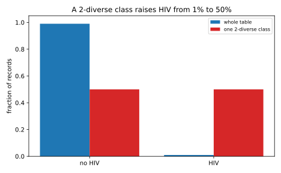

# Syntactic anonymity and how it breaks

## Why this matters

[Linkage and re-identification](07-linkage-reidentification.md) showed that deleting names does not anonymize a table: the remaining **quasi-identifiers**, such as age, ZIP code and sex, single out most people. Between 1998 and 2008 a family of definitions answered by constraining the released table itself. **k-anonymity** hides every record in a crowd of at least $k$ look-alikes. **l-diversity** asks each crowd to hold several different sensitive values. **t-closeness** asks each crowd to look like the whole table. They are **syntactic**: each is a property of the published table that you can check by reading it, with no reference to how it was produced or what else the adversary knows.

Statistics offices, data-sharing agreements, regulators' guidance and anonymization tools such as ARX still use them, so you need to know what each promises and what breaks it. The one idea is that **a syntactic definition fixes the adversary's knowledge in advance**. Each attack gives the adversary one more piece of knowledge the definition did not anticipate, and a second release breaks all three. Those failures are the specification for differential privacy. @tbl-anon-uses maps each definition to what it guarantees and what breaks it.

| Definition | What it guarantees | What breaks it | Section |
| --- | --- | --- | --- |
| k-anonymity | Linkage success at most $1/k$ | Homogeneity, background knowledge | @sec-anon-k |
| l-diversity | Recursive version: posterior below $c/(1 + c)$ | Skewness, similarity | @sec-anon-l |
| t-closeness | Every belief moves by at most $t$ | Rare values; it also erases the data's purpose | @sec-anon-t |
| All three | Nothing about two releases | Composition | @sec-anon-composition |

: The syntactic definitions, what each guarantees, and the attack that breaks it. {#tbl-anon-uses}

Throughout, records are grouped into **equivalence classes**, sets of records with the same (generalized) quasi-identifiers, and each record has one **sensitive attribute** $S$, such as a diagnosis. One fact drives every attack on $S$. An adversary who knows the target's quasi-identifiers can find the target's class $E$ but not its record, so its belief, or **posterior**, about the target's value is the class's frequency of that value:
$$\Pr[S_{\text{target}} = v \mid \text{release}] = \frac{n_E(v)}{\lvert E\rvert} = P_E(v),$$ {#eq-anon-posterior}
where $n_E(v)$ counts the records of $E$ with value $v$. Background knowledge works by elimination: if the adversary knows the target's value is not $u$, it crosses out the records with $u$ and renormalizes over the rest.

## k-anonymity {#sec-anon-k}

**Idea.** Sweeney and Samarati's answer to linkage: make sure no combination of quasi-identifiers singles out fewer than $k$ people. A custodian gets there by **generalization** (age 37 becomes 35–39, ZIP code 02139 becomes 021\*\*) and by **suppression**, deleting the few records that still stand out.

**Result.** A release is **k-anonymous** if every equivalence class has at least $k$ records. The linkage success, the number of classes $J$ over the number of records $n$, is then
$$\Pr[\text{win}] = \frac{J}{n} \le \frac{1}{k},$$ {#eq-anon-k-link}
because $n$ records cannot fill more than $n/k$ classes of $k$. The cost is precision. If the generalized quasi-identifiers split the population into $M$ equally likely cells, the fraction of records in classes smaller than $k$ is about $\Pr[\mathrm{Poisson}(n/M) \le k - 2]$. Keeping that below 1% needs more than $k$ people per cell on average, because cells vary in size and the unlucky small ones violate the definition.

**Example.** For $n = 10{,}000$ people ($\log_2 n = 13.29$ bits), 2-anonymity for 99% of records needs 4.61 people per cell and allows the quasi-identifiers 11.08 bits, 2.20 below $\log_2 n$; 5-anonymity needs 10.05 per cell and allows 9.96 bits. The window between "almost everyone is unique" and "almost everyone is hidden" is about 9 bits wide. On a synthetic hospital table of 10,000 patients (age, ZIP code and sex as quasi-identifiers, one of eight diagnoses as the sensitive attribute), the exact quasi-identifiers give a linkage success of 0.933. The **Mondrian** algorithm (LeFevre, DeWitt & Ramakrishnan, 2006), which splits boxes of records at medians while both halves keep $k$ records, k-anonymizes it (@tbl-anon-k).

| $k$ | Classes | Sizes | Mean width | Linkage $J/n$ | Certain disclosure | Guess accuracy |
| --- | --- | --- | --- | --- | --- | --- |
| 2 | 4,091 | 2–5 | 0.005 | 0.4091 | 0.2797 | 0.675 |
| 5 | 1,542 | 5–11 | 0.016 | 0.1542 | 0.0232 | 0.593 |
| 10 | 748 | 10–20 | 0.028 | 0.0748 | 0.0000 | 0.562 |
| 20 | 366 | 20–41 | 0.043 | 0.0366 | 0.0000 | 0.540 |
| 50 | 129 | 50–99 | 0.075 | 0.0129 | 0.0000 | 0.506 |

: Mondrian k-anonymization of a synthetic hospital table of 10,000 patients. Mean width is the class's range as a fraction of each quasi-identifier's full range. Certain disclosure is the fraction of records in a class with a single diagnosis. Guess accuracy is the fraction of records whose diagnosis is the most common one in their class. {#tbl-anon-k}

Linkage stays below $1/k$ at little cost in precision: at $k = 5$ the average range covers 1.6% of each quasi-identifier's span.

**Pitfalls.** k-anonymity protects names, not attributes: at $k = 5$, 2.3% of patients sit in a class with a single diagnosis, and the release states their diagnosis outright. In sparse data, like ratings, every column is a quasi-identifier, and k-anonymizing it leaves little. And the guarantee assumes the adversary knows only the quasi-identifiers.

## Homogeneity, background knowledge and l-diversity {#sec-anon-l}

**Idea.** Machanavajjhala and colleagues (2006) showed that k-anonymity hides who a record belongs to, not what it says. @tbl-anon-toy is 3-anonymous.

| ZIP code | Age | Diagnosis |
| --- | --- | --- |
| 130\*\* | < 30 | heart disease |
| 130\*\* | < 30 | heart disease |
| 130\*\* | < 30 | heart disease |
| 148\*\* | 4\* | cancer |
| 148\*\* | 4\* | flu |
| 148\*\* | 4\* | heart disease |
| 130\*\* | 3\* | cancer |
| 130\*\* | 3\* | cancer |
| 130\*\* | 3\* | flu |

: A 3-anonymous release with three classes of three records. {#tbl-anon-toy}

Alice, 26, is in the first class, where every record says heart disease: her posterior is 1. That is the **homogeneity attack**. Bob, 35, is in the third class, with posterior $\frac23$ for cancer; his neighbour knows he did not have flu, crosses out the flu record, and cancer has posterior 1. That is the **background knowledge attack**. l-diversity asks each class for enough different sensitive values.

**Result.** Sort a class's value counts as $r_1 \ge r_2 \ge \dots \ge r_m$. A class is **distinct $\ell$-diverse** if it holds at least $\ell$ different values; **entropy $\ell$-diverse** if the entropy of its distribution is at least $\log_2 \ell$, as spread out as $\ell$ equally common values; and **recursive $(c, \ell)$-diverse** if $r_1 < c\,(r_\ell + \dots + r_m)$, so the top value cannot swamp the tail left after setting aside the $\ell - 1$ largest. Only the recursive version gives a numeric cap: after the adversary rules out any $\ell - 2$ values, every remaining value has posterior below $c/(1 + c)$, which is 0.500, 0.667 and 0.750 for $c = 1, 2, 3$.

**Example.** The toy classes hold 1, 3 and 2 values, with entropy-equivalent $\ell$ of 1.00, 3.00 and 1.89, so the release is only 1-diverse. On the hospital table, @tbl-anon-l adds diversity to $k = 5$.

| Criterion | Classes | Sizes | Mean width | Linkage $J/n$ | Certain disclosure | Guess accuracy |
| --- | --- | --- | --- | --- | --- | --- |
| $k = 5$ | 1,542 | 5–11 | 0.016 | 0.1542 | 0.0232 | 0.593 |
| $k = 5$, distinct $\ell = 3$ | 1,132 | 5–33 | 0.022 | 0.1132 | 0.0000 | 0.574 |
| $k = 5$, recursive $(c = 2, \ell = 3)$ | 389 | 5–641 | 0.113 | 0.0389 | 0.0000 | 0.417 |

: Mondrian with l-diversity on the same hospital table: each split is allowed only if both halves satisfy the criterion. {#tbl-anon-l}

Read guess accuracy against baselines that use no release: the table's most common diagnosis is right for 18.5% of patients, and **imputation**, the most likely diagnosis for each patient's age under the population law, for 53.6%. So most of what a 5-anonymous release teaches (59.3%) is the age–diagnosis pattern any study would report. Distinct 3-diversity removes certain disclosure cheaply. Recursive $(2, 3)$-diversity forces classes of hundreds of patients and pushes accuracy below imputation.

**Pitfalls.** l-diversity protects against certainty, not likelihood: even the recursive cap lets the adversary be fairly sure, and the distinct and entropy versions cap nothing: an entropy 3-diverse class over 8 values can have one value in 73% of its records. The adversary's knowledge is assumed, not bounded: one who rules out more than $\ell - 2$ values, or knows something softer ("probably not flu"), is not covered. Measure attribute disclosure against imputation, not against guessing the most common value, or you will count the study's findings as leaks.

## Skewness, similarity and t-closeness {#sec-anon-t}

**Idea.** Li, Li and Venkatasubramanian (2007) found two attacks that l-diversity misses. **Skewness**: if 1% of the table has HIV, a class that is half HIV is 2-diverse, yet it raises the belief for its members from 1% to 50%. **Similarity**: a class holding gastric ulcer, gastritis and stomach cancer is 3-diverse, and still says "stomach disease". What matters is how far a class is from what the adversary would believe anyway, the whole table's distribution $P$.

**Result.** A release is **t-close** if every class's distribution is within distance $t$ of the table's, $d(P_E, P) \le t$. With the **total variation (TV)** distance, $\mathrm{TV}(P, Q) = \frac12\sum_v\lvert P(v) - Q(v)\rvert$, which is the largest gap in probability over any set of values, every question about the target's value gets an answer within $t$ of the table's:
$$\lvert P_E(A) - P(A)\rvert \le t \quad \text{for every set of values } A.$$ {#eq-anon-tv}
So guessing the class's top value is right with probability at most $\max_v P(v) + t$. To catch the similarity attack, Li et al. use the **earth mover's distance (EMD)**: the least work to reshape one distribution into the other, where moving mass between two values costs their distance. For $m$ ordered values (salary bands, age groups) at spacing $1/(m - 1)$, it sums the net mass that must cross each gap:
$$\mathrm{EMD}(P_E, P) = \frac{1}{m - 1}\sum_{i=1}^{m-1}\Big\lvert\sum_{j \le i}\big(P_E(j) - P(j)\big)\Big\rvert.$$ {#eq-anon-emd}

**Example.** The toy classes are at TV 0.556, 0.111 and 0.444 from the table, so the release is $t$-close only for $t \ge 0.556$. The half-HIV class is at TV 0.49 (@fig-anon-skew); a class with 10% HIV is at 0.09, passes $t = 0.1$, and still makes HIV ten times as likely. On the hospital table (@tbl-anon-t), the guess accuracy respects the bound $0.185 + t$.

| Criterion | Classes | Sizes | Mean width | Largest TV | Guess accuracy | Bound $\max_vP(v) + t$ |
| --- | --- | --- | --- | --- | --- | --- |
| $k = 5$ | 1,542 | 5–11 | 0.016 | 0.937 | 0.593 | — |
| $k = 5$, $t = 0.3$ | 495 | 6–60 | 0.291 | 0.300 | 0.275 | 0.485 |
| $k = 5$, $t = 0.15$ | 136 | 14–304 | 0.324 | 0.149 | 0.222 | 0.335 |

: Mondrian with t-closeness (total variation) on the hospital table. The table's most common diagnosis has frequency 0.185. {#tbl-anon-t}

{#fig-anon-skew}

**Pitfalls.** The bound is additive, and rare values need a ratio: at $t = 0.15$ a 1% value may rise to 16%, a sixteen-fold increase for the people who most need protection. t-closeness also fights the purpose of the release. The classes now span about 30% of each quasi-identifier's range, and the guess accuracy of 0.222 to 0.275 is far below the 0.536 that imputation from age achieves: the age–diagnosis pattern, a population fact rather than a secret about anyone, is gone. The distance is a choice of what counts as similar: TV treats all values as equally different and misses the similarity attack.

## The composition attack {#sec-anon-composition}

**Idea.** Every definition so far is about one table. Ganta, Kasiviswanathan and Smith (2008) asked about two. Two hospitals publish their tables, each properly k-anonymous or $\ell$-diverse, without coordinating. A patient treated at both is in a class of each, and the true diagnosis appears in both, so the adversary intersects their values. Neither hospital did anything wrong, yet the intersection can name the diagnosis.

**Result.** The candidate values are those present in both of the target's classes, $\{v : n_{E_A}(v) > 0\} \cap \{v : n_{E_B}(v) > 0\}$, and the diagnosis is **pinned down** when one candidate is left. In a model where the other members of each class are drawn from the population, the full edition gives the exact probability of pinning; it falls with class size, because each extra member is another chance for the two classes to share a wrong value.

**Example.** In that model the probability is 0.8734 for classes of 2, 0.1615 for classes of 5, 0.0288 for classes of 7 and 0.0015 for classes of 10. On data: a city of 15,000 people, two hospitals each treating a random 10,000 of them, so 6,649 are treated at both, and each publishing a 5-anonymous Mondrian release (@tbl-anon-composition).

| Releases | Pinned by A alone | Pinned by B alone | Pinned by A and B | Mean candidates, A alone | Mean candidates, A and B |
| --- | --- | --- | --- | --- | --- |
| $k = 5$ | 0.0289 | 0.0262 | 0.0985 | 2.79 | 2.38 |
| $k = 5$, distinct $\ell = 3$ | 0.0000 | 0.0000 | 0.0027 | 3.22 | 2.92 |

: The composition attack on two independent hospital releases, for the 6,649 people treated at both. "Pinned" is the fraction left with a single possible diagnosis. {#tbl-anon-composition}

Two 5-anonymous releases pin down the diagnosis of 9.9% of shared patients, more than three times either alone. With distinct 3-diversity neither release pins anyone, and together they pin 18 patients.

**Pitfalls.** The model understates the risk: real classes group similar people, who share diagnoses more often than random draws. A patient's class in the 5-anonymous release of @tbl-anon-k holds 6.8 records on average, and the model predicts only 2.9% pinned for classes of 7, yet the two real releases pinned 9.9%. No custodian can prevent the attack by checking its own table harder, because it would need to know every other release its patients appear in. This is what a better definition must provide. It has to hold whatever the adversary knows, since another release is just auxiliary information. It has to say how leakage adds up when releases are combined. And it has to bound the ratio of beliefs with and without a person's data, so that rare values are protected. [The definition of differential privacy](../part03-dp-foundations/01-definition.md) starts from these three requirements.

## Code

An auditor can check every definition of this chapter by grouping the rows. The snippet audits @tbl-anon-toy: smallest class, fewest distinct values, entropy-equivalent $\ell$, recursive $(2, 2)$-diversity and TV distance from the table.

```python
from collections import Counter, defaultdict
from math import log2


def classes(rows: list[tuple[str, str, str]]) -> list[Counter[str]]:
    """Group (ZIP, age, diagnosis) rows by their quasi-identifiers; count the diagnoses in each class."""
    groups: defaultdict[tuple[str, str], Counter[str]] = defaultdict(Counter)
    for zip_code, age, diagnosis in rows:
        groups[(zip_code, age)][diagnosis] += 1
    return list(groups.values())


def entropy_l(counts: Counter[str]) -> float:
    """2 ** entropy: the number of equally common values with the same spread."""
    total = sum(counts.values())
    return 2 ** -sum(c / total * log2(c / total) for c in counts.values())


def recursive_diverse(counts: Counter[str], c: float, l: int) -> bool:
    """Recursive (c, l)-diversity: the top count is below c times the counts from the l-th largest on."""
    r = sorted(counts.values(), reverse=True)
    return r[0] < c * sum(r[l - 1 :])


def tv_to_table(counts: Counter[str], table: Counter[str]) -> float:
    """Total variation between a class's distribution and the whole table's."""
    nc, nt = sum(counts.values()), sum(table.values())
    return sum(abs(counts[v] / nc - table[v] / nt) for v in table) / 2


rows = [
    ("130**", "<30", "heart disease"), ("130**", "<30", "heart disease"), ("130**", "<30", "heart disease"),
    ("148**", "4*", "cancer"), ("148**", "4*", "flu"), ("148**", "4*", "heart disease"),
    ("130**", "3*", "cancer"), ("130**", "3*", "cancer"), ("130**", "3*", "flu"),
]
table = Counter(diagnosis for _, _, diagnosis in rows)
found = classes(rows)
print(min(sum(e.values()) for e in found))  # 3
print(min(len(e) for e in found))  # 1
print(" ".join(f"{entropy_l(e):.2f}" for e in found))  # 1.00 3.00 1.89
print(all(recursive_diverse(e, 2, 2) for e in found))  # False
print(" ".join(f"{tv_to_table(e, table):.3f}" for e in found))  # 0.556 0.111 0.444
```

The full edition's script, [syntactic_anonymity.py](../../code/part02-attacks/syntactic_anonymity.py), implements Mondrian with each criterion and runs every attack of this chapter:

```bash
uv run python code/part02-attacks/syntactic_anonymity.py
```

## Cheat sheet

| Definition or attack | Condition | What it gives, and where it ends |
| --- | --- | --- |
| Posterior in a class | $P_E(v) = n_E(v)/\lvert E\rvert$ | Ruling out values renormalizes over the rest |
| k-anonymity | Every $\lvert E\rvert \ge k$ | Linkage $J/n \le 1/k$; nothing about the sensitive attribute |
| Distinct, entropy l-diversity | $\ge \ell$ values; entropy $\ge \log_2 \ell$ | No cap on the top value's share |
| Recursive $(c, \ell)$-diversity | $r_1 < c(r_\ell + \dots + r_m)$ | Posterior $< c/(1 + c)$ after ruling out $\ell - 2$ values |
| t-closeness (TV) | $\mathrm{TV}(P_E, P) \le t$ | Every belief moves by $\le t$; a 1% value may rise to $1\% + t$ |
| t-closeness (EMD) | $\mathrm{EMD}(P_E, P) \le t$ | Similar values are close; catches the similarity attack |
| Composition | Intersect the values of the target's classes | Breaks all three; no single-table check prevents it |

: The syntactic definitions and the attacks on them. {#tbl-anon-cheat}

**Rules of thumb**

- When you see "k-anonymous", ask what each class's sensitive values reveal, not just how big it is.
- Measure attribute disclosure against imputation from the population, not against guessing the most common value.
- A rare sensitive value needs a bound on the ratio of beliefs, not on their difference.
- Assume another release exists. A guarantee about one table is not a guarantee about a person.

## Further reading

- Sweeney, "k-Anonymity: A Model for Protecting Privacy" (2002): the definition, generalization and suppression.
- Machanavajjhala, Kifer, Gehrke & Venkitasubramaniam, "l-Diversity: Privacy Beyond k-Anonymity" (2007) and Li, Li & Venkatasubramanian, "t-Closeness: Privacy Beyond k-Anonymity and l-Diversity" (ICDE, 2007): the attacks on the sensitive attribute and the definitions that answer them.
- Ganta, Kasiviswanathan & Smith, "Composition Attacks and Auxiliary Information in Data Privacy" (KDD, 2008): the intersection attack and why a definition must survive auxiliary information.
- Article 29 Working Party, "Opinion 05/2014 on Anonymisation Techniques": how European regulators judge these techniques against singling out, linkability and inference.

**Derivations.** Every result in this chapter is derived step by step in [the full edition's chapter](../../book-full/part02-attacks/08-syntactic-anonymity.md).
