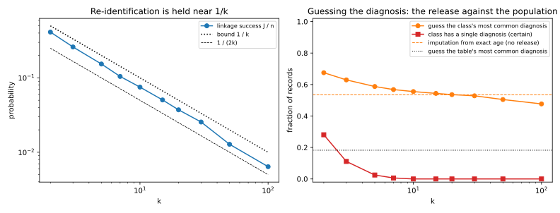

# Syntactic anonymity and how it breaks

## Why this matters

[Linkage and re-identification](07-linkage-reidentification.md) showed that deleting names does not anonymize a table. The columns that remain, such as age, ZIP code and sex, are called **quasi-identifiers**. None of them names anyone, but together they single out most people. Anyone who holds a list of names with the same columns, such as a voter roll, can join it to the released table and name most rows.

Between 1998 and 2008, data custodians and researchers answered with a family of definitions that constrain the released table itself. The first, **k-anonymity**, hides every record in a crowd of at least $k$ records that look alike, where the custodian chooses the crowd size $k$. The second, **l-diversity**, asks each crowd to hold several different sensitive values, such as diagnoses. The third, **t-closeness**, asks each crowd to look like the whole table.

They are called **syntactic** because each is a property of the published table that you can check by reading it, whatever produced the table. Statistics offices, regulators' guidance and anonymization tools such as ARX still use them, so you need to know where their promise ends. Their failures are also the list of requirements that differential privacy, the subject of the next part, is built to meet.

Each definition was proposed to answer an attack on the one before, and a last attack, which combines two releases, defeats all three. The reason is what they share. Each is a property of one table, and it protects only against an adversary whose knowledge is fixed in advance. Give the adversary one piece of knowledge the definition did not anticipate, and the guarantee says nothing.

## What the adversary believes about a class {#sec-anon-posterior}

Take a released table of $n$ records. Each record has quasi-identifiers and one **sensitive attribute**, written $S$, such as a diagnosis. To protect it, the custodian applies a **generalization**, which replaces each quasi-identifier by a coarser value, so that an age becomes a range and a ZIP code becomes a prefix. Records that end up with the same generalized quasi-identifiers form an **equivalence class**, or class for short.

The adversary knows the target's quasi-identifiers and that the target is in the release, so it can find the target's class, which we write $E$. All the records in the class look the same, so if the adversary knows nothing else about the target, each one is equally likely to be the target's.

The adversary's belief about the target's sensitive value after it has seen the release is called its **posterior**. When the adversary knows nothing else, the posterior is just the share of the class that has each value. Write $\lvert E\rvert$ for the number of records in the class, and $n_E(v)$ for the number of them whose sensitive value is $v$. The posterior that the target has value $v$ is then
$$\Pr[S_{\text{target}} = v \mid \text{release}] = \frac{n_E(v)}{\lvert E\rvert} = P_E(v).$$ {#eq-anon-posterior}
We call this share $P_E(v)$ the class's distribution of the sensitive attribute. The same share computed over the whole table is written $P(v)$.

Background knowledge breaks the condition that the adversary knows nothing else, and it works by elimination. In a class with the diagnoses cancer, cancer and flu, the posterior for cancer is $\frac23$. An adversary who knows that the target did not have flu crosses out the flu record, and its posterior for cancer becomes 1. Every attack on the sensitive attribute in this chapter is this calculation.

## k-anonymity {#sec-anon-k}

Sweeney and Samarati proposed the first answer to the linkage attack in 1998. A release is k-anonymous if every class has at least $k$ records, so that every combination of quasi-identifier values in the release is shared by at least $k$ people. A custodian gets there by generalizing, so that an exact age becomes a five-year range and a ZIP code keeps only its first three digits. It also uses **suppression**, which deletes the few records that still stand out.

To see what this buys, recall the linkage game of [Linkage and re-identification](07-linkage-reidentification.md). There the adversary must pick out the record of a target drawn at random from the release. Within a class it can only guess, so its best chance of winning is $J/n$, where $J$ is the number of classes. When every class needs at least $k$ records, the $n$ records cannot fill more than $n/k$ classes. So the chance of winning the linkage game is capped:
$$\Pr[\text{win}] = \frac{J}{n} \le \frac1k.$$ {#eq-anon-k-link}

This guarantee is about names only. It says nothing about the sensitive attribute, which is the very thing the release must protect. The sections on l-diversity and t-closeness below attack exactly that gap.

The guarantee also needs the adversary to know the quasi-identifiers and nothing more. A neighbour who already knows the target's diagnosis can pick out the target's record whenever that diagnosis appears only once in the class, with no linkage at all.

Which columns count as quasi-identifiers is a judgment, and in sparse data every column is one. Sparse data has many columns, each filled for few people, such as a matrix of movie ratings. [Linkage and re-identification](07-linkage-reidentification.md) showed that a handful of rare ratings single out a subscriber. To make such a matrix k-anonymous, you would have to generalize thousands of columns until little is left (Aggarwal, 2005).

## What k-anonymity costs {#sec-anon-cost}

Coarse quasi-identifiers protect more but say less, so the practical question is how coarse they must be. The uniform-cells model of [Linkage and re-identification](07-linkage-reidentification.md) answers it. The generalized quasi-identifiers split the population into $M$ cells, and each of the $n$ people falls into a cell independently, every cell equally likely.

Fix one person, and count the others who share that person's cell. Each of the other $n - 1$ people lands there with probability $1/M$. When there are many people and each has a small chance, this count is close to a **Poisson** count ([Probability distributions](../part01-prerequisites/01-distributions.md)). Its mean is $(n - 1)/M$, which is about $n/M$, the average number of people per cell.

A person violates k-anonymity when their class has fewer than $k$ records. The class holds the person plus the others in the cell, so this happens when at most $k - 2$ others share it. Every person has the same chance of this, so the expected fraction of people in classes that are too small equals that chance:
$$\Pr[\mathrm{Poisson}(n/M) \le k - 2].$$ {#eq-anon-k-violate}

Suppose you allow a small fraction $\alpha$ of records, for example 1%, to violate the definition. More people per cell make small classes rarer, so the fraction falls as the average $n/M$ grows. Write $\lambda_k$ for the average at which the fraction equals $\alpha$. The release then stays within the allowance as long as $n/M$ is at least $\lambda_k$, so there can be at most $n/\lambda_k$ cells.

Counting in bits lets you compare this budget with what each published column costs. A quasi-identifier with $M$ equally likely values carries $\log_2 M$ bits about a person, so the quasi-identifiers may carry at most $\log_2 n - \log_2 \lambda_k$ bits.

You might expect 2-anonymity to need 2 people per cell on average. But cell sizes vary around their average, and the unlucky small cells are the ones that violate the definition, so $\lambda_k$ is larger than $k$. For $k = 2$, a person violates the definition when nobody else is in their cell, which for a Poisson count with mean $\lambda$ has probability $e^{-\lambda}$. Setting that probability to 1% gives $\lambda_2 = \ln 100 = 4.61$, more than twice $k$. @tbl-anon-bits gives $\lambda_k$ for larger $k$, in a population of 10,000 people.

| $k$ | People per cell $\lambda_k$ | Bits allowed | Below $\log_2 n$ by | $\log_2 k$ |
| --- | --- | --- | --- | --- |
| 2 | 4.61 | 11.08 | 2.20 | 1.00 |
| 5 | 10.05 | 9.96 | 3.33 | 2.32 |
| 10 | 17.40 | 9.17 | 4.12 | 3.32 |
| 20 | 30.58 | 8.35 | 4.93 | 4.32 |
| 50 | 66.74 | 7.23 | 6.06 | 5.64 |

: Uniform cells, $n = 10{,}000$ ($\log_2 n = 13.29$ bits): how many bits of quasi-identifier k-anonymity allows if at most 1% of records may fall in classes smaller than $k$. {#tbl-anon-bits}

The last two columns compare the true cost with the naive guess of $\log_2 k$ bits. The gap shrinks as $k$ grows, because a Poisson count with a large mean varies little relative to its mean.

k-anonymity is the mirror image of uniqueness, and counting in bits makes the comparison exact. In the same model, a person is unique when nobody else is in their cell, which has probability $e^{-n/M}$. For 99% of people to be unique, there must be about 100 cells per person. That takes $\log_2 100 = 6.64$ bits beyond $\log_2 n$ ([Linkage and re-identification](07-linkage-reidentification.md)). Hiding 99% of records in classes of at least 2 needs the opposite, and @tbl-anon-bits shows that it takes 2.20 bits below $\log_2 n$. So the window between "almost everyone is unique" and "almost everyone is hidden" is about 9 bits wide, and every attribute you publish uses some of it.

Real tables are not uniform, so real anonymizers search for a generalization that works on the data at hand. The full edition's script builds a synthetic hospital table of 10,000 patients, with age, ZIP code and sex as quasi-identifiers. The sensitive attribute is one of eight diagnoses, which depends strongly on age, and HIV is rare, at 1.0% of records. With exact quasi-identifiers the linkage success is 0.933, so most patients are alone in their combination of age, ZIP code and sex.

The script anonymizes the table with **Mondrian** (LeFevre, DeWitt & Ramakrishnan, 2006). Starting from the whole table, it keeps splitting groups of records at the median of one quasi-identifier while both halves keep at least $k$ records. Each final group becomes a class. Because each group is split on its own, a busy ZIP area gets narrow age ranges and a quiet one wide ranges, and the classes stay close to size $k$. @tbl-anon-k gives the result.

| $k$ | Sizes | Mean width | Linkage $J/n$ | Certain disclosure | Guess accuracy |
| --- | --- | --- | --- | --- | --- |
| 2 | 2–5 | 0.005 | 0.4091 | 0.2797 | 0.675 |
| 5 | 5–11 | 0.016 | 0.1542 | 0.0232 | 0.593 |
| 10 | 10–20 | 0.028 | 0.0748 | 0.0000 | 0.562 |
| 20 | 20–41 | 0.043 | 0.0366 | 0.0000 | 0.540 |
| 50 | 50–99 | 0.075 | 0.0129 | 0.0000 | 0.506 |

: Mondrian k-anonymization of a synthetic hospital table of 10,000 patients. Mean width is the average, over records and quasi-identifiers, of the class's range as a fraction of the full range. Certain disclosure is the fraction of records in a class with a single diagnosis. Guess accuracy is the fraction of records whose diagnosis is the most common one in their class. {#tbl-anon-k}

The linkage success stays below the guaranteed $1/k$ in every row (@fig-anon-tradeoff, left). It also stays above $1/(2k)$ because the average class is smaller than $2k$ records, though nothing guarantees that. The cost in precision is small, since at $k = 5$ a class's range covers on average 1.6% of each quasi-identifier's span. The last two columns are about the diagnosis, and the next two sections explain them.

{#fig-anon-tradeoff}

## Homogeneity, background knowledge and l-diversity {#sec-anon-l}

Machanavajjhala and colleagues (2006) pointed out that k-anonymity hides who a record belongs to, but not what the record says. @tbl-anon-toy is a 3-anonymous release.

| ZIP code | Age | Diagnosis |
| --- | --- | --- |
| 130\*\* | < 30 | heart disease |
| 130\*\* | < 30 | heart disease |
| 130\*\* | < 30 | heart disease |
| 148\*\* | 4\* | cancer |
| 148\*\* | 4\* | flu |
| 148\*\* | 4\* | heart disease |
| 130\*\* | 3\* | cancer |
| 130\*\* | 3\* | cancer |
| 130\*\* | 3\* | flu |

: A 3-anonymous release with three classes of three records. {#tbl-anon-toy}

Alice is 26 and lives in ZIP code 13053, so she is in the first class. Every record there says heart disease, so by @eq-anon-posterior her posterior for heart disease is 1. This is the **homogeneity attack**, and it discloses her diagnosis without re-identifying her record. Bob is 35 and lives in ZIP code 13068, which puts him in the third class. Two of its three records say cancer, so his posterior for cancer starts at $\frac23$. But his neighbour saw him at work through the whole flu season, and so can rule out flu. Crossing out the flu record leaves only cancer, and the posterior rises to 1. This is the **background knowledge attack**.

Both attacks work because one value dominates the class, either from the start or after a few values are ruled out. To stop them, l-diversity asks each class to hold enough different values, and its three versions differ in how they measure "enough". The simplest is **distinct $\ell$-diversity**, which asks each class to hold at least $\ell$ different values. A release is $\ell$-diverse when every class is.

The second version, **entropy $\ell$-diversity**, measures how evenly the values are spread. A class with $\ell$ equally common values has an entropy of exactly $\log_2\ell$ bits. The condition asks every class for at least that much, so each is at least as spread out as $\ell$ equally common values.

Neither version limits the share of the most common value directly, so either can leave the adversary fairly sure. A class can hold three values and still have one value in almost all of its records, and entropy helps only a little. A class over eight values can be entropy 3-diverse with one value in 73% of its records, because the remaining records, spread over seven values, add enough entropy.

The third version targets the background knowledge attack directly. Sort a class's value counts from largest to smallest, so that $r_1$ is the count of the most common value. Set aside the $\ell - 1$ largest counts, and call the total of the rest the tail. A class is **recursive $(c, \ell)$-diverse** if its top count is less than $c$ times the tail, for a constant $c$ that the custodian chooses. In symbols, with $r_\ell$ the $\ell$-th largest count,
$$r_1 < c\,(r_\ell + r_{\ell+1} + \dots).$$

The tail is what survives the background knowledge attack. An adversary who rules out $\ell - 2$ values cannot make any remaining count larger. Whichever values it removes, the counts that remain besides the top one still add up to at least the tail. So the top value still holds less than $c$ parts for every one part held by the rest. Every remaining value therefore has a posterior below $c/(1 + c)$:
$$\Pr[S_{\text{target}} = v \mid \text{release}, \text{background}] < \frac{c}{1 + c}.$$ {#eq-anon-recursive}
The guarantee stops at $\ell - 2$ ruled-out values, because ruling out one more can leave a class with a single value.

So l-diversity protects against certainty, not against likelihood. The cap $c/(1 + c)$ is already a half at $c = 1$, and it climbs towards 1 as $c$ grows, so even recursive diversity lets the adversary be fairly sure. The guarantee also fixes in advance how much the adversary may know. It does not cover one who rules out more values, or who knows something softer such as "probably not flu".

Some tables cannot be made diverse at all. The table's distribution is a mix of its classes' distributions, and mixing distributions can only spread the values out further. So if every class had entropy at least $\log_2\ell$, the whole table would too. A table dominated by one value, with entropy below $\log_2\ell$, therefore has no entropy $\ell$-diverse split into classes.

In @tbl-anon-toy, the third class counts for only 1.89 equally common values when measured by entropy, because its two values are unevenly spread. The release as a whole is only 1-diverse, because of Alice's class.

## Measuring what a release teaches {#sec-anon-baseline}

In the hospital table, the "certain disclosure" column of @tbl-anon-k counts the patients in classes with a single diagnosis. At $k = 2$ it is 28.0% of all patients. At $k = 5$ it falls to 2.3%. That still means the release states 232 diagnoses outright. Knowing a patient's age and the population's patterns never gives that certainty, since at no age does the population give any diagnosis a probability above 0.705.

A posterior has to be read against what the adversary would believe with no release. A posterior of 0.6 is not a leak if the population already gives 0.6 to people of the target's age. The right comparison is the **imputation baseline** of [Attribute inference and model inversion](03-attribute-inference.md). It is the most likely value of the sensitive attribute given the target's own quasi-identifiers, under the true population distribution, computed with no release at all. Success up to the baseline comes from what the population reveals, and only success beyond it tells the adversary something about the individual.

The "guess accuracy" column of @tbl-anon-k needs this comparison (@fig-anon-tradeoff, right). Guessing the most common diagnosis of the whole table is right for 18.5% of patients. Here diagnosis depends on age, so imputation guesses the most likely diagnosis for each patient's exact age. It is right for 53.6% with no release at all. A 5-anonymous release is right for 59.3%. So most of what the release teaches is the pattern linking age to diagnosis, which any useful study would report. The excess over imputation, 0.057 at $k = 5$, comes from the small classes, and it almost vanishes by $k = 20$.

@tbl-anon-l adds l-diversity to $k = 5$. Mondrian then allows a split only if both halves satisfy the extra criterion.

| Criterion | Sizes | Mean width | Linkage $J/n$ | Certain disclosure | Guess accuracy |
| --- | --- | --- | --- | --- | --- |
| $k = 5$ | 5–11 | 0.016 | 0.1542 | 0.0232 | 0.593 |
| $k = 5$, distinct $\ell = 3$ | 5–33 | 0.022 | 0.1132 | 0.0000 | 0.574 |
| $k = 5$, recursive $(c = 2, \ell = 3)$ | 5–641 | 0.113 | 0.0389 | 0.0000 | 0.417 |

: Mondrian with l-diversity on the same hospital table: each split is allowed only if both halves satisfy the criterion. {#tbl-anon-l}

Distinct 3-diversity removes the certain disclosures at little cost. Recursive $(2, 3)$-diversity forces some classes to cover hundreds of patients, and it pushes the guess accuracy below imputation. The reason is that diagnosis depends on age. To keep any diagnosis from dominating a class, Mondrian must mix ages, and that erases the pattern the data were released to show.

## Skewness, similarity and t-closeness {#sec-anon-t}

Li, Li and Venkatasubramanian (2007) found two attacks that l-diversity does not see. In the **skewness attack**, 1% of the table has HIV. A class that is half HIV is 2-diverse by every definition. Yet by @eq-anon-posterior it raises the belief that a member has HIV fifty-fold, to 50%. In the **similarity attack**, a class holds three different diagnoses, gastric ulcer, gastritis and stomach cancer. It is 3-diverse, and the adversary still learns that the target has a stomach disease.

So counting values is the wrong yardstick. What matters is how far a class's distribution is from what the adversary would believe anyway, the distribution of the whole table. A release is t-close if every class's distribution is within a distance $t$ of the table's, for a chosen measure of distance.

The first choice of distance is the **total variation (TV)** distance ([Divergences](../part01-prerequisites/03-divergences.md)). It is half the total absolute difference between the two distributions' probabilities, summed over the values. It also equals the largest difference that the two distributions can show in the probability of any set of values.

The second form is what t-closeness relies on, because by @eq-anon-posterior the adversary's belief about a target in class $E$ is the class's distribution $P_E$. Write $P_E(A)$ for the probability that a value drawn from the class lands in a set of values $A$, and $P(A)$ for the same probability under the table. A bound $t$ on the total variation between the two distributions then bounds every question the adversary can ask about the target's value. For every class and every set $A$,
$$\lvert P_E(A) - P(A)\rvert \le t.$$ {#eq-anon-tv}
Taking $A$ to be a single value shows that no value's share in a class exceeds its share in the table by more than $t$. So guessing the most common value of the target's class is right with probability at most $\max_v P(v) + t$, the best guess from the table alone plus $t$.

The bound is additive, and an additive bound protects rare values badly. It lets a value held by 1% of the table rise to $1\% + t$. At $t = 0.15$ that is 16%, a sixteen-fold increase for the people who most need protection. In the skewness attack, a class with 10% HIV passes a threshold of 0.1, yet it makes HIV ten times as likely for its members (@fig-anon-skew). A guarantee for rare values has to bound the ratio of the adversary's beliefs with and without the release, not their difference. Differential privacy, in the next part, has that shape.

{#fig-anon-skew}

Total variation treats every pair of different values as equally far apart, so it does not see the similarity attack. Li and colleagues chose the **earth mover's distance (EMD)** instead, under which similar values are close. Think of each distribution as piles of sand on the values. The EMD is the least work needed to reshape one set of piles into the other, when moving sand costs the distance it travels. If the distances come from a tree that groups diagnoses by organ, gastritis and gastric ulcer are close, and a class full of stomach diseases fails.

Values with a natural order, such as salary bands, have a closed form. Number the $m$ ordered values from 1 to $m$, spaced evenly so that the two ends are distance 1 apart. On a line, sand can cross a gap only by passing through it, so the least work adds up the net sand that must cross each gap:
$$\mathrm{EMD}(P_E, P) = \frac{1}{m - 1}\sum_{i=1}^{m-1}\Big\lvert\sum_{j \le i}\big(P_E(j) - P(j)\big)\Big\rvert.$$ {#eq-anon-emd}
The index $i$ numbers the gap between values $i$ and $i + 1$. The inner sum is the extra share of the class, over the table, at or below value $i$, which is the net sand crossing that gap. The factor $1/(m - 1)$ is the length of each gap.

t-closeness also fights the purpose of the release. If age predicts diagnosis, a class of similar ages differs from the whole table, so making every class t-close means mixing ages until the pattern is gone. But that pattern is a fact about the population, not a secret about any one patient.

Even the toy release is far from close. Alice's class is all heart disease, which makes up only four ninths of the table, so the release is t-close only for $t$ of at least 0.556. On the hospital table, @tbl-anon-t adds t-closeness in total variation to $k = 5$.

| Criterion | Sizes | Mean width | Largest TV | Guess accuracy | Bound $\max_vP(v) + t$ |
| --- | --- | --- | --- | --- | --- |
| $k = 5$ | 5–11 | 0.016 | 0.937 | 0.593 | — |
| $k = 5$, $t = 0.3$ | 6–60 | 0.291 | 0.300 | 0.275 | 0.485 |
| $k = 5$, $t = 0.15$ | 14–304 | 0.324 | 0.149 | 0.222 | 0.335 |

: Mondrian with t-closeness (total variation) on the hospital table. The table's most common diagnosis has frequency 0.185. {#tbl-anon-t}

The bound column is the frequency of the table's most common diagnosis, 0.185, plus $t$, and the guess accuracy stays under it, as @eq-anon-tv promises. But the classes now span about 30% of each quasi-identifier's range. For learning about the population, the release has become worse than no release, because its guess accuracy falls far below the 0.536 that imputation from age achieves.

## The composition attack {#sec-anon-composition}

Every definition so far is about one release, and Ganta, Kasiviswanathan and Smith (2008) asked what happens when there are two. Suppose two hospitals in one city publish properly k-anonymous or $\ell$-diverse tables without coordinating. A patient treated at both then appears in a class of each release.

The adversary keeps only the diagnoses that appear both in the target's class in release A, written $E_A$, and in its class in release B, written $E_B$. These candidates are
$$\{v : n_{E_A}(v) > 0\} \cap \{v : n_{E_B}(v) > 0\}.$$
The true value is always among them, because the target's own record carries it in each class. So when only one candidate is left, the diagnosis is **pinned down**. Each release satisfies its definition, yet together they can reveal the diagnosis outright.

How often this happens depends on the size of the classes. To see how, suppose the other members of the target's classes are independent draws from the population's distribution of diagnoses, which gives each value $v$ a probability $p_v$. The target is pinned exactly when no wrong value turns up in both classes. Each extra member is another chance for the two classes to share a wrong value, so larger classes are pinned less often.

To compute the chance, fix the true value $v$, and write $W_v$ for the set of wrong values found among the other members of the class in release A. Each of the $k_B - 1$ other members of the class in release B, a class of $k_B$ records, avoids those values independently. Averaging over the true value and over the random set gives
$$\Pr[\text{pinned}] = \sum_v p_v\,\mathbb E\big[(1 - p(W_v))^{k_B - 1}\big],$$ {#eq-anon-pinned}
where $p(W_v)$ is the total probability of the values in $W_v$. A simpler union bound, which charges each wrong value separately, is exact for classes of 2 but turns negative from classes of 5. It fails there because two classes of 5 already share more than one wrong value on average.

In the model, with the diagnosis distribution of the hospital table, two classes of 2 pin down the diagnosis with probability 0.8734. For classes of 5 it is 0.1615, and by classes of 10 it has fallen to 0.0015. Simulation agrees (@fig-anon-composition, left).

The script then runs the attack on a city of 15,000 people drawn from the model of the hospital table. Two hospitals each treat a random 10,000 of them, so 6,649 people are treated at both, and each hospital publishes a 5-anonymous Mondrian release of its own patients. @tbl-anon-composition gives what the adversary learns about the 6,649.

| Releases | Pinned by A alone | Pinned by B alone | Pinned by A and B | Mean candidates, A alone | Mean candidates, A and B |
| --- | --- | --- | --- | --- | --- |
| $k = 5$ | 0.0289 | 0.0262 | 0.0985 | 2.79 | 2.38 |
| $k = 5$, distinct $\ell = 3$ | 0.0000 | 0.0000 | 0.0027 | 3.22 | 2.92 |

: The composition attack on two independent hospital releases, for the 6,649 people treated at both. "Pinned" is the fraction left with a single possible diagnosis. {#tbl-anon-composition}

Together, the two 5-anonymous releases pin down the diagnosis of 9.9% of the shared patients, more than three times what either release pins alone. With distinct 3-diversity, no single release pins anyone down. The two together still pin down 18 patients, or 0.27% of those treated at both.

{#fig-anon-composition}

The model understates the risk. In the 5-anonymous release of @tbl-anon-k, a patient's class has 6.8 records on average. For classes of 7 the model predicts that only 2.9% are pinned, far fewer than the 9.9% the real releases pin. A real class collects people of similar age, who share diagnoses more often than random draws, so each class holds fewer distinct wrong values.

None of the three definitions survives composition, because each is a condition on one table, and the intersection of two tables is a table that neither custodian checked. Checking its own table more carefully does not help. To rule the attack out, a custodian would need to know the other hospital's classes, and every other release in which its patients appear.

That points to what a better definition must do. First, it must compose, so that the leak of two releases together is at most a known function of the leak of each. Second, it must hold whatever the adversary knows, since another release is just auxiliary information. Third, as the rare values under t-closeness showed, it must bound the ratio of the adversary's beliefs rather than their difference. [The definition of differential privacy](../part03-dp-foundations/01-definition.md) starts from these requirements.

## Code

An auditor can check every definition of this chapter by grouping the rows. The snippet audits @tbl-anon-toy, and its third line shows the entropy-equivalent $\ell$ of each class. It also checks recursive $(2, 2)$-diversity and each class's total variation from the table.

```python
from collections import Counter, defaultdict
from math import log2


def classes(rows: list[tuple[str, str, str]]) -> list[Counter[str]]:
    """Group (ZIP, age, diagnosis) rows by their quasi-identifiers; count the diagnoses in each class."""
    groups: defaultdict[tuple[str, str], Counter[str]] = defaultdict(Counter)
    for zip_code, age, diagnosis in rows:
        groups[(zip_code, age)][diagnosis] += 1
    return list(groups.values())


def entropy_l(counts: Counter[str]) -> float:
    """2 ** entropy: the number of equally common values with the same spread."""
    total = sum(counts.values())
    return 2 ** -sum(c / total * log2(c / total) for c in counts.values())


def recursive_diverse(counts: Counter[str], c: float, l: int) -> bool:
    """Recursive (c, l)-diversity: the top count is below c times the counts from the l-th largest on."""
    r = sorted(counts.values(), reverse=True)
    return r[0] < c * sum(r[l - 1 :])


def tv_to_table(counts: Counter[str], table: Counter[str]) -> float:
    """Total variation between a class's distribution and the whole table's."""
    nc, nt = sum(counts.values()), sum(table.values())
    return sum(abs(counts[v] / nc - table[v] / nt) for v in table) / 2


rows = [
    ("130**", "<30", "heart disease"), ("130**", "<30", "heart disease"), ("130**", "<30", "heart disease"),
    ("148**", "4*", "cancer"), ("148**", "4*", "flu"), ("148**", "4*", "heart disease"),
    ("130**", "3*", "cancer"), ("130**", "3*", "cancer"), ("130**", "3*", "flu"),
]
table = Counter(diagnosis for _, _, diagnosis in rows)
found = classes(rows)
print(min(sum(e.values()) for e in found))  # 3
print(min(len(e) for e in found))  # 1
print(" ".join(f"{entropy_l(e):.2f}" for e in found))  # 1.00 3.00 1.89
print(all(recursive_diverse(e, 2, 2) for e in found))  # False
print(" ".join(f"{tv_to_table(e, table):.3f}" for e in found))  # 0.556 0.111 0.444
```

The full edition's script, [syntactic_anonymity.py](../../code/part02-attacks/syntactic_anonymity.py), computes every number in this chapter and draws every figure. It implements Mondrian with any criterion on a class, the uniform-cells calculation, the attacks on the sensitive attribute and the composition attack. Tools such as ARX play Mondrian's part on real data. From the repository root:

```bash
uv run python code/part02-attacks/syntactic_anonymity.py
```

## Cheat sheet

| Definition or attack | Condition | What it gives, and where it ends |
| --- | --- | --- |
| Posterior in a class | Adversary knows only the quasi-identifiers: $P_E(v) = n_E(v)/\lvert E\rvert$ | Ruling out values spreads the belief over the records left |
| k-anonymity | Every class has $\lvert E\rvert \ge k$ | Linkage $J/n \le 1/k$; nothing about the sensitive attribute |
| Uniform cells | Fraction in classes smaller than $k$: $\Pr[\mathrm{Poisson}(n/M) \le k - 2]$ | 99% 2-anonymous needs $\log_2 n - 2.20$ bits or fewer |
| Distinct, entropy l-diversity | At least $\ell$ values; entropy $\ge \log_2 \ell$ | No direct cap on the top value's share |
| Recursive $(c, \ell)$-diversity | $r_1 < c(r_\ell + r_{\ell+1} + \dots)$ | Posterior $< c/(1 + c)$ after ruling out $\ell - 2$ values |
| t-closeness (TV) | $\mathrm{TV}(P_E, P) \le t$ | Every belief moves by at most $t$; a 1% value may rise to $1\% + t$ |
| t-closeness (EMD) | $\mathrm{EMD}(P_E, P) \le t$ | Similar values are close; catches the similarity attack |
| Composition | Intersect the values of the target's two classes | Pinned: @eq-anon-pinned; no single-table definition prevents it |

: The syntactic definitions and the attacks on them. {#tbl-anon-cheat}

**Rules of thumb**

- k-anonymity protects names, not attributes. Ask what a class's sensitive values reveal, not just how big the class is.
- Measure attribute disclosure against imputation from the population, or you will count the study's findings as leaks.
- A rare sensitive value needs a bound on the ratio of beliefs, not on their difference.
- Assume another release exists. A guarantee that is only about one table is not a guarantee about a person.

## Further reading

- Sweeney, "k-Anonymity: A Model for Protecting Privacy" (2002): the definition, generalization and suppression, and the linkage attack it answers.
- Machanavajjhala, Kifer, Gehrke & Venkitasubramaniam, "l-Diversity: Privacy Beyond k-Anonymity" (ICDE 2006; journal version 2007), and Li, Li & Venkatasubramanian, "t-Closeness: Privacy Beyond k-Anonymity and l-Diversity" (ICDE, 2007): the attacks on the sensitive attribute and the definitions that answer them.
- Ganta, Kasiviswanathan & Smith, "Composition Attacks and Auxiliary Information in Data Privacy" (KDD, 2008): the intersection attack, and why a definition must hold up against auxiliary information such as other releases.
- Article 29 Working Party, "Opinion 05/2014 on Anonymisation Techniques": how European regulators judge these techniques against singling out, linkability and inference.

**Derivations.** Every result in this chapter is derived step by step in [the full edition's chapter](../../book-full/part02-attacks/08-syntactic-anonymity.md), except Aggarwal's result on sparse data, which it cites, the 73% entropy example, which its exercises work out, and the 6.64-bit uniqueness figure, which its Linkage chapter derives.
