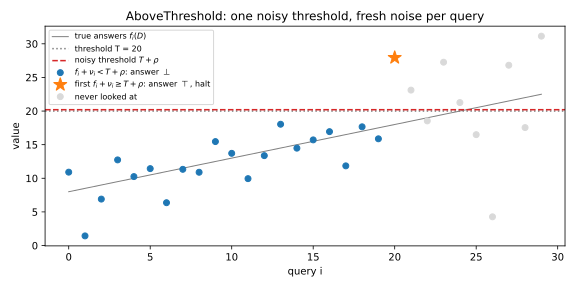

# Selection: exponential mechanism, report-noisy-max, sparse vector

## Why this matters

Many questions ask you to **pick** something rather than compute a number. Which of 50 hyperparameter settings scores best on the validation set? Which of a thousand monitored statistics first crosses an alarm level? The answer is a name from a list, and adding noise to a name makes no sense.

The [Laplace and Gaussian mechanisms](03-laplace-gaussian.md) of differential privacy (DP) add noise to numbers. Releasing a noisy score for every candidate releases $k$ numbers, and if one record can move all $k$ scores, the noise must grow with $k$. You never have to pay for the losers. The one idea: **release the position, not the values.** Each mechanism adds noise to scores it never publishes and releases only which candidate won. A candidate wins when its noise clears a bar set by the best of the others, and a maximum of numbers that each move by at most $\Delta$ moves by at most $\Delta$, however many numbers there are. So the number of candidates never enters the privacy cost. It enters only the accuracy, as $\ln k$. @tbl-sel-overview maps the decisions to the sections.

| Decision | Rule | Section |
| --- | --- | --- |
| Pick a good candidate from a fixed list | Exponential mechanism: softmax of the scores at temperature $2\Delta/\varepsilon$ | @sec-sel-exp |
| Pick it by adding noise to the scores | Report-noisy-max: release only the argmax; Gumbel noise gives the exponential mechanism exactly | @sec-sel-rnm |
| Find the first query in a stream above a threshold | AboveThreshold: pay once, however many queries stay below | @sec-sel-svt |
| Review a sparse vector implementation | Fresh noise per query, halt after the $\top$, never publish noisy values | @sec-sel-svt-bugs |

: The decisions behind private selection, and where this chapter makes each one. {#tbl-sel-overview}

Throughout, $k$ candidates have a **score** $u(D, r)$, how good candidate $r$ is on dataset $D$. Its **sensitivity** $\Delta$ is the largest change in any one score between two **neighbouring** datasets, which differ in one person's record. Scores are **monotone** if one record always pushes all scores the same way: counts under add/remove neighbours are, a histogram under replace neighbours is not.

## The exponential mechanism {#sec-sel-exp}

**Idea.** McSherry and Talwar (2007) give each candidate a weight that grows exponentially with its score and pick it with probability equal to its share of the total weight. One record changes each score by at most $\Delta$, so it changes the chosen candidate's weight by at most $e^{\varepsilon/2}$ and the total weight by at most $e^{\varepsilon/2}$; the two together give $e^\varepsilon$. It is a softmax of the scores with temperature $2\Delta/\varepsilon$.

**Result.** The **exponential mechanism** outputs candidate $r$ with probability
$$\Pr[M_E(D) = r] = \frac{\exp\big(\varepsilon\,u(D, r)/(2\Delta)\big)}{\sum_s\exp\big(\varepsilon\,u(D, s)/(2\Delta)\big)},$$ {#eq-sel-em}
and it is $\varepsilon$-DP for any number of candidates. With monotone scores the 2 can be dropped: weights $e^{\varepsilon u/\Delta}$ are also $\varepsilon$-DP, because the chosen candidate's weight and the total cannot both move against you at once. For accuracy, call the **gap** the difference between the best score $\mathrm{OPT}$ and the chosen one. For every $t > 0$, with probability at least $1 - e^{-t}$,
$$\text{gap} \le \frac{2\Delta}{\varepsilon}(\ln k + t),$$ {#eq-sel-em-utility}
and the expected gap is at most $\frac{2\Delta}{\varepsilon}(\ln k + 1)$. With monotone weights, replace $2\Delta$ by $\Delta$. Doubling $k$ adds only $\frac{2\Delta}{\varepsilon}\ln 2$, and a [lower bound](09-lower-bounds.md) shows that no $\varepsilon$-DP mechanism can avoid the $\ln k$.

**Example.** You want to release the best of 50 trained models on a private validation set of 1,000 examples. Model $r$ gets $900 - r$ right, so the best is at 90.0% accuracy. The score is the count of correct predictions, so $\Delta = 1$. @tbl-sel-em-models and @fig-sel-em-probs show the result. At $\varepsilon = 1$ you lose 1.54 correct predictions on average, 0.15% accuracy, although you pick the best model only 39% of the time: the mechanism mostly picks near-ties that cost one or two predictions. The counts are monotone, and the weights $e^{\varepsilon u}$ cut the expected gap at $\varepsilon = 1$ from 1.54 to 0.58.

| $\varepsilon$ | $\Pr[\text{best}]$ | $\mathbb E[\text{gap}]$ | Bound $2(\ln 50 + 1)/\varepsilon$ | $\mathbb E[\text{gap}]$, monotone weights |
| --- | --- | --- | --- | --- |
| 0.1 | 0.0531 | 15.03 | 98.24 | 9.17 |
| 1 | 0.3935 | 1.54 | 9.82 | 0.58 |
| 5 | 0.9179 | 0.09 | 1.96 | 0.01 |

: The exponential mechanism selecting among 50 models with scores $900 - r$. The gap is in correct predictions out of 1,000. {#tbl-sel-em-models}

{#fig-sel-em-probs}

**Pitfalls.** The candidate list must be fixed before you look at the data: a candidate read off the data leaks through its mere presence. Use the factor 2 unless you have checked that the scores are monotone under your neighbouring relation. The utility bound is loose when scores are spread out: at $\varepsilon = 1$ it says the gap exceeds 13.82 with probability at most 0.0498, while the exact probability is $9.12\times10^{-4}$. Use it to choose $\varepsilon$, not to predict the result. Never exponentiate scores in the thousands directly; subtract the largest score first, which changes nothing, or use the Gumbel form of the next section.

## Report-noisy-max and Gumbel noise {#sec-sel-rnm}

**Idea.** Add independent noise to every score and report the index of the largest noisy score, and *only the index*. Fix the noise of every other candidate: candidate $i$ wins exactly when its own noise clears a bar, the best of the other noisy scores minus its own score. One record moves that bar by at most $2\Delta$ (the maximum by $\Delta$, its own score by $\Delta$), or by $\Delta$ for monotone scores, and Laplace noise of scale $b$ pays for a shift $s$ with a factor $e^{s/b}$. The losers enter only through one maximum, which is why they cost nothing.

**Result.** **Report-noisy-max** outputs $\arg\max_r\big(u(D, r) + Z_r\big)$ with independent $Z_r \sim \mathrm{Lap}(b)$. With $b = 2\Delta/\varepsilon$ it is $\varepsilon$-DP; with monotone scores $b = \Delta/\varepsilon$ suffices. With probability at least $1 - \beta$ the gap is at most $2b\ln(k/\beta)$. If you add **Gumbel** noise of scale $2\Delta/\varepsilon$ instead of Laplace noise, the argmax picks each candidate with exactly the probability of @eq-sel-em: report-noisy-max with Gumbel noise *is* the exponential mechanism. This Gumbel-max trick samples the exponential mechanism in one pass, without a normalizer or overflow. Taking the $c$ largest noisy scores gives the same distribution as running the exponential mechanism $c$ times and removing each winner (Durfee & Rogers 2019), at a cost of $c\varepsilon$ by basic composition.

**Example.** On the 50 models at $\varepsilon = 1$, Laplace report-noisy-max with $b = 2$ picks the best model with probability 0.4241, against 0.3935 for the exponential mechanism, and has expected gap 1.40 against 1.54. The monotone version, $b = 1$, picks it with probability 0.6463 and has expected gap 0.54. @tbl-sel-gumbel shows the Gumbel equivalence on five candidates with noise scale 2: a million Gumbel draws land within 0.0008 of the exponential mechanism's exact probabilities, about the sampling error. Laplace noise favours the top candidate a little more, and its total variation distance from the exponential mechanism is 0.0216.

| Candidate score | 4 | 3 | 3 | 1 | 0 |
| --- | --- | --- | --- | --- | --- |
| Exponential mechanism, exact | 0.3889 | 0.2359 | 0.2359 | 0.0868 | 0.0526 |
| Gumbel noisy max, $10^6$ runs | 0.3891 | 0.2351 | 0.2362 | 0.0871 | 0.0525 |
| Laplace noisy max, exact | 0.4105 | 0.2341 | 0.2341 | 0.0764 | 0.0449 |

: Selection probabilities with noise scale 2 for five candidates. {#tbl-sel-gumbel}

**Pitfalls.** Release only the index. Publishing the winning noisy score as well publishes the very noise the proof averages over, and the guarantee is gone. If you need the winner's score, spend extra budget on a fresh Laplace answer for that one query. The noises must be independent, one fresh draw per candidate.

## The sparse vector technique {#sec-sel-svt}

**Idea.** Now the candidates arrive one at a time and you want the first one that is good enough, such as the first statistic to cross an alarm level. Answering each with the Laplace mechanism costs $\varepsilon$ per query. The **sparse vector technique** (Dwork, Naor, Reingold, Rothblum & Vadhan 2009) compares every query with one noisy threshold and pays only for the one that is above. All the "below" answers together say only that the noisy threshold sits above the largest of the earlier noisy answers, and that maximum moves by at most $\Delta$, so they cost one threshold noise between them.

**Result.** **AboveThreshold** (Dwork & Roth 2014, Algorithm 1) takes a stream of queries of sensitivity $\Delta$, possibly chosen adaptively, a threshold $T$, and budgets $\varepsilon_1 + \varepsilon_2 = \varepsilon$. It draws the threshold noise $\rho \sim \mathrm{Lap}(\Delta/\varepsilon_1)$ once. For each query it draws fresh noise $\nu_i \sim \mathrm{Lap}(2\Delta/\varepsilon_2)$; if $f_i(D) + \nu_i \ge T + \rho$ it outputs $\top$ ("above") and **halts**, and otherwise outputs $\bot$ ("below") and continues. It is $\varepsilon$-DP for any number of $\bot$ answers. With monotone queries, $\nu_i \sim \mathrm{Lap}(\Delta/\varepsilon_2)$ suffices (Lyu, Su & Li 2017). With the equal split and $k$ queries answered, with probability at least $1 - \beta$ every $\bot$ query has $f_i(D) < T + \alpha$ and the $\top$ query has $f_k(D) \ge T - \alpha$, where
$$\alpha = \frac{8\Delta\big(\ln k + \ln(2/\beta)\big)}{\varepsilon}.$$ {#eq-sel-svt-alpha}
Only queries within $\alpha$ of $T$ can go either way. To find the first $c$ queries above the threshold, restart AboveThreshold with fresh threshold noise after each $\top$, at $\varepsilon/c$ per run.

**Example.** You monitor $k = 1000$ counting queries ($\Delta = 1$) with threshold $T = 500$ at $\varepsilon = 1$. With $\beta = 0.05$, $\alpha = 84.77$. So with probability at least 0.95, no query below 415.23 fires and no query above 584.77 is skipped. If every count is 400 except query 700, which is 600, the output is query 700 with probability at least 0.95; in 10,000 simulated runs it always was (@fig-sel-svt-path shows a smaller run). Answering all 1,000 queries with the Laplace mechanism at $\varepsilon/1000$ each would add noise of scale 1,000 to counts of a few hundred.

{#fig-sel-svt-path}

**Pitfalls.** The accuracy, unlike the privacy, depends on $k$. AboveThreshold answers a yes/no question; to release the value of the query that fired, spend extra budget on a fresh Laplace answer. Any split of $\varepsilon$ is private, but the equal split is not the most accurate; Lyu, Su & Li give a better one.

## When the sparse vector technique goes wrong {#sec-sel-svt-bugs}

**Idea.** The technique is easy to break. Lyu, Su & Li (2017) found published variants that are not DP at all, each a seemingly harmless optimization that removes one ingredient of the proof: the fresh noise $\nu_i$ that pays for the $\top$, the halt that limits the run to one $\top$, or the secrecy of the noisy values.

**Result.** @tbl-sel-svt-variants lists the variants and their actual privacy.

| Variant (as numbered by Lyu, Su & Li) | What it changes | Privacy shown by Lyu, Su & Li |
| --- | --- | --- |
| Algorithm 1 (theirs); Algorithm 2 (Dwork & Roth) | Correct, with $c$ answers above | $\varepsilon$ |
| Algorithm 3 (Roth's 2011 lecture notes) | Outputs the noisy value $f_i + \nu_i$ for each $\top$ | $\infty$ |
| Algorithm 4 (Lee & Clifton 2014) | Query noise does not grow with $c$ | $\frac{1 + 6c}{4}\varepsilon$ |
| Algorithm 5 (Stoddard et al. 2014) | No noise on the queries | $\infty$ |
| Algorithm 6 (Chen et al. 2015) | Never halts | $\infty$ |

: Variants of the sparse vector technique and their actual privacy, from Lyu, Su & Li (2017). {#tbl-sel-svt-variants}

The **no-halt variant** uses exactly AboveThreshold's noise but answers every query. On a pair of neighbours where the first $m$ queries are 0 and the last $m$ are 1 on $D$, and the reverse on $D'$, the output "$m$ below, then $m$ above" has privacy loss at least $m\varepsilon/4$, which grows without bound. Without query noise even the halting version fails, with two queries.

**Example.** @tbl-sel-svt-loss gives the exact losses at $\varepsilon = 1$. AboveThreshold levels off at exactly $\varepsilon$, so its proof is tight; the no-halt variant gains about 0.45 nats (units of natural logarithm) for each pair of queries added.

| $m$ | 1 | 5 | 10 | 20 | 40 |
| --- | --- | --- | --- | --- | --- |
| AboveThreshold, largest loss over outputs | 0.3958 | 0.8998 | 0.9940 | 1.0000 | 1.0000 |
| No halt, loss of $\bot^m\top^m$ | 0.3958 | 2.0985 | 4.3220 | 8.8741 | 18.1246 |
| Lower bound $m\varepsilon/4$ | 0.25 | 1.25 | 2.50 | 5.00 | 10.00 |

: Exact privacy loss of AboveThreshold and of its no-halt variant on the counterexample, with $\varepsilon = 1$. {#tbl-sel-svt-loss}

**Pitfalls.** The no-halt variant adds as much noise per query as the correct one, so a reviewer who checks only noise scales will miss the bug. An empirical audit catches it. If a mechanism is $\varepsilon$-DP, any event is at most $e^\varepsilon$ times as likely under $D$ as under $D'$, so the log-ratio of a test's firing rates is a lower bound on the true $\varepsilon$. The test "more $\top$ answers in the second half than in the first" gives a log-ratio of 1.40 at $m = 40$, which already proves the no-halt variant is not 1-DP (@fig-sel-svt-buggy). When you review an implementation, check four things: fresh query noise for every query (reusing one draw is Algorithm 5's bug), one threshold noise per run, a halt after the allowed number of $\top$ answers, and no published noisy values.

{#fig-sel-svt-buggy}

## Code {#sec-sel-code}

Each mechanism fits in a few lines. Note where AboveThreshold draws its two noises:

```python
import random
from math import exp, log
from typing import Sequence


def exponential_mechanism_probs(scores: Sequence[float], eps: float, sensitivity: float) -> list[float]:
    """Selection probabilities, proportional to exp(eps * u / (2 * sensitivity)), without overflow."""
    top = max(scores)
    weights = [exp(eps * (u - top) / (2 * sensitivity)) for u in scores]
    total = sum(weights)
    return [w / total for w in weights]


def gumbel_select(scores: Sequence[float], eps: float, sensitivity: float, rng: random.Random) -> int:
    """One draw of the exponential mechanism: add Gumbel noise of scale 2 * sensitivity / eps, take the argmax."""
    beta = 2 * sensitivity / eps
    noisy = [u - beta * log(-log(1 - rng.random())) for u in scores]
    return max(range(len(scores)), key=noisy.__getitem__)


def laplace(scale: float, rng: random.Random) -> float:
    return rng.expovariate(1 / scale) - rng.expovariate(1 / scale)


def above_threshold(
    answers: Sequence[float], threshold: float, eps: float, sensitivity: float, rng: random.Random
) -> int | None:
    """Index of the first answer whose noisy value reaches the noisy threshold; equal budget split."""
    noisy_threshold = threshold + laplace(2 * sensitivity / eps, rng)  # drawn once per run
    for i, answer in enumerate(answers):
        if answer + laplace(4 * sensitivity / eps, rng) >= noisy_threshold:  # fresh noise every query
            return i  # halt, and release only the index
    return None


def svt_margin(k: int, eps: float, sensitivity: float, beta: float) -> float:
    return 8 * sensitivity * (log(k) + log(2 / beta)) / eps


print([round(p, 4) for p in exponential_mechanism_probs([3, 2, 1, 0], 1.0, 1.0)])  # [0.4551, 0.276, 0.1674, 0.1015]
print(f"{svt_margin(1000, 1.0, 1.0, 0.05):.2f}")  # 84.77
counts = [600.0 if i == 699 else 400.0 for i in range(1000)]  # query 700 is the only high one
print(above_threshold(counts, 500.0, 1.0, 1.0, random.Random(0)))  # 699
```

The first line is a vote with counts $(3, 2, 1, 0)$ at $\varepsilon = 1$; the last finds query 700 of the alarm stream. Floating-point samplers are fine for checking a calculation but not for production ([Discrete and floating-point-safe mechanisms](07-discrete-mechanisms.md)): use a vetted DP library. The full edition's script, [selection.py](../../code/part03-dp-foundations/selection.py), computes every number in this chapter and checks each mechanism by exact integration and simulation:

```bash
uv run python code/part03-dp-foundations/selection.py
```

## Cheat sheet

| Mechanism | Output | Privacy | Accuracy |
| --- | --- | --- | --- |
| Exponential mechanism | $r$ with probability $\propto e^{\varepsilon u(D, r)/(2\Delta)}$ | $\varepsilon$; $e^{\varepsilon u/\Delta}$ for monotone scores | Gap $\le \frac{2\Delta}{\varepsilon}(\ln k + t)$ w.p. $1 - e^{-t}$ |
| Report-noisy-max, Laplace | $\arg\max_r(u + \mathrm{Lap}(2\Delta/\varepsilon))$, index only | $\varepsilon$; $\mathrm{Lap}(\Delta/\varepsilon)$ for monotone scores | Gap $\le 2b\ln(k/\beta)$ w.p. $1 - \beta$ |
| Report-noisy-max, Gumbel | $\arg\max_r(u + \mathrm{Gumbel}(2\Delta/\varepsilon))$ | Identical to the exponential mechanism | Same |
| AboveThreshold | First $f_i + \mathrm{Lap}(2\Delta/\varepsilon_2) \ge T + \mathrm{Lap}(\Delta/\varepsilon_1)$, then halt | $\varepsilon_1 + \varepsilon_2$, any number of $\bot$ | $\alpha = 8\Delta(\ln k + \ln\frac2\beta)/\varepsilon$, equal split |
| $c$ answers above | AboveThreshold restarted $c$ times at $\varepsilon/c$ | $\varepsilon$ by basic composition | $\alpha$ with $\varepsilon/c$ in place of $\varepsilon$ |

: The selection mechanisms of this chapter. {#tbl-sel-cheat}

**Rules of thumb**

- Release positions, not values. Every released noisy value needs its own budget.
- The number of candidates costs $\ln k$ in accuracy and nothing in privacy.
- Use $2\Delta$ unless you have checked that the scores are monotone under your neighbouring relation.
- To sample the exponential mechanism, add Gumbel noise and take the argmax.
- A sparse vector implementation must draw fresh noise for every query, keep one threshold noise per run, halt after the allowed number of $\top$ answers, and never publish the noisy values it compared.

## Further reading

- Dwork & Roth, *The Algorithmic Foundations of Differential Privacy* (2014), §3.3, §3.4 and §3.6: report-noisy-max, the exponential mechanism and AboveThreshold, with proofs.
- Lyu, Su & Li, "Understanding the Sparse Vector Technique for Differential Privacy" (Proceedings of the VLDB Endowment, 2017): the general algorithm, the budget split and the survey of broken variants. The best single source on the technique.
- Durfee & Rogers, "Practical Differentially Private Top-k Selection with Pay-what-you-get Composition" (NeurIPS 2019): one-shot Gumbel top-$c$ selection.
- Near & Abuah, *Programming Differential Privacy*, the chapters on the exponential mechanism and the sparse vector technique: short implementations.

**Derivations.** Every result in this chapter is derived step by step in [the full edition's chapter](../../book-full/part03-dp-foundations/05-selection.md).
