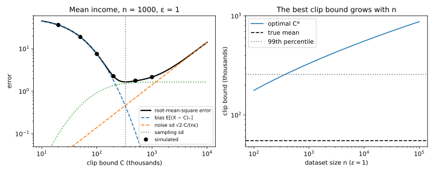

# Beyond global sensitivity

## Why this matters

The [Laplace and Gaussian mechanisms](03-laplace-gaussian.md) set their noise by the **global sensitivity**: the most one record can move the answer, over every pair of neighbouring datasets that could exist, not just yours. For a count that is the right scale. For many statistics it is not. The median of ages in $[0, 100]$ has global sensitivity 100, because in a dataset of half zeros and half hundreds one person swings it from end to end. The mean of incomes has infinite sensitivity, and for an estimator fitted by an optimizer nobody knows it. Yet on a realistic sample of 1,001 ages, one person moves the median by about a tenth of a year, because the ages near the middle are packed tightly together.

Can you add noise on the scale of the data you hold and keep a differential privacy (DP) guarantee? Yes, if you respect one idea: **the noise scale is itself a function of the data, so it must be private too.** Each technique below makes the scale safe to reveal in a different way. Throughout, datasets have a fixed size $n$ and neighbours differ by one **replaced** record.

## Local sensitivity, and why it leaks {#sec-sens-local}

The obvious fix is to take the maximum over your own dataset's neighbours only, the **local sensitivity**:
$$\mathrm{LS}_f(D) = \max_{D':\ d(D, D') = 1}|f(D) - f(D')|,$$
where the **Hamming distance** $d(D, D')$ counts the records in which two datasets differ. For the median of $n$ sorted values (with $n$ odd), one change can push the median at most one place up or down the sorted list, so the local sensitivity is the larger of the two gaps next to the median.

But noise of scale $\mathrm{LS}_f(D)/\varepsilon$ publishes the local sensitivity along with the answer, and one record can change it enormously. With ages in $[0, 100]$, the dataset $(0, 0, 0, 0, 100)$ has median 0 with gaps of 0 on both sides, so its "noisy" median is exactly 0. Its neighbour $(0, 0, 0, 100, 100)$ has the same median, but a gap of 100 above it, so its release is spread out and never exactly 0. An output of 0 identifies the first dataset with certainty, whatever $\varepsilon$ you claim.

Nor does it need a degenerate dataset. The neighbours of @tbl-sens-leak both have median 30, but at $\varepsilon = 1$ their noise scales are 10 and 60. The narrow Laplace density falls off six times faster than the wide one, so the further an output lands from 30, the more it favours $D'$: the privacy loss grows in a straight line with the distance and has no bound. It passes 1 beyond a distance of 33.50, which happens with probability 0.572 under $D'$ and only 0.0351 under $D$, and covering that would take $\delta = 0.477$ (@fig-sens-local-leak).

| Dataset | Values | Median | $\mathrm{LS}$ |
| --- | --- | --- | --- |
| $D$ | 10, 20, 30, 31, 90 | 30 | 10 |
| $D'$ (31 replaced by 90) | 10, 20, 30, 90, 90 | 30 | 60 |

: Two neighbouring datasets with the same median and very different local sensitivities. {#tbl-sens-leak}

{#fig-sens-local-leak}

The same leak hides in any scale computed from the private data, such as a clip bound set to the observed maximum. Each such number needs one of the repairs below or its own share of the budget.

## Smooth sensitivity {#sec-sens-smooth}

The first repair, due to Nissim, Raskhodnikova and Smith (2007), uses a scale that cannot jump: an upper bound on the local sensitivity that changes by at most a factor $e^\beta$ between neighbours. A bounded *factor* is the right kind of control because a privacy loss is a log-ratio, and stretching the noise by $e^\beta$ shifts log-densities by about $\beta$.

What is the smallest such bound? If some dataset $k$ changes away has a large local sensitivity, the bound at yours can be smaller only by the factor $e^{-\beta}$ per step on the way. So it must be at least that dataset's local sensitivity discounted by $e^{-k\beta}$, and the **$\beta$-smooth sensitivity** is exactly the largest of these discounted values:
$$S^*_\beta(D) = \max_{D''}\ \mathrm{LS}_f(D'')\,e^{-\beta\,d(D, D'')}.$$ {#eq-sens-smooth}
For the median, $k$ changes can at most empty the stretch between two sorted values $k + 1$ ranks apart next to the median; calling the widest such gap $A^{(k)}$, $S^*_\beta$ is the largest $e^{-k\beta}A^{(k)}$, an exact $O(n^2)$ computation (@sec-sens-code).

The release stretches noise of a fixed shape $Z$ by this bound, $f(D) + (S^*_\beta(D)/\alpha)\,Z$, where $\alpha$ sets how many noise scales one record's shift is worth. Which shapes work depends on their tails, because between neighbours the loss contains the log-ratio of a density and a copy stretched by up to $e^\beta$. For Laplace noise the log-density is linear in $|z|$, so the stretch changes it by an amount proportional to $|z|$: unbounded, exactly the leak of @tbl-sens-leak in miniature. A power-law tail has a log-density that grows only like $\ln|z|$, so a stretch changes it by a bounded amount everywhere. That is why **pure DP needs heavy tails**: with standard Cauchy noise and $\alpha = \beta = \varepsilon/6$, releasing $f(D) + \frac{6}{\varepsilon}S^*_{\varepsilon/6}(D)\cdot Z$ is $\varepsilon$-DP. Laplace noise can still be used, if you pay for its rare large draws with a $\delta$: the release is $(\varepsilon, \delta)$-DP when
$$\beta + e^\beta\alpha + (e^\beta - 1)\ln(1/\delta) \le \varepsilon.$$
The last term charges the change of scale once for each unit of $\ln(1/\delta)$, which forces $\beta$ down to roughly $\varepsilon/(2\ln(1/\delta))$, much smaller than the Cauchy's $\varepsilon/6$.

Release the median of 1,001 synthetic ages at $\varepsilon = 1$. With global sensitivity the median absolute error is 69.31 years. The local sensitivity is 0.1386, and the Cauchy release's smooth sensitivity, 0.1632, is barely above it, because with this many people even seven changes cannot open a wide gap near the middle; its error is 0.979. Laplace noise at $\delta = 10^{-6}$ allows only $\beta = 0.0322$, so more distant datasets count and $S^* = 0.5144$, but the lighter tails make up for it: error 0.713. Both are 70 to 100 times better than the global release, and the gain grows with $n$, because the smooth bound follows the spacing of the data near the median (@fig-sens-methods-vs-n). The same reasoning shows where it fails: for $n \lesssim 20$, a few changes can open a gap across nearly the whole range, and smooth sensitivity loses to global sensitivity.

The heavy tail has its own cost: about one Cauchy release in 16 is off by more than ten times the typical error, and the Cauchy has no mean, so don't average such values. And a bound you substitute for $S^*$, for a statistic without an exact formula, works only if it is itself $\beta$-smooth.

## Propose-test-release {#sec-sens-ptr}

Without a formula like the median's, Dwork and Lei (2009) take a cruder route. Propose a bound $b$ on the local sensitivity before looking at the data, then ask how many records would have to change before the local sensitivity could exceed $b$; call that distance $\operatorname{dist}_b(D)$. This count is safe to release with noise: a path from a neighbour to a bad dataset can always go through your dataset first, so one record moves the distance by at most 1. **Propose-test-release** adds $\mathrm{Lap}(1/\varepsilon)$ to the distance, outputs $\bot$ ("no answer") if the result is at most $\ln(1/\delta)/\varepsilon$, and otherwise releases $f(D) + \mathrm{Lap}(b/\varepsilon)$.

Why is that private? If the proposal is right for a pair of neighbours, so that their answers differ by at most $b$, the release is an ordinary Laplace mechanism, and test plus release cost $\varepsilon$ each: $2\varepsilon$ in all. If it is wrong, both datasets have local sensitivity above $b$, so both sit at distance 0, and the test passes only if the noise alone clears the threshold, which happens with probability $\delta/2$. That lucky pass is what $\delta$ pays for, so the mechanism is $(2\varepsilon, \delta)$-DP. The noise scale is now your proposal, which reveals nothing, and $\bot$ says only that the data were probably near an unstable point.

The threshold is demanding: at $\varepsilon = 1$ and $\delta = 10^{-6}$ it is $\ln(10^6) = 13.82$, so the data must be stable against more than a dozen changes. On the 1,001 ages with $b = 1$ year, the distance is 21, the test passes with probability 0.999621, and the release has median error 0.693 years at a total cost of 2. On 101 ages the distance is 1 and the test almost never passes: one year is far too optimistic there (@fig-sens-methods-vs-n, right).

{#fig-sens-methods-vs-n}

A proposal taken from the data, such as twice the observed local sensitivity, brings back the leak of @sec-sens-local. Plan for $\bot$: every retry with a larger $b$ spends budget again.

## Subsample-and-aggregate {#sec-sens-saa}

When you cannot analyse $f$ at all, such as a trained model, make the sensitivity small by construction. Split the records into $B$ disjoint blocks by a partition fixed in advance (say, by a hash of a record identifier), run $f$ on each block, clip each block answer $z_j$ to $[0, R]$, and release
$$M(D) = \frac1B\sum_{j=1}^B \operatorname{clip}_{[0,R]}(z_j) + \mathrm{Lap}\Big(\frac{R}{B\varepsilon}\Big).$$
One record lives in one block, so it changes one clipped answer by at most $R$ and the average by at most $R/B$. That is the whole proof, and it never looks inside $f$, so the release is $\varepsilon$-DP for any $f$. It is also why the partition must not depend on the values: otherwise one record could reshuffle many blocks.

The number of blocks sets a trade-off. The noise falls like $1/B$, because one record's influence is diluted over more blocks. But each block sees only $n/B$ records, and many estimators are biased on small samples, so the bias grows with $B$. The sampling error hardly moves: each block estimate is noisier by a factor $B$ in variance, and averaging $B$ of them undoes it. Take the rate of $n = 10{,}000$ exponential inter-arrival times, estimated by $1/\bar x$, at $\varepsilon = 1$ with $R = 5$. Its global sensitivity is infinite. With 10 blocks the noise standard deviation is 0.7071 and swamps everything; with 1,000 blocks of 10 records the bias is 0.1111. At 250 blocks the two are of similar size and the error is 0.0396, about four times the non-private 0.0100, for an estimator whose sensitivity you never had to bound (@fig-sens-saa-blocks). Choose $B$ from an error model, not by trying values on the data.

{#fig-sens-saa-blocks}

The range $R$ is still a global bound, now on the output of $f$, and a loose $R$ means large noise. With a noisy vote as the combiner, this is private aggregation of teacher ensembles (PATE), where models trained on disjoint shards vote.

## Clipping {#sec-sens-clip}

For the mean of unbounded data, **clipping** forces a bound: replace each value by $\min(x, C)$, and one record moves the mean by at most $C/n$, so $\frac1n\sum_i\min(x_i, C) + \mathrm{Lap}(C/(n\varepsilon))$ is $\varepsilon$-DP for non-negative data. Every "assume the data lie in $[0, \Lambda]$" of earlier chapters is a clip in disguise, and the same move on per-example gradients is the core of private model training.

The price is bias: clipping removes the part of each value above $C$, so the estimate is low by the average excess $\mathbb E[(X - C)_+]$. Adding the sampling variance of the clipped values and the noise variance gives the mean squared error,
$$\operatorname{err}(C)^2 = \mathbb E[(X - C)_+]^2 + \frac{\operatorname{Var}(\min(X, C))}{n} + \frac{2C^2}{n^2\varepsilon^2}.$$ {#eq-sens-clip-error}
Raising $C$ shrinks the first term and grows the last. The noise shrinks with $n$ but the bias does not, so with more data you can clip further into the tail. Given a model of your data, minimize @eq-sens-clip-error numerically before seeing any records.

Log-normal incomes, in thousands, with median 40 and mean 55.085, show the trade-off at $n = 1000$ and $\varepsilon = 1$ (@tbl-sens-clip). Clipping at the median cuts half the population back and leaves a bias of 23. The optimum, 331.34, touches only 0.4% of people and has error 1.666, just 1% above the 1.649 of the unclipped, non-private mean. And the optimum moves out as predicted: 177.5 at $n = 100$, 557.3 at $n = 10{,}000$ (@fig-sens-clip-tradeoff).

| Clip bound $C$ | $\Pr[X > C]$ | Bias | Noise sd | Root-mean-square error |
| --- | --- | --- | --- | --- |
| 40 (the median) | 0.5000 | 23.415 | 0.057 | 23.417 |
| 257.23 (99th percentile) | 0.0100 | 0.924 | 0.364 | 1.767 |
| 331.34 (optimal) | 0.0041 | 0.438 | 0.469 | 1.666 |
| 1000 | 0.0000 | 0.006 | 1.414 | 2.169 |

: The clipped private mean of log-normal incomes, $n = 1000$, $\varepsilon = 1$, for four clip bounds. {#tbl-sens-clip}

{#fig-sens-clip-tradeoff}

Three consequences follow. Choosing $C$ from the data, say the empirical 99th percentile, makes the noise scale a statistic again and reopens the leak of @sec-sens-local; take it from domain knowledge, or spend budget on a private quantile with the [exponential mechanism](05-selection.md) or the methods above. Clipping from above only ever lowers values, so it always underestimates, and clipping to $[-C, C]$ is unbiased only when the cuts on both sides cancel, for distributions symmetric about 0. And under add/remove neighbours $n$ itself is private, so release a noisy clipped sum and a noisy count, divide, and charge both to the budget ([Post-processing, group privacy and composition](02-properties.md)).

## Code {#sec-sens-code}

The smooth sensitivity of the median is easy to get subtly wrong, mostly in the padding of the order statistics. The snippet computes it for $D = (1, 3, 4, 6, 9)$ in $[0, 10]$ with $\beta = 0.5$: the local sensitivity is 2, but one change opens a gap of 5, and $e^{-0.5}\times 5 = 3.03$ wins. It also solves for the $\beta$ of the age example.

```python
from math import exp, log


def gap_within(xs: list[float], upper: float, k: int) -> float:
    """A(k): the widest gap next to the median that changing k records can open."""
    n, m = len(xs), (len(xs) + 1) // 2  # n odd; m is the rank of the median

    def x(i: int) -> float:  # order statistic i, padded with 0 below and `upper` above
        return 0.0 if i < 1 else upper if i > n else xs[i - 1]

    return max(x(m + t) - x(m + t - k - 1) for t in range(k + 2))


def smooth_sensitivity_median(values: list[float], upper: float, beta: float) -> float:
    """The beta-smooth sensitivity of the median of values in [0, upper]."""
    xs = sorted(values)
    return max(exp(-k * beta) * gap_within(xs, upper, k) for k in range(len(xs) + 1))


def laplace_beta(eps: float, delta: float, alpha: float) -> float:
    """The largest beta with beta + e^beta * alpha + (e^beta - 1) * ln(1/delta) <= eps."""
    lo, hi = 0.0, eps
    for _ in range(100):
        mid = (lo + hi) / 2
        ok = mid + exp(mid) * alpha + (exp(mid) - 1) * log(1 / delta) <= eps
        lo, hi = (mid, hi) if ok else (lo, mid)
    return lo


data = [1.0, 3.0, 4.0, 6.0, 9.0]
print(f"{gap_within(sorted(data), 10.0, 0):.2f}")  # 2.00
print(f"{smooth_sensitivity_median(data, 10.0, 0.5):.2f}")  # 3.03
print(f"{laplace_beta(1.0, 1e-6, 0.5):.4f}")  # 0.0322
```

The distance for propose-test-release is the first `k` with `gap_within(xs, upper, k) > b`. The full edition's script computes every number in this chapter and checks the formula for $A^{(k)}$ by brute force:

```bash
uv run python code/part03-dp-foundations/sensitivity.py
```

## Cheat sheet

| Technique | Release | Privacy | Use when |
| --- | --- | --- | --- |
| Local sensitivity | $f(D) + \mathrm{Lap}(\mathrm{LS}_f(D)/\varepsilon)$ | **Not private** | Never |
| Smooth sensitivity, Cauchy | $f(D) + \frac{6}{\varepsilon}S^*_{\varepsilon/6}(D)\,Z$ | $\varepsilon$ | Median, quantiles; $n$ in the hundreds or more |
| Smooth sensitivity, Laplace | $f(D) + \frac{S^*_\beta(D)}{\alpha}\mathrm{Lap}(1)$, $\beta + e^\beta\alpha + (e^\beta - 1)\ln\frac1\delta \le \varepsilon$ | $(\varepsilon, \delta)$ | Same, when you want light tails |
| Propose-test-release | $\bot$ if $\operatorname{dist}_b + \mathrm{Lap}(\frac1\varepsilon) \le \frac{\ln(1/\delta)}{\varepsilon}$, else $f(D) + \mathrm{Lap}(\frac b\varepsilon)$ | $(2\varepsilon, \delta)$ | Stable statistics without a smooth-sensitivity formula |
| Subsample-and-aggregate | Mean of $B$ clipped block outputs $+ \mathrm{Lap}(\frac{R}{B\varepsilon})$ | $\varepsilon$ | Black-box estimators and models |
| Clipped mean | $\frac1n\sum\min(x_i, C) + \mathrm{Lap}(\frac{C}{n\varepsilon})$; bias $\mathbb E[(X - C)_+]$ | $\varepsilon$ | Means and sums of unbounded data |

: The techniques of this chapter, with neighbours that replace one record. {#tbl-sens-cheat}

**Rules of thumb**

- Pure DP with a data-dependent scale needs heavy-tailed noise; Laplace noise needs a $\delta$ and a $\beta$ near $\varepsilon/(2\ln(1/\delta))$.
- Fix clip bounds, block counts and proposals before looking at the data, from an error formula or with a separate slice of the budget.

## Further reading

- Nissim, Raskhodnikova & Smith, "Smooth Sensitivity and Sampling in Private Data Analysis" (STOC 2007): smooth sensitivity, the admissible noise distributions, the median formula and the original sample-and-aggregate framework.
- Dwork & Lei, "Differential Privacy and Robust Statistics" (STOC 2009): propose-test-release, and robust private estimators built on it.
- Amin, Kulesza, Muñoz Medina & Vassilvitskii, "Bounding User Contributions: A Bias-Variance Trade-off in Differential Privacy" (ICML 2019): choosing clip bounds when users contribute many records.

**Derivations.** Every result in this chapter is derived step by step in [the full edition's chapter](../../book-full/part03-dp-foundations/06-sensitivity.md).
