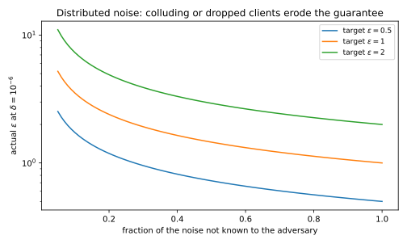

# Local, shuffle and distributed trust models

## Why this matters

Every mechanism so far in this part assumed a **trusted curator**, a party that holds the raw data, runs the mechanism and releases only its output. This setting is the **central model**. The guarantee of differential privacy (DP) is a promise about the curator's output, not about the curator, its database, its engineers or a court order that can demand the data. [Threat models](../part02-attacks/01-threat-models.md) put this in one line: trust decides who the adversary is. In the central model the curator is outside the threat model, but often it cannot be. A browser vendor collecting usage statistics is exactly the party its users do not want to see their data.

This chapter asks how much accuracy each weaker trust assumption costs, and what you have to trust instead. It compares four answers, drawn in @fig-trust-models. In the central model you trust the curator with every record. In the **local model** you trust nobody, and each person randomizes their own record before it leaves their device. In the **shuffle model** you trust a shuffler only to cut the link between each report and its sender. In the **distributed model** you trust cryptography and enough honest participants, and the server learns only a noisy sum.

{#fig-trust-models}

One idea organizes the whole chapter. All four models release a noisy statistic, and they differ only in where the noise is added and in who sees the data before the noise goes in. The further upstream the noise enters, the fewer parties you have to trust and the more noise reaches the answer. A local report is everything the receiver learns about its sender. So it must carry as much noise as a curator adds once to the whole answer. With $n$ people that noise is added $n$ times over, and the local answer ends up about $\sqrt n$ times less accurate than the central one.

The shuffle and distributed models move the noise back downstream without handing the data to any single party. Anonymity hides which report is whose, and cryptography hides everything except the sum.

## Central and local differential privacy {#sec-trust-local}

In the local model there is no curator. Each person runs a **local randomizer** on their own record and sends only the result, which we call their **report**. Whoever receives a report may know whose it is, so the report has to look about the same whatever the record behind it is.

That requirement is the DP definition of [The definition of differential privacy](01-definition.md), applied to a dataset of a single record. Write $R$ for the randomizer and $\varepsilon_0$ for its privacy level, the level of one report. The randomizer is an **$\varepsilon_0$-DP local randomizer** if no set of possible reports becomes more than $e^{\varepsilon_0}$ times as likely when the record changes. In symbols, for every pair of records $x$ and $x'$ and every set $S$ of reports,
$$\Pr[R(x) \in S] \le e^{\varepsilon_0}\Pr[R(x') \in S].$$ {#eq-trust-ldp}
Every pair of records counts as neighbours here. The receiver may already know whose report it is, so the randomization is the only thing that stands between the receiver and the record.

Neighbouring datasets in this chapter always differ by **replacing** one record, never by adding or removing one. Each report comes from a known device, so the number of reports already reveals who took part, and no randomization of the value can hide that.

The **local protocol** collects the reports of all $n$ people, each randomized with its own independent randomness. It then has two guarantees. Taken together, the reports are $\varepsilon_0$-DP in the usual central sense, under replace neighbours. And each report on its own is $\varepsilon_0$-DP against anyone who sees it, including the party that collects it. The first holds because changing one person's record changes only their own report, and, since each person uses independent randomness, the other reports keep the same distribution. A randomizer that shared its random draws across people could tie the reports together, which is why independence is required. The second holds because @eq-trust-ldp is a statement about the report alone, whoever reads it.

Any estimate computed from the reports is just as private. This is **post-processing** ([Post-processing, group privacy and composition](02-properties.md)), and it holds because a function that never touches the data cannot sharpen what the reports reveal.

The guarantee no longer depends on the curator. A breach of the collector's database, a malicious insider or a subpoena reveals reports, and the reports are already private. That is why the large deployments of the 2010s used local DP, among them Google's RAPPOR in Chrome (@sec-trust-frequency) and Apple's telemetry. The guarantee covers only the randomized value, though. A network address stored next to a report links it to the person, and anything learned about that person later can be combined with it.

The price is that each person pays for privacy separately, in noise on their own report. The basic local randomizer is **randomized response** on a single bit. Each person reports their true bit with some probability, written $t$ and called the keep probability, and the flipped bit otherwise. Setting $t = e^{\varepsilon_0}/(1 + e^{\varepsilon_0})$ makes the probability of each report exactly $e^{\varepsilon_0}$ times larger under one true bit than under the other.

The flipping pulls the average report towards one half by a known amount, so the analyst can undo it. Write $\pi$ for the true fraction of ones. The average report is then $(1 - t) + \pi(2t - 1)$ in expectation, a straight line in $\pi$ with a known offset and slope. So subtracting the offset $1 - t$ and dividing by the slope $2t - 1$ gives an unbiased estimate $\hat\pi$. Because every report has the same variance whatever its bit, the standard deviation of the estimate does not depend on the data. Substituting the keep probability gives
$$\operatorname{sd}(\hat\pi) = \frac{e^{\varepsilon_0/2}}{(e^{\varepsilon_0} - 1)\sqrt n}.$$
A strongly private randomizer has a small slope, and dividing by it multiplies the noise variance by a large factor, a pattern that recurs throughout the chapter.

Here is the cost in a survey of ten thousand people, of whom 3,000 hold a 1, though the standard deviation does not depend on that number. Each person uses randomized response at the level $\ln 3$, which by the first guarantee above is also the central $\varepsilon$ of the whole collection. The keep probability is then 0.75. The formula gives a standard deviation of 0.00866 for the estimated fraction, which is 86.6 people on the count.

A trusted curator would instead add Laplace noise to the true count. The **Laplace mechanism** ([The Laplace and Gaussian mechanisms](03-laplace-gaussian.md)) adds noise of scale $\Delta_1/\varepsilon$, where the sensitivity $\Delta_1$ is the most that one person can move the answer. Replacing one person's bit moves the count by at most 1, so the scale is $1/\varepsilon$. The noise then has a standard deviation of $\sqrt2/\varepsilon$, or 1.287 people at the same level. So with the same people and the same $\varepsilon$, the local survey is 67.3 times noisier than the central one.

## The price of local privacy: a $\sqrt n$ gap {#sec-trust-gap}

A factor of 67 at ten thousand people raises a question: is it a weakness of randomized response, or of the local model itself? It is the model, because no locally private protocol can estimate a fraction with error below order $1/((e^{\varepsilon_0} - 1)\sqrt n)$, while the central Laplace mechanism reaches order $1/(n\varepsilon)$. The ratio between the two grows like $\sqrt n$.

The argument asks whether the reports can even tell apart two populations whose fractions differ slightly. If they cannot, no estimate built from them can be accurate. It has two halves. The first shows that one locally randomized report says little about the population it came from. Suppose each person's record is drawn independently from one of two populations, written $P_0$ and $P_1$. Each person applies some $\varepsilon_0$-DP local randomizer, possibly a different one for each person, and $M_0$ and $M_1$ are the resulting distributions of one report. These stay close however different the populations are, because no record can make a report more than $e^{\varepsilon_0}$ times as likely as any other record does.

The bound measures closeness in two standard ways ([Divergences](../part01-prerequisites/03-divergences.md)). The **total variation (TV) distance** is the largest difference between the probabilities that two distributions give to the same event. The **Kullback–Leibler (KL) divergence** is the average log-likelihood ratio in favour of $M_0$ when the data come from $M_0$. It is zero only when the two distributions are equal.

With these measures, the KL divergence between the two report distributions is at most a factor times the squared TV distance between the populations:
$$D_{\mathrm{KL}}(M_0\|M_1) \le (e^{\varepsilon_0} - 1)^2\,\mathrm{TV}(P_0, P_1)^2.$$ {#eq-trust-kl-contraction}
For small $\varepsilon_0$ the factor $(e^{\varepsilon_0} - 1)^2$ is about $\varepsilon_0^2$, so the randomizer shrinks what each report reveals by roughly that factor. And KL adds up over independent reports, so $n$ reports carry at most $n$ times the bound.

The second half turns little information into a large error. Take populations whose fractions of ones are one half and one half plus a small gap, written $\alpha$. Suppose an estimator built from $n$ reports is within $\alpha/2$ of the true fraction, except with a small failure probability $\beta$, under both populations. It then gives a test that checks which side of the midpoint the estimate lands on. That test errs with probability at most $\beta$ under each population. Its two error rates can be that small only if the TV distance between the distributions of all $n$ reports is at least $1 - 2\beta$. But **Pinsker's inequality** says that this TV distance is at most the square root of half their KL divergence, which is small. Combining the two inequalities gives
$$\frac\alpha2 \ge \frac{1 - 2\beta}{(e^{\varepsilon_0} - 1)\sqrt{2n}}.$$ {#eq-trust-lower}
No local protocol can therefore guarantee accuracy better than order $1/((e^{\varepsilon_0} - 1)\sqrt n)$, the order that randomized response reaches.

So randomized response is optimal up to a constant. Dividing its standard deviation by the lower bound cancels the factor $(e^{\varepsilon_0} - 1)\sqrt n$, and at level 1 and a failure probability of 0.1 the constant left is 2.91. The contraction also explains the cost in people. For small $\varepsilon_0$ the contraction factor is about $\varepsilon_0^2$, and KL adds over people, so you need about $1/\varepsilon_0^2$ times as many people to learn the same thing. Centrally, privacy costs an additive error of order $1/(n\varepsilon)$ on a fraction, which vanishes faster than the sampling error of order $1/\sqrt n$ that every survey has anyway. For a fraction near one half at $\varepsilon = 1$, sampling error is already the larger of the two beyond 8 people.

The contraction is loose by a constant, and for one randomized-response report at level 1 it overstates the KL divergence about seven times. Duchi, Jordan & Wainwright (2018) prove a version of it with a constant factor of 4. Chan, Shi & Song (2012) prove the matching lower bound for counting, of order $\sqrt n$ on a count. Letting people respond in turn does not help much. Lower bounds of the same order hold for **sequentially interactive** protocols, in which each person speaks once but their randomizer may depend on earlier reports.

@fig-trust-rr-gap shows how the gap grows at $\varepsilon = 1$, where the central Laplace mechanism's error on a fraction is the count's $\sqrt2/\varepsilon$ divided by $n$. With a thousand people the central mechanism is 21 times more accurate, and because the ratio grows like $\sqrt n$, it reaches 215 at a hundred thousand. Put the other way round, suppose you want a standard deviation of 0.001 at this level. Randomized response needs 920,674 people for that, while the central Laplace mechanism needs only 1,415. Only an item held by a large share of a very large population stands clear of that noise. That is why local DP is used for the most frequent items and almost never for anything finer.

{#fig-trust-rr-gap}

## Frequency estimation: $k$-ary randomized response and unary encoding {#sec-trust-frequency}

The workhorse of deployed local DP is **frequency estimation**. In it, each person holds one value from a fixed list, such as a home page, an emoji or a crashing app. Write $k$ for the number of possible values. The analyst wants the fraction of people holding each value, written $f_v$ for the value $v$. There are two natural ways to extend randomized response to $k$ values, and they behave very differently as $k$ grows.

Both fit one template, called a **frequency oracle**, in which each report either "supports" a value $v$ or not. Write $p$ for the probability of support when the person holds $v$, and $q$ for the smaller probability when they do not, with reports independent across people. Write $C_v$ for the number of reports that support $v$. The expected share of supporting reports is then $q + f_v(p - q)$, again a straight line with a known offset and slope. So subtracting $q$ and dividing by $p - q$ gives an unbiased estimate, with exact variance
$$\hat f_v = \frac{C_v/n - q}{p - q}, \qquad \operatorname{Var}\hat f_v = \frac{f_vp(1-p) + (1 - f_v)q(1-q)}{n(p - q)^2}.$$ {#eq-trust-oracle}
The square of the gap $p - q$ divides the variance, so designing a frequency oracle comes down to making that gap as large as the privacy level allows.

The first scheme is **$k$-ary randomized response**. It reports the true value with probability $p = e^{\varepsilon_0}/(e^{\varepsilon_0} + k - 1)$. It reports each other value with probability $q = 1/(e^{\varepsilon_0} + k - 1)$, and a report supports $v$ if it equals $v$. Any single report has probability $p$ or $q$ under any record, so the ratio between two records is at most $p/q = e^{\varepsilon_0}$.

The second scheme is **unary encoding**. It writes the value as a one-hot vector of $k$ bits, in which bit $v$ is 1 and all the others are 0. It then sends each bit through its own randomized response, so that a 1 survives with probability $p$ and a 0 turns into a 1 with probability $q$. A report supports $v$ if its bit $v$ is 1. Changing a person's value from $x$ to $x'$ changes only two bits of the vector, whatever $k$ is, and every other bit has the same distribution under both values. Bit $x$ can change a report's probability by at most a factor $p/q$, and bit $x'$ by at most $(1 - q)/(1 - p)$. The privacy level is the logarithm of their product,
$$\varepsilon_0 = \ln\frac{p(1 - q)}{q(1 - p)}.$$

Two choices of $p$ and $q$ are in use. The **symmetric** choice sets $p = e^{\varepsilon_0/2}/(e^{\varepsilon_0/2} + 1)$ and $q = 1 - p$, so each bit gets half of the privacy budget. This is basic one-shot RAPPOR. The **optimized** choice of Wang et al. (2017) sets $p$ to one half and $q = 1/(e^{\varepsilon_0} + 1)$. Both choices give exactly the level $\varepsilon_0$.

An oracle's usefulness is decided by rare values. Most values of a large domain are rare, and the variance at $f_v = 0$ acts as a noise floor. A value whose frequency is below a few standard deviations, the square root of that floor, cannot be told apart from zero. Each scheme's noise floor follows from setting $f_v = 0$ in @eq-trust-oracle and substituting its own $p$ and $q$,
$$k\text{-ary: } \frac{e^{\varepsilon_0} + k - 2}{n(e^{\varepsilon_0} - 1)^2}, \qquad \text{symmetric unary: } \frac{e^{\varepsilon_0/2}}{n(e^{\varepsilon_0/2} - 1)^2}, \qquad \text{optimized unary: } \frac{4e^{\varepsilon_0}}{n(e^{\varepsilon_0} - 1)^2}.$$
The $k$-ary and optimized unary floors have the same denominator, so comparing their numerators shows that $k$-ary randomized response wins exactly when $k < 3e^{\varepsilon_0} + 2$.

The reason for the crossover is that $k$-ary randomized response spreads its noise over the domain. With many values, the true one is reported with probability of only about $e^{\varepsilon_0}/k$. The report is then nearly uniform and carries little signal, and its noise floor grows linearly in $k$ (@fig-trust-frequency-oracles). Unary encoding avoids this by paying $\varepsilon_0$ once for two bits, whatever $k$ is. Its variance does not depend on $k$, and the price is a report of $k$ bits. The optimized version keeps a true 1 only half the time, but it invents a 1 less often than the symmetric version does. That is the right trade, because almost all bits of a one-hot vector are 0, so invented 1s are the noise that matters most. @tbl-trust-oracles gives the floors at $\varepsilon_0 = 1$, where the crossover is at $k = 10.15$.

| $k$ | $k$-ary randomized response | Symmetric unary | Optimized unary |
| --- | --- | --- | --- |
| 2 | 0.921 | 3.918 | 3.683 |
| 8 | 2.953 | 3.918 | 3.683 |
| 32 | 11.082 | 3.918 | 3.683 |
| 128 | 43.596 | 3.918 | 3.683 |

: $n$ times the variance of the estimated frequency of a rare value, at $\varepsilon_0 = 1$. $k$-ary randomized response wins below $k = 3e + 2 = 10.15$. {#tbl-trust-oracles}

{#fig-trust-frequency-oracles}

As an example, a keyboard app wants the frequency of each of 128 emoji at $\varepsilon_0 = 1$ from a million users. A rare emoji's estimate then has a standard deviation of 0.0066 under $k$-ary randomized response and 0.0019 under optimized unary encoding. An estimate has to stand about three standard deviations above zero to be told apart from noise. So even with optimized unary encoding, emoji used by fewer than about 0.6% of users are lost in the noise, and $k$-ary randomized response loses more. With only 8 choices, below the crossover, $k$-ary randomized response would win, with a standard deviation of 0.0017.

These oracles are optimal local protocols, so they still carry the $\sqrt n$ gap of the previous section, since every floor is divided by $n$. For large $k$, local hashing and Hadamard response hash the value to a short code first. They reach the variance of unary encoding with reports of only about $\log k$ bits.

RAPPOR (Erlingsson, Pihur & Korolova 2014) shows what a deployment adds on top. It applies unary encoding to a Bloom filter, a hashed bit vector, in Chrome. For each value a user holds, it computes a **permanent** randomized response once and remembers it, then draws fresh noise around it in each report. The reason is composition ([Post-processing, group privacy and composition](02-properties.md)). A user who reports the same value every day with fresh noise alone would pay $\varepsilon_0$ each day, and averaging the reports would reveal the value. With the permanent layer, averaging recovers at most the fixed randomized value.

## The shuffle model and amplification by shuffling {#sec-trust-shuffle}

The local model loses a factor of $\sqrt n$ because each report must hide its owner from an analyst who knows whose report it is. The **shuffle model** (Bittau et al. 2017; Cheu et al. 2019) takes that knowledge away, so that the reports can hide each other. Each person sends a locally randomized report to a **shuffler**. The shuffler strips identifiers and timing, and forwards the reports in a uniformly random order, so the analyst sees which reports were sent, but not by whom. It must be trusted only to unlink reports from senders, not to keep data secret, because what it sees are reports that are already $\varepsilon_0$-DP.

The claim is that anonymity amplifies privacy. Call the person whose privacy we check the **target**. The more people's reports the target's report is mixed with, the less the shuffled collection reveals about the target, so the central $\varepsilon$ falls as $n$ grows. The guarantee takes the $(\varepsilon, \delta)$ form of DP ([The definition of differential privacy](01-definition.md)), where $\delta$ is a small additive slack allowed on top of the factor $e^\varepsilon$.

The bound to compute with is Theorem 3.1 of Feldman, McMillan & Talwar (2021), for $n$ people under replace neighbours. It holds even when each person's randomizer depends on the reports sent before it, as in a server that updates its query after each batch. The theorem holds under one condition. It says there must be enough people to hide among, as the end of this section explains, and it reads
$$\varepsilon_0 \le \ln\frac{n}{16\ln(2/\delta)}.$$
When the condition holds, the shuffled reports are $(\varepsilon, \delta)$-DP with a central level that falls like $1/\sqrt n$,
$$\varepsilon \le \ln\left(1 + \frac{e^{\varepsilon_0} - 1}{e^{\varepsilon_0} + 1}\left(\frac{8\sqrt{e^{\varepsilon_0}\ln(4/\delta)}}{\sqrt n} + \frac{8e^{\varepsilon_0}}{n}\right)\right).$$ {#eq-trust-fmt}

The reason it falls is that other people's reports act as cover. By @eq-trust-ldp, any report is at least $e^{-\varepsilon_0}$ times as likely under another person's value as under either of the target's two possible values, and so as under their average. A share $e^{-\varepsilon_0}$ of that person's report distribution can therefore be set aside as a half-and-half mix of the target's two distributions. In other words, each report is drawn as if its sender held one of the target's values with probability $e^{-\varepsilon_0}/2$ each, and otherwise from a leftover distribution. Every other person is thus, with probability $e^{-\varepsilon_0}$, a **clone** of the target, whose report looks exactly like one the target might have sent. After shuffling, the analyst sees the target's report among about $(n - 1)e^{-\varepsilon_0}$ clones and cannot tell which one is the target's.

@fig-trust-clones does the split for randomized response over 4 values at the level $\ln 3$. A person holding value 3 is a clone of a target holding 1 or 2 with probability $\frac13$. The leftover keeps the remaining mass of 0.6667.

{#fig-trust-clones}

[Amplification by shuffling and by iteration](../part04-privacy-accounting/07-shuffling-iteration.md#sec-shuf-clones) returns to this argument, and the full edition derives it. The number of clones of each kind is a binomial count, which rarely strays far from its mean ([Concentration inequalities](../part01-prerequisites/02-concentration.md)). So the split between the two kinds of clone is rarely lopsided enough to point to the target's value. The factor in front of the bracket comes from treating the target's own report as a randomized response, and it equals $\tanh(\varepsilon_0/2)$. For large $n$ the second term in the bracket is negligible, and the logarithm of one plus a small number is about that number. So the bound is about
$$\varepsilon \approx 8\tanh(\varepsilon_0/2)\sqrt{\frac{e^{\varepsilon_0}\ln(4/\delta)}{n}}.$$
For small $\varepsilon_0$ it is of order $\varepsilon_0\sqrt{\ln(1/\delta)/n}$, which is the first amplification result, due to Erlingsson et al. (2019) (@fig-trust-shuffle-bound).

The large-$\varepsilon_0$ form is what makes the shuffle model useful. There the hyperbolic tangent is close to 1, and the bound is of order $\sqrt{e^{\varepsilon_0}\ln(1/\delta)/n}$. Turned around, it says that a target central $\varepsilon$ lets $e^{\varepsilon_0}$ grow in proportion to $\varepsilon^2 n/\ln(1/\delta)$. At such a level, randomized response has an error of about $1/\sqrt{ne^{\varepsilon_0}}$ on a fraction, because the $-1$ in its formula hardly matters. Substituting the allowed $e^{\varepsilon_0}$ then gives an error of order $\sqrt{\ln(1/\delta)}/(\varepsilon n)$. That is the central rate up to a factor of $\sqrt{\ln(1/\delta)}$, which is why shuffling recovers nearly all the accuracy the local model lost.

The theorem's condition is what keeps this argument honest. Rewritten, it says that the expected number of clones, $ne^{-\varepsilon_0}$, must be at least $16\ln(2/\delta)$. If $\varepsilon_0$ is so large that fewer clones are expected, the target may have too few to hide among, and the theorem then says nothing at all.

@tbl-trust-shuffle compares the closed form with two values the full edition computes, at ten thousand people and $\delta = 10^{-6}$. The numeric column, from Theorem 3.2 of the same paper, computes the comparison of clone counts exactly, so it is still a valid bound for every $\varepsilon_0$-DP randomizer. The exact column is the true $\varepsilon$ of shuffled binary randomized response, which no valid general bound can undercut because the theorem covers that randomizer. The closed form is 2.6 to 4.6 times the numeric bound, while the numeric bound stays within 1.9 times the exact value. So reason with the closed form, and deploy with a **numerical accountant**, a program that computes a bound like Theorem 3.2's numerically.

| $\varepsilon_0$ | Closed form, @eq-trust-fmt | Numeric (Theorem 3.2) | Exact, shuffled binary randomized response |
| --- | --- | --- | --- |
| 0.5 | 0.0939 | 0.0204 | 0.0162 |
| 1 | 0.2140 | 0.0530 | 0.0357 |
| 2 | 0.5009 | 0.1550 | 0.0870 |
| 3 | 0.8241 | 0.3207 | 0.1692 |

: Central $\varepsilon$ after shuffling the reports of $n = 10^4$ people, each $\varepsilon_0$-DP, at $\delta = 10^{-6}$. The condition of the theorem requires $\varepsilon_0 \le 3.763$ here. {#tbl-trust-shuffle}

{#fig-trust-shuffle-bound}

In practice you choose the local level from a target, say central $\varepsilon = 1$ at $\delta = 10^{-6}$. The right-hand side of @eq-trust-fmt increases with $\varepsilon_0$, so the largest allowed $\varepsilon_0$ is where it equals 1, and bisection finds it (@sec-trust-code). With ten thousand people each person may randomize at $\varepsilon_0 = 3.504$. The allowed level rises to 5.701 at a hundred thousand people, and to 7.992 at a million. At that last level a single report is almost the true value, since randomized response over 8 values would keep the truth with probability 0.998. Yet the shuffled collection is still $(1, 10^{-6})$-DP. At a thousand people, by contrast, there are too few clones, and the theorem's condition caps $\varepsilon_0$ at 1.460.

The amplification lasts only as long as the shuffler does its one job, and three things can undo it. The first is collusion. If the shuffler colludes with the analyst, the guarantee falls back to the local $\varepsilon_0$ of each report. So shuffling is a defence in depth, not a replacement for a reasonable $\varepsilon_0$. The second is fake senders. An adversary that controls $m$ of the senders knows their reports and can remove them. Only the honest reports provide clones, so $n - m$ must replace $n$ in @eq-trust-fmt. The third is side channels. The theorem covers only the collection of reports, so timing, message sizes and message counts must not leak anything either. That is why real shufflers batch and pad their traffic.

## Distributed DP: splitting the noise {#sec-trust-distributed}

The **distributed model** adds the central amount of noise once, in pieces, rather than to every report. Each client adds a small share of noise to its own value, and a **secure aggregation** protocol reveals only the sum of the noisy values to the server. In federated learning, where devices train a shared model on their own data, this lets a server learn a noisy model update without seeing any device's update.

Secure aggregation is a cryptographic protocol built from the additive secret sharing of [Cryptography basics](../part01-prerequisites/08-crypto-basics.md). The property this chapter uses is **simulation**. Everything the server sees during the protocol could have been generated from the sum alone, plus randomness of the server's own, so the server learns nothing beyond the sum. Practical versions (Bonawitz et al. 2017) add random masks that pairs of clients agree on and that cancel in the sum, and they tolerate clients that drop out.

Recall that the **Gaussian mechanism** ([The Laplace and Gaussian mechanisms](03-laplace-gaussian.md)) adds normal noise, of standard deviation written $\sigma$, to each coordinate of a vector-valued answer. Its privacy depends only on the ratio of $\sigma$ to the **$\ell_2$ sensitivity**, the largest Euclidean distance that one person can move the answer. The noise splits cleanly because independent Gaussian noises add up to a Gaussian whose variance is the sum of theirs.

Now let $n$ clients each hold a vector, and let the server want their sum. Each client adds independent normal noise of variance $\sigma^2/n$ to its vector and sends the result through secure aggregation. The $n$ noise shares then add up to exactly the noise of variance $\sigma^2$ that the central mechanism would have added. So by simulation and post-processing, the server's whole view is as private as the central Gaussian mechanism's output.

A client should not simply add the full central noise to be safe. The sum would then carry $n$ times too much variance, which is the local model again with its $\sqrt n$ loss. The small shares are what make the accuracy central, and they are also the weakness, since no single share is enough noise on its own. Suppose an adversary knows the noise of $t$ clients, because they collude with it, or because they dropped out and their planned share of noise is missing. Then only the $n - t$ honest clients' noise protects the sum. The server effectively runs a Gaussian mechanism with the smaller noise
$$\sigma\sqrt{\frac{n - t}{n}}.$$

Deployments therefore over-provision the noise. Write $\rho$ for the largest fraction of clients that may collude or drop out. Each client then adds variance $\sigma^2/(n(1 - \rho))$, so the honest clients alone contribute the full $\sigma^2$, and when everyone is honest the server receives $1/(1 - \rho)$ times the variance it needs.

As an example, a server aggregates a histogram of its users' values through 100 clients and wants $(\varepsilon, \delta) = (1, 10^{-6})$. Under replace, a user who changes value moves one count down by 1 and another up by 1, so the $\ell_2$ sensitivity is $\sqrt2$. The **analytic Gaussian calibration** of [The Laplace and Gaussian mechanisms](03-laplace-gaussian.md) then gives a total noise of $\sigma = 5.975$, so each client adds noise with standard deviation 0.597. If 20% of the clients collude with the server, the delivered guarantee weakens to $\varepsilon = 1.128$. With half of them honest it is 1.455, and with only a tenth honest it is 3.525 (@fig-trust-collusion). So decide before deployment what fraction of clients may collude or drop out, and over-provision for it.

{#fig-trust-collusion}

Real-valued Gaussian noise cannot actually be sent through secure aggregation. Shares can look uniformly random only in a finite set, since no uniform distribution covers all real numbers. So the protocol works on integers modulo a large number, chosen so that the true sum never wraps around. Clients round their scaled vectors to integers and add integer noise whose sum still has a known distribution.

**Skellam noise** is the difference of two independent Poisson variables. Sums of independent Poisson variables are Poisson, so Skellam shares sum exactly to Skellam noise. Its privacy is close to a Gaussian's of the same variance (Agarwal, Kairouz & Liu 2021). The **distributed discrete Gaussian** (Kairouz, Liu & Steinke 2021) instead adds a Gaussian restricted to the integers. A sum of these is not exactly a discrete Gaussian, but it is close to one, and the paper bounds the gap.

Laplace noise, by contrast, does not split this simply. Write $b$ for the central scale, and let each client add Laplace noise of scale $b/n$, by analogy with the Gaussian shares. The variances then add up to only $2b^2/n$. That is $n$ times less than the central $2b^2$, too little to meet the target. Splitting Laplace noise exactly needs a different decomposition, as a difference of Gamma variables.

Distributed noise gives central accuracy, but with a $\delta$, which Gaussian noise pays for with a wider spread than Laplace noise on a small histogram (@sec-trust-compare). Its advantage is in high dimension. The Gaussian is calibrated to the $\ell_2$ sensitivity, while the Laplace mechanism uses the $\ell_1$ sensitivity, the sum of absolute changes. For a change spread evenly over $d$ coordinates, the case where they differ most, the $\ell_1$ sensitivity is $\sqrt d$ times larger.

Secure aggregation hides the inputs but does not check them, so a malicious client can send a vector with no noise or an enormous value. Bounding what such clients can do needs zero-knowledge proofs or verifiable aggregation.

## Comparing the four models {#sec-trust-compare}

@tbl-trust-who sets out what each model asks you to trust, what the untrusted party sees, and how the error of a count grows at a fixed $\varepsilon$. Each entry was derived in its section.

| Model | Who must be trusted | What the untrusted party sees | Error of a count, $\varepsilon$ fixed |
| --- | --- | --- | --- |
| Central | The curator, with all raw records | The mechanism's output | Order $1/\varepsilon$, independent of $n$ |
| Local | Nobody | Every report | Order $\sqrt n/\varepsilon$ |
| Shuffle | The shuffler, to unlink reports from senders | The reports, without their senders | Order $\sqrt{\ln(1/\delta)}/\varepsilon$ |
| Distributed | The cryptography, and enough honest clients | The noisy sum | Order $\sqrt{\ln(1/\delta)}/\varepsilon$ |

: The four trust models: who is trusted, what the untrusted party sees, and the order of the error of a count. {#tbl-trust-who}

To see the constants, the full edition's script estimates a histogram over 8 values, a few common and the rest rare, in all four models at the same central guarantee. Central adds pure-DP Laplace noise to each count, and distributed sends Skellam shares calibrated as a Gaussian. Shuffle and local use the better of the two oracles, shuffle at the largest $\varepsilon_0$ that @eq-trust-fmt allows and local at $\varepsilon_0 = 1$. The error is the expected squared distance between the estimated and true histograms of fractions, computed exactly (@tbl-trust-matched) and checked against 200 simulated runs.

| $n$ | Central | Distributed | Shuffle | Local |
| --- | --- | --- | --- | --- |
| $10^3$ | $6.40\times10^{-5}$ | $2.86\times10^{-4}$ | $9.35\times10^{-3}$ | $2.71\times10^{-2}$ |
| $10^4$ | $6.40\times10^{-7}$ | $2.86\times10^{-6}$ | $4.88\times10^{-5}$ | $2.71\times10^{-3}$ |
| $10^5$ | $6.40\times10^{-9}$ | $2.86\times10^{-8}$ | $4.76\times10^{-7}$ | $2.71\times10^{-4}$ |

: Expected squared $\ell_2$ error of an 8-value histogram of fractions at the same central $(\varepsilon, \delta) = (1, 10^{-6})$ in all four trust models. {#tbl-trust-matched}

{#fig-trust-matched-error}

The local model is a different regime. Its squared error falls like $1/n$, while the central one falls like $1/n^2$ because the central noise stays fixed as the counts grow. So the gap grows linearly in $n$, and at a hundred thousand people it is a factor of about 42,000 (@fig-trust-matched-error).

Shuffling recovers most of that gap. At ten thousand people its error is about 56 times smaller than the local error. From there on it falls parallel to the central curve, because the allowed $\varepsilon_0$ keeps growing with $n$. But at a thousand people the theorem's condition caps $\varepsilon_0$, and shuffling helps only by a factor of 3.

The distributed model behaves like the central Gaussian mechanism. On this small histogram its error is about 4.5 times the central Laplace error, because Gaussian noise for $\delta = 10^{-6}$ is wider than Laplace noise in low dimension. In exchange it needs no trusted party, only cryptography and enough honest clients.

Every column of @tbl-trust-matched has the same $(\varepsilon, \delta)$, but each protects against a different adversary. Only the local model needs no trusted component at all. The others protect only against parties that do not see what the trusted component holds, whether the curator's data, the shuffler's links or the honest clients' noise. So a report of "$\varepsilon = 1$" means nothing without its trust model.

## Code {#sec-trust-code}

The snippet below computes the two numbers that recur in local and shuffled deployments, which frequency oracle to use and how large a local $\varepsilon_0$ the shuffler allows.

```python
from math import exp, log, log1p, sqrt


def rare_variance_krr(eps0: float, k: int) -> float:
    """n times the variance of a rare value's frequency under k-ary randomized response."""
    return (exp(eps0) + k - 2) / (exp(eps0) - 1) ** 2


def rare_variance_oue(eps0: float) -> float:
    """n times the variance of a rare value's frequency under optimized unary encoding."""
    return 4 * exp(eps0) / (exp(eps0) - 1) ** 2


def shuffle_cap(n: int, delta: float) -> float:
    """The largest eps0 the shuffling theorem covers: ln(n / (16 ln(2/delta)))."""
    return log(n / (16 * log(2 / delta)))


def shuffle_epsilon(eps0: float, n: int, delta: float) -> float:
    """Central epsilon after shuffling n eps0-DP reports (Feldman, McMillan & Talwar 2021)."""
    if eps0 > shuffle_cap(n, delta):
        raise ValueError("eps0 is above the theorem's cap")
    e0 = exp(eps0)
    bracket = 8 * sqrt(e0 * log(4 / delta)) / sqrt(n) + 8 * e0 / n
    return log1p((e0 - 1) / (e0 + 1) * bracket)


def max_local_epsilon(eps: float, n: int, delta: float) -> float:
    """The largest eps0 whose shuffled reports are (eps, delta)-DP by the closed form."""
    lo, hi = 0.0, shuffle_cap(n, delta)
    if shuffle_epsilon(hi, n, delta) <= eps:
        return hi
    for _ in range(100):
        mid = (lo + hi) / 2
        lo, hi = (mid, hi) if shuffle_epsilon(mid, n, delta) <= eps else (lo, mid)
    return lo


print(f"{rare_variance_krr(1.0, 128):.3f} {rare_variance_oue(1.0):.3f}")  # 43.596 3.683
print(f"{shuffle_epsilon(1.0, 10_000, 1e-6):.4f}")  # 0.2140
print(" ".join(f"{max_local_epsilon(1.0, n, 1e-6):.3f}" for n in (10**3, 10**4, 10**5, 10**6)))  # 1.460 3.504 5.701 7.992
```

The full edition's script, [trust_models.py](../../code/part03-dp-foundations/trust_models.py), computes every number in this chapter, including the numerical shuffle bound and the four-model comparison:

```bash
uv run python code/part03-dp-foundations/trust_models.py
```

## Cheat sheet

| Result | Formula | Notes |
| --- | --- | --- |
| Local randomizer | $\Pr[R(x) \in S] \le e^{\varepsilon_0}\Pr[R(x') \in S]$ for all $x, x'$ | The reports are $\varepsilon_0$-DP under replace, against everyone, the collector included |
| Randomized response | $\operatorname{sd} = e^{\varepsilon_0/2}/((e^{\varepsilon_0} - 1)\sqrt n)$ | Unbiased after debiasing; optimal among local protocols up to a constant |
| Local lower bound | Error $\ge (1 - 2\beta)/((e^{\varepsilon_0} - 1)\sqrt{2n})$ | Central Laplace: $\sqrt2/(n\varepsilon)$; the gap grows like $\sqrt n$ |
| $k$-ary randomized response | Rare variance $(e^{\varepsilon_0} + k - 2)/(n(e^{\varepsilon_0} - 1)^2)$ | Best for $k < 3e^{\varepsilon_0} + 2$ |
| Optimized unary encoding | $p = \frac12$, $q = 1/(e^{\varepsilon_0} + 1)$; rare variance $4e^{\varepsilon_0}/(n(e^{\varepsilon_0} - 1)^2)$ | Independent of $k$; $k$-bit reports |
| Shuffling | @eq-trust-fmt, for $\varepsilon_0 \le \ln(n/(16\ln(2/\delta)))$ | Several times loose; deploy with a numerical bound |
| Distributed Gaussian | $n$ shares of variance $\sigma^2/n$ sum to variance $\sigma^2$ | $t$ colluders leave $\sigma\sqrt{(n - t)/n}$ |
| Skellam | Skellam shares sum exactly to Skellam noise | Integer noise for secure aggregation |

: The results of this chapter. {#tbl-trust-cheat}

**Rules of thumb**

- Local DP costs a factor of about $\sqrt n$ in error over central DP, and no local protocol avoids it. Use it only for frequent items in very large populations.
- For frequency estimation, use $k$-ary randomized response when $k < 3e^{\varepsilon_0} + 2$, and optimized unary encoding or a hashing variant otherwise. Memoize the reports of values that do not change.
- A shuffler lets each report use a large $\varepsilon_0$, and the closed form is several times loose, so compute the central $\varepsilon$ numerically before deploying.
- With distributed noise, decide how many clients may collude or drop out, and over-provision the noise for that fraction.
- Always state the trust model next to $(\varepsilon, \delta)$, because the same numbers protect against different adversaries.

## Further reading

- Wang, Blocki, Li & Jha, "Locally Differentially Private Protocols for Frequency Estimation" (USENIX Security 2017): frequency oracles, optimized unary encoding and local hashing, compared.
- Duchi, Jordan & Wainwright, "Minimax Optimal Procedures for Locally Private Estimation" (*Journal of the American Statistical Association* 2018): the contraction behind the local lower bound, and optimal local estimators.
- Feldman, McMillan & Talwar, "Hiding Among the Clones" (FOCS 2021): the closed form used here, the clone reduction and the numerical bound to deploy with.
- Kairouz, Liu & Steinke, "The Distributed Discrete Gaussian Mechanism for Federated Learning with Secure Aggregation" (ICML 2021): distributed noise end to end, with integer noise and modular arithmetic.

**Derivations.** The local guarantees, the frequency oracles, the KL contraction, the local lower bound and the distributed Gaussian results are derived step by step in [the full edition's chapter](../../book-full/part03-dp-foundations/08-trust-models.md). It cites rather than derives the shuffling theorem, whose clone argument it outlines, the interactive lower bounds, the hashing schemes and the privacy of Skellam and discrete Gaussian noise.
