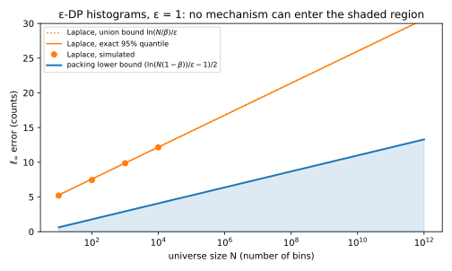
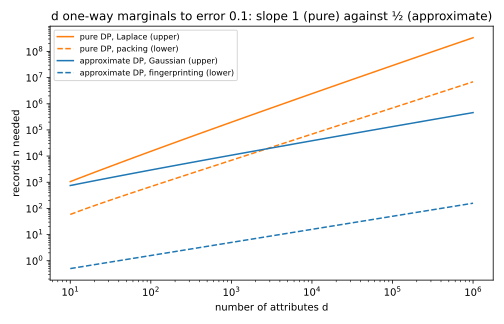

# Lower bounds: what privacy costs

## Why this matters

Suppose someone hands you the design of a private release. It is a histogram over a million locations, and it promises an error of at most five records in every bin, with 95% probability. It also satisfies differential privacy (DP) with a privacy parameter $\varepsilon$ of 1 and no extra slack. Is that accuracy possible at all? The earlier chapters of this part cannot tell you, because they gave **upper bounds**, which say how accurate one particular mechanism is. A cleverer mechanism might still do better.

A **lower bound** answers the question from the other side. It says that no mechanism satisfying the definition can be more accurate than some amount, whatever it does inside. When a lower bound matches the error of a known mechanism, that mechanism is the best possible up to a small factor. More accuracy can then only come from more data or a weaker guarantee. This chapter gives the three standard lower bounds of DP, and each one comes with an attack you can run.

How can anything be said about every mechanism, when there are infinitely many and you cannot try them all? The trick is to use only two facts about a mechanism, that it is accurate and that it is private, and to show that they cannot both hold. An accurate output says something about the data, so an attacker can use it, and the more accurate the output, the better the attack works. DP, on the other hand, limits every attack, because no test can tell apart two datasets that differ in one record much better than chance. Suppose the attack built from an accurate mechanism would succeed more often than DP allows. Then the mechanism cannot be both accurate and private. Writing this clash as an inequality and solving it for the error, or for the number of records, gives the lower bound.

Accuracy is described by two numbers. The **error** $\alpha$ is how far the output may be from the true answer, and the **failure probability** $\beta$ is the chance that it lands further away than that. A mechanism is accurate in this sense if, on every dataset, its error is at most $\alpha$ with probability at least $1 - \beta$. The lower bounds rely on "every dataset", because they pick the datasets on which accuracy is hardest.

Recall the definition from [The definition of differential privacy](01-definition.md), which has the privacy parameter $\varepsilon$ and a small slack $\delta$. A mechanism $M$ is $(\varepsilon, \delta)$-DP if changing one record makes the probability of any set of outputs at most $e^\varepsilon$ times larger, plus the slack. Pure DP is the case $\delta = 0$, while approximate DP allows $\delta > 0$. The examples use $\varepsilon = 1$ and $\beta = 0.05$. Approximate DP examples use $\delta = 10^{-6}$, except the tracing example, which follows the full edition in using $10^{-5}$.

"Changing one record" has two meanings, and the chapter uses both. The histogram results use **add/remove** neighbours, where one dataset has one more record than the other. The later sections use **replace** neighbours, where one record is swapped for another. Those sections need this because their bounds speak about the number of records $n$, which adding a record would change.

## Packing: pure DP pays the logarithm of the number of candidates {#sec-lower-packing}

The first lower bound applies to any output that must single out one of many candidates. Its argument compares datasets that are several records apart, while DP itself compares only neighbours. **Group privacy** ([Post-processing, group privacy and composition](02-properties.md)) bridges the gap by walking from one dataset to the other, one record at a time. Each step can make any event at most $e^\varepsilon$ times more likely, and it also adds the slack $\delta$. For two datasets that are $k$ records apart, the walk has $k$ steps. Call the datasets $D$ and $\tilde D$. For any set $S$ of outputs, the walk gives
$$\Pr[M(D) \in S] \le e^{k\varepsilon}\Pr[M(\tilde D) \in S] + \delta_k, \qquad \delta_k = \delta\sum_{j=0}^{k-1}e^{j\varepsilon}.$$ {#eq-lower-group}

The total slack $\delta_k$ is a geometric sum, because each step multiplies everything collected so far by $e^\varepsilon$, including the slacks of earlier steps. At the chapter's values of $\varepsilon$ and $\delta$, five steps give a total slack of $8.6\times10^{-5}$, which is still small. Twenty steps give 282, and a bound of 282 on a probability says nothing at all. Under pure DP there is no slack to pile up, only the factor $e^{k\varepsilon}$, and packing relies on this.

### The packing lemma

Suppose the output of a mechanism must point to one of several candidates, and write $m$ for their number. It might name the most common ZIP code among a million, or the bin of a histogram that holds a spike. For each candidate $i$ you can build a dataset $D_i$ on which a good answer must point to $i$. Call the set of outputs that point to $i$ its region $G_i$, and choose the regions so that no output lies in two of them. An accurate mechanism lands in the region $G_i$ with probability at least $1 - \beta$ when it runs on $D_i$.

Now run the same mechanism on a single reference dataset $D_0$ instead, one that is within $k$ records of every $D_i$. Its output must land somewhere, and its probabilities add up to 1. Because the regions do not overlap, most of them can receive only a small share. Group privacy under pure DP, however, says that each region can be at most $e^{k\varepsilon}$ times more likely on its own dataset than on $D_0$. So the output on $D_0$ must still put at least $(1 - \beta)e^{-k\varepsilon}$ of its probability on every region, and this holds for all $m$ regions at once.

Those $m$ demands must fit into a total of 1. That requirement is the **packing lemma**. Take any mechanism $M$ that is $\varepsilon$-DP and accurate on every $D_i$ in this sense. Then
$$m(1 - \beta)e^{-k\varepsilon} \le 1, \qquad\text{that is,}\qquad k \ge \frac{\ln\big(m(1 - \beta)\big)}{\varepsilon}.$$ {#eq-lower-packing}
So the candidate datasets must be far apart, by the logarithm of the number of candidates divided by $\varepsilon$, before any pure-DP mechanism can be accurate on all of them. The regions must be disjoint for the argument to work. If they overlapped, a single output could count for several candidates, and the output on $D_0$ could meet every demand with far less than its total probability.

@fig-lower-packing-budget draws the two sides of this inequality. The counting argument is not new to privacy. Packing is the private version of Fano's method from [Information theory](../part01-prerequisites/05-information-theory.md), which shows that an estimator choosing among many hypotheses that are hard to tell apart must often choose wrong.

{#fig-lower-packing-budget}

### The mode and the histogram

Two practical bounds follow by choosing the datasets. Both use add/remove neighbours and a universe of $N$ possible elements, the values a record can take. The **mode** is the most frequent element of the data. Take the empty dataset as the reference, and for each element $x$ take the dataset made of $k$ copies of $x$. Its mode is $x$, so there are $N$ candidates, each $k$ additions away from the empty dataset. Call $k$ the **lead**, since it is how many more times the top element appears than any other. Suppose a mechanism is $\varepsilon$-DP and reports the mode with probability at least $1 - \beta$ on each of these datasets. The lemma then says that the lead must satisfy
$$k \ge \frac{\ln\big(N(1 - \beta)\big)}{\varepsilon}.$$ {#eq-lower-mode}

Below that lead, no pure-DP mechanism can find the mode reliably.

A histogram is the vector of counts of the $N$ elements, and its $\ell_\infty$ error is its largest error over the bins. A histogram that is accurate to within $\alpha$ in every bin can be used to find a spike taller than $2\alpha$. The spike's bin is then off by at most $\alpha$ downward and every empty bin by at most $\alpha$ upward, so the spike's bin still has the largest released count. A lead of $k$ is therefore enough as soon as it exceeds $2\alpha$, and the smallest such whole number is at most $2\alpha + 1$. Putting $2\alpha + 1$ in place of $k$ in the mode's bound gives the histogram's bound. Any $\varepsilon$-DP histogram that is accurate in this sense on every dataset must have
$$\alpha \ge \frac12\left(\frac{\ln\big(N(1 - \beta)\big)}{\varepsilon} - 1\right).$$ {#eq-lower-histogram}

The Laplace mechanism comes close to this. It adds independent Laplace noise of scale $1/\varepsilon$ to every count, and each noise exceeds $\alpha$ in size with probability $e^{-\alpha\varepsilon}$. The union bound over the $N$ bins puts the chance that any of them does at most $Ne^{-\alpha\varepsilon}$. Setting that chance to $\beta$ gives an error of at most $\ln(N/\beta)/\varepsilon$. Both the lower bound and the Laplace error grow like $\ln N/\varepsilon$ (@fig-lower-histogram). The lower bound has half the slope, so Laplace is optimal up to a factor of about 2.

That factor comes from slack in the argument, not from a weak mechanism. The lemma ignores the probability that the output on the reference dataset lands outside every region. For the Laplace histogram, that output is pure noise around zero, so almost all of its probability is outside every region and is wasted.

Report-noisy-max ([Selection](05-selection.md)) plays the same role for the mode. It adds Laplace noise to every count and returns the bin with the largest noisy count. On the dataset of $k$ copies of $x$, it fails only if the noise in some other bin beats the noise in the true bin by at least $k$. A union bound over the other bins shows that its failure probability falls like $Ne^{-k\varepsilon}$, times a factor that grows only slowly with $k$. So it becomes small once $e^{-k\varepsilon}$ is well below $1/N$, which is the same point at which the packing lemma first allows any mechanism to succeed. Report-noisy-max is therefore optimal for the mode, up to that slowly growing factor.

{#fig-lower-histogram}

@tbl-lower-histogram puts numbers on these bounds. Take $N = 10^6$, a typical number of fine-grained locations. Before any $\varepsilon$-DP mechanism can report the most common location reliably, it must lead the others by at least 13.76 records. Report-noisy-max needs a lead of 18.44, the lead at which its failure bound equals 0.05. For the histogram, every $\varepsilon$-DP mechanism has an error of at least 6.38 in some bin at the 95% level. The Laplace mechanism's error is 16.79. The design from the opening, with an error of five records, is therefore impossible under pure DP.

| $N$ | Mode: lower bound on lead $k$ | Report-noisy-max needs | Histogram: lower bound on error | Laplace error (exact) | Laplace error (union bound) |
| --- | --- | --- | --- | --- | --- |
| $10^3$ | 6.86 | 11.09 | 2.93 | 9.88 | 9.90 |
| $10^6$ | 13.76 | 18.44 | 6.38 | 16.79 | 16.81 |
| $10^9$ | 20.67 | 25.65 | 9.84 | 23.69 | 23.72 |

: Packing lower bounds against the mechanisms that achieve them, $\varepsilon = 1$, $\beta = 0.05$, add/remove neighbours. Errors and leads are in records. {#tbl-lower-histogram}

### Approximate DP escapes packing

The lemma needs $\delta = 0$, and the reason shows what approximate DP buys. With $\delta > 0$, group privacy adds the slack $\delta_k$. Measured against the factor $e^{k\varepsilon}$, that slack costs each region about $k\delta$. So the demand on each region becomes $e^{-k\varepsilon}(1 - \beta)$ minus a term that grows like $k\delta$. Once $e^{-k\varepsilon}$ falls below about $k\delta$, the demand turns negative, and the lemma then says nothing, however many candidates there are. That happens when $k$ reaches about $\ln(1/\delta)/\varepsilon$, because the extra factor $k$ moves the crossing point only slightly. So under approximate DP, packing can force a distance of only about $\ln(1/\delta)/\varepsilon$, which is 13.82 records at the chapter's $\delta$.

This is not a weakness of the proof, because a real mechanism does better. The stability-based histogram (Vadhan 2017) adds noise only to the bins that are non-empty. It releases a bin only if its noisy count clears a threshold of order $\ln(1/\delta)/\varepsilon$. Empty bins are never released, so there is no union bound over all $N$ bins, and its error does not grow with $N$ at all. For a huge universe that is mostly empty, approximate DP is how you escape the $\ln N$.

## Sample complexity: how many records privacy costs {#sec-lower-sample}

An error in counts becomes an error in fractions once you divide by the number of records $n$. An error of 6 records is large in a dataset of 50 and negligible in a dataset of a million. So a lower bound on error is also a lower bound on the number of records you need. This view lets you compare the cost of privacy with a cost you pay anyway, the sampling error of estimating a population from a sample.

### Histograms: privacy adds a term

Take the histogram bound and ask for an error of $\alpha$ in every frequency, which is an error of $\alpha n$ in every count. Put $\alpha n$ in place of the error in @eq-lower-histogram and solve for $n$. An $\varepsilon$-DP histogram that is accurate in this sense on every dataset of up to $n$ records then needs
$$n \ge \frac{\ln\big(N(1 - \beta)\big) - \varepsilon}{2\alpha\varepsilon}.$$ {#eq-lower-n-histogram}

Without privacy you still pay for sampling. Hoeffding's inequality ([Concentration inequalities](../part01-prerequisites/02-concentration.md)) bounds how far an average of independent values between 0 and 1 strays from its mean. Each frequency is such an average, so long as the records are drawn independently. A union bound over the $N$ bins then shows how many samples are enough to estimate every frequency to within $\alpha$:
$$n = \frac{\ln(2N/\beta)}{2\alpha^2}.$$
Fano's method, the non-private counterpart of packing, gives a lower bound of the same order, so sampling really does cost that much.

You need the larger of the two numbers, and they grow at different rates. The private requirement grows like $1/(\alpha\varepsilon)$, while the statistical one grows like $1/\alpha^2$. Their ratio is about $\alpha/\varepsilon$, so the private term dominates only when $\alpha$ is about $\varepsilon$ or larger. That happens for coarse answers at strong privacy. So at $\varepsilon = 1$ and any accuracy finer than 0.1, the records you need for sampling error alone already pay for privacy, as the next example shows.

Take a histogram over a million cells at $\varepsilon = 1$, and ask for an error of 0.1 in every frequency. Privacy then needs at least 64 records, while sampling needs up to 875, and since sampling really costs that order, privacy is the smaller requirement. For an error of 0.01, privacy needs at least 638 records. Sampling then needs up to 87,522, so the gap widens as the answers get finer.

### Many attributes: pure DP pays $d$, approximate DP pays $\sqrt d$

Now let each record be a person's answers to $d$ yes/no questions, coded as $-1$ or $+1$. The release is the vector of the $d$ attribute means, each between $-1$ and $1$, and its error is the largest error over the attributes. Start from a reference dataset of $n$ identical records. For each of the other $2^d - 1$ answer patterns, build a dataset by replacing $k$ of those records with that pattern. These datasets use replace neighbours, because the number of records stays fixed.

Replacing $k$ records moves some mean by $2k/n$. So an accurate release tells these datasets apart once that shift exceeds $2\alpha$, that is, once $k$ exceeds $\alpha n$. Packing charges the logarithm of the number of candidates, about $d\ln 2$, so $\alpha n$ must be at least about $d\ln 2/\varepsilon$. Any $\varepsilon$-DP mechanism that is accurate in this sense therefore needs, for large $d$, about
$$n \ge \frac{d\ln 2}{\alpha\varepsilon}$$ {#eq-lower-n-marginals}
records. This cost is linear in $d$. The full edition gives the exact form, which subtracts small terms that matter only for small $d$.

Two mechanisms come close to this. The Laplace mechanism is pure DP, and it needs
$$n = \frac{2d\ln(d/\beta)}{\alpha\varepsilon}$$
records, within a factor of the lower bound that grows only like $\ln d$. Its cost is linear in $d$ because it calibrates its noise to the $\ell_1$ sensitivity. Replacing one record moves each of the $d$ means by at most $2/n$, so that sensitivity is $2d/n$.

The Gaussian mechanism is only $(\varepsilon, \delta)$-DP, and it calibrates its noise to the $\ell_2$ sensitivity, which is $2\sqrt d/n$. It needs
$$n = \frac{2\sqrt d\,z}{\mu\alpha}$$
records. Here $z$ is the normal quantile with tail $\beta/(2d)$, which grows only like $\sqrt{\ln d}$.

The number $\mu$ comes from the exact Gaussian calibration of [The Laplace and Gaussian mechanisms](03-laplace-gaussian.md). It is the largest ratio of sensitivity to noise standard deviation that keeps the mechanism $(\varepsilon, \delta)$-DP, and at the chapter's parameters it is 0.2367. So the Gaussian mechanism's requirement grows like $\sqrt{d\ln d}$.

For large $d$, then, the Gaussian mechanism needs fewer records than packing says any pure-DP mechanism needs. That is no contradiction, because packing breaks down once $\delta > 0$. At the chapter's $\delta$ it can force a group distance of only 13, the largest whole number below 13.82. Under pure DP at $d = 1000$, by contrast, it forces 693.10.

| | Pure DP, packing (lower) | Pure DP, Laplace (upper) | Approximate DP, Gaussian (upper) |
| --- | --- | --- | --- |
| $d = 100$ | 683 | 15,202 | 2,941 |
| $d = 1000$ | 6,921 | 198,070 | 10,836 |
| $d = 10{,}000$ | 69,304 | 2,441,215 | 38,570 |
| $d = 100{,}000$ | 693,137 | 29,017,315 | 134,299 |

: Records needed to release $d$ attribute means with $\ell_\infty$ error 0.1 (on the scale $[-1, 1]$) with probability 0.95, at $\varepsilon = 1$ and, for the Gaussian, $\delta = 10^{-6}$. {#tbl-lower-sample}

@tbl-lower-sample shows the two rates. The packing column grows tenfold with each tenfold increase in $d$, and the Laplace column a little faster. The Gaussian column grows only 3.7-, 3.6- and 3.5-fold. That is close to $\sqrt{10}$, so the Gaussian column must eventually drop below the packing column. It does so from $d = 2731$ attributes on. From there, the Gaussian mechanism needs fewer records than any pure-DP mechanism can. This is one reason why private machine learning, where $d$ is the number of parameters, uses the Gaussian mechanism and approximate DP. A model with a few thousand parameters is already past the crossover.

## Fingerprinting: the $\sqrt d$ lower bound for approximate DP {#sec-lower-fingerprinting}

The Gaussian mechanism's $\sqrt d$ raises a question, which is whether that rate is the price of approximate DP or whether a cleverer mechanism could do better still. Packing cannot answer it, because it compares datasets many records apart, and approximate DP defeats it there. **Fingerprinting** (Bun, Ullman & Vadhan 2014) compares only neighbours, so the slack $\delta$ never piles up. It looks at one random dataset and asks what an accurate answer reveals about each person in it. Suppose the released means agree with a person's record more than with a stranger's, where agreement is a correlation made precise below. Then the release has "fingerprinted" that person.

The argument has two halves that pull against each other. Accuracy forces the release to agree with the records, by a total amount of order $d$ summed over all of them. DP says that each single record's agreement can exceed a stranger's only by a little. There are only $n$ records to carry the total, so $n$ must be large.

### How DP limits an average score

DP bounds the probability of every event, but the fingerprinting argument needs a bound on the average of a score computed from the output. The bridge is that the average of a score that cannot be negative is the sum, over all levels, of the probability that the score exceeds that level. DP bounds each of those probabilities, and so it bounds the average. Let the score $h$ be any function of the output whose size is at most a bound $T$, and let the mechanism be $(\varepsilon, \delta)$-DP. For neighbouring datasets $D$ and $D'$, the result is
$$\mathbb E\,h(M(D)) \le \mathbb E\,h(M(D')) + (e^\varepsilon - 1)\,\mathbb E\,|h(M(D'))| + 2\delta T.$$ {#eq-lower-expectation}

In words, a score's average on one dataset can exceed its average on a neighbour only by a multiple $e^\varepsilon - 1$ of its typical size on the neighbour. That multiple comes from the factor $e^\varepsilon$ that DP allows on each probability. The slack is paid once at every level up to $T$, for the positive and the negative part of the score, which is where the term $2\delta T$ comes from. So the score must be bounded for the result to say anything, because an unbounded score would make that term unbounded too.

### The fingerprinting lemma

The random dataset is built in two stages. First draw a true mean for each of the $d$ attributes, independently and uniformly between $-1$ and $1$. Write $p_j$ for the mean of attribute $j$. Then draw the $n$ records. Each answer is drawn independently as $\pm1$, with average $p_j$ for attribute $j$. The means must be random, because for a fixed mean the constant estimate that always outputs it is accurate and reveals nothing about anyone.

The lemma looks at one attribute at a time, so drop the index $j$ and write $p$ for that attribute's true mean. Write $x_1, \dots, x_n$ for the $n$ records' answers to it, and $\bar x$ for their mean. Then let $f$ be any estimate of $p$ computed from these answers. Each record's **deviation** $x_i - p$ is how far its answer lies from the true mean. The lemma measures how much the estimate agrees with these deviations, summed over the records. It says that this agreement equals twice the average product of the true mean and the estimate, which measures how well the estimate follows the mean. And it says that an accurate estimate must agree a lot, with $\frac23$ being the agreement of the sample mean:
$$\mathbb E\Big[f\sum_{i=1}^n(x_i - p)\Big] = 2\,\mathbb E\big[p\,f\big] \ge \frac23 - 2\,\mathbb E\,|f - \bar x|.$$ {#eq-lower-fp-lemma}
The averages are over the random mean and the random answers.

The reason is that the deviations are the only way the data carry information about $p$. At each true mean, the agreement equals how steeply the average estimate rises with $p$, weighted by $1 - p^2$. An accurate estimate must rise from about $-1$ to about $+1$ across the range, so its slope cannot be small on average, and neither can its agreement. An estimate can lower its agreement only by moving away from the sample mean, and the right side charges it twice its average distance from the sample mean for that.

@fig-lower-fingerprinting shows this for five records, where the full edition computes everything exactly. It writes $g(p)$ for the average estimate at each true mean, and the agreement at that mean is $1 - p^2$ times the slope of $g$. The sample mean has agreement 0.6667, and the bound is also 0.6667, so the lemma is tight there. Half the sample mean halves the agreement, and it pays for that in error. The constant estimate 0 has no agreement at all, and the bound for it is $-0.5333$, which says nothing. So the lemma is tight for unbiased estimates and loose for biased ones, but any estimate that avoids agreement pays for it in error.

{#fig-lower-fingerprinting}

### The lower bound

The proof is an attack, and it now uses all $d$ attributes at once. So the letters change meaning, and $x_i$ is now the whole $i$-th record, the vector of its answers, while $p$ is the vector of true means. Assume also that the mechanism's outputs lie between $-1$ and $1$, as the means themselves do. The attacker then scores the record by its agreement with the release:
$$Z_i = \big\langle M(D),\ x_i - p\big\rangle = \sum_{j=1}^d M(D)_j\,(x_{ij} - p_j).$$
A member should score high, because the release follows the data. Write $\alpha'$ for the mechanism's average error per attribute. Summing the lemma over the $d$ attributes shows that the members' scores add up, on average, to at least $(\frac23 - 2\alpha')d$.

A stranger's record is independent of the release, so its score averages zero. Its typical size is at most $\sqrt d$, because it is a sum of $d$ independent terms, each centred at zero with variance at most 1. Now swap one member for a stranger. The two datasets differ in one record, so they are replace neighbours. Each term of the score is an output, at most 1 in size, times a deviation, at most 2. So the whole score is at most $2d$ in size. Using $T = 2d$, and $\sqrt d$ for the stranger's typical size, the bound on average scores says that a member's average score is at most $(e^\varepsilon - 1)\sqrt d + 4\delta d$.

Putting the two halves together gives the bound, because adding the cap over the $n$ members must cover the total that accuracy forces. Suppose the mechanism is $(\varepsilon, \delta)$-DP under replace neighbours, with outputs between $-1$ and $1$. Suppose also that its average error per attribute on the random dataset is at most $\alpha'$. Then
$$n \ge \frac{(2/3 - 2\alpha')\,d}{(e^\varepsilon - 1)\sqrt d + 4\delta d}.$$ {#eq-lower-fp}

The bound uses an average error per attribute. A mechanism that is accurate in the earlier sense has an average error of at most $\alpha + 2\beta$, once its output is clipped to the range of the means. Clipping never moves it further from the true means, and a failure costs at most 2, the width of the range.

### What the bound means

The $\sqrt d$ is the gap between signal and noise. A typical member scores of order $d/n$, and DP keeps that within a constant multiple of a stranger's spread, which is of order $\sqrt d$. So $n$ must be at least of order $\sqrt d$. Under pure DP the same bound holds with $\delta = 0$, but packing gives the stronger cost linear in $d$.

The term $4\delta d$ in the denominator is harmless only while $\delta$ is far below $1/\sqrt d$. That first condition keeps the bound's $\sqrt d$ term in charge. The term cannot be removed, and a simple mechanism shows why. A mechanism that publishes each record outright with probability $\delta$ satisfies $(0, \delta)$-DP, because one record's presence changes any event's probability by at most $\delta$. If $\delta$ were as large as $1/n$, that mechanism would publish about one record on average, and no lower bound of this kind could hold. That gives a second condition, which any meaningful guarantee needs: $\delta$ must stay far below $1/n$.

Use the bound for its rate, not its numbers, because its constants are poor. For $d = 1000$ attributes and the accuracy of @tbl-lower-sample, it says only that $n \ge 5.0$. By contrast, the Gaussian mechanism needs 10,836 records for the same release. With ten times more attributes, the bound rises only to $n \ge 15.8$, while the Gaussian mechanism then needs 38,570.

Three gaps separate the simple bound from the Gaussian rate, and each has a known cause. The first is a factor $1/\alpha$, which a padding argument recovers, and the two numbers above already include that factor. The second is a factor $\sqrt{\ln(1/\delta)}$. A sharper choice of how the means are drawn recovers it, and proves that $n$ must be of order $\sqrt{d\ln(1/\delta)}/(\alpha\varepsilon)$ (Steinke & Ullman 2016). The third, a $\sqrt{\ln d}$, comes from the union bound in the Gaussian mechanism's analysis, and it is a property of the largest error over many attributes, not of privacy. Once the first two are recovered, the upper and lower bounds agree up to that third factor, so the Gaussian mechanism is optimal up to it (@fig-lower-sample-complexity).

{#fig-lower-sample-complexity}

## Tracing attacks: the lower bound is a membership inference attack {#sec-lower-tracing}

The fingerprinting score is not only a device for a proof, because it is an attack that has been run on real data. In 2008 Homer et al. studied genome-wide association studies, which publish the frequencies of genetic variants among a few hundred people. They showed that these summaries reveal whether a given person's DNA was in the study. That same year, the US National Institutes of Health withdrew such summaries from public access. Up to details, the test of Homer et al. is the fingerprinting score. Dwork et al. (2015) later proved that it still works when the released means are noisy, and when the attacker knows the population only through a small reference sample.

### The attack and its power

The attacker sees the released means. They are the true means plus Gaussian noise, whose standard deviation $\sigma$ is the same in each coordinate. Write $\hat q$ for this release. The attacker also has a target record $y$ and the population means $p$. It scores the target by the agreement of the release with the target's deviations from the population. Write $Z(y)$ for this score:
$$Z(y) = \langle\hat q, y - p\rangle.$$
The attacker says "member" when the score is large.

Each member pulls the release slightly toward its own record, by $1/n$ of its deviation, so a member's score is shifted up. A non-member's record is independent of the release, so its score is centred at zero. With the attribute means drawn uniformly as in the previous section, the shift between the two groups and the variance of a non-member's score are
$$\text{gap} = \frac{2d}{3n}, \qquad \text{variance} = d\left(\frac2{15} + \frac{8}{15n} + \frac{2\sigma^2}3\right).$$ {#eq-lower-tracing}
The three terms of the variance come from the population means, the sampling of the records and the noise.

How well the attack works depends on the gap measured in units of the spread. The spread here is the standard deviation, the square root of the variance. A threshold test says "member" when the score is above a threshold. Its **true positive rate** (TPR) is how often it says "member" for a member. Its **false positive rate** (FPR) is how often it says so for a non-member, and its advantage is the TPR minus the FPR. Suppose the scores of both groups are roughly normal, with the same spread. The best threshold then sits halfway between the two group means, where the two normal curves cross, and it reaches an advantage of
$$\mathrm{TPR} - \mathrm{FPR} = 2\Phi\Big(\frac{\text{gap}}{2\,\text{spread}}\Big) - 1.$$
Here $\Phi$ is the standard normal cumulative distribution function (CDF).

Without noise, and ignoring the small middle term of the variance, the ratio of gap to spread is of order $\sqrt d/n$. So the attack is strong once $\sqrt d$ is a few times $n$, which means once there are many more attributes than the square of the number of people. Noise adds $2\sigma^2/3$ to the variance per attribute, and the ratio becomes of order $\sqrt d/(n\sigma)$. The attack therefore fails once $\sigma$ is much larger than $\sqrt d/n$. And the Gaussian mechanism adds $\sigma = 2\sqrt d/(n\mu)$, which is of exactly that order. With much less noise this attack would succeed, so the mechanism could not be private.

### What DP allows any attack

DP caps this attack, and every other one, for each target. A membership test tries to tell the output on a dataset from the output on a neighbour. Its TPR is measured on the dataset with the record, and its FPR on the one without. Applying the definition to the event "the test fires" gives the first constraint, $\mathrm{TPR} \le e^\varepsilon\,\mathrm{FPR} + \delta$. Applying it the other way round, to the event "the test does not fire", gives a second constraint, $1 - \mathrm{FPR} \le e^\varepsilon(1 - \mathrm{TPR}) + \delta$. The first limit on the advantage rises with the FPR, and the second falls. A test must obey both, and the smaller of a rising and a falling limit is largest where they cross. There the advantage is
$$\mathrm{TPR} - \mathrm{FPR} \le \frac{e^\varepsilon - 1 + 2\delta}{e^\varepsilon + 1}.$$ {#eq-lower-advantage}
For pure DP at $\varepsilon = 1$, this cap is 0.4621. The definition holds for both orders of a pair of neighbours, so it does not matter which dataset holds the member.

For the Gaussian mechanism there is a sharper cap. Its outputs on two neighbours are normal with the same $\sigma$, and their means differ by at most the $\ell_2$ sensitivity $\Delta_2$. Along the direction in which the two means differ, telling them apart is a one-dimensional problem with gap $\Delta_2$ and spread $\sigma$. So no test does better than $2\Phi\big(\Delta_2/(2\sigma)\big) - 1$, the **total variation** (TV) distance between the two outputs.

### An example: 50 people, 2000 attributes

The full edition's script releases the means of $n = 50$ records with $d = 2000$ attributes, and repeats this over many random datasets. Without noise, @eq-lower-tracing predicts a gap of 26.67 and a spread of 16.97. The simulation agrees closely with both, and the normal approximation then gives an advantage of 0.568. The Gaussian mechanism that is $(1, 10^{-5})$-DP on these means, with a $\delta$ ten times larger than elsewhere in the chapter, has $\sigma = 6.67$. @tbl-lower-tracing shows the attack at three noise levels.

| Noise $\sigma$ | Advantage (simulated) | Advantage (normal approximation) | Worst-case TV bound | TPR at 1% FPR |
| --- | --- | --- | --- | --- |
| 0 | 0.578 | 0.568 | 1.000 | 0.242 |
| 1.00 | 0.264 | 0.259 | 0.629 | 0.052 |
| 6.67 (DP, $\varepsilon = 1$) | 0.049 | 0.044 | 0.107 | 0.014 |

: The tracing attack on released attribute means, $n = 50$, $d = 2000$. The advantage is the best $\mathrm{TPR} - \mathrm{FPR}$ over thresholds. The worst-case column is the Gaussian cap $2\Phi(\Delta_2/(2\sigma)) - 1$, with $\Delta_2 = 2\sqrt d/n = 1.79$. {#tbl-lower-tracing}

Without noise, a quarter of the members are identified at a 1% false-alarm rate, from the means of 50 people. The worst-case cap is 1 there, because the exact means of two neighbours differ, and an exact release tells them apart perfectly. With the DP noise, the advantage drops to 0.049, under the Gaussian cap of 0.107. The generic cap, at 0.462, is far looser. The TPR at a 1% FPR falls in the same way, to 0.014. That is within the bound $e^\varepsilon\,\mathrm{FPR} + \delta$, which is 0.0272 here.

@fig-lower-tracing-scores shows the score distributions, and @fig-lower-tracing-advantage shows the advantage over the whole range of noise. The attack fades out around $\sigma = \sqrt d/n$, which is 0.89 here, and it is almost gone at the DP noise level.

{#fig-lower-tracing-scores}

{#fig-lower-tracing-advantage}

### What it means in practice

Released aggregates are not safe because they are aggregates. What protects the members is the ratio of $n$ to $\sqrt d$, or noise. This is the attack of [Membership inference](../part02-attacks/02-membership-inference.md), applied to statistics instead of models. It is reported the same way, as the TPR at a low FPR, since identifying a few people with confidence is already a privacy failure.

When you audit a release with this score, take the population means from a separate reference sample. Using the release itself as the population means would subtract part of each member's own pull, since the member's record is part of the release, and that weakens the signal. A separate sample keeps the full gap, at the cost of some extra variance.

## Dinur–Nissim as a lower bound {#sec-lower-dinur-nissim}

[Reconstruction attacks](../part02-attacks/09-reconstruction.md) showed that a database of $n$ secret bits can be almost entirely recovered from noisy answers to random counting queries (Dinur & Nissim 2003). Each query picks a random subset of the people and asks how many of them have bit 1. The attacker then finds the bits that best fit all the noisy answers, for example by least squares. The attack needs answers whose error grows more slowly than $\sqrt n$, and a number of queries only slightly larger than $n$. Dinur and Nissim's proof used $n(\log n)^2$ queries, and the proof in the full edition's reconstruction chapter uses a constant times $n\log n$. A sharper analysis by Dwork, McSherry and Talwar (2007) needs only a constant times $n$, and that is the form this section uses.

### From an attack to a bound on $\varepsilon$

That was an attack. Read in reverse, it is a lower bound on the noise. Suppose the bits are independent, and each is 0 or 1 with probability one half. Two databases that differ in one bit are neighbours, and guessing that bit from the output is a test between them. Averaged over the two equally likely values, a guess is right with probability one half plus half the test's advantage. So the cap on the advantage from the previous section limits how often any guess is right, to at most $(e^\varepsilon + \delta)/(e^\varepsilon + 1)$. For pure DP at $\varepsilon = 1$, that is 73.11%. The bits must be uniform for this argument. With a biased bit, guessing the more likely value already beats one half, and the bound would have to start from that prior instead.

The fraction of bits an attacker recovers is an average of such guesses, so it obeys the same limit. Write $r$ for the expected fraction recovered by any reconstruction applied to the output of an $(\varepsilon, \delta)$-DP mechanism. Then
$$r \le \frac{e^\varepsilon + \delta}{e^\varepsilon + 1}, \qquad\text{so}\qquad \varepsilon \ge \ln\frac{r - \delta}{1 - r}.$$ {#eq-lower-dn}
The second form turns any measured reconstruction into a proof that $\varepsilon$ is at least some value.

Now insert the attack. Take a number of random queries of order $n$, and errors that grow more slowly than $\sqrt n$. The attack then recovers a fraction of the bits that tends to 1 as $n$ grows. The denominator $1 - r$ then goes to zero, and the right side of @eq-lower-dn grows without limit. So no such mechanism is $(\varepsilon, \delta)$-DP for any fixed $\varepsilon$, as long as $\delta$ is below one half. Error that grows more slowly than $\sqrt n$ breaks privacy, so every private mechanism that answers that many counting queries must add error of at least a constant times $\sqrt n$.

### The Gaussian mechanism matches it

Take $k$ queries. Changing one bit changes by 1 the answer to every query whose subset contains that person, and leaves the other answers alone. So at most $k$ answers change, so the vector of answers moves by at most $\sqrt k$ in $\ell_2$ distance. The Gaussian mechanism therefore needs noise proportional to $\sqrt k/\mu$ per answer, which for $k = 4n$ is $2\sqrt n/\mu$. That is of order $\sqrt n$, so the bound is tight. Answering $k$ counting queries costs error of order $\sqrt k$ per query under approximate DP, as the sample-complexity section found for $d$ means. Under pure DP, the Laplace mechanism must be calibrated to the $\ell_1$ sensitivity, which is $k$. So it pays error of order $k$ per query, as packing says it must.

### An example: 200 bits, 800 queries

The full edition's script answers $k = 800$ random subset sums of $n = 200$ uniform bits with Gaussian noise. It decodes by least squares and rounds each estimate to 0 or 1, over 40 random databases. @tbl-lower-dn gives the fraction recovered at each noise level, the $\varepsilon$ that this proves by @eq-lower-dn, and the $\varepsilon$ that the Gaussian mechanism guarantees at that noise.

| $\sigma/\sqrt n$ | Fraction recovered | $\varepsilon$ at least (attack) | $\varepsilon$ at most (Gaussian mechanism) |
| --- | --- | --- | --- |
| 0.1 | 1.0000 | $\infty$ | 294.17 |
| 0.25 | 0.9607 | 3.20 | 69.24 |
| 0.5 | 0.8058 | 1.42 | 26.36 |
| 1 | 0.6710 | 0.71 | 11.00 |
| 2 | 0.5810 | 0.33 | 4.89 |

: Reconstruction from 800 noisy subset sums of 200 bits, and the privacy loss it proves, at $\delta = 10^{-6}$. {#tbl-lower-dn}

At the smallest noise every bit is recovered, so the release is not private for any finite $\varepsilon$. A mechanism with $\varepsilon = 1$ would let an attacker recover at most 73.11% of the bits, and that limit splits the table. At noise $0.5\sqrt n$ the attack recovers 0.8058, more than the limit allows. At noise $\sqrt n$, however, it recovers only 0.6710, which is within it. So, judged by this attack, an $\varepsilon = 1$ mechanism needs noise somewhere between $0.5\sqrt n$ and $\sqrt n$ per answer (@fig-lower-dinur-nissim).

{#fig-lower-dinur-nissim}

### An attack bounds $\varepsilon$ only from below

The bound is crude in one way, because it looks only at the fraction of bits recovered, and least squares is not the best attack. Recovering 67% of the bits at noise $\sqrt n$ proves that $\varepsilon$ is at least 0.71. That does not make the release $(0.71, 10^{-6})$-DP. The mechanism's own analysis guarantees only that $\varepsilon$ is at most 11.00. The true privacy loss lies somewhere between the two, and stronger attacks narrow the gap from below, which is what privacy auditing does.

## Code {#sec-lower-code}

The snippet checks a claimed accuracy against this chapter's bounds. It computes the histogram floor and the Laplace error, the records needed for $d$ means, and the $\varepsilon$ that a reconstruction proves.

```python
from math import exp, log, sqrt
from statistics import NormalDist

PHI = NormalDist().cdf


def histogram_error_floor(bins: int, eps: float, beta: float) -> float:
    """Smallest max-bin error any eps-DP histogram can have with probability 1 - beta (packing)."""
    return max(0.0, (log(bins * (1 - beta)) / eps - 1) / 2)


def laplace_histogram_error(bins: int, eps: float, beta: float) -> float:
    """Max-bin error the Laplace histogram reaches with probability 1 - beta (exact)."""
    return -log(1 - (1 - beta) ** (1 / bins)) / eps


def means_records_floor_pure(d: int, eps: float, alpha: float, beta: float) -> float:
    """Records any eps-DP release of d means in [-1, 1] needs for max error alpha (packing)."""
    return ((d * log(2) + log(1 - 2.0**-d) + log(1 - beta)) / eps - 1) / alpha


def gaussian_mu(eps: float, delta: float) -> float:
    """Largest sensitivity / sigma for which the Gaussian mechanism is (eps, delta)-DP."""
    lo, hi = 1e-6, 100.0
    for _ in range(200):
        mu = (lo + hi) / 2
        d = PHI(mu / 2 - eps / mu) - exp(eps) * PHI(-mu / 2 - eps / mu)
        lo, hi = (mu, hi) if d < delta else (lo, mu)
    return lo


def means_records_gaussian(d: int, eps: float, delta: float, alpha: float, beta: float) -> float:
    """Records the Gaussian mechanism needs for the same release (an upper bound)."""
    z = NormalDist().inv_cdf(1 - beta / (2 * d))
    return 2 * sqrt(d) * z / (gaussian_mu(eps, delta) * alpha)


def epsilon_proved(recovered: float, delta: float) -> float:
    """Lower bound on epsilon from an attack that recovers this fraction of uniform secret bits."""
    return log((recovered - delta) / (1 - recovered))


print(f"{histogram_error_floor(10**6, 1.0, 0.05):.2f} {laplace_histogram_error(10**6, 1.0, 0.05):.2f}")  # 6.38 16.79
print(f"{means_records_floor_pure(1000, 1.0, 0.1, 0.05):.0f} {means_records_gaussian(1000, 1.0, 1e-6, 0.1, 0.05):.0f}")  # 6921 10836
print(f"{epsilon_proved(0.9607, 1e-6):.2f}")  # 3.20
```

Back to the opening claim, an error of at most 5 records with 95% probability. Under pure DP at $\varepsilon = 1$, no histogram over a million locations goes below 6.38, so that design is impossible. If it claims approximate DP instead, compare its error with the stability-based histogram's threshold of order $\ln(1/\delta)/\varepsilon$, which is 13.82 records at the chapter's $\delta$. The full edition's script, [lower_bounds.py](../../code/part03-dp-foundations/lower_bounds.py), computes every number in this chapter and runs the attacks. Run it from the repository root.

```bash
uv run python code/part03-dp-foundations/lower_bounds.py
```

## Cheat sheet

| Result | Statement | Matching mechanism |
| --- | --- | --- |
| Packing (pure DP) | $m$ disjoint regions, datasets within $k$ records of one reference: $k \ge \ln(m(1 - \beta))/\varepsilon$ | — |
| Mode over $N$ elements (pure) | Lead $k \ge \ln(N(1 - \beta))/\varepsilon$ | Report-noisy-max |
| Histogram, $\ell_\infty$ (pure) | $\alpha \ge \frac12(\ln(N(1 - \beta))/\varepsilon - 1)$ | Laplace: $\alpha \le \ln(N/\beta)/\varepsilon$ |
| Packing under $\delta > 0$ | Forces at most $k \approx \ln(1/\delta)/\varepsilon$ | Stability-based histogram |
| Histogram, records | $n \ge (\ln(N(1 - \beta)) - \varepsilon)/(2\alpha\varepsilon)$; sampling needs $\approx\ln(2N/\beta)/(2\alpha^2)$ | Laplace |
| $d$ means (pure) | $n \gtrsim d\ln2/(\alpha\varepsilon)$ | Laplace: $n = 2d\ln(d/\beta)/(\alpha\varepsilon)$ |
| $d$ means (approximate) | $n \ge (\frac23 - 2\alpha')d/((e^\varepsilon - 1)\sqrt d + 4\delta d)$; tight form of order $\sqrt{d\ln(1/\delta)}/(\alpha\varepsilon)$ | Gaussian: $n = 2\sqrt d\,z/(\mu\alpha)$ |
| Tracing score | Gap $2d/(3n)$; non-member variance $d(\frac2{15} + \frac8{15n} + \frac{2\sigma^2}3)$ | Defeated by $\sigma \gg \sqrt d/n$ |
| Any membership test | $\mathrm{TPR} - \mathrm{FPR} \le \frac{e^\varepsilon - 1 + 2\delta}{e^\varepsilon + 1}$; $\mathrm{TPR} \le e^\varepsilon\mathrm{FPR} + \delta$ | — |
| Reconstruction | Recovering a fraction $r$ of uniform bits proves $\varepsilon \ge \ln\frac{r - \delta}{1 - r}$ | Gaussian with $\sigma \propto \sqrt k$ |

: The lower bounds of this chapter, with the mechanism that matches each. {#tbl-lower-cheat}

**Rules of thumb**

- Pure DP pays $\ln(\text{number of candidates})/\varepsilon$ in error. For $d$-dimensional outputs that cost is linear in $d$, while approximate DP pays about $\sqrt d$.
- Privacy adds its own requirement on the number of records, and you need the larger of it and the sampling requirement. The private one wins only for coarse answers at small $\varepsilon$.
- Answering $k$ counting queries privately costs error of about $\sqrt k$ per query with $\delta > 0$. Without the slack it costs about $k$.
- Released aggregates over many attributes leak membership, and noise of order $\sqrt d/n$ stops it. Keep $\delta$ far below $1/n$.

## Further reading

- Vadhan, "The Complexity of Differential Privacy" (2017), §5: packing, fingerprinting and reconstruction lower bounds side by side, and the stability-based histogram.
- Steinke & Ullman, "Between Pure and Approximate Differential Privacy" (Journal of Privacy and Confidentiality, 2016): the simplified fingerprinting lemma and the tight $\sqrt{d\ln(1/\delta)}$ bound for attribute means.
- Dwork, Smith, Steinke & Ullman, "Exposed! A Survey of Attacks on Private Data" (Annual Review of Statistics and Its Application, 2017): reconstruction and tracing attacks for a statistics audience.

**Derivations.** Every result in this chapter is derived step by step in [the full edition's chapter](../../book-full/part03-dp-foundations/09-lower-bounds.md), with these exceptions. It cites the stability-based histogram, the tight $\sqrt{d\ln(1/\delta)}$ bound of Steinke and Ullman, the statistical lower bound from Fano's method, the robustness of tracing, and the form of the Dinur–Nissim attack that needs only a constant times $n$ queries. The padding argument behind the fingerprinting numbers, and the reason to audit with a separate reference sample, are worked as exercises in the full edition's exercise book. The reconstruction attack itself is derived in [the full edition's reconstruction chapter](../../book-full/part02-attacks/09-reconstruction.md).
