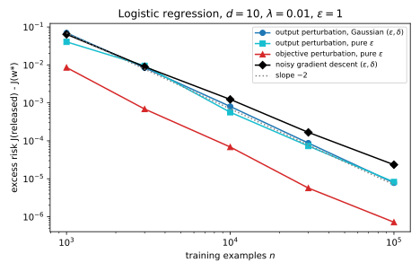

# Private empirical risk minimization

## Why this matters

Most of machine learning is **empirical risk minimization (ERM)**. You choose the weights of a model so that its average loss on the training data is as small as possible, usually with a penalty that keeps the weights short. The trained weights are a function of every training record, and [Membership inference](../part02-attacks/02-membership-inference.md) showed that they give some of those records away. Differential privacy (DP) promises that replacing one record barely changes the distribution of what you release ([The definition of differential privacy](../part03-dp-foundations/01-definition.md)). How much it may change is set by a privacy level, written $\varepsilon$, and a small slack, written $\delta$. To keep that promise for a trained model, randomness has to enter somewhere between the data and the released weights, and this chapter asks where.

There are three natural places to add noise, and each gives a classic algorithm. **Output perturbation** trains as usual and then adds noise to the final weights. **Objective perturbation** puts the noise earlier, in a random term added to the training objective, which it then minimizes exactly. **Gradient perturbation** goes furthest back and adds noise to every gradient during training.

One idea organizes all three methods. Every DP mechanism in this book finds a quantity that one record can move only by a known amount, called its **sensitivity**. It then adds enough noise to hide a move of that size. The three methods differ only in which quantity they bound, and the earlier in training they add the noise, the fewer assumptions they need. Gradient perturbation needs, for its privacy, only that each record's gradient is bounded. That is why it survives in deep learning, as stochastic gradient descent (SGD) with per-example clipping and Gaussian noise, called DP-SGD, the subject of the [next chapter](02-dp-sgd.md).

## The setting and the noise {#sec-dperm-setting}

A training set, written $D$, holds $n$ records. Each of them pairs a feature vector $x$, which has $d$ real coordinates, with a label $y$ of plus or minus one. Given weights $w$, the model's loss on a record $z$ is written $\ell(w, z)$. Training minimizes the average loss plus a ridge penalty, whose strength is a positive number $\lambda$, so the training objective, written $J$, is
$$J(w; D) = \frac1n\sum_{i=1}^n\ell(w, z_i) + \frac\lambda2\|w\|^2.$$
Here $z_i$ is the $i$-th record. The weights that minimize the objective are written $w^*(D)$.

In this chapter, two datasets are neighbours when one is obtained from the other by **replacing** a single record. Both then have $n$ records, and one record changes exactly one term of the average. The next chapter switches to adding or removing a record. Every sensitivity in this chapter is built from one more number, written $L$, which bounds the length of every record's loss gradient. A loss with no such bound has no privacy proof, which is why deep learning has to force one, as the last section shows.

A released, private version of the weights is written $\tilde w$. Its quality is measured by its **excess risk**, the amount by which its objective $J(\tilde w; D)$ exceeds the smallest possible value $J(w^*; D)$.

The running example is ridge-regularized logistic regression with ten features and a ridge of strength $\lambda = 0.01$. Its loss on a record is $\ln(1 + e^{-y\langle w, x\rangle})$, where $\langle w, x\rangle$ is the inner product of the weights and the features. Every feature vector has length 1. The logistic loss changes by less than one unit per unit of the margin $y\langle w, x\rangle$, so each record's gradient is at most 1 long, and $L = 1$. Every method targets $\varepsilon = 1$, with $\delta = 10^{-5}$ for the methods that need a slack.

The Gaussian mechanism ([The Laplace and Gaussian mechanisms](../part03-dp-foundations/03-laplace-gaussian.md)) adds independent normal noise to each coordinate of a vector. Suppose the vector moves between neighbours by at most a distance $\Delta$, its $\ell_2$ sensitivity, and write $\sigma$ for the standard deviation of the noise. Then the privacy of the release depends only on the ratio $\mu = \Delta/\sigma$, the largest move measured in units of the noise. Balle and Wang (2018) gave the exact condition. Writing $\Phi$ for the cumulative distribution function of the standard normal distribution, the mechanism is $(\varepsilon, \delta)$-DP exactly when
$$\delta \ge \Phi\Big(\frac\mu2 - \frac\varepsilon\mu\Big) - e^\varepsilon\,\Phi\Big(-\frac\mu2 - \frac\varepsilon\mu\Big).$$ {#eq-dperm-gauss-delta}

The right side grows with the ratio, so each target allows a largest ratio, written $\mu(\varepsilon, \delta)$. The smallest safe noise is then the sensitivity divided by it. For the running example's target the largest ratio is 0.2681, so the noise must be 3.7306 times the sensitivity. The classic formula $\Delta\sqrt{2\ln(1.25/\delta)}/\varepsilon$ asks for 4.8448 times instead. That is 30% more noise for the same guarantee, so this chapter always uses the exact calibration.

Gaussian noise cannot give pure $\varepsilon$-DP, with no slack at all. A pure guarantee bounds the ratio of the two output densities at every output. A normal log-density falls like the square of the distance, so far out in the tails that ratio grows without limit. Noise whose density falls only exponentially keeps it bounded. The standard choice draws a noise vector $b$ whose density is proportional to $e^{-\|b\|/s}$, where $s$ is a scale. If the centre of the noise moves by at most $\Delta$, this density changes by at most a factor $e^{\Delta/s}$ at any output. So the scale $s = \Delta/\varepsilon$ gives pure $\varepsilon$-DP.

## Output perturbation {#sec-dperm-output}

The simplest private trainer, introduced by Chaudhuri and Monteleoni in 2008, treats training as a black box. It computes the exact minimizer and adds noise to it, which is the Gaussian mechanism applied to the function $w^*(D)$. So it needs the sensitivity of the minimizer, which [Optimization](../part01-prerequisites/06-optimization.md#sec-opt-erm) derived.

When the loss is convex, the ridge makes the objective **$\lambda$-strongly convex**. Its gradient then grows by at least $\lambda$ per unit of distance from the minimizer, in every direction. Replacing one record tilts the objective's gradient by at most $2L/n$, since one gradient leaves and one arrives. Strong convexity turns that small tilt into a small move of the minimizer. Writing $D'$ for the neighbouring dataset,
$$\|w^*(D) - w^*(D')\| \le \frac{2L}{\lambda n}.$$ {#eq-dperm-sens}
Without strong convexity, a flat objective could let a small tilt move the minimizer a long way, and no such bound would hold.

Output perturbation releases the minimizer plus a Gaussian noise vector $Z$ with $d$ independent coordinates:
$$\tilde w = w^*(D) + Z, \qquad Z \sim \mathcal N\big(0, \sigma^2I\big), \qquad \sigma = \frac{2L}{\lambda n\,\mu(\varepsilon, \delta)}.$$ {#eq-dperm-output}
This is $(\varepsilon, \delta)$-DP for replace-one neighbours, because the minimizer is the only thing in the release that depends on the data. For pure $\varepsilon$-DP, the method uses the pure-DP noise instead, with the scale $s = 2L/(\lambda n\varepsilon)$.

The noise must hide the worst case, not the move that actually happens. In the one-dimensional example of @fig-dperm-output-1d, replacing one record moves the minimizer by 0.0832, but the bound is 0.2. The noise is sized for 0.2, because the guarantee has to hold for every pair of neighbours.

{#fig-dperm-output-1d}

What does the noise cost? Near the minimizer the objective is shaped like a bowl, whose curvature is described by the Hessian $H$, the matrix of second derivatives at $w^*$. Noise that points in a uniformly random direction, chosen independently of its length, feels the bowl's average curvature. That average is the trace of $H$, the sum of the curvatures along the bowl's axes, divided by $d$. So to second order
$$\mathbb E\big[J(\tilde w) - J(w^*)\big] \approx \frac{\mathbb E\|Z\|^2}{2d}\operatorname{tr}H.$$ {#eq-dperm-output-risk}
Both the Gaussian and the pure-DP noise meet the condition on the direction. For the Gaussian, the mean squared length is $d\sigma^2$, which gives about $\frac{\sigma^2}{2}\operatorname{tr}H$.

Notice the mismatch in this formula. The noise is calibrated to the curvature that the ridge guarantees, $\lambda$, but the damage is weighed by the actual curvature $H$, which includes the data's own. Because $\sigma$ is proportional to $1/\lambda$, a small ridge buys a better non-private fit and costs a lot of noise. And because $\sigma$ is proportional to $1/n$, the excess risk falls like $1/n^2$. Sampling error falls only like $1/n$, so in this convex, low-dimensional setting privacy eventually costs less than sampling does.

In the running example with ten thousand records, the sensitivity is 0.02 and the noise has $\sigma = 0.07461$ in each coordinate. The Hessian at the minimizer has a trace of 0.3129. With these values @eq-dperm-output-risk predicts an excess risk of $8.711 \times 10^{-4}$. Simulated releases average $9.274 \times 10^{-4}$, and the pure-DP version averages $8.321 \times 10^{-4}$.

The weak point of output perturbation is that the sensitivity bound holds for the exact minimizer, which an optimizer only approximates. Suppose the optimizer stops where the gradient has length at most $g$, the gradient tolerance. Strong convexity puts each output within $g/\lambda$ of its exact minimizer, so the sensitivity grows to
$$\frac{2L}{\lambda n} + \frac{2g}{\lambda}.$$ {#eq-dperm-approx}
In the running example, a tolerance of $10^{-3}$, which looks tight, raises the sensitivity to 0.22. That is eleven times the exact value, so the excess risk grows by about 121 times. To keep the extra term below the exact one, the optimizer must reach a gradient of length at most $L/n$. The stopping rule must also check the gradient rather than count steps. The proof needs the bound on every pair of datasets, and a fixed step count reaches the tolerance only on some of them.

## Objective perturbation {#sec-dperm-objective}

Output perturbation wastes the data's curvature, because it pays for the worst case $\lambda$ and is judged on the actual $H$. Chaudhuri, Monteleoni and Sarwate (2011) instead add a random linear term $\frac1n\langle b, w\rangle$ to the objective and minimize the result exactly. Here $b$ is a noise vector. A linear term acts like a constant force pushing on the minimizer. All of the objective's curvature resists that force, so where the data add curvature, the minimizer moves less.

The method needs a loss of a particular form. The loss must depend on the weights only through the margin $m$, the label times the inner product $\langle w, x\rangle$. It can then be written $\varphi(m)$ for a twice-differentiable function $\varphi$ of one number. Its slope must be at most 1 in size, $|\varphi'| \le 1$. Its curvature must never be negative, which makes the loss convex, and must be at most a known constant $c$, so that $0 \le \varphi'' \le c$. The features must also have length at most 1, which together with the slope bound gives $L = 1$. Logistic regression meets all of these conditions with $c = \frac14$, and the privacy argument below shows what each one is for.

The privacy level is split in two. A small share pays for how much one record can change the objective's curvature, and what is left for the noise is
$$\varepsilon' = \varepsilon - 2\ln\Big(1 + \frac{c}{n\lambda}\Big).$$ {#eq-dperm-eps-prime}
The noise $b$ is then drawn with a density proportional to $e^{-\varepsilon'\|b\|/2}$, which is the pure-DP noise with scale $2/\varepsilon'$. The released weights are
$$\tilde w = \arg\min_w\Big[J(w; D) + \frac1n\langle b, w\rangle\Big].$$ {#eq-dperm-objective}
If $\varepsilon'$ is positive, this release is $\varepsilon$-DP for replace-one neighbours. If it is zero or negative, the method raises the ridge until the curvature share takes only half of the budget. The share shrinks as $n\lambda$ grows, and in the running example with ten thousand records the noise gets $\varepsilon' = 0.9950$, almost the whole budget.

The argument compares the densities of the output under two neighbours. Because the loss is convex, the perturbed objective is strongly convex, so each output is the minimizer for exactly one noise vector. The density of the output is therefore the density of the noise behind it, times a stretching factor. That factor measures how much the map from outputs to noise expands or squeezes volume, and it is the determinant of the objective's Hessian.

Each of the two factors gets its own bound. The noise vectors behind one output differ by the difference between the two replaced records' gradients. Each gradient is at most 1 long, so the difference is at most 2 long. The noise scale $2/\varepsilon'$ is matched to a move of length 2, so the two noise densities differ by at most a factor $e^{\varepsilon'}$.

For the stretching factor, each record adds curvature along a single direction, because the loss sees the weights through one inner product, and that curvature is at most $c$. No record's curvature is negative, so the ridge keeps the total curvature at least $n\lambda$ in every direction. Against that floor, the record that leaves and the record that arrive each change the determinant by at most a factor $1 + c/(n\lambda)$. The logarithms of all the factors add up to $\varepsilon$, at every output, which is pure $\varepsilon$-DP.

The benefit shows in the excess risk. A constant force against curvature $H$ moves the minimizer by about $-H^{-1}b/n$. The noise $b$, too, points in a uniformly random direction independent of its length, so the same averaging as before gives
$$\mathbb E\big[J(\tilde w) - J(w^*)\big] \approx \frac{\mathbb E\|b\|^2}{2dn^2}\operatorname{tr}H^{-1}.$$ {#eq-dperm-objective-risk}
So the damage is now weighed by the inverse Hessian rather than by the Hessian, and more curvature means less damage. Suppose every eigenvalue of $H$ is close to some value $h$, and the noise gets almost all of the budget. Comparing the two formulas then shows that objective perturbation beats the pure-DP version of output perturbation by a factor of about $(h/\lambda)^2$. That factor is 1 when the ridge supplies all the curvature, and it grows quadratically as the data add more.

In the running example with ten thousand records, @eq-dperm-objective-risk predicts an excess risk of $7.127 \times 10^{-5}$. Simulated releases average $8.156 \times 10^{-5}$, against $8.321 \times 10^{-4}$ for pure-DP output perturbation, so objective perturbation is ten times better. The rule of thumb predicts this, because near the minimizer the objective's curvature lies between 0.0263 and 0.0330. That is about three times the ridge's 0.01, and squaring the factor of three gives 9.

The analysis is safe, not tight. In one dimension the output densities can be computed exactly, and with $\varepsilon = 1$ the largest log ratio over many random small datasets is 0.3779 (@fig-dperm-objective-density). The noise part and the curvature part each stay at or below about half of their budgets, because the bounds assume worst cases that cannot happen together for logistic loss.

{#fig-dperm-objective-density}

The price is exact minimization, since the argument needs each output to come from exactly one noise vector. The loss must also be smooth, so the hinge loss of a support vector machine must be smoothed first. Kifer, Smith and Thakurta (2012) extend the method to Gaussian noise with $(\varepsilon, \delta)$-DP and to constrained problems. Iyengar et al. (2019) give a version that tolerates approximate solvers by adding a little output noise on top.

## Gradient perturbation: noisy gradient descent {#sec-dperm-gradient}

The first two methods release one point and need the exact minimizer, but real training is iterative and stops early. Gradient perturbation, analysed by Song, Chaudhuri and Sarwate and by Bassily, Smith and Thakurta, makes each step of the optimizer private and composes the steps. Its simplest form is full-batch gradient descent with Gaussian noise. It starts from the weights $w_0 = 0$ and runs a fixed number of steps, written $T$, with a step size $\eta$. Writing $\xi_t$ for the fresh, independent noise added at the $t$-th step, the update is
$$w_{t+1} = w_t - \eta\big(\nabla J(w_t; D) + \xi_t\big), \qquad \xi_t \sim \mathcal N(0, \sigma^2I), \qquad \sigma = \frac{2L}{n}\cdot\frac{\sqrt T}{\mu(\varepsilon, \delta)}.$$ {#eq-dperm-noisy-gd}
Releasing every iterate is $(\varepsilon, \delta)$-DP for replace-one neighbours. This holds for any loss whose per-record gradients have length at most $L$, convex or not.

Each step is a Gaussian mechanism. At the current weights, the ridge term of the gradient is the same on both datasets, and the average loss gradients differ only in the replaced record. So one record moves the gradient by at most $2L/n$, and the step has the ratio $\mu_{\text{step}} = 2L/(n\sigma)$. The current weights depend on the data only through the earlier noisy gradients, which are already released, and adaptive composition covers exactly this case.

Gaussian steps also compose exactly, by the rules of Gaussian differential privacy (GDP) in [f-DP and Gaussian differential privacy](../part04-privacy-accounting/04-gaussian-dp.md). Run $T$ Gaussian mechanisms in sequence, each allowed to depend on the earlier outputs, with ratios $\mu_1$ to $\mu_T$. Together they are exactly as private as one Gaussian mechanism with the ratio
$$\mu = \sqrt{\mu_1^2 + \dots + \mu_T^2}.$$ {#eq-dperm-gdp}
With $T$ equal steps the total ratio is $\sqrt T\,\mu_{\text{step}}$. Setting it equal to $\mu(\varepsilon, \delta)$ gives the noise of @eq-dperm-noisy-gd. Then @eq-dperm-gauss-delta converts the result to $(\varepsilon, \delta)$ exactly, with nothing lost in the conversion. Nothing here used convexity, which enters only when you ask how accurate the result is.

For accuracy, assume that the objective is $\lambda$-strongly convex. Assume also that its curvature is at most some value $\beta$, which makes it $\beta$-smooth, and take the step size $\eta = 1/\beta$. The excess risk of the last iterate is then approximately
$$\mathbb E\big[J(w_T) - J(w^*)\big] \approx \Big(1 - \frac\lambda\beta\Big)^T\big(J(w_0) - J(w^*)\big) + \frac{d\sigma^2}{4\beta}.$$ {#eq-dperm-gd-risk}
The first term is the optimization error. Without noise, each step shrinks the gap to the minimum by at least the factor $1 - \lambda/\beta$ ([Optimization](../part01-prerequisites/06-optimization.md#sec-opt-strong)), so this term falls geometrically with $T$. The second term is a noise floor, the level at which each step's pull toward the minimizer balances the noise it adds. It grows with $T$, because $\sigma^2$ is proportional to $T$.

So **the step count is a privacy parameter**. Too few steps leave optimization error, and too many drown the solution in noise (@fig-dperm-noisy-gd-steps). Picking $T$ by its validation score is itself a computation on the data, and [Hyperparameter tuning](03-hyperparameter-tuning.md) shows how to pay for it.

{#fig-dperm-noisy-gd-steps}

One option that spends no privacy is to choose $T$ by minimizing @eq-dperm-gd-risk with public quantities only. For logistic loss with features of length 1, everything it needs is public. The smoothness is at most $\frac14 + \lambda$, and the initial gap is at most $\ln 2$, the loss at zero weights. With ten thousand records this rule picks $T = 218$, which gives per-step noise $\sigma = 0.01102$. Simulated runs then average an excess risk of $1.384 \times 10^{-3}$.

@fig-dperm-noisy-gd-steps shows that the rule overshoots. The rule assumes only the ridge's curvature of 0.01. Near the minimizer, though, the objective's curvature lies between 0.0263 and 0.0330, so noiseless descent converges much faster than the rule expects. The excess risk is smallest near 50 steps, where it is five times less than with the rule's choice. You may only use that knowledge if you obtained it privately, or from public data that resembles yours.

## How the three compare {#sec-dperm-compare}

Each method is private by its own argument, so the choice between them is about accuracy. Bassily, Smith and Thakurta (2014) studied strongly convex objectives built from losses with gradients bounded by $L$. For these, they found the smallest expected excess risk that any $(\varepsilon, \delta)$-DP algorithm can guarantee. Up to constant factors, and to logarithmic factors in $n$, it is
$$\frac{L^2\,d\,\ln(1/\delta)}{\lambda\,n^2\varepsilon^2}.$$ {#eq-dperm-rate-strong}
A version of noisy gradient descent attains this rate. Without strong convexity the rate is slower, falling only like $1/(n\varepsilon)$. The lower bounds come from fingerprinting codes ([Lower bounds](../part03-dp-foundations/09-lower-bounds.md)), which show that a too accurate private output would let an adversary trace which records were used.

The rate has two practical readings. First, the excess risk grows with the dimension $d$, so at the same privacy level a model with more parameters loses more accuracy. Second, the dataset size and the privacy level appear only as their product. That is because every sensitivity here is proportional to $1/n$, and every noise scale to the sensitivity divided by $\varepsilon$. So halving $\varepsilon$ costs the same accuracy as halving $n$.

The rate says how fast the excess risk falls, but not by what constant factor, and that factor decides between methods. @tbl-dperm-compare measures the four private releases on the running example.

| $n$ | Output, Gaussian | Output, pure | Objective, pure | Noisy gradient descent (public $T$) |
| --- | --- | --- | --- | --- |
| 1,000 | $8.170 \times 10^{-2}$ | $7.060 \times 10^{-2}$ | $1.009 \times 10^{-2}$ | $6.558 \times 10^{-2}$ |
| 3,000 | $1.211 \times 10^{-2}$ | $7.206 \times 10^{-3}$ | $6.303 \times 10^{-4}$ | $8.888 \times 10^{-3}$ |
| 10,000 | $9.274 \times 10^{-4}$ | $8.321 \times 10^{-4}$ | $8.156 \times 10^{-5}$ | $1.384 \times 10^{-3}$ |
| 30,000 | $9.973 \times 10^{-5}$ | $8.943 \times 10^{-5}$ | $7.135 \times 10^{-6}$ | $1.538 \times 10^{-4}$ |
| 100,000 | $8.543 \times 10^{-6}$ | $6.379 \times 10^{-6}$ | $8.798 \times 10^{-7}$ | $1.621 \times 10^{-5}$ |
| Slope in $\log n$ | $-2.01$ | $-2.00$ | $-2.01$ | $-1.79$ |

: Mean excess risk $J(\tilde w) - J(w^*)$ over 20 datasets of the running example ($d = 10$, $\lambda = 0.01$, $\varepsilon = 1$, $\delta = 10^{-5}$ for the Gaussian methods), and the slope of a straight-line fit of $\log$ excess risk against $\log n$. {#tbl-dperm-compare}

The three perturbation releases fall like $1/n^2$, while noisy gradient descent falls a little more slowly because its step count grows with $\ln n$. Objective perturbation beats output perturbation at every $n$, by about ten times at 10,000 records (@fig-dperm-comparison). Noisy gradient descent with the public step rule is the worst of the four releases from 10,000 records on. Tuned privately to about 50 steps, it would sit between the two perturbation methods.

{#fig-dperm-comparison}

The pure-DP column beats the Gaussian one here only because the dimension is small. The pure-DP noise has a length that follows a gamma distribution, and its mean squared length grows like $d^2$ rather than like $d$. For the same sensitivity $\Delta$, it is $110\,\Delta^2$ in ten dimensions, against $139.2\,\Delta^2$ for the Gaussian. In a hundred dimensions, though, it is $10{,}100\,\Delta^2$, against $1{,}392\,\Delta^2$. So pure DP costs a factor that grows like $d$, the price of a zero $\delta$, which [Lower bounds](../part03-dp-foundations/09-lower-bounds.md) shows cannot be avoided.

Excess risk is a fine measure, but what you care about is predictions, and those are forgiving. On held-out data, the non-private model trained on 1,000 records has accuracy 0.747. Output perturbation drops it to 0.681, and noisy gradient descent to 0.695, but objective perturbation drops it only to 0.736. With ten thousand records, all four private releases come within 0.002 of the non-private accuracy, so a low-dimensional convex model can be made private almost for free.

## When the model is not convex {#sec-dperm-nonconvex}

A neural network's loss is not convex in its weights, and that breaks the first two methods. Both need a unique minimizer that moves only a little when the data change, and without strong convexity neither property is guaranteed. [Optimization](../part01-prerequisites/06-optimization.md#sec-opt-erm) showed a loss with two wells whose minimizer sits in the well favoured by the majority label. When the two labels are almost tied, one label flips the majority and moves the minimizer by 2.0010, however large the dataset is. Output perturbation would then need $\sigma = 7.465$ at $\varepsilon = 1$, more than three times the distance between the wells. Objective perturbation fails at the first step of its argument, because the perturbed objective can have several minimizers.

Gradient perturbation keeps its guarantee, because its argument only used the bound on the gradient at the visited points. What it loses is the guarantee of accuracy. Noisy gradient descent on a neural network is private whatever the network does, but whether it learns anything becomes an empirical question.

A neural network also has no bound $L$ on its per-record gradients, which can be arbitrarily long. You can force one by **clipping**, which rescales each record's gradient to length at most a clipping norm $C$ before averaging. Shorter gradients are left unchanged, as in [Beyond global sensitivity](../part03-dp-foundations/06-sensitivity.md#sec-sens-clip). The mean of clipped gradients then moves by at most $2C/n$ when one record is replaced, and the privacy argument goes through with $L = C$. Clipping does change what is being optimized, though. The mean of clipped gradients is not the gradient of $J$, so the algorithm no longer minimizes $J$, and the next chapter measures that bias.

Full-batch steps are also slow, because each touches every record. A random minibatch at each step makes each step cheaper and, by [amplification by subsampling](../part04-privacy-accounting/05-subsampling.md), more private, since each record is used only with a small probability. Clipping, noise, minibatches and an accountant for the subsampled Gaussian mechanism together make up [DP-SGD](02-dp-sgd.md).

## Code {#sec-dperm-code}

The snippet finds the largest safe Gaussian ratio by bisection, then sizes the noise for each method.

```python
from math import erfc, exp, log, sqrt


def phi(x: float) -> float:
    """Standard normal cumulative distribution function."""
    return 0.5 * erfc(-x / sqrt(2))


def gaussian_delta(eps: float, mu: float) -> float:
    """Exact delta of a Gaussian mechanism with sensitivity-to-noise ratio mu."""
    return phi(mu / 2 - eps / mu) - exp(eps) * phi(-mu / 2 - eps / mu)


def gaussian_mu(eps: float, delta: float) -> float:
    """Largest ratio mu for which the Gaussian mechanism is (eps, delta)-DP."""
    lo, hi = 1e-6, 50.0
    for _ in range(200):
        mid = (lo + hi) / 2
        lo, hi = (lo, mid) if gaussian_delta(eps, mid) > delta else (mid, hi)
    return lo


mu = gaussian_mu(1.0, 1e-5)
print(f"{mu:.4f} {1 / mu:.4f}")  # 0.2681 3.7306
print(f"{sqrt(2 * log(1.25 / 1e-5)):.4f}")  # 4.8448
# Output perturbation: sensitivity 2L/(lambda n), L = 1, lambda = 0.01, n = 10,000.
print(f"{2 / (0.01 * 10_000) / mu:.5f}")  # 0.07461
# Objective perturbation: the share of eps left for the noise, c = 1/4.
print(f"{1 - 2 * log(1 + 0.25 / (10_000 * 0.01)):.4f}")  # 0.9950
# Noisy gradient descent: noise on the mean gradient for T = 218 steps.
print(f"{2 / 10_000 * sqrt(218) / mu:.5f}")  # 0.01102
```

The full edition's script, [dp_erm.py](../../code/part05-dp-ml/dp_erm.py), implements the three methods for logistic regression with exact Newton solves. It also computes the exact one-dimensional densities of objective perturbation and runs the comparison:

```bash
uv run python code/part05-dp-ml/dp_erm.py
```

## Cheat sheet

| Result | Formula | Needs | Guarantee |
| --- | --- | --- | --- |
| Exact Gaussian ratio | $\mu(1, 10^{-5}) = 0.2681$, so $\sigma = 3.7306\,\Delta$ | Sensitivity $\Delta$ | Classic formula: $4.8448\,\Delta$ |
| Sensitivity of the minimizer | $2L/(\lambda n)$ | Convex loss plus ridge ($\lambda$-strong convexity), exact minimizer | — |
| Approximate minimizer | $2L/(\lambda n) + 2g/\lambda$ | Gradient length $\le g$ checked at stopping | — |
| Output perturbation | $w^* + \mathcal N(0, \sigma^2I)$, $\sigma = 2L/(\lambda n\mu)$ | As above | $(\varepsilon, \delta)$-DP |
| Output, pure | $w^* + b$, density $\propto e^{-\|b\|/s}$, $s = 2L/(\lambda n\varepsilon)$ | As above | $\varepsilon$-DP |
| Excess risk, output | $\approx\mathbb E\|Z\|^2\operatorname{tr}H/(2d)$ | Second order; noise direction uniform, independent of its length | — |
| Objective perturbation | $\arg\min J + \langle b, w\rangle/n$, density $\propto e^{-\varepsilon'\|b\|/2}$, $\varepsilon' = \varepsilon - 2\ln(1 + c/(n\lambda))$ | Loss $\varphi(y\langle w, x\rangle)$, $|\varphi'| \le 1$, $0 \le \varphi'' \le c$, $\|x\| \le 1$, exact minimizer, $\varepsilon' > 0$ (else raise $\lambda$) | $\varepsilon$-DP |
| Excess risk, objective | $\approx\mathbb E\|b\|^2\operatorname{tr}H^{-1}/(2dn^2)$ | Second order; noise direction uniform, independent of its length | — |
| Noisy gradient descent | $\sigma = (2L/n)\sqrt T/\mu$ on the mean gradient | Per-record gradients $\le L$, or clipped | $(\varepsilon, \delta)$-DP, all iterates |
| Excess risk, noisy gradient descent | $\approx(1 - \lambda/\beta)^T(J(w_0) - J(w^*)) + d\sigma^2/(4\beta)$ | Strong convexity, smoothness, $\eta = 1/\beta$ | — |
| Best achievable excess risk (optimal rate) | $\tilde\Theta(L^2d\ln(1/\delta)/(\lambda n^2\varepsilon^2))$ | Strong convexity | Bassily, Smith & Thakurta (2014) |

: The results of this chapter, for replace-one neighbours, with $\mu = \mu(\varepsilon, \delta)$ the largest admissible Gaussian ratio and $H$ the Hessian at the minimizer. {#tbl-dperm-cheat}

**Rules of thumb**

- On strongly convex problems, all three methods give an excess risk that falls like $1/(n\varepsilon)^2$, so halving $\varepsilon$ costs as much as halving the data.
- Output perturbation pays for the ridge's curvature, while objective perturbation benefits from the data's. If the data's curvature $h$ is well above $\lambda$, expect objective perturbation to win by about $(h/\lambda)^2$.
- Output and objective perturbation need the exact minimizer. Stop on a gradient tolerance well below $L/n$, never on a step count.
- The number of steps of noisy gradient descent is part of the privacy budget. Choose it from public quantities, or pay for choosing it.
- Only gradient perturbation is private without convexity. Clip per-record gradients to get the bound it needs.

## Further reading

- Chaudhuri, Monteleoni & Sarwate, "Differentially Private Empirical Risk Minimization" (JMLR 2011): output and objective perturbation, with their excess-risk bounds.
- Bassily, Smith & Thakurta, "Private Empirical Risk Minimization: Efficient Algorithms and Tight Error Bounds" (FOCS 2014): noisy gradient methods that attain the optimal rates, and the matching lower bounds.
- Iyengar, Near, Song, Thakkar, Thakurta & Wang, "Towards Practical Differentially Private Convex Optimization" (IEEE S&P 2019): an objective perturbation that tolerates inexact solvers, and a benchmark of the three methods.

**Derivations.** Every result in this chapter is derived step by step in [the full edition's chapter](../../book-full/part05-dp-ml/01-dp-erm.md), except the exact Gaussian calibration and Gaussian composition, which it takes from Parts 3 and 4, the optimal rates and their lower bounds, which it cites from Bassily, Smith & Thakurta (2014), and the extensions of Wu et al., Kifer et al. and Iyengar et al., which it only cites.
