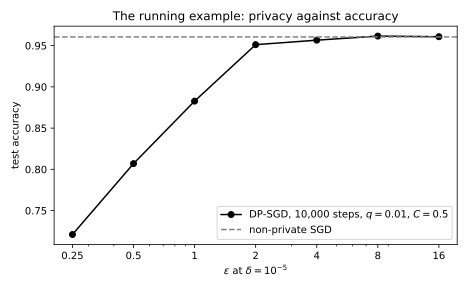

# DP-SGD

## Why this matters

[Private empirical risk minimization](01-dp-erm.md) compared three places to add noise to training, and only gradient perturbation, Gaussian noise on every gradient step, works for models that are not convex. Its privacy proof needs only a bound on how far one record can move each step's gradient. Clipping each record's gradient to a fixed length supplies that bound for any model, however complicated.

Two more changes make the method practical for differential privacy (DP). Each step uses a small random batch of the data, which makes the step cheap and, through amplification by subsampling, also more private. And an **accountant**, a program that adds up the privacy cost of every step, turns the thousands of steps into one guarantee. As always, the guarantee is a privacy parameter $\varepsilon$ with a small slack $\delta$ ([the definition of DP](../part03-dp-foundations/01-definition.md)). The result is stochastic gradient descent (SGD) with per-example clipping and Gaussian noise, called DP-SGD (Abadi et al. 2016), which nearly every private deep-learning system runs.

Part 4 computed the privacy of DP-SGD without running it ([Amplification by subsampling](../part04-privacy-accounting/05-subsampling.md)). Its running example takes 10,000 steps, each on a random 1% of the data with noise as large as the clipping length, and costs $\varepsilon = 6.71$. This chapter trains a neural network with that configuration and asks what privacy costs in accuracy. The privacy analysis never looks inside the model, so the settings split in two. The noise, the sampling rate and the number of steps decide $\varepsilon$, while the clipping length and the step size are free to be tuned for accuracy alone.

## The algorithm and its guarantee {#sec-dpsgd-algorithm}

A training set holds $n$ records, and the model has weights $w$. The gradient of one record's loss with respect to the weights is that record's **per-example gradient**, written $g_i$ for record $i$. DP-SGD repeats five operations for a number of steps $T$, starting from weights chosen without looking at the data.

1. **Sample.** Each record enters the batch independently with probability $q$, the **sampling rate**. This is Poisson sampling, so the batch size is random.
2. **Compute per-example gradients.** Each record in the batch gets its own gradient $g_i$.
3. **Clip.** Each gradient longer than the **clipping norm** $C$ is rescaled to length $C$.
4. **Add noise to the sum.** Gaussian noise is added to every coordinate of the sum of clipped gradients. Its standard deviation is $\sigma C$, where the **noise multiplier** $\sigma$ measures the noise in units of the clipping norm.
5. **Step.** The noisy sum is divided by the expected batch size $B$, which is $qn$, and the weights move against the result, scaled by the step size $\eta$.

In symbols, write $w_t$ for the weights at step $t$, and $S_t$ for the batch drawn at that step. With fresh Gaussian noise $\xi_t$, the update is
$$w_{t+1} = w_t - \frac{\eta}{B}\Big(\sum_{i\in S_t}g_i\min\Big(1, \frac{C}{\|g_i\|}\Big) + \xi_t\Big), \qquad \xi_t \sim \mathcal N(0, \sigma^2C^2I),$$
where $I$ is the identity matrix, so every coordinate gets its own independent noise.

The guarantee is stated for **add/remove neighbours**, two datasets that differ because one has a record the other lacks. Under that relation, releasing every intermediate set of weights is $(\varepsilon, \delta)$-DP, with $\varepsilon$ computed by the Rényi differential privacy (RDP) accountant of Part 4. The guarantee does not depend on the loss, the model, the clipping norm or the step size.

### Why it is private, and how implementations break it

The proof has four links, and each link is also a condition that the code must meet. An implementation that breaks one loses the guarantee, and nothing in the training curves will show it.

The first link is that one record moves the clipped sum by at most $C$. Adding the target record adds one clipped term of length at most $C$ and leaves every other term alone, because each term is computed from its own record. Batch normalization breaks this, because its statistics over the batch let one record change every other record's gradient. That is why private models use group or layer normalization, which act on one example at a time. The link also needs a clipping norm fixed in advance. A $C$ set from the current batch, say its median gradient norm, would make the noise scale depend on the data.

This bound is also why the neighbouring relation matters. Replacing a record, as the previous chapter's neighbours do, swaps one clipped term for another that may point the opposite way, so the sum can move by up to $2C$. An $\varepsilon$ computed under add/remove therefore does not carry over unchanged to replace-one, so state the relation next to every $\varepsilon$ you report.

The second link makes each step a subsampled Gaussian mechanism. A Gaussian mechanism's privacy depends only on the shift divided by the noise's standard deviation ([The Laplace and Gaussian mechanisms](../part03-dp-foundations/03-laplace-gaussian.md)). Here that is $C$ over $\sigma C$, so the clipping norm cancels and leaves $1/\sigma$. Poisson sampling draws the target with probability $q$, independently of the other records. So the output with the record is a mixture, a shifted run with probability $q$ and otherwise a run exactly as if the record were absent. That unchanged share dilutes the difference, which is the amplification, and it is why Poisson sampling pairs with add/remove.

The accountant must therefore assume the sampler the code actually runs ([Amplification by subsampling](../part04-privacy-accounting/05-subsampling.md#sec-sub-schemes)). Many data loaders shuffle the data once per epoch and cut it into fixed batches. A record is then never absent from an epoch, so the mixture is missing, and the true $\varepsilon$ can be far above the Poisson number. Fixed-size batches drawn afresh at every step lie in between. A record that enters one pushes another out, so the sum can move by $2C$, as revealing as a shift of $C$ with half the noise. Under add/remove, a Poisson accountant covers them if you give it the batch's fraction of the data as the sampling rate and half your noise multiplier.

The third link is post-processing. Dividing by the fixed public number $B$ uses nothing but the noisy sum, so it is as private as the sum itself ([Properties of DP](../part03-dp-foundations/02-properties.md)). Dividing by the actual batch size $|S_t|$ breaks this, because that size changes when the target is added.

The fourth link is composition. Each step starts from weights that depend on the earlier noisy sums, and the cost of such adaptive steps still adds up. The accountant adds $T$ copies of one step's RDP curve, its cost at each order of the Rényi divergence ([Rényi DP](../part04-privacy-accounting/01-renyi-dp.md)). It converts the total to $(\varepsilon, \delta)$ only at the end, because [each conversion](../part04-privacy-accounting/02-rdp-conversions.md) carries a fixed cost. So the accountant must see every step, including those of runs thrown away during [tuning](03-hyperparameter-tuning.md).

Even when every link holds, the guarantee protects one record. A person who contributes many records needs [user-level privacy](07-user-level.md). And preprocessing that looks at the data, such as normalizing features by their mean, must itself be private.

The running example has $q = 0.01$ and $\sigma = 1$. @tbl-dpsgd-sigma gives the noise multiplier that the same sampling rate and number of steps need for other budgets.

| $\varepsilon$ at $\delta = 10^{-5}$ | 0.5 | 1 | 2 | 4 | 6.71 | 8 |
| --- | --- | --- | --- | --- | --- | --- |
| Noise multiplier $\sigma$ | 7.72 | 4.13 | 2.28 | 1.36 | 1 | 0.917 |

: The noise multiplier that DP-SGD with $q = 0.01$ and $T = 10{,}000$ steps needs for each budget, from the RDP accountant. {#tbl-dpsgd-sigma}

### How large the noise is

The running example trains a network with the logistic loss on synthetic data, labelled by a fixed random "teacher" network so that a perfect classifier exists. The student has one hidden layer of 64 units, and its number of weights $p$ is 3,329. It trains on 10,000 records, with clipping norm and step size both 0.5.

The averaged update carries noise with standard deviation $\sigma C/B$ on each coordinate, which is 0.005 here. A Gaussian vector with $p$ independent coordinates is about $\sqrt p$ times their standard deviation long, so the noise vector is about 0.288 long. The signal, the averaged clipped gradient, lies between 0.015 and 0.027 from step 1,000 on. So the noise in every step is about ten times longer than the signal.

Training works anyway, provided the signal points in roughly the same direction from one step to the next. Over a number of steps $k$, such signals add up to about $k$ times their length. Independent noise vectors add in squares, so the noise grows only to about $\sqrt k$ times its length, and the signal overtakes it once
$$k > \Big(\frac{\text{noise length}}{\text{signal length}}\Big)^2.$$
For a typical signal of about 0.026 this takes about 123 steps, so the noise slows training down without stopping it. The final model reaches a test accuracy of 0.9589, against 0.9627 for SGD without privacy.

## Clipping: bias, noise and the choice of C {#sec-dpsgd-clipping}

The clipping norm does not affect privacy, but it controls both costs of privacy. A small $C$ clips more gradients, which changes the direction of the update, a **bias**. A large $C$ means more noise, because the noise is $\sigma C$, which makes each step partly random, a **variance**.

Each record is in the batch with probability $q$ and the noise averages to zero, so dividing by $B = qn$ cancels the $q$. Averaged over the random batch and the noise, the noisy sum $G_t$ divided by $B$ is therefore
$$\mathbb E\Big[\frac{G_t}{B}\Big] = \frac1n\sum_{i=1}^n\min\Big(1, \frac{C}{\|g_i\|}\Big)g_i.$$ {#eq-dpsgd-expected}
It is the average gradient over all $n$ records, with each record weighted by how much clipping shrinks it.

Those weights are where the bias lives, and they fall as a record's gradient grows. Records the model fits badly, such as rare examples, members of small groups or mislabelled points, have large gradients and are down-weighted. So DP-SGD follows the gradient of a reweighted loss, and [Disparate impact](08-disparate-impact.md) measures who pays for this.

### Two regimes of the clipping norm

Suppose $C$ is below every per-example gradient norm at every step, so that every gradient is clipped. Each clipped gradient is then a unit vector stretched to length $C$. The noise, too, is $C$ times something that does not involve $C$, namely the noise multiplier times a standard normal vector $\zeta_t$. So the update becomes
$$w_{t+1} = w_t - \frac{\eta C}{B}\Big(\sum_{i\in S_t}\frac{g_i}{\|g_i\|} + \sigma\zeta_t\Big), \qquad \zeta_t \sim \mathcal N(0, I).$$ {#eq-dpsgd-normalized}
Nothing inside the bracket depends on $C$, so the run depends on the step size and the clipping norm only through their product $\eta C$. Two runs with the same product and the same seed produce the same weights, as long as every gradient is clipped in both.

This **scale invariance** is why practitioners often clip hard and tune only the step size, and why De et al. (2022) report that small clipping norms work well. If some gradients are shorter than $C$, though, they keep their own length, and doubling $C$ while halving $\eta$ changes the run.

In the opposite regime, with $C$ above most gradient norms, the signal stops growing with $C$ while the noise $\sigma C/B$ keeps growing. The ratio of signal to noise then falls like $1/C$, so a large $C$ is never better than the smallest $C$ that clips almost nothing.

A fixed $C$ does not stay in one regime, because the logistic loss flattens on records classified with a wide margin, and their gradients vanish. In the private run of the running example, the median per-example gradient norm falls from 3.592 at the first step to 0.006 a thousand steps later. Training without privacy behaves the same way (@fig-dpsgd-clipping, right). With $C = 0.5$, every gradient is clipped at the start. Later only the records near the decision boundary are, between 9% and 25% of the batch.

{#fig-dpsgd-clipping}

@tbl-dpsgd-clip shows both regimes at $\varepsilon = 6.71$, with the step size fixed and with $\eta C$ fixed.

| $C$ | 0.01 | 0.03 | 0.1 | 0.3 | 1 | 3 | 10 |
| --- | --- | --- | --- | --- | --- | --- | --- |
| Fixed $\eta = 0.5$ | 0.9244 | 0.9510 | 0.9567 | 0.9607 | 0.9583 | 0.9523 | 0.8347 |
| Fixed $\eta C = 0.25$ | 0.9627 | 0.9623 | 0.9605 | 0.9599 | 0.9590 | 0.9558 | 0.9494 |

: Test accuracy of the running example at $\sigma = 1$ for seven clipping norms, one run each. With $\eta C$ fixed, small clipping norms all give the same accuracy. {#tbl-dpsgd-clip}

With the step size fixed, a small clipping norm is too slow, because every step has a length proportional to $\eta C$, and a large one is too noisy. With $\eta C$ fixed instead, accuracy is flat for $C$ up to 0.3, as scale invariance predicts, and falls slowly beyond. The best run, at $C = 0.01$, matches the model trained without privacy.

## Batch size and the number of steps at a fixed budget {#sec-dpsgd-batch}

Suppose the privacy budget is fixed, and so is the compute budget, a number of epochs or passes over the data. One epoch takes $1/q$ steps, so the question is whether to take many small steps or a few large ones.

For a small sampling rate and a noise multiplier well above 1, a run of a fixed number of epochs costs privacy in proportion to $q/\sigma^2$ ([Amplification by subsampling](../part04-privacy-accounting/05-subsampling.md#sec-sub-small-q)). At a fixed budget the noise multiplier must then grow like $\sqrt q$. Since $q$ is $B/n$, the noise on the averaged gradient shrinks like one over the square root of the batch size,
$$\sigma \propto \sqrt{\frac Bn}, \qquad \frac{\sigma C}{B} \propto \frac{C}{\sqrt{Bn}}.$$ {#eq-dpsgd-batch}

Small batches are even worse than this law says, because they need a small noise multiplier. The law uses $1/\sigma^2$ where Part 4's more accurate small-$q$ cost has $e^{1/\sigma^2} - 1$. Their ratio is the factor
$$\sigma^2\big(e^{1/\sigma^2} - 1\big),$$
which is close to 1 for a large noise multiplier but grows quickly below 1. Where it is large, each step costs more than the law assumes, so the noise multiplier must be larger than the law predicts.

@tbl-dpsgd-batch holds the budget at $\varepsilon = 4$ and 100 epochs, and finds the noise multiplier for each sampling rate. If @eq-dpsgd-batch were exact, the ratio $\sigma/\sqrt q$ would be the same in every row. Instead it is largest for the smallest batches, where the factor is far above 1.

| $q$ | $B$ | Steps $T$ | $\sigma$ | Noise per averaged gradient $\sigma/B$ | $\sigma/\sqrt q$ | $\sigma^2(e^{1/\sigma^2} - 1)$ |
| --- | --- | --- | --- | --- | --- | --- |
| 0.001 | 10 | 100,000 | 0.704 | 0.0704 | 22.3 | 3.23 |
| 0.003 | 30 | 33,333 | 0.909 | 0.0303 | 16.6 | 1.95 |
| 0.01 | 100 | 10,000 | 1.36 | 0.0136 | 13.6 | 1.33 |
| 0.03 | 300 | 3,333 | 2.16 | 0.0072 | 12.5 | 1.12 |
| 0.1 | 1,000 | 1,000 | 3.78 | 0.00378 | 12 | 1.04 |
| 0.3 | 3,000 | 333 | 6.44 | 0.00215 | 11.8 | 1.01 |
| 1 | 10,000 | 100 | 10.8 | 0.00108 | 10.8 | 1 |

: Noise needed for $\varepsilon = 4$ at $\delta = 10^{-5}$ over 100 epochs on $n = 10{,}000$ records, for seven sampling rates. The full batch needs no subsampling accountant, because its 100 plain Gaussian steps compose exactly. The noise on the averaged gradient, in units of $C$, falls faster than $1/\sqrt B$. {#tbl-dpsgd-batch}

So from a batch of 10 to one of 1,000, the noise per averaged gradient falls by a factor of 18.6, where the square-root law predicts 10 (@fig-dpsgd-batch).

{#fig-dpsgd-batch}

Large batches are not free, though, because at a fixed number of epochs they also mean fewer steps. @tbl-dpsgd-batch-train trains four of the configurations above, each with three step sizes.

| $B$ | Step sizes and test accuracy |
| --- | --- |
| 30 | $\eta = 0.25$: 0.9544; 0.5: 0.9487; 1: 0.9453 |
| 100 | $\eta = 0.5$: 0.9522; 1: 0.9569; 2: 0.9465 |
| 300 | $\eta = 1$: 0.9591; 2: 0.9565; 4: 0.9577 |
| 1,000 | $\eta = 2$: 0.9589; 4: 0.9565; 8: 0.9576 |

: Test accuracy of the running example at $\varepsilon = 4$ and 100 epochs, for four batch sizes and three step sizes each, one run each. {#tbl-dpsgd-batch-train}

The best step size grows with the batch, which makes up for the fewer steps. At their best step sizes, the two largest batches do best. Picking the step size by test accuracy is itself a leak, done here only to compare batch sizes ([Hyperparameter tuning and private selection](03-hyperparameter-tuning.md) does it privately). At scale, De et al. (2022) and Anil et al. (2022) report that very large batches are a main ingredient of accurate private models.

## Per-example gradient norms without per-example gradients {#sec-dpsgd-ghost}

Clipping needs every record's gradient norm, but ordinary backpropagation computes only the gradient of the batch's summed loss. Forming all $B$ per-example gradients takes $B$ times the memory of one gradient, which is prohibitive for large models. **Ghost clipping** gets the norms and the clipped sum without ever forming the per-example gradients, which are the "ghosts" of its name.

The trick rests on the shape of a dense layer's gradient. Such a layer multiplies its input vector $a$ by a weight matrix. Write $\gamma$ for the gradient of the loss with respect to the layer's output, the **back-propagated error**, which backpropagation computes anyway. Each weight multiplies one input and feeds one output, so its gradient is that output's error times that input, and the whole gradient is the outer product $\gamma a^\top$. Each squared entry is then a squared error times a squared input, so the squared entries sum to the product of the two squared lengths. For record $i$, with input $a_i$ and error $\gamma_i$, the gradient's length as one long vector, its Frobenius norm with subscript $F$, is therefore
$$\big\|\gamma_ia_i^\top\big\|_F = \|\gamma_i\|\,\|a_i\|.$$ {#eq-dpsgd-ghost}
Over a network of such layers, the squared norms add.

The clipped sum takes a second pass, because each record's clipping factor depends on its norm over the whole network. Once the norms are known, each record's error is scaled by its factor, and the usual matrix product of errors and inputs gives the clipped sum. Each record therefore needs only its input and its error. For a layer with $p_{\text{in}}$ inputs and $p_{\text{out}}$ outputs, a batch stores $B(p_{\text{in}} + p_{\text{out}})$ numbers instead of $Bp_{\text{in}}p_{\text{out}}$.

Sequences are harder. When a layer sees $L$ tokens of one record, its gradient is a sum of outer products, one per token. Expanding the square gives a sum over every pair of tokens, the $u$-th and the $v$-th, of their inputs' dot product times their errors' dot product:
$$\Big\|\sum_u\gamma_{iu}a_{iu}^\top\Big\|_F^2 = \sum_{u, v}(a_{iu}\cdot a_{iv})(\gamma_{iu}\cdot\gamma_{iv}).$$ {#eq-dpsgd-ghost-seq}
That needs two $L \times L$ tables per record, $2BL^2$ numbers in all, which beats explicit gradients only when $2L^2$ is smaller than $p_{\text{in}}p_{\text{out}}$. Convolutional layers behave the same way over positions. So Bu, Mao & Xu (2022) choose between the two methods layer by layer. In @tbl-dpsgd-ghost, the ghost method wins by a factor of 384 for one token in a 768-wide layer, but with 512 tokens its advantage is almost gone.

| Layer | Explicit $Bp_{\text{in}}p_{\text{out}}$ | Ghost | Ratio |
| --- | --- | --- | --- |
| Running example, first layer: $B = 100$, $p = 51 \to 64$ | 326,400 | 11,500 | 28.4 |
| $B = 32$, one token, $768 \to 768$ | 18,874,368 | 49,152 | 384.0 |
| $B = 32$, 512 tokens, $768 \to 768$ | 18,874,368 | 16,777,216 | 1.1 |
| $B = 32$, 512 tokens, $768 \to 3{,}072$ | 75,497,472 | 16,777,216 | 4.5 |
| $B = 8$, 4,096 tokens, $4{,}096 \to 4{,}096$ | 134,217,728 | 268,435,456 | 0.5 |

: Numbers stored to clip one dense layer, explicitly and with ghost norms. {#tbl-dpsgd-ghost}

Privacy is untouched either way, because both methods compute the same numbers. In the running example they agree to rounding error, a relative difference of $2.2 \times 10^{-16}$.

## The running example: privacy against accuracy {#sec-dpsgd-run}

@tbl-dpsgd-run trains the running example three times at each of five budgets, with the noise multipliers of @tbl-dpsgd-sigma. Of the two baselines, one clips without adding noise, and the other is plain SGD stopped at 1,000 steps, where it is already at its best.

| | Noise multiplier | Test accuracy (mean ± standard deviation over 3 runs) |
| --- | --- | --- |
| $\varepsilon = 0.5$ | 7.72 | $0.8209 \pm 0.0180$ |
| $\varepsilon = 1$ | 4.13 | $0.9175 \pm 0.0161$ |
| $\varepsilon = 2$ | 2.28 | $0.9441 \pm 0.0051$ |
| $\varepsilon = 4$ | 1.36 | $0.9548 \pm 0.0019$ |
| $\varepsilon = 8$ | 0.917 | $0.9604 \pm 0.0019$ |
| Clipped, no noise | 0 | $0.9649 \pm 0.0009$ |
| Non-private SGD, 1,000 steps | — | $0.9610 \pm 0.0005$ |

: Test accuracy of the running example under DP-SGD at five budgets, with $\delta = 10^{-5}$. The single non-private run quoted in @sec-dpsgd-algorithm reached 0.9627, and the last row gives the mean of three further runs. {#tbl-dpsgd-run}

On this problem clipping costs nothing, since clipping without noise even ends slightly above SGD without privacy. So the whole loss of accuracy comes from the noise, and it grows steeply as $\varepsilon$ shrinks. Going from $\varepsilon = 8$ to 4 costs half a point, while going from 2 to 1 costs 2.7 points, and halving $\varepsilon$ once more costs almost 10 points (@fig-dpsgd-privacy-accuracy).

{#fig-dpsgd-privacy-accuracy}

The signal-against-noise count of @sec-dpsgd-algorithm explains the collapse. At $\varepsilon = 1$ the noise multiplier is 4.13, which makes the noise about 1.19 long. The usual signal of 0.026 then needs about 2,100 steps to overtake it, so the 10,000 steps contain only a few stretches that each move the weights reliably once. The model reaches its accuracy early and then wanders (@fig-dpsgd-training). More steps would not help, because at a fixed budget they require more noise per step.

{#fig-dpsgd-training}

The variation from run to run also grows with the noise, and its standard deviation reaches 0.018 at $\varepsilon = 0.5$. So comparing two configurations by one run each, as @tbl-dpsgd-clip does, is reliable only for differences well above that spread.

On this task, the running example's budget of $\varepsilon = 6.71$ costs 0.4 points of accuracy. Halving $\varepsilon$ would cost about one more point, and reaching $\varepsilon = 1$ about four. [Choosing ε](09-choosing-epsilon.md) asks which trade is worth making, and [Auditing private training](10-auditing.md) checks whether the trained model is as private as the accountant says.

## Code {#sec-dpsgd-code}

Before a long run, check how the noise compares with the signal. This snippet computes the noise length and the break-even number of steps for the running example, at $\sigma = 1$ and at the noise multiplier that gives $\varepsilon = 1$. Both cases use the signal length of about 0.026 measured in the run.

```python
from math import sqrt


def noise_length(sigma: float, clip: float, batch: float, params: int) -> float:
    """Approximate length of the noise on the averaged clipped gradient."""
    return sigma * clip / batch * sqrt(params)


def break_even_steps(noise: float, signal: float) -> float:
    """Steps after which a steady signal (adds like k) overtakes independent noise (adds like sqrt k)."""
    return (noise / signal) ** 2


print(f"{noise_length(1.0, 0.5, 100, 3329):.3f}")  # 0.288
print(f"{break_even_steps(0.288, 0.026):.0f}")  # 123
print(f"{noise_length(4.13, 0.5, 100, 3329):.2f}")  # 1.19
print(f"{break_even_steps(1.19, 0.026):.0f}")  # 2095
```

The accountant itself is in the code section of [Amplification by subsampling](../part04-privacy-accounting/05-subsampling.md#sec-sub-code). The full edition's script implements the network, the ghost norms, DP-SGD with Poisson sampling and the accountant in NumPy, and reproduces every table of this chapter. Run it from the repository root.

```bash
uv run python code/part05-dp-ml/dp_sgd.py
```

## Cheat sheet

| Result | Formula | Conditions |
| --- | --- | --- |
| Update | $w_{t+1} = w_t - \frac\eta B\big(\sum_{i\in S_t}g_i\min(1, \frac C{\|g_i\|}) + \mathcal N(0, \sigma^2C^2I)\big)$ | Poisson batches, per-example clipping, $B = qn$ |
| Privacy | RDP of $T$ Poisson-subsampled Gaussian steps with ratio $1/\sigma$, converted once | Add/remove neighbours, Poisson sampling, fixed $C$, public $B$, no batch statistics |
| Running example | $\varepsilon = 6.71$ at $\delta = 10^{-5}$ | $q = 0.01$, $\sigma = 1$, $T = 10{,}000$ |
| Fixed-size batches of $m$ | Poisson accountant with rate $m/n$ and noise multiplier $\sigma/2$ | Add/remove; see Part 4 |
| Shuffle and partition | No Poisson guarantee; the true $\varepsilon$ can be far larger | Zero-out (Part 4); never absent from an epoch |
| Expected update | $\frac1n\sum_i\min(1, C/\|g_i\|)g_i$ | Divide by $B$, not $|S_t|$ |
| Noise | $\sigma C/B$ per coordinate, length about $\sigma C\sqrt p/B$ | — |
| Scale invariance | Depends on $\eta C$ only | Every gradient clipped |
| Batch size | $\sigma \propto \sqrt q$, noise $\propto 1/\sqrt B$ | Fixed $\varepsilon$ and epochs, small $q$, $\sigma$ well above 1 |
| Small batches | More noise than the law, by the cost factor $\sigma^2(e^{1/\sigma^2} - 1)$ | $\sigma$ near or below 1 |
| Ghost norms | $\|\gamma_ia_i^\top\|_F = \|\gamma_i\|\,\|a_i\|$; sequences: sum over token pairs | Dense layers |
| Signal against noise | Overtakes after about $(\text{noise length}/\text{signal length})^2$ steps | Signal roughly constant in direction |

: The results of this chapter. {#tbl-dpsgd-cheat}

**Rules of thumb**

- Only the noise multiplier, the sampling rate and the number of steps set $\varepsilon$. The clipping norm and the step size are free to be tuned for accuracy.
- Clip small and tune $\eta C$, because below the typical gradient norm the clipping norm stops mattering.
- Prefer large batches at a fixed number of epochs, and scale the step size up with them.
- Read the data loader and the model before trusting a reported $\varepsilon$. Look for Poisson sampling, per-example gradients, no batch statistics, a public denominator and a fixed $C$, and state the neighbouring relation next to $\varepsilon$.
- Expect accuracy close to the non-private model at large $\varepsilon$ and a collapse below some threshold, and locate that threshold for your task before promising a budget.

## Further reading

- Abadi, Chu, Goodfellow, McMahan, Mironov, Talwar & Zhang, "Deep Learning with Differential Privacy" (CCS 2016): DP-SGD and the moments accountant.
- Ponomareva et al., "How to DP-fy ML: A Practical Guide to Machine Learning with Differential Privacy" (JAIR 2023): the practitioner's reference for what to clip, how to tune and what to report.
- De, Berrada, Hayes, Smith & Balle, "Unlocking High-Accuracy Differentially Private Image Classification through Scale" (arXiv 2022): large batches, small clipping norms and other practices that close much of the gap.
- Li, Tramèr, Liang & Hashimoto, "Large Language Models Can Be Strong Differentially Private Learners" (ICLR 2022): ghost clipping for sequence models.

**Derivations.** Every result in this chapter is derived step by step in [the full edition's chapter](../../book-full/part05-dp-ml/02-dp-sgd.md), except those it takes from elsewhere. The accountant's RDP curve and the rules for other samplers come from [the full edition's Amplification by subsampling](../../book-full/part04-privacy-accounting/05-subsampling.md), the conversion to (ε, δ) from [From Rényi DP to (ε, δ)](../../book-full/part04-privacy-accounting/02-rdp-conversions.md), and the exact composition of full-batch steps from [f-DP and Gaussian DP](../../book-full/part04-privacy-accounting/04-gaussian-dp.md). The fixed-size rule under add/remove is Lebeda et al.'s (2024) and the shuffle-and-partition gap is Chua et al.'s (2024), both cited there, not derived. The reports on small clipping norms and large batches are those of De et al. (2022) and Anil et al. (2022), and the per-layer choice of clipping method is Bu, Mao & Xu's (2022).
