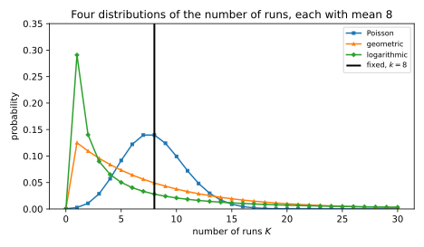
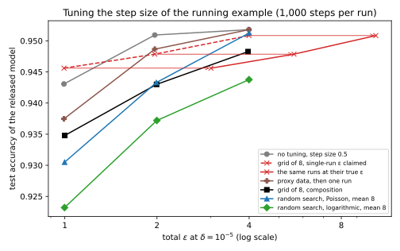

# Hyperparameter tuning and private selection

## Why this matters

Training a model with stochastic gradient descent (SGD), clipping each example's gradient and adding Gaussian noise to every step, satisfies differential privacy (DP). This is [DP-SGD](02-dp-sgd.md). Run once with a fixed step size, clipping norm, batch size and number of steps, it guarantees the privacy level that its accountant reports. That guarantee covers exactly one training run, but nobody trains once. In practice you try a grid of step sizes, perhaps several clipping norms, score each trained model on a validation set and ship the best one. Every one of those runs touched the private training data, and every score touched the private validation data. So the question of this chapter is how much the search leaks, and how you pay for it honestly.

Releasing the best of $k$ private runs can cost as much as releasing all $k$ of them. For example, one run of this part's running example has a privacy level, written $\varepsilon$, of 6.71. Charging for every run then makes a grid of 10 runs cost 27.23, about four times one run, since the accountant charges less than the plain sum (@sec-hpt-composition). But one change to the procedure changes the answer completely. The change is to draw the *number* of runs at random, from a suitable distribution fixed before the search starts. For the right distribution, the release then costs a constant multiple of one run, plus a term that grows only with the logarithm of the expected number of runs. For the same expected number of runs, the cost falls to between 10.08 and 13.67, depending on the distribution.

The reason is the one idea of this chapter. The model you ship was chosen by comparing all the runs, so it depends on every one of them. With a fixed number of runs, an attacker can test for the event that every run came out badly. The next section shows that the evidence from that event multiplies across runs. With a random number of runs, the same event is mostly explained by the search having stopped early, which does not depend on the data.

## The best of k runs can cost k runs {#sec-hpt-leak}

A common argument for ignoring tuning says that a choice among eight step sizes carries at most three bits. The argument is wrong because the released model is not just the choice. It is a whole private run, picked *because* of how it came out, and the comparison that picked it depends on every run.

Let one run be **randomized response** on two outcomes, "good" and "bad", where good is better. Which outcome is likelier on which dataset is just a choice of labels. On a dataset $D$, the run comes out bad with probability $e^\varepsilon/(1 + e^\varepsilon)$. On a neighbouring dataset $D'$, which differs from $D$ in one record, it comes out bad with probability $1/(1 + e^\varepsilon)$. The ratio of these two probabilities is $e^\varepsilon$, so one run is exactly $\varepsilon$-DP. Now release the best of $k$ independent runs. Its outcome is bad only if every run is bad, and because the runs are independent, the chance of that is the product of $k$ per-run chances on each dataset. The ratio between the two datasets is therefore the product of $k$ ratios of $e^\varepsilon$ each:
$$\frac{P_D[\text{best of } k \text{ is bad}]}{P_{D'}[\text{best of } k \text{ is bad}]} = e^{k\varepsilon}.$$ {#eq-hpt-rr-k}
So the best of $k$ runs is exactly $k\varepsilon$-DP, no better than releasing all $k$ runs.

The whole loss sits on one rare event. Take $\varepsilon = 1$ and $k = 10$, and look at the **privacy loss**, the logarithm of the ratio above for the outcome that was released, with outcomes drawn under $D$. Most of the time the best run is good, and the loss is $-0.0446$, slightly negative because a good release is a little less likely on $D$ than on $D'$. That happens with probability 0.9564. The rest of the time every run is bad, and then the loss is 10. That happens with probability 0.0436 (@fig-hpt-leak, right). An attacker who checks whether the released model is bad therefore gets a likelihood ratio of $e^{10}$ whenever that check fires.

{#fig-hpt-leak}

The example is extreme, because it puts all of each run's privacy loss on a single yes-or-no outcome, but it is not a contrived corner. A DP-SGD run that sometimes diverges has a "bad" outcome whose probability depends a little on the data, and the best of $k$ such runs multiplies those small dependences. A particular search may leak much less than $k$ runs. Still, an analysis that knows only each run's $\varepsilon$ cannot rule out the full $k\varepsilon$, because randomized response is one of the runs with that $\varepsilon$.

The same holds in Rényi terms. Papernot & Steinke (2022) show that the divergence of the best of $k$ randomized-response runs is at least $k\varepsilon$ minus a term that shrinks as the order grows. In the example above, the exact divergence at order 2 is 6.8683. One run alone has 0.7353 at that order, so charging for all ten runs gives 7.3533, only 7% more. So for a fixed number of runs, no bound that holds for every mechanism can be much cheaper than composition, and a cheaper guarantee needs a different procedure.

Tuning with non-private runs and then training once privately does not escape the problem, because the chosen hyperparameters are a non-private function of the data. Papernot & Steinke build a support vector machine whose best regularization weight changes when a few outliers are added. The chosen weight alone then reveals whether the outliers were in the training set, which is a [membership inference](../part02-attacks/02-membership-inference.md) attack through a single number.

## Paying by composition {#sec-hpt-composition}

The safe answer is to charge for every run. The best of $k$ runs is computed from the $k$ outputs alone, by comparing their scores and keeping the winner. A computation that uses only private outputs and never the data is as private as those outputs ([Post-processing, group privacy and composition](../part03-dp-foundations/02-properties.md)). So the release costs at most what releasing all $k$ runs costs, and composition gives that cost.

For DP-SGD, the natural currency is **Rényi differential privacy (RDP)** ([Rényi DP](../part04-privacy-accounting/01-renyi-dp.md)). It describes a mechanism by a curve $\varepsilon(\lambda)$, which bounds a divergence between the mechanism's outputs on neighbouring datasets at each order $\lambda$ greater than 1. Curves of mechanisms run one after another add up, even when each run is chosen after seeing the earlier results. The total curve is converted only once, at the best order, into a privacy level $\varepsilon$ with a small slack $\delta$ ([RDP conversions](../part04-privacy-accounting/02-rdp-conversions.md)). Suppose each of the $k$ runs has curve $\varepsilon(\lambda)$. Then anything computed from all of them, the best run included, has a curve of at most
$$\varepsilon_A(\lambda) \le k\,\varepsilon(\lambda),$$ {#eq-hpt-compose}
where $\varepsilon_A$ is the curve of the whole tuning procedure.

For DP-SGD this has a simple form. The accountant charges each noisy step the same amount, whatever model weights the step is applied to. So if $T$ is the number of steps in one run, $k$ runs cost exactly as much as one run of $kT$ steps. That holds even though each run starts from its own initialization.

@tbl-hpt-compose applies this to the running example of [DP-SGD](02-dp-sgd.md), a network with 3,329 weights trained on 10,000 records. Each step samples every record with probability $q$, the sampling rate, which is 0.01 here. The noise multiplier $\sigma$, the noise's standard deviation relative to the clipping norm, is 1. The slack stays at $\delta = 10^{-5}$ throughout this chapter. So one run of 10,000 steps costs $\varepsilon = 6.71$.

| Runs $k$ | 1 | 3 | 10 | 30 | 100 |
| --- | --- | --- | --- | --- | --- |
| $\varepsilon$ of $k$ runs at $\sigma = 1$ | 6.71 | 12.73 | 27.23 | 58.25 | 145.17 |
| Ratio to one run | 1.00 | 1.90 | 4.06 | 8.68 | 21.63 |
| $\sigma$ per run for a total of 6.71 | 1 | 1.46 | 2.45 | 4.12 | 7.44 |

: Composition of $k$ DP-SGD runs of the running example, at $\delta = 10^{-5}$. {#tbl-hpt-compose}

Ten runs cost 4.06 times one run, not 10 times, for two reasons. The conversion from a curve to $(\varepsilon, \delta)$ subtracts a term that grows with $\ln(1/\delta)$, and it subtracts that term only once, for the whole search. And adding RDP curves behaves like advanced composition ([Composition](../part03-dp-foundations/04-composition.md)), which grows roughly like $\sqrt k$ when each run's $\varepsilon$ is small. The curve itself still grows linearly in $k$, though, and so does $\varepsilon$ once the budget is large, as the right of @tbl-hpt-compose shows.

The honest way to keep the budget fixed is to add more noise to every run. Suppose you want 10 runs to cost no more than one run did, 6.71. Then each run needs $\sigma = 2.45$ instead of 1. More noise per step leaves fewer useful steps, so accuracy falls ([DP-SGD](02-dp-sgd.md)). For two or three candidates, composition costs little more than the random-$K$ methods of the next sections and needs no change to the procedure. Those methods only pull ahead once there are more than a few runs (@fig-hpt-overhead).

## Random stopping {#sec-hpt-stopping}

To see why a random number of runs helps, you need one formula for the best of such a search. Suppose the outcomes of a run are ranked from best to worst. The best of $k$ independent runs is no better than an outcome $y$ exactly when every run is no better than $y$. Write $x$ for the chance that one run is no better than $y$. Then all $k$ runs are no better than $y$ with probability $x^k$.

Now let the number of runs $K$ be random, drawn independently of the runs. Averaging $x^K$ over the random number of runs gives the **generating function** $f$ of that number,
$$f(x) = \mathbb E[x^K].$$
So with a random number of runs, the chance that the best run is no better than $y$ is $f(x)$ instead of $x^k$. The chance that the best is exactly $y$ is then $f(x)$ minus the same function evaluated at the chance that one run is strictly worse than $y$.

A die makes this concrete. The best of two rolls of a die is a six unless both rolls are below six, which happens with probability $(5/6)^2$. So the best is a six with probability $11/36$, or 0.3056. If instead you roll once or twice with probability $\frac12$ each, the generating function is $f(x) = \frac12x + \frac12x^2$. The best is then a six with probability $1 - f(5/6)$, which works out to 0.2361. That is the average of the one-roll answer, $1/6$, and the two-roll answer.

The change that breaks the $k\varepsilon$ barrier is called **random stopping**, and Liu & Talwar (2019) found it. After each run, flip a biased coin whose probability of heads, written $\gamma$, you fix in advance. On heads you stop and release the best run seen so far, and on tails you run again. So the number of runs is geometric, with mean $1/\gamma$. Their result is that if each run is $\varepsilon$-DP, the release is $3\varepsilon$-DP, whatever $\gamma$ is.

The reason lies in the exact probability of each output. Write $p$ for the probability that one run produces outcome $y$. Write $p_>$ for the probability that one run is strictly better than $y$, so that $p_\ge = p_> + p$ is the probability that it is at least as good. Putting the geometric generating function into the difference above and simplifying gives the probability that the release is $y$:
$$P[\text{release} = y] = \frac{\gamma\,p}{\big(\gamma + (1 - \gamma)p_>\big)\big(\gamma + (1 - \gamma)p_\ge\big)}.$$ {#eq-hpt-lt}

Each of $p$, $p_>$ and $p_\ge$ is the probability of an event about a single run. Because one run is $\varepsilon$-DP, each moves by at most a factor $e^\varepsilon$ between neighbouring datasets. Each factor in the denominator is the constant $\gamma$, which does not depend on the data, plus a multiple of $p_>$ or $p_\ge$. The constant part stays the same and the other part moves by at most $e^\varepsilon$, so their sum also moves by at most $e^\varepsilon$. The numerator and the two denominator factors give three moves of at most $e^\varepsilon$, so the ratio is at most $e^{3\varepsilon}$. That holds however many runs the search makes, where a fixed number of runs gave a $k$-th power.

The factor 3 is not a weakness of the proof, because some mechanisms come close to it. Take a mechanism with three outcomes that is exactly 1-DP. Its best outcome is rare, its middle one is much rarer still, and the coin's $\gamma$ is smaller again. For the middle outcome, all three factors then move by nearly $e^\varepsilon$. With $\gamma = 10^{-6}$ the exact cost of the release reaches 2.9987.

With only two outcomes, however, as in randomized response, the bound is driven by the best outcome rather than the bad one. Nothing is better than the best outcome, so for it $p_>$ is zero, and one denominator factor is just $\gamma$ and cannot move. So only two factors are left, and the cost approaches $2\varepsilon$. For randomized response with $\varepsilon = 1$ and $\gamma = 0.1$, for example, the release costs 1.7957. As $\gamma$ shrinks to 0.001, the cost rises to 1.9977 (@fig-hpt-leak, left).

Random stopping does not promise to find the best candidate, and that is where its price lies. What it promises instead is that the release is usually at least as good as the top fraction $\pi$ of the distribution of one run's outcomes. The release misses that top fraction only if every run misses it, and averaging over the geometric number of runs gives
$$P[\text{miss}] = \frac{\gamma(1 - \pi)}{\gamma + (1 - \gamma)\pi} \le \frac{\gamma}{\pi}.$$ {#eq-hpt-lt-utility}

Take a grid of 8 candidates with one best, so the top fraction is $\pi = 1/8$. If the coin's probability is also 1/8, the search makes 8 runs on average. The chance of never trying the best candidate is then 0.4667, and the bound $\gamma/\pi$ equals 1, which says nothing. Raising the mean to 80 runs brings the miss probability down to 0.0805. The bound is then 0.1, a little above the exact value. So the bound guarantees a top candidate with probability at least 0.9 once the mean number of runs is ten times the size of the grid. The exact miss probability shows that slightly fewer would do. That is the trade the method makes, a constant privacy cost bought with extra runs.

The geometric distribution is also widely spread. With $\gamma = 1/8$ it stops after a single run one time in eight. Yet it also makes more than 16 runs with probability 0.118 (@fig-hpt-k). That spread is what makes "every run was bad" look like "the coin stopped early", so it is what buys the privacy.

Liu & Talwar also give variants for $(\varepsilon, \delta)$-DP runs, for a cap on the number of runs, and for a known score threshold, which costs $2\varepsilon$ plus a small term. For DP-SGD, though, the next section gives the version to use.

## Rényi bounds for a random number of runs {#sec-hpt-rdp}

DP-SGD is not usefully $\varepsilon$-DP for any small $\varepsilon$, because its Gaussian noise gives it an RDP curve rather than a small pure $\varepsilon$. Papernot & Steinke (2022) extended random stopping to RDP and to a family of distributions for the number of runs.

Their general bound starts from the same formula for the best of $K$ runs. It adds to one run's curve a term that depends only on the generating function $f$ of $K$. Any privacy guarantee of a single run limits that term, so each choice of distribution for $K$ turns into a concrete bound.

The first choice is a **Poisson** number of runs, whose mean is written $\mu$. Its bound needs the run to satisfy two guarantees: its RDP curve $\varepsilon(\lambda)$ at the order $\lambda$ where the bound is evaluated, and also an $(\hat\varepsilon, \hat\delta)$-DP guarantee. Here $\hat\varepsilon$ must be small enough that $e^{\hat\varepsilon} \le 1 + 1/(\lambda - 1)$, because the proof needs this to cancel a term proportional to $\mu$. Under these conditions the tuning procedure has curve
$$\varepsilon_A(\lambda) \le \varepsilon(\lambda) + \mu\hat\delta + \frac{\ln\mu}{\lambda - 1}.$$ {#eq-hpt-poisson}

The first term is one run. You never pay less than that, because the release is the output of a run. The last term is the price of the number of runs, and it grows only with the logarithm of the mean. The middle term, $\mu\hat\delta$, grows linearly with the mean, but it is multiplied by the run's $\hat\delta$ at a small $\hat\varepsilon$. So the Poisson bound is good only when one run is already very private. When the Poisson distribution gives zero runs, which is rare for any useful mean, the procedure releases something that does not depend on the data, such as the untrained initialization.

The second choice is the **truncated negative binomial** family, which never gives zero runs. It has a shape parameter $\eta$, any number greater than $-1$. Its second parameter $\gamma$ lies between 0 and 1, and a smaller $\gamma$ gives a larger mean. The case $\eta = 1$ is the geometric distribution of random stopping. The case $\eta = 0$ is the **logarithmic distribution**, which gives $K$ runs with probability proportional to $(1 - \gamma)^K/K$. For a run with curve $\varepsilon(\lambda)$, the procedure has curve
$$\varepsilon_A(\lambda) \le \varepsilon(\lambda) + (1 + \eta)\Big(1 - \frac1{\hat\lambda}\Big)\varepsilon(\hat\lambda) + \frac{(1 + \eta)\ln(1/\gamma)}{\hat\lambda} + \frac{\ln\mathbb E[K]}{\lambda - 1},$$ {#eq-hpt-tnb}
where $\hat\lambda$ is a second order, any number from 1 up, that you choose to make the bound smallest.

Each term again pays for something. The first is one run, and the last is the logarithmic price of the expected number of runs, so multiplying that number by 10 adds $\ln 10/(\lambda - 1)$. The middle terms pay for the tail of $K$. They measure how well an attacker can tell "many runs, all bad" from "few runs", and here they are a constant times the run's own privacy at the second order. For a run that is $\varepsilon$-DP, letting both orders grow without bound makes the last two terms vanish, and the bound becomes $(2 + \eta)\varepsilon$. That gives $3\varepsilon$ for the geometric distribution, as in @sec-hpt-stopping, and $2\varepsilon$ for the logarithmic one.

@tbl-hpt-overhead and @fig-hpt-overhead evaluate these bounds on the running example, taking the best orders and converting to $\varepsilon$ at $\delta = 10^{-5}$. With 10 runs in expectation, the logarithmic distribution costs 10.08. That is 1.5 times one run, while composition costs 27.23. Raising the expected number of runs to 1,000 adds only 3.38. The Poisson bound starts well, at 8.93 for 3 runs, but then grows nearly linearly. That is because one run at $\varepsilon = 6.71$ is far from private enough at the small $\hat\varepsilon$ that the Poisson condition demands, so its $\hat\delta$ there is not small. At a smaller per-run budget the Poisson bound does much better, as @sec-hpt-run shows.

| Expected runs | 3 | 10 | 30 | 100 | 1,000 |
| --- | --- | --- | --- | --- | --- |
| Composition | 12.73 | 27.23 | 58.25 | 145.17 | 1035.93 |
| Poisson | 8.93 | 13.67 | 26.43 | 67.77 | 302.57 |
| Geometric ($\eta = 1$) | 9.22 | 11.31 | 12.85 | 14.32 | 16.76 |
| $\eta = 0.5$ | 9.03 | 10.75 | 11.98 | 13.15 | 15.09 |
| Logarithmic ($\eta = 0$) | 8.75 | 10.08 | 11.04 | 11.95 | 13.46 |

: The $\varepsilon$ at $\delta = 10^{-5}$ of tuning with DP-SGD runs of the running example (one run: $\varepsilon = 6.71$), by the number of runs and how it is chosen. {#tbl-hpt-overhead}

{#fig-hpt-overhead}

Choosing $\eta$ trades privacy against the shape of $K$. A smaller $\eta$ shrinks the multiple $(1 + \eta)$ in the middle terms, so it gives a cheaper bound. But it also makes $K$ more skewed, so the search often runs only a few candidates. For example, the logarithmic distribution with a mean of 10 has $\gamma = 0.02692$. It stops after a single run with probability 0.2692. The geometric distribution with the same mean, by contrast, does so with probability 0.1000. The Poisson distribution is the limit of the family as $\eta$ grows, at a fixed mean, and it stays close to its mean. With a mean of 10, it gives at most one run with probability only $4.99 \times 10^{-4}$. @fig-hpt-k shows four of these distributions at a mean of 8, the mean used in @sec-hpt-run.

{#fig-hpt-k}

These are upper bounds that hold for every run with the given curve, so they can be loose for a particular run. Take randomized response with $\varepsilon = 0.5$ and a logarithmic number of runs with mean 10. At orders 5 and 20, where the conversion to $(\varepsilon, \delta)$ usually finds its best order, the bound is two to three times above the exact divergence. It is still two to four times below composition there, although at order 2 its constant terms make it worse than composition.

The theorems also have conditions, and each one is easy to break in practice. First, each run must draw its candidate independently from a distribution fixed in advance, typically uniform on the grid, which is **random search**. The proof treats the runs as independent draws of the same randomized algorithm. Adaptive methods such as Bayesian optimization pick the next candidate from the scores so far, so each run depends on the ones before it. Such methods are not covered and need [adaptive composition](../part04-privacy-accounting/08-adaptive-composition.md). Second, the number of runs must be drawn from its distribution independently of the data. Third, the score that ranks the runs must be part of each run's private output, which @sec-hpt-select explains.

For runs described by zero-concentrated differential privacy (zCDP), the paper also gives a closed form. Its overhead grows like the square root of the logarithm of the expected number of runs.

## Selecting by a noisy validation score {#sec-hpt-select}

Sometimes the candidates are already fixed, such as public pretrained checkpoints, and only the choice among them uses private data, a held-out validation set. That is a pure **selection** problem, which [Selection](../part03-dp-foundations/05-selection.md) solved.

Take a private validation set, and write $m$ for its number of records. Score each candidate $r$ by its number of correct predictions there, written $u(r)$. Adding or removing one validation record changes every count by at most 1, which is the sensitivity of the score. An accuracy would be a worse score, because it divides the count by the number of records, and under add/remove neighbours that number is itself private.

Write $\varepsilon$ for the privacy level spent on the choice. The **exponential mechanism** picks candidate $r$ with probability proportional to $e^{\varepsilon u(r)/2}$. It is $\varepsilon$-DP for the validation records, because one record moves each weight, and also their sum, by at most a factor $e^{\varepsilon/2}$. So the probability of each candidate moves by at most $e^\varepsilon$. It also loses little. Candidates far below the best have exponentially small weight, so among $k$ candidates the expected shortfall from the best count is at most
$$\frac{2}{\varepsilon}(\ln k + 1)$$
correct predictions. In accuracy, that is an expected gap of at most $2(\ln k + 1)/(\varepsilon m)$. Report-noisy-max, which adds Laplace or Gumbel noise to each count and releases the largest, has the same guarantee.

@tbl-hpt-em runs the exponential mechanism on eight trained models from the experiment of @sec-hpt-run. Each was scored on the 5,000 validation records. Their counts of correct predictions range from 4,123 to 4,694. The best count, from step size 0.5, beats the second best by only 13.

| $\varepsilon_{\text{sel}}$ | $P[\text{best}]$ | Expected gap (correct predictions) | Accuracy gap | Bound $2(\ln 8 + 1)/\varepsilon_{\text{sel}}$ |
| --- | --- | --- | --- | --- |
| 0.01 | 0.2478 | 87.62 | 1.752% | 615.9 |
| 0.1 | 0.6484 | 5.61 | 0.112% | 61.6 |
| 1 | 0.9985 | 0.02 | 0.000% | 6.2 |

: The exponential mechanism selecting among eight trained models by their correct predictions on 5,000 private validation records. {#tbl-hpt-em}

At a selection budget $\varepsilon_{\text{sel}} = 0.1$, the choice costs about a tenth of a point of accuracy, and at 1 it costs nothing measurable. Selection on a few thousand records is cheap, because the scores differ by tens of correct predictions. The mechanism's scale, $2/\varepsilon_{\text{sel}}$, is only 2 at a budget of 1.

Training is what is expensive. If the candidates were trained on the private training set, the training records need their own accounting. Each record sits in exactly one of the two sets, and a pair of neighbouring datasets differs in one record. So the procedure's cost is the larger of its cost in training records and its cost in validation records, not their sum. This is **parallel composition**. Write $\varepsilon_j(\lambda)$ for the curve of the $j$-th training run and $\varepsilon_{\text{sel}}(\lambda)$ for the curve of the selection. With the validation set disjoint from the training set, releasing the selected model costs
$$\varepsilon_A(\lambda) \le \max\Big(\sum_{j = 1}^k\varepsilon_j(\lambda),\ \varepsilon_{\text{sel}}(\lambda)\Big).$$ {#eq-hpt-select}

For a training record, the validation set and the selection noise are fixed, so the release is a post-processing of the $k$ trained models, and they compose. For a validation record, the trained models are fixed, so only the selection matters. The exponential mechanism cannot reduce the training term, because it protects only the low-sensitivity scores, and each trained model depends on the training records far more than a count does.

The validation set needs protection under every method in this chapter. The best-of theorems of @sec-hpt-stopping and @sec-hpt-rdp assume that the score is part of each run's private output. If the score is an exact validation accuracy, the validation records are not protected at all, because the choice and the released score depend on them with no noise. The fix is to add Gaussian noise with standard deviation $\sigma_{\text{val}}$ to each run's count of correct predictions. Each score is then a Gaussian mechanism with RDP curve $\lambda/(2\sigma_{\text{val}}^2)$. By parallel composition again, a run's curve is the larger of its training curve and this one.

So a noisy score costs nothing extra as long as its curve stays below the training curve. With noise of $\sigma_{\text{val}} = 20$ correct predictions, for example, one noisy count costs $\varepsilon = 0.182$. Eight of them composed cost 0.546. That is well below the eight training runs of @sec-hpt-run, which at $\sigma = 2.07$ cost 1.994 together. Adding the counts leaves the total at 1.994, because their curve stays below the training curve at every order the conversion uses.

## Tuning the running example {#sec-hpt-run}

To see the trade-offs together, tune the step size of the running example over eight values, from 0.0625 to 8, doubling each time. Each run uses DP-SGD with $q = 0.01$, clipping norm 0.5 and, to keep the experiment fast, 1,000 steps. A private validation set of 5,000 records scores each run, by its count of correct predictions plus Gaussian noise with $\sigma_{\text{val}} = 20$. The whole procedure gets a budget of $\varepsilon = 2$ at $\delta = 10^{-5}$. Each strategy then picks the noise multiplier $\sigma$ that keeps it within that budget, by composition or by the bounds of @sec-hpt-rdp. @tbl-hpt-run also shows an untuned run, a search that misreports its cost, and a search on proxy data.

| Strategy | $\sigma$ | $\varepsilon$ of one run | Total $\varepsilon$ | Test accuracy | Runs on private data |
| --- | --- | --- | --- | --- | --- |
| No tuning: step size 0.5 from [DP-SGD](02-dp-sgd.md) | 1.03 | 1.97 | 1.97 | $0.9509 \pm 0.0015$ | 1 |
| Grid of 8, single-run $\varepsilon$ reported | 1.03 | 1.97 | 5.60 | $0.9479 \pm 0.0030$ | 8 |
| Tune on proxy data, then one run | 1.03 | 1.97 | 1.97 | $0.9487 \pm 0.0025$ | 1 |
| Grid of 8, composition | 2.07 | 0.66 | 1.99 | $0.9430 \pm 0.0022$ | 8 |
| Random search, Poisson, mean 8 | 1.53 | 0.98 | 1.99 | $0.9433 \pm 0.0060$ | 8.01 |
| Random search, logarithmic, mean 8 | 1.36 | 1.17 | 2.00 | $0.9372 \pm 0.0200$ | 7.95 |

: Tuning the step size of the running example (1,000 steps per run) at a total budget of $\varepsilon = 2$, $\delta = 10^{-5}$. Test accuracy of the released model, mean and standard deviation over repetitions of the whole procedure, estimated by resampling from three runs per step size; runs on private data is the average number of training runs. {#tbl-hpt-run}

The honest searches lose about a point of test accuracy against a single untuned run, which reaches 0.9509. Composition reaches 0.9430 and Poisson random search 0.9433.

The second row of @tbl-hpt-run is the common reporting bug. A team runs the grid at the noise of a single run and reports that run's $\varepsilon$ of 1.97. Composition of the eight runs puts the honest cost at 5.60. The bug distorts comparisons between papers. A paper that reports 0.948 at $\varepsilon = 1.97$ for this search looks better than one that reports 0.943 after an honest search at about the same budget. Yet both run the same grid search, and the first adds less noise only because it undercounts what the search costs. So it should be compared with other methods at $\varepsilon = 5.60$.

On this task, tuning did not pay even with the budget misreported. The grid search reaches 0.9479, below the untuned 0.9509. Step size 0.5 is the best of the grid, and the noisy count sometimes picks an adjacent step size instead. But step size 0.5 is the best because [DP-SGD](02-dp-sgd.md) chose its running example's settings knowing this very task. That is a leak of exactly the kind this chapter is about, which no accountant in the book has charged for. On a new task you would have no such guess.

Poisson random search beats composition only slightly here, because its gain and its losses roughly cancel. It allows a noise multiplier of 1.53 instead of 2.07. Each run therefore costs 0.98 instead of 0.66, and learns more. But because the number of runs is random, with a mean of one per step size, it misses any given step size with probability 0.3679. Its accuracy also varies more from one search to the next, with a standard deviation of 0.0060 against 0.0022. With a larger grid the balance shifts, because @tbl-hpt-overhead shows the random-$K$ cost growing far more slowly than composition.

The logarithmic distribution has the cheapest bound and the worst search. It allows the least noise of the honest strategies, $\sigma = 1.36$. But with a mean of 8 it stops after a single run with probability 0.2907, and then it ships a randomly chosen step size. That is why its accuracy is the lowest and the most variable, $0.9372 \pm 0.0200$. Papernot & Steinke report the same trade-off, and they also found the Poisson distribution best in their own small search.

Tuning on proxy data is nearly free, when proxy data exist. The running example's labels come from a fixed random "teacher" network, and the proxy is a second task labelled by a different random teacher. It stands in for public data from a related distribution. The grid runs on the proxy task at no privacy cost, and one private run with the winning step size reaches 0.9487. How well this works depends on how close the proxy is to the private task. @fig-hpt-accuracy repeats the comparison at budgets of 1 and 4, where each point comes from one run per step size and so is noisier.

{#fig-hpt-accuracy}

## What to do and what to report {#sec-hpt-practice}

The results of this chapter turn into a short procedure. First, spend private runs only where you must, since runs on public or proxy data cost nothing. In @tbl-hpt-run, for instance, the two strategies that spend the whole budget on one private run beat every honest search. A poor guess can be far worse than a noisy search, but this says where to start. So reuse hyperparameters that worked on similar tasks, and shrink what is left to search. For example, once the clipping norm is below the typical gradient norm, only the product of step size and clipping norm matters ([DP-SGD](02-dp-sgd.md)). So one of the two need not be searched.

Next, fix the search before you touch the private data. Write down the candidate set, the distribution of the number of runs, the score and the validation set. The random-$K$ theorems require candidates drawn from a fixed distribution and a number of runs drawn independently of the data. An engineer who looks at the first few results and decides to "try a few more" has made those choices functions of the data. The procedure has then changed, and no theorem covers it.

Then make the score private, with a held-out validation set and a noisy count as in @sec-hpt-select, because an exact validation score leaves the validation records unprotected.

After that, account for the whole search. For more than a few candidates, run random search with a random number of runs. The Poisson bound suits a small per-run budget and a moderate number of runs, and the truncated negative binomial bound suits many runs. Count every run on the private data, including runs that crashed, runs for debugging and evaluations used for early stopping. A crashed run still computed on the data, and if its failure changed what was done next, it is part of an adaptive sequence.

Finally, report two numbers. The first is the $\varepsilon$ of the released run, which says how much the final model alone would leak if its hyperparameters were public. The second is the $\varepsilon$ of the whole procedure, which is what the release actually guarantees. Report it with how it was computed, meaning the candidate set, the distribution of the number of runs, the accountant, $\delta$ and the neighbouring relation. For the Poisson row of @tbl-hpt-run, a complete report reads as follows.

> DP-SGD with Poisson sampling rate 0.01, clipping norm 0.5, noise multiplier 1.53 and 1,000 steps. One run satisfies $(0.98, 10^{-5})$-DP. The step size was selected by random search over $\{0.0625, 0.125, \dots, 8\}$, with a Poisson number of runs with mean 8. Each run was scored by its correct predictions on a disjoint validation set of 5,000 records, plus Gaussian noise of standard deviation 20. The whole procedure satisfies $(1.99, 10^{-5})$-DP by the Rényi bound of Papernot & Steinke (2022, Theorem 6), for add/remove neighbours at the record level.

Reporting standards ask for this. Ponomareva et al. (2023) ask for the formal guarantee of both the final model and the tuning, and [Choosing an accountant](../part04-privacy-accounting/09-choosing-an-accountant.md) lists tuning among the checks of a reported $\varepsilon$. An [audit](10-auditing.md) cannot catch a missing tuning charge, because it tests the one released model. The leak lies in the event that every run of the search was bad, and an audit would see it only by rerunning the whole search on neighbouring datasets.

## Code

The generating function makes the best of $K$ runs one line of code, because the best of $K$ randomized-response runs is bad exactly when every run is bad. If $x$ is the chance that one run is bad, that happens with probability $f(x)$. This snippet computes the exact $\varepsilon$ of the release for a fixed and for a geometric number of runs.

```python
from collections.abc import Callable
from math import exp, log


def best_of_rr_epsilon(eps: float, f: Callable[[float], float]) -> float:
    """Exact epsilon of releasing the best of K randomized-response runs, f(x) = E[x^K]."""
    bad_d = exp(eps) / (1 + exp(eps))  # one run comes out bad on D
    bad_d2 = 1 / (1 + exp(eps))  # ... and on its neighbour D'
    # The best is bad only if every run is bad: probability f(P[bad]).
    out_d = [f(bad_d), 1 - f(bad_d)]
    out_d2 = [f(bad_d2), 1 - f(bad_d2)]
    return max(abs(log(a / b)) for a, b in zip(out_d, out_d2))


def fixed(k: int) -> Callable[[float], float]:
    return lambda x: x**k


def geometric(gamma: float) -> Callable[[float], float]:
    """Stop after each run with probability gamma; the mean number of runs is 1/gamma."""
    return lambda x: gamma * x / (1 - (1 - gamma) * x)


print(f"{best_of_rr_epsilon(1.0, fixed(10)):.4f}")  # 10.0000
print(f"{best_of_rr_epsilon(1.0, geometric(0.1)):.4f}")  # 1.7957
print(f"{best_of_rr_epsilon(1.0, geometric(0.001)):.4f}")  # 1.9977
```

The script [hyperparameter_tuning.py](../../code/part05-dp-ml/hyperparameter_tuning.py) has the DP-SGD accountants. Its `tuned_epsilon(q, sigma, steps, strategy)` gives the total $\varepsilon$ of a search, with `strategy` one of `("fixed", k)`, `("poisson", mean)` or `("tnb<η>", mean)`, and `sigma_for_tuning(q, steps, eps, strategy)` gives the noise multiplier that keeps it within a budget. Running the script reproduces every number in this chapter, in two to four minutes:

```bash
uv run python code/part05-dp-ml/hyperparameter_tuning.py
```

## Cheat sheet

| Result | Formula or value | Conditions |
| --- | --- | --- |
| Best of a fixed $k$ | Up to $k\varepsilon$; composition's bound is attained in the worst case | Any runs; for DP-SGD, $k$ runs of $T$ steps cost one run of $kT$ steps |
| Random stopping | $3\varepsilon$-DP; misses the top fraction $\pi$ with probability $\le \gamma/\pi$ | $\varepsilon$-DP runs, geometric $K$ with mean $1/\gamma$ |
| Poisson | $\varepsilon(\lambda) + \mu\hat\delta + \ln\mu/(\lambda - 1)$ | Run also $(\hat\varepsilon, \hat\delta)$-DP with $e^{\hat\varepsilon} \le 1 + 1/(\lambda - 1)$ |
| Truncated negative binomial | $\varepsilon(\lambda) + (1 + \eta)(1 - \frac1{\hat\lambda})\varepsilon(\hat\lambda) + \frac{(1 + \eta)\ln(1/\gamma)}{\hat\lambda} + \frac{\ln\mathbb E[K]}{\lambda - 1}$; pure DP: $(2 + \eta)\varepsilon$ | Any $\hat\lambda \ge 1$; random search fixed in advance |
| Running example, 10 runs | 27.23 (composition), 13.67 (Poisson), 10.08 (logarithmic) | One run costs 6.71 |
| Fixed candidates | Exponential mechanism, expected gap $\le 2(\ln k + 1)/\varepsilon$ correct predictions | Count score on private validation data |
| Trained candidates | $\max(\sum_j\varepsilon_j(\lambda), \varepsilon_{\text{sel}}(\lambda))$ | Disjoint training and validation sets |

: The results of this chapter. {#tbl-hpt-cheat}

**Rules of thumb**

- The best of $k$ runs is not cheaper than $k$ runs unless the number of runs is random. Report the cost of the search, not only of the released run.
- For a small search at a small per-run budget, use Poisson random search. For a large search, use the logarithmic or $\eta = 0.5$ distribution, at the price of often trying few candidates.
- Validation scores on private data must be noisy, and a few thousand validation records make the noise cheap.
- The best tuning is the tuning you do not do on private data.

## Further reading

- Papernot & Steinke, "Hyperparameter Tuning with Renyi Differential Privacy" (ICLR 2022): the Poisson and truncated negative binomial bounds for DP-SGD, the lower bound for a fixed number of runs, and an experiment that recommends the Poisson distribution for small searches.
- Liu & Talwar, "Private Selection from Private Candidates" (STOC 2019): random stopping and the $3\varepsilon$ bound, with threshold and $(\varepsilon, \delta)$ variants.
- Ponomareva et al., "How to DP-fy ML: A Practical Guide to Machine Learning with Differential Privacy" (JAIR 2023): what to tune, how, and what to report.
- Mohapatra, Sasy, He, Kamath & Thakkar, "The Role of Adaptive Optimizers for Honest Private Hyperparameter Selection" (2021): honest tuning by composition, and optimizers that need less of it.

**Derivations.** Every result in this chapter is derived step by step in [the full edition's chapter](../../book-full/part05-dp-ml/03-hyperparameter-tuning.md), except that it only sketches the truncated negative binomial bound, citing the paper for the algebra, and states with citations its pure-DP and zCDP forms and Liu & Talwar's threshold, capped and $(\varepsilon, \delta)$ variants.
