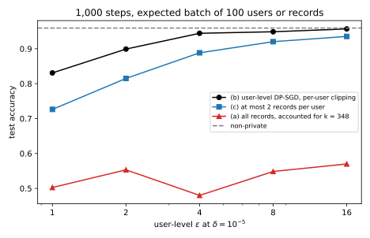

# User-level differential privacy

## Why this matters

Every differential privacy (DP) guarantee in this part so far protects one record. Its workhorse is stochastic gradient descent (SGD) made private by clipping each record's gradient and adding Gaussian noise to their sum, which is called [DP-SGD](02-dp-sgd.md). Its guarantee has a privacy budget $\varepsilon$ and a small probability $\delta$ that the bound fails. For the part's running example it reports $\varepsilon = 6.71$ at $\delta = 10^{-5}$, so an adversary who sees the trained model learns little about whether any single training example was used. But the people behind the data do not contribute one record each. A user of a messaging app contributes hundreds of messages, a patient dozens of visits and a photographer thousands of photos. The guarantee covers each record but not the person, because a person's records together can reveal far more than any one of them.

So this chapter asks what a record-level $\varepsilon$ says about a person with many records, and how to train a model whose guarantee covers the person instead. The answer to both rests on one idea, that **the neighbouring relation is the privacy unit**. A DP guarantee compares the outputs on two neighbouring datasets, and whatever differs between the two is what the guarantee protects. If neighbours differ in one record, records are protected, and if they differ in all of one person's records, people are protected. Nothing else in the definition changes, so the work is to bound how far one person can move the computation and to run the privacy accounting with that bound.

There are two ways to get a guarantee for a person. The first keeps the record as the unit and pays for the person afterwards. It is cheap to build but expensive in privacy, because the noise was calibrated to one record while the person can move the output by several. The second makes the person the unit from the start. On the running example the first route gives a useless model at every reasonable budget, while the second gives a model within a few points of the non-private one.

The running example is the part's two-class task, in which a small network learns labels produced by a fixed teacher network from 10,000 training records. It is trained as in [DP-SGD](02-dp-sgd.md), with the clipping norm and the step size both 0.5. This chapter assigns the training records to 1,000 users. Every user gets one record, and the other 9,000 are spread over the users with random, very uneven weights. So a user holds 10 records on average, while the largest holds 348 (@fig-ulvl-population). Each user's records are the records closest to one random record in the input space, so they resemble each other the way one person's messages do.

{#fig-ulvl-population}

## The privacy unit {#sec-ulvl-unit}

Take a mechanism $M$, and write $D$ and $D'$ for two datasets that differ by adding or removing all the records of one user. The mechanism is **user-level** $(\varepsilon, \delta)$-DP if, for every such pair and every set $S$ of possible outputs,
$$\Pr[M(D) \in S] \le e^\varepsilon\Pr[M(D') \in S] + \delta.$$
The mechanism is **example-level** DP if the same inequality holds for datasets that differ in one record.

User-level DP is therefore not a new privacy notion. It is DP with a coarser neighbouring relation, and the proofs of post-processing and composition hold for any fixed neighbouring relation. So every property of DP holds for it unchanged, including every accountant of [Part 4](../part04-privacy-accounting/00-introduction.md). Only the sensitivity changes, the most that one unit can move the computation. Records, users, households, devices and organizations are all possible units. The right one answers the question "whose participation do I want to hide?" A guarantee that does not name its unit leaves that question open, which is why [Choosing an accountant](../part04-privacy-accounting/09-choosing-an-accountant.md) lists the unit among what a guarantee must report.

What does an example-level guarantee give a person with $k$ records? Add that person's records one at a time, and you walk from the dataset without them to the dataset with them in $k$ steps, each between example-level neighbours. **Group privacy** ([Post-processing, group privacy and composition](../part03-dp-foundations/02-properties.md)) applies the one-record guarantee once per step. Each step multiplies the probability bound by $e^\varepsilon$, so the person gets $k\varepsilon$. Each step also adds its own slack $\delta$, and that slack is then multiplied by $e^\varepsilon$ at every step that follows it. Adding up the slacks gives the person's slack, written $\delta_k$:
$$\delta_k = \delta\sum_{j=0}^{k-1}e^{j\varepsilon} = \delta\,\frac{e^{k\varepsilon} - 1}{e^\varepsilon - 1}.$$ {#eq-ulvl-group}
So an example-level $(\varepsilon, \delta)$-DP mechanism is user-level $(k\varepsilon, \delta_k)$-DP for users with at most $k$ records. Some mechanisms attain this bound exactly, so nothing better holds for a mechanism that is known only to be $(\varepsilon, \delta)$-DP.

DP-SGD's accountant works with Rényi differential privacy (RDP), which bounds a Rényi divergence at some order $\alpha$ ([Rényi DP](../part04-privacy-accounting/01-renyi-dp.md)). For RDP the chain is weaker still, because the Rényi divergence has no triangle inequality, so passing through a dataset in between costs a higher order. Mironov (2017) shows that each doubling of the group halves the order at which the guarantee holds and triples its $\varepsilon$. His result needs the order to stay at least 2 after all the halvings, because only from there up does each doubling cost at most a factor of 3. So the starting order must be at least twice the group size.

Group privacy is weak even in $\varepsilon$. For example, ten records protected at $\varepsilon = 1$ each give their owner $\varepsilon = 10$. That allows the output's probabilities to differ by a factor of about 22,000 with and without the person. The slack is worse, because @eq-ulvl-group multiplies the per-record $\delta$ by up to $e^{(k-1)\varepsilon}$. So the per-record $\delta$ must be tiny, and for DP-SGD a smaller $\delta$ comes with a larger per-record $\varepsilon$. DP-SGD's accountant can convert its result at any $\delta$, so you can pick the per-record $\delta$ that brings the user's slack down to $10^{-5}$. But the two pull against each other, and the per-record $\varepsilon$ enters the user's slack multiplied by $k$ in an exponent. So for a few records the falling $\delta$ wins. For more records the rising $\varepsilon$ wins at every $\delta$, and group privacy then gives no guarantee at $10^{-5}$ at all.

The running example shows both effects. If you keep the per-record $\delta$ at $10^{-5}$, its guarantee gives a user with two records $\varepsilon = 13.42$, twice the record's value. The same reading gives that user $\delta_2 = 0.0082$, a chance of almost one in a hundred that the guarantee fails outright, which is no guarantee. Converting the accountant's result at a smaller per-record $\delta$ does better. Bringing the user's slack down to $10^{-5}$ raises the per-record $\varepsilon$ to 9.30. So the user gets $\varepsilon = 18.61$. The same procedure gives a user with five records $\varepsilon = 118.12$, and a user with ten records nothing at all, because no per-record $\delta$ is small enough. That matters, because 244 of the running example's 1,000 users have at least ten records.

## A user with k records in example-level DP-SGD {#sec-ulvl-group-sgd}

Group privacy treats DP-SGD as a black box, but it is not one, because you know exactly how a user's records enter each step. Recall that each step of [DP-SGD](02-dp-sgd.md) puts every record in the batch independently with some probability $q$, the sampling rate (Poisson sampling). It clips each sampled record's gradient to length at most $C$, the clipping norm, sums the clipped gradients and adds Gaussian noise. The noise has standard deviation $\sigma C$ in each coordinate, where $\sigma$ is the noise multiplier.

Now take a user with $k$ records. Each of their records enters the batch independently with probability $q$, so the number of them in a batch follows a binomial distribution. Write $b_m$ for the probability that exactly $m$ of the user's records are drawn. The other users' gradients are the same with and without the user, so they cancel out of the comparison. In the worst case, all of the user's drawn records push the sum by the full $C$ in the same direction, and only that direction matters. So, measured in units of $C$ along that direction, one step's output without the user is the noise alone. With the user, it is a mixture of the noise shifted by each possible $m$, weighted by $b_m$. Write $P_0$ for the distribution without the user and $P_{(k)}$ for the one with them. They are
$$P_0 = \mathcal N(0, \sigma^2) \qquad\text{and}\qquad P_{(k)} = \sum_{m=0}^k b_m\,\mathcal N(m, \sigma^2), \qquad b_m = \binom km q^m(1 - q)^{k - m}.$$ {#eq-ulvl-mixture}

Charles et al. (2024) prove in their Theorem 3 that this pair bounds the user's privacy loss once it is composed over the steps. They also prove that the bound is attained, by a loss for which the user's gradients all point the same way. An accountant built on this pair computes the user's guarantee directly, in the same way as the [subsampling](../part04-privacy-accounting/05-subsampling.md) accountant does for one record.

The result has a simple reading while $kq$ is small, because then **a user with $k$ records looks like one record sampled at rate $kq$**. Amplification by subsampling helps only because the unit is usually absent from the batch. For a user, what matters is the chance that some record of theirs is present, which is about $kq$. For one record with small $q$, the accountant's per-step cost at order $\alpha$ is close to
$$\frac\alpha2q^2\big(e^{1/\sigma^2} - 1\big).$$
This is the leading term of the record-level accountant ([Amplification by subsampling](../part04-privacy-accounting/05-subsampling.md)), with the sampling rate entering squared. For the user, write $\varepsilon_k(\alpha)$ for the per-step cost. In this regime it is the same formula with $q$ replaced by $kq$:
$$\varepsilon_k(\alpha) \approx \frac\alpha2(kq)^2\big(e^{1/\sigma^2} - 1\big).$$ {#eq-ulvl-rate}
So, in this regime, halving the sampling rate compensates doubling the user's records.

This cost grows like the square of $k$. The final $\varepsilon$ grows only roughly like its square root, because the conversion to $(\varepsilon, \delta)$ trades the composed cost against a term in $\ln(1/\delta)$. So the user's $\varepsilon$ grows roughly linearly in $k$.

Beyond that regime the user's $\varepsilon$ grows faster, for two reasons. First, $kq$ is no longer small. A user with 50 records in the running example has on average half a record in every batch, which is far too often for subsampling to hide. Second, a step can draw several of the user's records together and shift the sum by several clipping norms. High Rényi orders weigh such rare large shifts heavily, so the accountant is forced to orders near 1. There the conversion is expensive, because it adds a term in $\ln(1/\delta)$ divided by $\alpha - 1$.

@tbl-ulvl-k applies the accountant to the running example's DP-SGD run, which samples records at $q = 0.01$ with $\sigma = 1$. The run lasts 10,000 steps, and every $\varepsilon$ in the table is at $\delta = 10^{-5}$.

| Records of the user $k$ | 1 | 2 | 5 | 10 | 50 |
| --- | --- | --- | --- | --- | --- |
| User accountant, @eq-ulvl-mixture | 6.72 | 15.54 | 52.36 | 146.20 | 2161.43 |
| Best order $\alpha$ | 4 | 2.5 | 1.65 | 1.3 | 1.05 |
| Group privacy, @eq-ulvl-group | 6.71 | 18.61 | 118.12 | none | none |
| One record at rate $kq$ | 6.71 | 15.32 | 50.11 | 134.50 | 1673.08 |

: The user-level $\varepsilon$ at $\delta = 10^{-5}$ of the running example's example-level DP-SGD, for a user with $k$ records. "None" means that group privacy gives no $(\varepsilon, 10^{-5})$ guarantee. {#tbl-ulvl-k}

The second row shows the best order falling toward 1 as $k$ grows, as the previous paragraph predicted.

Already at two records, the person behind them is protected only at $\varepsilon = 15.54$, more than twice the record's value. At ten records, $\varepsilon = 146.20$ means no protection at all. The direct accountant is nonetheless below group privacy for every user with more than one record, and it stays finite where group privacy gives up (@fig-ulvl-user-eps). Group privacy only chains the per-record guarantee, and it ignores how DP-SGD draws and sums the user's records, so it is the wrong tool for DP-SGD.

The rate-$kq$ estimate is within 1.5% of the accountant at two records and within 8% at ten. So you can estimate a user's exposure quickly by rerunning the record-level accountant with $q$ replaced by $kq$. The estimate is below the accountant in every row, because it leaves out the steps that draw several of the user's records together.

An auditor should not discount the accountant's value as pessimistic. It is a worst case over the user's gradients, but real users' gradients are partly aligned, because a person's records resemble each other. And the theorem says that some loss attains the bound. So treat the accountant's value as the guarantee.

{#fig-ulvl-user-eps}

## User-level DP-SGD {#sec-ulvl-dpsgd}

The alternative to accounting for users after the fact is to change the algorithm, so that the unit DP-SGD samples, clips and accounts for is the user. McMahan, Ramage, Talwar & Zhang (2018) introduced it for federated learning of a language model. Write $U$ for the number of users. Starting from weights chosen without looking at the data, each step of **user-level DP-SGD** does five things.

1. **Sample users.** Put each user in the batch independently with probability $q$, now the user sampling rate.
2. **Compute one vector per user.** For each sampled user, compute one vector from that user's records alone. It can be the user's average gradient, or the change in weights after a few local steps of SGD on their records.
3. **Clip per user.** Rescale that vector to length at most $C$.
4. **Add noise.** Sum the clipped vectors and add Gaussian noise with standard deviation $\sigma C$ in each coordinate. Call the result $G_t$.
5. **Step.** Divide $G_t$ by $qU$, the expected number of sampled users, and take a gradient step.

The guarantee is user-level DP, with exactly the accountant of example-level DP-SGD, users in place of records and $q$ the user sampling rate. Each user adds only their own clipped vector to the sum, so one user moves it by at most $C$, however many records they have. Users also enter the batch independently, so each step is the same subsampled Gaussian mechanism as before. Dividing by $qU$ is post-processing, because the number of users is treated as public.

A common variant keeps per-record clipping. It keeps at most $k$ records per user, clips each record's gradient to $C$ and sums them, while users are still sampled whole. One user can then move the sum by up to $k$ clipping norms. Only the ratio of shift to noise matters, so this variant has the guarantee of DP-SGD with noise multiplier $\sigma/k$. Compared with clipping each user's averaged vector to $C$, it needs $k$ times more noise for the same $\varepsilon$. Summing all of a user's records and then clipping the sum is also valid, with sensitivity $C$, and it gives heavy users more weight than averaging does (@sec-ulvl-hetero).

The first consequence of changing the unit is that **you pay for the number of units**. User-level DP-SGD has the privacy of example-level DP-SGD on a dataset with one record per user. To keep the same expected batch, it must sample at a higher rate, and amplification is weaker at a higher rate. Consider the running example, trained for 1,000 steps with an expected batch of 100 units. Sampling records, it needs $\sigma = 0.778$ for $\varepsilon = 4$. Sampling users, it must use a rate ten times higher, and then the same $\varepsilon$ needs $\sigma = 3.78$, so the noise on the averaged update is about five times larger. That is the honest price of protecting people. There are ten times fewer people than records, and each unit needs the same noise to hide it, however many records it holds.

The second consequence is that **records inside a user are free**. The guarantee does not depend on how many records a user has. Their records can be averaged, used for several local steps or subsampled without changing $\varepsilon$, as long as the result is one clipped vector computed from that user's data alone. More records make each user's vector a better estimate of their gradient, so the signal improves while the noise stays fixed. Levy et al. (2021) show that, when each user's records come from the same distribution, user-level private learning gains from having more records per user.

The proof makes two assumptions that an implementation can break. The first is that each user's vector is computed from that user's data alone. This rules out normalizing a user's vector by statistics of other users, and it requires that one person's records are not spread over several "users" in the data. If one person has several accounts, the unit is the account, and the person is again a group of units. The second assumption is that users are Poisson-sampled. An implementation that iterates over users in a fixed shuffled order is a different mechanism, exactly as it is for records.

## Contribution bounding {#sec-ulvl-bounding}

User-level DP-SGD needs a data pipeline that groups records by user. Many training pipelines are built around records instead, with shuffled files of examples and per-example gradient code. You can keep such a pipeline and still protect users, if you limit how many records each user contributes.

**Contribution bounding** keeps at most $k$ records of each user, the cap, and discards the rest. Example-level DP-SGD then runs on the remaining records. The result is user-level DP, with the $\varepsilon$ that the accountant of @eq-ulvl-mixture gives for a user with $k$ records. The reason is that adding a user then adds at most $k$ records, all of them that user's. Users with fewer than $k$ records are covered too. Such a user behaves like a $k$-record user some of whose clipped gradients happen to be zero, and the accountant's worst case includes zero gradients.

The argument needs one condition. The records a user keeps must be chosen without looking at other users' data, for example at random. Suppose instead that the cap kept each user's $k$ records most similar to the rest of the dataset. Adding one user could then change which records the other users keep, and the two datasets would differ in more than $k$ records. Random selection keeps the proof simple, and Chua et al. (2024) report that keeping each user's longest records worked best on one of their language-model datasets.

Choosing the cap is a bias–variance trade-off (Amin, Kulesza, Muñoz Medina & Vassilvitskii 2019). On one side, the noise grows with the cap, because a user looks like a record sampled at rate $kq$ (@eq-ulvl-rate). So if the cap doubles, holding the user's privacy fixed means halving $q$, which halves the batch, or raising $\sigma$. At a fixed sampling rate, the noise multiplier must grow roughly in proportion to the cap. On the other side, the bias shrinks with the cap. Every discarded record belongs to a user with more than $k$ records, so the training set becomes both smaller and reweighted toward light users. Amin et al. found that the best cap therefore depends on how user sizes are distributed.

Because the best cap depends on the data, it should come from public knowledge of the population, or be chosen privately. Trying several caps and keeping the one with the best test accuracy spends privacy that the accountant does not see ([Hyperparameter tuning](03-hyperparameter-tuning.md)).

@tbl-ulvl-cap nevertheless tries every cap on the running example, to show the trade-off. It fixes a user-level $\varepsilon = 4$ for every cap. Every run also has the same schedule, 1,000 steps with an expected batch of 100 records. So the sampling rate is 100 divided by the number of records kept, and the column $kq$ is the expected number of a full user's records in each batch.

| Cap $k$ | Records kept | Sampling rate $q$ | $kq$ | Noise multiplier $\sigma$ | Test accuracy |
| --- | --- | --- | --- | --- | --- |
| 1 | 1,000 (10.0%) | 0.1 | 0.100 | 3.78 | 0.8917 |
| 2 | 1,807 (18.1%) | 0.0553 | 0.111 | 4.18 | 0.8920 |
| 5 | 3,506 (35.1%) | 0.0285 | 0.143 | 5.34 | 0.8790 |
| 10 | 5,063 (50.6%) | 0.0198 | 0.198 | 7.34 | 0.8276 |
| 20 | 6,631 (66.3%) | 0.0151 | 0.302 | 11.2 | 0.7562 |
| 50 | 8,437 (84.4%) | 0.0119 | 0.593 | 21.8 | 0.6401 |

: Contribution bounding at user-level $\varepsilon = 4$ and $\delta = 10^{-5}$: example-level DP-SGD on at most $k$ records per user, accounted for $k$ records, one run each. {#tbl-ulvl-cap}

Going from the smallest cap to the largest multiplies the data by 8.4 and the noise multiplier by 5.8. Along the way, accuracy falls from 0.8917 to 0.6401. On this task the noise dominates, because one record per user already holds most of what the network can learn privately at this budget. Every extra record per user therefore costs more in noise than it adds in signal. The caps 1 and 2 are tied.

The cap of 1 is user-level DP-SGD on one record per user in disguise. With one record per user, sampling records is the same as sampling users, so the accountant and its noise multiplier are the same too. More generally, the two techniques combine. You can cap each user's records to bound the compute, and then compute one clipped vector per user. In that combination the cap costs data but no noise, because each user still moves the sum by at most $C$. A user can even contribute all their records over the run, if each step draws a fresh subset of that user's records.

## Heterogeneous users {#sec-ulvl-hetero}

User sizes are rarely equal. In the running example, for instance, 30 users have at least 50 records each. These heavy users hold 30.6% of all records (@fig-ulvl-population). Example-level training weights each user by their number of records, but user-level training does not. So it matters which objective user-level DP-SGD optimizes, and what that does to heavy users.

Write $\bar g_u$ for user $u$'s average gradient. Averaged over the user sampling and the noise, the update direction of user-level DP-SGD is
$$\mathbb E\Big[\frac{G_t}{qU}\Big] = \frac1U\sum_{u=1}^U\min\Big(1, \frac{C}{\|\bar g_u\|}\Big)\bar g_u.$$ {#eq-ulvl-expected}
Each user is in the batch with probability $q$ and the noise averages to zero, so dividing by $qU$ leaves the average of the clipped vectors over all users. Each clipped vector has length at most $C$, so no user's term is longer than $C/U$, whatever their number of records. Example-level DP-SGD instead gives each record the same weight, so a user with $n_u$ of the $n$ records has weight $n_u/n$.

So user-level training changes the objective, not only the noise. With averaged per-user gradients, the model minimizes the average over users of each user's own average loss, with clipping on top, rather than the average over records. Whether that is what you want depends on the application. For a keyboard model, weighting people equally keeps a few very active users from defining everyone's suggestions. For a model meant to fit the overall distribution of records, the same weighting under-weights heavy users' content. That bias matters when heavy users differ from light ones, for example in language, topic or device.

Clipping can cap a heavy user's influence a second time. Once the model fits a user's data, their average gradient is typically short and is rarely clipped. But if the user's data are unusual, their average gradient is long, and it is clipped to $C$ like everyone else's. Their influence is then capped at that of any other user. This is the user-level version of what clipping does to records with large gradients ([Disparate impact](08-disparate-impact.md)).

Summing a user's gradients before clipping sits in between. A user's sum grows with their number of records, so their influence rises with it until the sum reaches $C$. From there on it is capped like everyone else's. So if you need heavy users to count for more, you can sum instead of averaging. With sums, a larger $C$ also lets more heavy users keep their extra weight before the clip, though the noise $\sigma C$ grows with it. Both changes stay inside the per-user computation, so the sensitivity stays at $C$ and $\varepsilon$ does not change.

On the running example the reweighting costs nothing measurable. User-level DP-SGD gives the heavy users at most 3.0% of the update, their share of the users, instead of the 30.6% they get in example-level training. The full edition's script splits the test set by the owner of each test point's nearest training record. For 68.3% of test points, that owner is a heavy user. At a user-level $\varepsilon = 4$, user-level DP-SGD does about as well on those points as on the others. It reaches 0.9361 on the heavy users' points and 0.9319 on the rest. The non-private model reaches 0.9607 and 0.9622 on the same two groups.

Down-weighting heavy users costs nothing here because one teacher network labels every record, so light users' records teach the same function. On data where heavy users' records follow their own patterns, the same reweighting would cost accuracy on those patterns.

## Comparing the strategies on the running example {#sec-ulvl-run}

Three strategies give the running example a user-level guarantee. Strategy (a) runs example-level DP-SGD on all the records at $q = 0.01$, and accounts for the heaviest user with $k = 348$. Strategy (b) is user-level DP-SGD, sampling users at $q = 0.1$. Strategy (c) caps each user at two records, runs example-level DP-SGD on the 1,807 records that remain and accounts for a user with two records. Every strategy runs for 1,000 steps with an expected batch of 100 units, and @tbl-ulvl-sigma gives the noise multiplier each one needs. Its first column, for comparison, is the noise the same schedule needs to protect only records.

| User-level $\varepsilon$ | Record-level (not user-level) | (a) All records, $k = 348$ | (b) User-level DP-SGD | (c) At most 2 records per user |
| --- | --- | --- | --- | --- |
| 1 | 1.52 | 449 | 12.9 | 14.4 |
| 2 | 1.03 | 237 | 6.89 | 7.62 |
| 4 | 0.778 | 128 | 3.78 | 4.18 |
| 8 | 0.616 | 70.3 | 2.18 | 2.4 |

: Noise multipliers for 1,000 steps with an expected batch of 100 units, at $\delta = 10^{-5}$. {#tbl-ulvl-sigma}

Column (a) is the cost of keeping the record as the unit when one user has 348 records. This user has on average 3.48 records in each batch, so subsampling hardly hides them, and the noise must cover a shift of several clipping norms in nearly every step.

@tbl-ulvl-run gives the test accuracy of each strategy at the noise multipliers of @tbl-ulvl-sigma.

| User-level $\varepsilon$ | (a) Example-level, all records | (b) User-level DP-SGD | (c) At most 2 records per user |
| --- | --- | --- | --- |
| 1 | 0.5318 | 0.8065 | 0.7084 |
| 2 | 0.5582 | 0.9028 | 0.8374 |
| 4 | 0.5713 | 0.9347 | 0.8810 |
| 8 | 0.5478 | 0.9442 | 0.9333 |
| Non-private, 1,000 steps | 0.9612 | | |

: Test accuracy at the same user-level budget, $\delta = 10^{-5}$, one run each. {#tbl-ulvl-run}

Keeping the record as the unit fails. Strategy (a) stays near chance, which is about 0.5 for this two-class task, at every budget in the table. The heaviest user dictates the noise for everyone, and a noise multiplier between 70.3 and 449 drowns every gradient. That is the practical meaning of @fig-ulvl-user-eps, since an example-level pipeline on data with heavy users needs either an enormous $\varepsilon$ or a cap.

Changing the unit wins. User-level DP-SGD is the best strategy at every budget, and at $\varepsilon = 4$ it is 2.7 points below the non-private model. It needs a little less noise than the cap of two, and unlike the cap it uses every record, through the per-user average. Its lead over the cap shrinks as the budget grows, from 9.8 points at the smallest budget to 1.1 points at the largest. What it costs is compute, because each step processes all the records of about 100 users. That is about 1,000 records, ten times what the record-based strategies process.

Bounding is the fallback when the pipeline must stay record-based. At the three smaller budgets, the cap is 5 to 10 points behind user-level DP-SGD. It comes close at $\varepsilon = 8$, where the noise is small enough that the discarded data, not the noise, limits accuracy.

Two cautions apply to these numbers. The cap of two was chosen because it tied for best at $\varepsilon = 4$ in @tbl-ulvl-cap. Choosing it from test accuracy is a leak that a real deployment would have to pay for. And single runs vary by about a point at these budgets, since two runs of the cap of one gave 0.8917 and 0.9070. So read the large gaps between strategies, not the small ones (@fig-ulvl-strategies).

{#fig-ulvl-strategies}

Published comparisons on language models point the same way. Chua et al. (2024) report that user-level DP-SGD generally beats contribution bounding for fine-tuning, especially at small budgets. They account for the cap with generic group privacy, though. Charles et al. (2024) report that sampling users usually does better when each user's data are varied and when strong privacy is required, and that sampling examples sometimes wins.

In the end, the user-level model reaches 0.9347 at $\varepsilon = 4$. The record-level model of [DP-SGD](02-dp-sgd.md), trained for longer at the same budget, reached 0.9548. That gap is the price of the unit, since the guarantee now covers the person with 348 records as well as the people with a single record.

## Code

The full edition's script builds the user population, implements the user accountant of @eq-ulvl-mixture and trains the three strategies. From the repository root, it runs in about a minute and a half:

```bash
uv run python code/part05-dp-ml/user_level.py
```

## Cheat sheet

| Result | Formula or rule | Conditions |
| --- | --- | --- |
| Group privacy | $(k\varepsilon,\ \delta\frac{e^{k\varepsilon} - 1}{e^\varepsilon - 1})$ | Any example-level $(\varepsilon, \delta)$ mechanism, users with at most $k$ records; for DP-SGD can give no guarantee beyond a few records |
| Group privacy for RDP | Each doubling of the group halves the order and triples $\varepsilon$ | Order at least 2 after the halvings (Mironov 2017) |
| User with $k$ records, example-level DP-SGD | Noise alone against a mixture of shifts $0, \dots, k$ with binomial weights | Tight (Charles et al. 2024, Theorem 3) |
| Quick estimate | Record-level accountant at rate $kq$ | Small $kq$; slightly optimistic |
| User-level DP-SGD | DP-SGD's accountant with users as units, $q$ the user sampling rate | One clipped vector per user, from that user's data alone; users Poisson-sampled |
| Capped sum per user | Noise multiplier $\sigma/k$ | Per-record clipping, at most $k$ records, users sampled whole |
| Contribution bounding | User accountant for $k$ records | Records kept without looking at other users' data; cap from public knowledge or chosen privately |

: The results of this chapter. {#tbl-ulvl-cheat}

**Rules of thumb**

- Name the privacy unit with every $\varepsilon$. A record-level $\varepsilon$ says little about a person with many records.
- For a quick estimate of a user's exposure under an example-level model, rerun the accountant at rate $kq$.
- Don't use group privacy for DP-SGD. Use the user accountant, or better, sample and clip users.
- If the pipeline must stay record-based, cap the records per user, choose the cap from public knowledge, and account for it with the user accountant.
- Decide deliberately how heavy users should count. Averaging weights people equally, while summing before clipping weights records until the clip.

## Further reading

- McMahan, Ramage, Talwar & Zhang, "Learning Differentially Private Recurrent Language Models" (ICLR 2018): user-level DP-SGD, in federated learning.
- Charles, Ganesh, McKenna, McMahan, Mitchell, Pillutla & Rush, "Fine-Tuning Large Language Models with User-Level Differential Privacy" (arXiv 2407.07737, 2024): the tight user accountant, and sampling examples against sampling users.
- Chua, Ghazi, Huang, Kamath, Kumar, Liu, Manurangsi, Sinha & Zhang, "Mind the Privacy Unit! User-Level Differential Privacy for Language Model Fine-Tuning" (Conference on Language Modeling 2024): contribution bounding against user-level DP-SGD.
- Amin, Kulesza, Muñoz Medina & Vassilvitskii, "Bounding User Contributions: A Bias-Variance Trade-off in Differential Privacy" (ICML 2019): choosing the cap.
- Levy, Sun, Amin, Kale, Kulesza, Mohri & Suresh, "Learning with User-Level Privacy" (NeurIPS 2021): theory of user-level learning with several samples per user.
- Mironov, "Rényi Differential Privacy" (CSF 2017): RDP and its group-privacy bound.

**Derivations.** Every result in this chapter is derived step by step in [the full edition's chapter](../../book-full/part05-dp-ml/07-user-level.md). Group privacy for Rényi DP is derived in [the full edition's Rényi DP chapter](../../book-full/part04-privacy-accounting/01-renyi-dp.md) (Mironov 2017). The chapter cites the rest: that the user accountant bounds the user's loss and is tight, with aligned gradients the worst case (Charles et al. 2024, Theorem 3), the gain from more records per user (Levy et al. 2021), the dependence of the best cap on user sizes (Amin et al. 2019), and the published findings on which records to keep and on the strategies (Chua et al. 2024; Charles et al. 2024).
