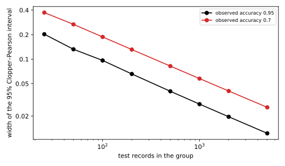

# Disparate impact

## Why this matters

Training the part's running example with differential privacy (DP) at $\varepsilon = 4$ costs less than one point of test accuracy: 0.9548 against 0.9610 without privacy ([private gradient descent](02-dp-sgd.md)). That number is an average over the test set, and it says nothing about who loses the point. Bagdasaryan, Poursaeed & Shmatikov (2019) asked, and found that when a network is trained with stochastic gradient descent (SGD) with per-example clipping and Gaussian noise, DP-SGD, the lost accuracy is concentrated on the classes and subgroups that are under-represented in the training data, and existing gaps between groups grow. They called this the **disparate impact** of DP on model accuracy. A model that is "less than a point worse" can be ten points worse for a group of people, and the groups that pay are often the ones privacy is meant to protect: small populations, rare conditions, unusual records.

The one idea: **every record gets the same budget of influence, and every group gets the same noise.** DP-SGD caps each record's pull on the update at the clipping norm $C$, then adds noise whose size depends only on $C$ and the noise multiplier $\sigma$, not on the data. Both rules are blind to groups, and that is exactly why they are not neutral. Clipping cuts back hardest the groups whose gradients are long, which are the groups the model fits badly. And the noise is the same for everyone while a group's signal is proportional to its size, so a small group's signal-to-noise ratio is smaller by its share of the data. Small groups that the model finds hard suffer from both, and the two compound.

## Disparate impact, measured {#sec-fair-observed}

An accuracy gap between groups in a private model is not enough to blame DP, because the non-private model may have the gap already. What privacy adds is measured by each group's **privacy cost**: the accuracy the group loses when the same training recipe is made private,
$$\pi_g = \mathrm{acc}_g(\text{non-private}) - \mathbb E\big[\mathrm{acc}_g(\text{private})\big],$$
averaged over the randomness of private training (Esipova et al. 2023). DP has disparate impact when groups' privacy costs differ.

The running example shows it. Of its 10,000 training records, 9,500 are the usual ones and 500, a 5% minority, come from a different region of input space, have larger inputs, and follow their own labelling rule, which the majority does not teach. The non-private model learns both: 0.9529 on the majority and 0.9411 on the minority, a gap of 1.2 points, so any large gap in a private model is caused by privacy. Each group is tested on 20,000 fresh records, so test error is small next to the effects, and each row of @tbl-fair-eps averages three training runs.

| Training | Majority accuracy | Minority accuracy | Privacy cost: majority | minority |
| --- | --- | --- | --- | --- |
| Non-private SGD | $0.9529 \pm 0.0018$ | $0.9411 \pm 0.0052$ | — | — |
| Clipping only, $\sigma = 0$ | $0.9581 \pm 0.0015$ | $0.9007 \pm 0.0048$ | $-0.0051$ | 0.0404 |
| $\varepsilon = 8$ | $0.9550 \pm 0.0006$ | $0.8553 \pm 0.0110$ | $-0.0020$ | 0.0858 |
| $\varepsilon = 4$ | $0.9470 \pm 0.0037$ | $0.8477 \pm 0.0211$ | 0.0059 | 0.0934 |
| $\varepsilon = 2$ | $0.9366 \pm 0.0082$ | $0.7574 \pm 0.0379$ | 0.0163 | 0.1836 |
| $\varepsilon = 1$ | $0.8822 \pm 0.0032$ | $0.6133 \pm 0.0173$ | 0.0707 | 0.3278 |

: Test accuracy of each group (mean ± standard deviation over 3 runs) of the running example with a 5% minority, trained with DP-SGD at four budgets ($\delta = 10^{-5}$), with clipping alone, and without privacy. {#tbl-fair-eps}

The minority pays almost all of it. At $\varepsilon = 4$ the majority loses 0.59 points and the minority 9.34, 15.7 times as much. At $\varepsilon = 8$, a budget at which the running example is nearly as accurate as without privacy, the majority loses nothing and the minority 8.58 points. Yet a test set drawn like the training set, 95% majority, would report a loss of about one point at $\varepsilon = 4$; a test set with equal numbers of both groups would report about five. The overall number depends on the test set's mix as much as on the model, which is why it hides the effect.

The table also separates the two causes. The clipping-only row has no noise at all, yet the minority loses 4.04 points while the majority gains 0.51: clipping alone is disparate. Adding noise then widens the gap as $\varepsilon$ falls (@fig-fair-privacy-accuracy). Published experiments show the same shape: Esipova et al. (2023) report, for MNIST digits with class 8 undersampled to about 1% of the training set, a privacy cost of 8.9 points for a typical class and 57.9 points for class 8 at $\varepsilon = 5.90$.

{#fig-fair-privacy-accuracy}

## Clipping reweights the groups {#sec-fair-clipping}

How does a rule that treats every record the same end up treating groups differently? Recall what DP-SGD's expected update is: each record's gradient, multiplied by its **clipping weight** $\min(1, C/\|g_i\|)$, averaged over all records. Group those records. Each group then pulls with its share of the records, $s_g$, times its average clipped gradient, and since every clipped gradient is at most $C$ long, a group's pull is never longer than $s_g C$, however badly the model fits it. A group of large-gradient records is cut back much more than a group whose gradients are already short.

When a group's gradients point roughly the same way, the effect is a reweighting. Clipping keeps a fraction $c_g$ of the group's average gradient (its average clipping weight, when the group's norms are equal), and the update becomes the gradient of a mixture in which group $g$ has **effective share**
$$\tilde s_g = \frac{s_g\,c_g}{\sum_h s_h\,c_h}$$
instead of its true share $s_g$. This splits clipping's damage in two. The denominator shortens the whole update, which a larger step size undoes. The effective shares change *which* mixture of groups is being descended, and no step size undoes that. Esipova et al. (2023) find this direction error far more harmful than the length error, especially to the under-represented class.

A two-dimensional example makes it concrete. Take 95 majority records with gradient $(0.2, 0)$, already short, and 5 minority records with gradient $(0, 4)$, long because the model fits them badly. Without clipping the average is $(0.19, 0.2)$: the five minority records pull as hard as the ninety-five others. Clip at $C = 0.5$. The majority's gradients are untouched, the minority's shrink eightfold, and the average becomes $(0.19, 0.025)$. The minority's part of the update falls from 0.513 to 0.116, the update turns by 39.0 degrees toward the majority, and the minority's effective share falls from 0.05 to 0.0065. Scaling every gradient by the same factor, $1/8$, instead would shorten the update eightfold but keep its direction (@fig-fair-clipping-toy).

{#fig-fair-clipping-toy}

Gradients are long for two reasons, and a small group the model has not learned has both. The model fits the group badly, so the loss's derivative is large; and the group's inputs are large, since a dense layer's per-example gradient grows with the length of its input. Tran, Dinh & Fioretto (2021) identify both factors as the source of clipping's part of disparate impact. That sets up a feedback loop during training. At the start every record is clipped and every group has a similar weight. As the majority is learned, its gradients shrink below $C$ and its weight rises toward 1, while the minority, not yet learned, keeps long gradients and a low weight. Its effective share falls below its true share, so it is learned more slowly, so its gradients stay long. In the running example with clipping and no noise, the minority's effective share starts at its true 0.0495, falls to 0.0251 at step 2,500, half its share exactly when it most needs to be learned, and recovers only to 0.0387 by the end. With the noise of $\varepsilon = 4$ it is 0.0261 at step 2,500 and 0.0358 at the end: the noise keeps the minority's gradients long, so clipping keeps cutting them back.

## The noise floor of a small group {#sec-fair-noise}

The noise is added to the sum, the same for everyone, so why should it hurt a small group more? Because what the noise competes with is each group's signal, and a group's signal in the sum is proportional to its size.

Two arguments make this quantitative. The first is about learning at all. A signal that keeps pointing the same way grows linearly with the number of steps, while independent noise grows only like its square root, so a signal beats the noise after about $(\ell_{\text{noise}}/\ell_{\text{sig}})^2$ steps, the squared ratio of the noise's length to the signal's per step. If the part of the update that serves a group is a fraction $s_g$ of the population's signal, that count is multiplied by $1/s_g^2$. In the running example at $\varepsilon = 4$, the averaged clipped gradient has length about 0.026 and the noise 0.392, so a signal shared by the whole population emerges after 228 steps. A signal that is 20% of it needs 5,693 steps; one that is 5% needs 91,085, nine times the entire run. A group whose rule the rest of the data does not teach is in this position. Running longer does not help, because at a fixed budget more steps mean more noise per step, and the break-even count grows about as fast as the run.

The second argument is about where training settles. In a simple model where each group's loss is a quadratic bowl in its own weights, the training pull on a group's weights is proportional to its share, while the noise is not. Noisy gradient descent then settles at an excess loss for the group of roughly
$$\mathbb E[L_g] \approx \frac{k\,\eta\,\tau^2}{4\,s_g},$$
where $k$ is the number of the group's weights, $\eta$ the step size and $\tau = \sigma C/B$ the noise per coordinate on the averaged update, with $B$ the expected batch size. **The floor scales like one over the share**: a group with a twentieth of the data sits at about twenty times the excess loss. The bowl's curvature cancels, because a sharper loss pulls back harder but also charges more for each displacement. In a simulation with the noise of $\varepsilon = 4$, the formula and the simulation agree within 1%, and the floor grows from $4.07 \times 10^{-4}$ for a group with 95% of the data to $2.96 \times 10^{-2}$ for a group with 1%, a factor of 73. With clipping, the share is replaced by the clipped share $s_g c_g$, so the two mechanisms compound: a 5% group whose gradients clipping halves pays the floor of a 2.5% group. A network is not a set of bowls, and where a minority's task overlaps the majority's, the majority's gradient does part of its work and the penalty is smaller; the model's value is that it makes the role of the share explicit.

The network bears this out. @tbl-fair-size varies the minority's share with everything else fixed.

| Minority share | Records | Minority, non-private | Minority, $\varepsilon = 4$ | Privacy cost: majority | minority |
| --- | --- | --- | --- | --- | --- |
| 1% | 100 | $0.8498 \pm 0.0021$ | $0.5009 \pm 0.0102$ | $-0.0002$ | 0.3488 |
| 5% | 500 | $0.9411 \pm 0.0052$ | $0.8477 \pm 0.0211$ | 0.0059 | 0.0934 |
| 20% | 2,000 | $0.9787 \pm 0.0004$ | $0.9507 \pm 0.0038$ | 0.0041 | 0.0280 |

: The minority's test accuracy for three sizes of the minority, non-private and at $\varepsilon = 4$, and each group's privacy cost (mean ± standard deviation over 2 runs; the 5% row over 3 runs). {#tbl-fair-size}

The minority's privacy cost falls steeply with its share: 34.88 points at 1%, 9.34 at 5%, 2.80 at 20%, a little less than in proportion to the share, and at 1% the minority is at chance and cannot lose more. The majority's cost stays below one point throughout. At 20% the minority is no longer a minority in any sense that matters to the noise (@fig-fair-group-size).

{#fig-fair-group-size}

## Measuring per-group accuracy {#sec-fair-measure}

Every number so far used 20,000 test records per group. Real evaluations are not so generous: a 2,000-record test split with a 5% minority holds 100 minority records. Each test record is classified right or wrong, so a group's measured accuracy is a binomial proportion, and the **Clopper–Pearson interval** inverts the binomial exactly, covering the true accuracy with probability at least 95% ([Hypothesis testing](../part01-prerequisites/04-hypothesis-testing.md)). Its width falls only like one over the square root of the number of records. For the gap between two groups measured on disjoint test records, the two errors are independent and their variances add, so an approximate 95% interval is
$$(\hat p_a - \hat p_b) \pm 1.96\sqrt{\frac{\hat p_a(1 - \hat p_a)}{m_a} + \frac{\hat p_b(1 - \hat p_b)}{m_b}},$$
with $\hat p_g$ the measured accuracies and $m_g$ the numbers of test records.

Take one model trained at $\varepsilon = 4$, whose accuracy on all 20,000 minority test records is 0.8641. On 100 of them it gets 88 right, an estimate of 0.880 with interval $[0.800, 0.936]$, 13.6 points wide. The non-private model's 0.9411 lies just above that interval, so on this test set alone the minority's privacy cost could be anywhere from about half a point to fourteen. On 1,900 majority records the model gets 0.954, and the gap of 0.074 has the interval 0.010 to 0.138: real, but anywhere from one point to fourteen (@fig-fair-intervals).

{#fig-fair-intervals}

Training is a second, separate source of variation, and a larger test set does nothing about it: it pins down the model you have, but another run gives another model. In @tbl-fair-eps the run-to-run standard deviation at $\varepsilon = 4$ is 0.0211 for the minority against 0.0037 for the majority, almost six times as large, so a comparison of two recipes on one run each can easily be reversed for the small group. Report each group's interval and the spread over several runs. And per-group accuracies computed on private test data are statistics of that data: if you publish them, they need their own privacy analysis ([Choosing ε](09-choosing-epsilon.md)).

## Mitigations and what they cost {#sec-fair-mitigation}

Both mechanisms come from DP-SGD's two knobs, clipping and noise. The tempting fixes move the cost around rather than remove it, and it pays to know where to.

Changing the clipping norm trades one mechanism for the other. A smaller $C$ clips more, so the minority's effective share falls. A larger $C$ clips less, so the update points in the right direction, but the noise $\sigma C$ grows with $C$ while short gradients do not, so it is larger relative to their signal. In the limit, scaling every gradient by the same factor $C/Z$, with no gradient longer than $Z$, is exactly DP-SGD with clipping norm $Z$ and a smaller step: the right direction, the most noise. @tbl-fair-mitigation shows both failures on the running example, keeping $\eta C$ fixed.

| Change | $\sigma$ | Majority accuracy | Minority accuracy |
| --- | --- | --- | --- |
| None: $C = 0.5$, $\eta = 0.5$ | 1.36 | $0.9470 \pm 0.0037$ | $0.8477 \pm 0.0211$ |
| Smaller clipping norm: $C = 0.05$, $\eta = 5$ | 1.36 | $0.9541 \pm 0.0008$ | $0.8313 \pm 0.0157$ |
| Larger clipping norm: $C = 5$, $\eta = 0.05$ | 1.36 | $0.9463 \pm 0.0027$ | $0.8133 \pm 0.0166$ |
| Oversample the minority four times | 4.71 | $0.8669 \pm 0.0079$ | $0.8270 \pm 0.0111$ |

: Mitigations at $\varepsilon = 4$ for every record, on the running example with a 5% minority (mean ± standard deviation over 2 or 3 runs). {#tbl-fair-mitigation}

Neither clipping norm helps the minority: the smaller one costs it 1.64 points through clipping, the larger one 3.44 points through noise. These differences are of the size of the run-to-run spread, so only their direction is clear. Esipova et al. (2023) propose a variant of global scaling that clips the rare gradients above $Z$ and adapts $Z$ from a privately estimated count, and report that it reduces the privacy cost gap on their datasets; it needs no group labels. Group-aware methods, such as giving more-clipped groups a larger clipping bound (Xu, Du & Wu 2021), need each training record's group, which is itself sensitive, and their per-group statistics must be computed privately. Choosing $C$ from the largest gradient observed in the data is not allowed at all: the clipping norm must be fixed in advance or chosen privately.

Upweighting a group's loss does not work either, because clipping undoes it: the gradients grow and are then rescaled back to $C$. Oversampling the group does raise its pull, but each record's privacy depends on its own sampling rate, so the minority's records sampled four times as often need $\sigma = 4.71$ instead of 1.36 to stay at $\varepsilon = 4$. The minority's pull grows by 4 and the noise by 3.46, so its signal-to-noise ratio improves by only 1.16, while the majority's falls by 3.46 and its records end up at $\varepsilon = 0.86$, budget wasted. The gap narrows from 9.93 to 3.99 points, but by **levelling down**: the minority's accuracy is 2.07 points lower than without oversampling and the majority's 8.01 lower. A smaller gap is not by itself a fairer model, so report both groups' accuracy and privacy cost, never the gap alone. And oversampling without raising $\sigma$ would silently give the minority $\varepsilon = 20.96$: the group already disadvantaged in accuracy would get the weakest privacy too.

Some of the cost is unavoidable. Learning a group's own rule privately is partly a private estimation problem on that group's records, and [Lower bounds](../part03-dp-foundations/09-lower-bounds.md) shows that private estimation has a price no algorithm avoids: the error that $n_g$ records allow shrinks only like $1/(n_g\varepsilon)$. Feldman (2020) argues more broadly that fitting a long tail of small subpopulations well requires memorizing their few examples, which is what DP forbids. What helps is more data from the group, a larger $\varepsilon$ with its own costs, or a starting point that already serves the group, such as a public pretrained model ([Public data and private fine-tuning](06-public-data.md)).

## Code {#sec-fair-code}

This snippet reproduces the two-dimensional clipping example and the interval for the accuracy gap measured on 1,900 majority and 100 minority test records:

```python
from math import acos, degrees, hypot, sqrt


def clipped_mean(groups: list[tuple[float, tuple[float, float]]], c: float) -> tuple[float, float]:
    """Expected DP-SGD update: each group's share times its gradient, clipped to norm c."""
    x = y = 0.0
    for share, (gx, gy) in groups:
        scale = min(1.0, c / hypot(gx, gy))
        x, y = x + share * scale * gx, y + share * scale * gy
    return x, y


def angle(u: tuple[float, float], v: tuple[float, float]) -> float:
    """Angle between two vectors, in degrees."""
    return degrees(acos((u[0] * v[0] + u[1] * v[1]) / (hypot(*u) * hypot(*v))))


def effective_share(share: float, weight: float, other_weight: float) -> float:
    """A group's share of the update after clipping, against one other group."""
    return share * weight / (share * weight + (1 - share) * other_weight)


def gap_interval(pa: float, ma: int, pb: float, mb: int) -> tuple[float, float]:
    """Approximate 95% interval for the accuracy gap pa - pb, measured on disjoint test sets."""
    se = sqrt(pa * (1 - pa) / ma + pb * (1 - pb) / mb)
    return pa - pb - 1.96 * se, pa - pb + 1.96 * se


groups = [(0.95, (0.2, 0.0)), (0.05, (0.0, 4.0))]
true, clipped = clipped_mean(groups, float("inf")), clipped_mean(groups, 0.5)
print(f"{true[1] / (true[0] + true[1]):.3f} {clipped[1] / (clipped[0] + clipped[1]):.3f}")  # 0.513 0.116
print(f"{angle(true, clipped):.1f}")  # 39.0
print(f"{effective_share(0.05, 0.125, 1.0):.4f}")  # 0.0065
print("%.3f %.3f" % gap_interval(0.954, 1_900, 0.880, 100))  # 0.010 0.138
```

The full edition's script trains the running example with a minority group, logs per-group gradient statistics, and checks every number in this chapter:

```bash
uv run python code/part05-dp-ml/disparate_impact.py
```

## Cheat sheet

| Result | Formula or rule | Conditions |
| --- | --- | --- |
| Privacy cost of a group | $\mathrm{acc}_g(\text{non-private}) - \mathbb E[\mathrm{acc}_g(\text{private})]$ | Same data and recipe; average over runs |
| A group's pull | At most $s_g C$ | Any gradients |
| Effective share | $s_g c_g / \sum_h s_h c_h$ | Gradients roughly parallel within each group |
| Break-even steps | $(\ell_{\text{noise}}/\ell_{\text{sig}})^2 / s_g^2$ | Group's signal a fraction $s_g$ of the population's |
| Noise floor | $\approx k\eta\tau^2/(4 s_g)$, $\tau = \sigma C/B$ | Quadratic model, the group's own $k$ weights |
| Accuracy gap interval | $\hat p_a - \hat p_b \pm 1.96\sqrt{\sum_g \hat p_g(1 - \hat p_g)/m_g}$ | Disjoint test records, large counts |
| Global scaling | Same as clipping norm $Z$ with a smaller step | No gradient above $Z$ |
| Oversampling at rate $vq$ | Those records' $\varepsilon$ is the accountant's at rate $vq$ | Rate fixed in advance per group |

: The results of this chapter. {#tbl-fair-cheat}

Report accuracy per group, with intervals and the spread over several runs, next to the non-private model's. Expect a group's privacy cost to grow like one over its share, and faster for groups with long gradients. Don't upweight a group's loss, and don't oversample it without accounting at its higher rate. When a group is too small to learn privately, get more data from it or start from a public model that already serves it.

## Further reading

- Bagdasaryan, Poursaeed & Shmatikov, "Differential Privacy Has Disparate Impact on Model Accuracy" (NeurIPS 2019): the observation this chapter explains.
- Esipova, Ghomi, Luo & Cresswell, "Disparate Impact in Differential Privacy from Gradient Misalignment" (ICLR 2023): separates clipping's direction error from its length error, and proposes global scaling with an adaptive threshold.
- Tran, Dinh & Fioretto, "Differentially Private Empirical Risk Minimization under the Fairness Lens" (NeurIPS 2021): a group's excess risk split into clipping and noise terms, and the role of gradient and input norms.
- Feldman, "Does Learning Require Memorization? A Short Tale about a Long Tail" (STOC 2020): why fitting small subpopulations well conflicts with privacy.

**Derivations.** Every result in this chapter is derived step by step in [the full edition's chapter](../../book-full/part05-dp-ml/08-disparate-impact.md).
