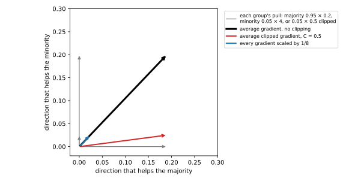
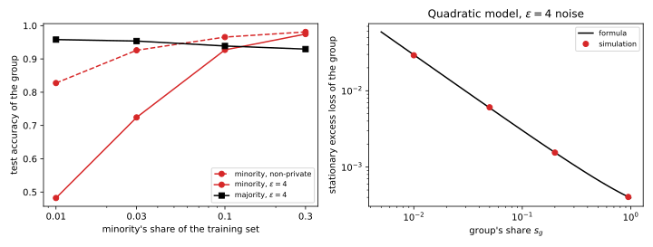

# Disparate impact

## Why this matters

The part's running example is a two-layer network that classifies synthetic 50-dimensional records. Training it with differential privacy (DP), at a privacy budget $\varepsilon$ of 4, costs less than one point of test accuracy ([private gradient descent](02-dp-sgd.md)). The private model reaches 0.9548, against 0.9610 without privacy. That number is an average over the whole test set, so it says nothing about who loses the point.

Bagdasaryan, Poursaeed & Shmatikov (2019) asked that question about networks trained with stochastic gradient descent (SGD) with per-example clipping and Gaussian noise, which is called DP-SGD. They found that the lost accuracy fell mostly on the classes and subgroups that were under-represented in the training data. In their gender classifier, for example, the drop was much larger on Black faces than on white faces, so the gap that the non-private model already had grew. They called this the **disparate impact** of DP on model accuracy.

This matters for two reasons. A model that is "less than a point worse" on average can be ten points worse for one group of people, and the average hides it. And the groups that pay are often the ones a privacy guarantee is meant to protect. They include small populations, people with rare conditions and records that are unusual in other ways.

The cause lies in the two rules that make DP-SGD private, and both are blind to groups. Clipping caps every record's pull on the update at the same length, the clipping norm $C$, so it cuts back hardest the groups whose gradients are long. The noise depends only on $C$ and the noise multiplier $\sigma$, so it is the same for every group, while a group's signal grows with its size. A small group's signal is therefore the weakest against the noise. A small group that the model finds hard suffers from both effects, and they compound.

This chapter explains each effect, measures both on the running example, and weighs what can be done about them.

## Disparate impact, measured {#sec-fair-observed}

To say that DP hurts one group more than another, you need a measure that DP alone is responsible for. A gap between the groups' accuracies in the private model is not one, because the non-private model may already have a gap. So the measure compares each group with itself.

Write $\mathrm{acc}_g$ for a model's accuracy on the test records of group $g$. The **privacy cost** $\pi_g$ of group $g$ is the accuracy the group loses when the same training recipe, on the same data, is made private:
$$\pi_g = \mathrm{acc}_g(\text{non-private}) - \mathbb E\big[\mathrm{acc}_g(\text{private})\big].$$ {#eq-fair-cost}
The private accuracy is averaged over training runs, because private training is random. This is the definition Esipova et al. (2023) use. DP has disparate impact when different groups have different privacy costs, and the difference between two groups' costs, the **privacy cost gap**, measures how much.

The running example of [DP-SGD](02-dp-sgd.md) needs a minority group to show the effect. Of its 10,000 training records, 9,500 are the usual records of the running example. The other 500, a 5% minority, come from a different region of input space. Their input vectors are longer, 8.89 on average against 7.04 for the majority, and their labels follow a rule of their own, which the majority's records do not teach. On this modified dataset, the model learns both groups well without privacy, with accuracy 0.9529 on the majority and 0.9411 on the minority. That gap of 1.2 points is small, so any large gap in a private model is caused by privacy rather than inherited from the data. Each group is tested on 20,000 fresh records of its own, and each row of @tbl-fair-eps averages three training runs.

| Training | Majority accuracy | Minority accuracy | Privacy cost: majority | minority |
| --- | --- | --- | --- | --- |
| Non-private SGD | $0.9529 \pm 0.0018$ | $0.9411 \pm 0.0052$ | — | — |
| Clipping only, $\sigma = 0$ | $0.9581 \pm 0.0015$ | $0.9007 \pm 0.0048$ | $-0.0051$ | 0.0404 |
| $\varepsilon = 8$, $\sigma = 0.917$ | $0.9550 \pm 0.0006$ | $0.8553 \pm 0.0110$ | $-0.0020$ | 0.0858 |
| $\varepsilon = 4$, $\sigma = 1.36$ | $0.9470 \pm 0.0037$ | $0.8477 \pm 0.0211$ | 0.0059 | 0.0934 |
| $\varepsilon = 2$, $\sigma = 2.28$ | $0.9366 \pm 0.0082$ | $0.7574 \pm 0.0379$ | 0.0163 | 0.1836 |
| $\varepsilon = 1$, $\sigma = 4.13$ | $0.8822 \pm 0.0032$ | $0.6133 \pm 0.0173$ | 0.0707 | 0.3278 |

: Test accuracy of each group (mean ± standard deviation over 3 runs) of the running example with a 5% minority, trained with DP-SGD at four budgets ($\delta = 10^{-5}$), with clipping alone, and without privacy. The privacy cost is @eq-fair-cost. {#tbl-fair-eps}

The minority pays almost all of the cost. At $\varepsilon = 4$ the majority loses 0.59 points of accuracy. The minority loses 9.34 points, which is 15.7 times as much. Even at $\varepsilon = 8$, where the majority loses nothing, the minority loses 8.58 points. The ratio between the two costs is smaller at $\varepsilon = 1$, but only because the majority starts to lose there too. Its cost is 7.07 points, against the minority's 32.78.

An overall accuracy hides all of this. A test set drawn like the training set, with 95% majority records, would report a loss of about one point at $\varepsilon = 4$. A test set with equal numbers from both groups would report about five points.

The table also separates the two causes. The clipping-only row adds no noise, so it gives no privacy at all. Yet the minority loses 4.04 points there while the majority gains 0.51, which shows that clipping alone is disparate. Adding noise then widens the gap steadily as $\varepsilon$ falls (@fig-fair-privacy-accuracy). The next two sections explain each cause in turn.

{#fig-fair-privacy-accuracy}

Published experiments show the same pattern. For example, Esipova et al. (2023) undersampled one digit of MNIST to about 1% of the training set. A typical class then had a privacy cost of 8.9 points under DP-SGD at $\varepsilon = 5.90$. The undersampled digit's cost, by contrast, was 57.9 points.

## Clipping reweights the groups {#sec-fair-clipping}

Clipping without noise gives no privacy, yet in @tbl-fair-eps it costs the minority 4.04 points. The reason lies in what DP-SGD does on average. Write $g_i$ for record $i$'s gradient and $n$ for the number of records. Averaged over the random batch and the noise, the update is the average gradient with each record's gradient scaled by its **clipping weight**, the factor $\min(1, C/\|g_i\|)$ ([DP-SGD](02-dp-sgd.md#sec-dpsgd-clipping)):
$$\mathbb E[\text{update}] = \frac1n\sum_{i=1}^n\min\Big(1, \frac{C}{\|g_i\|}\Big)g_i.$$
A record whose gradient is shorter than $C$ keeps the weight 1. A record with a longer gradient is scaled down to length exactly $C$, so the longer its gradient, the smaller its weight.

Now sort the records into groups, and write $s_g$ for group $g$'s **share**, its fraction of the training records. The sum above then splits into one term per group, in which the group pulls with its share times the average of its clipped gradients. That average is at most $C$ long, because each clipped gradient is. So a group's pull is never longer than $s_g C$, however badly the model fits the group. A group whose gradients are long is therefore cut back much more than a group whose gradients are already short.

When the gradients within each group point in the same direction, the effect is a reweighting. Clipping then only shortens each group's average gradient.

Write $c_g$ for the fraction of group $g$'s average gradient that survives clipping, a number between 0 and 1. If all of a group's records have gradients of the same length, $c_g$ is simply their clipping weight. The expected update is then a shortened version of the gradient of a mixture of the groups, meaning an average of their losses with new weights. In that mixture, group $g$ has the **effective share**
$$\tilde s_g = \frac{s_g\,c_g}{\sum_h s_h\,c_h}$$ {#eq-fair-effective}
instead of its true share $s_g$. The sum in the denominator runs over every group $h$, so the effective shares add up to 1. The condition matters, because when a group's gradients point different ways, clipping can also rotate the group's own average gradient, and the update is no longer a reweighted mixture.

The formula splits clipping's damage in two. The denominator, the total $\sum_h s_h c_h$, is the factor by which the whole update shrinks, and a larger step size can undo that. But the effective shares change *which* mixture of the groups the training descends, and no step size undoes that. Esipova et al. (2023) measured the two errors separately and found the direction error far more harmful, especially to the under-represented class.

A two-dimensional example makes this concrete. Take 95 majority records whose gradient is $(0.2, 0)$, already short because the model fits them well. Next to them are 5 minority records whose gradient is $(0, 4)$, long because the model fits them badly. Without clipping, the average gradient is $(0.19, 0.2)$, so the five minority records pull about as hard as the ninety-five others. Clipping at $C = 0.5$ leaves the majority's gradients untouched but shrinks the minority's eightfold, to length 0.5. The average becomes $(0.19, 0.025)$, so the update has turned toward the majority, by 39.0 degrees.

In the formula, the surviving fraction $c_g$ is 1 for the majority and 0.125 for the minority. The minority's effective share is therefore 0.0065 instead of its true share of 0.05. Scaling every gradient by the same factor of $1/8$ would shorten the update just as much, but it would keep the true direction (@fig-fair-clipping-toy).

{#fig-fair-clipping-toy}

Which groups have long gradients? A gradient is long for two reasons, and a small group that the model has not learned yet has both. The first is that the model fits the group badly. The loss's derivative with respect to the model's output is large for a misclassified record, and small for one classified with a wide margin. The second is that the group's inputs are large. A dense layer's per-example gradient has a length equal to the length of the error signal that backpropagation passes to that layer times the length of the layer's input ([DP-SGD](02-dp-sgd.md#sec-dpsgd-ghost)). So at the same error, a record with a longer input has a longer gradient. Tran, Dinh & Fioretto (2021) identify both factors as the source of clipping's part of disparate impact, and the running example's minority has both.

This sets up a feedback loop during training. At the start every record's gradient is longer than $C$, so every record is clipped, and every group has a similar weight. As the majority is learned, its gradients shrink below $C$ and its weight rises toward 1. The minority, not yet learned, keeps long gradients and a low weight. Its effective share falls below its true share, so it is learned more slowly, and so its gradients stay long. The loop ends only when the minority's gradients fall below $C$ as well. Training also ends in a different place, where the clipped update is zero rather than the true average gradient. When the groups' gradients conflict, that point has moved toward the majority.

The running example shows the loop during training with clipping and no noise. At the first step the minority's effective share is 0.0495, almost exactly its true share of 0.05. By step 2,500 the majority has been learned, and only 18% of its records are still clipped. Of the minority's records, 70% are still clipped, and its effective share has fallen to 0.0251, half its true share. That happens exactly while the minority most needs to be learned, since its test accuracy is then only 0.6724. The share recovers only as the minority is learned, and it reaches 0.0387 by the end. With the noise of $\varepsilon = 4$ added, the share falls about as far by the same step, to 0.0261. It ends at 0.0358 (@fig-fair-clipping-training), because the noise slows the minority's learning. That keeps its gradients long, so clipping keeps cutting them back.

{#fig-fair-clipping-training}

## The noise floor of a small group {#sec-fair-noise}

The noise is the same for everyone, yet it hurts a small group more. What the noise competes with is each group's signal, and that signal is proportional to the group's size. Two arguments make this precise. The first asks whether a group is learned at all, and the second asks where training settles for it.

The first argument uses a fact from [DP-SGD](02-dp-sgd.md). Suppose each step moves the weights by a signal of length $\ell_{\text{sig}}$ that keeps pointing the same way, plus independent noise of length $\ell_{\text{noise}}$. Over many steps the signals add up in a straight line, while independent noise grows only like the square root of the number of steps. So the signal overtakes the noise after about $(\ell_{\text{noise}}/\ell_{\text{sig}})^2$ steps.

Now suppose the part of the update that reduces group $g$'s loss is only a fraction $s_g$ of the whole population's signal, because no other group's gradient helps it. The noise is unchanged. Replacing $\ell_{\text{sig}}$ by $s_g\ell_{\text{sig}}$ shows that the group's signal emerges from the noise only after
$$\frac{1}{s_g^2}\Big(\frac{\ell_{\text{noise}}}{\ell_{\text{sig}}}\Big)^2$$ {#eq-fair-breakeven}
steps. That is $1/s_g^2$ times as many steps as a signal that the whole population shares.

The numbers for the running example are stark. At $\varepsilon = 4$ the averaged clipped gradient is about 0.026 long during training. The noise added to it is far longer, about 0.392. So a signal that the whole population shares emerges only after 228 steps. A signal that is 5% of it needs 91,085 steps. That is nine times the entire run, which has 10,000 steps. A group whose rule the rest of the data does not teach is in exactly this position, because no other group's gradient does its work.

Running longer does not help. At a fixed budget, more steps require more noise per step. With the small sampling rates DP-SGD uses, the noise variance per step grows roughly in proportion to the number of steps ([DP-SGD](02-dp-sgd.md#sec-dpsgd-batch)). So the break-even count grows about as fast as the run itself.

The second argument asks where training settles, in a simple model that isolates the role of the share. Each group's loss in this model depends only on its own block of $k$ weights, which no other group's loss touches. Each group's loss is a quadratic bowl around the group's best weights, with the curvature $\lambda$. Training minimizes the share-weighted average of the groups' losses, so the pull on group $g$'s weights is proportional to its share $s_g$.

Training takes steps with the step size $\eta$, and it adds noise to each coordinate of the averaged gradient, as DP-SGD does. That noise has the standard deviation $\tau = \sigma C/B$, where $B$ is the expected batch size. So each step pulls the group's weights back toward their best values, and it also adds fresh noise. The weights settle where the pull back balances the noise, so a weaker pull lets more noise accumulate. A group's excess loss, its loss above the best value it could reach, then settles at about
$$\mathbb E[L_g] \approx \frac{k\,\eta\,\tau^2}{4\,s_g}.$$ {#eq-fair-floor}
The exact formula has $2 - \eta s_g\lambda$ in its denominator where the approximation has 2, so the approximation holds when $\eta s_g\lambda$ is small.

So **the floor scales like one over the share.** A group with a twentieth of the data sits at about twenty times the excess loss of a group with all of it. The curvature $\lambda$ cancels, because a sharper loss pulls the weights back harder but also makes each unit of noise cost more. The share does not cancel, because the noise is not scaled by it. A small group also takes longer to reach even this floor, about $1/(\eta s_g\lambda)$ steps, which is $1/s_g$ times as long as a group with all the data.

A simulation of this model with the noise of $\varepsilon = 4$ agrees with the exact formula to within 1% (@fig-fair-group-size, right). The simulation runs from a group with 95% of the data down to one with 1%. Across that range the floor grows by a factor of 73. That is a little less than the ratio of the shares, 95, because for the large group $\eta s_g\lambda$ is not small.

Clipping and noise compound. With clipping, a group's pull is its share times the fraction $c_g$ of its gradient that survives clipping. As long as $c_g$ changes slowly, the same argument applies with $s_g c_g$ in place of $s_g$. So a group with 5% of the data, whose gradients clipping halves, pays the floor of a group with 2.5%.

The model is exact for what it assumes, but a network is not a set of separate bowls. Where a minority's task overlaps the majority's, the majority's gradient does part of the minority's work, and the penalty is smaller. Tran, Dinh & Fioretto (2021) analyse DP-SGD without assuming separate weights, and they also split the change in a group's loss into a clipping term and a noise term. The quadratic model adds what their analysis leaves implicit, which is the role of the share.

The network bears the model out. @tbl-fair-size varies the minority's share of the 10,000 training records with everything else fixed.

| Minority share | Records | Minority, non-private | Minority, $\varepsilon = 4$ | Privacy cost: majority | minority |
| --- | --- | --- | --- | --- | --- |
| 1% | 100 | $0.8498 \pm 0.0021$ | $0.5009 \pm 0.0102$ | $-0.0002$ | 0.3488 |
| 5% | 500 | $0.9411 \pm 0.0052$ | $0.8477 \pm 0.0211$ | 0.0059 | 0.0934 |
| 20% | 2,000 | $0.9787 \pm 0.0004$ | $0.9507 \pm 0.0038$ | 0.0041 | 0.0280 |

: The minority's test accuracy for three sizes of the minority, non-private and at $\varepsilon = 4$, and each group's privacy cost (mean ± standard deviation over 2 runs; the 5% row is from @tbl-fair-eps, over 3 runs). {#tbl-fair-size}

The minority's privacy cost falls steeply as its share grows. Multiplying the share by 5 divides the cost by 3.7. A further factor of 4 divides it by 3.3. Both are a little less than the ratio of the shares, just as the quadratic model's exact floor fell a little less than in proportion to the share. Accuracy is not loss, though, and it saturates. At a share of 1% the private model is at chance on the minority, with accuracy 0.5009, so it cannot lose more. With 20% of the data, the minority's privacy cost is within three points of the majority's, which stays below one point throughout (@fig-fair-group-size).

{#fig-fair-group-size}

## Measuring per-group accuracy {#sec-fair-measure}

Every number so far was measured on 20,000 test records per group. Real evaluations are rarely so generous. Suppose the test split has 2,000 records. With a 5% minority it holds only 100 minority records, and you need to know how precisely they measure the group's accuracy.

Given the model, each test record of a group is either classified correctly or not. If the test records are drawn independently, each one is correct with probability equal to the group's true accuracy. The number correct is then a binomial count. The **Clopper–Pearson interval** is computed from the binomial distribution itself rather than from a normal approximation. At the 95% level it covers the true accuracy with probability at least 95% ([Hypothesis testing](../part01-prerequisites/04-hypothesis-testing.md#sec-ht-estimation)). Its width falls only like one over the square root of the number of test records (@fig-fair-intervals). A gap between groups is visible only when the interval is narrower than the gap. So a gap of 5 points can be seen only with a few hundred minority test records, and a gap of 1 point only with thousands.

{#fig-fair-intervals}

The gap between two groups needs its own interval. Write $\hat p_g$ for group $g$'s measured accuracy, and $m_g$ for the number of test records it was measured on. The measured gap between a first group $a$ and a second group $b$ is then $\hat p_a - \hat p_b$. When the two groups are measured on different test records, the two errors are independent, so their variances add. When both counts are large, the measured gap is close to normally distributed, by the central limit theorem. An approximate 95% interval for the gap is then
$$(\hat p_a - \hat p_b) \pm 1.96\sqrt{\frac{\hat p_a(1 - \hat p_a)}{m_a} + \frac{\hat p_b(1 - \hat p_b)}{m_b}}.$$ {#eq-fair-gap}
If both groups shared test records, their errors would no longer be independent, and this formula would not apply.

@tbl-fair-ci trains the running example once at $\varepsilon = 4$. On all 20,000 minority test records this model's accuracy is 0.8641, which serves as its true accuracy. The table measures it on random subsets.

| Test records | Correct | Estimate | 95% Clopper–Pearson interval |
| --- | --- | --- | --- |
| 100 minority | 88 | 0.880 | $[0.800, 0.936]$ |
| 1,900 majority | 1,812 | 0.954 | $[0.943, 0.963]$ |

: Minority accuracy of one model trained at $\varepsilon = 4$, measured on random subsets of the minority's test records, with the majority on 1,900 records for comparison. {#tbl-fair-ci}

Take first the 100 minority records that a 2,000-record test split would hold. The estimate from them is 1.6 points above the true accuracy, and the interval is 13.6 points wide. The true accuracy is inside the interval, as it should be 95% of the time. But the non-private model's 0.9411 lies only just above the interval's upper end. So on this test set alone, the minority's privacy cost could be anywhere from about half a point to fourteen points.

Now measure the gap between the groups on the same 100 minority records and on 1,900 majority records. The measured gap is 0.074. By @eq-fair-gap, its interval runs from 0.010 to 0.138. So the gap is real, but it could be anywhere from one point to fourteen.

Training is a second, separate source of variation, and a larger test set does nothing about it. A large test set pins down the accuracy of the model you have, but another training run gives another model. The variance of a single run's measured accuracy is the test set's variance plus the run-to-run variance of the model's true accuracy, and only repeated training estimates the second part. In @tbl-fair-eps, the minority's run-to-run standard deviation at $\varepsilon = 4$ is almost six times the majority's. A comparison of two training recipes on one run each can therefore easily be reversed for the small group. So report each group's interval, and the spread over several training runs.

The evaluation can leak, too. Per-group accuracies computed on private test data are statistics of that data. If you publish them, they need their own privacy analysis, which [Choosing ε](09-choosing-epsilon.md) and the selection mechanisms of [Hyperparameter tuning](03-hyperparameter-tuning.md) address.

## Mitigations and what they cost {#sec-fair-mitigation}

Both mechanisms, clipping and noise, come from DP-SGD's two knobs, the clipping norm and the noise multiplier. Each fix in this section moves the cost around rather than removing it, so it pays to know where the cost goes.

The simplest idea is to upweight the minority's loss, and it does not work. Multiplying a group's loss by 10 makes its gradients ten times longer, but clipping then scales the long ones back to length $C$. Records that were already clipped gain nothing, and the others gain only until they reach $C$.

Changing the clipping norm trades one mechanism for the other. A smaller $C$ clips more records, so the minority's effective share falls further. A larger $C$ clips fewer, so the update points in a better direction. But the noise has size $\sigma C$, so it grows with $C$, while a gradient that was already shorter than $C$ does not.

In the limit, you can scale every gradient by the same factor instead of clipping. Write $Z$ for a bound, known in advance, that no gradient's length exceeds. Scaling every gradient by $C/Z$ and adding noise $\sigma C$ is exactly DP-SGD with clipping norm $Z$ and a smaller step size. The reason is that the scaled gradients and the noise $\sigma C$ are the unscaled gradients and the noise $\sigma Z$, all multiplied by $C/Z$. The noise multiplier is the same, so the privacy guarantee is unchanged. The bound is a condition, because a gradient longer than $Z$ would be scaled to more than $C$, and the noise would no longer cover it. The update then has the true direction, like the blue arrow in @fig-fair-clipping-toy, but the noise is as large as it can be relative to the gradients.

@tbl-fair-mitigation shows both failures on the running example. The clipping-norm rows keep the product of the step size and the clipping norm fixed, so that the step length is comparable across rows.

| Change | $\sigma$ | Majority accuracy | Minority accuracy | Gap |
| --- | --- | --- | --- | --- |
| None: $C = 0.5$, $\eta = 0.5$ | 1.36 | $0.9470 \pm 0.0037$ | $0.8477 \pm 0.0211$ | 0.0993 |
| Smaller clipping norm: $C = 0.05$, $\eta = 5$ | 1.36 | $0.9541 \pm 0.0008$ | $0.8313 \pm 0.0157$ | 0.1229 |
| Larger clipping norm: $C = 5$, $\eta = 0.05$ | 1.36 | $0.9463 \pm 0.0027$ | $0.8133 \pm 0.0166$ | 0.1330 |
| Oversample the minority four times | 4.71 | $0.8669 \pm 0.0079$ | $0.8270 \pm 0.0111$ | 0.0399 |

: Mitigations at $\varepsilon = 4$ for every record, with a 5% minority (mean ± standard deviation over 2 or 3 runs). The clipping-norm rows keep $\eta C = 0.25$, and the oversampling row sets $\sigma$ so that the minority's records meet $\varepsilon = 4$. {#tbl-fair-mitigation}

Neither clipping norm helps the minority. A ten times smaller clipping norm clips the minority more, and its accuracy falls by 1.64 points while the majority's rises by 0.71. That is the clipping mechanism at work. A ten times larger clipping norm clips almost nothing. But these rows keep $\eta C$ fixed, so the noise in each step stays the same, while the step along any gradient shorter than 0.5 becomes ten times smaller. The noise is therefore ten times larger relative to that part of the signal, and the minority's accuracy falls by 3.44 points, which is the noise mechanism at work. These differences are about the size of the run-to-run spread, so only their direction is clear.

Better versions of these ideas exist. Esipova et al. (2023) propose a form of global scaling that clips the rare gradients above $Z$ instead of assuming that none exist. It adapts $Z$ during training from a privately estimated count of how many gradients exceed it. They report that it reduces the privacy cost gap and improves accuracy on their datasets, and it needs no group labels because it treats every record alike. Group-aware methods do need labels. Xu, Du & Wu (2021) give the groups that are clipped more a larger clipping bound, to equalize the groups' clipping bias. Tran, Dinh & Fioretto (2021) add penalties on the differences between groups to the training objective. Both need each training record's group, which is itself sensitive and may not be available or lawful to collect, and the per-group statistics they use must be computed privately.

One tempting fix is not allowed at all. Setting $C$ to the largest gradient norm observed in the training data makes the clipping norm depend on the data. The privacy argument of DP-SGD assumes that $C$ is fixed in advance, so a data-dependent clipping norm must itself be chosen privately and charged to the budget.

Oversampling the minority does raise its pull, but it costs that group's privacy. The privacy analysis compares runs with and without one record, so a record's privacy depends on its own chance of being sampled. A record sampled at four times the usual rate therefore gets only the privacy that random sampling at that higher rate gives a Gaussian step ([Amplification by subsampling](../part04-privacy-accounting/05-subsampling.md)). The rate may depend on a record's group, but the rule must be fixed in advance rather than chosen by looking at the data. And because the guarantee must hold for every record, it is set by the most-sampled records.

At a fixed budget, oversampling therefore buys little. To keep the minority's records at $\varepsilon = 4$ the noise multiplier must rise to 4.71. Without oversampling, by contrast, 1.36 was enough. Oversampling raises the minority's pull by a factor of 4, but the noise grows by a factor of 3.46. So its signal-to-noise ratio improves by only 1.16, while the majority's falls by 3.46. The majority's records also end up at $\varepsilon = 0.86$, far more private than the target, which is wasted budget. Oversampling without raising $\sigma$ is worse, because it would silently give the minority $\varepsilon = 20.96$, so the group that is already disadvantaged in accuracy would also get the weakest privacy.

On the running example, oversampling narrows the gap from 9.93 points to 3.99, but it does so by **levelling down**. The minority's accuracy is 2.07 points lower than without oversampling, and the majority's is 8.01 points lower. So report both groups' accuracy and privacy cost, never the gap alone.

Some of the cost cannot be avoided by any algorithm. Learning a group's own rule privately is partly a private estimation problem on that group's $n_g$ records, and private estimation has a price. [Lower bounds](../part03-dp-foundations/09-lower-bounds.md) proves it for the simplest case, releasing the averages of $d$ attributes under approximate DP. There, whatever the mechanism, the error in estimating those averages from $n_g$ records shrinks only like $1/(n_g\varepsilon)$, and the Gaussian mechanism comes close to that best possible error. A smaller group is a smaller dataset, and no clever clipping makes it larger.

Feldman (2020) makes a broader argument for any learner. When the data have a long tail of small subpopulations, fitting them well requires memorizing their few examples, which is exactly what DP forbids. What helps is more data from the group, or a larger $\varepsilon$ with its own costs. A starting point that already serves the group helps too, such as a public pretrained model ([Public data and private fine-tuning](06-public-data.md)).

## Code {#sec-fair-code}

This snippet reproduces the two-dimensional clipping example, and the interval for the accuracy gap measured on 1,900 majority and 100 minority test records:

```python
from math import acos, degrees, hypot, sqrt

def clipped_mean(groups: list[tuple[float, tuple[float, float]]], c: float) -> tuple[float, float]:
    """Expected DP-SGD update: each group's share times its gradient, clipped to norm c."""
    x = y = 0.0
    for share, (gx, gy) in groups:
        scale = min(1.0, c / hypot(gx, gy))
        x, y = x + share * scale * gx, y + share * scale * gy
    return x, y

def angle(u: tuple[float, float], v: tuple[float, float]) -> float:
    """Angle between two vectors, in degrees."""
    return degrees(acos((u[0] * v[0] + u[1] * v[1]) / (hypot(*u) * hypot(*v))))

def gap_interval(pa: float, ma: int, pb: float, mb: int) -> tuple[float, float]:
    """Approximate 95% interval for the accuracy gap pa - pb, measured on disjoint test sets."""
    se = sqrt(pa * (1 - pa) / ma + pb * (1 - pb) / mb)
    return pa - pb - 1.96 * se, pa - pb + 1.96 * se

groups = [(0.95, (0.2, 0.0)), (0.05, (0.0, 4.0))]
true, clipped = clipped_mean(groups, float("inf")), clipped_mean(groups, 0.5)
print(f"{true[1] / (true[0] + true[1]):.3f} {clipped[1] / (clipped[0] + clipped[1]):.3f}")  # 0.513 0.116
print(f"{angle(true, clipped):.1f}")  # 39.0
print("%.3f %.3f" % gap_interval(0.954, 1_900, 0.880, 100))  # 0.010 0.138
```

The full edition's script trains the running example with a minority group, logs per-group gradient statistics, and computes every number in this chapter, which [tests/test_disparate_impact.py](../../tests/test_disparate_impact.py) checks:

```bash
uv run python code/part05-dp-ml/disparate_impact.py
```

## Cheat sheet

| Result | Formula or rule | Conditions |
| --- | --- | --- |
| Privacy cost of a group | $\mathrm{acc}_g(\text{non-private}) - \mathbb E[\mathrm{acc}_g(\text{private})]$ | Same data and recipe; average over runs |
| A group's pull | At most $s_g C$ | Any gradients |
| Effective share | $s_g c_g / \sum_h s_h c_h$ | Gradients pointing the same way within each group |
| Break-even steps | $(\ell_{\text{noise}}/\ell_{\text{sig}})^2 / s_g^2$ | The group's signal a fraction $s_g$ of the population's |
| Noise floor | $\approx k\eta\tau^2/(4 s_g)$, with $\tau = \sigma C/B$ | Quadratic loss on the group's own $k$ weights |
| Accuracy gap interval | $\hat p_a - \hat p_b \pm 1.96\sqrt{\sum_g \hat p_g(1 - \hat p_g)/m_g}$ | Disjoint test records, large counts |
| Global scaling | Same as clipping norm $Z$ with a smaller step | No gradient longer than $Z$ |
| Oversampling a group | Its records' $\varepsilon$ is the accountant's at their higher sampling rate | Rate fixed in advance per group |

: The results of this chapter. {#tbl-fair-cheat}

**Rules of thumb**

- Report accuracy per group, with Clopper–Pearson intervals and the spread over several training runs, next to the non-private model's.
- Expect a group's privacy cost to grow like one over its share of the data. Expect it to grow faster for groups with long gradients, from large inputs or a rule the rest of the data does not teach.
- Clipping alone is disparate. A larger clipping norm, with $\eta C$ fixed, reduces the clipping part and raises the noise part.
- Don't upweight a group's loss, because clipping undoes it. Don't oversample a group without accounting at its higher sampling rate.
- When a group is too small to learn privately, get more data from it or start from a public model that already serves it.

## Further reading

- Bagdasaryan, Poursaeed & Shmatikov, "Differential Privacy Has Disparate Impact on Model Accuracy" (NeurIPS 2019): the observation this chapter explains.
- Esipova, Ghomi, Luo & Cresswell, "Disparate Impact in Differential Privacy from Gradient Misalignment" (ICLR 2023): separates clipping's direction error from its length error, and proposes global scaling with an adaptive threshold.
- Tran, Dinh & Fioretto, "Differentially Private Empirical Risk Minimization under the Fairness Lens" (NeurIPS 2021): a group's excess risk split into clipping and noise terms, and the role of gradient and input norms.
- Feldman, "Does Learning Require Memorization? A Short Tale about a Long Tail" (STOC 2020): why fitting small subpopulations well conflicts with privacy.

**Derivations.** Every result in this chapter is derived step by step in [the full edition's chapter](../../book-full/part05-dp-ml/08-disparate-impact.md), except the published findings of Bagdasaryan et al., Esipova et al., Tran et al., Xu et al. and Feldman, which it cites. It takes the Clopper–Pearson interval from [Hypothesis testing](../../book-full/part01-prerequisites/04-hypothesis-testing.md), the lower bound on private estimation from [Lower bounds](../../book-full/part03-dp-foundations/09-lower-bounds.md), and the growth of the noise with the number of steps from [DP-SGD](../../book-full/part05-dp-ml/02-dp-sgd.md).
