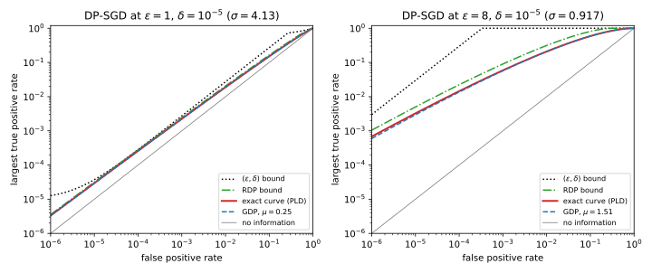

# Choosing ε

## Why this matters

Every model trained with differential privacy (DP) ships with a privacy budget $\varepsilon$, and someone has to pick it ([The definition of differential privacy](../part03-dp-foundations/01-definition.md)). This part's running example is a small neural network trained on 10,000 records. It is trained with stochastic gradient descent (SGD) made private by per-example clipping and Gaussian noise, an algorithm called DP-SGD. The chapter on [DP-SGD](02-dp-sgd.md) measured what each budget costs in accuracy. It fixed the slack $\delta$, a small additive allowance in the guarantee, at $10^{-5}$. The test accuracy fell from 0.9610 without privacy to 0.9175 at $\varepsilon = 1$, but at $\varepsilon = 8$ it was back to 0.9604.

That is only half of the decision. The other half is what each budget means for the people in the data. It is what an attacker who sees the model can learn about one of them, and how sure the attacker can be. Without that half, $\varepsilon$ gets chosen by habit ("everyone uses 8") or by the accuracy curve alone. Neither answer holds up when a reviewer, a regulator or a person in the data asks what the number promises.

This chapter supplies the privacy half, and one idea organizes it. An attacker who wants to know whether a record was used for training runs a test, and every test has two error rates. The pair $(\varepsilon, \delta)$ caps one rate in terms of the other, and on a plot of the two rates that cap is a straight line. But a training algorithm also has its own curve, the best detection rate an attacker can reach at each false-alarm rate. That curve can lie far below the line. So choosing $\varepsilon$ well means computing the curve, reading it at the error rates that matter for your threat, and reporting it.

## What one (ε, δ) pair promises {#sec-epsc-pair}

A model card says "trained with $(\varepsilon, \delta) = (8, 10^{-5})$". Start with what that number forbids on its own, because it is all you can say about a model whose training algorithm you have not seen. The attacker to keep in mind runs a **membership test**, which sees the trained model and says "member" or "non-member" about one target record.

The test's true positive rate (TPR) is the probability that it says "member" when the target was in the training set. Its false positive rate (FPR) is the probability that it says "member" when the target was not. Both rates are probabilities of the same event, the test saying "member", once in the world with the record and once in the world without it. DP bounds the probability of every event in one world by $e^\varepsilon$ times its probability in the other world, plus the additive slack $\delta$. So it bounds these two rates directly. The bound also covers tests that flip a coin before they answer, because such a test is an average of ordinary ones. Throughout, two datasets count as neighbours when one is the other with a single record added or removed, which is the relation DP-SGD uses.

Applied to the "member" event, the definition says that the TPR is at most $e^\varepsilon$ times the FPR, plus $\delta$. Applied in the other direction to the "non-member" event, it says the same of the two complementary rates, the chances of answering "non-member". Solved for the TPR, that gives a second cap, and a probability is also never above 1. Together, every membership test against an $(\varepsilon, \delta)$-DP mechanism satisfies
$$\mathrm{TPR} \le \min\big\{1,\ e^\varepsilon\,\mathrm{FPR} + \delta,\ 1 - e^{-\varepsilon}(1 - \delta - \mathrm{FPR})\big\}.$$ {#eq-epsc-pair}

Call $e^\varepsilon\mathrm{FPR} + \delta$ the first line and the last term the second line. Which one binds depends on the FPR. At a small FPR the first line binds, so the TPR can be at most about $e^\varepsilon$ times the FPR. Below an FPR of about $\delta e^{-\varepsilon}$, the guarantee rests on $\delta$ alone. At a large FPR the second line binds instead. It lies so close to 1 that once the first line passes 1, the bound allows a TPR of almost 1. At $\varepsilon = 8$ that happens from an FPR of $3.35\times10^{-4}$ upwards, so the pair says almost nothing at the error rates where attacks are usually evaluated.

Those error rates are low ones. [Membership inference](../part02-attacks/02-membership-inference.md) judges attacks by their TPR at an FPR of $10^{-3}$ or below. It does so because an attack that flags members while almost never flagging non-members is one that identifies people with confidence. At $\varepsilon = 1$ the pair caps that TPR at $e \times 10^{-3} + 10^{-5} = 0.002728$, which is a real constraint. But the cap grows quickly with $\varepsilon$, to 0.05461 at $\varepsilon = 4$, and at $\varepsilon = 8$ it is 0.9997, which constrains almost nothing.

The **advantage** of a test, its TPR minus its FPR, is often quoted instead, as the amount by which the test beats guessing. The first line rises faster than the diagonal and the second more slowly, so the advantage is largest where the two lines cross. There the pair bounds it by
$$\mathrm{TPR} - \mathrm{FPR} \le \frac{e^\varepsilon - 1 + 2\delta}{e^\varepsilon + 1}.$$ {#eq-epsc-adv}
At $\varepsilon = 1$ this gives 0.4621, and at $\varepsilon = 4$ it gives 0.9640, which makes that budget sound hopeless. But the advantage is read at one point, where the two error rates are equal, and it says little about the low FPRs that matter. Both bounds are also reached only by the worst mechanism with this $\varepsilon$. That mechanism is randomized response, the coin-flipping survey of [The definition of differential privacy](../part03-dp-foundations/01-definition.md), whose best tests sit exactly on the two lines. @tbl-epsc-pair evaluates both bounds for the six budgets of the running example.

| $\varepsilon$ | TPR at FPR $10^{-3}$ | TPR at FPR $10^{-2}$ | TPR at FPR $10^{-1}$ | Advantage |
| --- | --- | --- | --- | --- |
| 0.5 | 0.001659 | 0.0165 | 0.1649 | 0.2449 |
| 1 | 0.002728 | 0.02719 | 0.2718 | 0.4621 |
| 2 | 0.007399 | 0.0739 | 0.7389 | 0.7616 |
| 4 | 0.05461 | 0.546 | 0.9835 | 0.9640 |
| 8 | 0.9997 | 0.9997 | 0.9997 | 0.9993 |
| 16 | 1 | 1 | 1 | 1.0000 |

: The largest TPR and advantage of any membership test that the pair $(\varepsilon, 10^{-5})$ allows. {#tbl-epsc-pair}

Read this way, the pair says three things. A budget of 2 or less is a strong guarantee at low FPR. A budget of 4 is meaningful only at very low FPR. And a budget of 8 or more is no guarantee at all against membership inference. DP-SGD is not randomized response, though, and the next section shows that for DP-SGD the second and third conclusions are far too pessimistic.

## The whole curve of DP-SGD {#sec-epsc-curve}

A privacy accountant, the tool that computes a training run's guarantee ([Choosing an accountant](../part04-privacy-accounting/09-choosing-an-accountant.md)), reported $\varepsilon$ at $\delta = 10^{-5}$. It could just as well have reported it at a smaller or a larger $\delta$, because a mechanism satisfies DP for a whole range of pairs. For each $\varepsilon$, the smallest $\delta$ that works is written $\delta(\varepsilon)$, and this function is the mechanism's **privacy profile**. Every pair in the profile draws another line that every test must stay under. So the best TPR an attacker can reach at a given FPR, written $\mathrm{TPR}^*(\mathrm{FPR})$, is at most the lowest of all those lines. This lowest envelope is called the **trade-off curve**, and it is exactly the best rate, since each line touches it where one of the best tests lies:
$$\mathrm{TPR}^*(\mathrm{FPR}) = \min_{\varepsilon}\big(e^\varepsilon\,\mathrm{FPR} + \delta(\varepsilon)\big).$$ {#eq-epsc-duality}

To compute the curve you need the best tests, and [Hypothesis testing](../part01-prerequisites/04-hypothesis-testing.md) gives them. The **privacy loss** of an output is the logarithm of how much more likely that output is with the target record than without it. By the Neyman–Pearson lemma, the most powerful test at each FPR says "member" exactly when the privacy loss is above a threshold. Moving the threshold traces the whole curve. So the curve depends only on how the privacy loss is distributed when the record is in the data, which is called the **privacy loss distribution (PLD)**.

For DP-SGD that distribution can be computed. The chapter on [DP-SGD](02-dp-sgd.md) showed that, for one record, every step reduces to a single worst-case pair of distributions. Look at the step's noisy output along the direction of the record's clipped gradient. Without the record it is pure Gaussian noise. With the record it is the same noise, shifted by one clipping norm in the steps whose batch contains the record. Each step includes the record with probability $q$, the sampling rate, and adds fresh, independent noise. So the losses of the $T$ steps of the run add up, and the PLD of the whole run is that of one step convolved with itself $T$ times. A numerical accountant computes exactly this ([Numerical accounting](../part04-privacy-accounting/06-numerical-accounting.md)). It rounds each step's loss once up and once down on a fine grid, so its two answers bracket the true curve.

Two cheaper methods come close to that bracket, one from above and one only approximately. The first is the Rényi differential privacy (RDP) accountant, which DP-SGD used to choose its noise. RDP measures privacy at each of a range of orders, parameters of the Rényi divergence. Each order also bounds the TPR at every FPR, so RDP bounds the whole curve at no extra cost. That bound is looser than the PLD, because each order summarizes the loss distribution by a single moment.

The second is the Gaussian differential privacy (GDP) approximation. It replaces the run by two normal distributions with standard deviation 1 whose means are a distance $\mu$ apart. Write $\sigma$ for the noise multiplier, the noise's standard deviation in units of the clipping norm. Then the central limit theorem (CLT) gives
$$\mu = q\sqrt{T\big(e^{1/\sigma^2} - 1\big)}.$$ {#eq-epsc-gdp}
This is an approximation, not a bound, because the CLT holds only in a limit, and away from it GDP can err in either direction.

The running example samples records at rate $q = 0.01$ for $T = 10{,}000$ steps. For each target $\varepsilon$ at $\delta = 10^{-5}$, it uses the noise multiplier $\sigma$ that the RDP accountant requires, listed in @tbl-epsc-curve. The RDP accountant overstates the true $\varepsilon$ a little, as Part 4 found. In the $\varepsilon = 4$ run it reports 3.993, where the PLD bracket for $\varepsilon$ is [3.629, 3.729], so it overstates by at most 0.264. In the $\varepsilon = 8$ run it reports 7.997 against at most 7.417, an excess of 0.58. The rest of the chapter still calls each run by its target, "the $\varepsilon = 4$ run", even where the true $\varepsilon$ is a little smaller.

@tbl-epsc-curve compares the four answers at the FPR that matters most, $10^{-3}$.

| $\varepsilon$ | $\sigma$ | Pair | RDP bound | Exact (PLD bracket) | GDP |
| --- | --- | --- | --- | --- | --- |
| 0.5 | 7.72 | 0.001659 | 0.00161 | [0.001524, 0.001554] | 0.001537 |
| 1 | 4.13 | 0.002728 | 0.002427 | [0.002209, 0.00225] | 0.002224 |
| 2 | 2.28 | 0.007399 | 0.005033 | [0.004267, 0.004342] | 0.004273 |
| 4 | 1.36 | 0.05461 | 0.01668 | [0.01215, 0.01312] | 0.01244 |
| 8 | 0.917 | 0.9997 | 0.09016 | [0.05555, 0.0589] | 0.05719 |
| 16 | 0.695 | 1 | 0.4971 | [0.2714, 0.2808] | 0.3234 |

: The largest TPR of a membership test against the running example's DP-SGD at FPR $10^{-3}$ and $\delta = 10^{-5}$, with the noise multiplier of each run: from the pair, from the RDP bound, exactly from the PLD (optimistic and pessimistic), and from the GDP approximation. {#tbl-epsc-curve}

The pair overstates the attacker, and more so the larger $\varepsilon$ is. The factor by which the pair's cap exceeds the exact value grows from about 1.2 at $\varepsilon = 1$ to about 4 at $\varepsilon = 4$. At $\varepsilon = 8$ it reaches about 17, because the pair allows 0.9997 where the curve allows at most 0.0589. @fig-epsc-tradeoff shows why. The curve of DP-SGD is smooth and close to the curve of two Gaussians, so a straight line can follow it only near one point. The reported line touches the curve at the test whose threshold on the loss equals $\varepsilon$. The accountant chose $\varepsilon$ so that the loss rarely exceeds it, so that test has a tiny FPR, below $10^{-4}$ for every run here. Everywhere else the reported line is a loose summary.

{#fig-epsc-tradeoff}

The RDP bound is the cheap middle ground. It comes from the same accountant that produced $\varepsilon$, and in the $\varepsilon = 8$ run it caps the TPR at 0.09016 rather than 0.9997. GDP is close, but not on the safe side. Up to $\varepsilon = 8$ it lands inside the exact bracket at this FPR. But in the $\varepsilon = 16$ run it reports 0.3234, above the exact value, because there $\mu = 2.632$ is far from the limit in which the CLT behind GDP holds. So use GDP to explain a curve, and the PLD or the RDP bound to certify one.

@tbl-epsc-curve-more reads the exact curve at two higher FPRs, and gives its largest advantage.

| $\varepsilon$ | Exact TPR at FPR $10^{-2}$ | Exact TPR at FPR $10^{-1}$ | Exact advantage |
| --- | --- | --- | --- |
| 0.5 | [0.01391, 0.01418] | [0.1236, 0.126] | [0.0472, 0.0567] |
| 1 | [0.01859, 0.01893] | [0.1489, 0.1515] | [0.0933, 0.1023] |
| 2 | [0.03088, 0.03141] | [0.2043, 0.2076] | [0.1778, 0.1859] |
| 4 | [0.06739, 0.0724] | [0.3211, 0.3416] | [0.3094, 0.3429] |
| 8 | [0.1987, 0.2092] | [0.5682, 0.5901] | [0.5271, 0.5498] |
| 16 | [0.5447, 0.5588] | [0.8637, 0.8752] | [0.7647, 0.7758] |

: The exact trade-off curve of the running example's DP-SGD at two more false positive rates, and its largest advantage. {#tbl-epsc-curve-more}

The advantage tells the same story as the low-FPR column. In the $\varepsilon = 4$ run, DP-SGD allows an advantage of at most 0.3429, far below the 0.9640 the pair allows. @fig-epsc-curves draws the six exact curves together. On log axes each one is nearly a straight line at low FPR, with a slope a little below 1. That slope means that when the FPR falls tenfold, the TPR falls a little less than tenfold, so the ratio of TPR to FPR grows, but only slowly. This ratio says how much more often the attacker's flag fires on a member than on a non-member. In the $\varepsilon = 8$ run, for example, it rises from about 21 at an FPR of $10^{-2}$ to only about 59 at $10^{-3}$. That is far below the $e^8$, about 2,981, that the pair would allow.

{#fig-epsc-curves}

The curve is the best test of a strong attacker. That attacker knows every other record, the architecture, the initialization and every hyperparameter, and it sees every intermediate model. Its target is a record whose clipped gradient has full length at every step that samples it. Nasr et al. (2021) showed that an adversary who can choose the target's gradient and see every iterate does reach the accountant's guarantee. In that threat model, the curve is attainable.

A typical record attacked through the final model alone is much safer. The loss-threshold attack of [Membership inference](../part02-attacks/02-membership-inference.md) calls a record a member when the model's loss on it is low. On the running example it was run against one model per budget. Its TPR stayed within 0.004 of its FPR at every budget, at each of the three FPRs measured, which is chance level. It was nearly at chance even against the non-private model, because the task is noiseless and the network generalizes, so an average record's loss says little about membership. That describes this attack on this task, and it is not a guarantee. [Auditing private training](10-auditing.md) builds attacks that come close to the curve, with planted records chosen to be as exposed as possible.

## What an attacker can believe {#sec-epsc-bayes}

People who are not statisticians rarely think in error rates. They ask how sure someone who sees the model can be that they were in the data. That is a question about beliefs, and Bayes' rule answers it. Write $p$ for the attacker's **prior**, the probability it gives to "member" before it sees anything. After it sees an output, its odds on "member" are its odds before, multiplied by $e^L$, where $L$ is the privacy loss of that output. That factor is just how much more likely the output is with the record than without it.

The belief can therefore only grow as far as the loss allows. If no output has a privacy loss above $\varepsilon$, then for every prior $p$ the posterior probability of membership is at most
$$\Pr[\text{member} \mid \text{output}] \le \frac{p\,e^\varepsilon}{p\,e^\varepsilon + 1 - p}.$$ {#eq-epsc-posterior}
Under $(\varepsilon, \delta)$-DP some outputs may have a larger loss, so pick any larger level $\varepsilon'$ and use it in place of $\varepsilon$. The bound can then fail only on outputs whose loss is above $\varepsilon'$. Such outputs are much more likely with the record than without it, and the definition allows that excess only through $\delta$, so they must be rare. Their total probability is at most
$$\frac{\delta}{1 - e^{\varepsilon - \varepsilon'}}.$$

DP thus bounds the change of belief, not the belief itself, and @tbl-epsc-posterior evaluates the bound at three priors. For example, take an attacker who thinks there is a 1% chance that you are in the data. At $\varepsilon = 1$ it can reach at most 2.67%, so its belief barely moves. But at $\varepsilon = 4$ it can already reach 35.55%, and at $\varepsilon = 8$ it can reach 96.79%. Read through this bound, that last budget permits near certainty.

| $\varepsilon$ | Prior 0.01 | Prior 0.1 | Prior 0.5 |
| --- | --- | --- | --- |
| 0.5 | 0.0164 | 0.1548 | 0.6225 |
| 1 | 0.0267 | 0.2320 | 0.7311 |
| 2 | 0.0695 | 0.4509 | 0.8808 |
| 4 | 0.3555 | 0.8585 | 0.9820 |
| 8 | 0.9679 | 0.9970 | 0.9997 |
| 16 | 1.0000 | 1.0000 | 1.0000 |

: The largest posterior probability of membership when the privacy loss is at most $\varepsilon$, from @eq-epsc-posterior. {#tbl-epsc-posterior}

That bound treats every output as the worst one, with a loss of exactly $\varepsilon$. For DP-SGD the loss changes from one training run to the next, and the PLD says how it is spread. @tbl-epsc-loss reads that spread for a worst-case target record. It is read off the pessimistic PLD, the one rounded up, so its values are slightly overstated. It gives the median loss, the losses exceeded with small probabilities, and the posterior that each loss produces from a prior of 1%.

| Run | Median loss | Loss exceeded w.p. $10^{-3}$ | Loss exceeded w.p. $10^{-5}$ | Probability the loss exceeds $\varepsilon$ | Posterior from prior 0.01: median, $10^{-3}$, $10^{-5}$ |
| --- | --- | --- | --- | --- | --- |
| $\varepsilon = 0.5$ | 0.018 | 0.421 | 0.575 | $1.10\times10^{-4}$ | 0.0102, 0.0152, 0.0176 |
| $\varepsilon = 1$ | 0.040 | 0.802 | 1.093 | $5.04\times10^{-5}$ | 0.0104, 0.0220, 0.0293 |
| $\varepsilon = 2$ | 0.115 | 1.549 | 2.099 | $2.52\times10^{-5}$ | 0.0112, 0.0454, 0.0762 |
| $\varepsilon = 4$ | 0.401 | 3.059 | 4.092 | $1.59\times10^{-5}$ | 0.0149, 0.1771, 0.3768 |
| $\varepsilon = 8$ | 1.136 | 5.971 | 7.910 | $7.86\times10^{-6}$ | 0.0305, 0.7984, 0.9649 |
| $\varepsilon = 16$ | 3.032 | 11.661 | 15.314 | $3.78\times10^{-6}$ | 0.1732, 0.9991, 1.0000 |

: The total privacy loss of a worst-case target record in the running example's DP-SGD runs, from the pessimistic PLD (so slightly overstated), and the posterior it produces from a prior of 1%. {#tbl-epsc-loss}

The realized loss is usually far below $\varepsilon$. In the $\varepsilon = 8$ run, a worst-case member's total loss is at most 1.136 in half of all runs, so an attacker with a 1% prior moves only to 0.0305. The loss exceeds 5.971, enough to move the same attacker to 0.7984, only once in a thousand runs. In every run, the loss exceeds the reported $\varepsilon$ only with a probability of the order of $\delta$, as the fifth column of @tbl-epsc-loss shows. @fig-epsc-posterior draws the bound and these typical posteriors side by side.

{#fig-epsc-posterior}

Base rates matter just as much as the loss. An attacker who acts only on a flag, "the test said member", sees an event that has probability TPR for a member and FPR for a non-member. So by Bayes' rule its flag is right with probability
$$\Pr[\text{member} \mid \text{flag}] = \frac{p\,\mathrm{TPR}}{p\,\mathrm{TPR} + (1 - p)\,\mathrm{FPR}}.$$ {#eq-epsc-precision}
Putting the pair's cap, or the exact curve, in place of the TPR bounds how often a flag can be right. At a small prior, even a large ratio of TPR to FPR leaves most flags wrong, because the non-members vastly outnumber the members. For example, take an attacker with a prior of 1% that flags at an FPR of $10^{-2}$. Against the $\varepsilon = 8$ run, the pair allows its flags a precision of 0.5024, but the exact curve allows only 0.1744, so five flags out of six are false.

So a statement about beliefs must say who the attacker is. Suppose an insider knows that the training set held either you or a colleague in your place, which makes its prior 0.5. Against the $\varepsilon = 2$ run, its posterior can reach 0.8808 on the worst output. A stranger with a prior of 0.01 reaches at most 0.0695 against the same run, and in a run with the median loss only 0.0112. The guarantee is the same in both cases, but what it protects against depends on how much the attacker knew before.

## Reconstruction {#sec-epsc-recon}

Membership is a demanding standard, since the attacker is handed the target record and only has to say whether it was used. Many harms need more, such as recovering a patient's diagnosis or a person's face that the attacker does not have ([Reconstruction attacks](../part02-attacks/09-reconstruction.md)). Balle, Cherubin & Hayes (2022) model this with an **informed adversary**. It knows every training record except the target, knows a prior distribution from which the target was drawn, sees the trained model, and outputs a guess. The guess succeeds if it is within some error of the target.

The yardstick is the best success without seeing the model, which this chapter calls the **baseline** $\kappa$. For example, if the target is drawn uniformly from a number $m$ of candidates and only an exact guess counts, the baseline is $1/m$. The model can raise the success above the baseline, but only as far as the trade-off curve allows, because any reconstruction attack is also a membership test. For each candidate, "say member when the guess lands on this candidate" is a test. Its FPR is the chance of landing on the candidate with a model trained without it. Such a model carries no information about the target, so averaged over the prior that FPR is at most the baseline.

Averaging over the candidates cannot help the attacker either. The curve is increasing, and it is concave, because a test that randomizes between two tests reaches every point between them. So the average success over the candidates is at most the curve read at their average FPR. For every reconstruction attack, then,
$$\Pr[\text{success}] \le \mathrm{TPR}^*(\kappa),$$ {#eq-epsc-rero}
the trade-off curve read at an FPR equal to the baseline. From the pair alone this is $e^\varepsilon\kappa + \delta$.

A very uncertain prior means a small baseline, and the baseline plays the role of the FPR. So reconstruction under uncertainty is read exactly where DP-SGD's curve lies far below the line, and the tables above already give the answer. Choosing among 10, 100 or 1,000 equally likely candidates is the curve at an FPR of $10^{-1}$, $10^{-2}$ or $10^{-3}$, in @tbl-epsc-curve-more and @tbl-epsc-curve.

Large budgets can therefore still prevent reconstruction. At $\varepsilon = 8$ the pair gives no bound for any $m$ up to 1,000. The curve, however, caps the success of choosing among 1,000 equally likely candidates at 0.0589, where guessing alone would succeed with probability 0.001. Even the $\varepsilon = 16$ run keeps that success at 0.2808. Balle, Cherubin & Hayes observed the same in experiments, finding that large budgets can protect against reconstruction when the target is high-dimensional and the adversary's prior is very uncertain. Hayes, Mahloujifar & Balle (2023) derived the bound from DP-SGD's whole curve and found it close to their best attack in all their settings. They also found that runs with the same $\varepsilon$ but different hyperparameters differ in reconstruction success, so the curve, not $\varepsilon$, is what matters.

The catch is the prior, because even ten candidates is a strong one. Against the $\varepsilon = 4$ run, the curve then allows a success of 0.3416, more than three times the baseline of 0.1. If the attacker can narrow the target to two equally likely values, as with one unknown yes-or-no field in an otherwise known record, the baseline is 0.5. Reconstruction is then as easy as membership at an FPR of 0.5, where the full edition finds the curve far above 0.5, so $\varepsilon = 4$ guarantees little. A defensible reconstruction claim therefore names its prior, as in "an attacker who knows the target is one of $m$ records".

When the target is continuous, such as an image, an exact guess is not the goal, and the useful question is how close a guess can get. Guo, Karrer, Chaudhuri & van der Maaten (2022) bound that error from below. Under RDP at order 2 with level $\varepsilon$, the expected squared error of any reconstruction is at least of order $1/(e^\varepsilon - 1)$. So a smaller budget forces a larger error.

## How small δ must be {#sec-epsc-delta}

Every number so far used $\delta = 10^{-5}$, so it is time to ask what $\delta$ itself permits. A deliberately bad mechanism shows it, because it publishes each record in full, independently with probability $\delta$. Adding one record changes the output only when that record's own coin says publish, which happens with probability $\delta$, so the mechanism is $(0, \delta)$-DP. Yet each of $n$ records escapes independently with probability $1 - \delta$, so at least one record is published with probability
$$1 - (1 - \delta)^n \approx 1 - e^{-n\delta}.$$ {#eq-epsc-release}
For example, take $n = 10{,}000$ records. At $\delta = 1/n$ the exposure probability is 0.6321, so the mechanism more likely than not publishes someone. With a smaller $\delta$ the risk falls quickly, to 0.09516 at $\delta = 10^{-5}$. It falls further, to 0.00995, at $\delta = 10^{-6}$. So a meaningful guarantee needs $n\delta$ to be much smaller than 1.

The count $n$ must be the count of privacy units. If one person can contribute many records, $n$ is the number of people, and a per-record guarantee is not a per-person guarantee at all ([User-level differential privacy](07-user-level.md)). NIST's guidelines (SP 800-226) write that a common recommendation is that $\delta$ be at most $1/n^2$. They call $1/(n\log n)$ another sensible choice, and add that values of $\delta$ above $10^{-5}$ are suspicious and should be justified. The running example, at $\delta = 10^{-5}$, has $n\delta = 0.1$. That is acceptable for DP-SGD, as the next paragraph explains, but it does not meet the $1/n^2 = 10^{-8}$ rule.

DP-SGD spends its $\delta$ very differently from the release mechanism. There, $\delta$ is spent at an infinite loss, because a published record is identified with certainty. In DP-SGD, $\delta$ is spent on outputs whose loss is only a little above $\varepsilon$. The reason is that $\delta(\varepsilon)$ counts only outputs whose loss exceeds $\varepsilon$, each at most once, so it is at most the probability that the loss exceeds $\varepsilon$. And DP-SGD's loss has a light, nearly Gaussian tail (@tbl-epsc-loss). Since a $\delta$ can hide a catastrophic failure in general, NIST recommends, where possible, guarantees that rule it out. Examples are RDP, GDP and **zero-concentrated differential privacy (zCDP)**. For the same reason, a full privacy profile, or the curve, says more than any one pair.

The light tail also makes a smaller $\delta$ cheap. @tbl-epsc-delta and @fig-epsc-delta show what the RDP accountant reports for three runs as $\delta$ shrinks.

| Run ($\sigma$) | $\delta = 10^{-4}$ | $10^{-5}$ | $10^{-6}$ | $10^{-8}$ | $10^{-10}$ |
| --- | --- | --- | --- | --- | --- |
| $\varepsilon = 1$ (4.13) | 0.852 | 0.999 | 1.129 | 1.354 | 1.548 |
| $\varepsilon = 4$ (1.36) | 3.501 | 3.993 | 4.432 | 5.209 | 5.890 |
| $\varepsilon = 8$ (0.917) | 7.088 | 7.997 | 8.821 | 10.301 | 11.627 |

: The $\varepsilon$ of three DP-SGD runs of the running example at five values of $\delta$, from the RDP accountant. {#tbl-epsc-delta}

{#fig-epsc-delta}

Take the $\varepsilon = 4$ run, for example. Dividing $\delta$ by ten, to $10^{-6}$, raises its budget only from 3.993 to 4.432. Meeting the $1/n^2$ rule at $\delta = 10^{-8}$ raises it to 5.209. Across @tbl-epsc-delta, each factor of 100 in $\delta$ costs the two smaller runs between about 0.2 and 0.9 in $\varepsilon$. So when in doubt, use a smaller $\delta$, because it costs little.

## Deployed values and their units {#sec-epsc-deployed}

"Industry uses $\varepsilon$ between 1 and 10" is a common justification. It hides two things that every $\varepsilon$ needs before it means anything. The first is the **privacy unit**, which says what one neighbouring change is, such as one record, one user's data for a day, or one user's data forever. The second is the **period** over which the budget is spent.

@tbl-epsc-deployed lists deployments whose parameters are documented in a primary source, in each source's own terms. Several rows use zCDP, whose guarantee is a single number $\rho$ that converts to a pair, as explained below. In those rows, replace-one means that neighbouring datasets differ in the value of one record rather than in its presence. The local deployments, by contrast, randomize each report on the user's device, and memoization means reusing one randomized answer for a value that does not change. RAPPOR's $\varepsilon_1$ and $\varepsilon_\infty$ are its budgets for one report and for all reports of such a value. The Gboard models were trained in federated learning, where the data stay on users' devices. They used follow the regularized leader (FTRL) with noise added to sums of gradients, called DP-FTRL ([DP-FTRL and matrix factorization](04-matrix-mechanisms.md)).

| Deployment | Mechanism and accounting | Privacy unit and period | Published parameters |
| --- | --- | --- | --- |
| US Census Bureau, 2020 Census redistricting data | Discrete Gaussian, zCDP | One person's (or housing unit's) record, replace-one; one release | $\rho = 2.63$ in total, 2.56 for persons and 0.07 for housing units; reported as $\varepsilon = 17.14$ (persons) plus 2.47 (housing), 19.61 in total, at $\delta = 10^{-10}$ |
| US Census Bureau, 2020 Demographic and Housing Characteristics file | Discrete Gaussian, zCDP | As above | $\rho \approx 4.96$ for persons, $\approx 7.70$ for households |
| Google Gboard language models | DP-FTRL in federated learning, zCDP | One device's data, whole training run | $\rho$ from 0.25 to 1.86, which is $\varepsilon$ from 4.49 to 13.69 at $\delta = 10^{-10}$ (numerical conversion) |
| Google Gboard, Spanish model (2022) | As above | As above | $\rho = 0.81$, $(8.9, 10^{-10})$; later models down to $\varepsilon = 0.994$ |
| Apple, local DP on iOS and macOS | Local randomizers, pure $\varepsilon$ | One donation; limited donations per day; data kept up to three months | Per donation: Emoji 4 (one a day), QuickType 8 (two a day), Health types 2 (one a day), Lookup Hints 4 (two a day) |
| Google RAPPOR in Chrome (homepages) | Local randomized response, pure $\varepsilon$ | One report ($\varepsilon_1$); one unchanging value over all reports ($\varepsilon_\infty$) | $\varepsilon_1 = 0.5343$; $\varepsilon_\infty = 2.043$ from the paper's formula |
| Microsoft Windows app-usage telemetry | Local, pure $\varepsilon$, with memoization | One user, one collection round every 6 hours | $\varepsilon = 1$ per round and app; 0.686 after output perturbation; 1.672 across all apps |
| LinkedIn Audience Engagements API | Gaussian and Laplace noise on counts | One member, per analyst, per month | $(0.15, 10^{-10})$ per returned result; $(34.9, 7\times10^{-9})$ per month |
| Facebook URLs dataset for researchers | Gaussian noise, zCDP | One action (a user and a URL); user level for users with at most 100 actions | Per action, $\rho = 0.005$ gives $\varepsilon = 0.485$ at $\delta = 10^{-5}$; user level $\varepsilon = 0.45$ at $\delta = 10^{-5}$ |

: Published differential-privacy parameters of real deployments, with their privacy units. Values are as stated in the primary sources, except the RAPPOR $\varepsilon_\infty$, which the full edition computes from the paper's formula. {#tbl-epsc-deployed}

The rows differ in unit, in period and in accounting, so their $\varepsilon$ values are not comparable until they are converted. Four conversions come up again and again.

The first converts zCDP to a pair. A zCDP guarantee has a single parameter $\rho$, and its composition simply adds the $\rho$ values ([Concentrated differential privacy](../part04-privacy-accounting/03-concentrated-dp.md)). Bun & Steinke (2016) give a simple conversion to $(\varepsilon, \delta)$,
$$\varepsilon = \rho + 2\sqrt{\rho\ln(1/\delta)},$$ {#eq-epsc-zcdp}
and tighter numerical conversions give somewhat smaller values. For the Census persons' $\rho = 2.56$ at $\delta = 10^{-10}$, the simple formula gives 17.915, while the Bureau's 17.14 comes from a tighter conversion. Likewise, for the Spanish Gboard model the simple formula gives 9.447, against the 8.9 that Google reports from a numerical conversion.

The second converts between neighbouring relations. The Census guarantee is for replacing one person's record, which is a removal followed by an addition. DP-SGD reports an add/remove guarantee $(\varepsilon, \delta)$, and the two steps compose. So it implies only the replace-one guarantee $(2\varepsilon, (1 + e^\varepsilon)\delta)$, which doubles the budget and enlarges the slack ([The definition of differential privacy](../part03-dp-foundations/01-definition.md)).

The third composes local reports over time. Suppose a local randomizer with budget $\varepsilon$ per donation runs a number $k$ of times, each time on fresh data. When a person's data are correlated across reports, every report tells the attacker something about the same underlying facts. So by basic composition the losses can add up to $k\varepsilon$, an upper bound that correlated data can reach. For example, Apple's QuickType makes two donations of $\varepsilon = 8$ a day, which is up to 16 per day. Tang, Korolova et al. (2017) reverse-engineered macOS and found a daily privacy loss of up to 16 for four applications, renewed every day. RAPPOR avoids part of this cost by memoization. A value that does not change then costs at most $\varepsilon_\infty = 2.043$ over all its reports, but a value that changes is reported afresh.

The fourth turns a per-day budget into a total. A budget of $\varepsilon = 1$ per user per day can add up to 365 over a year by basic composition, for someone whose behaviour is the same every day. NIST SP 800-226 uses exactly this example to warn that event-level and user-day units can be surprisingly weak.

After these conversions, the rows about training a model are the comparable ones. The Gboard models are the best documented, with device-level guarantees for a whole training run and $\varepsilon$ between about 1 and 14 at $\delta = 10^{-10}$. The running example's budgets of 1 to 8 fall in that range, but at a much larger $\delta$, and with records rather than users as the unit.

Large published values are not rare. The Census Bureau published $\varepsilon = 17.14$ for persons, and many local deployments spend several units of $\varepsilon$ per day. NIST notes that many deployments have used values between 1 and 20. These are facts about practice, not evidence that a value is safe. Dwork, Kohli & Mulligan (2019) found no clear consensus on how deployments choose $\varepsilon$, and proposed a public Epsilon Registry so that choices could be compared. Lists that convert deployments to a common $\delta$ and unit, such as Desfontaines', differ from the primary sources on purpose. So convert both budgets to the same unit, neighbouring relation, accounting and $\delta$ before you compare, or say that you did not.

As an example, could the running example's $\varepsilon = 8$ run be described as "less than half the Census budget"? The Census value of 17.14 is a replace-one guarantee at $\delta = 10^{-10}$. The run's value is an add/remove guarantee at the much larger $\delta$ of $10^{-5}$. At $\delta = 10^{-10}$ the run is at 11.627 (@tbl-epsc-delta), and replace-one can double an add/remove guarantee in the worst case. After converting, the honest statement is that the two are of the same order, which is a weaker claim than the slogan.

## Justifying a choice {#sec-epsc-justify}

You now have to pick a target for the running example and write a statement that a sceptical reviewer will check. A defensible choice of $\varepsilon$ fixes the claim before the number, in six steps, and each step is there because the number means nothing without it.

1. **The unit and the neighbouring relation.** Say whether the unit is a record, a user or a device. Say whether neighbours differ by adding or removing a unit or by replacing it, and over what period the budget is spent. The period must count every training run and hyperparameter search that touched the data ([Hyperparameter tuning](03-hyperparameter-tuning.md)). Without the unit, the same number can protect a single click or a person's whole history.
2. **The threat.** Say whether the concern is membership, attribute inference or reconstruction. Say what the attacker knows and believes beforehand, and what it observes, such as the final model, the iterates or an API. This step decides where to read the curve. An insider who knows the target is one of two reads it near an FPR of 0.5, while an attacker choosing among a thousand candidates reads it at $10^{-3}$.
3. **The whole guarantee.** Compute the privacy profile or the trade-off curve with a tight accountant, with $\delta$ well below $1/n$, and read it at the operating points of the threat. Membership is read at an FPR of $10^{-3}$ and below, and reconstruction at an FPR equal to the baseline. A statement based on the pair alone either undersells the model or invites the reader to dismiss DP as vacuous.
4. **The evidence.** Run an empirical audit ([Auditing private training](10-auditing.md)) whose lower bound is consistent with the claim, and check the code against the assumptions of the proof ([DP-SGD](02-dp-sgd.md)). The curve is a theorem about an algorithm, but whether the code runs that algorithm is an empirical fact, and audits are how bugs that break the proof are found.
5. **The utility.** Plot accuracy against $\varepsilon$ and find the bend, where the curve stops rising steeply and flattens. The curve is so non-linear that the accuracy lost by halving $\varepsilon$ varies by an order of magnitude along it. The smallest budget at which it has already flattened is the natural candidate.
6. **The comparison.** Only now compare with published tiers and with practice. They give a reader a reference point, but they cannot replace the first five steps.

Two sources supply the tiers. Ponomareva et al. (2023) say that $\varepsilon \le 1$ gives strong formal guarantees. They call $\varepsilon \le 10$ the widely used goal and a reasonable level of anonymization for many applications. Above 10, they say, the guarantee alone cannot be taken as sufficient evidence of anonymization, and additional measures such as auditing may be necessary. NIST SP 800-226 offers no specific rule for choosing $\varepsilon$, but it cites a study suggesting that values below 1 are reasonable. It also warns that releases with $\varepsilon$ of 10 or more can leave outliers vulnerable, and recommends publishing the parameters.

The utility step is clearest when the accuracy curve and the risk curve sit side by side, as in @fig-epsc-accuracy. The risk here is the exact TPR at an FPR of 1%, from @tbl-epsc-curve-more. Accuracy rises from 0.9175 at $\varepsilon = 1$ to 0.9441 at $\varepsilon = 2$, a gain of 2.66 percentage points, while that TPR rises to at most 0.03141. The next doubling, to $\varepsilon = 4$, gains 1.07 points for a TPR of at most 0.0724. The doubling to 8 gains only 0.56 points, enough to bring the model within 0.0006 of the non-private accuracy. But it nearly triples the TPR, to at most 0.2092. Past $\varepsilon = 4$, then, each point of accuracy is bought with a much larger increase in worst-case risk.

{#fig-epsc-accuracy}

The usual rules of thumb make sense in this light, as the end of the reasoning rather than its start. "$\varepsilon \le 1$ is strong" holds for every mechanism, because the pair's line is already tight enough there. "1 to 10 is common in machine learning" describes practice. This chapter shows why it can be reasonable for DP-SGD, since at those budgets the actual curve lies far below the line. "Above 10 needs justification" holds because there even the actual curve allows strong attacks on worst-case records. In the $\varepsilon = 16$ run, the exact TPR at an FPR of $10^{-3}$ is above 0.27.

Following the procedure, a team that chooses the $\varepsilon = 4$ run might write the statement in @tbl-epsc-statement.

| Item | Statement |
| --- | --- |
| Training | DP-SGD with Poisson sampling rate 0.01, noise multiplier 1.36, clipping norm 0.5 and 10,000 steps, on 10,000 records, one record per person |
| Unit | One record under add/remove neighbours; no other run touched the training data |
| Guarantee | The RDP accountant gives $(3.993, 10^{-5})$-DP and $(5.209, 10^{-8})$-DP; a PLD accountant gives $\varepsilon \le 3.729$ at $\delta = 10^{-5}$ |
| Membership | Against an attacker who knows every other record and sees every iterate, any membership test has TPR at most 0.01312 at FPR $10^{-3}$ and at most 0.0724 at FPR $10^{-2}$ |
| Reconstruction | Any attack that picks a record out of 100 equally likely candidates succeeds with probability at most 0.0724 |
| Utility | Test accuracy 0.9548, against 0.9610 without privacy |

: A privacy statement for the running example's $\varepsilon = 4$ run, following the six steps. {#tbl-epsc-statement}

Every number in it can be checked, and each comes with its unit, its accountant and the attacker it refers to. A reviewer who thinks $\varepsilon = 4$ is too large can now argue about the TPR at a specific FPR, which is where the substance is, rather than about the number.

## Code

This snippet turns a claimed pair into what it allows, and checks two conversions of this chapter:

```python
from math import exp, log, sqrt


def pair_tpr_cap(eps: float, delta: float, fpr: float) -> float:
    """The largest TPR any test can reach at a given FPR, from the pair (eps, delta) alone."""
    return min(1.0, exp(eps) * fpr + delta, 1 - exp(-eps) * (1 - delta - fpr))


def posterior_bound(eps: float, prior: float) -> float:
    """The largest posterior probability of membership when the privacy loss is at most eps."""
    return prior * exp(eps) / (prior * exp(eps) + 1 - prior)


def zcdp_to_eps(rho: float, delta: float) -> float:
    """The simple zCDP to (eps, delta) conversion of Bun & Steinke."""
    return rho + 2 * sqrt(rho * log(1 / delta))


print(f"{pair_tpr_cap(4, 1e-5, 1e-3):.5f}")  # 0.05461
print(f"{posterior_bound(8, 0.01):.4f}")  # 0.9679
print(f"{zcdp_to_eps(2.56, 1e-10):.3f}")  # 17.915
```

The exact curve needs a PLD accountant. The full edition's script computes it, along with every other number in this chapter, and takes two to three minutes to run.

```bash
uv run python code/part05-dp-ml/choosing_epsilon.py
```

## Cheat sheet

| Result | Formula or value | Conditions and notes |
| --- | --- | --- |
| One pair | $\mathrm{TPR} \le e^\varepsilon\mathrm{FPR} + \delta$; advantage $\le \frac{e^\varepsilon - 1 + 2\delta}{e^\varepsilon + 1}$ | Any $(\varepsilon, \delta)$-DP mechanism; almost no constraint once $e^\varepsilon\mathrm{FPR} + \delta \ge 1$ |
| Whole curve | $\mathrm{TPR}^*(\mathrm{FPR}) = \min_\varepsilon(e^\varepsilon\mathrm{FPR} + \delta(\varepsilon))$ | Exact; traced by thresholding the privacy loss |
| Curve of DP-SGD | From the PLD, composed by a numerical accountant | Exact up to the grid; bracketed above and below |
| RDP bound | One bound per order, take the best | Valid, cheap, looser than the PLD |
| GDP | $\mu = q\sqrt{T(e^{1/\sigma^2} - 1)}$ | Approximation, not a bound; can err either way |
| Posterior | $\le pe^\varepsilon/(pe^\varepsilon + 1 - p)$ | Bounds the change in belief; the typical loss is far below $\varepsilon$ |
| Precision of a flag | $p\,\mathrm{TPR}/(p\,\mathrm{TPR} + (1 - p)\mathrm{FPR})$ | Base rates dominate at small $p$ |
| Reconstruction | Success $\le \mathrm{TPR}^*(\kappa)$; pair: $e^\varepsilon\kappa + \delta$ | Informed adversary, baseline $\kappa$; state the prior |
| $\delta$ | Release mechanism exposes $1 - (1 - \delta)^n$; use $\delta \ll 1/n$; NIST cites $\le 1/n^2$ | $n$ counts privacy units; cheap to shrink for DP-SGD |
| zCDP to $(\varepsilon, \delta)$ | $\varepsilon = \rho + 2\sqrt{\rho\ln(1/\delta)}$ | Simple, slightly loose |
| Add/remove to replace-one | $(\varepsilon, \delta) \to (2\varepsilon, (1 + e^\varepsilon)\delta)$ | A replacement is a removal plus an addition |

: The results of this chapter. {#tbl-epsc-cheat}

**Rules of thumb**

- Report the curve, not just the pair: the TPR at FPR $10^{-3}$ and $10^{-2}$, from a PLD accountant or bounded with RDP.
- State the unit, the neighbouring relation, the period and $\delta$ with every $\varepsilon$, and convert before comparing with anyone else's.
- A budget of $\varepsilon \le 1$ is strong for any mechanism, 1 to 10 needs DP-SGD's curve as justification, and above 10 needs the curve and an audit.
- Choose $\delta$ well below $1/n$ for the right $n$. For DP-SGD a smaller $\delta$ costs little $\varepsilon$.
- Put the accuracy curve next to the risk curve, and pick the smallest budget past the bend in accuracy.

## Further reading

- Kairouz, Oh & Viswanath, "The Composition Theorem for Differential Privacy" (ICML 2015), and Dong, Roth & Su, "Gaussian Differential Privacy" (JRSS B, 2022): the testing view of DP and trade-off curves.
- Hayes, Mahloujifar & Balle, "Bounding Training Data Reconstruction in DP-SGD" (NeurIPS 2023): the reconstruction bound from DP-SGD's curve, and experiments showing it is nearly tight.
- Near, Darais, Lefkovitz & Howarth, *Guidelines for Evaluating Differential Privacy Guarantees* (NIST SP 800-226, 2025): privacy units, how small $\delta$ should be, and the hazards of large $\varepsilon$.
- Ponomareva et al., "How to DP-fy ML: A Practical Guide to Machine Learning with Differential Privacy" (JAIR 2023): the tiers of $\varepsilon$ for machine learning and what to report.

**Derivations.** The full edition's chapter derives the testing, curve, Bayesian, reconstruction and $\delta$ results step by step ([the full edition's chapter](../../book-full/part05-dp-ml/09-choosing-epsilon.md)). It relies on its Parts 3 and 4 for the replace-one conversion, the numerical accountant and the GDP approximation. It cites without proof the zCDP conversion of Bun & Steinke, the reconstruction error bound of Guo et al., the attacks of Nasr et al., the experiments of Balle, Cherubin & Hayes, Hayes, Mahloujifar & Balle and Tang et al., and the deployed parameters and recommendations, which come from their own publications.
