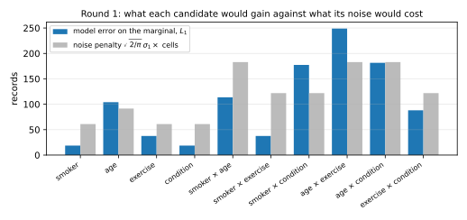
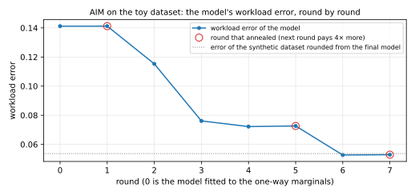

An organization holds a table of records about people, with attributes such as age group, occupation and a medical condition. Researchers want to study the table, but it cannot leave the building. One answer is **synthetic data**, a new table of made-up rows that gives nearly the same answers to the statistical questions that matter, but reveals almost nothing about any one real person. AIM, by McKenna, Mullins, Sheldon and Miklau (2022), is a way to build such a table, and in the paper's experiments it beat every competitor on most settings.

The name stands for *adaptive and iterative mechanism*. AIM builds its model of the data one noisy statistic at a time, and each choice depends on what the earlier measurements taught it. So the note answers three questions. What does AIM promise, and how is that promise counted? How does a pile of noisy statistics become one dataset? And how does AIM decide what to measure next, and with how much noise? You need only expectations, the normal distribution and a little calculus. @tbl-map gives the question of each section, and @tbl-symbols lists the symbols. A script carries the running example, and every number in the note comes from it:

```bash
uv run python code/notes/aim.py
```

| Section | The question it answers |
|:---|:---|
| @sec-task | What does synthetic data have to get right, and how is its error measured? |
| @sec-dp | What does the privacy promise say, and how are its costs counted? |
| @sec-smg | Why not measure every statistic directly, and what three problems that leaves? |
| @sec-pgm | How does one dataset come out of many noisy, inconsistent statistics? |
| @sec-aim | What does AIM do in each round, and why? |
| @sec-privacy | Why does AIM keep its privacy promise? |
| @sec-error | How does AIM know how wrong its answers are? |
| @sec-results | How well does it work, and which of its ideas matter most? |

: The question each section answers. {#tbl-map}

| Symbol | Meaning |
|:---|:---|
| $D$, $D'$; $D \sim D'$ | a dataset of $n$ records, and a neighbouring one, which has one record more or one fewer |
| $d$ | the number of attributes |
| $r$, $s$ | sets of attributes |
| $\mu_r(D)$, $m_r$ | the marginal of $D$ over the attributes in $r$, a vector of counts, and its number of cells |
| $\mathcal Q$, $c_s$ | the workload, a list of attribute sets whose marginals the synthetic data should get right, with their weights |
| $\mathcal Q_+$ | the downward closure of the workload, the marginals AIM may measure |
| $w_r$ | the weight AIM gives a candidate marginal $r$ |
| $\tilde y_i$, $\sigma_i$ | the $i$-th noisy measurement, and its noise level |
| $\hat p$, $\hat p_t$ | the model's table of counts, and the model after round $t$ |
| $\hat D$ | the synthetic dataset |
| $\varepsilon$, $\delta$ | the parameters of a differential-privacy guarantee |
| $\rho$, $\rho_{\mathrm{used}}$ | the privacy budget in zero-concentrated form, and the part of it spent so far |
| $\sigma_t$, $\varepsilon_t$ | the noise level and the selection budget of round $t$; $\sigma_0$ is the starting noise level |
| $T$ | the number of rounds AIM plans for |
| $u(D, r)$, $\Delta u$ | the score AIM gives candidate $r$, and the most one record can change it |
| $D_\alpha(P \| Q)$ | the Rényi divergence of order $\alpha$ between two distributions |
| $\theta$ | the parameters of the model |

: The symbols the note uses. Each is also explained where it first appears. {#tbl-symbols}

# The task: synthetic data that gets the marginals right {#sec-task}

Before privacy enters, we need to say what a good synthetic dataset is, because every later choice of AIM tries to make its error small.

## Records, attributes and the full table

A dataset $D$ is a list of $n$ records, and each record gives a value for each of $d$ attributes. AIM requires every attribute to be **discrete**, with a fixed, finite list of values, so income, for example, must first be cut into bands.

The running example is a toy dataset of $n = 1{,}000$ people with four attributes. *Smoker* has the values no and yes, and *exercise* has the values rarely and often. *Age* has three bands, under 40, 40 to 64, and 65 and over. *Condition* records whether the person has a certain medical condition. In the population that the script draws from, smoking, exercise and the condition depend on age, and the condition also depends on smoking.

A record is one combination of values, and the number of possible combinations is the product of the attributes' sizes, $2 \times 3 \times 2 \times 2 = 24$ for the toy dataset. The **full table** of a dataset counts the records on each combination, so it holds everything about the dataset except the order of the rows. But for real data it is far too big to release or even to store, because the product of fifteen attribute sizes runs into the billions. So AIM works with marginals instead.

## Marginals

A marginal looks at a few attributes at a time and ignores the rest.

::: {#def-marginal name="Marginal"}
Let $r$ be a set of attributes. The **marginal** of $D$ over $r$, written $\mu_r(D)$, is the vector that gives, for every combination of values of the attributes in $r$, the number of records of $D$ with that combination. Its number of entries, or **cells**, is written $m_r$. A marginal over one attribute is a **one-way** marginal, over two attributes a **two-way** marginal, and so on.
:::

So a marginal is a contingency table, flattened into a vector. @tbl-marginal shows the toy dataset's marginal over smoker and condition, which has $m_r = 4$ cells.



Two facts about marginals drive everything that follows. First, a marginal over a set $r$ determines the marginals over every subset of $r$, because you can add up its cells, as the row sums of @tbl-marginal give the one-way marginal of smoker. Second, every marginal is a sum over the full table. Summing the full table over the attributes outside $r$ gives $\mu_r(D)$, and this sum is linear in the table, which is what lets @sec-pgm fit a table to noisy marginals.

## The workload and the error

The user of the synthetic data says which marginals matter. The **workload** $\mathcal Q$ is a list of attribute sets, and each set $s$ in it has a weight $c_s$ that says how much its marginal matters. In the toy example the workload is all six two-way marginals, with equal weights. In the paper's experiments it is typically every three-way marginal of a dataset, several hundred of them.

The quality of the synthetic dataset $\hat D$ is the weighted distance between its workload marginals and the true ones. The paper measures distance by the $L_1$ norm, the sum of the absolute differences of the cells, and divides by the number of marginals and by $n$:

$$\mathrm{Error}(D, \hat D) = \frac{1}{|\mathcal Q|\, n} \sum_{s \in \mathcal Q} c_s \,\bigl\|\mu_s(D) - \mu_s(\hat D)\bigr\|_1.$$ {#eq-error}

The division by $n$ turns counts into shares, so an error of $0.05$ means that a typical workload marginal is off by five percent of the records in total, spread over its cells. The toy run in @sec-aim starts at about $0.14$ and ends at about $0.05$.

# Differential privacy, as much as AIM needs {#sec-dp}

AIM promises that the synthetic data reveal almost nothing about any one person, a promise called differential privacy (DP). AIM touches the data with only two noisy operations. So once we have the exact promise, a way to count its cost and the cost of each operation, the privacy of the whole algorithm comes from adding up costs.

## Neighbouring datasets and the promise

The promise compares two datasets that differ in one person.

::: {#def-neighbours name="Neighbouring datasets"}
Two datasets $D$ and $D'$ are **neighbouring**, written $D \sim D'$, if one can be obtained from the other by adding or removing a single record.
:::

Some papers instead let neighbours differ by one replaced record. AIM uses the add-or-remove version, and the choice matters for the noise, because adding a record changes a marginal in one cell, while replacing one changes two cells.

A **mechanism** $M$ is a randomized algorithm that takes a dataset and returns an output, here a synthetic dataset. Its output on $D$ is random, and the promise is that this distribution barely changes when $D$ is replaced by a neighbour.

::: {#def-dp name="Differential privacy"}
Let $\varepsilon \ge 0$ and $\delta \in [0, 1]$. A mechanism $M$ is **$(\varepsilon, \delta)$-differentially private**, or $(\varepsilon, \delta)$-DP, if for every pair of neighbouring datasets $D \sim D'$ and every set $S$ of possible outputs,
$$\Pr[M(D) \in S] \le e^{\varepsilon}\,\Pr[M(D') \in S] + \delta.$$
:::

In words, no outcome becomes much more likely because one person's record is in the data. For example, $\varepsilon = 1$ lets an outcome become at most $e \approx 2.7$ times more likely, and $\delta$ is a small probability of exceptions, typically far below one in a million. The definition covers both orders of the pair. So an observer who sees the output cannot tell with any confidence whether a given person's record was used, whatever else they know.

## Counting the cost in concentrated form

AIM performs many noisy operations, and if you add up their $(\varepsilon, \delta)$ pairs directly, the total is weak. So AIM counts in a different currency, called zero-concentrated differential privacy, in which costs simply add and convert to an $(\varepsilon, \delta)$ pair at the end. Its definition uses a distance between two distributions.

::: {#def-renyi name="Rényi divergence"}
Let $P$ and $Q$ be two distributions on the same outputs, and write $p$ and $q$ for their densities, or their mass functions if the outputs are discrete. Let the order $\alpha$ be a number greater than $1$. Their **Rényi divergence of order $\alpha$** is
$$D_\alpha(P \| Q) = \frac{1}{\alpha - 1} \ln \mathbb E_{Y \sim Q}\!\left[\left(\frac{p(Y)}{q(Y)}\right)^{\alpha}\right].$$
:::

The ratio $p(y)/q(y)$ says how much more likely an output is under $P$ than under $Q$, and the divergence averages a power of that ratio, on a logarithmic scale. So it is zero when the distributions are equal and grows as they separate.

::: {#def-zcdp name="Zero-concentrated differential privacy"}
Let $\rho \ge 0$. A mechanism $M$ is **$\rho$-zero-concentrated differentially private**, or $\rho$-zCDP, if for every pair of neighbouring datasets $D \sim D'$ and every order $\alpha > 1$,
$$D_\alpha\bigl(M(D) \,\|\, M(D')\bigr) \le \rho\,\alpha.$$
:::

The number $\rho$ is the **privacy budget** in this currency. AIM needs three standard facts about it.

::: {#prp-zcdp name="Three properties of zCDP"}
(a) *Composition.* If $M_1$ is $\rho_1$-zCDP and $M_2$ is $\rho_2$-zCDP, where $M_2$ may be chosen after seeing the output of $M_1$, then releasing both outputs is $(\rho_1 + \rho_2)$-zCDP.
(b) *Post-processing.* Any computation on the output of a $\rho$-zCDP mechanism, which does not look at the data again, is still $\rho$-zCDP.
(c) *Conversion.* A $\rho$-zCDP mechanism is $(\varepsilon, \delta)$-DP for every $\varepsilon \ge 0$ with
$$\delta = \min_{\alpha > 1} \frac{\exp\bigl((\alpha - 1)(\alpha\rho - \varepsilon)\bigr)}{\alpha - 1}\left(1 - \frac1\alpha\right)^{\alpha}.$$
:::
<!-- proof: cited -->

Bun and Steinke (2016) prove parts (a) and (b), and Canonne, Kamath and Steinke (2020) prove part (c). In AIM, part (a) lets the costs of the rounds add even though each round depends on earlier outputs. Part (b) makes most of AIM free, because the model fit, the choice of what to measure next and the rounding to a dataset look only at released values. Part (c) sets the budget. The user picks $\varepsilon$ and $\delta$, and the script finds the largest $\rho$ whose conversion gives them. For $\varepsilon = 1$ and $\delta = 10^{-6}$, the values of the toy run, the budget is $\rho = 0.0244$.

## The two building blocks

The first building block releases a vector of counts with Gaussian noise. Its cost depends on how much one person can change the vector.

::: {#def-sensitivity name="Sensitivity"}
Let $f$ map datasets to vectors. Its **$L_2$ sensitivity** is the largest Euclidean distance between its values on two neighbouring datasets,
$$\Delta_2 f = \max_{D \sim D'} \bigl\| f(D) - f(D') \bigr\|_2.$$
:::

A marginal has the smallest sensitivity a count can have.

::: {#lem-marginal-sensitivity name="A marginal has sensitivity one"}
For every attribute set $r$, the marginal $\mu_r$ has $L_2$ sensitivity $1$.
:::

::: {.proof}
Adding one record to $D$ adds one to exactly one cell of $\mu_r(D)$, the cell of that record's values on the attributes in $r$, and leaves every other cell unchanged. Removing a record subtracts one from one cell. In both cases the difference vector has a single entry of $\pm 1$, whose Euclidean length is $1$.
:::

::: {#prp-gaussian name="The Gaussian mechanism"}
Let $f$ have $L_2$ sensitivity $\Delta_2 f$, and let $\sigma > 0$. The mechanism that releases $f(D) + Z$, where $Z$ is a vector of independent $\mathcal N(0, \sigma^2)$ noise, one entry per coordinate, is $\rho$-zCDP with
$$\rho = \frac{(\Delta_2 f)^2}{2\sigma^2}.$$
:::
<!-- proof: cited -->

Bun and Steinke (2016) prove this result. Their proof uses the Rényi divergence between two normal distributions with the same variance, which is $\alpha$ times the squared distance of their means over $2\sigma^2$. A marginal has sensitivity one by @lem-marginal-sensitivity, so a measurement with noise level $\sigma$ costs $1/(2\sigma^2)$, whatever the marginal's size. But a marginal with many cells spreads the same $n$ records thinly, so each cell's count is small next to the noise. That is why @sec-aim prefers smaller marginals when the budget is tight.

The second building block chooses one option from a list. It favours options with a high score, but it does not reveal the scores.

::: {#prp-exponential name="The exponential mechanism"}
Let $\mathcal R$ be a finite set of candidates, and let $u(D, r)$ be a score for each candidate $r$, whose **sensitivity** $\Delta u$ is the most that adding or removing one record can change any candidate's score. The mechanism that chooses candidate $r$ with probability proportional to $\exp\bigl(\varepsilon\, u(D, r)/(2\Delta u)\bigr)$ is $\varepsilon$-DP, and it is $\rho$-zCDP with
$$\rho = \frac{\varepsilon^2}{8}.$$
:::
<!-- proof: cited -->

The $\varepsilon$-DP claim is the theorem of McSherry and Talwar (2007), and Cesar and Rogers (2021) prove the zCDP cost. The exponent sets how sharp the choice is, because a candidate whose score is higher by $2\Delta u/\varepsilon$ is $e$ times more likely to be chosen. So with a large $\varepsilon$ the mechanism almost always picks the best candidate, and with a tiny $\varepsilon$ it picks nearly at random.

# Select, measure, generate {#sec-smg}

With the two building blocks, the obvious method is to measure every workload marginal with Gaussian noise and release the results. Its failure names the three problems that AIM must solve.

Suppose the workload has $k$ marginals, each measured once with the same noise level $\sigma$. By @prp-gaussian and @prp-zcdp (a), the total cost is $k/(2\sigma^2)$, so if you spend the whole budget, $\sigma = \sqrt{k/(2\rho)}$. On the toy workload, with $k = 6$ and $\rho = 0.0244$, that gives $\sigma = 11.1$, which is small next to counts in the hundreds. But all three-way marginals of fifteen attributes make $k = 455$, and then $\sigma = 96.6$. A three-way marginal of fifty thousand records might have a hundred cells of about five hundred records each, so the noise would be a fifth of a typical count. That is the first problem, **selection**: measure only the marginals that matter, and infer the rest from them.

The second problem appears even on the toy workload, because six noisy marginals are not a dataset. Two of them that share an attribute disagree about its one-way marginal, because each carries its own noise. Some cells are negative, and a marginal that was never measured gets no answer at all. This is the problem of **generation**: turn the noisy measurements into one dataset whose marginals are consistent, non-negative, and close to the measurements.

The third problem is the **budget split**. A measurement with little noise costs a great deal, and one with much noise may be worthless, so an even split ignores that some marginals are far from what the model already knows and others are not.

The *select-measure-generate* family, as the paper calls it, answers the three problems in a loop. It selects a marginal, measures it with noise, updates a model of the data to agree with every measurement so far, and repeats, and at the end it generates a dataset from the model. The ancestor of AIM in this family is the multiplicative weights exponential mechanism (MWEM). It uses the exponential mechanism to pick the marginal on which the current model is most wrong. AIM keeps the loop and changes every step in it, but both share the generation step, which comes first.

# Private-PGM, without graphical models {#sec-pgm}

The generation step must turn noisy, inconsistent marginals into one dataset. Private-PGM (McKenna, Sheldon and Miklau, 2019) does this. Its name promises probabilistic graphical models, but what it computes is simple to state without them, and AIM takes only one number from that machinery, the size of the model.

## One table that explains every measurement

Suppose that a sequence of marginals has been measured. The $i$-th measurement is a noisy vector $\tilde y_i$, equal to $\mu_{r_i}(D)$ plus Gaussian noise of level $\sigma_i$ in each cell. Private-PGM looks for a full table $p$, which counts the records on every combination of values, as in @sec-task, with non-negative entries that sum to the number of records. Its marginals $\mu_r(p)$ are sums over the attributes outside $r$, as for a dataset. Private-PGM asks them to be as close to the measurements as possible, in squared error, with less weight on noisier measurements:

$$\hat p = \arg\min_{p} \sum_{i} \frac{1}{\sigma_i} \bigl\| \mu_{r_i}(p) - \tilde y_i \bigr\|_2^2.$$ {#eq-pgm}

Squared error is the natural choice because the noise is Gaussian. With weights $1/\sigma_i^2$, the minimizer would be the maximum-likelihood table. The paper uses $1/\sigma_i$, which worked better in practice.

So the generation problem of @sec-smg goes away. The marginals of one table cannot disagree with each other, because they are all sums of the same numbers, and they cannot be negative, because the table is not. A table also answers the marginals never measured, by combining what the measured ones imply. For example, after the toy run has measured only the four one-way marginals, the model's marginal over smoker and condition keeps the measured row and column totals (@tbl-init). It spreads them as if the two attributes were independent, because nothing measured says otherwise.



The number of records $n$ changes between add-or-remove neighbours, so it is private, and the table's total cannot simply be set to $n$. Instead, each noisy one-way marginal sums to a noisy copy of $n$, and the script uses the average of these sums, which is free post-processing. The toy run estimates $1{,}019$ records.

## Why the table never has to be built

The difficulty is size. On the toy domain, $p$ has 24 entries, but no computer can hold $p$ on a real domain with billions of combinations. The way out is that the objective of @eq-pgm depends on $p$ only through its marginals over the measured sets $r_1, r_2, \dots$, and that fact forces the shape of the solution.

::: {#thm-pgm name="The solution is a product of small tables"}
Write $x_{r_i}$ for the combination of values that a record $x$ takes on the attributes in $r_i$. Among the minimizers of @eq-pgm there is a table of the form
$$p_\theta(x) \propto \exp\Bigl( \sum_i \theta_i[x_{r_i}] \Bigr),$$
where each $\theta_i$ is a table of numbers with one entry per cell of the $i$-th measured marginal.
:::
<!-- proof: cited -->

McKenna, Sheldon and Miklau (2019) prove this by a convex duality argument. The objective depends on the table only through its marginals, which are linear in it, and the maximum-entropy table with given marginals has this exponential form. So the model has as many parameters as the measurements have cells, however large the domain. To fit it, the script's optimizer adjusts the parameter tables $\theta_i$ until the model's marginals match the measurements, and Private-PGM does the same with a more careful algorithm.

This form explains @tbl-init. With only one-way marginals measured, the model is proportional to $\exp(\theta_1[x_1]) \exp(\theta_2[x_2]) \cdots$, one factor per attribute, which is the definition of independent attributes. A measured marginal over smoker and condition adds a factor that depends on both, and only that pair becomes dependent. So the model carries exactly the dependencies that were measured.

Graphical models compute the marginals of $p_\theta$ without the full table, because they sum out one attribute at a time. The largest intermediate table sets the cost. It stays small when the measured sets form chains and small clusters, and grows enormous when the sets overlap in a tangled way. The paper calls the memory this needs the **junction tree size**, written $\mathrm{JT\text{-}SIZE}(r_1, \dots, r_t)$ for the measured sets, in megabytes, and AIM keeps it below a limit.

## From the table to records

The fitted table $\hat p$ has fractional entries, but a dataset needs whole records, so Private-PGM produces the synthetic dataset $\hat D$ by rounding. It rounds each cell's count down and gives the records lost to rounding to the cells with the largest fractional parts. By @prp-zcdp (b) this step is free. In the toy run, the model's workload error is $0.0529$ and the rounded dataset's is $0.0537$.

# AIM, round by round {#sec-aim}

With the generation step in hand, two problems of @sec-smg remain: what to measure, and with how much budget. AIM takes a dataset $D$, a workload $\mathcal Q$ of attribute sets with weights $c_s$, and a budget $\rho$, and returns a synthetic dataset. It has three fixed settings. It plans for a number of rounds $T = 16d$, where $d$ is the number of attributes. It gives nine tenths of each round's budget to the measurement and one tenth to the selection. And it caps the model's junction tree size at 80 megabytes.

## The schedule

Each round $t$ selects a marginal with the exponential mechanism at a budget $\varepsilon_t$, then measures it with Gaussian noise at a level $\sigma_t$. By @prp-exponential, @prp-gaussian and @lem-marginal-sensitivity, the round costs

$$\rho_t = \frac{\varepsilon_t^2}{8} + \frac{1}{2\sigma_t^2}.$$ {#eq-round-cost}

AIM chooses the starting values so that $T$ rounds at those values would spend the budget in the planned split. Nine tenths of $\rho$ over $T$ measurements means $T/(2\sigma_0^2) = 0.9\rho$, and one tenth over $T$ selections means $T\varepsilon_1^2/8 = 0.1\rho$. Each equation solves for its unknown:

$$\sigma_0 = \sqrt{\frac{T}{2 \cdot 0.9\,\rho}}, \qquad \varepsilon_1 = \sqrt{\frac{8 \cdot 0.1\,\rho}{T}}.$$ {#eq-start}

With $T = 16d$ the starting noise is large and the starting selection budget is tiny, on purpose. The annealing rule below raises the per-round budget when a round teaches too little, and AIM stops when the budget is gone, not after $T$ rounds. @tbl-schedule gives the schedule for the toy dataset, where $d = 4$.



## Initialization

Before the loop, AIM measures every one-way marginal that appears in some workload marginal, each with noise level $\sigma_0$, and fits the model to them. This saves the selections that MWEM's early rounds spend on one-way marginals anyway. The cost is at most $d/(2\sigma_0^2)$, which by @eq-start equals $0.9\rho\, d/T$, a sixteenth of the measurement budget when $T = 16d$. The result is the independence model of @tbl-init.

## The candidates

AIM may measure every marginal over a subset of a workload set, a collection the paper calls the **downward closure** of the workload,

$$\mathcal Q_+ = \{\, r : r \subseteq s \text{ for some } s \in \mathcal Q \,\}.$$

The reason is noise. A large marginal spreads the records over many cells, so the noise swamps each cell's count. Its sub-marginals have bigger counts, and the model combines them into an estimate of the large one. On the toy workload of six two-way marginals, the closure adds the four one-way marginals, for ten candidates in all.

Each candidate gets a weight that says how much of the workload it serves. It counts the attributes the candidate shares with each workload marginal, times that marginal's weight:

$$w_r = \sum_{s \in \mathcal Q} c_s\, |r \cap s|.$$ {#eq-weight}

For example, a two-way candidate on the toy workload shares both attributes with itself and one attribute with four other workload marginals, so its weight is $6$. A one-way candidate shares its attribute with three workload marginals, for a weight of $3$.

Last, in each round AIM drops the candidates that would make the model too big. A candidate $r$ stays only if the junction tree size of the measured sets plus $r$ is at most $(\rho_{\mathrm{used}}/\rho)$ times the 80 megabyte cap. So early rounds are kept to small models, and the full cap is available only near the end. Every model on the toy domain is tiny, so the script does not need this filter.

## Selection: the score

AIM's first new idea is its score. MWEM scores a candidate by how wrong the current model is on it, the $L_1$ distance $\|\mu_r(D) - \mu_r(\hat p_{t-1})\|_1$ between the true marginal and the model's. That score favours large marginals, which have large errors simply by having many cells, even when the noise of a measurement would be larger still. So AIM subtracts the expected $L_1$ norm of the noise, which needs one lemma.

::: {#lem-l1-noise name="Expected size of Gaussian noise"}
Let $Z \sim \mathcal N(0, \sigma^2)$. Then
$$\mathbb E|Z| = \sigma\sqrt{2/\pi}.$$
Hence a vector of $m$ independent such entries has expected $L_1$ norm $\sigma m \sqrt{2/\pi}$.
:::

::: {.proof}
The density of $Z$ is symmetric about zero, so the expectation of $|Z|$ is twice the integral over the positive half-line:
$$\mathbb E|Z| = 2 \int_0^\infty \frac{z}{\sigma\sqrt{2\pi}} \exp\!\left(-\frac{z^2}{2\sigma^2}\right) \mathrm d z.$$
Up to the constant in front, the integrand is the derivative of $-\sigma^2 \exp(-z^2/(2\sigma^2))$, which runs from $-\sigma^2$ at zero to $0$ at infinity. So the integral equals $\sigma^2/(\sigma\sqrt{2\pi})$, and twice that is $2\sigma/\sqrt{2\pi} = \sigma\sqrt{2/\pi}$. The $L_1$ norm of a vector is the sum of the absolute values of its entries, and expectation is linear, so $m$ entries give $m$ times the single-entry value.
:::

The constant $\sqrt{2/\pi}$ is about $0.798$. AIM's score for candidate $r$ in round $t$ is then

$$u(D, r) = w_r \Bigl( \bigl\|\mu_r(D) - \mu_r(\hat p_{t-1})\bigr\|_1 - \sqrt{2/\pi}\;\sigma_t\, m_r \Bigr).$$ {#eq-score}

Read it as a balance in units of records. The first term is how far the model is from the truth on $r$, and the second is how far the noisy measurement would be from the truth, in expectation. So a candidate scores above zero only when its measurement is expected to bring the model closer to the truth. The script's version is short:

```{.python excerpt="score"}
def score(
    data: Array,
    model: Array,
    attrs: Attrs,
    weight: float,
    sigma: float,
) -> float:
    """AIM's quality score of a candidate marginal: how far the model is from the data
    on it, minus the L1 error that measuring it with noise of standard deviation sigma
    would add in expectation, times the weight."""
    model_error = float(np.abs(marginal(data, attrs) - marginal(model, attrs)).sum())
    penalty = SQRT_2_OVER_PI * sigma * cells(attrs)
    return weight * (model_error - penalty)
```

The exponential mechanism needs the score's sensitivity, and the weight sets it.

::: {#prp-score-sensitivity name="Sensitivity of the score"}
Adding or removing one record changes $u(D, r)$ by at most $w_r$. So, over a candidate set $\mathcal R$, the sensitivity is $\Delta u = \max_{r \in \mathcal R} w_r$.
:::

::: {.proof}
The model $\hat p_{t-1}$ and the noise level are fixed when the score is computed, so only $\mu_r(D)$ changes between neighbouring datasets, and by the argument of @lem-marginal-sensitivity it changes in a single cell by $1$. So the $L_1$ distance to the fixed vector $\mu_r(\hat p_{t-1})$ changes by at most $1$, by the triangle inequality applied to that one cell. Multiplying by $w_r$ gives the claim, and the sensitivity over the set is the largest of these.
:::

AIM then chooses $r_t$ with probability proportional to $\exp\bigl(\varepsilon_t u(D, r)/(2\Delta u)\bigr)$, as @prp-exponential prescribes. @tbl-scores and @fig-scores show the first round on the toy dataset. The model is still the independence model, so the pairs with real dependence, such as smoker with condition, have the largest errors, and two of them clear their noise penalty by a wide margin.



{#fig-scores}

But the last column of @tbl-scores shows that a high score barely helps at the start. At the starting budget $\varepsilon_1 = 0.0174$, the best score of $396$ gives an exponent of only $0.0174 \times 396 / 12 \approx 0.57$. So the best candidate is only about $e^{0.57} \approx 1.8$ times as likely as an average one, and the selection is nearly random. In the toy run, round 1 chose the one-way marginal of smoker, which the model already knew. The cautious schedule of @eq-start causes this, and the annealing rule exists to notice it and raise the stakes.

## Measurement and estimation

AIM measures the chosen marginal with Gaussian noise at level $\sigma_t$, by @prp-gaussian, and appends it to the list of measurements. Then it refits the model to the whole list by @eq-pgm, which is free by @prp-zcdp (b). So the model stays consistent with every earlier measurement, weighted by its precision.

## Annealing: when a round teaches too little

AIM's second new idea sets the number of rounds and the per-round budget automatically. After the refit, AIM compares the model's marginal over $r_t$ before and after the measurement. The round taught too little if the measurement moved that marginal by no more than the noise it carried, that is, if

$$\bigl\| \mu_{r_t}(\hat p_t) - \mu_{r_t}(\hat p_{t-1}) \bigr\|_1 \le \sqrt{2/\pi}\;\sigma_t\, m_{r_t}.$$ {#eq-anneal}

In that case AIM doubles $\varepsilon_{t+1}$ and halves $\sigma_{t+1}$, which by @eq-round-cost makes a round cost four times as much. Both reasons for a weak round are fixed. If no candidate was worth measuring at this noise level, halving $\sigma$ makes more scores positive, and if the selection missed a good candidate, doubling $\varepsilon$ makes it sharper. The comparison looks only at two fitted models, so it is free.

A second rule ends the loop cleanly. If the remaining budget $\rho - \rho_{\mathrm{used}}$ is at most twice the next round's cost, AIM makes the next round the last one and sets its parameters to spend exactly what is left, in the same nine-to-one split:

$$\varepsilon_{t+1} = \sqrt{8 \cdot 0.1\,(\rho - \rho_{\mathrm{used}})}, \qquad \sigma_{t+1} = \sqrt{\frac{1}{2 \cdot 0.9\,(\rho - \rho_{\mathrm{used}})}}.$$ {#eq-final}

If you put these into @eq-round-cost, you get $0.1$ plus $0.9$ of the remainder, which is all of it. So the loop's condition $\rho_{\mathrm{used}} < \rho$ fails after that round and AIM stops. The script's version of both rules is short:

```{.python excerpt="anneal"}
def anneal(
    eps: float, sigma: float, change: float, penalty: float, remaining: float
) -> tuple[float, float, bool, bool]:
    """The next round's (eps, sigma). If the last measurement moved the model by less
    than the noise it carried, double eps and halve sigma. Then, if what is left cannot
    pay for two such rounds, make the next round the last one and let it spend exactly
    the remaining budget. Also returns whether it annealed and whether it is the last."""
    annealed = change <= penalty
    if annealed:
        eps, sigma = 2 * eps, sigma / 2
    last = remaining <= 2 * round_cost(eps, sigma)
    if last:
        eps = math.sqrt(8 * (1 - MEASURE_SHARE) * remaining)
        sigma = math.sqrt(1 / (2 * MEASURE_SHARE * remaining))
    return eps, sigma, annealed, last
```

## The run on the toy dataset

@tbl-rounds lists every round, and @fig-rounds plots the workload error of @eq-error after each. The run is short, because the budget is small and each annealing makes a round cost four times as much.



{#fig-rounds}

Round 1 measured smoker again and moved the model by one record, far below the penalty, so it annealed. Rounds 2 and 3, at twice the selection budget and half the noise, picked the two marginals with the most dependence to find, and the workload error fell by almost half. Round 4 picked exercise with condition and fixed it. Round 5 picked it again, learned nothing new, and annealed. Round 6, at four times the original stakes, found the dependence between age and condition, the last large error. Round 7, set by @eq-final to spend the rest, refined a marginal that was already close. The error fell from $0.141$ to $0.053$, and @tbl-final shows the smoker-and-condition marginal at the end.

| smoker | true: no condition | true: condition | final model: no condition | final model: condition |
|:---|---:|---:|---:|---:|
| no | 627 | 98 | 626.3 | 103.0 |
| yes | 181 | 94 | 185.4 | 104.0 |

: The marginal over smoker and condition in the toy dataset and in AIM's final model. Compare @tbl-init, the model before any two-way marginal was measured. {#tbl-final}

On this toy workload, a simpler method does better. If you measure all six marginals directly with the whole budget, at noise level $\sigma = 11.1$, and fit the model to them, the workload error is $0.035$, against AIM's $0.053$. The budget covers six marginals, and none is redundant, so the selection budget is wasted. AIM's advantage is on real workloads, where hundreds of marginals compete for the budget and a few others nearly imply most of them.

# Why AIM keeps its promise {#sec-privacy}

AIM must not spend more than its budget $\rho$, although its rounds choose their own costs as the run goes. AIM touches the data only through Gaussian measurements and exponential-mechanism selections. So the proof must show that each round costs @eq-round-cost, and that the costs never add up to more than $\rho$. The second part needs a budget filter, because the costs depend on earlier outputs and plain composition assumes that they are fixed in advance.

::: {#lem-filter name="Budget filter"}
Consider a sequence of mechanisms in which the $t$-th is $\rho_t$-zCDP, where $\rho_t$ may be chosen after seeing the outputs of the earlier mechanisms. If, for every choice the earlier outputs can lead to, the sum of the $\rho_t$ over the rounds that run is at most $\rho$, then releasing all the outputs is $\rho$-zCDP.
:::
<!-- proof: cited -->

This is Theorem 3.1 of Feldman and Zrnic (2021). They prove it for Rényi differential privacy, which contains zCDP as the case of all orders at once, by a supermartingale argument over the rounds.

::: {#thm-aim-privacy name="AIM is ρ-zCDP"}
With the paper's settings, $T = 16d$ and a nine-to-one split, AIM is $\rho$-zCDP. By @prp-zcdp (c) it is therefore $(\varepsilon, \delta)$-DP for every pair that the conversion gives.
:::

::: {.proof}
The plan is to list every access to the data with its cost, confirm that nothing else touches the data, and then show that the loop's bookkeeping keeps the total at $\rho$, so that @lem-filter applies.

**Step 1: the accesses and their costs.** The initialization measures at most $d$ one-way marginals, each at noise level $\sigma_0$. By @lem-marginal-sensitivity and @prp-gaussian each costs $1/(2\sigma_0^2)$. So by @eq-start the initialization costs at most $d/(2\sigma_0^2) = 0.9\rho\, d/T$, which is $0.9\rho/16$ for $T = 16d$. Round $t$ makes two accesses. The selection is the exponential mechanism with the score of @eq-score at budget $\varepsilon_t$, whose sensitivity @prp-score-sensitivity gives, so by @prp-exponential it costs $\varepsilon_t^2/8$. The measurement is a Gaussian release at level $\sigma_t$, which costs $1/(2\sigma_t^2)$. Together they are @eq-round-cost, which is exactly what the algorithm adds to $\rho_{\mathrm{used}}$.

**Step 2: nothing else touches the data.** The model fits of @eq-pgm use only the released measurements. The candidate weights depend on the workload alone, and the candidate filter depends on the sets already selected and on $\rho_{\mathrm{used}}$, both of which are released. The annealing test of @eq-anneal compares two fitted models, and the final-round rule of @eq-final reads $\rho_{\mathrm{used}}$. The rounding to records uses the final model. By @prp-zcdp (b), none of this adds to the cost. In particular, the next round's $\varepsilon_{t+1}$ and $\sigma_{t+1}$ are functions of earlier outputs, which is exactly the situation @lem-filter allows.

**Step 3: the total never exceeds $\rho$.** After the initialization, by Step 1, the remaining budget is at least $\rho(1 - 0.9/16)$, and by @eq-start the first round costs $\rho/T = \rho/(16d)$, which is smaller. So the first round fits. Now consider any later round $t + 1$, and look at the decision taken at the end of round $t$. If the final-round rule fired, round $t + 1$ costs exactly the remainder, by the arithmetic below @eq-final, so after it $\rho_{\mathrm{used}} = \rho$ and the loop stops. If the rule did not fire, the remainder was more than twice the cost of round $t + 1$, so that round fits with budget to spare, and the argument repeats at the end of it. Either way $\rho_{\mathrm{used}}$ never exceeds $\rho$, on every path the random choices can take.

By Steps 1 to 3, AIM is a sequence of mechanisms with adaptively chosen costs whose sum is at most $\rho$ on every path, and @lem-filter makes it $\rho$-zCDP.
:::

So the final-round rule is not a detail. Without it, a round could start with less budget left than it costs, and AIM would have to overspend or waste the rest. The script checks the rule at the end of every run, where $\rho_{\mathrm{used}}$ equals $\rho$ to floating-point precision.

# What AIM says about its own error {#sec-error}

A synthetic dataset is more useful when it comes with a bound on how far its marginals may be from the truth. AIM gives one at no extra privacy cost, because it computes the bound from values it has already released. Here is the simpler of the paper's two bounds.

Consider a marginal $r$ that lies inside one or more of the measured sets. If you add up the cells of each such measurement $\tilde y_i$, the noisy marginal of the $i$-th measured set, you get a noisy copy of $\mu_r(D)$, the true marginal over $r$. A weighted average of the copies gives one estimate $\bar y_r$, which is the truth plus Gaussian noise of a known level $\bar\sigma_r$. The question is how large the $L_1$ norm of that noise can be.

::: {#thm-error name="A confidence bound for a measured marginal"}
Let $\bar y_r = \mu_r(D) + Z$, where $Z$ has $m_r$ independent $\mathcal N(0, \bar\sigma_r^2)$ entries. For every $\lambda \ge 0$, with probability at least $1 - e^{-\lambda^2}$,
$$\bigl\| \mu_r(D) - \bar y_r \bigr\|_1 \le \sqrt{2 \ln 2}\; \bar\sigma_r\, m_r + \lambda\, \bar\sigma_r \sqrt{2 m_r}.$$
:::
<!-- proof: cited -->

This is Theorem 3 of the AIM paper. Its proof bounds the expected $L_1$ norm by Jensen's inequality, which gives the first term, slightly looser than @lem-l1-noise. Then a concentration inequality for the $L_1$ norm, a Lipschitz function of the Gaussian vector, gives the second term, in which $\lambda$ sets the confidence. The bound on the synthetic dataset then follows by the triangle inequality. The distance from $\mu_r(\hat D)$ to the truth is at most its known distance to $\bar y_r$, plus the bound above. For a marginal that no measured set contains, the paper gives a weaker bound built from the selection scores. In the paper's experiments, with $\lambda$ set for 95% confidence, the bounds held. They were within a factor of about four of the true error for measured marginals, and eight for the others.

# How well it works {#sec-results}

The toy run cannot show whether AIM beats other methods on real data. The paper tests that on six public datasets with nine to sixteen attributes and about a thousand to a million records, each on three workloads of three-way marginals, at nine privacy budgets from $\varepsilon = 0.01$ to $\varepsilon = 100$, with $\delta = 10^{-9}$. Three competitors ignore the workload, among them MST, the winner of a NIST synthetic-data competition. Three use it, among them MWEM with Private-PGM as its model.

AIM had the lowest workload error in 76% of all settings, and in every setting with $\varepsilon \ge 1$. On average it beat the next best method in each setting by a factor of 1.6. On the workloads that concentrate on a few attributes, where the choice of what to measure matters most, the factor was up to 5.7. The paper also removes AIM's ideas one at a time and measures how much the error grows, as @tbl-ablation reports.

| Idea removed | Error grows by a factor of |
|:---|---:|
| Private-PGM, replaced by a relaxed table that need not be a distribution | 2.36 |
| adaptive rounds and the annealed budget split, replaced by fixed rounds | 1.48 |
| the noise-aware score of @eq-score, replaced by the model error alone | 1.37 |
| Gaussian noise, replaced by Laplace noise | 1.18 |
| add-or-remove neighbours, replaced by replace-one | 1.13 |
| the nine-to-one split, replaced by an even split | 1.08 |
| the initialization on one-way marginals | 1.03 |

: The paper's ablation, as geometric means over the datasets and budgets of the ratio of the error without the idea to the error with it. {#tbl-ablation}

So generation from a real distribution, which Private-PGM gives, matters most, and the adaptive budget comes second. AIM's own two ideas, the annealing and the noise-aware score, together account for a factor of about two.

The method has three limits. Every attribute must be discrete, so the user must bin numeric attributes before any privacy is spent. The model's size is capped, so AIM cannot measure every marginal of a workload whose marginals overlap in a tangled way, however large the budget. And the running time grows with the model, because every round refits it. The paper ran AIM on one processor core with four gigabytes of memory, which the 80 megabyte cap keeps possible.

# Sources

1. R. McKenna, B. Mullins, D. Sheldon and G. Miklau (2022), *AIM: An Adaptive and Iterative Mechanism for Differentially Private Synthetic Data*, PVLDB 15(11). The algorithm, its privacy theorem, the error bounds and the experiments. <https://arxiv.org/abs/2201.12677>
2. R. McKenna, D. Sheldon and G. Miklau (2019), *Graphical-model based estimation and inference for differential privacy*, ICML. Private-PGM: the objective of @eq-pgm, the form of its solution (@thm-pgm) and the algorithms that fit it without building the full table. <https://arxiv.org/abs/1901.09436>
3. M. Bun and T. Steinke (2016), *Concentrated Differential Privacy: Simplifications, Extensions, and Lower Bounds*. The definition of zCDP, its composition and post-processing, and the Gaussian mechanism's cost. <https://arxiv.org/abs/1605.02065>
4. C. Canonne, G. Kamath and T. Steinke (2020), *The Discrete Gaussian for Differential Privacy*. The conversion from zCDP to $(\varepsilon, \delta)$-DP in @prp-zcdp (c). <https://arxiv.org/abs/2004.00010>
5. F. McSherry and K. Talwar (2007), *Mechanism Design via Differential Privacy*, FOCS. The exponential mechanism and its $\varepsilon$-DP guarantee.
6. M. Cesar and R. Rogers (2021), *Bounding, Concentrating, and Truncating: Unifying Privacy Loss Composition for Data Analytics*, ALT. The $\varepsilon^2/8$ zCDP cost of the exponential mechanism. <https://arxiv.org/abs/2004.07223>
7. V. Feldman and T. Zrnic (2021), *Individual Privacy Accounting via a Rényi Filter*, NeurIPS. The budget filter of @lem-filter. <https://arxiv.org/abs/2008.11193>
8. M. Hardt, K. Ligett and F. McSherry (2012), *A Simple and Practical Algorithm for Differentially Private Data Release*, NeurIPS. MWEM, the ancestor of AIM's select-measure-generate loop. <https://arxiv.org/abs/1012.4763>
