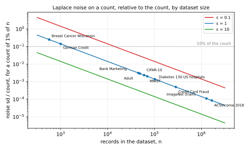
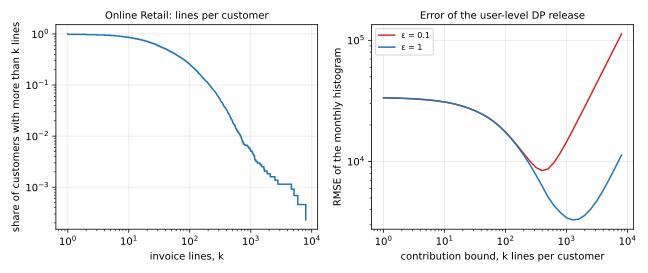

Suppose you want to run, or read, an experiment with differential privacy (DP). You need a dataset, and three things about it decide what the experiment can show. The first is what one record is, because that decides whom the guarantee protects. The second is how many records there are, because that decides whether the noise is small. The third is where the data came from, which decides whether you may use it and whether a model has already seen it. This note is a guide to the public datasets that DP papers use, organized around those three questions.

The note is for a reader who knows what DP promises and wants to put it to work, in a paper, a benchmark or a privacy-utility study. It assumes basic probability and nothing about any particular dataset. Every size, licence and result below was read from the dataset's own page or the paper that reports it, and the sources are listed at the end. Where a number could not be confirmed, the note says so rather than guessing. The companion note, "The Privacy–Utility Trade-off, Worked Through", ran one experiment on one dataset, Adult, and this note says what the alternatives are and what each would have changed. @tbl-map shows the question each section answers, and @tbl-symbols lists the few symbols the note uses.

| Section | The question it answers |
|:---|:---|
| @sec-what | What do the size and shape of a dataset mean for DP? |
| @sec-tabular | Which tables do DP papers use, and what has replaced Adult? |
| @sec-images | Which image datasets, and what accuracy does DP reach on them? |
| @sec-text | Which text datasets, and what does public pre-training change? |
| @sec-users | Which datasets have user identifiers, and what does user-level privacy cost? |
| @sec-other | What is used for locations, graphs and clinical records? |
| @sec-released | Which real DP releases are themselves public datasets? |
| @sec-synthetic | What do DP synthetic data generators train and compete on? |
| @sec-choose | How do you choose a dataset for a privacy-utility study? |

: The question each section answers. {#tbl-map}

| Symbol | Meaning |
|:---|:---|
| $D$, $D'$; $D \sim D'$ | two neighbouring datasets, which differ by one record added or removed |
| $M$ | a mechanism, the random procedure that computes a released output |
| $\varepsilon$, $\delta$ | the parameters of a DP guarantee |
| $n$ | the number of records in a dataset |
| $s$ | the share of the records that a count covers |
| $k$ | the most records one user may contribute, the contribution bound |
| $\rho$ | the single parameter of zero-concentrated DP, a form of the guarantee that converts to an $(\varepsilon, \delta)$ pair |

: The symbols the note uses. Each is also explained where it first appears. {#tbl-symbols}

# What a dataset has to offer a DP experiment {#sec-what}

Before the catalogue, this section fixes what to look for in a dataset, because the same four questions come up for every entry below. What is one record, and so who is being protected? How many records are there, and is that enough for the noise to be small? Is the domain of the data known without looking at it? And may you download, use and redistribute it? Each question gets a short answer here, with the numbers that the rest of the note refers back to. Everything computed in this note comes from one script, [code/notes/dp_datasets.py](https://github.com/manuelvloureiro/privacy-preserving-machine-learning-book/blob/main/code/notes/dp_datasets.py), which a reader can run to get the same numbers.

## The privacy unit

DP protects whatever one record is, and its definition says how. Write $M$ for a mechanism, the random procedure that computes the released output, and take two datasets, written $D$ and $D'$, that differ in one record. The guarantee has two parameters. The first is the privacy parameter $\varepsilon$, which bounds how much the probability of any output may change between the two datasets. The second is the parameter $\delta$, a small probability of exception. The mechanism is $(\varepsilon, \delta)$-DP when, for any such pair of datasets and any set $S$ of outputs,

$$\Pr[M(D) \in S] \le e^{\varepsilon}\Pr[M(D') \in S] + \delta.$$

This note uses the add/remove relation throughout, so $D'$ is $D$ with one record added or taken away. The guarantee is a promise about that record, and what a record is decides what is protected. In Adult one record is one person, so the guarantee is about a person. In Online Retail one record is one line of an invoice, and a customer with 400 lines is 400 records, so a guarantee at the record level says little about the customer. To protect the customer, the mechanism has to treat all of their lines as one unit, which is called **user-level** privacy, and the dataset has to say which lines belong to whom. Most benchmark datasets carry no such identifier, so they can only test **example-level** privacy. @sec-users is about the ones that do.

## The size of the dataset

The noise that DP adds to a count does not depend on how many records there are. Under add/remove, a count changes by at most one when one record changes, so Laplace noise with scale $1/\varepsilon$ makes it $\varepsilon$-DP. That noise has standard deviation $\sqrt{2}/\varepsilon$ whatever the dataset. What the number of records $n$ decides is how that fixed noise compares with the counts the dataset can answer. A count of a share $s$ of the records is about $ns$, so the noise, as a fraction of that count, is

$$\frac{\sqrt{2}}{\varepsilon\, n s}.$$

Doubling the data therefore halves the relative error, and a ten times stricter $\varepsilon$ costs the same as ten times less data.

That fraction is plotted in @fig-noise-floor for a count of 1% of the records, against $n$, with the common benchmark datasets marked on the $\varepsilon = 1$ line. The dotted line is a relative error of 10%, a reasonable bar for a statistic worth publishing. At $\varepsilon = 1$ a dataset clears it once it has 1,414 records, and at $\varepsilon = 0.1$ once it has 14,142. @tbl-sizes gives the values for each dataset.

{#fig-noise-floor}



Two things follow for choosing a dataset. The small datasets that machine-learning courses use, with a few hundred or a thousand records, cannot show DP at work, because the noise swamps any count finer than the whole. German Credit's 1,000 applicants give a 1% count of ten people, and the noise at $\varepsilon = 1$ is 14% of it. Above about fifty thousand records, on the other hand, a single count is almost free at any $\varepsilon$ a paper would report. The cost of DP on such data comes from asking many questions of it, since the budget is shared between them, or from training a model, which asks thousands. That is why the companion note found that a model trained on Adult kept its quality as $\varepsilon$ shrank, down to about 0.1, and lost it much earlier when the note kept only 2,000 of Adult's records.

## The domain

A DP mechanism needs to know the range of every value before it looks at the data. The sensitivity of a sum is the largest value a record can contribute, and if that largest value is read off the data, the reading itself is a leak. A dataset with a public codebook, which lists each attribute's categories and bounds, is therefore easier to use than one whose columns have to be inspected. Adult's codebook gives every category and the survey's top codes, the caps above which a value is recorded as the cap itself, and the companion note scaled its features from that alone. The size of the domain also decides what can be released at all, which @sec-synthetic takes up. A table with fifteen columns has far more possible rows than records, so a mechanism has to choose which few summaries to release.

## Licence and provenance

A dataset in a paper is downloaded, modified and sometimes redistributed, and each of these needs permission. The UCI Machine Learning Repository's datasets carry a Creative Commons licence (CC BY 4.0), which allows all three with attribution. Kaggle datasets, by contrast, carry whatever licence the uploader chose, and some forbid redistribution. ImageNet and CelebA go further and are released for non-commercial research only. Clinical data such as MIMIC are the strictest case, since they require a signed agreement and training before download and cannot be shared onward. The catalogue names the terms of each entry, because the choice of dataset often turns on them.

Provenance matters for a different reason. Benchmark datasets are not private. Adult is a public survey extract, and CIFAR-10 was collected from the web. A DP experiment on them measures what a mechanism would cost on data of that shape, not whether anyone is harmed. That is the right measurement, but the data's public status has a consequence in the other direction. A model pre-trained on a public web corpus and then fine-tuned with DP on a benchmark may have already seen the benchmark, and its DP accuracy is then overstated. @sec-text returns to this.

# Tabular data {#sec-tabular}

Tables are where DP started, because a table of survey records is what a statistics office releases. They remain the data of most DP papers on query release, which is answering many counting queries about a table under one budget, and on synthetic data. This section catalogues them, from the one dataset nearly every paper uses to the census microdata that is replacing it. @tbl-tabular summarizes them, and the text says what each is good for.

| Dataset | Records | One record is | Label or task | Licence |
|:---|---:|:---|:---|:---|
| Adult (UCI 2) | 48,842 | a person, 1994 survey | income over $50,000 | CC BY 4.0 |
| ACSIncome (folktables, 2018, US) | 1,664,500 | a person, ACS PUMS | income over $50,000 | Census Bureau terms |
| ACSEmployment (folktables, 2018, US) | 3,236,107 | a person | employed | Census Bureau terms |
| Census-Income KDD (UCI 117) | 299,285 | a person, 1994–95 surveys | income over $50,000 | CC BY 4.0 |
| Bank Marketing (UCI 222) | 45,211 | a client contact | subscribed a deposit | CC BY 4.0 |
| German Credit (UCI 144) | 1,000 | a loan applicant | good or bad risk | CC BY 4.0 |
| Credit Card Fraud (Kaggle, ULB) | 284,807 | a transaction | fraud, 492 cases | DbCL 1.0 |
| Online Retail (UCI 352) | 541,909 | an invoice line | none | CC BY 4.0 |
| Diabetes 130-US hospitals (UCI 296) | 101,766 | a hospital stay | readmission | CC BY 4.0 |
| MovieLens 25M (GroupLens) | 25,000,095 | a rating | rating prediction | research use, no redistribution |

: The tabular datasets of this section. Record counts are as the source page states them. {#tbl-tabular}

## Adult, and why it is retiring

**Adult** is the dataset of the companion note and of more DP papers than any other table. Barry Becker extracted it from the 1994 Current Population Survey ([UCI dataset 2](https://archive.ics.uci.edu/dataset/2/adult), licence CC BY 4.0). It holds 48,842 people with 14 attributes, and a label saying whether their income exceeded $50,000. It ships split into a training file of 32,561 rows and a test file of 16,281, which the companion note used as the bank's customers and the next campaign. Its attributes are mostly categorical, its codebook lists every category, and it is small enough to run anything on. That is why it appears in the query-release papers of Hardt, Ligett and McSherry (2012) and Aydore et al. (2021), in every synthetic data benchmark of @sec-synthetic, and in the fairness literature. Some papers use a cleaned version of 45,222 rows with the missing values dropped, so a paper's row count tells you which version it took.

Adult's weaknesses are the reason it is being retired. Its data are from 1994, its $50,000 threshold is arbitrary, and its filtering of the survey is undocumented. Ding, Hardt, Miller and Schmidt (2021) built **folktables** to replace it. The library downloads the American Community Survey (ACS) Public Use Microdata Sample (PUMS) from the Census Bureau and derives five prediction tasks from it, for any state and any year from 2014 on. Their Table 1 gives the sizes for the whole United States in 2018. ACSIncome, the direct successor of Adult, has 1,664,500 people with ten features, and ACSEmployment has 3,236,107 with seventeen. ACSPublicCoverage has 1,138,289 people, ACSMobility has 620,937 and ACSTravelTime has 1,466,648. The code is MIT-licensed, and the data fall under the Census Bureau's terms of service, which allow use and redistribution with attribution ([folktables](https://github.com/socialfoundations/folktables)).

For DP, folktables has two advantages beyond size. A task can be cut by state, which gives datasets from a few thousand records for the smallest states to a few hundred thousand for the largest, and millions for the whole country, all with the same columns. A paper can therefore show how the cost of privacy falls with $n$. And the same survey underlies the Census Bureau's own DP work and the NIST synthetic data benchmarks, so results carry over. Vietri et al. (2022) built their synthetic data benchmark from five tasks in five states, and Annamalai, Gadotti and Rocher (2024) used the California employment task to attack synthetic data. A paper that would once have used Adult should now use ACSIncome for one state, and Adult only to compare with older work.

## The other common tables

The **UCI Census-Income (KDD)** dataset is Adult's larger sibling ([UCI dataset 117](https://archive.ics.uci.edu/dataset/117/census+income+kdd), CC BY 4.0). It holds 299,285 records from the 1994 and 1995 surveys with 41 attributes, and the synthetic data literature calls it "Census". It needs care, because its codebook reports tens of thousands of duplicate or conflicting rows, and a survey weight column that must be dropped before training. **Bank Marketing** records 45,211 telephone contacts of a Portuguese bank's marketing campaign ([UCI dataset 222](https://archive.ics.uci.edu/dataset/222/bank+marketing), CC BY 4.0). Each row has the client's attributes and whether they subscribed a term deposit. That makes it the closest public analogue of the companion note's use case, a campaign with a yes-or-no outcome. It also appears in the synthetic data benchmarks of Tao et al. (2021) and Chen et al. (2025). It exists in two versions with different columns, the original and an extended one with economic indicators, and papers rarely say which they used.

**German Credit** holds 1,000 loan applicants with a good-or-bad label ([UCI dataset 144](https://archive.ics.uci.edu/dataset/144/statlog+german+credit+data), CC BY 4.0). It is too small for DP, as @sec-what showed, and it appears mostly in studies of fairness under DP, where its small size is part of the point. The **Credit Card Fraud** dataset from the Université Libre de Bruxelles is the opposite case ([Kaggle](https://www.kaggle.com/datasets/mlg-ulb/creditcardfraud), Database Contents License 1.0). It holds 284,807 card transactions of September 2013, of which only 492 are frauds. The features are 28 anonymized principal components, the time and the amount. Its interest for DP is the extreme imbalance, because a class of 492 records is exactly the kind of count that noise can erase. Two of the synthetic data generators of @sec-synthetic evaluate on it: DP-MERF, and a generative adversarial network (GAN) trained through private aggregation of teacher ensembles (PATE), called PATE-GAN.

**Diabetes 130-US hospitals** is the largest freely downloadable clinical table ([UCI dataset 296](https://archive.ics.uci.edu/dataset/296/diabetes+130-us+hospitals+for+years+1999-2008), CC BY 4.0). It holds 101,766 hospital stays of diabetic patients over ten years, with a readmission label. **Online Retail** records 541,909 invoice lines of a UK online shop over thirteen months ([UCI dataset 352](https://archive.ics.uci.edu/dataset/352/online+retail), CC BY 4.0). It has no label, and no DP paper this note could find uses it. It is in the catalogue because it has a customer id on 406,829 of its lines. That makes it the one freely licensed table on which user-level privacy can be studied, and @sec-users does so.

Two Kaggle datasets are also used. **Home Credit Default Risk** is competition data, 307,511 loan applications with 122 columns. The **Lending Club** loan files are the source of the "Loans" dataset of 42,535 records in the query-release papers of Vietri et al. (2020) and Aydore et al. (2021). Both have competition or uploader terms that this note could not verify, so a paper that uses them should say what it was permitted.

## Recommendation data, and the warning of Netflix

**MovieLens** is the standard dataset for recommendation, released by GroupLens for research with a condition against redistribution ([GroupLens](https://files.grouplens.org/datasets/movielens/)). It comes in sizes from 100,000 ratings by 943 users to 25,000,095 ratings by 162,541 users. Each record is one rating, and each user has many, so it is a user-level dataset, which is why the DP recommendation literature uses it. Jain, Thakkar and Thakurta (2018) train DP matrix completion on it and on the **Netflix Prize** data, 100,480,507 ratings by 480,189 subscribers.

The Netflix data are the warning that opens most privacy courses. Netflix released them in 2006 with the subscriber names removed. Narayanan and Shmatikov (2008) then showed that eight ratings, two of them wrong, with dates known to within two weeks, identify 99% of subscribers uniquely. The side information was public reviews on IMDb. The dataset was withdrawn after a lawsuit and is no longer distributed, though copies circulate. McSherry and Mironov (2009) showed on the same data that DP recommenders lose little accuracy, which made it one of the first demonstrations of DP at scale. The lesson for a dataset catalogue is that "anonymized" means nothing without a definition, and that DP is the definition this note is about.

## The Census Bureau's own data

The US Census Bureau protected the 2020 Census with DP, and the data around that decision are a resource of their own. The TopDown algorithm of Abowd et al. (2022) adds discrete Gaussian noise to counts at every level of geography and then fits the published tables to those noisy measurements. The redistricting data were released with a total budget of $\varepsilon = 19.61$, of which 17.14 went to persons and 2.47 to housing units ([Census Bureau, June 2021](https://www.census.gov/newsroom/press-releases/2021/2020-census-key-parameters.html)). To let researchers study the effect, the Bureau ran the same algorithm on the 2010 Census and published the results as demonstration data. Development releases used budgets of 4.5 and 12.2, and a 2023 release used the production settings ([2020 DAS development](https://www.census.gov/programs-surveys/decennial-census/decade/2020/planning-management/process/disclosure-avoidance/2020-das-development.html)). It also published the noisy measurement file itself, the counts after noise and before fitting, which is as close to a raw DP release as any statistics office has gone ([AWS Open Data](https://registry.opendata.aws/census-2010-pl94-nmf)). Kenny et al. (2021) used the demonstration data to measure what DP did to redistricting.

The Bureau's test data for the algorithm were the full-count 1940 Census, which IPUMS distributes to registered users, and whose Colorado extract became the data of the first NIST challenge in @sec-synthetic ([IPUMS](https://usa.ipums.org/usa/1940CensusDASTestData.shtml)). The ACS PUMS is the Bureau's other public microdata, and it is the source of folktables and of the NIST excerpts below ([ACS PUMS](https://www.census.gov/programs-surveys/acs/microdata.html)).

# Images {#sec-images}

The private form of stochastic gradient descent (SGD), called DP-SGD, was introduced on image classification, and that is where its progress is measured, so a few image datasets carry most of the DP deep-learning literature. DP-SGD trains on randomly sampled batches, clips each example's gradient to a fixed norm and adds Gaussian noise to every update. An accountant then turns the noise and the number of steps into an $(\varepsilon, \delta)$ guarantee. @tbl-images lists the datasets with the results they are known for, and the text explains what those results mean and what each dataset's terms allow.

| Dataset | Images | Classes | Licence or terms | A DP result |
|:---|---:|---:|:---|:---|
| MNIST | 60,000 + 10,000 | 10 | none stated | 98.7% at $\varepsilon = 2.93$ (Tramèr and Boneh, 2021) |
| Fashion-MNIST | 60,000 + 10,000 | 10 | MIT | 89.7% at $\varepsilon = 3$ (Tramèr and Boneh, 2021) |
| CIFAR-10 | 50,000 + 10,000 | 10 | none stated | 81.4% at $\varepsilon = 8$ from scratch (De et al., 2022) |
| CIFAR-100 | 50,000 + 10,000 | 100 | none stated | 81.8% at $\varepsilon = 8$ with ImageNet pre-training (De et al., 2022) |
| ImageNet (ILSVRC 2012) | 1,281,167 + 50,000 | 1,000 | non-commercial research | 32.4% at $\varepsilon = 8$ from scratch (De et al., 2022) |
| Places365-Standard | 1,803,460 | 365 | non-commercial, no redistribution | public pre-training data (Kurakin et al., 2022) |
| CelebA | 202,599 | 40 attributes | non-commercial research | FID 21.1 at $\varepsilon = 10$ (Dockhorn et al., 2022) |
| Camelyon17 (WILDS) | 455,954 patches | 2 | CC0 | 91.1% at $\varepsilon = 10$ (Ghalebikesabi et al., 2023) |

: The image datasets of DP deep learning. Train + test sizes are as the source page states them; each result is at δ = 10⁻⁵ unless the paper states otherwise. {#tbl-images}

**MNIST** and **CIFAR-10** are the two datasets of Abadi et al. (2016), the paper that introduced DP-SGD, and every later paper reports on them to be comparable. MNIST's 70,000 handwritten digits are so easy that DP costs little. Abadi et al. reached 90% at $\varepsilon = 0.5$, 95% at $\varepsilon = 2$ and 97% at $\varepsilon = 8$. Tramèr and Boneh (2021) then reached 98.7% at $\varepsilon = 2.93$ with hand-designed features and a linear model, close to the non-private 99%. MNIST's original page served no files when this note was checked, and it states no licence, so papers load it from a mirror. **Fashion-MNIST**, Zalando's drop-in replacement with clothing items, is harder and MIT-licensed ([Fashion-MNIST](https://github.com/zalandoresearch/fashion-mnist)).

CIFAR-10 is where the gap shows. Its 60,000 colour images in ten classes ([CIFAR](https://www.cs.toronto.edu/~kriz/cifar.html)) are classified at over 95% without privacy, and Abadi et al. reached 73% at $\varepsilon = 8$, with convolutional layers pre-trained on CIFAR-100 treated as public. De et al. (2022) raised the from-scratch result to 81.4% at $\varepsilon = 8$ by scaling up the model and the batch, and to 96.7% with a model pre-trained on ImageNet. The second number is the one to read carefully, since it depends on what counts as public data, and @sec-text comes back to that. CIFAR's page states no licence at all, and the images were collected from the web, which has not stopped anyone from using it.

**ImageNet** is the test of whether DP training scales. It has 1,281,167 training images in 1,000 classes, and access requires agreeing to use it only for non-commercial research ([ImageNet](https://www.image-net.org/download.php)). Kurakin et al. (2022) trained a ResNet-18 to 47.9% at $\varepsilon = 10$, against 75% without privacy, after pre-training on Places365. De et al. (2022) reached 32.4% from scratch at $\varepsilon = 8$, and 86.7% by fine-tuning a model pre-trained on JFT-4B, a Google-internal dataset of four billion images that nobody else can use. The two numbers for one dataset at one budget are the clearest illustration in this note that a DP result means nothing without its public data stated.

**CelebA** and **Camelyon17** are the datasets of DP image synthesis, which @sec-synthetic covers. CelebA's 202,599 face images with forty attributes are for non-commercial research only ([CelebA](https://mmlab.ie.cuhk.edu.hk/projects/CelebA.html)). Dockhorn et al. (2022) report a Fréchet inception distance (FID) of 21.1 at $\varepsilon = 10$ for DP diffusion models trained on it. Camelyon17 is different in kind: 455,954 histopathology patches from five Dutch hospitals, labelled for tumour tissue, in the public domain under CC0 ([WILDS](https://wilds.stanford.edu/datasets/)). It is the one image dataset in this note whose contents resemble data that would actually be private. Ghalebikesabi et al. (2023) reached 91.1% on it at $\varepsilon = 10$ by fine-tuning a diffusion model pre-trained on ImageNet.

Two recent benchmark papers judge these choices. Mokhtari et al. (2026) argue that MNIST, CIFAR-10 and ImageNet have nothing private about them. They propose two medical datasets, CheXpert and EyePACS, for private fine-tuning, with tiers for what public data a method may use. DPMLBench, by Wei et al. (2023), compares twelve DP training algorithms on MNIST, Fashion-MNIST, CIFAR-10 and the street-view house numbers of SVHN, and finds that the ranking depends on the dataset. Neither counts how often each dataset is used, and this note found no paper that does.

# Text {#sec-text}

Language models memorize their training data, which is why DP matters for them and why the datasets of DP language modelling are the ones where memorization was first shown. This section lists them, then takes up the question that every DP text result now turns on, which is what the model saw before DP training began.

| Dataset | Size | Task | Licence | A DP result |
|:---|---:|:---|:---|:---|
| SST-2 (GLUE) | 67,349 sentences | sentiment | not stated | 93.0% at $\varepsilon = 3$ (Li et al., 2022) |
| MNLI (GLUE) | 392,702 pairs | entailment | not stated | 87.8% at $\varepsilon = 6.7$ (Yu et al., 2022) |
| QNLI, QQP (GLUE) | 104,743; 363,846 | question answering; paraphrase | not stated | 90.8%; 86.4% at $\varepsilon = 3$ (Li et al., 2022) |
| E2E NLG | 42,061 pairs | table to text | CC BY-SA 4.0 | BLEU 61.5 at $\varepsilon = 3$ (Li et al., 2022) |
| DART | 30,526 instances | table to text | MIT | BLEU 43.8 at $\varepsilon = 6.8$ (Yu et al., 2022) |
| PersonaChat | 162,064 utterances | dialogue | not stated | used by Li et al. (2022) |
| WikiText-103 | 103 million tokens | language modelling | CC BY-SA | not in the four papers checked |
| Enron emails | about 500,000 messages, 150 users | memorization studies | none | real personal mail |
| Yelp reviews (processed) | 1.9 million reviews | synthetic text | Yelp terms | see @sec-synthetic |

: The text datasets of DP fine-tuning. The GLUE sizes are training sets; each result is development-set accuracy. {#tbl-text}

The DP fine-tuning papers of 2022 fixed the benchmarks. Li et al. (2022) and Yu et al. (2022) both fine-tune RoBERTa on four classification tasks of the GLUE benchmark of language understanding, which are SST-2, QNLI, QQP and MNLI. Both also fine-tune GPT-2 on the table-to-text datasets E2E and DART ([GLUE sizes](https://www.tensorflow.org/datasets/catalog/glue)). Their results are the reference points of @tbl-text. At $\varepsilon = 3$ a large model fine-tuned with DP is within a few points of its non-private accuracy on every GLUE task. On E2E the cost shows in the BLEU score, a measure from 0 to 100 of how closely generated text matches reference text, which falls from 69.5 to 61.5. GLUE's tasks come with the licences of their underlying datasets, which the GLUE page does not restate, and its test labels are hidden, so papers report on the development sets. E2E is CC BY-SA 4.0 ([E2E](https://github.com/tuetschek/e2e-dataset)) and DART is MIT ([DART](https://github.com/Yale-LILY/dart)).

The older language-modelling benchmarks appear in DP work less than one would expect. They are **WikiText-103**, 103 million tokens of Wikipedia under CC BY-SA ([WikiText](https://huggingface.co/datasets/Salesforce/wikitext)), and the **Penn Treebank**, which the Linguistic Data Consortium licenses for a fee. None of the four papers above evaluates on them. The **Enron emails** are about half a million messages of 150 Enron employees, released by a court ([CMU](https://www.cs.cmu.edu/~enron/)). They are the standard testbed for memorization and extraction attacks, because they are real personal mail with real names in it. They have no licence, only a request to respect the privacy of the people involved, which is itself a reason to think before using them.

## What the model saw first

Every result in @tbl-text comes from a model pre-trained on a public corpus and then fine-tuned with DP, and the pre-training is where the accuracy comes from. The corpora are Wikipedia and books for BERT and RoBERTa, WebText for GPT-2, and C4 or the Pile for later models. Anil et al. (2022) showed what DP costs without that help. They pre-trained BERT itself with DP on Wikipedia and books, 346 million examples. Reaching a masked-language-model accuracy of 60.5% at $\varepsilon = 5.36$, against about 70% without privacy, took a batch of two million examples.

Tramèr, Kamath and Carlini (2024) ask whether the recipe is honest. A web corpus contains personal data of people who never consented, so a model "pre-trained publicly" has already absorbed private information, and the DP guarantee on the fine-tuning says nothing about it. The corpus may also contain the benchmark itself. C4 is 364,868,892 documents of filtered Common Crawl, under ODC-BY ([C4](https://huggingface.co/datasets/allenai/c4)). The Pile is 825 GiB from 22 sources ([the Pile](https://pile.eleuther.ai/)), one of which was removed in 2023 after copyright notices. A paper that reports a DP result on text should therefore state the pre-training corpus, and a reader should treat the public data as part of the method. Ponomareva et al. (2023) put this in their reporting checklist, next to the privacy unit and the neighbouring relation.

# Datasets with user identifiers {#sec-users}

A guarantee about a person needs a dataset that knows which records are the person's. Few benchmarks do, and this section catalogues the ones that do, which are mostly the datasets of federated learning. It then uses Online Retail to show what user-level privacy costs, with numbers from the script.

| Dataset | Users | Records | Records per user | Licence |
|:---|---:|---:|---:|:---|
| Stack Overflow (TFF) | 342,477 train | 135,818,730 | about 400 | CC BY-SA 3.0 |
| Reddit (LEAF) | 1,660,820 | 56,587,343 | 34 | not stated |
| FEMNIST (LEAF) | 3,550 | 805,263 | 227 | not stated |
| Shakespeare (TFF) | 715 | 16,068 | 22 | public-domain text |
| CelebA (LEAF) | 9,343 | 200,288 | 21 | non-commercial research |
| Sentiment140 (LEAF) | 660,120 | 1,600,498 | 2.4 | research use |
| FLAIR (Apple) | 51,414 | 429,078 | 8.3 | CC BY-NC 4.0 annotations |
| Online Retail (UCI) | 4,372 | 406,829 | 93 (median 42) | CC BY 4.0 |
| MovieLens 25M | 162,541 | 25,000,095 | 154 | research use |

: The datasets with user identifiers. Records per user is the mean as the source reports it, or as the script computes it for Online Retail. {#tbl-users}

The **LEAF** benchmark of Caldas et al. (2018) and the datasets module of TensorFlow Federated (TFF) are where most of these live. **Stack Overflow** is the largest, with 342,477 training users and 135,818,730 questions and answers between them, under CC BY-SA 3.0 ([TFF](https://www.tensorflow.org/federated/api_docs/python/tff/simulation/datasets/stackoverflow/load_data)). Kairouz et al. (2021) used it to test the private form of follow the regularized leader (FTRL), called DP-FTRL. That training method adds noise that is correlated across steps instead of relying on DP-SGD's random sampling of batches, which a deployment on phones cannot guarantee. With user-level privacy at $\varepsilon \approx 18.7$ it trains a next-word model to about 21% accuracy, against 25% without privacy. **Reddit** in LEAF is one month of comments by 1,660,820 users. McMahan et al. (2018) trained the first user-level DP language model on a different cut of the same source, with 763,430 users, and lost almost no accuracy at $(4.634, 10^{-9})$-DP.

The smaller ones serve for quick experiments. **FEMNIST** gives EMNIST's handwritten characters back to their 3,550 writers, and **Shakespeare** makes each speaking role a user ([LEAF](https://leaf.cmu.edu/)). Apple's **FLAIR** is a newer image dataset built for the purpose ([FLAIR](https://github.com/apple/ml-flair)). It has 429,078 Flickr photos from 51,414 users, split by user, and its annotations are CC BY-NC 4.0 while the images keep their owners' licences.

The deployed systems that these datasets simulate are not public. Google's Gboard models are trained on device with DP-FTRL. Xu et al. (2023) state the guarantee in zero-concentrated DP (zCDP), a form of the guarantee with a single parameter $\rho$ that bounds the privacy loss in every moment and converts to an $(\varepsilon, \delta)$ pair. The launched models have $\rho$ between 0.2 and 2, over populations of a million to seventeen million devices per language. At $\delta = 10^{-10}$ the paper converts that to an $\varepsilon$ between 4.49 and 13.69. Stack Overflow is the public stand-in for that setting, and its per-user record counts are the reason. A user with 400 posts is the heavy contributor that user-level DP has to bound.

## What user-level data costs: Online Retail

Online Retail is the one dataset in this note's code that has a user identifier, so it serves here to show what user-level privacy does to a release. Of its 541,909 invoice lines, 406,829 carry one of 4,372 customer ids. One record is one line, one product on one invoice. The script counts the lines of each identified customer, and @fig-contributions shows the result on the left. The median customer has 42 lines, one in ten has more than 212, one in a hundred has more than 672, and the heaviest has 7,983. That long tail is typical of any dataset where people act repeatedly, and it is what makes user-level privacy expensive.

{#fig-contributions}

Consider releasing the number of lines in each of the thirteen months, with the customer as the privacy unit. Adding or removing a customer moves all of their lines, so the histogram's sensitivity is the largest number of lines any customer has, 7,983, and Laplace noise of that scale is useless. The standard fix is to **bound the contribution**: choose a bound $k$ and keep at most $k$ lines of each customer. That caps the sensitivity at $k$, but it drops the rest of a heavy customer's purchases. The release then has two errors that pull in opposite directions. The lines dropped from heavy customers bias every month's count downward, and that bias shrinks as $k$ grows. The Laplace noise has scale $k/\varepsilon$, so it grows with $k$. The right panel of @fig-contributions plots the root mean squared error over the thirteen months against $k$, when each customer keeps their first $k$ lines in date order. @tbl-contributions gives a few of its points.



At $\varepsilon = 1$ the error is smallest at a bound of 1,263 lines, where it is 3,294 lines against a monthly average of 31,295, so about a tenth of the count. Keeping every line instead gives an error of 11,290, more than three times worse, and so does bounding too tightly. At $k = 42$, the median, the bias alone is 21,146 lines a month. At $\varepsilon = 0.1$ the best bound moves down to 399 lines, and the best error is 8,421. So a user-level experiment needs the per-user counts reported, because the right bound, and the cost of privacy, depend on the tail of that distribution and on nothing else about the data.

# Locations, graphs and clinical records {#sec-other}

Three kinds of data have DP literatures of their own, with their own datasets. Locations are the most sensitive data most people generate, graphs make the privacy unit ambiguous, and clinical records are the data DP was meant for but can rarely be downloaded. This section lists what each literature uses.

## Locations and trajectories

A trajectory is a sequence of timed positions, and one person's trajectory is one record, so trajectory datasets are user-level by construction. **GeoLife** holds 17,621 trajectories of 182 Microsoft Research volunteers in Beijing between 2007 and 2012 ([GeoLife](https://www.microsoft.com/en-us/download/details.aspx?id=52367)), with no licence stated and a request to cite. **T-Drive** is one week of 10,357 Beijing taxis, about fifteen million GPS points, from the same group. The **Porto taxi** data from the ECML/PKDD 2015 challenge hold 1,710,671 trips of 442 taxis over one year, under CC BY 4.0 at UCI ([Porto](https://archive.ics.uci.edu/dataset/339/taxi+service+trajectory+prediction+challenge+ecml+pkdd+2015)). They are the dataset most DP trajectory papers share.

Two check-in datasets are also used. **Gowalla** from the Stanford Network Analysis Project (SNAP) has 6,442,890 check-ins with user ids and a friendship graph, and the **Foursquare** check-ins of Dingqi Yang have 227,428 records for New York and 573,703 for Tokyo.

The DP work on these is synthesis. AdaTrace, by Gursoy et al. (2018), generates synthetic trajectories and is evaluated on GeoLife and Porto. PrivTrace, by Wang et al. (2022), does the same with adaptive Markov models, on GeoLife, Porto and a simulated city. Buchholz et al. (2024) review six generative models on GeoLife and Foursquare and find that most offer no formal guarantee. The older query-release line, Qardaji, Yang and Li (2013), released two-dimensional counts over Gowalla check-ins and road intersections. DPBench, the benchmark of Hay et al. (2016) for range queries, kept Gowalla among its twenty-seven datasets. The one public DP release of location data is Google's, in @sec-released.

## Graphs

In a graph the privacy unit is a choice. **Edge-level** DP hides one relationship, and **node-level** DP hides a person with all of their relationships. The second is far harder, because one person's node can touch many edges, so a count can change by their whole degree when they are added or removed. The datasets come from SNAP, which states no licence for its collections. Karwa et al. (2011) released subgraph counts of five arXiv collaboration graphs and of the Enron email graph of 36,692 addresses. The **ego-Facebook** graph of 4,039 users and 88,234 friendships is the small standard. Under local DP, where each person randomizes their own data before it leaves them, Imola, Murakami and Chaudhuri (2021) counted triangles and stars. They used an IMDb actor graph of 896,308 nodes and Orkut with 3,072,441 nodes. The DP graph neural network papers, such as Sajadmanesh et al. (2023), use the citation graph **Cora** with 2,708 papers, together with Reddit, Amazon co-purchases and the Facebook100 friendship networks. Daigavane et al. (2021) use the Open Graph Benchmark's arXiv and products graphs.

## Clinical records

**MIMIC-III** is the dataset that DP clinical papers use ([PhysioNet](https://physionet.org/content/mimiciii/1.4/)). It holds the intensive-care unit (ICU) records of over forty thousand patients at one Boston hospital, from 2001 to 2012. The exact counts often quoted, 46,520 patients and 58,976 admissions, come from the database's schema documentation rather than its paper, and this note could not confirm them on PhysioNet. Access needs PhysioNet credentialing, a training course and a signed data use agreement. The agreement forbids redistributing anything derived from the data. So the DP-GAN of Xie et al. (2018) and the DP-auto-GAN of Tantipongpipat et al. (2019) train on it, but their synthetic records cannot be released. Suriyakumar et al. (2021) show on the same data that DP-SGD hurts the rarest patients most.

The other clinical databases follow the same pattern. **MIMIC-IV** extends MIMIC-III to 364,627 people through 2022, and the **eICU** database holds over 200,000 stays from 208 hospitals, under the same terms. The two freely downloadable clinical datasets are the PhysioNet 2012 challenge, with 12,000 ICU stays under an open licence, and Diabetes 130-US hospitals from @sec-tabular. The **Texas Hospital Inpatient Discharge** files sit in between. They can be downloaded, but under a state data use agreement with penalties for re-identification. Stadler, Oprisanu and Troncoso (2022) used 50,000-record samples of them to attack synthetic data.

# Public DP releases as datasets {#sec-released}

A handful of organizations have published data with a DP guarantee, and those releases are datasets too, with a known $\varepsilon$ attached. They are worth knowing for two reasons. They show what budgets are used in practice, and they are the only public data whose noise a reader can study. @tbl-released lists them.

| Release | What is published | Guarantee | Where |
|:---|:---|:---|:---|
| US Census 2020 redistricting data | population counts by geography | $\varepsilon = 19.61$ in total, zCDP accounting | [data.census.gov](https://data.census.gov) |
| 2010 Census demonstration data | the same algorithm on 2010 data, and the noisy measurement file | $\varepsilon = 4.5$ and 12.2 (2021), production settings (2023) | [Census Bureau](https://www.census.gov/programs-surveys/decennial-census/decade/2020/planning-management/process/disclosure-avoidance/2020-das-development.html) |
| Google Community Mobility Reports | daily change in visits by place category and region, 2020–2022 | Laplace, $\varepsilon = 0.11$ to 0.44 per metric per day, 1.76 per user per day | [Google](https://www.google.com/covid19/mobility/) |
| Wikimedia pageviews by country | daily page views per country and project | $\rho$-zCDP of 0.015 per device per day, about $\varepsilon = 1$ at $\delta = 10^{-7}$ | [Wikimedia](https://analytics.wikimedia.org/published/datasets/country_project_page/00_README.html) |
| Meta Full URLs dataset | shares and views of 38 million URLs | Gaussian noise; action-level privacy, which protects one share or view rather than a user | by application to Social Science One |
| LinkedIn Audience Engagements API | top-k engagement counts | $(34.9, 7 \times 10^{-9})$-DP per analyst per month | not public |
| Apple, Microsoft telemetry | emoji and domain frequencies; app usage | local DP, $\varepsilon = 4$ (Apple), $\varepsilon = 1$ per collection (Microsoft) | not public |

: Real DP releases and their stated guarantees, as the publishing organization reports them. {#tbl-released}

Google's reports are the most useful of these for study, because Aktay et al. (2020) describe them exactly. Each metric is a daily percentage change in visits to a place category. It is protected by Laplace noise, with $\varepsilon$ of 0.11 per metric per day at the country and first region level, 0.22 at the second, and 0.44 per place visit at the county level. All of one user's contributions in a day share a budget of $\varepsilon = 1.76$, and any region whose noisy user count is under 100 is suppressed. The reports stopped in October 2022, but the history remains downloadable, with its noise in it. Apple's mobility reports of the same period are not DP, despite often being listed with Google's, and the note excludes them. Wikimedia's release of pageviews by country, described by Adeleye et al. (2023), is the other continuing one, and its README gives the budget per risk tier of country. The deployments of Apple, Microsoft and LinkedIn publish their mechanisms and budgets but not their data.

The DP libraries ship small example datasets for tutorials, and they are worth naming so that nobody mistakes them for benchmarks. OpenDP's examples use a 1,000-row sample of the California PUMS, Tumult Analytics uses a fictional library's 54,217 members, and Google's library counts the carrots eaten by about 200 fictional zoo animals.

# Datasets for DP synthetic data generation {#sec-synthetic}

A DP synthetic dataset is a mechanism's output that looks like the original data. It has the same columns and the same kinds of rows, with a guarantee that no one record changed it much. The field has its own benchmarks, because what counts as "looks like" has to be measured, and its own history of public challenges. This section first uses Adult's domain to say why the methods that win fit marginals. It then catalogues the challenges, the benchmark suites, and the generators with the data each was evaluated on, and it ends with synthesis through foundation models.

## Why the winning generators fit marginals: Adult's domain

The reason that marginal-based generators win is in the domain of a tabular dataset, and Adult makes it concrete. Its fourteen attributes and its label are listed in @tbl-adult-domain with the number of values each can take, where the script cuts each numeric attribute into ten equal-width bins and counts the missing-value code as a category.



A **marginal** is a table of counts over a few attributes. The one-way marginal of occupation has fifteen cells, one per occupation and one for the missing-value code, and the two-way marginal of occupation and sex has thirty. The full table of counts over all fifteen attributes has as many cells as there are combinations of values, which is the product of the sizes in @tbl-adult-domain, about $7.6 \times 10^{13}$. Adult has 48,842 records, so almost every cell of that table is empty, and the few occupied ones hold a single record each. Releasing that table is useless either way. Without noise it lists the dataset's records one by one, which is exactly what a synthetic dataset must not do. With Laplace noise the noise is cheap, since adding a record changes one cell by one and the noise per cell is only $\sqrt{2}/\varepsilon$, but every true count is 0 or 1, so the noise buries them all.

The other end is in @tbl-adult-marginals. The fifteen one-way marginals have 164 cells between them, and an average of 4,467 records per cell. The 105 two-way marginals have 11,926 cells and 430 records per cell. Even when the budget of $\varepsilon = 1$ is split evenly over all 105 two-way marginals by basic composition, the noise on a cell has standard deviation 148, about a third of the average count. That is a usable signal, and better accounting improves on it. The three-way marginals are where it stops. There are 455 of them, with 515,212 cells and only 43 records each, while the noise at an even split is 644 per cell, more than the count itself.

A generator therefore cannot measure every three-way marginal. The practical ones measure all the one-way marginals and a chosen set of two- and three-way ones. They pick that set by what the data suggest, at a small cost in budget, and fit a model to the noisy measurements. The noise per measured cell then grows with the square root of the number of measurements under zCDP rather than linearly, which is a further reason the method works.

## The NIST challenges

The field's public record is three NIST challenges, each with public data and published scoring. The **2018 Differential Privacy Synthetic Data Challenge** ran three matches on Topcoder ([NIST](https://www.nist.gov/ctl/pscr/open-innovation-prize-challenges/past-prize-challenges/2018-differential-privacy-synthetic)). The first two used San Francisco Fire Department calls for service, about 305,000 records with 32 attributes. The third used the 1940 Census PUMS for Colorado, about 661,000 records with 98 attributes. It scored entries on the Arizona file of 293,999 records and the Vermont file of 211,228. Bowen and Snoke (2021) compare the entries.

The results set the pattern for everything since. A team called pfr won the first two matches and released no code. DPSyn placed second in all three, and Ryan McKenna's entry won the third match and the overall ranking. The winning methods measured low-order marginals with noise and fitted a graphical model. The one entry built on a GAN scored far below them. McKenna, Miklau and Sheldon (2021) generalized the winner into **MST**. It measures all one-way marginals, selects two-way marginals along a maximum spanning tree of mutual information, and fits a graphical model to the noisy measurements, a step called Private-PGM that the generators subsection describes.

The **2020 Differential Privacy Temporal Map Challenge** moved to data with time and place ([NIST](https://www.nist.gov/ctl/pscr/open-innovation-prize-challenges/past-prize-challenges/2020-differential-privacy-temporal)). Its three sprints used Baltimore 911 calls, the ACS for Illinois and Ohio, and Chicago taxi trips. They were won by the Minutemen team of the University of Massachusetts and by N-CRiPT of the National University of Singapore, again with noisy marginals and graphical models. The winning code is public, and McKenna's adaptive-grid entry became the basis of **AIM** ([nist-synthetic-data-2021](https://github.com/ryan112358/nist-synthetic-data-2021)).

The **Collaborative Research Cycle**, from 2023, is not a competition but a shared benchmark ([NIST CRC](https://pages.nist.gov/privacy_collaborative_research_cycle/)). Its data are the **NIST ACS Data Excerpts**, formerly the Diverse Communities Data Excerpts, drawn from the 2019 ACS PUMS with 24 features. There are three excerpts. The national one has 27,254 records from twenty areas, the Massachusetts one 7,634 and the Texas one 9,276. Each comes with a control sample from 2018, real data from the same areas to compare a synthetic version against ([SDNist](https://github.com/usnistgov/SDNist)). Sen et al. (2023) describe them, and the point of the design is that the areas were chosen for their demographic diversity, so that a generator's errors on minorities show. The SDNist tool scores any synthetic version against the originals and produces a report, and the archive holds over 450 scored submissions, which is the largest public comparison of DP synthetic data.

## Benchmark suites and what they found

**SDGym**, from the CTGAN paper of Xu et al. (2019), fixed the datasets of the deep-learning side ([SDGym](https://github.com/sdv-dev/SDGym)). Its real datasets are Adult, the Census-Income KDD data, Covertype, the Credit Card Fraud data, the KDD Cup 99 intrusion data, two binarized MNISTs and the Online News Popularity data, plus seven simulated datasets from Gaussian mixtures and Bayesian networks. CTGAN itself is not private, but DP-CTGAN, PATE-CTGAN and DP-MERF were evaluated on SDGym's datasets, and the suite's licence has since changed to one that forbids running a commercial benchmarking service on it.

Tao, McKenna, Hay, Machanavajjhala and Miklau (2021) ran the first systematic DP comparison, on seven small tables. They were Adult, Bank Marketing, Census-Income KDD, Online Shoppers, Car, Mushroom and a scooter dataset. Their findings set the field's expectations. Many mechanisms, and nearly all the GAN-based ones, failed to preserve even one-way marginals and did worse than releasing noisy independent marginals. No mechanism was best everywhere, but MST had the best average rank, and how numeric columns were binned mattered as much as the mechanism. Ganev, Xu and De Cristofaro (2024) trained about 21,000 models to explain why. Graphical models spread their budget over columns and struggle on wide tables, while deep models spend it per training step and scale to width, so PATE-GAN wins on complex prediction tasks and MST on statistics. Chen et al. (2025) rerun eight methods on ACS, Bank and Loan data and find the same trade-off, now between utility and running time.

The benchmarks also exposed a reproducibility problem. Ganev, Annamalai and De Cristofaro (2025) tried to reproduce PATE-GAN from its six open-source implementations. None matched the paper's utility, and all leaked more privacy than claimed, with nineteen privacy violations between them. A dataset catalogue cannot fix that, but it can say that a result on a benchmark is only as good as the implementation's audit.

## The generators and their data

The main generators are listed in @tbl-generators with the data they were evaluated on, which is what a reader needs to compare a new method with them.

| Generator | Kind | Evaluated on | Source |
|:---|:---|:---|:---|
| PrivBayes (2017) | Bayesian network over marginals | NLTCS 21,574; ACS 47,461; Adult 45,222; Brazil 2000 census 38,000 | Zhang et al. |
| MST (2021) | marginals and Private-PGM | the 2018 NIST data | McKenna, Miklau and Sheldon |
| AIM (2022) | adaptive marginals and Private-PGM | Adult; Salary 135,727; MSNBC 989,818; Fire 305,119; NLTCS; Titanic 1,304 | McKenna et al. |
| PrivSyn (2021) | many two-way marginals, iterative fitting | Adult; US Accidents 600,000; Loan 600,000; the Colorado 1940 PUMS | Zhang et al. |
| DP-GAN (2018) | GAN with DP-SGD | MNIST; MIMIC-III binary codes | Xie et al. |
| PATE-GAN (2019) | GAN trained through PATE | Credit Card Fraud; cervical cancer; ISOLET; epileptic seizure; two private | Jordon, Yoon and van der Schaar |
| DP-MERF (2021) | kernel mean embeddings | MNIST; Fashion-MNIST; nine SDGym tables | Harder, Adamczewski and Park |
| DP diffusion (2022–23) | diffusion models with DP-SGD | MNIST; Fashion-MNIST; CelebA; CIFAR-10; Camelyon17 | Dockhorn et al.; Ghalebikesabi et al. |
| Private Evolution (2024) | API calls to a foundation model | CIFAR-10; Camelyon17; two sets of 100 cat photos | Lin et al. |
| Aug-PE (2024) | the same for text | Yelp 1.9 million; OpenReview 8,396; PubMed 75,316 | Xie et al. |

: DP synthetic data generators and the datasets of their evaluations, as their papers report them. {#tbl-generators}

The marginal-based line began with **PrivBayes** of Zhang et al. (2017), which learns a Bayesian network under DP and samples from it. **Private-PGM** of McKenna, Sheldon and Miklau (2019) then separated the two halves of the problem, measuring and fitting, since it fits a graphical model to any set of noisy marginals, whichever mechanism measured them. MST chooses those marginals along a spanning tree. **AIM** of McKenna et al. (2022) chooses them adaptively, by how badly the current model fits them, and **PrivSyn** of Zhang et al. (2021) handles a hundred attributes at once. The reference implementation of the McKenna methods is one repository, which now ships only Adult and its domain file ([mbi](https://github.com/ryan112358/mbi)). Every other dataset in @tbl-generators therefore has to be fetched from its source.

The GAN line runs from **DP-GAN** through **PATE-GAN** to **DP-MERF**, and was evaluated on SDGym's tables and on MNIST. The systematization of Hu et al. (2024) finds DP-MERF the most dependable of the deep methods on images.

The newest line does not train on the private data at all. **Private Evolution**, by Lin et al. (2024), asks a pre-trained image model, through its application programming interface (API), to generate candidates. It then scores the candidates by DP nearest-neighbour counts against the private data, keeps the best and repeats. On CIFAR-10 it reaches an FID of 7.87 at $\varepsilon = 0.67$, where earlier methods needed $\varepsilon = 32$. On Camelyon17 a classifier trained on its output reaches 80.3% at $\varepsilon = 10$, against 91.1% for DP fine-tuning.

**Aug-PE**, by Xie et al. (2024), does the same for text, on three datasets the authors prepared ([aug-pe](https://github.com/AI-secure/aug-pe)). The first is 1.9 million Yelp reviews in ten business categories. The second is 8,396 ICLR 2023 reviews from OpenReview, and the third is 75,316 PubMed abstracts from one week of 2023. The Yelp data come from Yue et al. (2023), who first showed that DP fine-tuning of GPT-2 gives synthetic reviews on which a classifier trains almost as well as on the originals. Only the code in the repository carries a licence. The terms of Yelp, OpenReview and PubMed for the texts themselves are not stated, so a paper reusing them should check.

## Evaluating synthetic data, and attacking it

A synthetic dataset is judged on two things, and both need the original. Utility is measured by comparing marginals, or by training a model on the synthetic data and testing it on real held-out data. SDNist and the SDMetrics library of the Synthetic Data Vault automate both ([SDMetrics](https://github.com/sdv-dev/SDMetrics)). Privacy is measured by attack, and here the datasets matter because the attacks target specific records. Stadler, Oprisanu and Troncoso (2022), for example, attacked synthetic versions of Adult and of the Texas discharge data. Without DP, the synthetic data did not stop linkage and attribute inference, and outliers stayed exposed. With DP the synthesis protected them, but at a large cost in utility. Annamalai, Gadotti and Rocher (2024) then built a linear reconstruction attack that infers a hidden attribute from DP synthetic data. They ran it on the ACS California employment task and on the Fire data, and found that it works on ordinary records, not just outliers. The attack datasets of choice are therefore the ones with a known sensitive attribute and a known population, which the ACS tasks provide.

Two official synthetic products are often mentioned beside DP ones and are not DP. The Census Bureau's SIPP Synthetic Beta and its Synthetic Longitudinal Business Database are synthesized from confidential records by older methods, with validation on the real data offered on request. The UK Office for National Statistics, by contrast, used MST. It built a DP synthetic version of the linked 2011 Census and deaths register for England and Wales, at $\varepsilon = 1$ and $\delta = 10^{-8}$, from a source of about 55 million rows ([ONS Data Science Campus](https://datasciencecampus.ons.gov.uk/synthesising-the-linked-2011-census-and-deaths-dataset-while-preserving-its-confidentiality/)). That is the largest MST run on record.

# Choosing a dataset for a privacy-utility study {#sec-choose}

The companion note walked through one decision on Adult. This section says what a dataset needs to support that kind of study, and which of the datasets above would do. The study needs a business count, which is a label or outcome whose count the decision maker cares about, so an unlabelled dataset will not do. The records must be many enough for the privacy-utility curve to have a flat part, which @sec-what put at tens of thousands at least. A public codebook matters too, so that nothing is tuned on the private data. And the licence must allow the results, and ideally the data, to be published. @tbl-choose rates the candidates.

| Dataset | The business count | Records | Fits a privacy-utility study because | But |
|:---|:---|---:|:---|:---|
| Adult | high earners reached by a campaign | 48,842 | codebook, licence, every DP method has a result on it | 1994 data, retiring |
| ACSIncome, one state | the same, on current data | thousands to hundreds of thousands | same task, any size, same source as the Census Bureau's DP work | no codebook of categories bundled; use the PUMS data dictionary |
| Bank Marketing | deposits sold per contact | 45,211 | a real campaign with a yes-or-no outcome | two versions; contacts repeat clients |
| Credit Card Fraud | frauds caught per review | 284,807 | the count that matters is rare, so DP's cost shows | features are anonymized components with no codebook |
| Online Retail | revenue retained per customer | 4,372 customers | the only free table for a user-level study | no label; the outcome must be defined |
| Home Credit | defaults avoided per loan | 307,511 | a real credit decision with rich features | competition terms, unverified |
| Stack Overflow | next-word accuracy | 342,477 users | the standard user-level benchmark | not a business count |

: Candidate datasets for a privacy-utility study, with the count a decision maker would sign for. {#tbl-choose}

Three of these deserve a comment. ACSIncome for one state is the natural successor to the companion note's experiment. It is the same task on data twenty-five years newer, and a state can be chosen to match the size of the business in question. Credit Card Fraud turns the study around. With 492 frauds among 284,807 transactions, the business count is tiny, so a model that must catch a fixed number of frauds at a fixed number of reviews will feel DP's noise where Adult did not. And Online Retail is the only free dataset on which the privacy unit can be a customer. A study of user-level DP for a business would have to start there, with the contribution bound of @sec-users as its first decision.

Whatever the dataset, the report should say four things about it, which Ponomareva et al. (2023) put in their checklist. It says what one record is, and so whom the guarantee covers. It says which neighbouring relation the accounting assumed, add/remove or replace-one. It says what public data the method used, for pre-training, for tuning or for the codebook. And for a user-level study it gives the distribution of records per user, because without it no reader can judge the contribution bound.

# References {#sec-sources}

Datasets, in the order of the catalogue.

- Becker, B. and Kohavi, R. (1996). [Adult](https://archive.ics.uci.edu/dataset/2/adult). UCI Machine Learning Repository, dataset 2. CC BY 4.0.
- Ding, F., Hardt, M., Miller, J. and Schmidt, L. (2021). [Retiring Adult: New Datasets for Fair Machine Learning](https://arxiv.org/abs/2108.04884). *NeurIPS 2021*. The folktables library and the ACS tasks.
- [Census-Income (KDD)](https://archive.ics.uci.edu/dataset/117/census+income+kdd), UCI dataset 117; Moro, S., Rita, P. and Cortez, P. (2014), [Bank Marketing](https://archive.ics.uci.edu/dataset/222/bank+marketing), UCI dataset 222; Hofmann, H. (1994), [Statlog (German Credit Data)](https://archive.ics.uci.edu/dataset/144/statlog+german+credit+data), UCI dataset 144; Chen, D. (2015), [Online Retail](https://archive.ics.uci.edu/dataset/352/online+retail), UCI dataset 352; Clore, J. et al. (2014), [Diabetes 130-US hospitals](https://archive.ics.uci.edu/dataset/296/diabetes+130-us+hospitals+for+years+1999-2008), UCI dataset 296. All CC BY 4.0.
- Dal Pozzolo, A. et al. [Credit Card Fraud Detection](https://www.kaggle.com/datasets/mlg-ulb/creditcardfraud). Kaggle, Université Libre de Bruxelles Machine Learning Group. DbCL 1.0.
- Harper, F. M. and Konstan, J. A. (2015). The MovieLens Datasets: History and Context. *ACM Transactions on Interactive Intelligent Systems* 5(4). [GroupLens](https://files.grouplens.org/datasets/movielens/).
- Narayanan, A. and Shmatikov, V. (2008). [Robust De-anonymization of Large Sparse Datasets](https://arxiv.org/abs/cs/0610105). *IEEE S&P 2008*. The Netflix Prize de-anonymization.
- McSherry, F. and Mironov, I. (2009). Differentially Private Recommender Systems: Building Privacy into the Netflix Prize Contenders. *KDD 2009*.
- Jain, P., Thakkar, O. and Thakurta, A. (2018). [Differentially Private Matrix Completion Revisited](https://arxiv.org/abs/1712.09765). *ICML 2018*.
- Abowd, J. et al. (2022). [The 2020 Census Disclosure Avoidance System TopDown Algorithm](https://arxiv.org/abs/2204.08986). *Harvard Data Science Review*, special issue 2. The Census Bureau's [key parameters](https://www.census.gov/newsroom/press-releases/2021/2020-census-key-parameters.html) and [2010 demonstration data](https://www.census.gov/programs-surveys/decennial-census/decade/2020/planning-management/process/disclosure-avoidance/2020-das-development.html).
- Kenny, C. et al. (2021). [The use of differential privacy for census data and its impact on redistricting](https://arxiv.org/abs/2105.14197). *Science Advances* 7(41).
- Image datasets: [Fashion-MNIST](https://github.com/zalandoresearch/fashion-mnist) (MIT); Krizhevsky, A. (2009), [CIFAR-10 and CIFAR-100](https://www.cs.toronto.edu/~kriz/cifar.html); [ImageNet](https://www.image-net.org/download.php); [Places365](http://places2.csail.mit.edu/download-private.html); Liu, Z. et al. (2015), [CelebA](https://mmlab.ie.cuhk.edu.hk/projects/CelebA.html); Koh, P. W. et al. (2021), [WILDS](https://arxiv.org/abs/2012.07421), for Camelyon17.
- Abadi, M. et al. (2016). [Deep Learning with Differential Privacy](https://arxiv.org/abs/1607.00133). *ACM CCS 2016*. DP-SGD, with its MNIST and CIFAR-10 results.
- Tramèr, F. and Boneh, D. (2021). [Differentially Private Learning Needs Better Features (or Much More Data)](https://arxiv.org/abs/2011.11660). *ICLR 2021*.
- De, S., Berrada, L., Hayes, J., Smith, S. L. and Balle, B. (2022). [Unlocking High-Accuracy Differentially Private Image Classification through Scale](https://arxiv.org/abs/2204.13650).
- Kurakin, A. et al. (2022). [Toward Training at ImageNet Scale with Differential Privacy](https://arxiv.org/abs/2201.12328).
- Wei, C. et al. (2023). [DPMLBench: Holistic Evaluation of Differentially Private Machine Learning](https://arxiv.org/abs/2305.05900). *ACM CCS 2023*.
- Mokhtari, A., Kodeiri, S., Mohapatra, S., Tramèr, F. and Kamath, G. (2026). [Rethinking Benchmarks for Differentially Private Image Classification](https://arxiv.org/abs/2601.17189).
- Text datasets: [GLUE](https://www.tensorflow.org/datasets/catalog/glue); Novikova, J., Dušek, O. and Rieser, V. (2017), [E2E](https://github.com/tuetschek/e2e-dataset); Nan, L. et al. (2021), [DART](https://github.com/Yale-LILY/dart); Zhang, S. et al. (2018), [PersonaChat](https://arxiv.org/abs/1801.07243); Merity, S. et al. (2016), [WikiText](https://arxiv.org/abs/1609.07843); the [Enron corpus](https://www.cs.cmu.edu/~enron/); [C4](https://huggingface.co/datasets/allenai/c4); Gao, L. et al. (2020), [the Pile](https://pile.eleuther.ai/).
- Li, X., Tramèr, F., Liang, P. and Hashimoto, T. (2022). [Large Language Models Can Be Strong Differentially Private Learners](https://arxiv.org/abs/2110.05679). *ICLR 2022*.
- Yu, D. et al. (2022). [Differentially Private Fine-tuning of Language Models](https://arxiv.org/abs/2110.06500). *ICLR 2022*.
- Anil, R., Ghazi, B., Gupta, V., Kumar, R. and Manurangsi, P. (2022). [Large-Scale Differentially Private BERT](https://arxiv.org/abs/2108.01624).
- Tramèr, F., Kamath, G. and Carlini, N. (2024). [Position: Considerations for Differentially Private Learning with Large-Scale Public Pretraining](https://arxiv.org/abs/2212.06470). *ICML 2024*.
- Caldas, S. et al. (2018). [LEAF: A Benchmark for Federated Settings](https://arxiv.org/abs/1812.01097). The [TensorFlow Federated datasets](https://www.tensorflow.org/federated/api_docs/python/tff/simulation/datasets), including [Stack Overflow](https://www.tensorflow.org/federated/api_docs/python/tff/simulation/datasets/stackoverflow/load_data).
- Song, C., Granqvist, F. and Talwar, K. (2022). [FLAIR: Federated Learning Annotated Image Repository](https://arxiv.org/abs/2207.08869). [GitHub](https://github.com/apple/ml-flair).
- McMahan, H. B., Ramage, D., Talwar, K. and Zhang, L. (2018). [Learning Differentially Private Recurrent Language Models](https://arxiv.org/abs/1710.06963). *ICLR 2018*.
- Kairouz, P., McMahan, B., Song, S., Thakkar, O., Thakurta, A. and Xu, Z. (2021). [Practical and Private (Deep) Learning without Sampling or Shuffling](https://arxiv.org/abs/2103.00039). *ICML 2021*. DP-FTRL on Stack Overflow.
- Xu, Z. et al. (2023). [Federated Learning of Gboard Language Models with Differential Privacy](https://arxiv.org/abs/2305.18465). The deployed guarantees.
- Location data: Zheng, Y. et al., [GeoLife](https://www.microsoft.com/en-us/download/details.aspx?id=52367) and [T-Drive](https://www.microsoft.com/en-us/research/publication/t-drive-trajectory-data-sample/); Moreira-Matias, L. et al. (2013), [Porto taxi trajectories](https://archive.ics.uci.edu/dataset/339/taxi+service+trajectory+prediction+challenge+ecml+pkdd+2015), UCI dataset 339; Cho, E., Myers, S. and Leskovec, J. (2011), [Gowalla](https://snap.stanford.edu/data/loc-gowalla.html); Yang, D. et al., [Foursquare](https://sites.google.com/site/yangdingqi/home/foursquare-dataset).
- Gursoy, M. E., Liu, L., Truex, S., Yu, L. and Wei, W. (2018). Utility-Aware Synthesis of Differentially Private and Attack-Resilient Location Traces. *ACM CCS 2018*. AdaTrace.
- Wang, H. et al. (2022). [PrivTrace: Differentially Private Trajectory Synthesis by Adaptive Markov Models](https://arxiv.org/abs/2210.00581). *USENIX Security 2023*.
- Buchholz, E., Abuadbba, A., Wang, S., Nepal, S. and Kanhere, S. (2024). [SoK: Can Trajectory Generation Combine Privacy and Utility?](https://arxiv.org/abs/2403.07218). *PoPETs 2024*.
- Qardaji, W., Yang, W. and Li, N. (2013). [Differentially Private Grids for Geospatial Data](https://arxiv.org/abs/1209.1322). *ICDE 2013*.
- Aktay, A. et al. (2020). [Google COVID-19 Community Mobility Reports: Anonymization Process Description](https://arxiv.org/abs/2004.04145). The [reports](https://www.google.com/covid19/mobility/).
- Adeleye, T. et al. (2023). [Publishing Wikipedia Usage Data with Strong Privacy Guarantees](https://arxiv.org/abs/2308.16298). The [dataset](https://analytics.wikimedia.org/published/datasets/country_project_page/00_README.html).
- Rogers, R. et al. (2020). [LinkedIn's Audience Engagements API](https://arxiv.org/abs/2002.05839); Apple (2017), [Learning with Privacy at Scale](https://machinelearning.apple.com/research/learning-with-privacy-at-scale); Ding, B., Kulkarni, J. and Yekhanin, S. (2017), [Collecting Telemetry Data Privately](https://arxiv.org/abs/1712.01524), *NeurIPS 2017*; Messing, S. et al. (2020), [Facebook Privacy-Protected Full URLs Data Set](https://doi.org/10.7910/DVN/TDOAPG).
- Graph data: Leskovec, J. and Krevl, A., [SNAP Datasets](https://snap.stanford.edu/data/); Karwa, V., Raskhodnikova, S., Smith, A. and Yaroslavtsev, G. (2011), Private Analysis of Graph Structure, *PVLDB* 4(11); Imola, J., Murakami, T. and Chaudhuri, K. (2021), [Locally Differentially Private Analysis of Graph Statistics](https://arxiv.org/abs/2010.08688), *USENIX Security 2021*; Sajadmanesh, S., Shamsabadi, A. S., Bellet, A. and Gatica-Perez, D. (2023), [GAP: Differentially Private Graph Neural Networks with Aggregation Perturbation](https://arxiv.org/abs/2203.00949), *USENIX Security 2023*; Daigavane, A. et al. (2021), [Node-Level Differentially Private Graph Neural Networks](https://arxiv.org/abs/2111.15521).
- Clinical data: Johnson, A. et al. (2016), MIMIC-III, a freely accessible critical care database, *Scientific Data* 3, on [PhysioNet](https://physionet.org/content/mimiciii/1.4/); [MIMIC-IV](https://physionet.org/content/mimiciv/3.1/); [eICU](https://physionet.org/content/eicu-crd/2.0/); the [PhysioNet 2012 challenge](https://physionet.org/content/challenge-2012/1.0.0/); the [Texas Hospital Inpatient Discharge PUDF](https://www.dshs.texas.gov/center-health-statistics/chs-data-sets-reports/texas-health-care-information-collection/general-public-information/hospital-discharge-data-public).
- Suriyakumar, V. M., Papernot, N., Goldenberg, A. and Ghassemi, M. (2021). [Chasing Your Long Tails: Differentially Private Prediction in Health Care Settings](https://arxiv.org/abs/2010.06667). *FAccT 2021*.
- Bowen, C. M. and Snoke, J. (2021). [Comparative Study of Differentially Private Synthetic Data Algorithms from the NIST PSCR Differential Privacy Synthetic Data Challenge](https://arxiv.org/abs/1911.12704). *Journal of Privacy and Confidentiality* 11(1).
- Sen, A., Task, C., Kapur, D., Howarth, G. and Bhagat, K. (2023). [Diverse Community Data for Benchmarking Data Privacy Algorithms](https://arxiv.org/abs/2306.13216). *NeurIPS 2023 Datasets and Benchmarks*. The NIST excerpts and [SDNist](https://github.com/usnistgov/SDNist).
- Xu, L., Skoularidou, M., Cuesta-Infante, A. and Veeramachaneni, K. (2019). [CTGAN, the conditional GAN for tabular data](https://arxiv.org/abs/1907.00503). *NeurIPS 2019*. With the [SDGym](https://github.com/sdv-dev/SDGym).
- Tao, Y., McKenna, R., Hay, M., Machanavajjhala, A. and Miklau, G. (2021). [Benchmarking Differentially Private Synthetic Data Generation Algorithms](https://arxiv.org/abs/2112.09238).
- Ganev, G., Xu, K. and De Cristofaro, E. (2024). [Graphical vs. Deep Generative Models: Measuring the Impact of Differentially Private Mechanisms and Budgets on Utility](https://arxiv.org/abs/2305.10994). *ACM CCS 2024*.
- Ganev, G., Annamalai, M. S. M. S. and De Cristofaro, E. (2025). [The Elusive Pursuit of Reproducing PATE-GAN: Benchmarking, Auditing, Debugging](https://arxiv.org/abs/2406.13985). *TMLR*.
- Chen, K., Li, X., Gong, C., McKenna, R. and Wang, T. (2025). [Benchmarking Differentially Private Tabular Data Synthesis](https://arxiv.org/abs/2504.14061).
- Hu, Y. et al. (2024). [SoK: Privacy-Preserving Data Synthesis](https://arxiv.org/abs/2307.02106). *IEEE S&P 2024*.
- Zhang, J., Cormode, G., Procopiuc, C. M., Srivastava, D. and Xiao, X. (2017). PrivBayes: Private Data Release via Bayesian Networks. *ACM Transactions on Database Systems* 42(4).
- McKenna, R., Sheldon, D. and Miklau, G. (2019). [Graphical-model based estimation and inference for differential privacy](https://arxiv.org/abs/1901.09136). *ICML 2019*. Private-PGM, in the [mbi](https://github.com/ryan112358/mbi) repository.
- McKenna, R., Miklau, G. and Sheldon, D. (2021). [Winning the NIST Contest: A scalable and general approach to differentially private synthetic data](https://arxiv.org/abs/2108.04978). *Journal of Privacy and Confidentiality* 11(3). MST.
- McKenna, R., Mullins, B., Sheldon, D. and Miklau, G. (2022). [AIM: An Adaptive and Iterative Mechanism for Differentially Private Synthetic Data](https://arxiv.org/abs/2201.12677). *PVLDB* 15(11).
- Zhang, Z. et al. (2021). [PrivSyn: Differentially Private Data Synthesis](https://arxiv.org/abs/2012.15128). *USENIX Security 2021*.
- Xie, L., Lin, K., Wang, S., Wang, F. and Zhou, J. (2018). [Differentially Private Generative Adversarial Network](https://arxiv.org/abs/1802.06739).
- Jordon, J., Yoon, J. and van der Schaar, M. (2019). [PATE-GAN: Generating Synthetic Data with Differential Privacy Guarantees](https://openreview.net/forum?id=S1zk9iRqF7). *ICLR 2019*.
- Harder, F., Adamczewski, K. and Park, M. (2021). [DP-MERF](https://arxiv.org/abs/2002.11603). *AISTATS 2021*.
- Dockhorn, T., Cao, T., Vahdat, A. and Kreis, K. (2022). [Differentially Private Diffusion Models](https://arxiv.org/abs/2210.09929). *TMLR*.
- Ghalebikesabi, S. et al. (2023). [Differentially Private Diffusion Models Generate Useful Synthetic Images](https://arxiv.org/abs/2302.13861).
- Lin, Z., Gopi, S., Kulkarni, J., Nori, H. and Yekhanin, S. (2024). [Differentially Private Synthetic Data via Foundation Model APIs 1: Images](https://arxiv.org/abs/2305.15560). *ICLR 2024*. Private Evolution, in the [DPSDA](https://github.com/microsoft/DPSDA) repository.
- Xie, C. et al. (2024). [Differentially Private Synthetic Data via Foundation Model APIs 2: Text](https://arxiv.org/abs/2403.01749). *ICML 2024*. Aug-PE.
- Yue, X. et al. (2023). [Synthetic Text Generation with Differential Privacy: A Simple and Practical Recipe](https://arxiv.org/abs/2210.14348). *ACL 2023*.
- Stadler, T., Oprisanu, B. and Troncoso, C. (2022). [Synthetic Data – Anonymisation Groundhog Day](https://arxiv.org/abs/2011.07018). *USENIX Security 2022*.
- Annamalai, M. S. M. S., Gadotti, A. and Rocher, L. (2024). [A Linear Reconstruction Approach for Attribute Inference Attacks against Synthetic Data](https://arxiv.org/abs/2301.10053). *USENIX Security 2024*.
- Hardt, M., Ligett, K. and McSherry, F. (2012). [A Simple and Practical Algorithm for Differentially Private Data Release](https://arxiv.org/abs/1012.4763). *NeurIPS 2012*. The multiplicative weights exponential mechanism.
- Aydore, S. et al. (2021). [Differentially Private Query Release Through Adaptive Projection](https://arxiv.org/abs/2103.06641). *ICML 2021*. RAP, on Adult and Loans; Vietri, G. et al. (2020), [New Oracle-Efficient Algorithms for Private Synthetic Data Release](https://arxiv.org/abs/2007.05453), *ICML 2020*, for the Loans data; Vietri, G. et al. (2022), [Private Synthetic Data for Multitask Learning and Marginal Queries](https://arxiv.org/abs/2209.07400), *NeurIPS 2022*, for the ACS benchmark.
- Hay, M., Machanavajjhala, A., Miklau, G., Chen, Y. and Zhang, D. (2016). [Principled Evaluation of Differentially Private Algorithms using DPBench](https://arxiv.org/abs/1512.04817). *SIGMOD 2016*. Twenty-seven datasets for range queries.
- Ponomareva, N. et al. (2023). [How to DP-fy ML: A Practical Guide to Machine Learning with Differential Privacy](https://arxiv.org/abs/2303.00654). *Journal of Artificial Intelligence Research* 77. The reporting checklist.
- Office for National Statistics Data Science Campus (2023). [Synthesising the linked 2011 Census and deaths dataset while preserving its confidentiality](https://datasciencecampus.ons.gov.uk/synthesising-the-linked-2011-census-and-deaths-dataset-while-preserving-its-confidentiality/).
