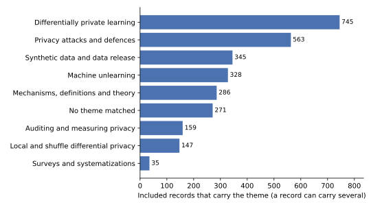

Suppose you want to know what the research on privacy-preserving machine learning did this year. You could read the proceedings of a few conferences, but most of the year's papers are not in them, and the ones you happen to see are not a fair sample. A **systematic review** fixes this by stating, before it starts, where it will search, with which words, what it will keep, and how it will sort what it keeps. Anyone can then run the same search and get the same records. This note is such a review of the papers published in 2026, run on 2 November 2026, and every count in it comes from one script.

The note is for a reader who knows what differential privacy (DP) and federated learning (FL) are, has little interest in federated or cryptographic systems, and wants a map of the rest of the year. It links to no other book and defines each term where it is used. It has two parts. The first says how the records were found and screened, which records the review sets aside, and what the counts show about how much was published, by whom and where. The second reads the papers of seven themes, in the order of their interest to a reader who trains and releases models under DP, and says what they claim. Every number comes from the frozen table of records that the search script wrote, and the script that computes them is [code/notes/ppml_2026_review.py](https://github.com/manuelvloureiro/privacy-preserving-machine-learning-book/blob/main/code/notes/ppml_2026_review.py):

```bash
uv run python code/notes/ppml_2026_review_search.py   # the search and the screening, from the cached download
uv run python code/notes/ppml_2026_review.py          # the counts, figures and tables of this note
```

@tbl-map gives the question each section answers, and @tbl-symbols lists the few symbols the note uses.

| Section | The question it answers |
|:---|:---|
| @sec-method | Where did the records come from, how were they screened, which were set aside, and how good is the screening? |
| @sec-map | How much was published, when, where, and how much of it has been cited? |
| @sec-themes | Which problems did the papers work on, and which problems go together? |
| @sec-synthesis | What did the papers of each theme do? |
| @sec-domains | Which data and which models were the papers about? |
| @sec-limits | What can this review not tell you? |
| @sec-reading | Where should you start reading? |
| @sec-sources | Which papers does the note cite, and where are they? |

: The question each section answers. {#tbl-map}

| Symbol | Meaning |
|:---|:---|
| $n$ | the number of records in the focus set |
| $m$ | the number of records in a hand-read sample |
| $\hat p$ | the share of a sample on which the reader agreed with the screening rule |
| $p$ | the true share, which the sample estimates |
| $\varepsilon$ | the privacy parameter of a differential-privacy guarantee, which bounds how much one record can change the output's distribution |
| $f$ | in $f$-DP, the trade-off function that a guarantee is stated with |

: The symbols the note uses. Each is also explained where it first appears. {#tbl-symbols}

# How the review was done {#sec-method}

A review is only as good as its search and its screening, so this section states both before any count. The review asks three questions. The first question is how much the field published in 2026, and where. The second question is which problems the papers worked on, and how the problems overlap. The third question is what the papers of each problem did. The first two questions are answered by counts over every included record. The third is answered by reading, and @sec-synthesis says which papers were read and why those.

## The search

The records come from two databases. The first is **OpenAlex**, an open index of scholarly works. It merges the records of Crossref, arXiv, PubMed, DataCite and other sources. So it lists journals, conference proceedings, books and repositories together. Each of its records has a title, usually an abstract, a publication date, a type such as article or preprint, a primary venue and a count of citing works. The second is **arXiv** itself, the repository where most machine-learning research first appears, searched through its own interface. Its records have a title, an abstract, the date of first submission and a subject class, but no citation count.

The search ran on 2 November 2026 with the thirteen strings of @tbl-queries. On OpenAlex a string was run over the title and the abstract of every work whose publication year is 2026. On arXiv it was run over the title and abstract of every paper first submitted in 2026, up to the search day. Each string names one way to protect, or to attack, the privacy of data used in learning. The strings were made wide on purpose. A paper that uses DP for anything was returned, and the screening then kept the ones about learning.



The plan was to run all thirteen strings on both databases, and the plan was not kept. OpenAlex gives an unregistered user a daily quota of requests, and the two widest strings, on differential privacy and on federated learning, used it up. The last quarter of the federated-learning string, the records dated October to December, was not downloaded, and the eleven narrower strings were not run there at all. A review must report such a deviation rather than hide it, so @tbl-queries shows zero OpenAlex records for those strings, and @sec-limits says what the gap costs. What it costs is bounded in one direction: an OpenAlex record on, say, membership inference is still in the review when its abstract also names differential privacy or federated learning, which @sec-synthesis shows most do. The script that runs the searches is [code/notes/ppml_2026_review_search.py](https://github.com/manuelvloureiro/privacy-preserving-machine-learning-book/blob/main/code/notes/ppml_2026_review_search.py), and it caches the download, so the screening can be rerun on the same records.

The strings overlap by design, because a paper on federated learning with differential privacy should be found twice rather than missed. So the records of all the searches were put together and the repeats removed, first by their identifier and then by their title. The second step matters for two reasons. The same paper is often in OpenAlex twice, once as a preprint and once as the published version, each with its own identifier. And a paper found on arXiv directly is often also in OpenAlex, which indexes arXiv with a delay. When two records had the same title after punctuation and case were removed, one was kept. The published version came before a preprint, and an OpenAlex record before an arXiv one, because it carries a citation count. The citation counts of two records were never added.

## The screening

A systematic review keeps a record only when it meets criteria written down before the search, and @def-included states this review's criteria. The criteria are applied by a script, not by a reader, so they are regular expressions on the title and the abstract, and the full list is in the script.

::: {#def-included name="An included record"}
A record is included when all of these hold. It is a paper, which means an article, a conference paper, a preprint, a review or a book chapter. It is in English. It is not retracted. Its title or abstract names a learning object, such as a model, training, a classifier, a language model or a neural network. And it is about privacy in one of two ways. Either its title or abstract names a privacy technique or a privacy attack, such as differential privacy, membership inference, homomorphic encryption, unlearning, synthetic data or anonymization. Or it names federated learning, or calls itself privacy-preserving, and has a privacy word in its title.
:::

The last criterion does the real work, and its second half needs a reason. FL keeps the data on the device, and nearly every paper that uses it calls itself privacy-preserving for that reason alone. If the words were enough, the review would be a review of FL. So a paper that names no technique and no attack is included only when privacy is in its title, which is where an author puts the purpose of the paper.

The criterion also removes two other kinds of record. The first kind mentions privacy only as a motivation. A paper on a smart grid, say, notes that its users care about privacy and then trains a model with no protection, so it has no cue at all. The second kind uses a privacy technique with no learning in it, such as a differentially private histogram of ages, so it has no learning cue. All three kinds are legitimate research, but they are not privacy-preserving machine learning. This review takes that term to mean the protection of data used to train, query or release a learned model, or an attack on that protection. @tbl-flow gives the records at each stage.



A record without an abstract was screened on its title alone, and a record with no cue in the title was then excluded. This loses some papers, and @sec-limits returns to it.

## Checking the screening by hand

A rule written as a regular expression will keep some records it should not and drop some it should keep. A reader can measure both kinds of error on a sample, so the author read two random samples of records. The first sample has $m$ = 120 records, where $m$ is the sample size, drawn from the included set with a fixed random seed. Each was read, title and abstract, and marked as a paper on privacy-preserving machine learning or not. The share marked as such is the **precision** of the screening, written $\hat p$. The second sample, of 40 records, was drawn from the records that the rule excluded for want of a learning cue, and each was marked as rightly or wrongly excluded. The decisions and the reason for each disagreement are in the file next to the script, so a second reader can check them.

A share measured on a sample is uncertain, and the uncertainty should be shown. If the true precision is $p$, the number of agreements in a sample of $m$ records is binomial with $m$ trials and success probability $p$. The **Clopper–Pearson interval** is the set of values of $p$ under which the observed count is not in the most extreme 2.5% of either tail. It is exact, which means its coverage is never below 95%, and it is wider than the normal approximation on a small sample. @tbl-screening gives both samples, their shares and their intervals.

The precision is $\hat p$ = 89%, with an interval from 82% to 94%. The thirteen false inclusions were security papers, systems papers and reviews that mention a privacy attack or a technique in passing. Of the records excluded for want of a learning word, 82% were rightly excluded. The interval is wide because the sample is small. The seven that were wrongly excluded are clustering, principal component analysis and trajectory synthesis, which the learning cue does not know. @sec-limits turns these shares into counts.



## What is set aside

The included set is about privacy-preserving machine learning as a whole, and two of its themes do not interest the reader this note is for. The first is federated learning, where the privacy protection is that the data stay on the device and the paper's work is the system around that. The second is cryptographic and hardware protection, where the protection is encryption, secret sharing or a trusted processor, and the paper's work is to make it fast enough. Both are large, both are mostly engineering, and both were summarized in the first version of this note. So the review classifies every included record first, as the next subsection says, and then sets aside every record that carries either theme. @tbl-focus gives the counts. What remains is the **focus set**, written $n$, and every count, figure and reading from @sec-map on is over it.



Two things about the cut should be clear. A record that combines a general result with a federated experiment is set aside with the rest, because the rule reads words, not contributions, and @sec-limits names what this costs. And the screening's precision was measured on the included set, not on the focus set, so the share of false inclusions in the focus set is estimated, not measured.

## Extraction and classification

From each included record the script keeps the title, the date, the type and the venue with its kind. It also keeps the citation count, the first author, the number of authors, the search strings that returned it and the topic that OpenAlex, the first database, assigns. It then classifies the record twice, again by regular expressions on the title and abstract. The first classification is by **theme**, the problem the paper works on. There are ten themes: the two that are set aside, the seven that @sec-synthesis reads, and surveys, and @tbl-themes in @sec-themes lists what each rule looks for. A record can carry several themes, and a record that matches none is counted as such rather than forced into one. The second classification is by **domain**, the kind of data or model the paper is about. The domains include language models, images, graphs, health records and the internet of things, and @sec-domains gives them.

Two choices in the classification need a word. A record is a survey only when its title says so, because "survey data" in an abstract is a kind of data, not a kind of paper. And the theme of private training is matched only when a DP word and a training word fall within a few words of each other. Otherwise a paper that trains a model and, separately, releases a private statistic would count as private training. Every rule is in the script, and the test in [tests/test_notes_ppml_2026_review.py](https://github.com/manuelvloureiro/privacy-preserving-machine-learning-book/blob/main/tests/test_notes_ppml_2026_review.py) checks each on examples.

# What was published, and where {#sec-map}

The focus set holds $n$ = 2,022 records, 28% of the 7,279 that the screening kept. This section counts them: by month, by the kind of venue, and by how often they have been cited. The counts answer the first question of the review, how much the field published in 2026 and where, and they also show what the record set can and cannot support.

## How many, and when

@fig-months shows the records of the focus set by the month of their publication date, split by the kind of venue. Two features of the figure are artefacts of the data, not of the field. The January column is the tallest because 186 records, 9% of the set, carry the date 1 January exactly. A journal that dates a whole volume to the first day of its year puts every paper of the volume there, so January counts papers from the whole year. The October column is cut by the search date, 2 November, since both databases index a paper some days or weeks after it appears.

{#fig-months}

Between those two columns the focus set grew by between 137 and 229 records a month. So a reader who follows the general literature of privacy-preserving machine learning, without its federated and cryptographic systems, faces about six new papers a day.

## Where

@tbl-sources gives the kind of venue of each record, as the databases list it, with arXiv, the preprint server, as a kind of its own. More than half of the focus set is on arXiv, and a journal holds less than a quarter. This is the reverse of the included set as a whole, where journals led and arXiv came second. The general results of the field are posted as preprints, while the federated and cryptographic systems that were set aside are the ones that fill the journals. One record in ten sits in a repository other than arXiv, most of them on Zenodo, a general archive where anyone can deposit a file without review.



@tbl-venues lists the twenty journals and proceedings with the most records of the focus set. The counts are small. A Springer book series of conference proceedings leads with 23 records, and the AAAI conference follows with 14. The specialist venues of the field are in the list but far from its top. The Proceedings on Privacy Enhancing Technologies and the two IEEE transactions on security have 8 records each, and the Network and Distributed System Security Symposium 7. So does the Journal of the American Statistical Association, which is where the year's accountant and its private inference went. The fifteen venues this review treats as the core of the field, listed in @sec-synthesis, hold 50 records between them, 2% of the focus set.



## Citations

OpenAlex gives a citation count for 1,291 of the records, every record it holds, while a record found only on arXiv has none. The median count is zero. Of the records with a count, 90% have not been cited, nine have five citations or more, and the most cited record has 13. Papers published in the same year as the search have had little time to be cited, so these numbers measure how early the year is, not how good the papers are. The few records that have been cited are preprints and applied journal papers of no particular theme. So citations are not a way to choose what to read, and @sec-synthesis reads by venue and by random draw instead.

# The themes {#sec-themes}

The second question of the review is which problems the papers worked on, which @sec-method called the themes. @tbl-themes gives the eight themes of the focus set, what each rule looks for, and how many records carry each. A record carries every theme its title or abstract matches, so the shares add up to more than one, and 271 records match no theme at all.



{#fig-themes}

Differentially private learning is the largest theme, with 745 records, 37% of the focus set, and attacks come second with 563. The next three are close together: synthetic data with 345 records, unlearning with 328 and mechanisms and theory with 286. Auditing and local DP are the small themes, with 159 and 147. Surveys are 35 records, and only 1,081 records carry exactly one theme, so most papers of the focus set sit on two or more of these problems at once.

{#fig-cooccurrence}

@fig-cooccurrence shows which problems go together. Auditing is the theme most entangled with the others, because an audit needs an attack and a trained model. Of the audit records, 58% also carry the attack theme and 32% the private-learning theme. Mechanisms and theory carry private learning in 59% of their records, which says that the year's theory was mostly theory of training rather than of statistics. Unlearning stands apart. Only 5% of its records carry private learning and 25% carry attacks. It also has the highest share of large language models (LLMs), 52%, and of arXiv, 96%. The attack theme is about language models in 48% of its records, against 23% for private learning and 15% for theory. So the field's attacks moved to language models faster than its defences did.

# Theme by theme: what the papers did {#sec-synthesis}

Counts say what the field worked on, not what it found, so this section reads. Reading every record of the focus set is beyond one author, and @sec-map showed that the most cited records would give a skewed sample. The review therefore read, for each theme, three sets of records by their abstracts. The first set is every record of the theme published at one of fifteen **core venues** of the field, or a random twenty of them when there are more. @tbl-core lists the fifteen: the privacy and security conferences and journals, and the machine-learning conferences. The second set is the five most cited records of the theme in OpenAlex. The third is twelve records of the theme drawn at random from arXiv, with a fixed seed. @tbl-reading gives the counts, and every paper named below is in @sec-sources.





Only 50 records, 2% of the focus set, are at a core venue at all. The three large machine-learning conferences contribute none, because OpenAlex indexes little of their 2026 proceedings, so their papers reach the set only through arXiv. The reading is thus a reading of the field's most selective venues and of a random slice of its preprints. It is also a reading of abstracts, which @sec-limits weighs. The seven themes come in the order of their interest to the reader this note is for.

## Differentially private learning

This theme holds 745 records, 37% of the focus set. Of these, 23% are about language models, 38% are on arXiv and 18% are about health. Its core-venue papers work on three problems. The first is to make training with stochastic gradient descent (SGD) made private, called DP-SGD, lose less accuracy. Xu et al. (2026) smooth each example's gradient with momentum before clipping it and filter the noise afterwards, to lower both the noise and the bias that clipping adds. Zheng et al. (2026) fine-tune a language model with noise only in the low-dimensional subspace where the task's updates live. Sha et al. (2026) constrain instead where the updates are applied, with a selection of parameters that costs no extra budget. Monir et al. (2026) adapt the noise and the clipping norm to the curvature of the loss, estimated on public data.

Two more core-venue papers protect something other than the weights. Yang et al. (2026) build steering vectors for language models under DP, and Liu et al. (2026) replace the gradient by a zeroth-order estimate, so that a large language model can be fine-tuned privately without the memory of per-example gradients.

The second problem is to account for the budget more tightly. Liang et al. (2026) prove that the privacy loss of DP-SGD converges with the number of iterations, when the loss is smooth and the parameters stay in a bounded set. So a long run no longer pays for every step. Xiang et al. (2026) revisit hyperparameter tuning, show by auditing that the generic analysis of private selection is loose in the white-box setting, and give a tighter one. Annamalai et al. (2026) audit DP-SGD trained with shuffling instead of Poisson sampling and find that the reported guarantees, computed as if sampling were Poisson, can be wrong. Ertan and a co-author (2026) go the other way. They prove, in $f$-DP, where $f$ is the trade-off function that states a guarantee, that one epoch of shuffled DP-SGD cannot have a favourable trade-off curve unless the noise multiplier is large. These papers share a method: they put a reported $\varepsilon$ to the test instead of taking it from the accountant, and @sec-synthesis-audit returns to it.

The third problem is what private training does to the model. Shi et al. (2026) study private gradient descent (GD), called DP-GD, and find a learning task where it generalizes better than GD itself, which is a rare theoretical result in the theme's favour. Giddens et al. (2026) give the first DP algorithm for weighted empirical risk minimization, which individualized treatment rules need. Sarkar et al. (2026) show that a bandit can be both private and fair in its regret. Among the random arXiv records, El Mais et al. (2026) find that tying the input and output embeddings of a language model costs accuracy under DP-SGD, although it is a standard choice. Mokhtari et al. (2026) propose a new set of benchmarks for private image classification with a public leader board. Sopa et al. (2026) give a user-level private regression for panel data. Wang et al. (2026) give risk bounds for DP-SGD with correlated noise. Zhao et al. (2026) give the first DP guarantee for training a language model with verifiable rewards, at the level of a prompt.

The pattern of the theme is that DP-SGD itself is settled and the work is around it: where to put the noise, how to count it, and what it costs. The most cited records of the theme are applied journal papers in health and sensing that apply DP as a step and add nothing to it.

## Auditing and measuring privacy {#sec-synthesis-audit}

Auditing is a small theme, with 159 records, but it is the one whose papers change what a practitioner should report. It is also the most entangled theme, since 58% of its records are also attacks and 74% are on arXiv. Its four core-venue papers are all about DP-SGD. Annamalai et al. (2026) audit DP-SGD with shuffling and find leakage above the reported bound. Xiang et al. (2026) audit hyperparameter tuning and find the generic bound loose. Zheng et al. (2026) prove that the privacy cost of a multi-layer graph neural network (GNN) converges with depth, where earlier analyses charged for every layer, and check the result by audit. Deng et al. (2026) then question the audits themselves. The canary examples that audits insert may not be the queries that leak most, because the most informative query shifts during training. So they optimize the query and get tighter lower bounds on the privacy parameter $\varepsilon$.

The arXiv records improve the audits' statistics. Agrawal et al. (2026) show that in a white-box one-run audit the canary signals sum to an asymptotically Gaussian statistic, and build tighter one-run audits on it. Bhuekar (2026) audits DP-SGD in the hidden-state model, where only the final model is seen, and finds that hiding the intermediate models gives no amplification when a record is used at every step. Cebere et al. (2026) audit a deployed model with no training run at all, by correcting for the distribution shift between known members and known non-members. Brännvall (2026) shows that the three leading membership inference attacks are one likelihood-ratio test under different distributional assumptions. The paper gives a rule for choosing among them by the number of shadow models one can afford.

Three arXiv records audit something other than a classifier. Zareian Jahromi et al. (2026) ask when a number called "epsilon" from an embedding-space audit is evidence at all, and find that only a classifier test with a held-out set and a confidence calculation is. Amin et al. (2026) separate true disclosures from phantom ones in synthetic data by a holdout test, and Li et al. (2026) calibrate text-rewriting mechanisms empirically because their nominal $\varepsilon$ values cannot be compared.

The theme's method is one. State a guarantee, build the strongest attacker the threat model allows, and compare what the attacker achieves with what the guarantee permits. In 2026 that method found three gaps in the guarantees of DP-SGD as reported, under shuffling, under tuning and under hidden states, and it found that the audits themselves could be sharper.

## Synthetic data and data release

The synthetic-data theme holds 345 records, 70% of them on arXiv and 32% about language models. Its core-venue papers generate new kinds of data under DP. Liu et al. (2026) in PrivCode synthesize code. Gong et al. (2026) in PrivORL synthesize the transitions and trajectories of offline reinforcement learning with a diffusion model. Wang et al. (2026) in RPGen make a diffusion model robust to DP noise before they fine-tune it on private images. For tabular data, Jia et al. (2026) combine a generative adversarial network (GAN) with a sparse Bayesian network and prove convergence bounds, which bridges the two families of tabular synthesizers. Bhusal et al. (2026) generate synthetic text by private prediction, which aggregates the token distributions of a frozen language model over private records, with no fine-tuning. Mori et al. (2026) use the same idea to build a private synthetic database for retrieval-augmented generation (RAG), so that the budget is spent once rather than at every query.

Three core-venue papers evaluate rather than generate. Angelozzi and a co-author (2026) benchmark fairness interventions on DP synthetic tables from the AIM mechanism and ask where in the pipeline an intervention still works. Golob et al. (2026) systematize reconstruction attacks on synthetic tables, pit fourteen attacks against thirteen generators on five datasets, and report that their strongest attack came from a national competition. Xin et al. (2026) show that sanitized text, whether by removing identifiers or by synthesis, still lets an attacker infer age or substance use from routine details. A commercial identifier remover left 74% of the information in a medical question set.

The arXiv records divide between new mechanisms and a growing scepticism. On the mechanism side, Rosenblatt et al. (2026) give a global guarantee for high-dimensional synthetic data from sliced polynomial moments. Zare Moayedi et al. (2026) adapt a pure-DP synthesizer to the intrinsic dimension of the data. Asiaee and a co-author (2026) release only sufficient statistics and do calibrated inference from them. Yavo et al. (2026) add a post-processing step that keeps synthetic records a minimum distance from real ones.

On the sceptical side, Zhao et al. (2026) argue in a position paper that privacy is a claim about an attacker, not a property of synthetic data. They show that most papers using synthetic data for privacy state no threat model. Ganev and a co-author (2026) argue that anonymity must be assessed against the generative model, not the released table, because the model is what is deployed. Kuo et al. (2026) find that four generative paradigms reproduce the marginals of a medical cohort and none preserves its subgroup structure and effect estimates. Takahashi and a co-author (2026) raise a question the theme had not asked. A private report can contain plausible statements that the data do not support, so they certify the support of each statement under DP.

## Mechanisms, definitions and theory

The theory theme holds 286 records, 59% of them also about private learning. Its core-venue papers are the ones a textbook will cite. Su et al. (2026) prove that the privacy blanket decomposition is the optimal way to analyse amplification by shuffling, which closes a question that two analytical frameworks had left open. Sabater et al. (2026) estimate a mean in a fully decentralized network under DP with correlated noise, robust to parties that drop out. Asghar et al. (2026) explain a known oddity of metric DP for text. The multidimensional Laplace mechanism returns either the original word or an unrelated one, because in a high-dimensional embedding the nearest neighbour is much farther than the gap between the next neighbours. Epasto et al. (2026) give sublinear-space private graph algorithms under continual release. Two results already noted belong here too. Zheng et al. (2026) prove that the privacy cost of message passing converges with depth, and Liang et al. (2026) that the privacy loss of DP-SGD converges with the number of steps.

The arXiv records are the theory of the year's open questions. Dharangutte and a co-author (2026) study probably approximately correct (PAC) learning under DP. They show that two classes with the same Vapnik–Chervonenkis (VC) and Littlestone dimensions can have different private sample complexities, and give a new parameter that lower-bounds that complexity. Raskhodnikova et al. (2026) define local node DP for graphs and answer linear queries about the degree distribution through a blurred version with lower sensitivity. Klopp and a co-author (2026) and Marchis et al. (2026) both show that node-private community detection needs a logarithmic budget, and give algorithms that reach it. Cesari and a co-author (2026) settle an open problem on the gap-dependent regret of private decision-theoretic online learning.

Three more arXiv records connect the theory to the rest of the note. Ribero et al. (2026) build two-sample tests from $f$-divergences, with the hockey-stick divergence as the case that matters for auditing and for unlearning. Hu et al. (2026) show that a relaxation of DP that protects only policy-specified substitutions buys nothing for the nearest-neighbour synthesizers now in use, because their vote histograms jump at every decision boundary. Saxena et al. (2026) turn the privacy profile into a certificate of robustness against backdoors, by composing the training-time and test-time mechanisms through the dual view of DP.

One paper the keyword rule set aside belongs here by its content. Wang et al. (2026) publish the Edgeworth accountant in a statistics journal. It composes guarantees in $f$-DP analytically, by an Edgeworth expansion of the summed privacy-loss log-likelihood ratios. Its abstract mentions FL as an application, so the rule put it with the federated records, and @sec-limits counts this among the costs of the cut.

## Privacy attacks and defences

The attack theme holds 563 records, 73% of them on arXiv and 48% about language models. Only seven are at a core venue, and they are of three kinds. Two measure. Chu et al. (2026) find that whether DP training stops membership inference on synthetic network data depends on the model. Zhu et al. (2026) in GraphTheft find that graph prompt learning leaks node attributes and links to every kind of attacker. Two defend without a guarantee. Forough and a co-author (2026) add noise at inference time in proportion to a query's risk, and Cui et al. (2026) train a GAN against a membership-inference objective. Shi et al. (2026) distil a dataset under DP by starting from DP-generated data. The seventh, Wang et al. (2026), breaks a published local DP protocol for set-valued data and recovers users' data with 96% probability.

The arXiv records show where the attacks went in 2026: to language models, and to parts of them that older attacks did not use. Tan et al. (2026) show that the routing information a mixture-of-experts model emits during inference improves membership inference on its fine-tuning data. Chen et al. (2026) and Zhai et al. (2026) attack fine-tuned diffusion language models, whose many masking patterns multiply the attacker's chances. Kulkarni et al. (2026) attack retrieval-based in-context learning. Cai et al. (2026) run black-box membership inference on fine-tuned text-to-speech models, which leak both the voice and the words. Zhu et al. (2026) move membership inference from a sample to an entity, by interrogating the model about a person as one would a witness. Huang et al. (2026) in WARP recover the mixture of data sources a model was fine-tuned on from its released weights.

Two papers find leakage in design choices rather than in data. Doan et al. (2026) show that batch normalization makes a network memorize its outliers more and so leak more. And graph-based RAG systems leak their knowledge graph to subgraph reconstruction attacks.

Two arXiv papers defend. Zhang et al. (2026) localize the tokens where verbatim memorization happens and correct the activations there only. Cheng et al. (2026) account for the privacy loss of the sampling process of a diffusion model, by a clipped empirical denoiser whose sensitivity is explicit. Vrettos et al. (2026) measure the membership-inference risk of each patient across 7,789 clinical models and find that the most exposed patients stay the same whatever the training choices. The theme's lesson repeats last year's. Every new interface to a model is a new channel, whether it is routing, retrieval, a prompt or the weights. The defences that offer a guarantee are the ones of @sec-synthesis-audit.

## Local and shuffle differential privacy

Local differential privacy (LDP), where each user randomizes their own data before it leaves them, has 147 records in the focus set. Its core-venue papers are of two kinds. The first improves the estimators. Jiang et al. (2026) generalize the count-mean sketch protocols that large companies deploy and optimize them for the frequencies one cares about. Seeam et al. (2026) learn the dependencies between attributes privately first and then spend the budget where they are. Ye and a co-author (2026) quantify what a classifier loses under any LDP mechanism, by reading the perturbation as a robustness problem. Su et al. (2026) settle the analysis of shuffling, as @sec-synthesis already noted.

The second kind applies LDP to a learning system, and in 2026 that system is a language model. Liu et al. (2026) in Rap-LI sanitize the prompts sent to a language-model service. They report that a uniform privacy budget of $\varepsilon = 0.1$ still leaks 72% of the sensitive items, so they spend the budget by risk. Zhan et al. (2026) in PRISM route the sensitive tokens of a prompt to the device and the rest to the cloud. Li et al. (2026) in Profile-DP privatize a user's profile before a personalized model reads it.

The arXiv records add estimators with rates. Butucea et al. (2026) show that a relaxed LDP, close in total variation, allows density estimation at nearly the non-private rate. Dufraiche et al. (2026) correct the bias that LDP noise puts into a classifier's loss by inverting a Weierstrass transform. Cao et al. (2026) make LDP work on images by randomizing their bit planes rather than their pixels. Li et al. (2026) show that LDP protocols for data streams can be manipulated by injected users, which is the second broken LDP protocol of the year after the one of @sec-synthesis. The theme's results are tighter than most of the field's, because LDP has a precise model and a decade of lower bounds to compare against.

## Machine unlearning

Unlearning has 328 records, and it is the theme least tied to the rest. Only 5% of its records carry private learning, while 52% are about language models and 96% are on arXiv. Only one record is at a core venue, Zhang et al. (2026), who unlearn from a language model through retrieval, so the theme was read almost entirely through its preprints. They are of three kinds.

The first kind unlearns. Almudévar and a co-author (2026) unlearn in the representation space with an information bottleneck instead of changing the weights, and Fang et al. (2026) in a low-dimensional feature subspace. Abitante et al. (2026) find that unlearning updates can be too small to survive four-bit quantization and concentrate them in low-rank adapters. Zhai et al. (2026) in Nullify steer activations at inference time, with no training. Wu and a co-author (2026) unlearn only the tokens that carry the knowledge. Dolgova and a co-author (2026) make certified unlearning, the kind with a DP guarantee, usable by spreading its noise over orthogonal subspaces. Schneider et al. (2026) design a model so that a user's data never enter the shared weights and deletion is exact.

The second kind evaluates, and it is the larger. Ataee and a co-author (2026) in TRIAGE and Dahal et al. (2026) in GONE evaluate what unlearning did inside the model and to related knowledge, not only whether the model appears to forget. Jang et al. (2026) use sparse autoencoders to distinguish suppression from deletion and find that most of twelve methods suppress. Hu et al. (2026) recover supposedly forgotten private information by decoding the least likely token at each step, from five unlearning methods. Rybak et al. (2026) in REBEL recover it with evolved adversarial prompts, and Li et al. (2026) find that knowledge erased in one language stays reachable in others. Qian et al. (2026) build a benchmark of multi-hop questions and recovery attacks. One paper from the hand-read sample studies the geometry: many unlearned models stay in the same connected basin of the loss as the original.

The third kind asks what a deletion request is. Lin et al. (2026) model the audit of unlearning compliance as a game between an auditor and an operator, and Han et al. (2026) price data retention when the operator cannot know users' preferences. What the theme lacks, across all three kinds, is a shared definition of success that an outsider could check. The evaluation papers are the evidence, because every one of them finds that a method which passed the standard benchmarks had not removed what it claimed.

# Domains and model types {#sec-domains}

The last classification asks what data and what models the papers are about. @tbl-domains gives the ten domains, how many records of the focus set carry each, and the share of each that works with differential privacy, with attacks or with synthetic data. Like the themes, the domains come from words in the title and abstract, a record can carry several, and 32% carry none.



Language models are the largest domain of the focus set, with 644 records, 32% of it, and images and video come second. This is the reverse of the included set as a whole, where health led because federated learning in hospitals led. The applied domains are still there, with health at 356 records and the internet of things at 130, but they are a minority once the federated systems are set aside. Language models are also where the attacks are. Of their records, 42% carry the attack theme, the highest share of any domain, against 18% for the internet of things and 16% for recommendation. Tables are where synthetic data are: 51% of the records about tables carry that theme, because the tabular synthesizers and their benchmarks are the oldest part of the synthetic-data literature.

The share of differential privacy says something as well. It is highest in the applied domains, at 84% for the internet of things, 79% for graphs and 78% for recommendation, where DP is applied as a step of a pipeline. It is lowest in the three domains of generated content: 41% for language models, 43% for speech and 47% for images, where the rest of the records attack, audit, unlearn or synthesize without a guarantee. So the field's newest domains are the ones where its formal tool is used least, and the gap between what is attacked and what is protected is widest there.

# What the review can and cannot say {#sec-limits}

A systematic review is only as reliable as its weakest step, so this section lists the steps that limit this one, from the search to the reading. Each limit is stated with the number that measures it where the review has one.

**The databases.** Eleven of the thirteen strings were run on arXiv only, because the quota of OpenAlex, the first database, ran out after the two widest strings. A journal or conference paper on, say, membership inference or unlearning entered the set only when its abstract also named differential privacy or federated learning, or when it was on arXiv. The arXiv searches found 731 records of the focus set that OpenAlex did not, and only 5 of those match the two wide strings. So the eleven narrow strings do find papers the wide ones miss. How many such papers sit in journals that OpenAlex indexes and arXiv does not is unknown, and the themes most affected are attacks, unlearning and auditing, the ones with the highest arXiv shares. OpenAlex also indexes little of the 2026 proceedings of the three large machine-learning conferences, so their papers appear as arXiv preprints, without a venue and without a citation count.

**The screening.** The screening rules are regular expressions, and @tbl-screening measures how often a reader agrees with them. Of the 120 records read from the included set, 107 were about privacy-preserving machine learning. That is a precision, the share of included records that belong, of 89% with an interval from 82% to 94%. The sample was drawn from the included set, not from the focus set, so the focus set's own precision is not measured. Of the 40 records read from those excluded for want of a learning word, 33 were rightly excluded. So about 18% of the 855 records excluded for that reason were lost, roughly 150. They are private clustering, principal component analysis and trajectory synthesis, whose titles name no word the rule knew, and most of them would have been in the focus set. A record without an abstract, 8% of the focus set, was screened on its title alone.

**The cut.** The focus set is what remains after every record that carries the federated or the cryptographic theme is set aside, and the themes are keyword rules. A paper whose abstract mentions federated learning as one application of a general result is set aside with the federated systems. The Edgeworth accountant of @sec-synthesis is one such paper. A separation result on DP under continual observation is another, set aside because its abstract uses the word oblivious, which the cryptographic rule knows from oblivious transfer. The cut therefore loses some general results, in a number this review has not measured, and the reader who wants the theory complete should search the set-aside records for the theory theme.

**The classification.** Themes and domains are also keyword rules. A paper that mentions membership inference in its related work carries the attack theme, and a paper on health that never says patient does not carry the health domain. The co-occurrence shares of @sec-themes are therefore upper bounds on how often two problems are really studied together. The surveys are found by title, so a survey whose title does not say so is missed.

**The dates and the counts.** OpenAlex's publication date is the one the publisher deposits, and 186 records carry 1 January, so the monthly counts of @fig-months describe publishers' habits as much as the field's rhythm. The search ran two months before the year's end, and indexing lags publication, so the year's total will be higher than 2,022 when it is complete. The citation counts are those of a few months, as @sec-map showed.

**The reading.** The synthesis read abstracts, not papers, and one reader did the screening and the reading. An abstract states a claim without its evidence, so a paper that claims to break a defence or to tighten a bound was taken at its word. The reading rule gives the core venues most of the weight, and the core venues are the privacy and security community's. A result published at a statistics or systems venue is read only if the random draw found it. For unlearning, with one record at a core venue, the reading is a reading of thirteen preprints chosen at random or by citations. The hand screening was done once, by the author, and no second reader measured the agreement between readers.

What the review can say, within those limits, is this. It can say how many records a reproducible search finds, where they are published, and how the themes are distributed and overlap, with the error of its rules measured on a sample. It can say what the papers at the field's own venues claim to have done, theme by theme, once federated and cryptographic systems are set aside. It cannot say which results are correct, which will matter, or what was published where neither database looked.

# Where to start reading {#sec-reading}

A reader who wants the year in a dozen papers can take one or two from each theme, chosen here from the core-venue and arXiv records that @sec-synthesis read, for the question each answers. @tbl-start lists them, in the order of the themes. The choice is the author's, after the reading, and a different reader would choose differently. The records that were read are counted in @tbl-reading, and the frozen table of all 7,279 records, with the two set-aside themes marked, is in the repository for anyone who wants to choose otherwise.

| Theme | Start with | Because it |
|:---|:---|:---|
| Differentially private learning | Liang et al. (2026); Xu et al. (2026) | tightens the budget of a long run; lowers the noise and the clipping bias of DP-SGD at once |
| Auditing | Annamalai et al. (2026); Deng et al. (2026) | finds leakage above the reported bound under shuffling; questions the canaries that audits use |
| Synthetic data | Golob et al. (2026); Zhao et al. (2026) on the position paper | measures reconstruction attacks on synthetic tables; asks what privacy claim synthetic data can make |
| Theory | Su et al. (2026); Dharangutte and a co-author (2026) | settles the analysis of shuffling; separates private from non-private sample complexity |
| Attacks and defences | Tan et al. (2026); Doan et al. (2026) | shows that routing telemetry leaks membership; shows that a normalization layer leaks |
| Local DP | Jiang et al. (2026); Liu et al. (2026) on Rap-LI | generalizes the deployed frequency protocols; measures what a uniform local budget leaves exposed |
| Unlearning | Dolgova and a co-author (2026); Hu et al. (2026) | makes certified unlearning usable; recovers what five methods claimed to forget |

: A starting paper or two for each theme, from the records the review read. {#tbl-start}

# References {#sec-sources}

The papers the note names, by the theme under which they were read. Each link goes to the paper's digital object identifier where OpenAlex records one, otherwise to its OpenAlex or arXiv page. The frozen table of all 7,279 included records, with each record's identifier, themes and domains, is [code/notes/ppml_2026_review_records.csv](https://github.com/manuelvloureiro/privacy-preserving-machine-learning-book/blob/main/code/notes/ppml_2026_review_records.csv), and the hand-screening decisions are [code/notes/ppml_2026_review_screening.csv](https://github.com/manuelvloureiro/privacy-preserving-machine-learning-book/blob/main/code/notes/ppml_2026_review_screening.csv).

The databases and the method.

- Priem, J., Piwowar, H. and Orr, R. (2022). [OpenAlex: A fully-open index of scholarly works, authors, venues, institutions, and concepts](https://arxiv.org/abs/2205.01833). The database behind the two wide searches; its [works endpoint](https://docs.openalex.org/api-entities/works) was queried over title and abstract.
- arXiv (2026). [The arXiv API](https://info.arxiv.org/help/api/index.html). The interface behind the thirteen arXiv searches, by date of first submission.
- Page, M. J. et al. (2021). [The PRISMA 2020 statement: an updated guideline for reporting systematic reviews](https://doi.org/10.1136/bmj.n71). *BMJ* 372. The reporting items the method section follows: the sources, the search strings, the criteria, the flow of records and the limits.
- Clopper, C. J. and Pearson, E. S. (1934). The use of confidence or fiducial limits illustrated in the case of the binomial. *Biometrika* 26(4). The exact interval of @tbl-screening.

Differentially private learning.

- Xincheng Xu, Thilina Ranbaduge, Qing Wang et al. (2026). [Enhancing DPSGD via Per-Sample Momentum and Low-Pass Filtering](https://doi.org/10.1609/aaai.v40i32.39951). *Proceedings of the AAAI Conference on Artificial Intelligence*.
- Lele Zheng, Xiang Wang, Tao Zhang et al. (2026). [Differentially Private Subspace Fine-Tuning for Large Language Models](https://doi.org/10.1609/aaai.v40i34.40117). *Proceedings of the AAAI Conference on Artificial Intelligence*.
- Haichao Sha, Zihao Wang, Yuncheng Wu et al. (2026). [DP-SelFT: Differentially Private Selective Fine-Tuning for Large Language Models](https://doi.org/10.48550/arxiv.2605.17432). *arXiv*.
- Zhihao Liu, Jian Lou, Wenjie Bao et al. (2026). [Differentially Private Zeroth-Order Methods for Scalable Large Language Model Fine-Tuning](https://doi.org/10.1109/tifs.2026.3679194). *IEEE Transactions on Information Forensics and Security*.
- Islam A. Monir, Gabriel Ghinita and Mohamed M. Abdallah (2026). [From Curvature to Privacy: EER-Driven Differential Privacy in Deep Neural Networks](https://doi.org/10.1145/3779208.3805970). *ACM Asia Conference on Computer and Communications Security (ASIA CCS)*.
- Haocheng Yang, Xiang Cheng, Chenhao Sun et al. (2026). [PrivSV: Differentially Private Steering Vector for Large Language Models](https://doi.org/10.1609/aaai.v40i40.40720). *Proceedings of the AAAI Conference on Artificial Intelligence*.
- Hao Liang, Wanrong Zhang, Xinlei He et al. (2026). [An Improved Privacy and Utility Analysis of Differentially Private SGD with Bounded Domain and Smooth Losses](https://doi.org/10.1609/aaai.v40i28.39510). *Proceedings of the AAAI Conference on Artificial Intelligence*.
- Zihang Xiang, Tianhao Wang, Cheng-Long Wang et al. (2026). [Revisiting Differentially Private Hyper-parameter Tuning](https://doi.org/10.14722/ndss.2026.230447). *Network and Distributed System Security Symposium*.
- Meenatchi Sundaram Muthu Selva Annamalai, Borja Balle, Jamie Hayes et al. (2026). [To Shuffle or not to Shuffle: Auditing DP-SGD with Shuffling](https://doi.org/10.14722/ndss.2026.240597). *Network and Distributed System Security Symposium*.
- Murat Bilgehan Ertan and Marten van Dijk (2026). [Fundamental Limitations of Favorable Privacy-Utility Guarantees for DP-SGD](https://doi.org/10.48550/arxiv.2601.10237). *arXiv*.
- Zhongjie Shi, Puyu Wang, Chenyang Zhang et al. (2026). [Towards Understanding Generalization in DP-GD: A Case Study in Training Two-Layer CNNs](https://doi.org/10.1609/aaai.v40i30.39731). *Proceedings of the AAAI Conference on Artificial Intelligence*.
- Spencer Giddens, Yiwang Zhou, Kevin R. Krull et al. (2026). [A Differentially Private Weighted Empirical Risk Minimization Procedure and Its Application to Outcome Weighted Learning](https://doi.org/10.1109/tifs.2026.3707445). *IEEE Transactions on Information Forensics and Security*.
- Dhruv Sarkar, Nishant Pandey and Sayak Ray Chowdhury (2026). [DP-NCB: Privacy Preserving Fair Bandits](https://doi.org/10.1609/aaai.v40i30.39710). *Proceedings of the AAAI Conference on Artificial Intelligence*.
- Razan El Mais, Ali Chehab, Ibrahim Issa et al. (2026). [Is Weight Tying Still Beneficial for Decoder-Only LLMs in Private Settings Under DP-SGD?](https://doi.org/10.48550/arxiv.2609.40335). *arXiv*.
- S. Mokhtari, Sara Kodeiri, Shubhankar Mohapatra et al. (2026). [Rethinking Benchmarks for Differentially Private Image Classification](https://doi.org/10.48550/arxiv.2601.17189). *arXiv*.
- Getoar Sopa, Marco Avella Medina and Cynthia Rush (2026). [Differentially Private Inference for Longitudinal Linear Regression](https://doi.org/10.48550/arxiv.2601.10626). *arXiv*.
- Puyu Wang, Jan Schuchardt, Nikita Kalinin et al. (2026). [Optimization Risk Bounds for Kolmogorov-Arnold Networks Trained by DP-SGD with Correlated Noise](https://doi.org/10.48550/arxiv.2605.12648). *arXiv*.
- Jiachen Zhao, Antonia Januszewicz and Taeho Jung (2026). [Reward-Driven Learning under Prompt-Level Differential Privacy](https://doi.org/10.48550/arxiv.2610.07212). *arXiv*.

Auditing and measuring privacy.

- (Jennie) Yu Zheng, Chenang Li, Zhou Li et al. (2026). [Convergent Privacy Framework for Multi-layer GNNs through Contractive Message Passing](https://doi.org/10.14722/ndss.2026.240255). *Network and Distributed System Security Symposium*.
- Zehang Deng, Hongqiao Chen, Shan Jiang et al. (2026). [Rethinking Query Choices for Differential Privacy Auditing](https://doi.org/10.1109/tdsc.2026.3658692). *IEEE Transactions on Dependable and Secure Computing*.
- Adya Agrawal, Yu Wei, Jaspal Singh et al. (2026). [Let's Ask Gauss: Improved One-Run Privacy Auditing](https://doi.org/10.48550/arxiv.2606.12733). *arXiv*.
- Apeksha Bhuekar (2026). [Tighter privacy auditing of differentially private stochastic gradient descent in the hidden state threat model](https://doi.org/10.1038/s41598-026-38537-0). *Scientific Reports*.
- Tudor Cebere, Mathieu Even, Linus Bleistein et al. (2026). [Privacy Auditing with Zero (0) Training Run](https://doi.org/10.48550/arxiv.2605.14591). *arXiv*.
- Rickard Brännvall (2026). [Exponential-Family Membership Inference: From LiRA and RMIA to BaVarIA](https://arxiv.org/abs/2603.11799). *arXiv*.
- Arman Zareian Jahromi, Vishnu Bondalakunta, Mohammad Akbar Bin Shah et al. (2026). [Picture the Epsilon: Pursuing Identity-Level Privacy Guarantees for Images](https://doi.org/10.48550/arxiv.2608.17147). *arXiv*.
- Kareem Amin, Rudrajit Das, Alessandro Epasto et al. (2026). [Phantoms and Disclosures: A Statistical Framework for Auditing Privacy in Synthetic Data](https://doi.org/10.48550/arxiv.2606.16952). *arXiv*.
- Weijun Li, Arnaud Grivet Sébert, Qiongkai Xu et al. (2026). [Beyond Theoretical Bounds: Empirical Privacy Loss Calibration for Text Rewriting Under Local Differential Privacy](https://doi.org/10.48550/arxiv.2603.22968). *arXiv*.

Synthetic data and data release.

- Zheng Liu, Chen Gong, Terry Yue Zhuo et al. (2026). [PrivCode: When Code Generation Meets Differential Privacy](https://doi.org/10.14722/ndss.2026.240936). *Network and Distributed System Security Symposium*.
- Chen Gong, Zheng Liu, Kecen Li et al. (2026). [PrivORL: Differentially Private Synthetic Dataset for Offline Reinforcement Learning](https://doi.org/10.14722/ndss.2026.240149). *Network and Distributed System Security Symposium*.
- Zihao Wang, Hao Peng, Wei Dong et al. (2026). [RPGen: Robust and Differentially Private Synthetic Image Generation](https://doi.org/10.1609/aaai.v40i13.38016). *Proceedings of the AAAI Conference on Artificial Intelligence*.
- Ke Jia, Yuheng Ma, Yang Li et al. (2026). [PrAda-GAN: A Private Adaptive Generative Adversarial Network with Bayes Network Structure](https://doi.org/10.1609/aaai.v40i27.39382). *Proceedings of the AAAI Conference on Artificial Intelligence*.
- Bishnu Bhusal, Manoj Acharya, Ramneet Kaur et al. (2026). [Privacy Preserving In-Context-Learning Framework for Large Language Models](https://doi.org/10.1609/aaai.v40i42.40838). *Proceedings of the AAAI Conference on Artificial Intelligence*.
- Junki Mori, Kazuya Kakizaki, Taiki Miyagawa et al. (2026). [Differentially Private Synthetic Text Generation for Retrieval-Augmented Generation (RAG)](https://doi.org/10.18653/v1/2026.findings-acl.62). *Findings of the Association for Computational Linguistics: ACL (Findings of ACL)*.
- Vinícius Gabriel Angelozzi and Héber H. Arcolezi (2026). [Where to Intervene? Benchmarking Fairness-Aware Learning on Differentially Private Synthetic Tabular Data](https://doi.org/10.56553/popets-2026-0110). *Proceedings on Privacy Enhancing Technologies*.
- Steven Golob, Sikha Pentyala and Martine De Cock (2026). [SoK: Reconstruction Attacks on Synthetic Tabular Data (Insights from Winning the NIST CRC)](https://doi.org/10.48550/arxiv.2606.08372). *arXiv*.
- Rui Xin, Niloofar Mireshghallah, Shuyue Stella Li et al. (2026). [A False Sense of Privacy: Evaluating Textual Data Sanitization Beyond Surface-level Privacy Leakage](https://doi.org/10.1109/satml68715.2026.00065). *IEEE Conference on Secure and Trustworthy Machine Learning (SaTML)*.
- Lucas Rosenblatt, R. Teal Witter and Christopher Musco (2026). [Differentially Private Synthetic Data from Sliced Chebyshev Moments](https://arxiv.org/abs/2610.42081). *arXiv*.
- Raoof Zare Moayedi, Amir R. Asadi, Mohammad Hossein Yassaee et al. (2026). [Geometry-Adaptive Mechanisms for Private Synthetic Data](https://doi.org/10.48550/arxiv.2609.33363). *arXiv*.
- Amir Asiaee and Samhita Pal (2026). [Noise-Calibrated Inference from Differentially Private Sufficient Statistics in Exponential Families](https://doi.org/10.48550/arxiv.2603.02010). *arXiv*.
- David Yavo, Richard Khoury, Christophe Père et al. (2026). [Generating High-quality Privacy-preserving Synthetic Data](https://doi.org/10.48550/arxiv.2602.06390). *arXiv*.
- Jiachen Zhao, Antonia Januszewicz and Taeho Jung (2026). [Position: Privacy Is a Claim, Not a Property of Synthetic Data](https://arxiv.org/abs/2609.01273). *arXiv*.
- Georgi Ganev and Emiliano De Cristofaro (2026). [Rethinking Anonymity Claims in Synthetic Data Generation: A Model-Centric Privacy Attack Perspective](https://arxiv.org/abs/2601.22434). *arXiv*.
- Nicholas I-Hsien Kuo, Blanca Gallego and Louisa Jorm (2026). [Synthetic but Not Realistic: The Evaluation Challenge in Generative Modelling for Structured Electronic Medical Records](https://arxiv.org/abs/2606.08903). *arXiv*.
- Tsubasa Takahashi and Takumi Hiraoka (2026). [PrivCert: Certifying Statement Support under Differential Privacy](https://doi.org/10.48550/arxiv.2609.38934). *arXiv*.

Mechanisms, definitions and theory.

- Pengcheng Su, Haibo Cheng and Ping Wang (2026). [Decomposition-Based Optimal Bounds for Privacy Amplification via Shuffling](https://doi.org/10.1109/sp63933.2026.00151). *IEEE Symposium on Security and Privacy (S&P)*.
- César Sabater, Sonia Ben Mokhtar and Jan Ramon (2026). [Dropout-Robust Mechanisms for Differentially Private and Fully Decentralized Mean Estimation](https://doi.org/10.56553/popets-2026-0057). *Proceedings on Privacy Enhancing Technologies*.
- Hassan Jameel Asghar, Robin Carpentier, Benjamin Zi Hao Zhao et al. (2026). [dX-Privacy for Text and the Curse of Dimensionality](https://doi.org/10.56553/popets-2026-0012). *Proceedings on Privacy Enhancing Technologies*.
- Alessandro Epasto, Quanquan C. Liu, Tamalika Mukherjee et al. (2026). [Sublinear Space Graph Algorithms in the Continual Release Model](https://doi.org/10.29012/jpc.997). *Journal of Privacy and Confidentiality*.
- Prathamesh Dharangutte and Amartya Sanyal (2026). [New Lower Bounds for Private PAC Learning](https://arxiv.org/abs/2610.41980). *arXiv*.
- Sofya Raskhodnikova, Adam Smith, Connor Wagaman et al. (2026). [Local Node Differential Privacy](https://doi.org/10.48550/arxiv.2602.15802). *arXiv*.
- Olga Klopp and Ilias Zadik (2026). [Node-Private Community Detection in Stochastic Block Models](https://doi.org/10.48550/arxiv.2604.09078). *arXiv*.
- Laurentiu Marchis, Ethan D'souza, TOMÁŠ FLÍDR et al. (2026). [Node-private community estimation in stochastic block models: Tractable algorithms and lower bounds](https://doi.org/10.48550/arxiv.2605.15943). *arXiv*.
- Tommaso Cesari and Roberto Colomboni (2026). [Optimal Gap-Dependent Regret for Private Stochastic Decision-Theoretic Online Learning](https://doi.org/10.48550/arxiv.2605.29148). *arXiv*.
- Mónica Ribero, Antonin Schrab and Arthur Gretton (2026). [Regularized $f$-Divergence Kernel Tests](https://doi.org/10.48550/arxiv.2601.19755). *arXiv*.
- Yingge Hu, Gautham Ramesh Babu and Mostafa Milani (2026). [Soft Voting for Policy-Aware Private Data Synthesis](https://doi.org/10.48550/arxiv.2610.11285). *arXiv*.
- Aman Saxena, Jan Schuchardt, Yan Scholten et al. (2026). [Provable Robustness against Backdoor Attacks via the Primal-Dual Perspective on Differential Privacy](https://doi.org/10.48550/arxiv.2605.21780). *arXiv*.
- Hua Wang, Sheng Gao, Huanyu Zhang et al. (2026). [Edgeworth Accountant: An Analytical Approach to Differential Privacy Composition](https://doi.org/10.1080/01621459.2026.2668139). *Journal of the American Statistical Association*.

Privacy attacks and defences.

- Andrew Chun-An Chu, Kyle MacMillan, Paul Schmitt et al. (2026). [Understanding Privacy and Quality Tradeoffs in Synthetic Network Data](https://doi.org/10.56553/popets-2026-0085). *Proceedings on Privacy Enhancing Technologies*.
- Jiani Zhu, Xi Lin, Yuxin Qi et al. (2026). [GraphTheft: Quantifying Privacy Risks in Graph Prompt Learning](https://doi.org/10.1109/tdsc.2026.3699823). *IEEE Transactions on Dependable and Secure Computing*.
- Javad Forough and Hamed Haddadi (2026). [Dynamic Probabilistic Noise Injection for Membership Inference Defense](https://doi.org/10.56553/popets-2026-0076). *Proceedings on Privacy Enhancing Technologies*.
- Guizhang Cui, Guowei Wu, Lin Yao et al. (2026). [Privacy-Preserving GAN for Synthetic Data against Membership Inference Attack](https://doi.org/10.1145/3820889). *ACM Transactions on Privacy and Security*.
- Shuo Shi, Jinghuai Zhang, Shijie Jiang et al. (2026). [DP-GenG: Differentially Private Dataset Distillation Guided by DP-Generated Data](https://doi.org/10.1609/aaai.v40i11.37854). *Proceedings of the AAAI Conference on Artificial Intelligence*.
- Yilin Wang, Xiong Li, Shuai Shang et al. (2026). [Privacy-Preserving Joint Distribution Analysis for Set-Valued Data via Local Differential Privacy](https://doi.org/10.1109/tifs.2026.3654799). *IEEE Transactions on Information Forensics and Security*.
- Yixin Tan, Jiayang Liu, Lu Sun et al. (2026). [When Routing Reveals Membership: Privacy Leakage from MoE Router Telemetry](https://arxiv.org/abs/2610.10616). *arXiv*.
- Yuetian Chen, Kaiyuan Zhang, Yuntao Du et al. (2026). [Membership Inference Attacks Against Fine-tuned Diffusion Language Models](https://arxiv.org/abs/2601.20125). *arXiv*.
- Shengfang Zhai, Leo Marchyok, Yuling Shi et al. (2026). [Membership Inference in Fine-tuned Diffusion Language Models via Token-level Memorization Asymmetry](https://arxiv.org/abs/2609.00873). *arXiv*.
- Tejas Kulkarni, Antti Koskela and Laith Zumot (2026). [Membership Inference Attacks for Retrieval Based In-Context Learning for Document Question Answering](https://arxiv.org/abs/2605.04116). *arXiv*.
- Kunlin Cai, Kaiyuan Zhang, Zihang Xiang et al. (2026). [Hearing the Whispers: Black-Box Membership Inference Attacks on Finetuned TTS Models](https://arxiv.org/abs/2609.01723). *arXiv*.
- Yiran Zhu and Ziqi Yang (2026). [Have You Ever Seen Them? Entity-level Membership Inference through Interrogating Large Language Models](https://arxiv.org/abs/2606.23030). *arXiv*.
- Tzu-Heng Huang, Aditya Goyal, John Cooper et al. (2026). [WARP: Weight-Space Analysis for Recovering Training Data Portfolios](https://arxiv.org/abs/2607.01686). *arXiv*.
- Ngoc Phu Doan, Chongyan Gu and Ihsen Alouani (2026). [Batch Normalization Amplifies Memorization and Privacy Risks](https://arxiv.org/abs/2605.24420). *arXiv*.
- Minkyoo Song, Jaehan Kim, Myungchul Kang et al. (2026). [Graphs Don't Stay Secret: Practical Subgraph Reconstruction Attacks on Defended Graph RAG](https://arxiv.org/abs/2602.06495). *arXiv*.
- Xuanqi Zhang, Haoyang Shang and Xiaoxiao Li (2026). [Mitigating Memorization Where It Happens](https://arxiv.org/abs/2602.08901). *arXiv*.
- William Cheng, Dongjun Kim and Mijung Park (2026). [Privacy Accounting for Empirical Denoisers](https://doi.org/10.48550/arxiv.2610.27710). *arXiv*.
- Konstantinos Vrettos, Eleftherios Tzanis, Haridimos Kondylakis et al. (2026). [Automated screening of privacy risks in medical AI](https://arxiv.org/abs/2610.30229). *arXiv*.

Local and shuffle differential privacy.

- Bo Jiang, Wanrong Zhang, Donghang Lu et al. (2026). [When Focus Enhances Utility: Target Range LDP Frequency Estimation and Unknown Item Discovery](https://doi.org/10.14722/ndss.2026.231397). *Network and Distributed System Security Symposium*.
- Shafizur Rahman Seeam, Zheng Ye and Yidan Hu (2026). [Frequency Estimation of Correlated Multi-attribute Data under Local Differential Privacy](https://doi.org/10.56553/popets-2026-0034). *Proceedings on Privacy Enhancing Technologies*.
- Zheng Ye and Yidan Hu (2026). [Quantifying Classifier Utility under Local Differential Privacy](https://doi.org/10.56553/popets-2026-0103). *Proceedings on Privacy Enhancing Technologies*.
- Zhihuang Liu, Zhangdong Wang, Tongqing Zhou et al. (2026). [Risk-Aware Privacy Preservation for LLM Inference](https://doi.org/10.1109/tifs.2026.3667458). *IEEE Transactions on Information Forensics and Security*.
- Junfei Zhan, Haoxun Shen, Zheng Lin et al. (2026). [PRISM: Privacy-Aware Routing for Adaptive Cloud–Edge LLM Inference via Semantic Sketch Collaboration](https://doi.org/10.1609/aaai.v40i33.40041). *Proceedings of the AAAI Conference on Artificial Intelligence*.
- Mingchen Li, Zifan Peng, Kewei Sha et al. (2026). [Profile-DP: Differential Privacy for User-Controlled Profile Release in Personalized LLM Inference](https://openalex.org/W7223189268). *arXiv*.
- Cristina Butucea, Huiyun Tang and Marie‐Luce Taupin (2026). [Faster Learning under Relaxed Local Differential Privacy](https://doi.org/10.48550/arxiv.2609.05034). *arXiv*.
- Jean Dufraiche, Paul Mangold, Michaël Perrot et al. (2026). [Learning with Locally Private Examples by Inverse Weierstrass Private Stochastic Gradient Descent](https://doi.org/10.48550/arxiv.2602.16436). *arXiv*.
- Yuanming Cao, Chengqi Li and Wenbo He (2026). [LDP-Slicing: Local Differential Privacy for Images via Randomized Bit-Plane Slicing](https://doi.org/10.48550/arxiv.2603.03711). *arXiv*.
- Xinyu Li, Xuebin Ren, Shusen Yang et al. (2026). [Fine-Grained Manipulation Attacks to Local Differential Privacy Protocols for Data Streams](https://doi.org/10.1109/tkde.2026.3652139). *IEEE Transactions on Knowledge and Data Engineering*.

Machine unlearning.

- Lefeng Zhang, Tianqing Zhu, Zihan Xie et al. (2026). [Parameter-Agnostic Privacy-Preserving Machine Unlearning for Large Language Models](https://doi.org/10.1109/tifs.2026.3698588). *IEEE Transactions on Information Forensics and Security*.
- Antonio Almudévar and Alfonso Ortega (2026). [Representation Unlearning: Forgetting through Information Compression](https://arxiv.org/abs/2601.21564). *arXiv*.
- Kun Fang, Qinghua Tao, Junxu Liu et al. (2026). [Machine Unlearning in Low-Dimensional Feature Subspace](https://arxiv.org/abs/2601.22456). *arXiv*.
- João Vitor Boer Abitante, Joana Meneguzzo Pasquali, Luan Fonseca Garcia et al. (2026). [Quantization-Robust LLM Unlearning via Low-Rank Adaptation](https://arxiv.org/abs/2602.13151). *arXiv*.
- Wei Zhai, Xiang Liu, Qiang Huang et al. (2026). [Nullify: Null-Space Activation Steering for Training-Free LLM Unlearning](https://arxiv.org/abs/2610.10655). *arXiv*.
- Jiawei Wu and Doudou Zhou (2026). [Unlearning What Matters: Token-Level Attribution for Precise Language Model Unlearning](https://arxiv.org/abs/2605.00364). *arXiv*.
- Polina Dolgova and Sebastian U. Stich (2026). [Sequential Subspace Noise Injection Prevents Accuracy Collapse in Certified Unlearning](https://doi.org/10.48550/arxiv.2601.05134). *arXiv*.
- Chris Schneider, Philipp Schoenegger and Ben Bariach (2026). [Separable Expert Architecture: Toward Privacy-Preserving LLM Personalization via Composable Adapters and Deletable User Proxies](https://doi.org/10.48550/arxiv.2604.21571). *arXiv*.
- Danial Ataee and Peter Triantafillou (2026). [LLM Unlearning Evaluation with TRIAGE](https://arxiv.org/abs/2609.32103). *arXiv*.
- Chahana Dahal, Ashutosh Balasubramaniam and Zuobin Xiong (2026). [GONE: Structural Knowledge Unlearning via Neighborhood-Expanded Distribution Shaping](https://arxiv.org/abs/2603.12275). *arXiv*.
- Yurim Jang, Jaeung Lee, Dohyun Kim et al. (2026). [Suppression or Deletion: A Restoration-Based Representation-Level Analysis of Machine Unlearning](https://arxiv.org/abs/2602.18505). *arXiv*.
- Shicheng Hu, Runzhi Tian, Ziqiao Wang et al. (2026). [On the Recoverability of Private Information Unlearning in Large Language Models](https://arxiv.org/abs/2608.29943). *arXiv*.
- Patryk Rybak, Paweł Batorski, Paul Swoboda et al. (2026). [REBEL: Hidden Knowledge Recovery via Evolutionary-Based Evaluation Loop](https://arxiv.org/abs/2602.06248). *arXiv*.
- Taoran Li, Varun Chandrasekaran and Zhiyuan Yu (2026). [Layer-Targeted Multilingual Knowledge Erasure in Large Language Models](https://arxiv.org/abs/2602.22562). *arXiv*.
- Haoting Qian, Qingjie Zhang, Zhicong Huang et al. (2026). [Leak-Resistant Unlearning: A New Benchmark for Evaluating Multi-Hop Reasoning Consistency and Recovery Robustness](https://arxiv.org/abs/2608.04519). *arXiv*.
- Jiali Cheng and Hadi Amiri (2026). [Understanding Machine Unlearning Through the Lens of Mode Connectivity](https://arxiv.org/abs/2607.23970). *arXiv*.
- Qinqi Lin, Ningning Ding, Lingjie Duan et al. (2026). [Governing AI Forgetting: Auditing for Machine Unlearning Compliance](https://arxiv.org/abs/2602.14553). *arXiv*.
- Bin Han, Di Feng, Zexin Fang et al. (2026). [The Price of Ignorance: Information-Free Quotation for Data Retention in Machine Unlearning](https://arxiv.org/abs/2604.11511). *arXiv*.
