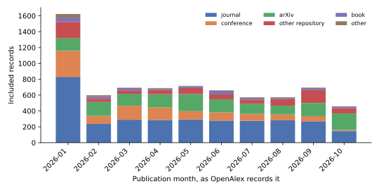
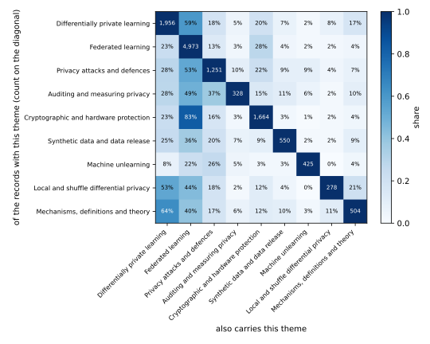

To assess what privacy-preserving machine learning research found in 2026, a reader needs more than a list of papers. Conference proceedings omit many papers, and selecting a few proceedings does not produce a representative sample. A **systematic review** specifies its search sources, search terms, inclusion criteria and classification method in advance. Anyone can then repeat the search and retrieve the same records. This review covers papers published in 2026 and was run on 2 November 2026. It reports the search and screening, then examines the ideas in seven themes and explains their arguments and implications.

The intended reader knows differential privacy (DP) and federated learning (FL), and wants to understand research beyond federated and cryptographic systems. The note links to no other book and defines each term where it appears. Its counts come from the frozen record table written by the search script. Its claims about papers come from reading the papers, not only their abstracts. The script that computes the counts is [code/notes/ppml_2026_review.py](https://github.com/manuelvloureiro/privacy-preserving-machine-learning-book/blob/main/code/notes/ppml_2026_review.py):

```bash
uv run python code/notes/ppml_2026_review_search.py   # the search and the screening, from the cached download
uv run python code/notes/ppml_2026_review.py          # the counts, figures and tables of this note
```

@tbl-map gives the question each section answers, and @tbl-symbols lists the symbols the note uses.

| Section | The question it answers |
|:---|:---|
| @sec-method | Where did the records come from, how were they screened, and which were set aside? |
| @sec-map | How much was published, where, and on which problems? |
| @sec-ideas | What did the papers of each theme find, and why does it hold? |
| @sec-practice | What should a practitioner now do differently? |
| @sec-limits | What can this review not tell you? |
| @sec-reading | Where should you start reading? |
| @sec-sources | Which papers does the note cite, and where are they? |

: The question each section answers. {#tbl-map}

| Symbol | Meaning |
|:---|:---|
| $n$ | the number of records in the focus set, or of a dataset, as the sentence says |
| $m$ | the number of records in a hand-read sample, or of composed mechanisms |
| $\hat p$, $p$ | the share of a sample on which the reader agreed with the screening rule, and the true share it estimates |
| $\varepsilon$, $\delta$ | the privacy parameter of a differential-privacy guarantee, which bounds how much one record can change the output's distribution, and the slack of an approximate guarantee |
| $\varepsilon_{\mathrm{emp}}$ | the lower bound on $\varepsilon$ that an audit certifies |
| $C$, $\sigma$ | the clipping norm and the noise multiplier of private training |
| $q$, $T$, $b$ | the sampling rate, the number of steps and the batch size of a training run |
| $\eta$, $L$, $D$ | the learning rate, the smoothness constant of the loss and the diameter of the parameter domain |
| $\mathrm{FPR}$, $\mathrm{FNR}$ | the false positive and false negative rates of a test |
| $M$, $D$, $D_f$ | a training algorithm, a dataset and the records a deletion request names |
| $d$ | the dimension of a model's parameters or of a record |

: The symbols the note uses. Each is also explained where it first appears. {#tbl-symbols}

# How the records were found {#sec-method}

A review is only as good as its search and its screening, so this section states both before any reading. It is short on purpose. The counts it produces matter only as the way to a reading list that nobody chose by taste, and @sec-ideas is where the reading happens.

## The search

The records come from two databases. The first is **OpenAlex**, an open index of scholarly works. It merges the records of Crossref, arXiv, PubMed and other sources. So it lists journals, proceedings, books and repositories together. Each record has a title, usually an abstract, a publication date, a type, a primary venue and a count of citing works. The second is **arXiv** itself, the repository where most machine-learning research first appears, searched through its own interface. Its records have a title, an abstract and the date of first submission, but no citation count.

The search ran on 2 November 2026 with the thirteen strings of @tbl-queries. Each string ran over the title and abstract of every work published, or first submitted, in 2026. Each names one way to protect, or to attack, the privacy of data used in learning, and the strings were made wide on purpose. A paper that uses DP for anything was returned, and the screening then kept the ones about learning.



The plan was to run all thirteen strings on both databases, and the plan was not kept. OpenAlex gives an unregistered user a daily quota of requests, and the two widest strings, on differential privacy and on federated learning, used it up. So the eleven narrower strings ran on arXiv only, and @tbl-queries shows zero OpenAlex records for them. A review must report such a deviation rather than hide it, and @sec-limits says what the gap costs. The script that runs the searches is [code/notes/ppml_2026_review_search.py](https://github.com/manuelvloureiro/privacy-preserving-machine-learning-book/blob/main/code/notes/ppml_2026_review_search.py). It caches the download, so the screening can be rerun on the same records.

The strings overlap by design, because a paper on federated learning with differential privacy should be found twice rather than missed. So the records of all the searches were put together and the repeats removed, first by identifier and then by title. The second step matters because the same paper is often in OpenAlex twice, as a preprint and as the published version, and a paper found on arXiv directly is often in OpenAlex as well. When two records had the same title after punctuation and case were removed, one was kept. The published version came before a preprint, and an OpenAlex record before an arXiv one, because it carries a citation count.

## The screening

A systematic review keeps a record only when it meets criteria written down before the search, and @def-included states this review's criteria. A script applies them, not a reader, so they are regular expressions on the title and the abstract, and the full list is in the script.

::: {#def-included name="An included record"}
A record is included when all of these hold. It is a paper, which means an article, a conference paper, a preprint, a review or a book chapter. It is in English. It is not retracted. Its title or abstract names a learning object, such as a model, training, a classifier, a language model or a neural network. And it is about privacy in one of two ways. Either its title or abstract names a privacy technique or a privacy attack, such as differential privacy, membership inference, homomorphic encryption, unlearning, synthetic data or anonymization. Or it names federated learning, or calls itself privacy-preserving, and has a privacy word in its title.
:::

The last criterion does the real work. FL keeps the data on the device, and nearly every paper that uses it calls itself privacy-preserving for that reason alone. If the words were enough, the review would be a review of FL. So a paper that names no technique and no attack is included only when privacy is in its title, which is where an author puts the purpose of the paper. The criterion also removes two other kinds of paper. One mentions privacy only as a motivation and then trains a model with no protection. The other uses a privacy technique with no learning in it, such as a private histogram of ages. Both are legitimate research, but they are not privacy-preserving machine learning. This review takes that term to mean the protection of data used to train, query or release a learned model, or an attack on that protection. @tbl-flow gives the records at each stage.



A rule written as a regular expression will keep some records it should not and drop some it should keep, and a reader can measure both errors on a sample. So the author read two random samples. The first has $m$ = 120 records drawn from the included set, where $m$ is the sample size. Each was marked as a paper on privacy-preserving machine learning or not, and the share marked as such is the **precision** of the screening, written $\hat p$. The second sample, of 40 records, was drawn from those the rule excluded for want of a learning cue. A share measured on a sample is uncertain, so @tbl-screening gives each share with its **Clopper–Pearson interval**. That is the exact 95% interval for a binomial proportion, and it is wider than the normal approximation on a small sample.

The precision is 89%. The thirteen false inclusions were security and systems papers that mention a privacy attack in passing. Of the records excluded for want of a learning word, 82% were rightly excluded. The seven that were not are private clustering, principal component analysis and trajectory synthesis, which the learning cue does not know. The decisions and the reason for each disagreement are in the file next to the script.



## What is set aside, and how the rest is sorted

Two themes of the included set do not interest the reader this note is for. The first is federated learning, where the protection is that the data stay on the device and the paper's work is the system around that. The second is cryptographic and hardware protection, where the protection is encryption, secret sharing or a trusted processor, and the work is to make it fast enough. Both are large and mostly engineering. So the review classifies every included record by **theme**, the problem the paper works on. The classification is one more regular expression per theme on the title and abstract, and every record that carries either of these two themes is set aside. @tbl-focus gives the counts. What remains is the **focus set**, written $n$, and everything from @sec-map on is about it. A record that combines a general result with a federated experiment is set aside with the rest, because the rule reads words, not contributions, and @sec-limits names what this costs.



The same classification gives the seven themes that @sec-ideas reads. A tenth rule marks surveys, by their title only, because "survey data" in an abstract is a kind of data, not a kind of paper. A record can carry several themes, and one that matches none is counted as such rather than forced into one. A second classification, by **domain**, marks the kind of data or model the paper is about, such as language models, images, graphs or health records. Every rule is in the script, and the test in [tests/test_notes_ppml_2026_review.py](https://github.com/manuelvloureiro/privacy-preserving-machine-learning-book/blob/main/tests/test_notes_ppml_2026_review.py) checks each on examples.

# The map in numbers {#sec-map}

The focus set holds $n$ = 2,022 records, 28% of the 7,279 that the screening kept. This section gives the few counts that a reader needs to place the reading of @sec-ideas: how much there is, where it is published, and how the themes and domains divide it. It is the whole of the note's statistics.

Between February and October the focus set grew by between 137 and 229 records a month. That is about six papers a day for a reader who follows the general literature without its federated and cryptographic systems. @fig-months shows the months, and two features of it are artefacts of the data. The January column is the tallest because 186 records carry the date 1 January exactly, which is how a journal dates a whole volume to the first day of its year. The October column is cut by the search date, since both databases index a paper some days or weeks after it appears.

{#fig-months}

More than half of the focus set is on arXiv, and a journal holds less than a quarter, as @tbl-sources shows. This is the reverse of the included set as a whole, where journals led. The general results of the field are posted as preprints, while the federated and cryptographic systems that were set aside are what fill the journals. The citation counts say the same thing about time. Of the records with a count, 90% have not been cited, and the most cited has 13, so citations cannot choose what to read a few months after publication. The fifteen venues this review treats as the core of the field, listed in @sec-ideas, hold 50 records between them, 2% of the focus set. The reason is that OpenAlex, the first database, indexes little of the 2026 proceedings of the large machine-learning conferences, so their papers reach the set only as preprints.



@tbl-themes gives the eight themes of the focus set and what each rule looks for. Differentially private learning is the largest, with 37% of the records, and attacks come second with 28%. Synthetic data, unlearning and theory are close together, and auditing and local DP are the small themes. Only 1,081 records carry exactly one theme, so most papers sit on two or more of these problems at once, and @fig-cooccurrence shows which go together.



{#fig-cooccurrence}

Three facts in the figure shape the reading. Auditing is the theme most entangled with the others, because an audit needs an attack and a trained model, so 58% of its records are also attacks. Theory is mostly theory of training, since 59% of its records also carry private learning. And unlearning stands apart. Only 5% of its records carry private learning, while 52% are about language models and 96% are on arXiv, so it is a literature with its own methods and its own venues.

The domains in @tbl-domains say where the problems live. Large language models (LLMs) are the largest domain, with 32% of the focus set, and they are also where the attacks are. Of their records, 42% carry the attack theme, the highest share of any domain. The share of records that work with DP is highest in the applied domains, such as the internet of things and graphs, where DP is one step of a pipeline. It is lowest in the three domains of generated content, language models, speech and images. There the rest of the records attack, audit, unlearn or synthesize without a guarantee. So the field's newest domains are the ones where its formal tool is used least, and the gap between what is attacked and what is protected is widest there. That gap is the thread of @sec-ideas.



# The ideas of the year, theme by theme {#sec-ideas}

Publication counts describe the field's topics, not its findings. Reading every record in the focus set was not feasible, and @sec-map shows that citation-based selection would skew the sample. For each theme, the review selected three groups: records published at one of the fifteen **core venues** listed in @tbl-core (or a random sample of twenty when there were more); the five most-cited records; and twelve records sampled at random from arXiv using a fixed seed. @tbl-reading gives the counts. The reviewer screened each record by its abstract, then read the papers discussed in each section in full to examine their arguments.





Each theme states its research question, explains the answer and its supporting argument, and identifies what remains unresolved. The seven themes follow the priorities of a reader who trains and releases models under DP: private training and accounting, audits of that accounting, data releases, theory, attacks, local models and unlearning.

## Differentially private learning: what private training pays, and for what {#sec-training}

Most of the focus set builds on stochastic gradient descent (SGD) made private, called **DP-SGD**. At each step it samples a batch and clips every example's gradient to the clipping norm $C$. It then adds Gaussian noise to the sum, with standard deviation $\sigma C$ for a noise multiplier $\sigma$, and takes a step. An **accountant** turns three numbers into the guarantee. They are the sampling rate $q$, the number of steps $T$ and the noise multiplier. The guarantee is $(\varepsilon, \delta)$, the privacy parameter and its slack. The theme holds 745 records, 37% of the focus set, and 23% of them are about language models. Its papers ask three questions. How much privacy does a run spend, and against which attacker? How can it lose less accuracy at a fixed budget? And what does the noise do to the model that comes out?

### How much is spent, and against whom

Every accountant in use composes the cost of every step, because it assumes that an attacker sees every intermediate model. So a practitioner who releases only the final model pays for a threat that does not exist, and the question is how much less the final model leaks. For convex losses the answer has been known since 2018 as **privacy amplification by iteration**. That is, the loss of a record used at one step decays as later steps bury it. Liang et al. (2026) extend the analysis to smooth non-convex losses, which is what a neural network has. Their tool is the shifted Rényi divergence, which compares the two runs on neighbouring datasets up to a shift in parameter space. One clipped noisy step can enlarge the shift by a factor of $1 + \eta L$, where $\eta$ is the learning rate and $L$ the smoothness constant, and adds a fixed cost.

The bound needs one more ingredient. If the parameters are projected onto a ball of diameter $D$ after each step, the shift can never exceed $D$. So the recursion can be restarted at any step, and only the steps after it are paid for. Write $n$ for the number of records and $b$ for the batch size. With $\alpha$ for the Rényi order, the privacy loss at that order then satisfies
$$\varepsilon(\alpha) = O\!\left(\frac{\alpha C^2}{n b \sigma^2}\cdot \min\left\{T,\ \frac{(1+\eta L)^2\, n b D^2}{\eta^2 C^2}\right\}\right).$$
The loss grows linearly in $T$ only until a burn-in and is constant after it, so a long run no longer pays for every step. The bound is quadratic in $D$ where the convex bounds are linear, and it needs the bounded domain, which the authors name as their main limitation. It should be read next to the audit of @sec-audit, which found that a record used at every step gets no amplification from the hidden state at all. The two agree. Amplification is for a record that is sampled rarely and then buried.

The opposite question is how little noise a run can use before the worst-case guarantee becomes empty. Ertan and a co-author (2026) answer it for one epoch, in which the data are shuffled once and cut into $M$ batches, where $M$ is the number of batches. The worst-case attacker knows every batch sum except the target's contribution. After projection it sees $M$ standard Gaussians, one of which may be shifted by $1/\sigma$, and must find the shifted one. Thresholding the largest of the $M$ values is a valid if suboptimal test, and its trade-off curve is explicit. From it the authors prove a dichotomy. Either
$$\sigma \ge \frac{1}{\sqrt{2\ln M}},$$
or the attacker's two error rates at the best threshold sum to at most a constant well below one. In $(\varepsilon, \delta)$ terms the second case forces $\varepsilon$ above one for any realistic dataset. The scale $\sqrt{2 \ln M}$ is the expected maximum of $M$ Gaussians. Poisson sampling obeys the same dichotomy up to a factor $1 - 1/e$, so the floor is not an artefact of shuffling.

At the floor the noise is already severe. A ResNet on CIFAR-10 falls from 80.1% to 40.4% accuracy at ten epochs. The shuffle accountant of Chua et al. certifies an $\varepsilon$ of at least 19.5 after one epoch. The floor sits near 0.3 for typical batch counts, which is below the multipliers of the published runs that the shuffling audit of @sec-audit examined, so the two results cover different regimes. The authors read their theorem as a limit of the worst-case adversary rather than of the algorithm, and they conclude that raising the noise is a blunt instrument.

The third cost is the one most runs do not count. A practitioner tries many hyperparameter settings and reports the budget of one. Xiang et al. (2026) revisit the generic bound for **private selection**, which runs the base algorithm a random number of times and releases the best run. They first construct a three-outcome mechanism on which that bound is tight, so no generic improvement exists. For DP-SGD, however, the base run is close to Gaussian DP, and its trade-off curve carries more than its $(\varepsilon, \delta)$ pair. The selected run's score is an order statistic of the single-run scores. From that they bound the tuning cost by the single-run $\varepsilon$ plus a term that depends on the curve and on the distribution of the number of runs. With about a hundred expected runs at a single-run budget of 4, the new bound gives 7.40 where the earlier one gave 9.30. So a practitioner can try several times more candidates for the same total budget, which gains up to four points of accuracy.

Their audit of the tuning step says the rest. Under an attacker who trains and validates normally, tuning adds little or nothing to the single-run leakage. Under the strongest attacker it adds more, but less than even the improved bound, a gap the authors attribute to the score function the attacker uses.

### Losing less accuracy at a fixed budget

Three papers keep the accountant and change what is clipped and where the noise enters. Xu et al. (2026) address the two errors of DP-SGD at once, the noise and the bias that clipping adds, which earlier methods traded against each other. Each example's gradient is first averaged with its own past gradients over the last $k$ steps, where $k$ is the window. That lowers its variance before clipping and so lowers the bias. The noisy batch gradient is then passed through a low-pass filter, because the true gradient lives at low frequencies and Gaussian noise is white. Because the filter is post-processing, it costs nothing. On CIFAR-10 with a vision transformer at $\varepsilon$ = 1 the accuracy rises from 35.7% to 41.0%. Likewise, on natural-language inference at the same budget it rises from 51.4% to 56.8%. The caveat comes from their own ablation: the filter loses signal when the noise is small.

Liu et al. (2026) remove the per-example gradient entirely. A **zeroth-order** method estimates the directional derivative along a random direction from two forward passes. The authors clip and add noise to that scalar difference, which is thousands of times smaller than the loss itself. The random direction is independent of the data, so multiplying the noisy scalar by it is post-processing. The memory cost is near that of inference, four times below fine-tuning with backpropagation. The accuracy of the plain method is below the concurrent zeroth-order baseline on most tasks. A data-free pruning of the parameters that are updated puts it ahead, at 74.9% against 69.4% on one benchmark at $\varepsilon$ = 4.

El Mais et al. (2026) find the cost of a choice nobody counts. Tying the input and output embeddings of a decoder is standard and is neutral without privacy. Under DP-SGD it costs between 0.6 and 4.7 points on three tasks. The reason is that the gradient that reaches the shared matrix is a sum of two parts, and the per-example norm that ghost clipping computes drops their cross term. Untying restores both the accuracy and the memory saving of ghost clipping, which is about two thirds.

### What the noise does to the model

The theme's last question has answers in two directions. Shi et al. (2026) exhibit a learning problem on which noisy full-batch gradient descent (GD) generalizes and plain GD does not. Each input has a signal patch and a noise patch, and the network's activation is linear above a threshold and flat below it. Gradient descent leaves the signal weight below the threshold and memorizes the noise. The injected noise pushes the signal weight over the threshold, after which it grows. At the hardest noise level in their simulation the private model reaches 95% accuracy and the non-private one 75%. The authors say that the regime is a product of the analysis and not a guide to practice. The noise floor of Ertan and a co-author (2026) is the other direction, at scale. There the required noise halves the accuracy of a convolutional network, and more training cannot lift it.

Mokhtari et al. (2026) ask whether the field measures the right thing. The recipes that made DP-SGD work on CIFAR-10, from group normalization to augmentation multiplicity, give mixed results on two medical imaging benchmarks. A model whose zero-shot accuracy on CIFAR-10 is 99.75% scores an area under the curve of 50.7% on retinal images, which is chance. They fix a grid of budgets, a rule for $\delta$ and tiers of allowed public data. They also demand that each result name its accountant, because a tighter accountant improves the reported $\varepsilon$ with no change to the training. And they note that their private runs never overfit where the non-private ones did.

What the theme settled is this. The final model leaks less than the per-step accountant charges, for smooth losses on a bounded domain, and the tuning step can be priced more tightly for DP-SGD than in general. Below a noise multiplier near 0.3, the worst-case guarantee of one epoch is empty under either sampler. What it left open is a convergent bound without a bounded domain and for adaptive optimizers, a provable guarantee for shuffling, the worst-case score function for tuning, and whether any accuracy recipe transfers across datasets.

## Auditing: testing the number the accountant reports {#sec-audit}

An accountant uses the noise multiplier, sampling rate and number of training steps to compute a privacy parameter $\varepsilon$. That theorem applies to an idealized algorithm; a **privacy audit** tests whether the guarantee holds for the code that ran. The audit creates two neighbouring datasets, runs the mechanism on one chosen at random, and asks an attacker to identify it. If the attacker performs better than any $(\varepsilon, \delta)$-DP mechanism permits, the reported $\varepsilon$ is false. This theme contains 159 records; 58% also concern attacks, and 74% are on arXiv. Its findings affect what practitioners should report, so it precedes the larger themes.

### How attack outcomes become a bound on $\varepsilon$

The audits in this review use the same conversion from test outcomes to a lower bound on $\varepsilon$. A mechanism that is $(\varepsilon, \delta)$-DP constrains every test that tries to distinguish the two datasets. Write $\mathrm{FPR}$ for the test's false positive rate and $\mathrm{FNR}$ for its false negative rate. The definition implies that
$$\mathrm{FNR} \ge 1 - \delta - e^{\varepsilon}\,\mathrm{FPR},$$
and the same with the two rates exchanged. The reason is that the probability of any event under one dataset is at most $e^\varepsilon$ times its probability under the other, plus $\delta$. An audit runs the game many times and counts the attacker's two kinds of error. It then replaces each count by the upper end of its Clopper–Pearson interval, so that the result holds with 95% confidence. Solving the inequality for $\varepsilon$ gives the smallest value consistent with what the attacker achieved. Annamalai et al. (2026) write it as
$$\varepsilon_{\mathrm{emp}} = \max\left\{\ln\frac{1 - \overline{\mathrm{FPR}} - \delta}{\overline{\mathrm{FNR}}},\ \ln\frac{1 - \overline{\mathrm{FNR}} - \delta}{\overline{\mathrm{FPR}}},\ 0\right\},$$
where the bars mark the interval ends.

This empirical $\varepsilon_{\mathrm{emp}}$ is a lower bound on the true privacy loss. If it exceeds the reported $\varepsilon$, the audit refutes the report. If it is lower, the audit is inconclusive because the attacker may be too weak. Audit strength therefore depends on the attack. The Neyman–Pearson lemma characterizes the strongest test: it thresholds the likelihood ratio of the observation under the two hypotheses. The year's three central audit papers differ mainly in how they estimate that ratio.

### Shuffling is not Poisson sampling

The accountant's theorem for DP-SGD assumes that each step draws its batch by **Poisson sampling**, including each record independently with probability $q$, the sampling rate. That is what gives privacy amplification by subsampling, the fact that a record absent from most batches pays for few steps. Production code does not sample this way. It shuffles the data once per epoch and walks through it in fixed batches, which is faster and gives every record exactly one visit per epoch. No tight guarantee for shuffling is known, so it became common to train with shuffling and report the Poisson number.

Annamalai et al. (2026) built the first audit of this practice. The difficulty is that no simple score distinguishes the two worlds under shuffling, so their answer is to make the likelihood ratio computable. In their worst-case dataset every record but the target has the same gradient. Then the only unknown is which batch holds the target, and the ratio is a sum over the $T$ possible positions of Gaussian densities. The attacker sees the model after every step and inserts a gradient of its own choosing for the target. That is the white-box setting in which all DP-SGD audits work.

The result depends on how much the attacker can control the other records. A **target-canary** attacker inserts only the target's gradient, and its empirical $\varepsilon$ falls below the Poisson accountant's value even when training uses shuffling. This weak audit therefore misses the gap. A **partially informed** attacker also inserts the opposite gradient at the end of every batch that contains neither the target nor its replacement. The two worlds then differ in two batch sums rather than one, exposing the gap. The authors audit published language-model and vision training recipes using ten million game observations. Two thirds of the settings leaked more than reported. For example, a sentence-pair model reported $\varepsilon = 3$ but audited at 12.73. A Places-365 model reported 7.53 but audited at 13.54.

The gap shrinks with the batch size. It is a factor near 3.5 at a batch of 100 records and small or none at 1,000, because the other records in a large batch add bias that the attacker cannot remove. The cost is the reason this audit was not done before. It needs between a million and a billion observations, and one million took 39 hours for a small convolutional network. The authors recommend avoiding shuffling until a guarantee is proven. The same machinery catches a real bug. Code that batches first and shuffles the batches leaks up to ten times more than code that shuffles the records.

### One training run, if the score is Gaussian

An audit with a million runs is not a tool a practitioner can use. So a line of work since 2023 inserts many canaries into one run and converts their membership guesses into a bound. The price was tightness, because each canary's score was collapsed to a binary guess. Agrawal et al. (2026) keep the scores. At each step the auditor projects the noisy gradient onto the canary's direction. That number is pure noise when the canary is absent, and noise plus the clipping norm $C$ when the canary is present and sampled. Summed over $T$ steps and scaled by $1/\sqrt{T}$, the absent score is exactly Gaussian with variance $\sigma^2$, the square of the noise multiplier. The present score is a sum of Bernoulli-weighted terms, so by the central limit theorem it is also nearly Gaussian. Its mean is $\sqrt{T} q C$ and its variance adds the Bernoulli part.

The paper proves the approximation error with a Berry–Esseen bound, which for its parameters is three orders of magnitude below $\delta$. Two Gaussians have a closed-form hockey-stick divergence. So the auditor fits the four parameters, takes a confidence region around them, and reports the smallest $\varepsilon$ that any point of the region allows.

This recovers much of what thresholding threw away. On CIFAR-10 at a reported $\varepsilon$ of 8, the Gaussian audit certifies 6.65, where the two earlier one-run methods certify 3.33 and 4.70. But the practical use is bug detection. The authors inject three bugs: noise scaled for half the clipping norm, twice the steps without recalibration, and twice the sampling rate. Each raises the true $\varepsilon$ to between 12 and 22. The Gaussian auditor exceeds the claimed 8 in every case, where the distribution-free audit of 2023 catches none. The assumption that buys this is that the background gradients have no component along the canary, which the authors check on a quantile plot. A thresholding audit makes no such assumption, so the two kinds of audit are complementary rather than one replacing the other.

### What the hidden state and zero runs can and cannot show

Two papers move the attacker away from the gradients. Bhuekar (2026) audits the **hidden-state** model, where only the final model is released, which theory says amplifies privacy for convex losses. The attacker pre-commits a sequence of gradients, each of norm $C$ in one coordinate, and reads that coordinate of the final model. For a model with far more parameters than batch records this simple attacker is tight. So when a record is used at every step, hiding the intermediate models gives no amplification at all. Amplification appears only when the record is used every few steps and the batch is small relative to the noise. Even then the privacy loss does not go to zero with more steps, unlike the convex case.

Cebere et al. (2026) go further and audit with no training run, from known members and known non-members of a deployed model. The difficulty is that members and non-members usually differ in distribution, and a classifier then detects the shift rather than the leakage. Their fix borrows from observational studies. A **propensity score** is the probability that a record is a member given its features, estimated by a separate model. A correct guess on a record whose features already gave it away then counts for less. The corrected bounds on CIFAR-10 and on a small language model are small. When the two groups are fully separable the bound collapses to zero. So the number is valid, but informative only when the auditor controlled the split.

### Attacks, audits and what an $\varepsilon$ from an audit means

The attack inside every audit is a membership inference attack, and Brännvall (2026) shows that the three leading ones are one object. Each is a log-likelihood ratio under an exponential-family model of the score, and they differ only in how many parameters they fit per record. The pooled attack fits none, which is best with few shadow models. The per-record Gaussian attack fits four, which is best with many. The order reverses around 32 to 64 shadow models, and a Bayesian prior on the per-record variance removes the switch. Under DP-SGD with noise multiplier 1, every attack lands within 0.005 of chance at a 1% false positive rate.

Three more papers ask what an audit number means outside the classifier setting. Amin et al. (2026) audit synthetic text with no model access. They split the data at random into a training half and a holdout half before generation. A disclosure that appears for a holdout record is a **phantom**, a thing the generator would have produced anyway, and phantoms were over 35% of the disclosures in their data. Only the excess over the holdout counts. For a generator fine-tuned with DP-SGD at $\varepsilon$ = 10 there was no excess.

Zareian Jahromi et al. (2026) work on a benchmark with a known $\varepsilon$ and show that most embedding-space numbers called $\varepsilon$ are diagnostics rather than bounds. The direct conversion of a finite receiver operating characteristic curve returned infinity in 62% of the null cases. The only valid certificate, a classifier fixed on development data and tested once, was often zero. Li et al. (2026) find the opposite failure for text rewriting under local DP. Six mechanisms at the same nominal $\varepsilon$ span an empirical $\varepsilon$ from near zero to the ceiling that ten thousand trials can measure, because they report their budgets at different granularities.

What the theme settled is that the reported $\varepsilon$ of DP-SGD can be wrong for two reasons that an audit now detects, shuffling and a calibration bug, and for no other reason found so far. The hidden state gives no free amplification in the worst case. And a number from an audit is evidence only with its threat model, its confidence and its sample size attached. What it left open is a one-run audit for shuffling and an audit of large batches without bias. Deng et al. (2026) propose canaries that search for the most informative query, and whether they change the picture is also open.

## Synthetic data: what claim a release can make {#sec-synthetic}

A data holder who cannot share records trains a generator on them and shares its output instead. The question of the theme in 2026 was what privacy claim such a release can make, against whom, and how to tell whether the output still carries the records it was trained on. The theme holds 345 records, 70% of them on arXiv and 32% about language models. Its papers divide into three kinds: arguments about the claim, attacks and audits that test it, and generators that earn it by spending a DP budget somewhere.

### Privacy is a claim about an attacker

Zhao et al. (2026) describe a drift in how synthetic data is justified. A privacy claim used to be a statement about residual inference risk under a stated threat model. It has become a property read off the generation process itself: the records are generated rather than copied, so they are taken to be safe. The paper audits the proceedings of three machine-learning conferences over two years. Most papers that use synthetic data in a privacy-sensitive setting pair privacy language with neither a guarantee nor an attack. Two consequences follow. False negatives become the norm, because a release can pass every similarity test while encoding the training distribution. And the risk is redistributed rather than removed. Common patterns dissolve into the background of the synthetic distribution while rare records stand out, and higher fidelity makes that worse.

The authors propose a minimum standard for a claim. Name the threat, state its scope, and give one piece of evidence, which may be a DP guarantee with its $\varepsilon$, an attack, or a disaggregated risk report. They also note which guarantee protects the tail. Pure DP bounds every record. The $\delta$ of approximate DP is a failure probability that can concentrate on the rare records that appearance-based auditing exposes most.

Ganev and a co-author (2026) make the same argument to regulators. Data protection law judges anonymity dataset by dataset, assuming one output row per input row. What is deployed is the generator, which can produce any number of datasets. So the assessment must be of the model, and each legal risk maps to an attack class. Singling out maps to differencing attacks, linkability to membership inference, and inference to attribute inference. Vendors report similarity metrics instead, such as the distance from each synthetic record to its closest training record. Such a metric treats privacy as a property of one output and must be rerun for every new sample, which itself leaks. Two constructed cases show the failure. A synthetic set that is an exact copy of the test data passes every such metric. So does a set made of three perturbed outliers and seventy copies of one point. DP passes the same criteria for the opposite reason. Its guarantee is a property of the computation, so by post-processing every dataset drawn from the model is covered at no further cost.

### What an attack on a table measures

Golob et al. (2026) systematize the attack that the theme had never put side by side. A **reconstruction attack** takes the released table and a target's known attributes, the quasi-identifiers, and predicts the target's hidden attributes. The authors run fourteen attacks against thirteen generators on five datasets. A correct guess is scored by the rarity of the value guessed, so that guessing the most common value earns nothing. Three findings order the field. First, the generator decides the risk, not the attacker. Switching attacks moves the score by a few points and switching generators by tens. Second, DP protects up to about $\varepsilon$ = 10 and then stops helping. Above that the risk is bounded by what the synthesizer can represent, not by its noise, so a large budget buys the attacker nothing and the data holder nothing either.

Third, a memorization test separates the mechanisms. The test attacks a record that was in the training table and one that was not, and takes the difference. The gap is near +20 points for cell suppression and +13 for a diffusion synthesizer. For every DP mechanism at every budget it lies between −0.1 and +2.1. The diffusion synthesizer also reconstructs outliers 3.4 times as well as typical records. The audit guidance that follows is to attack with the strongest attribute-inference attack rather than a distance proxy, and to report the train-versus-holdout gap per subgroup. Amin et al. (2026) build that holdout logic into a test for text, as @sec-audit described. They find the same thing from the other side. A non-private generator discloses more about its training half than its holdout half, and a DP-trained one does not.

### Where a generator spends its budget

The three generators the review read spend the budget in two different places, and the choice decides how much can be released. Rosenblatt et al. (2026) spend it once, on statistics. The leading tabular synthesizers match low-order marginals. These authors instead project the data onto $L$ random directions and release the first $k$ Chebyshev moments of each projection with Gaussian noise. Matching those moments controls the **sliced Wasserstein distance**, the average one-dimensional transport distance over random directions. Their bound on it has no dependence on the dimension, where the known lower bound for the full Wasserstein distance grows exponentially with it. On 209 benchmark datasets the method has the best regression utility at every budget. From $\varepsilon$ = 1 it also has the best two-way and three-way marginals, although it never targets a marginal.

Jia et al. (2026) spend it once, on a model, a generative adversarial network (GAN). Their generator is a chain of one sub-generator per variable. Each is a single-index model with a group-lasso penalty that zeroes a whole input when that variable is not a parent. So the generator learns the Bayes-network structure that earlier synthesizers require as a hyperparameter. Only the discriminator sees the data, so only its updates run DP-SGD. The estimation rate improves from $n^{-1/d}$ to $n^{-1/s}$, where $d$ is the number of variables and $s$ the largest set of ancestors of any one of them.

Bhusal et al. (2026) spend the budget per token. Their **private prediction** keeps the language model frozen. At each token it runs the model on $s$ private prompts, clips and averages the logits, blends them with a public prompt's logits, and samples from the softmax at temperature $\tau$. That sampling is the exponential mechanism, and its sensitivity is the clipping norm $C$ of the logits divided by $2s$. Advanced composition over $T$ tokens then gives
$$\varepsilon = \frac{C\sqrt{2T\ln(1/\delta)}}{s\,\tau}.$$
A membership inference attack on the output falls from an area under the curve of 0.94 without privacy to 0.52 at $\varepsilon$ = 4. No email address from the training corpus appears in the generated text. The authors state the cost themselves. Fine-tuning pays its privacy cost once, while private prediction pays for every token it generates, which bounds the volume of text a budget allows.

### What the data support

Three papers ask what a release supports rather than what it leaks. Kuo et al. (2026) run four generators of electronic medical records on a simulated cohort whose causal graph is known, with no DP at all. All four reproduce the marginals. None preserves the calibration of risk within subgroups, the hazard ratios and the dependency structure at once. The calibration error within socio-economic quintiles runs from 0.15 to 0.99, against at most 0.08 for the real data. No recovered graph has age and deprivation as the exogenous variables they are. The authors conclude that fidelity is still too low for privacy concerns to dominate.

Takahashi and a co-author (2026) find a gap between privacy and evidence. A DP text generator can output a plausible statement. By the definition of DP, its occurrence says almost nothing about how many private records support it. Their certifier releases a statement only with a Laplace-noised estimate of its support. It abstains when the estimate is below a threshold, and it bounds the probability of emitting an unsupported statement. The false-emission rate falls from at least 0.62 for free-text DP baselines to at most 0.014. Certifying against a DP synthetic proxy instead of the original data brings the rate back to 0.09, because the proxy is private but not evidential. Xin et al. (2026) measure sanitized text with a linking attack that works from paraphrased claims rather than exact strings. A commercial identifier remover leaves 74% of the information in a medical question set, and synthesis without DP leaves 48%. DP synthesis protects even at $\varepsilon$ = 1024, but its utility falls below that of removing the notes altogether.

What the theme settled is that generation is not a mechanism, that similarity metrics understate risk, and that DP spreads risk evenly where high-fidelity generators concentrate it on the rare. What it left open is whether the reconstruction plateau near $\varepsilon$ = 10 holds for generators that never reduce the data to noisy marginals. Also open is what a budget buys in utility for text, where the one generator with a guarantee lost more than it kept.

## Mechanisms, definitions and theory: which questions closed {#sec-theory}

The theory theme holds 286 records, and 59% of them also carry private learning, so most of the year's theory is theory of training and was read in @sec-training. What remains asks four kinds of question. Is a known analysis as tight as it can be? Next, what does privacy cost on a graph, where one person's data are the edges of many others? Then, what does a relaxation of the definition deliver? And what can the machinery of DP certify other than privacy? The theme has 16 records at a core venue, more than any other, and its papers are the ones a textbook will cite.

### The privacy blanket is the best decomposition

The **shuffle model** has $n$ users. Each applies a local randomizer with budget $\varepsilon_0$ to their own record, and a shuffler mixes the $n$ reports before the server sees them. Anonymity amplifies privacy: the shuffled reports satisfy a central $\varepsilon$ far below $\varepsilon_0$. Every known bound on the amplification decomposes each user's output into a part that all users share and a part specific to the input. The shared part is the crowd the target hides in. Two such frameworks existed, the privacy blanket and the clone, and a stronger clone had been retracted after a flaw was found in its core lemma. Su et al. (2026) define a **general clone** that contains every such decomposition and prove that the blanket is the best of them. The blanket takes, at each output value, the smallest probability that any input gives it, and that is by construction the largest component common to all users. Any other decomposition's reduction pair can be post-processed into the blanket's, so its hockey-stick divergence is no smaller.

The blanket bound was previously approximated with concentration inequalities. The authors compute it exactly as the positive part of a sum of independent copies of one random variable. That sum is a convolution, so a fast Fourier transform gives a full amplification curve in about thirty seconds. The resulting $\varepsilon$ is at least 10% below the earlier bounds in every setting they test and up to 50% below when the local budget is large and $n$ is small. What remains open is a bound that is not a decomposition at all, which would need the worst-case neighbouring pair, and the authors state that its identity is a conjecture.

### What privacy costs on a graph

A graph is the hard case for DP because removing one node changes the data of every neighbour. Raskhodnikova et al. (2026) define **local node DP**. Each node holds its own neighbourhood and reports through a local randomizer, and the server must not distinguish two graphs that differ in one node's edges. The difficulty is that one rewired node changes every other node's degree, so the sensitivity of the degree distribution is of order $\sqrt n$. Their answer is a **blurry degree distribution**. Each node reports its degree as a random rounding to one of the two nearest multiples of a chosen step $s$, which keeps the mean degree exact and moves the distribution by at most $s$. A neighbour's rounding then changes by at most $2/s$ when its degree changes by one, so the sensitivity of the whole vector falls to about $\sqrt{1 + n/s^2}$. With $s$ near $\sqrt n$ the noise is scaled as if rewiring one node affected only that node.

The parameter of a random graph and the size of a planted clique are then estimated as well as in the central model. The model is not local DP with a different adjacency. Shuffling does not amplify it in general, pure and approximate versions differ in power, and a node that sees its full edge list can do things a node that sees only its degree cannot.

Two papers find the price of node privacy for community detection. Klopp and a co-author (2026) work in the stochastic block model with $n$ nodes. They prove that any pure node-private mechanism fails at exact recovery with probability at least $1/(1 + e^{2\varepsilon})$, so a polynomially small failure probability needs $\varepsilon$ of order $\ln n$. They match it with an exponential mechanism over balanced labelings. The score is a penalized likelihood whose node sensitivity is bounded on a high-probability degree envelope, and an extension lemma carries the mechanism to all graphs. Above the logarithmic scale the private and non-private risks coincide at leading order. Marchis et al. (2026) give polynomial-time algorithms for the same problem, with larger budgets, and ask whether efficiency forces the larger budget.

### What a relaxation delivers, and what a metric hides

Hu et al. (2026) test a relaxation that protects only policy-specified substitutions, under which the noise of a mechanism scales with the largest change that one allowed substitution can cause. They apply it to the synthesizers that vote: each private record votes for its nearest candidate, and the noisy vote histogram selects the next generation. A substitution that moves a record across a decision boundary changes the one-hot vote by $\sqrt 2$ however short the move, and one that does not changes it by zero. Every round contained a crossing, so the policy bought nothing. A soft vote, a softmax of negative distances at temperature $\tau$, has sensitivity $\sqrt 2 \tanh(r/2\tau)$, where $r$ is the longest allowed substitution, and that bound does not depend on the number of candidates. The soft vote wins at strong budgets and loses at weak ones, with a crossover near $\varepsilon$ = 0.2 on census data.

Asghar et al. (2026) explain a known oddity of metric privacy for text. The standard mechanism adds a Laplace-shaped noise vector to a word's embedding and returns the vocabulary word nearest to the result. Across every budget it returns either the original word or an unrelated one, never a close neighbour. The reason is in the nearest-neighbour step. The noise is nearly orthogonal to every embedding direction, so the relevant quantity is a noisy dot product concentrated within $\sqrt{d}/\varepsilon$ for dimension $d$. For the original word to lose, that quantity must exceed half the distance to its nearest neighbour. For the nearest neighbour to beat the second, it must exceed the gap between the two distances, which in a high-dimensional embedding is about ten times smaller. So the mechanism snaps back or jumps far, and a word whose neighbours are distant gets less protection than one in a crowd. The fix is a post-processing that samples by neighbour rank, and the open problem is a metric that flattens the gap.

### What else the machinery certifies

Three papers use DP's tools for something other than privacy. Saxena et al. (2026) certify robustness against backdoor attacks, which perturb the training data and the test input together. They extend the primal-dual conversion between a trade-off function and a privacy profile to asymmetric neighbouring relations, where the relation encodes the attacker's budget. A training-time mechanism such as DP-SGD and a test-time noise are then composed numerically through their dominating pairs, and the smoothed classifier's prediction is certified unchanged when the composed profile allows.

Ribero et al. (2026) turn the hockey-stick divergence into a two-sample test statistic, by plugging a kernel estimate of the density ratio into its witness, the indicator that the ratio exceeds $e^\varepsilon$. The divergence between outputs on neighbouring inputs must be zero for a mechanism that is $\varepsilon$-DP, so a rejection refutes the claim. The test finds a known bug in a sparse-vector implementation with 500 samples where an earlier tester found nothing. For unlearning the same test rejects honest retraining with a different batch size, so the two-sample null is the wrong target, and they propose a relative three-sample test instead.

Wang et al. (2026) publish the **Edgeworth accountant**, which the keyword rule set aside because its abstract mentions FL and which belongs here by content. It composes guarantees by adding the log-likelihood ratios of the privacy losses of $m$ mechanisms and approximating the distribution of the standardized sum by an Edgeworth expansion. The central limit theorem is the zeroth order, and each further order adds a correction with a known power of $1/\sqrt m$. An explicit finite-sample bound on the approximation error turns the estimate into an interval that contains the true $\delta(\varepsilon)$, in constant time for identical mechanisms and linear time for mixed ones. Where fast Fourier transform accountants become numerically unstable for large and mixed compositions, the interval stays stable.

Two more results close older questions. Dharangutte and a co-author (2026) work on probably approximately correct (PAC) learning under DP. They show that two hypothesis classes with the same Vapnik–Chervonenkis (VC) and Littlestone dimensions can have private sample complexities that differ by more than a polylogarithmic factor. So neither dimension governs private PAC learning. They introduce a parameter that sums the costs of independent sub-problems packed into disjoint parts of the domain, and prove lower bounds that are tight for boxes, unions of intervals and subspaces. Cesari and a co-author (2026) settle the gap-dependent regret of private decision-theoretic online learning at the sum of a statistical term and a privacy term, closing an open problem posed at a learning-theory conference.

What the theme settled is this. The blanket is optimal among decompositions, and node privacy needs a logarithmic budget for community detection. VC and Littlestone dimensions do not determine private sample complexity, and the text mechanism fails for a geometric reason. What it left open is an amplification bound beyond decompositions, whether polynomial-time node-private algorithms must pay more, and whether the new packing parameter characterizes private learning in general.

## Attacks and defences: where the membership signal is {#sec-attacks}

A **membership inference attack** decides whether a given record was in a model's training data. It is the basic measurement of leakage, because every stronger attack, from reconstructing a record to extracting a secret, implies it. The question of the theme in 2026 was not whether models leak membership but where the signal is. Through which interface of a model does it travel, at what unit, and which design choices make it louder? The theme holds 563 records, 73% of them on arXiv and 48% about language models, with seven at a core venue. An attack is judged by its true positive rate at a low false positive rate, usually 1%. The reason is that an attacker who must be right about a few people is the one a privacy claim is made against, and the year's new channels add most at that operating point.

### Three new channels, and why each carries the signal

The first channel is operational. A mixture-of-experts language model routes each token to a few of its expert sub-networks, and serving systems log the routing for load monitoring. Tan et al. (2026) give an attacker the per-request routing frequencies and nothing else, no weights and no hidden states. On three models and three domains, that attacker improves on an ensemble of eleven output-based attacks by between 2.7 and 9.4 percentage points of true positives at a 1% false positive rate. The reason is not that the router memorizes. Freezing the router during fine-tuning leaves the gain intact. Projecting the hidden states onto the router's own subspace separates members from non-members better than a random subspace of the same rank. So fine-tuning writes membership into the hidden representations, and the router exposes a low-rank projection of them. The authors found no perturbation of the logged loads that removes the leak before the logs become useless.

The second channel is a modelling choice. A diffusion language model predicts masked tokens from both sides, so the membership signal of a text depends on which tokens are masked. Chen et al. (2026) measure that the variation of the signal across mask patterns exceeds the gap between members and non-members. That is why attacks built for autoregressive models land near chance. Their attack masks progressively and takes the sign of the loss difference between the fine-tuned model and its base on many random subsets. It then votes, since for a non-member each sign is a fair coin whatever the noise. The average area under the curve rises from 0.62 for the best earlier attack to 0.81. The same paper tests the defence with a guarantee. Fine-tuning with DP at $\varepsilon$ = 0.01 brings the attack to 0.497. At $\varepsilon$ = 20 it is still at 0.607, with a small loss of perplexity.

The third channel is a system in front of the model. Retrieval-based in-context learning answers a question by finding the stored documents nearest to the query and putting them in the prompt. Kulkarni et al. (2026) attack it with prefixes of a paraphrased query. If the document is stored, the retriever hands the model the whole of it even for a short prefix. So the model answers a question the prefix alone cannot support, and that is the signal. The attack reaches an area under the curve near 0.89 with 10% to 20% of the query's tokens, where earlier attacks fail on paraphrases. The authors note why DP does not transfer. Private in-context learning gains its amplification from sampling the demonstrations at random, and nearest-neighbour retrieval is deterministic.

### The unit of membership

Three papers change what membership is about. Zhu and a co-author (2026) move it from the sample to the entity. A language model may never reproduce a sentence about a person yet hold a consolidated memory of the person from scattered mentions. Their attack asks about the entity from a few clues in several ways borrowed from interview techniques, such as reordering the clues or adding them one at a time. It then measures how consistent the answers are. A stored entity yields answers that cluster, and an unknown one yields answers that scatter. On persons the attack reaches an area under the curve of 0.97 with answers only, against 0.80 for the best sample-level attack. It is weaker on organizations, whose information is diffuse.

Huang et al. (2026) move the unit to the whole training mixture. Given a base model and its fine-tuned release, they interpolate between the two weight vectors to stand in for the missing training trajectory. At each point they ask how strongly a probe example from each domain would have pulled the model along it. That recovers the domain proportions with less error than aggregating sample-level guesses.

Vrettos et al. (2026) move the unit to the patient, and their result is the one with the widest reach. They train 7,789 shadow models on six clinical datasets. Between 49% and 95% of patients exceed a per-patient attack threshold of 0.7. That holds even on a dataset whose population-level attack scores only 0.56. The training recipe changes how many patients are exposed, by up to a factor of three with stronger weight decay. The ranking of patients is nearly unchanged across recipes, architectures and initializations. The most exposed patients are the atypical ones, whose records are hard to predict from the rest of the cohort, and four cheap proxy models trained for one epoch find most of them in minutes. No mitigation they tried lowered the attack's true positive rate at a 0.1% false positive rate, and DP was not among them.

### Where memorization lives

Doan et al. (2026) find an amplifier in the architecture. Batch normalization rescales each activation by the mean and standard deviation of its batch. With the exact backward pass, where the gradient flows through those two statistics, the margin of an outlier grows faster. Write $\gamma$ for the layer's learned scale and $\sigma_B$ for the batch standard deviation. The margin grows per step by a factor of $(\gamma/\sigma_B)^2$ times a geometric constant near one. The scale tracks the unfit tail while the standard deviation tracks the bulk, so the ratio grows during training in proportion to the memorization load. A likelihood-ratio attack gains at least three points of area under the curve against networks with batch normalization on outlier mixtures, and at least one point on clean data. The paper also notes that under batch normalization a record's gradient depends on its batch. So the per-example clipping that DP-SGD assumes is not available.

Zhang et al. (2026) find that verbatim memorization in a language model is concentrated. The 10% of token positions with the largest excess likelihood over a reference model carry between 30% and 89% of the signal. Steering the activations only at those positions, along directions given in closed form by a singular value decomposition, removes memorization on a six-billion-parameter model. The cost is in perplexity, and there is no guarantee. Cheng et al. (2026) give the one defence of the theme that carries a guarantee, by moving the accounting from training to sampling. They replace a diffusion model's denoiser by a clipped average over the data. Each sampling step then becomes a Gaussian mechanism whose sensitivity is explicit. The privacy loss concentrates in the last, low-noise steps, so a sampler can hand over to a public denoiser before them. The certified images are worse than those of a privately trained model at the same budget, but no private training was needed.

Chu et al. (2026) add a caution about the attack as an instrument. On three generators of synthetic network traffic, training with DP stopped a white-box attack only for the one that overfit in the ordinary way. A generator that had collapsed to a few modes stayed attackable at $\varepsilon$ = 0.1, because noise does not resolve mode collapse. One that under-generalized was never attackable at all. The attack measures a failure mode, and DP addresses one of them.

What the theme settled is that every interface to a model is a channel, that cohort averages hide the exposed individuals, and that the exposed individuals are the atypical ones whatever the recipe. What it left open is a private mechanism for retrieval-based prompting and a guarantee for a neural denoiser. Whether the new channels persist beyond one epoch of fine-tuning is also open, since that is all the routing paper tested.

## Local privacy: spending a budget inside a record {#sec-local}

**Local differential privacy** (LDP) makes each user randomize their own record before it leaves their device, so no server ever holds the raw data. The price is noise that grows with the size of the domain. The question of the theme in 2026 was how to spend a fixed local budget across the parts of one record. The parts may be the values of a categorical attribute, several correlated attributes, the tokens of a prompt, or the bits of a pixel. The theme has 147 records, 35% of them on arXiv, with ten at a core venue. Its results are tighter than most of the field's, because LDP has a precise model and a decade of lower bounds to compare against.

### Budgets that follow the structure

The deployed frequency protocols, such as the count-mean sketch of a large phone maker, hash each value into a small domain and then randomize a unary encoding. Jiang et al. (2026) generalize them. Each user sends a short list of hash values that contains the true one with probability $p$ and random others otherwise. That gives the same randomness as a perturbed bit vector at a fraction of the communication. They derive the estimator's variance in closed form, correcting an error in the deployed protocol's own analysis, and then choose $p$ for a target frequency. Earlier protocols split the budget evenly between the true value and the others, or gave all of it to the others, and neither is optimal for any target. For small budgets the optimum stays at $p$ = 0.5, and it moves up as the budget and the target frequency grow.

Seeam et al. (2026) spend the budget across correlated attributes. The standard scheme divides $\varepsilon$ among the $d$ attributes of a record, so each gets $\varepsilon/d$ and the error grows with $d$. Their protocol first lets a small subset of users report all attributes the standard way, which yields noisy marginals. From the similarity of marginals the server computes, for each pair of attributes, a probability of reuse. Every other user then perturbs one attribute at the full budget and reports the others as copies of it with that probability, or as random values otherwise. The copies are post-processing of one private report, so they cost nothing. The estimator is biased, and the authors say so, but on strongly correlated data its error is more than 70% below the standard scheme at $\varepsilon$ = 0.1. On weakly correlated data it can lose to a baseline with public priors.

Cao et al. (2026) apply the same principle to images. An eight-bit pixel has 256 values, which is too large a domain for randomized response. They split each pixel into its eight bit planes and randomize every bit separately. The most significant bits of the luminance channel get most of the budget, by a closed-form rule that weights each bit by its contribution to the image. Face recognition on the private images loses less than two points of accuracy. The per-pixel budget is 20, and the authors acknowledge that composing it over an image gives a loose guarantee for the whole.

### What a prompt-level budget protects

Two papers protect the prompts that users send to a cloud language model, and both spend the budget by risk. Liu et al. (2026) start from an observation about uniform budgets. Suppose a sentence holds $h$ sensitive tokens and each is kept with probability $p_{\mathrm{keep}}$. Then at least one leaks with probability $1 - (1 - p_{\mathrm{keep}})^h$, so a keep rate of 10% on a few tokens already leaks most of the time. Their protocol tags tokens by risk with a named-entity recognizer and gives each a budget by its level. The budget is as low as 0.1 for identifiers and up to 8 for the rest, and low-risk tokens are sent in the clear. Each protected token is replaced by the exponential mechanism over its nearest neighbours in embedding space, with the scores reversed for high-risk tokens so that the most similar candidates become the least likely.

The guarantee is per pair of tokens, at the average of their two budgets, and per sentence over the positions that are not low risk. Against the strongest baseline with comparable utility, the attack that extracts identifiers succeeds half as often. The baseline's own failure is partly an artefact: its tokenizer kept out-of-vocabulary identifiers unchanged, so it leaked 72% of them even at a nominal $\varepsilon$ of 0.1.

Zhan et al. (2026) route instead of perturbing everything. A risk score from the tagged entities sends a non-sensitive prompt to the cloud, a highly sensitive one to a local model, and the rest through a collaborative path. On that path each flagged entity gets two randomized responses, one over its category and one over its value, with the split of the budget set by the category's weight. The cloud returns a structured sketch from the perturbed prompt and the local model finishes the answer with the original. The routing, not the noise, is what saves time and energy. Both papers share a boundary that a third makes explicit. Li et al. (2026) define a profile-release mechanism whose guarantee is conditional on everything the user chose to share, which is public side information by definition. What a tagger does not flag is not protected, and the authors of all three say so.

### What a learner loses, and how to get it back

Ye and a co-author (2026) bound what a fixed classifier loses when its input is perturbed before it arrives. The idea has two parts. An LDP mechanism concentrates its output within a radius $\theta$ of the true value with a probability that has a closed form in $\varepsilon$. And a classifier keeps its label within some radius of each input. Multiplying the two gives the probability that the classification survives, which is a product over the perturbed dimensions and so decays exponentially with their number. On low-dimensional classifiers the bound matches the measured accuracy, and no single mechanism wins everywhere.

Dufraiche et al. (2026) look at the other case, a learner trained on perturbed examples, and show that the bias LDP noise puts into the risk does not shrink with more data. Gaussian feature noise acts on the loss as a Weierstrass transform, which smooths it through iterated Laplacians, and randomized response on the label mixes the risk with the risk under wrong labels. Both transforms have inverses, and applying them to the loss and its gradient gives unbiased estimates of the clean ones, at the price of variance.

Butucea et al. (2026) relax the definition instead. Bounding the total variation between the output distributions of two inputs, rather than their likelihood ratio, allows a noise with a spike at the true value. Density estimation then reaches the non-private rate up to logarithms, with an effective sample size of $n\varepsilon$ rather than $n\varepsilon^2$. The mechanism's likelihood ratio is unbounded, so an output that lands exactly on the true value reveals it, and the authors state that their comparison with a true LDP estimator is unfair in that sense.

### Two broken protocols and one tight bound

Two papers break protocols, in different ways. Li et al. (2026) attack the adaptive protocols that publish a stream of frequencies and decide at each step whether to spend budget or repeat the last release. Fake users can send any report in the protocol's output format, and the aggregator must average it in, so a few of them steer the decision rule and the published estimate towards a target stream. Output poisoning needs fewer fake users than input poisoning, because fake reports carry no noise, and the attack improves as $\varepsilon$ grows, for the same reason the estimator does. The adaptive protocols are less robust than the non-adaptive ones they outperform in utility.

Wang et al. (2026) show that a published protocol for set-valued data was never LDP. Its output space is not surjective, so some outputs rule out some inputs, and the attack recovers users' data with 96% probability. Both are failures of design, not of the definition. On the positive side, Su et al. (2026) settle the analysis of shuffling, as @sec-theory explained. Their bound lets a shuffled frequency protocol use a local budget about 10% larger for the same central guarantee.

What the theme settled is that a local budget should follow the structure of the record. The bias of learning from private examples is intrinsic but removable, and an adaptive protocol's utility is bought with robustness. What it left open is any guarantee for the tokens a tagger does not flag, and a lower bound that matches the relaxed definition's density rate.

## Unlearning: removing a record, and checking that it is gone {#sec-unlearning}

A user asks that their data be deleted, and the data have already shaped a trained model. **Machine unlearning** is the attempt to honour that request without training again from scratch. The question of the theme is what "deleted" means for a model and how anyone could check it. The theme has 328 records, the least tied to the rest of the field, because only 5% of them carry private learning. Also, 52% are about language models and 96% are on arXiv, with one record at a core venue, so it was read almost entirely through its preprints. They divide into methods, evaluations that test the methods, and papers that ask what the request itself requires.

### Four meanings of "deleted"

The papers use four definitions, and only two of them say something about the model that does not depend on which questions the checker asks. The first is **certified unlearning**, which borrows the form of DP. Write $M$ for the training algorithm, $D$ for the data, $D_f$ for the records to forget and $U$ for the unlearning procedure. Dolgova et al. (2026) and Lin et al. (2026) both require the same inequality for every set $S$ of possible models:
$$\Pr[U(M(D), D_f) \in S] \le e^{\varepsilon} \Pr[\bar M(D \setminus D_f) \in S] + \delta.$$
Here $\bar M$ is a reference that trained on the retained data only, and the inequality must also hold with the two sides exchanged. In words, the unlearned model must be as hard to tell from a retrained one as two outputs of an $(\varepsilon, \delta)$-DP mechanism are from each other.

The second definition is deletion by construction. Schneider et al. (2026) design a personalized language model in which a user's data never enter the shared weights. Deletion is then the removal of a file, and there is nothing to verify. The third is the one most papers use: a score on a benchmark, such as the accuracy on the forgotten examples or a membership inference test against a retrained model. The fourth, from Hu et al. (2026), adds an auditor who knows the method and has the model's weights. A record counts as deleted only if the best auditor cannot recover it. The evaluations of the year are, in effect, the demonstration that the third definition does not imply the fourth.

### What a certificate costs

The certified definition is met by **noisy fine-tuning**. Start from the trained model and take gradient steps on the retained data, each step clipped, with Gaussian noise added to every parameter at every step. The run from the full model and the run from a retrained model then become indistinguishable, and the guarantee is proved as a DP guarantee is, through Rényi divergences. Its price is that the noise vector in a model with $d$ parameters has length about $\sigma\sqrt{d}$, where $\sigma$ is the noise standard deviation. For a network with millions of parameters that swamps the clipped update. Dolgova et al. (2026) report that a vision transformer on an image benchmark fell from 88% to under 20% accuracy and never recovered.

Their repair has two parts. They split the parameter space into orthogonal blocks and add the noise and the update to one block at a time. The variance is unchanged, but each step's perturbation is smaller, and the per-block budgets compose to the same $\varepsilon$. They also replace the worst-case distance between the full and the retrained model, which the certificate clips to, by a distance measured on ten coupled training runs. With both changes the transformer recovers to about 89.7% accuracy. But the $\varepsilon$ at which it does so is 50. Their other experiments use budgets between 30 and 90, and one ResNet run reports an $\varepsilon$ in the hundreds of thousands. The authors are careful about what the certificate means. It "certifies indistinguishability, but not high utility", and the distance it rests on is calibrated, not bounded.

### Suppression is not deletion

Three evaluation papers look inside the model. Each finds that methods which pass the benchmarks have hidden the information rather than removed it. Jang et al. (2026) work on image classifiers and train a sparse autoencoder on the activations of an intermediate layer, which finds the features that fire for the forgotten class. They then restore those features in the unlearned model, from the original model's values, and measure whether the forgotten class comes back. For most of the twelve methods it does, to between 80% and 100% accuracy on a class whose accuracy the benchmark had put at zero. The methods that resist are the ones that reset a layer or dampen weights, which change the parameters where the features live. Even retraining the pretrained checkpoint on the retained data restores to 95%, because the features came from pretraining and retraining never touched them.

Hu et al. (2026) find the same at the output of a language model that was fine-tuned on four hundred fictional profiles. Methods that raise the loss on the forgotten answers push those answers into the least likely tokens rather than out of the model. Decoding by choosing the least likely token within the answer's format recovers 97% of the postcodes that a method had scored as fully forgotten. A method that trains the model to refuse drops from a forget quality of 0.82 to 0.03 under plain greedy decoding over the format. The third paper, by Ataee and a co-author (2026), measures the footprint of an update in parameter space with the diagonal of the Fisher information. The footprint is split between the forgotten content, the related content that should stay, and generic text. It is uncorrelated with the behavioural forget score. The methods whose footprint lands mostly on the related content are the ones that relearn fastest.

### Why every recovery attack works

The recovery attacks of the year differ in what they need and agree on why they succeed. Rybak et al. (2026) need only queries. A second language model mutates prompts and a third judges the answers, over five rounds. The attack then extracts up to 93% of hazardous knowledge from a model that the standard metric put near chance, and 60% of forgotten facts from a small model. Qian et al. (2026) ask the forgotten fact through multi-step questions that never state it. These recover more than direct questions, because the methods suppress the direct path to a fact and leave its relations intact. Li et al. (2026) ask in another language. They show that the layer at which the update is applied decides whether the knowledge is erased in every language or in none.

Abitante et al. (2026) need no query at all. Quantizing a model to four bits rounds each weight to one of eight values. An unlearning update too small to cross a rounding boundary vanishes, so the quantized model is the original one. Concentrating the update in low-rank adapters with a larger learning rate makes it survive, at some cost in full-precision accuracy. In every case the forget objective moved the answer rather than removed it, which is what the three evaluation papers saw from inside.

### Methods that do not touch the weights, and models built for deletion

A family of methods keeps the weights fixed and intervenes at inference, and it is fast. Zhai et al. (2026) steer the activations of ten layers with a closed-form operator that is zero on the retained queries' subspace. It takes five minutes against an hour for the leading fine-tuning method, and it matches a retrained model's utility on the standard benchmark. The authors restrict the claim to the serving-time setting, because an operator that is applied at inference can be inspected or disabled. Almudévar and a co-author (2026) unlearn in representation space with an information bottleneck, and state that their method is vulnerable to any attacker with the weights. Hu et al. (2026) classify this whole family as masking.

The only exact answer in the set is architectural. Schneider et al. (2026) keep a per-user adapter and steering vectors in a directory that the shared model never trains on. A deletion request is met by removing the directory. The price is a weak personalization, a design that cannot be retrofitted to a model that has already absorbed its users' data, and a directory that is a new target for exfiltration.

The last paper of the theme models the auditor. Lin et al. (2026) take the certified definition and note what it says about any test. One inspection by a regulator misses a non-compliant operator with probability at least $e^{-\varepsilon}$ times a constant. In the game that follows, the operator picks its $\varepsilon$ and the regulator its number of inspections. The equilibrium has an odd property: when deletion requests grow and fines are high, the regulator inspects less, because the operator relaxes its $\varepsilon$ and becomes easier to catch.

What the theme settled is that an output score does not establish removal. The common objectives for language models leave recoverable traces under at least one attack, and a certificate speaks about distributions of parameters and not about utility. What it left open is any method that is certified at a small $\varepsilon$, keeps its accuracy, and survives the attacks above. None of the papers claims one.

# What the year changes for a practitioner {#sec-practice}

The seven themes were read for their ideas, and the ideas have consequences for anyone who trains or releases a model under DP. This section collects them. Each item names the result it rests on, so that a reader who disagrees can go to the paper.

- **Report the sampler, or audit it.** The $\varepsilon$ of DP-SGD is a theorem about Poisson sampling. Code that shuffles and walks through fixed batches leaked up to four times the reported budget on published recipes (@sec-audit). Code that batches before it shuffles leaked ten times more than code that does not. Sample by Poisson or by an allocation sampler with a proof, or audit the run, and never report the Poisson number for shuffled code.
- **Count the tuning step, with the trade-off curve.** The runs that were not selected still cost privacy. The bound that uses the Gaussian trade-off curve of DP-SGD is tighter than the generic one, and it buys several times more candidates for the same total budget (@sec-training).
- **Name the accountant, and the architecture's cost.** A tighter accountant improves the reported $\varepsilon$ with no change to the training, so a result without its accountant is not comparable. Tied embeddings cost accuracy under ghost clipping, and batch normalization both amplifies memorization and breaks per-example clipping (@sec-training and @sec-attacks).
- **Audit once per release, as a bug check.** A one-run Gaussian audit certifies most of a correct run's budget and catches miscalibrated noise, doubled steps and doubled sampling rates that the distribution-free audit misses (@sec-audit). Any $\varepsilon$ from an audit is evidence only with its threat model, its confidence and its sample size.
- **Make the synthetic-data claim explicit.** Name the threat, state the scope and give one piece of evidence. Similarity metrics are not evidence. Attack the release with the strongest attribute-inference attack and report the gap between training and holdout records per subgroup. Spend the budget once, in training or in statistics, because per-token prediction pays for every token. Above a budget near 10, more budget buys a marginal-based synthesizer nothing (@sec-synthetic).
- **Measure leakage at a low false positive rate, per individual.** A cohort average hides the exposed individuals, who are the atypical records whatever the recipe, and cheap proxy models find them before training (@sec-attacks). Every interface to a model is a channel, including routing logs and retrieval.
- **Treat an unlearning score as a claim, not a deletion.** The common objectives hide the answer in the least likely tokens or in intermediate features, and recovery attacks find it with queries alone. Only a certificate or a design in which the data never entered the shared weights says something an outsider can check (@sec-unlearning).
- **Spend a local budget by the structure of the record.** Uniform budgets across values, attributes, tokens or bits waste most of the protection, and what a tagger does not flag is public (@sec-local).

# What the review can and cannot say {#sec-limits}

A systematic review is only as reliable as its weakest step. This section lists the steps that limit this one, from the search to the reading, with the number that measures each where the review has one.

**The databases.** Eleven of the thirteen strings were run on arXiv only, because the quota of OpenAlex, the first database, ran out after the two widest strings. A journal or conference paper on, say, membership inference or unlearning entered the set only when its abstract also named differential privacy or federated learning, or when it was on arXiv. The arXiv searches found 731 records of the focus set that OpenAlex did not, and only 5 of those match the two wide strings, so the narrow strings do find papers the wide ones miss. How many such papers sit in journals that OpenAlex indexes and arXiv does not is unknown. The themes most affected are attacks, unlearning and auditing, the ones with the highest arXiv shares. OpenAlex also indexes little of the 2026 proceedings of the three large machine-learning conferences, so their papers appear as preprints without a venue.

**The screening and the cut.** The screening rules are regular expressions, and @tbl-screening measures how often a reader agreed with them. The precision on the included set is 89%. Of the 855 records excluded for want of a learning word, about 18% were lost, roughly 150, and most of them would have been in the focus set. The sample was drawn from the included set, so the focus set's own precision is estimated, not measured. The cut that sets aside federated and cryptographic records reads words, not contributions. The Edgeworth accountant of @sec-theory was set aside because its abstract mentions FL, and a separation result on DP under continual observation because its abstract uses the word oblivious. The theory a reader wants complete must also be sought among the set-aside records.

**The classification and the dates.** Themes and domains are keyword rules too, so the co-occurrence shares of @sec-map are upper bounds on how often two problems are really studied together. The publication date is the one the publisher deposits, and 186 records carry 1 January. The search ran two months before the year's end, so the year's total will be higher than 2,022 when it is complete.

**The reading.** The reading lists of @tbl-reading were read by abstract, and the papers that @sec-ideas explains, about seventy, were read in full. Four of them could not be obtained in full and were read from their abstracts. They are the paper on query choices for auditing, the curvature-driven schedule for DP-SGD, the retrieval-based unlearning paper and the broken protocol for set-valued data. The zeroth-order fine-tuning paper was read in its preprint version. One reader did the screening and the reading, and no second reader measured the agreement. A paper that claims to break a defence or to tighten a bound was taken at its word once its argument was read. The reading rule gives the core venues most of the weight, and the core venues are the privacy and security community's. So a result at a statistics or systems venue was read only if the random draw found it.

What the review can say, within those limits, is this. It can say how many records a reproducible search finds, where they are published, and how the themes divide and overlap. It can say what the papers of each theme argue and what their evidence is, because those papers were read. It cannot say which results are correct, which will matter, or what was published where neither database looked.

# Where to start reading {#sec-reading}

A reader who wants the year in a dozen papers can take one or two from each theme, chosen here from the papers that @sec-ideas explains, for the question each answers. @tbl-start lists them, in the order of the themes. The choice is the author's, after the reading, and a different reader would choose differently. The frozen table of all 7,279 records, with the two set-aside themes marked, is in the repository for anyone who wants to choose otherwise.

| Theme | Start with | Because it |
|:---|:---|:---|
| Differentially private learning | Liang et al. (2026); Xiang et al. (2026) | bounds what the final model leaks for non-convex losses; prices the tuning step for DP-SGD |
| Auditing | Annamalai et al. (2026); Agrawal et al. (2026) | finds leakage above the reported bound under shuffling; makes a one-run audit tight enough to catch bugs |
| Synthetic data | Golob et al. (2026); Zhao et al. (2026) on the position | measures reconstruction against thirteen generators; says what claim synthetic data can make |
| Theory | Su et al. (2026); Asghar et al. (2026) | settles the analysis of shuffling; explains why the text mechanism snaps back or jumps far |
| Attacks and defences | Vrettos et al. (2026); Tan et al. (2026) | shows that cohort averages hide exposed patients; shows that routing logs leak membership |
| Local DP | Jiang et al. (2026); Dufraiche et al. (2026) | optimizes the deployed frequency protocols; removes the bias of learning from private examples |
| Unlearning | Jang et al. (2026); Hu et al. (2026) | shows that unlearned features are restorable; recovers what five methods claimed to forget |

: A starting paper or two for each theme, from the papers the review explains. {#tbl-start}

# References {#sec-sources}

The papers the note explains, by the theme under which they were read. Each link goes to the paper's digital object identifier where OpenAlex records one, otherwise to its arXiv page. The frozen table of all 7,279 included records, with each record's identifier, themes and domains, is [code/notes/ppml_2026_review_records.csv](https://github.com/manuelvloureiro/privacy-preserving-machine-learning-book/blob/main/code/notes/ppml_2026_review_records.csv), and the hand-screening decisions are [code/notes/ppml_2026_review_screening.csv](https://github.com/manuelvloureiro/privacy-preserving-machine-learning-book/blob/main/code/notes/ppml_2026_review_screening.csv).

The databases and the method.

- Priem, J., Piwowar, H. and Orr, R. (2022). [OpenAlex: A fully-open index of scholarly works, authors, venues, institutions, and concepts](https://arxiv.org/abs/2205.01833). The database behind the two wide searches; its [works endpoint](https://docs.openalex.org/api-entities/works) was queried over title and abstract.
- arXiv (2026). [The arXiv API](https://info.arxiv.org/help/api/index.html). The interface behind the thirteen arXiv searches, by date of first submission.
- Page, M. J. et al. (2021). [The PRISMA 2020 statement: an updated guideline for reporting systematic reviews](https://doi.org/10.1136/bmj.n71). *BMJ* 372. The reporting items the method section follows: the sources, the search strings, the criteria, the flow of records and the limits.
- Clopper, C. J. and Pearson, E. S. (1934). The use of confidence or fiducial limits illustrated in the case of the binomial. *Biometrika* 26(4). The exact interval of @tbl-screening.
Differentially private learning.

- Hao Liang, Wanrong Zhang, Xinlei He et al. (2026). [An Improved Privacy and Utility Analysis of Differentially Private SGD with Bounded Domain and Smooth Losses](https://doi.org/10.1609/aaai.v40i28.39510). *Proceedings of the AAAI Conference on Artificial Intelligence*.
- Murat Bilgehan Ertan and Marten van Dijk (2026). [Fundamental Limitations of Favorable Privacy-Utility Guarantees for DP-SGD](https://doi.org/10.48550/arxiv.2601.10237). *arXiv*.
- Zihang Xiang, Tianhao Wang, Cheng-Long Wang et al. (2026). [Revisiting Differentially Private Hyper-parameter Tuning](https://doi.org/10.14722/ndss.2026.230447). *Network and Distributed System Security Symposium*.
- Xincheng Xu, Thilina Ranbaduge, Qing Wang et al. (2026). [Enhancing DPSGD via Per-Sample Momentum and Low-Pass Filtering](https://doi.org/10.1609/aaai.v40i32.39951). *Proceedings of the AAAI Conference on Artificial Intelligence*.
- Zhihao Liu, Jian Lou, Wenjie Bao et al. (2026). [Differentially Private Zeroth-Order Methods for Scalable Large Language Model Fine-Tuning](https://doi.org/10.1109/tifs.2026.3679194). *IEEE Transactions on Information Forensics and Security*.
- Razan El Mais, Ali Chehab, Ibrahim Issa et al. (2026). [Is Weight Tying Still Beneficial for Decoder-Only LLMs in Private Settings Under DP-SGD?](https://doi.org/10.48550/arxiv.2609.40335). *arXiv*.
- Zhongjie Shi, Puyu Wang, Chenyang Zhang et al. (2026). [Towards Understanding Generalization in DP-GD: A Case Study in Training Two-Layer CNNs](https://doi.org/10.1609/aaai.v40i30.39731). *Proceedings of the AAAI Conference on Artificial Intelligence*.
- S. Mokhtari, Sara Kodeiri, Shubhankar Mohapatra et al. (2026). [Rethinking Benchmarks for Differentially Private Image Classification](https://doi.org/10.48550/arxiv.2601.17189). *arXiv*.

Auditing and measuring privacy.

- Meenatchi Sundaram Muthu Selva Annamalai, Borja Balle, Jamie Hayes et al. (2026). [To Shuffle or not to Shuffle: Auditing DP-SGD with Shuffling](https://doi.org/10.14722/ndss.2026.240597). *Network and Distributed System Security Symposium*.
- Adya Agrawal, Yu Wei, Jaspal Singh et al. (2026). [Let's Ask Gauss: Improved One-Run Privacy Auditing](https://doi.org/10.48550/arxiv.2606.12733). *arXiv*.
- Apeksha Bhuekar (2026). [Tighter privacy auditing of differentially private stochastic gradient descent in the hidden state threat model](https://doi.org/10.1038/s41598-026-38537-0). *Scientific Reports*.
- Tudor Cebere, Mathieu Even, Linus Bleistein et al. (2026). [Privacy Auditing with Zero (0) Training Run](https://doi.org/10.48550/arxiv.2605.14591). *arXiv*.
- Rickard Brännvall (2026). [Exponential-Family Membership Inference: From LiRA and RMIA to BaVarIA](https://arxiv.org/abs/2603.11799). *arXiv*.
- Kareem Amin, Rudrajit Das, Alessandro Epasto et al. (2026). [Phantoms and Disclosures: A Statistical Framework for Auditing Privacy in Synthetic Data](https://doi.org/10.48550/arxiv.2606.16952). *arXiv*.
- Arman Zareian Jahromi, Vishnu Bondalakunta, Mohammad Akbar Bin Shah et al. (2026). [Picture the Epsilon: Pursuing Identity-Level Privacy Guarantees for Images](https://doi.org/10.48550/arxiv.2608.17147). *arXiv*.
- Weijun Li, Arnaud Grivet Sébert, Qiongkai Xu et al. (2026). [Beyond Theoretical Bounds: Empirical Privacy Loss Calibration for Text Rewriting Under Local Differential Privacy](https://doi.org/10.48550/arxiv.2603.22968). *arXiv*.
- Zehang Deng, Hongqiao Chen, Shan Jiang et al. (2026). [Rethinking Query Choices for Differential Privacy Auditing](https://doi.org/10.1109/tdsc.2026.3658692). *IEEE Transactions on Dependable and Secure Computing*.

Synthetic data and data release.

- Jiachen Zhao, Antonia Januszewicz and Taeho Jung (2026). [Position: Privacy Is a Claim, Not a Property of Synthetic Data](https://arxiv.org/abs/2609.01273). *arXiv*.
- Georgi Ganev and Emiliano De Cristofaro (2026). [Rethinking Anonymity Claims in Synthetic Data Generation: A Model-Centric Privacy Attack Perspective](https://arxiv.org/abs/2601.22434). *arXiv*.
- Steven Golob, Sikha Pentyala and Martine De Cock (2026). [SoK: Reconstruction Attacks on Synthetic Tabular Data (Insights from Winning the NIST CRC)](https://doi.org/10.48550/arxiv.2606.08372). *arXiv*.
- Lucas Rosenblatt, R. Teal Witter and Christopher Musco (2026). [Differentially Private Synthetic Data from Sliced Chebyshev Moments](https://arxiv.org/abs/2610.42081). *arXiv*.
- Ke Jia, Yuheng Ma, Yang Li et al. (2026). [PrAda-GAN: A Private Adaptive Generative Adversarial Network with Bayes Network Structure](https://doi.org/10.1609/aaai.v40i27.39382). *Proceedings of the AAAI Conference on Artificial Intelligence*.
- Bishnu Bhusal, Manoj Acharya, Ramneet Kaur et al. (2026). [Privacy Preserving In-Context-Learning Framework for Large Language Models](https://doi.org/10.1609/aaai.v40i42.40838). *Proceedings of the AAAI Conference on Artificial Intelligence*.
- Nicholas I-Hsien Kuo, Blanca Gallego and Louisa Jorm (2026). [Synthetic but Not Realistic: The Evaluation Challenge in Generative Modelling for Structured Electronic Medical Records](https://arxiv.org/abs/2606.08903). *arXiv*.
- Tsubasa Takahashi and Takumi Hiraoka (2026). [PrivCert: Certifying Statement Support under Differential Privacy](https://doi.org/10.48550/arxiv.2609.38934). *arXiv*.
- Rui Xin, Niloofar Mireshghallah, Shuyue Stella Li et al. (2026). [A False Sense of Privacy: Evaluating Textual Data Sanitization Beyond Surface-level Privacy Leakage](https://doi.org/10.1109/satml68715.2026.00065). *IEEE Conference on Secure and Trustworthy Machine Learning (SaTML)*.

Mechanisms, definitions and theory.

- Pengcheng Su, Haibo Cheng and Ping Wang (2026). [Decomposition-Based Optimal Bounds for Privacy Amplification via Shuffling](https://doi.org/10.1109/sp63933.2026.00151). *IEEE Symposium on Security and Privacy (S&P)*.
- Sofya Raskhodnikova, Adam Smith, Connor Wagaman et al. (2026). [Subgraph Counting with Local Node Differential Privacy](https://doi.org/10.48550/arxiv.2610.22278). *arXiv*.
- Olga Klopp and Ilias Zadik (2026). [Node-Private Community Detection in Stochastic Block Models](https://doi.org/10.48550/arxiv.2604.09078). *arXiv*.
- Laurentiu Marchis, Ethan D'souza, TOMÁŠ FLÍDR et al. (2026). [Node-private community estimation in stochastic block models: Tractable algorithms and lower bounds](https://doi.org/10.48550/arxiv.2605.15943). *arXiv*.
- Yingge Hu, Gautham Ramesh Babu and Mostafa Milani (2026). [Soft Voting for Policy-Aware Private Data Synthesis](https://doi.org/10.48550/arxiv.2610.11285). *arXiv*.
- Hassan Jameel Asghar, Robin Carpentier, Benjamin Zi Hao Zhao et al. (2026). [dX-Privacy for Text and the Curse of Dimensionality](https://doi.org/10.56553/popets-2026-0012). *Proceedings on Privacy Enhancing Technologies*.
- Aman Saxena, Jan Schuchardt, Yan Scholten et al. (2026). [Provable Robustness against Backdoor Attacks via the Primal-Dual Perspective on Differential Privacy](https://doi.org/10.48550/arxiv.2605.21780). *arXiv*.
- Mónica Ribero, Antonin Schrab and Arthur Gretton (2026). [Regularized $f$-Divergence Kernel Tests](https://doi.org/10.48550/arxiv.2601.19755). *arXiv*.
- Hua Wang, Sheng Gao, Huanyu Zhang et al. (2026). [Edgeworth Accountant: An Analytical Approach to Differential Privacy Composition](https://doi.org/10.1080/01621459.2026.2668139). *Journal of the American Statistical Association*.
- Prathamesh Dharangutte and Amartya Sanyal (2026). [New Lower Bounds for Private PAC Learning](https://arxiv.org/abs/2610.41980). *arXiv*.
- Tommaso Cesari and Roberto Colomboni (2026). [Optimal Gap-Dependent Regret for Private Stochastic Decision-Theoretic Online Learning](https://doi.org/10.48550/arxiv.2605.29148). *arXiv*.

Privacy attacks and defences.

- Yixin Tan, Jiayang Liu, Lu Sun et al. (2026). [When Routing Reveals Membership: Privacy Leakage from MoE Router Telemetry](https://arxiv.org/abs/2610.10616). *arXiv*.
- Yuetian Chen, Kaiyuan Zhang, Yuntao Du et al. (2026). [Membership Inference Attacks Against Fine-tuned Diffusion Language Models](https://arxiv.org/abs/2601.20125). *arXiv*.
- Tejas Kulkarni, Antti Koskela and Laith Zumot (2026). [Membership Inference Attacks for Retrieval Based In-Context Learning for Document Question Answering](https://arxiv.org/abs/2605.04116). *arXiv*.
- Yiran Zhu and Ziqi Yang (2026). [Have You Ever Seen Them? Entity-level Membership Inference through Interrogating Large Language Models](https://arxiv.org/abs/2606.23030). *arXiv*.
- Tzu-Heng Huang, Aditya Goyal, John Cooper et al. (2026). [WARP: Weight-Space Analysis for Recovering Training Data Portfolios](https://arxiv.org/abs/2607.01686). *arXiv*.
- Konstantinos Vrettos, Eleftherios Tzanis, Haridimos Kondylakis et al. (2026). [Automated screening of privacy risks in medical AI](https://arxiv.org/abs/2610.30229). *arXiv*.
- Ngoc Phu Doan, Chongyan Gu and Ihsen Alouani (2026). [Batch Normalization Amplifies Memorization and Privacy Risks](https://arxiv.org/abs/2605.24420). *arXiv*.
- Xuanqi Zhang, Haoyang Shang and Xiaoxiao Li (2026). [Mitigating Memorization Where It Happens](https://arxiv.org/abs/2602.08901). *arXiv*.
- William Cheng, Dongjun Kim and Mijung Park (2026). [Privacy Accounting for Empirical Denoisers](https://doi.org/10.48550/arxiv.2610.27710). *arXiv*.
- Andrew Chun-An Chu, Kyle MacMillan, Paul Schmitt et al. (2026). [Understanding Privacy and Quality Tradeoffs in Synthetic Network Data](https://doi.org/10.56553/popets-2026-0085). *Proceedings on Privacy Enhancing Technologies*.

Local and shuffle differential privacy.

- Bo Jiang, Wanrong Zhang, Donghang Lu et al. (2026). [When Focus Enhances Utility: Target Range LDP Frequency Estimation and Unknown Item Discovery](https://doi.org/10.14722/ndss.2026.231397). *Network and Distributed System Security Symposium*.
- Shafizur Rahman Seeam, Zheng Ye and Yidan Hu (2026). [Frequency Estimation of Correlated Multi-attribute Data under Local Differential Privacy](https://doi.org/10.56553/popets-2026-0034). *Proceedings on Privacy Enhancing Technologies*.
- Yuanming Cao, Chengqi Li and Wenbo He (2026). [LDP-Slicing: Local Differential Privacy for Images via Randomized Bit-Plane Slicing](https://doi.org/10.48550/arxiv.2603.03711). *arXiv*.
- Zhihuang Liu, Zhangdong Wang, Tongqing Zhou et al. (2026). [Risk-Aware Privacy Preservation for LLM Inference](https://doi.org/10.1109/tifs.2026.3667458). *IEEE Transactions on Information Forensics and Security*.
- Junfei Zhan, Haoxun Shen, Zheng Lin et al. (2026). [PRISM: Privacy-Aware Routing for Adaptive Cloud–Edge LLM Inference via Semantic Sketch Collaboration](https://doi.org/10.1609/aaai.v40i33.40041). *Proceedings of the AAAI Conference on Artificial Intelligence*.
- Mingchen Li, Zifan Peng, Kewei Sha et al. (2026). [Profile-DP: Differential Privacy for User-Controlled Profile Release in Personalized LLM Inference](https://arxiv.org/abs/2610.27213). *arXiv*.
- Ye Zheng and Yidan Hu (2026). [Quantifying Classifier Utility under Local Differential Privacy](https://doi.org/10.56553/popets-2026-0103). *Proceedings on Privacy Enhancing Technologies*.
- Jean Dufraiche, Paul Mangold, Michaël Perrot et al. (2026). [Learning with Locally Private Examples by Inverse Weierstrass Private Stochastic Gradient Descent](https://doi.org/10.48550/arxiv.2602.16436). *arXiv*.
- Cristina Butucea, Huiyun Tang and Marie‐Luce Taupin (2026). [Faster Learning under Relaxed Local Differential Privacy](https://doi.org/10.48550/arxiv.2609.05034). *arXiv*.
- Xinyu Li, Xuebin Ren, Shusen Yang et al. (2026). [Fine-Grained Manipulation Attacks to Local Differential Privacy Protocols for Data Streams](https://doi.org/10.1109/tkde.2026.3652139). *IEEE Transactions on Knowledge and Data Engineering*.
- Yilin Wang, Xiong Li, Shuai Shang et al. (2026). [Privacy-Preserving Joint Distribution Analysis for Set-Valued Data via Local Differential Privacy](https://doi.org/10.1109/tifs.2026.3654799). *IEEE Transactions on Information Forensics and Security*.

Machine unlearning.

- Polina Dolgova and Sebastian U. Stich (2026). [Sequential Subspace Noise Injection Prevents Accuracy Collapse in Certified Unlearning](https://doi.org/10.48550/arxiv.2601.05134). *arXiv*.
- Qinqi Lin, Ningning Ding, Lingjie Duan et al. (2026). [Governing AI Forgetting: Auditing for Machine Unlearning Compliance](https://arxiv.org/abs/2602.14553). *arXiv*.
- Chris Schneider, Philipp Schoenegger and Ben Bariach (2026). [Separable Expert Architecture: Toward Privacy-Preserving LLM Personalization via Composable Adapters and Deletable User Proxies](https://doi.org/10.48550/arxiv.2604.21571). *arXiv*.
- Shicheng Hu, Runzhi Tian, Ziqiao Wang et al. (2026). [On the Recoverability of Private Information Unlearning in Large Language Models](https://arxiv.org/abs/2608.29943). *arXiv*.
- Yurim Jang, Jaeung Lee, Dohyun Kim et al. (2026). [Suppression or Deletion: A Restoration-Based Representation-Level Analysis of Machine Unlearning](https://arxiv.org/abs/2602.18505). *arXiv*.
- Danial Ataee and Peter Triantafillou (2026). [LLM Unlearning Evaluation with TRIAGE](https://arxiv.org/abs/2609.32103). *arXiv*.
- Patryk Rybak, Paweł Batorski, Paul Swoboda et al. (2026). [REBEL: Hidden Knowledge Recovery via Evolutionary-Based Evaluation Loop](https://arxiv.org/abs/2602.06248). *arXiv*.
- Haoting Qian, Qingjie Zhang, Zhicong Huang et al. (2026). [Leak-Resistant Unlearning: A New Benchmark for Evaluating Multi-Hop Reasoning Consistency and Recovery Robustness](https://arxiv.org/abs/2608.04519). *arXiv*.
- Taoran Li, Varun Chandrasekaran and Zhiyuan Yu (2026). [Layer-Targeted Multilingual Knowledge Erasure in Large Language Models](https://arxiv.org/abs/2602.22562). *arXiv*.
- João Vitor Boer Abitante, Joana Meneguzzo Pasquali, Luan Fonseca Garcia et al. (2026). [Quantization-Robust LLM Unlearning via Low-Rank Adaptation](https://arxiv.org/abs/2602.13151). *arXiv*.
- Wei Zhai, Xiang Liu, Qiang Huang et al. (2026). [Nullify: Null-Space Activation Steering for Training-Free LLM Unlearning](https://arxiv.org/abs/2610.10655). *arXiv*.
- Antonio Almudévar and Alfonso Ortega (2026). [Representation Unlearning: Forgetting through Information Compression](https://arxiv.org/abs/2601.21564). *arXiv*.
