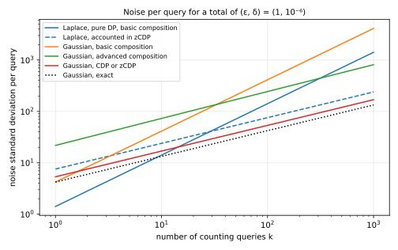

A privacy budget is a limit on how much a release may reveal about any one person. Analysts spend it query by query, and the total must stay within the limit. But "how much" depends on which definition of differential privacy (DP) you use, because each definition measures the revealed information in its own unit. Pure DP measures it with one number $\varepsilon$, and approximate DP adds a second number $\delta$. Concentrated differential privacy (CDP) uses two numbers, a mean and a spread of a quantity introduced below, while zero-concentrated differential privacy (zCDP) uses a single number $\rho$. A budget of $\rho = 0.02$ and a budget of $\varepsilon = 1$ cannot be compared until both are written in the same unit.

This note shows how to budget in each of the four definitions, and how to convert every budget to one reference so that the four can be compared. The organizing idea is that all four definitions bound the same random quantity, the privacy loss, which says how much more likely an output is with a person's record than without it. It is negative for an output that is less likely with the record. The definitions differ only in how they bound it. Pure DP bounds its largest value, approximate DP lets it exceed a limit in rare cases, and the two concentrated definitions bound its average and how far it strays from that average. The last two exploit a fact that the first two ignore. Over many releases, positive and negative losses partly cancel, so their total grows far more slowly than the sum of their worst cases.

The running example is a statistics office that holds records on 100,000 people and publishes 100 counts about them, such as how many people have each of 100 medical conditions. One person may have many conditions, so the office plans for the worst case, in which adding or removing one person's record changes every one of the 100 counts by one. The office wants the whole release to satisfy one reference guarantee, approximate DP with $\varepsilon = 1$ and $\delta = 10^{-6}$, whose meaning @sec-approx explains. The question each section answers is how much random noise each count needs for the release to meet that reference. The same noise can be certified more or less cheaply depending on the definition used to add up its cost, and less noise means more accurate counts. So a definition whose bookkeeping needs less noise is, for this release, the better one. You need basic probability to follow the note: densities, expectations, the normal distribution and Markov's inequality. @tbl-map gives the question each section answers, and @tbl-symbols lists the symbols.

| Section | The question it answers |
|:---|:---|
| @sec-ground | What do all four definitions compare, and what is the common reference? |
| @sec-pure | What is the strictest guarantee, and how do you budget with it? |
| @sec-approx | What guarantee admits Gaussian noise, and why do its composition theorems waste budget? |
| @sec-cdp | What if the definition bounds the average loss and its spread? |
| @sec-zcdp | Can one number do the same job, and be easier to budget? |
| @sec-tradeoffs | Which definition should you use, and what does each cost? |
| @sec-apx | Complete proofs of every result in the note. |

: The question each section answers. {#tbl-map}

| Symbol | Meaning |
|:---|:---|
| $D \sim D'$ | two neighbouring datasets: one is the other with one person's record added or removed |
| $M$; $P$, $Q$; $p$, $q$ | a mechanism; the distributions of its output on $D$ and on $D'$; their densities |
| $L$ | the privacy loss, $\ln(p/q)$ at the released output |
| $\Delta_1 f$, $\Delta_2 f$ | the sensitivity of a statistic $f$: the most one record can change it, as a sum of absolute changes ($\ell_1$) or as a Euclidean length ($\ell_2$) |
| $b$, $\sigma$ | the scale of Laplace noise, and the standard deviation of Gaussian noise |
| $s$ | the sensitivity measured in standard deviations of Gaussian noise, $\Delta_2 f/\sigma$ |
| $\varepsilon$, $\delta$ | the parameters of pure and approximate DP |
| $\mu$, $\tau$ | the parameters of concentrated DP, a bound on the mean of the loss and on its spread |
| $\rho$ | the parameter of zero-concentrated DP |
| $k$; $\varepsilon_0$, $\delta_0$, $\rho_0$ | the number of queries; the budget of one query, in each unit |
| $D_\alpha$, $\alpha$; $\lambda$ | the Rényi divergence of order $\alpha$; the variable $\lambda$ of an exponential moment $\mathbb E[e^{\lambda X}]$ |
| $\Phi$ | the standard normal cumulative distribution function |

: The symbols the note uses. Each is also explained where it first appears. {#tbl-symbols}

# The common ground {#sec-ground}

The four definitions demand different things, but they all compare the same two distributions and can all be read through the same quantity. This section introduces those shared pieces, then fixes the reference guarantee that every budget will be converted to and the plan that each of the next four sections follows.

## Neighbouring datasets and mechanisms

Take two datasets $D$ and $D'$ that differ in one person: one of them contains that person's record and the other does not. Such datasets are called **neighbouring**, written $D \sim D'$. Some authors call two datasets neighbouring when one record is replaced by another instead. The proofs below work for either choice, and this note uses adding or removing a record throughout.

A **mechanism** $M$ is a randomized procedure that takes a dataset and releases an output. Run on $D$, it releases an output drawn from a distribution we call $P$. Run on $D'$, it releases one drawn from a distribution $Q$. We write $p$ and $q$ for their densities, or their probabilities when the outputs are discrete. The proofs assume that both are positive at every output, so that their ratio, which the next section takes the logarithm of, is always defined. That holds for the Laplace and Gaussian mechanisms that this note uses.

Every privacy definition asks that $P$ and $Q$ be close, for every neighbouring pair. The definitions below bound $P$ in terms of $Q$, so they are required in both orders, with the roles of $D$ and $D'$ swapped as well. If $P$ and $Q$ were equal, the output would reveal nothing about whether the person's record was used. Without noise they could not be close, because a statistic that differs on $D$ and $D'$ would give two different outputs, each impossible under the other dataset. A statistic $f$, such as a count, has a **sensitivity**, the most it can change between neighbouring datasets. Adding or removing one person changes a count by at most one, so a count has sensitivity 1. A mechanism adds noise to $f(D)$, and the noise must be large compared with the sensitivity, so that the two possible answers $f(D)$ and $f(D')$ blur into each other.

## The privacy loss {#sec-ground-loss}

To compare $P$ and $Q$, look at each output in turn and ask how much more likely it is under one than under the other. Consider an attacker who sees the output $y$ and wants to know whether the data were $D$ or $D'$. By Bayes' rule, the attacker's odds after seeing $y$ are the odds before, multiplied by the ratio of the two likelihoods:

$$
\frac{\Pr[D \mid y]}{\Pr[D' \mid y]} = \frac{\Pr[D]}{\Pr[D']} \cdot \frac{p(y)}{q(y)}.
$$ {#eq-bayes}

So the ratio $p(y)/q(y)$ is exactly what the output teaches the attacker. Taking its logarithm turns this multiplication of odds into addition, which will matter when many outputs are released and their effects pile up. The **privacy loss** of the output $y$ is that logarithm:

$$
L(y) = \ln \frac{p(y)}{q(y)}.
$$ {#eq-loss}

A positive loss means that $y$ is more likely when the person's record is in the data, so seeing $y$ moves the attacker towards $D$. A negative loss moves the attacker towards $D'$. The output is random, so the loss of the released output is random too. We write $L$ for this **privacy loss random variable**, the loss at an output drawn from $P$. Drawing it from $P$ means looking at the world where the data are $D$; the world of $D'$ is covered by the same definitions applied to the swapped pair, whose loss is $-L$.

The running example shows the two shapes this loss can take. Suppose the count is 1 on $D$ and 0 on $D'$. With Laplace noise of scale 1, the output has density $e^{-|y - 1|}/2$ under $P$ and $e^{-|y|}/2$ under $Q$. The constants cancel in the ratio, and the logarithm of a ratio of exponentials is the difference of the exponents, so the loss is $|y| - |y - 1|$. That loss climbs from $-1$ to $1$ as $y$ moves from 0 to 1 and stays flat outside that interval. With Gaussian noise of standard deviation 1, the densities are proportional to $e^{-(y-1)^2/2}$ and $e^{-y^2/2}$, so the loss is $(y^2 - (y-1)^2)/2 = y - 1/2$. That loss is a straight line, with no bound in either direction. The left panel of @fig-losses plots both.

{#fig-losses}

Since the Gaussian output is $Y = 1 + Z$ with standard normal noise $Z$, its loss $Y - 1/2 = 1/2 + Z$ is itself normal, with mean $1/2$ and variance 1. That is the right panel of @fig-losses. The loss is above 1 with probability 0.3085, and it can be arbitrarily large, but large values are rare.

The four definitions are four ways of bounding this random variable. **Pure DP** asks that it never exceed $\varepsilon$. **Approximate DP** lets it exceed $\varepsilon$, as long as the excess carries probability at most $\delta$ in a sense @sec-approx makes precise. **Concentrated DP** bounds its average and asks that it stray from the average no more than a normal variable would. **Zero-concentrated DP** bounds all its exponential moments at once, the averages $\mathbb E[e^{\lambda L}]$ for every positive $\lambda$.

## The reference and the plan {#sec-ground-reference}

A budget written in one definition's unit says nothing to someone who uses another, so the four need a common unit. That unit is approximate DP with a fixed $\delta$, for two reasons. Every one of the four definitions implies an approximate DP guarantee, so every budget can be converted into it. And approximate DP is a statement about events, which is what an attacker sees and what laws, papers and libraries report.

The value of $\delta$ follows a common rule: at most $1/n^{1.1}$ for $n$ people, rounded down to a power of ten. @sec-approx explains why $\delta$ must be smaller than $1/n$, and the exponent 1.1 makes it smaller by a factor that grows with $n$. For $n = 100{,}000$ people, $n^{1.1} = 10^{5.5}$, so $1/n^{1.1}$ is about $3.2 \times 10^{-6}$, which rounds down to $\delta = 10^{-6}$, ten times below $1/n$. The value $\varepsilon = 1$ is a common, moderate choice, and any other value would serve for the comparison. With it, the **reference** for the whole release is approximate DP with $(\varepsilon, \delta) = (1, 10^{-6})$.

Budgeting under any definition then takes three steps. First, find the budget in the definition's own unit that converts to the reference. Second, split it across the queries with the definition's composition rule. Third, turn each query's share into a noise scale with the definition's mechanism. The second step is where the definitions differ most, so each Composition subsection does two things. It composes every parameter of its definition, not only $\varepsilon$. Then it states what $k$ equal steps give in the reference's unit, as a pair $(\varepsilon, \delta)$, so that the four composition rules can be compared on one scale.

Each of the next four sections follows the same plan, under the same headings: why the definition was introduced, its definition, its mechanism, composition, budgeting to the reference, and its limits. The main text states every result and says in a sentence or two how its proof goes. The full proofs are in @sec-apx, and every number comes from the script [code/notes/privacy_budgets.py](../../code/notes/privacy_budgets.py), which the test [tests/test_notes_privacy_budgets.py](../../tests/test_notes_privacy_budgets.py) checks.

# Pure differential privacy {#sec-pure}

Pure DP is the original definition and the strictest of the four. This section shows that it caps the privacy loss at every output, that Laplace noise achieves it, and that its budget adds up linearly, so that the running example needs a lot of noise.

## Why it was introduced

Dwork, McSherry, Nissim and Smith (2006) wanted a guarantee that holds whatever the attacker already knows and whatever the attacker does with the output. Their answer was to ask that no output be much more likely with a person's record than without it. Then the attacker's odds, by Bayes' rule in @eq-bayes, can move by at most a fixed factor, whatever the prior and whatever the output. The guarantee holds at every output, including the most unlucky one, which makes it simple to state and simple to reason about.

## The definition

The definition asks this for every set of outputs, not only for single outputs, because an attacker may look at any property of the output.

::: {#def-pure name="Pure differential privacy"}
A mechanism $M$ is **$\varepsilon$-DP** if, for every pair of neighbouring datasets $D \sim D'$ (in both orders) and every set $S$ of outputs,
$$
\Pr[M(D) \in S] \le e^{\varepsilon} \Pr[M(D') \in S].
$$
:::

The requirement on sets is equivalent to a requirement on the privacy loss at each output. If the loss never exceeds $\varepsilon$ in absolute value, every set gets at most $e^\varepsilon$ times more probability under $P$ than under $Q$. Conversely, if the loss exceeded $\varepsilon$ on a set of outputs of positive probability, that set itself would break the definition.

::: {#prp-pure-loss}
A mechanism is $\varepsilon$-DP if and only if, for every neighbouring pair, its privacy loss satisfies $|L(y)| \le \varepsilon$ at every output $y$, except perhaps on a set of outputs of probability zero.
:::

<!-- proof: in @sec-apx-loss -->
The proof in @sec-apx-loss writes the probability of a set as the integral of $e^{L} q$ over it, and takes as the set the outputs where the loss is too large.

## Its mechanism: Laplace noise

The Laplace mechanism adds noise from the **Laplace distribution** $\mathrm{Lap}(b)$, whose density $e^{-|z|/b}/(2b)$ falls off exponentially on both sides of zero at a rate set by the scale $b$. Its standard deviation is $\sqrt 2\, b$. The loss of the Laplace mechanism is flat outside the interval between the two true answers, as @fig-losses shows, so it is bounded. For a statistic with several coordinates, the sensitivity that matters is the $\ell_1$ sensitivity $\Delta_1 f$: over all neighbouring pairs, the largest sum of the absolute changes of the coordinates.

::: {#thm-laplace name="Laplace mechanism"}
Let $f$ be a statistic with values in $\mathbb R^d$ and $\ell_1$ sensitivity $\Delta_1 f$. The mechanism that releases $f(D) + Z$, where the coordinates of $Z$ are independent draws from $\mathrm{Lap}(b)$ with $b = \Delta_1 f/\varepsilon$, is $\varepsilon$-DP.
:::

<!-- proof: in @sec-apx-mech -->
The proof in @sec-apx-mech shows that, in each coordinate, the two log-densities differ by at most the change in that coordinate divided by $b$, by the triangle inequality. Summed over the coordinates, the loss is then at most $\Delta_1 f/b = \varepsilon$. For a single count, $\Delta_1 f = 1$, so the scale is $1/\varepsilon$ and the standard deviation is $\sqrt 2/\varepsilon$.

## Composition

A release of many statistics runs many mechanisms on the same data, and later queries may be chosen after seeing earlier answers. The total privacy loss of the sequence is the sum of the losses of its steps, because the joint density is the product of the steps' densities, each taken given the earlier outputs, and the logarithm turns that product into a sum. Each step's loss is bounded by its own $\varepsilon$, so the total is bounded by their sum.

::: {#thm-pure-comp name="Composition of pure DP"}
Run $k$ mechanisms in sequence on the same dataset, where the $i$-th mechanism may depend on the outputs of the earlier ones and is $\varepsilon_i$-DP for every value of those outputs. The sequence, which releases all $k$ outputs, is $\varepsilon$-DP with
$$
\varepsilon = \varepsilon_1 + \dots + \varepsilon_k.
$$
:::

<!-- proof: in @sec-apx-comp -->
@sec-apx-comp derives it as the case $\delta = 0$ of basic composition, @thm-basic-comp.

Pure DP has a single parameter, but it can be read as approximate DP with $\delta = 0$ at every step, and composition keeps that second parameter at zero. In the reference's unit, $k$ equal steps of $\varepsilon_0$ therefore give

$$
(\varepsilon, \delta) = (k\varepsilon_0,\ 0).
$$

The same $k$ steps can also be read in the reference's unit in a second way, if the release is allowed to spend a $\delta$. @cor-pure-adv in @sec-zcdp shows that they are then $(k\varepsilon_0^2/2 + \varepsilon_0\sqrt{2k\ln(1/\delta)},\ \delta)$-DP for every $\delta$ between 0 and 1. That $\varepsilon$ grows like $\sqrt k$ instead of $k$, which is what the budgeting below uses for Laplace counts accounted in zCDP.

## Budgeting to the reference

A pure guarantee with $\varepsilon = 1$ meets the reference outright, since it holds with $\delta = 0$, which is less than $10^{-6}$. So the pure DP budget is $\varepsilon = 1$, and @thm-pure-comp says it may be split across the 100 counts in any way whose parts sum to 1. The even split gives each count $\varepsilon_0 = 0.01$. By @thm-laplace, each count then gets Laplace noise with scale $1/0.01 = 100$ and standard deviation 141.42.

Pure DP cannot certify these counts more cheaply, and the reason shows what the other definitions improve. Draw the outputs from $P$, with the person's record in the data, and recall from @fig-losses that a Laplace count's loss equals $+\varepsilon_0$ whenever its noisy output lands above the larger true answer. Each count lands there with probability 1/2, and the noise of different counts is independent. In the worst case of the running example, the person changes all 100 counts, so all 100 land there together with probability $2^{-100}$, and then the total loss is exactly $100\,\varepsilon_0$. That outcome is absurdly rare, but it is possible, and pure DP charges for every possible outcome. The other three definitions charge less for rare outcomes. Accounted in zero-concentrated DP and converted to the reference, the same Laplace counts need only a standard deviation of 75.66 each, as @sec-zcdp-budget shows.

## Limits

Pure DP has two limits. Its cost grows linearly with the number of queries, because it adds up worst cases that almost never occur together. And it rules out Gaussian noise, whose loss in @fig-losses is unbounded, so that @prp-pure-loss fails for every $\varepsilon$. Gaussian noise matters for two reasons. It is calibrated to the $\ell_2$ sensitivity $\Delta_2 f$, the largest Euclidean length of the change, which can be far smaller than the $\ell_1$ sensitivity: a change of 1 in each of $d$ coordinates has $\ell_1$ length $d$ but $\ell_2$ length $\sqrt d$. And sums of Gaussian noise stay Gaussian, which makes their composition exact (@sec-approx-comp). Approximate DP was introduced to admit it.

# Approximate differential privacy {#sec-approx}

Approximate DP relaxes pure DP by an additive slack $\delta$. This section shows what $\delta$ measures, what the Gaussian mechanism achieves exactly, and why the classical composition theorems waste much of the budget when they are applied to Gaussian noise.

## Why it was introduced

Dwork, Kenthapadi, McSherry, Mironov and Naor (2006) introduced the slack so that mechanisms with unbounded loss, chief among them the Gaussian mechanism, could have a guarantee. The idea is to tolerate outputs whose loss exceeds $\varepsilon$ as long as they carry little probability. Dwork, Rothblum and Vadhan (2010) then found a second use for it: allowing a small $\delta$ makes the cost of $k$ queries grow like $\sqrt k$ instead of $k$.

## The definition

::: {#def-approx name="Approximate differential privacy"}
A mechanism $M$ is **$(\varepsilon, \delta)$-DP** if, for every pair of neighbouring datasets $D \sim D'$ (in both orders) and every set $S$ of outputs,
$$
\Pr[M(D) \in S] \le e^{\varepsilon} \Pr[M(D') \in S] + \delta.
$$
:::

For a given $\varepsilon$ and a given pair, the smallest $\delta$ that works can be written through the privacy loss. That $\delta$ is the largest gap $P(S) - e^\varepsilon Q(S)$ over all sets $S$. The set with the largest gap collects every output where $p > e^\varepsilon q$, which is where the loss exceeds $\varepsilon$, so the exact $\delta$ is the gap of that set.

::: {#prp-profile name="The smallest δ"}
For a fixed neighbouring pair and a fixed $\varepsilon$, the smallest $\delta$ for which the inequality of @def-approx holds for every set $S$ is
$$
\delta(\varepsilon) = \Pr_{Y \sim P}[L(Y) > \varepsilon] - e^{\varepsilon} \Pr_{Y \sim Q}[L(Y) > \varepsilon].
$$
A mechanism is $(\varepsilon, \delta)$-DP if and only if $\delta$ is at least this value for every ordered neighbouring pair.
:::

<!-- proof: in @sec-apx-loss -->
The proof in @sec-apx-loss shows that adding an output where the loss exceeds $\varepsilon$ to a set raises the gap $P(S) - e^\varepsilon Q(S)$, and adding any other output lowers it. The curve $\delta(\varepsilon)$ is called the **privacy profile** of the pair. Dropping the second, subtracted term gives a simpler bound, which is the one the two concentrated definitions use to reach the reference.

::: {#cor-tail name="A tail bound suffices"}
If, for every ordered neighbouring pair, the privacy loss exceeds $\varepsilon$ with probability at most $\delta$ when the output is drawn from $P$, then the mechanism is $(\varepsilon, \delta)$-DP.
:::

<!-- proof: in @sec-apx-loss -->
The proof is one line in @sec-apx-loss. The bound is loose, because it ignores the subtracted term. For the Gaussian count with standard deviation 1 in @fig-losses, the tail probability above $\varepsilon = 1$ is 0.3085, while the exact $\delta(1)$, computed with the formula of @thm-gauss-exact below, is 0.1269.

The slack $\delta$ must be tiny, because the definition allows anything to happen with probability $\delta$, including a disclosure of a whole record. The next example makes that concrete.

::: {#exm-catastrophe name="Publishing records with probability δ"}
Consider the mechanism that goes through the dataset and publishes each person's record, in full, with probability $\delta$, independently of the others. Adding a person's record $x$ to a dataset leaves the other records' coins unchanged. With probability $1 - \delta$ the new record stays unpublished, and then the output has exactly the distribution it has without the record. So the two output distributions can disagree only on an event of probability $\delta$, and any set of outputs has probabilities under the two datasets that differ by at most $\delta$, in either direction. The mechanism is therefore $(0, \delta)$-DP, with $\varepsilon = 0$, the strongest value there is.

Yet it publishes $n\delta$ records on average. With $\delta = 1/n$ it publishes one person's whole record on average, while claiming $\varepsilon = 0$. With the reference's $\delta = 10^{-6}$ and $n = 100{,}000$ people, the average is 0.1 records. That is still not nothing, which is why $\delta$ is kept well below $1/n$.
:::

## Its mechanism: Gaussian noise

The Gaussian mechanism adds independent normal noise with standard deviation $\sigma$ to each coordinate, and its relevant sensitivity is the $\ell_2$ sensitivity $\Delta_2 f$. Write $s = \Delta_2 f/\sigma$ for the sensitivity measured in standard deviations of noise.

The loss of this mechanism generalizes the example of @fig-losses, where $s = 1$. For a pair whose statistics differ by exactly $\Delta_2 f$, the loss is normal with mean $s^2/2$ and variance $s^2$ under $P$, and with mean $-s^2/2$ and the same variance under $Q$, as @lem-gauss-loss derives. These distributions depend on nothing but $s$, so $s$ is all that matters for privacy. Putting them into @prp-profile gives the exact privacy profile in closed form, a result due to Balle and Wang (2018).

::: {#thm-gauss-exact name="Exact privacy profile of the Gaussian mechanism"}
Let $f$ have $\ell_2$ sensitivity $\Delta_2 f$, and let the mechanism release $f(D) + Z$ with $Z$ normal with mean zero and covariance $\sigma^2 I$. Write $s = \Delta_2 f/\sigma$. Then for every $\varepsilon \ge 0$ and every neighbouring pair,
$$
\delta(\varepsilon) \le \Phi\Big(\frac{s}{2} - \frac{\varepsilon}{s}\Big) - e^{\varepsilon}\, \Phi\Big(-\frac{s}{2} - \frac{\varepsilon}{s}\Big),
$$
with equality for a pair whose statistics differ by exactly $\Delta_2 f$. The right-hand side increases with $s$.
:::

<!-- proof: in @sec-apx-mech -->
The proof in @sec-apx-mech computes the loss, reads the two tail probabilities off the normal distribution, and shows by differentiation that the bound grows with $s$. Because it grows with $s$, you calibrate by solving for the largest $s$ that gives the $\delta$ you want, and set $\sigma = \Delta_2 f/s$. For one count at the reference $(1, 10^{-6})$, the largest ratio is $s = 0.23670$, so $\sigma = 4.22$.

## Composition {#sec-approx-comp}

There are three ways to bound the cost of $k$ approximate DP mechanisms. The first, **basic composition**, adds the $\varepsilon$'s and adds the $\delta$'s.

::: {#thm-basic-comp name="Basic composition"}
Run $k$ mechanisms in sequence on the same dataset, where the $i$-th may depend on the earlier outputs and is $(\varepsilon_i, \delta_i)$-DP for every value of them. The sequence is $(\varepsilon_1 + \dots + \varepsilon_k,\ \delta_1 + \dots + \delta_k)$-DP.
:::

<!-- proof: in @sec-apx-comp -->
The proof in @sec-apx-comp handles two mechanisms and extends by induction. It bounds the probability of a set of output pairs by first applying the second mechanism's guarantee for each first output, then the first mechanism's guarantee to the resulting average over the first output.

The second way, **advanced composition**, uses the fact that the losses of independent steps partly cancel, so that their sum grows like $\sqrt k$. It pays for this with an extra slack $\delta'$ of your choosing, the probability that the sum strays above a bound of that $\sqrt k$ size.

::: {#thm-adv-comp name="Advanced composition"}
Run $k$ mechanisms in sequence as in @thm-basic-comp, each $(\varepsilon_0, \delta_0)$-DP. For every $\delta' > 0$, the sequence is $(\varepsilon, k\delta_0 + \delta')$-DP with
$$
\varepsilon = \varepsilon_0 \sqrt{2k \ln(1/\delta')} + k\varepsilon_0 (e^{\varepsilon_0} - 1).
$$
:::

<!-- proof: cited -->
This is Theorem 3.20 of Dwork and Roth (2014), from Dwork, Rothblum and Vadhan (2010), and its proof is cited here. When $\delta_0 > 0$, that proof first shows that each pair of output distributions differs, on events of total probability at most $\delta_0$, from a pair that is $\varepsilon_0$-DP, a step this note does not build. For $\delta_0 = 0$, @cor-pure-adv in @sec-zcdp proves a stronger version, with $k\varepsilon_0^2/2$ in place of $k\varepsilon_0(e^{\varepsilon_0} - 1)$.

The third way is to compute the composition exactly. That is rarely possible, but Gaussian counts are an exception. Releasing $k$ counts, each with its own independent Gaussian noise, is the same as releasing one vector of $k$ counts with Gaussian noise on each coordinate. Each count changes by at most 1, so the vector changes by at most $\sqrt{1^2 + \dots + 1^2} = \sqrt k$ in Euclidean length, with equality in the running example's worst case, where one person changes every count.

::: {#cor-gauss-k name="Composition of Gaussian queries"}
Let $k$ statistics $f_1, \dots, f_k$, fixed in advance, each have $\ell_2$ sensitivity at most $\Delta$, and release each with independent Gaussian noise of standard deviation $\sigma$. For every neighbouring pair, the release's $\delta(\varepsilon)$ is at most the bound of @thm-gauss-exact with $s = \sqrt k\, \Delta/\sigma$, with equality for a pair that changes every $f_i$ by exactly $\Delta$.
:::

<!-- proof: in @sec-apx-mech -->
The proof in @sec-apx-mech is the argument above. When the queries are chosen adaptively, the same bound still holds. That is the composition theorem of Gaussian differential privacy, a definition built on the Gaussian mechanism's privacy profile (Dong, Roth and Su, 2022), and it is cited here.

All three rules compose both parameters, and all three already give their result in the reference's unit. @tbl-approx-comp sets them side by side for $k$ equal steps. Basic composition adds the $\varepsilon$'s and the $\delta$'s. Advanced composition makes $\varepsilon$ grow like $\sqrt k$, while the $\delta$'s still add and the extra slack $\delta'$ joins them. The exact rule for Gaussian counts has no per-step $\delta$ at all, because it composes the noise itself and computes one privacy profile for the whole release.

| Rule | Each step | $\varepsilon$ of the total | $\delta$ of the total |
|:---|:---|:---|:---|
| Basic, @thm-basic-comp | $(\varepsilon_0, \delta_0)$-DP | $k\varepsilon_0$ | $k\delta_0$ |
| Advanced, @thm-adv-comp | $(\varepsilon_0, \delta_0)$-DP | $\varepsilon_0\sqrt{2k\ln(1/\delta')} + k\varepsilon_0(e^{\varepsilon_0} - 1)$ | $k\delta_0 + \delta'$ |
| Exact, @cor-gauss-k | Gaussian, ratio $s_0 = \Delta/\sigma$ | any $\varepsilon$ | the bound of @thm-gauss-exact at $\varepsilon$, with $s = \sqrt k\, s_0$ |

: What k equal steps of approximate DP give in total, under each composition rule. Every rule composes both parameters. {#tbl-approx-comp}

## Budgeting to the reference

Approximate DP's budget is the reference itself, $(1, 10^{-6})$. What remains is to split it, and each of the three composition rules splits it differently.

With basic composition, each count gets an equal share of both parameters, $\varepsilon_0 = 0.01$ and $\delta_0 = 10^{-8}$. Calibrating each count exactly with @thm-gauss-exact then gives $\sigma = 412.36$. That is nearly three times the 141.42 of pure DP with Laplace noise. Each count's normal loss must stay below the tiny threshold 0.01 except with probability $10^{-8}$, which forces its spread $s$ to be very small and so $\sigma$ to be very large. Basic composition then adds up the hundred costs as if they happened together.

With advanced composition, you must also choose how to divide $\delta$ between $\delta'$ and the hundred $\delta_0$'s. The script tries a grid of divisions and keeps the one that needs the least noise. It gives $\delta' = 3.95 \times 10^{-7}$, which is 39.5% of the budget, and $\delta_0 = 6.05 \times 10^{-9}$ per count. Solving @thm-adv-comp for the per-count budget gives $\varepsilon_0 = 0.01782$, and exact calibration gives $\sigma = 243.80$, computed from the unrounded values. That is better than basic composition, but still worse than pure DP.

With @cor-gauss-k, which is exact in the running example's worst case, the whole release is one Gaussian mechanism with $s = 10/\sigma$, since $\sqrt{100} = 10$. The largest $s$ that meets $(1, 10^{-6})$ is 0.23670, as for a single count, so $\sigma = 10/0.23670 = 42.25$. That is ten times less noise than basic composition needs, for the same guarantee, so the loss came from the composition theorems and not from the definition.

## Limits

The slack $\delta$ is a probability of unconstrained failure, as @exm-catastrophe showed, so it must be chosen far below $1/n$, and its meaning is easy to misread. The composition theorems lose much of the budget: basic composition adds worst cases, and advanced composition needs a $\delta'$ and still loses a factor of almost six against the exact answer in the running example. Exact composition needs the privacy profile of each mechanism and a way to compute the profile of their composition. That is possible for Gaussian noise and, in general, with numerical accounting of the full distribution of the loss (Koskela, Jälkö and Honkela, 2020). The root cause is that a pair $(\varepsilon, \delta)$ is one point on the privacy profile, and composing single points throws away the shape of the loss. The two concentrated definitions keep that shape, in a summary simple enough to add up.

# Concentrated differential privacy {#sec-cdp}

Concentrated DP takes the facts that make advanced composition work and turns them into the definition. This section defines it through the mean and the spread of the privacy loss, shows that both add up over many queries, and converts the result to the reference.

## Why it was introduced

Dwork and Rothblum (2016) noticed that the proof of advanced composition needs only two facts about the privacy loss of each step. The first is that the loss is small on average, and the second is that it strays from that average no more than a normal variable would. These two facts are enough because, over many steps, the averages add up while the fluctuations partly cancel. Dwork and Rothblum therefore turned the two facts into a definition of privacy: a mechanism is private in their sense when its privacy loss has a small average and fluctuates no more than a normal variable. With this definition, composition becomes bookkeeping. You add up the averages of the steps and add up their squared spreads, and you convert the total to approximate DP once, at the end. Bun and Steinke (2016) later called this definition mean-concentrated DP, to tell it apart from their own, which @sec-zcdp covers.

## The definition

The definition needs a precise meaning for "strays from its average no more than a normal variable would". It compares exponential moments, the averages $\mathbb E[e^{\lambda X}]$, which are large when $X$ has large values with appreciable probability. A normal variable with variance $\tau^2$ has exponential moments $e^{\lambda^2 \tau^2/2}$ around its mean, a fact @lem-normal-mgf derives. A variable is called subgaussian when its exponential moments are no larger than those.

::: {#def-subg name="Subgaussian"}
A random variable $X$ with mean $m$ is **$\tau$-subgaussian** if, for every real $\lambda$,
$$
\mathbb E\big[e^{\lambda (X - m)}\big] \le e^{\lambda^2 \tau^2 / 2}.
$$
:::

Large deviations of a subgaussian variable are rare: by the Chernoff bound of @lem-chernoff, it exceeds its mean by $t$ with probability at most $e^{-t^2/(2\tau^2)}$, the same bound a normal variable with standard deviation $\tau$ satisfies. Any variable confined to an interval of length $2\tau$ is $\tau$-subgaussian; that is Hoeffding's lemma, @lem-hoeffding.

::: {#def-cdp name="Concentrated differential privacy"}
A mechanism $M$ is **$(\mu, \tau)$-CDP** if, for every pair of neighbouring datasets $D \sim D'$ (in both orders), the privacy loss random variable $L$ has mean at most $\mu$ and is $\tau$-subgaussian.
:::

The mean of the loss is the Kullback–Leibler divergence of $P$ from $Q$, a standard measure of how far apart two distributions are, and it is never negative. The parameter $\mu$ therefore bounds how much the attacker gains on average, and $\tau$ bounds how far an unlucky output can push the gain above that average.

## Its mechanism

The Gaussian mechanism fits this definition exactly, since its loss is normal with mean $s^2/2$ and standard deviation $s$.

::: {#prp-cdp-gauss}
The Gaussian mechanism of @thm-gauss-exact, with $s = \Delta_2 f/\sigma$, is $(s^2/2,\ s)$-CDP.
:::

<!-- proof: in @sec-apx-mech -->
The proof in @sec-apx-mech uses the normal distribution of the loss. A pure DP mechanism also fits the definition: its loss lies between $-\varepsilon$ and $\varepsilon$, so Hoeffding's lemma bounds its spread, and a separate argument bounds its mean.

::: {#prp-cdp-pure}
Every $\varepsilon$-DP mechanism is $(\varepsilon \tanh(\varepsilon/2),\ \varepsilon)$-CDP. Since $\tanh(x) \le x$, it is also $(\varepsilon^2/2,\ \varepsilon)$-CDP.
:::

<!-- proof: in @sec-apx-pure -->
@sec-apx-pure proves it. By this result, a Laplace count with budget $\varepsilon_0$ is $(\varepsilon_0 \tanh(\varepsilon_0/2), \varepsilon_0)$-CDP. Dwork and Rothblum state the mean as $\varepsilon(e^\varepsilon - 1)/2$, which is larger.

## Composition

When the queries are independent, the total loss is a sum of independent losses. Its mean is the sum of the means, and its exponential moment is the product of the steps' exponential moments, so the squared spreads add.

::: {#thm-cdp-comp name="Composition of CDP"}
Run $k$ mechanisms independently on the same dataset, the $i$-th one $(\mu_i, \tau_i)$-CDP. The release of all $k$ outputs is $(\mu, \tau)$-CDP with
$$
\mu = \mu_1 + \dots + \mu_k, \qquad \tau = \sqrt{\tau_1^2 + \dots + \tau_k^2}.
$$
:::

<!-- proof: in @sec-apx-comp -->
@sec-apx-comp proves it, and also handles queries chosen adaptively. For those, it proves a bound on the upper tail of the total loss only, @lem-cdp-adaptive, which is all that the conversion below needs. Dwork and Rothblum state the full theorem for adaptive queries too.

The conversion to approximate DP uses the subgaussian tail. The loss exceeds $\mu + t$ with probability at most $e^{-t^2/(2\tau^2)}$, and setting that bound equal to $\delta$ gives $t = \tau\sqrt{2\ln(1/\delta)}$. Then @cor-tail turns the tail bound into approximate DP.

::: {#thm-cdp-conv name="From CDP to approximate DP"}
A $(\mu, \tau)$-CDP mechanism is $(\varepsilon, \delta)$-DP for every $\delta$ between 0 and 1, and so is any mechanism whose loss satisfies $\mathbb E_P[e^{\lambda(L - \mu)}] \le e^{\lambda^2\tau^2/2}$ for every $\lambda \ge 0$ and every ordered neighbouring pair, with
$$
\varepsilon = \mu + \tau \sqrt{2 \ln(1/\delta)}.
$$
:::

<!-- proof: in @sec-apx-conv -->
@sec-apx-conv proves it from Markov's inequality applied to an exponential, which is the Chernoff bound.

CDP has two parameters, and @thm-cdp-comp composes both: the means add, and the squared spreads add. Neither of them is a $\delta$, so CDP has no $\delta$ to compose. A $\delta$ enters only when the total is converted to the reference's unit, and it is chosen once, for the whole release, rather than spent step by step. In the reference's unit, $k$ equal steps of $(\mu_0, \tau_0)$ therefore give, for every $\delta$ between 0 and 1,

$$
(\varepsilon, \delta) = \Big(k\mu_0 + \sqrt k\,\tau_0\sqrt{2\ln(1/\delta)},\ \delta\Big).
$$ {#eq-cdp-k}

The first term grows like $k$, but $\mu_0$ is tiny; the second grows only like $\sqrt k$, because the spreads add in squares.

## Budgeting to the reference

The CDP budget is a pair, and many pairs convert to the same reference, so the pair depends on the noise. For Gaussian counts the two are tied together, since a Gaussian mechanism has $\mu = \tau^2/2$, and @thm-cdp-comp keeps that relation when Gaussian mechanisms are combined. So the budget for a release of Gaussian counts is the $\tau$ that solves

$$
\frac{\tau^2}{2} + \tau \sqrt{2 \ln(1/\delta)} = 1.
$$

At $\delta = 10^{-6}$, $\ln(1/\delta) = 13.8155$, and this quadratic gives $\tau = 0.18692$ and $\mu = 0.01747$. Composition adds the squared spreads, so each of the 100 counts gets $\tau_0 = \tau/\sqrt{100} = 0.018692$. By @prp-cdp-gauss, $\tau_0 = 1/\sigma$ for a count, so $\sigma = 53.50$. For Laplace counts, @prp-cdp-pure gives each count a mean $\varepsilon_0\tanh(\varepsilon_0/2)$ and a spread $\varepsilon_0$, so the release has mean $100\,\varepsilon_0\tanh(\varepsilon_0/2)$ and spread $10\,\varepsilon_0$. The script solves @thm-cdp-conv for the $\varepsilon_0$ that makes the total 1. Since $\varepsilon_0\tanh(\varepsilon_0/2)$ is almost exactly $\varepsilon_0^2/2$ for a small $\varepsilon_0$, this is nearly the Gaussian equation, and the solution is $\varepsilon_0 = 0.01869$. The Laplace scale is then $1/\varepsilon_0 = 53.50$ and the standard deviation $\sqrt 2/\varepsilon_0 = 75.66$.

## Limits

CDP has three limits. First, its budget is two numbers, and only their combination in @thm-cdp-conv means anything to a reader. Second, the conversion is loose: 53.50 against the exact 42.25. Third, and most serious, it is not closed under **post-processing**, which means computing anything from the released output without the data. Bun and Steinke (2016) give a mechanism that is CDP but becomes not CDP after a step that uses only its output. A privacy definition should never be broken by computing on the released output without the data, because anyone can perform such a step. That defect is why zero-concentrated DP replaced it.

# Zero-concentrated differential privacy {#sec-zcdp}

Zero-concentrated DP keeps the idea of concentrated DP but states it through one number and a family of measures of the distance between $P$ and $Q$, the Rényi divergences. This section shows that its budget simply adds up, that the Gaussian mechanism meets it exactly, that pure DP converts into it, and that its budget converts to the reference in one formula.

## Why it was introduced

Bun and Steinke (2016) wanted the benefits of concentrated DP without its defects. Their definition bounds every exponential moment of the privacy loss by a single parameter $\rho$. One parameter makes budgets easy to split. Rényi divergences can only shrink when the output is processed further, so the definition is closed under post-processing. And the Gaussian mechanism meets it with equality, so nothing is lost when the mechanism is translated into the definition.

## The definition

The divergence is the **Rényi divergence** of order $\alpha$. It averages the likelihood ratio raised to the power $\alpha$, so a larger order puts more weight on the outputs where the ratio is large.

::: {#def-renyi name="Rényi divergence"}
For an order $\alpha > 1$, the Rényi divergence of $P$ from $Q$ is
$$
D_\alpha(P \| Q) = \frac{1}{\alpha - 1} \ln \mathbb E_{Y \sim Q}\Big[\Big(\frac{p(Y)}{q(Y)}\Big)^{\alpha}\Big].
$$
:::

The divergence is an exponential moment of the privacy loss in disguise. Inside the expectation, one factor $p/q$ can be absorbed into the distribution, which turns an average under $Q$ into an average under $P$.

::: {#lem-renyi-loss}
For every order $\alpha > 1$,
$$
D_\alpha(P \| Q) = \frac{1}{\alpha - 1} \ln \mathbb E_{Y \sim P}\big[e^{(\alpha - 1) L(Y)}\big].
$$
:::

::: {.proof}
1. The expectation under $Q$ is an integral against $q$, and $(p/q)^\alpha q = (p/q)^{\alpha - 1} p$. So the expectation equals the average of $(p/q)^{\alpha - 1}$ under $P$.
2. By @eq-loss, $p/q = e^{L}$, so $(p/q)^{\alpha - 1} = e^{(\alpha - 1)L}$.
:::

::: {#def-zcdp name="Zero-concentrated differential privacy"}
A mechanism $M$ is **$\rho$-zCDP** if, for every pair of neighbouring datasets $D \sim D'$ (in both orders) and every order $\alpha > 1$,
$$
D_\alpha(P \| Q) \le \alpha \rho.
$$
:::

By @lem-renyi-loss, the definition bounds the exponential moments of the loss. Multiply both sides of $D_\alpha \le \alpha\rho$ by $\alpha - 1$, exponentiate, and write $\lambda = \alpha - 1 > 0$, so that $\alpha = \lambda + 1$. The condition becomes

$$
\mathbb E_P\big[e^{\lambda L}\big] \le e^{\lambda(\lambda + 1)\rho} \quad \text{for every } \lambda > 0.
$$

A normal loss with mean $\rho$ and variance $2\rho$ has exactly these exponential moments, by @lem-normal-mgf, since $\lambda\rho + \lambda^2 (2\rho)/2 = \lambda(\lambda + 1)\rho$. So $\rho$-zCDP says that the loss is no worse, in any exponential moment, than a normal loss with mean $\rho$ and variance $2\rho$. That is the loss of a Gaussian mechanism with $s^2 = 2\rho$.

## Its mechanism

::: {#prp-zcdp-gauss}
The Gaussian mechanism of @thm-gauss-exact is $\rho$-zCDP with $\rho = (\Delta_2 f)^2/(2\sigma^2) = s^2/2$, and no smaller $\rho$ works when some pair attains the sensitivity.
:::

<!-- proof: in @sec-apx-mech -->
The proof in @sec-apx-mech computes the exponential moment of the normal loss, which matches the bound exactly. Pure DP converts too, which lets a zCDP budget pay for Laplace noise as well.

::: {#prp-zcdp-pure}
Every $\varepsilon$-DP mechanism is $(\varepsilon^2/2)$-zCDP.
:::

<!-- proof: in @sec-apx-pure -->
The proof in @sec-apx-pure bounds the mean of the loss by $\varepsilon^2/2$ and its centred exponential moment by $e^{\lambda^2\varepsilon^2/2}$, using Hoeffding's lemma as for @prp-cdp-pure. Their product is $e^{\lambda\varepsilon^2/2 + \lambda^2\varepsilon^2/2} = e^{\lambda(\lambda+1)\varepsilon^2/2}$, which is the condition with $\rho = \varepsilon^2/2$. A Laplace count with budget $\varepsilon_0$ is therefore $(\varepsilon_0^2/2)$-zCDP.

## Composition

The total loss of a sequence is the sum of the steps' losses, and the exponential of a sum is a product. Averaging the last step first, for each value of the earlier outputs, bounds its factor by $e^{\lambda(\lambda + 1)\rho_k}$, and repeating this step by step multiplies the bounds.

::: {#thm-zcdp-comp name="Composition of zCDP"}
Run $k$ mechanisms in sequence on the same dataset, where the $i$-th may depend on the earlier outputs and is $\rho_i$-zCDP for every value of them. The sequence is $\rho$-zCDP with
$$
\rho = \rho_1 + \dots + \rho_k.
$$
:::

<!-- proof: in @sec-apx-comp -->
@sec-apx-comp proves it.

A guarantee would be of little use if someone could break it by computing on the released output, so the next result checks that this is impossible, for zCDP and for pure and approximate DP alike.

::: {#thm-post name="Post-processing"}
Let $g$ be any procedure, possibly randomized, that takes the output of $M$ and does not look at the data. If $M$ is $\varepsilon$-DP, $(\varepsilon, \delta)$-DP or $\rho$-zCDP, then the mechanism that releases $g$ applied to the output of $M$ satisfies the same guarantee.
:::

<!-- proof: in @sec-apx-post -->
@sec-apx-post proves it. For zCDP, the step that matters is Jensen's inequality, which says that the average of a convex function, here $x^\alpha$, is at least the function of the average.

The conversion to the reference applies Markov's inequality to $e^{\lambda L}$ and chooses the best $\lambda$, which gives a normal-shaped tail.

::: {#thm-zcdp-conv name="From zCDP to approximate DP"}
A $\rho$-zCDP mechanism is $(\varepsilon, \delta)$-DP for every $\delta$ between 0 and 1, with
$$
\varepsilon = \rho + 2\sqrt{\rho \ln(1/\delta)}.
$$
:::

<!-- proof: in @sec-apx-conv -->
@sec-apx-conv proves it. For a Gaussian mechanism, this is the same formula as @thm-cdp-conv: with $\rho = s^2/2$, $\mu = s^2/2$ and $\tau = s$, both give $s^2/2 + s\sqrt{2\ln(1/\delta)}$. Chaining @prp-zcdp-pure, @thm-zcdp-comp and @thm-zcdp-conv gives an advanced composition theorem for pure DP, with a proof that this note completes.

::: {#cor-pure-adv name="Advanced composition of pure DP"}
Run $k$ mechanisms in sequence as in @thm-pure-comp, each $\varepsilon_0$-DP. For every $\delta$ between 0 and 1, the sequence is $(\varepsilon, \delta)$-DP with
$$
\varepsilon = \frac{k \varepsilon_0^2}{2} + \varepsilon_0 \sqrt{2k \ln(1/\delta)}.
$$
:::

<!-- proof: in @sec-apx-pure -->
The proof in @sec-apx-pure chains the three results. Its second term is the same as in @thm-adv-comp, and its first term is about half as large, since $e^{\varepsilon_0} - 1$ is close to $\varepsilon_0$ for a small $\varepsilon_0$.

zCDP has one parameter, and @thm-zcdp-comp composes it by adding. Like CDP, it has no $\delta$ to compose: a $\delta$ is chosen once, when the total is converted. In the reference's unit, $k$ equal steps of $\rho_0$ therefore give, for every $\delta$ between 0 and 1,

$$
(\varepsilon, \delta) = \Big(k\rho_0 + 2\sqrt{k\rho_0\ln(1/\delta)},\ \delta\Big).
$$ {#eq-zcdp-k}

For Gaussian steps, where $\mu_0 = \rho_0$ and $\tau_0^2 = 2\rho_0$, this is the same pair as @eq-cdp-k.

## Budgeting to the reference {#sec-zcdp-budget}

The zCDP budget for the reference is the largest $\rho$ that @thm-zcdp-conv turns into $\varepsilon = 1$ at $\delta = 10^{-6}$. The conversion is a quadratic in $\sqrt\rho$, namely $(\sqrt\rho)^2 + 2\sqrt{\ln(1/\delta)}\,\sqrt\rho - \varepsilon = 0$, and its positive root gives

$$
\rho = \Big(\sqrt{\ln(1/\delta) + \varepsilon} - \sqrt{\ln(1/\delta)}\Big)^2.
$$ {#eq-rho-budget}

With $\ln(1/\delta) = 13.8155$ and $\varepsilon = 1$, @eq-rho-budget gives $\rho = 0.01747$. That is the whole release's budget, and by @thm-zcdp-comp any split whose parts sum to it works. The even split gives each count $\rho_0 = 1.747 \times 10^{-4}$.

Each count can then be paid for with either kind of noise. With Gaussian noise, @prp-zcdp-gauss gives $\sigma = 1/\sqrt{2\rho_0} = 53.50$, the same as under CDP. With Laplace noise, @prp-zcdp-pure gives $\varepsilon_0 = \sqrt{2\rho_0} = 0.01869$, so the scale is 53.50 and the standard deviation is 75.66. That is the number promised in the pure DP section. The same Laplace noise, which pure DP certifies only at $\varepsilon = 100 \times 0.01869 = 1.87$, meets the reference $(1, 10^{-6})$ once it is accounted in zCDP.

A single budget can also mix the two kinds of noise. A release might give its ten most important counts Gaussian noise with a larger $\rho_i$ each, and the rest Laplace noise with a smaller one. The only rule is that the $\rho_i$ add up to 0.01747.

## Limits

The conversion of @thm-zcdp-conv is not exact. The running example needs a standard deviation of 53.50 under zCDP, against 42.25 with the exact profile, which is 1.266 times as much noise. Canonne, Kamath and Steinke (2020) give a sharper conversion, cited here, which closes part of that gap. The parameter $\rho$ has no direct meaning for a reader, so a release is still reported in approximate DP, after a conversion. And zCDP cannot describe mechanisms that fail outright with a small probability, such as @exm-catastrophe. Such a mechanism publishes, with positive probability, an output that is impossible without the person's record. That falls outside this note's assumption of positive densities, and its loss there is infinite, so every Rényi divergence is infinite. That exclusion is mostly a strength, but it also rules out some useful mechanisms whose analysis needs a $\delta$, and it captures poorly the privacy gain of running a mechanism on a random subset of the records (Bun, Dwork, Rothblum and Steinke, 2018).

# Trade-offs {#sec-tradeoffs}

Each of the four definitions has now been budgeted to the same reference. This section sets the results side by side, compares the composition rules in one unit, says which guarantees imply which, shows how the cost of each accounting grows with the number of queries, and ends with when to use each.

## Side by side

@tbl-side summarizes the four sections in words, and @tbl-math gives the same comparison in formulas. In the PDF, each table has a landscape page of its own. The last row of @tbl-side is the answer to the running example's question: the noise each count needs so that 100 counts meet $(1, 10^{-6})$.

@tbl-math restates every formula the four sections use, row by row, so that one row compares the four definitions on one question. Writing $s = \Delta_2 f/\sigma$ for the Gaussian mechanism and $b$ for the Laplace scale, the rows go from the definition through the two mechanisms and composition to the conversion and the budget. The last two rows are the budgeting recipe for $k$ counts that must meet the reference $(\varepsilon, \delta)$ in total.

```{=latex}
\begin{landscape}
```

| | Pure DP | Approximate DP | CDP | zCDP |
|:---|:---|:---|:---|:---|
| What it bounds | the loss at every output | the gap between $P(S)$ and $e^\varepsilon Q(S)$ on every set $S$ | the mean of the loss and its spread | every exponential moment of the loss |
| Parameters | $\varepsilon$ | $\varepsilon$, $\delta$ | $\mu$, $\tau$ | $\rho$ |
| Natural mechanism | Laplace | Gaussian | Gaussian | Gaussian, and Laplace through @prp-zcdp-pure |
| Composition | the $\varepsilon$'s add; $\delta$ stays 0 | basic adds the $\varepsilon$'s and the $\delta$'s; advanced makes $\varepsilon$ grow like $\sqrt k$ and adds the $\delta$'s plus $\delta'$ | the $\mu$'s add and the $\tau^2$'s add; $\delta$ is chosen once, at conversion | the $\rho$'s add; $\delta$ is chosen once, at conversion |
| $k$ equal steps, in the reference's unit | $(k\varepsilon_0, 0)$ | @tbl-approx-comp | @eq-cdp-k | @eq-zcdp-k |
| Budget for $(1, 10^{-6})$ | $\varepsilon = 1$ | the reference itself, split by a composition rule | $\mu = 0.01747$, $\tau = 0.18692$ (Gaussian counts) | $\rho = 0.01747$ |
| Post-processing | preserved | preserved | not preserved | preserved |
| Noise per count, $k = 100$ | 141.42 (Laplace) | 412.36 (basic), 243.80 (advanced), 42.25 (exact) | 53.50 (Gaussian), 75.66 (Laplace) | 53.50 (Gaussian), 75.66 (Laplace) |

: The four definitions side by side. The last row is the standard deviation of the noise on each of 100 counts for the release to meet (ε, δ) = (1, 10⁻⁶). {#tbl-side}

```{=latex}
\clearpage
```

::: {#tbl-math}

::: {.content-visible when-format="html"}

| | Pure DP | Approximate DP | CDP | zCDP |
|:--------------|:-----------|:--------------|:--------------|:--------------|
| Definition, for every ordered neighbouring pair | $P(S) \le e^{\varepsilon} Q(S)$ for every set $S$ | $P(S) \le e^{\varepsilon} Q(S) + \delta$ for every set $S$ | $\mathbb E_P[L] \le \mu$ and $\mathbb E_P[e^{\lambda(L - \mathbb E_P L)}] \le e^{\lambda^2\tau^2/2}$ for every real $\lambda$ | $D_\alpha(P\Vert Q) \le \alpha\rho$ for every $\alpha > 1$ |
| The same, through the loss | $\lvert L \rvert \le \varepsilon$ (@prp-pure-loss) | $\Pr_P[L > \varepsilon] - e^{\varepsilon}\Pr_Q[L > \varepsilon] \le \delta$ (@prp-profile) | as in the definition | $\mathbb E_P[e^{\lambda L}] \le e^{\lambda(\lambda + 1)\rho}$ for every $\lambda > 0$ (@lem-renyi-loss) |
| Laplace mechanism, scale $b$, with $\varepsilon = \Delta_1 f/b$ | $\varepsilon$-DP (@thm-laplace) | $(\varepsilon,\ 0)$ | $(\varepsilon\tanh(\varepsilon/2),\ \varepsilon)$ (@prp-cdp-pure) | $\rho = \varepsilon^2/2$ (@prp-zcdp-pure) |
| Gaussian mechanism, $s = \Delta_2 f/\sigma$ | not pure DP for any $\varepsilon$ | $\delta = \Phi(s/2 - \varepsilon/s) - e^{\varepsilon}\Phi(-s/2 - \varepsilon/s)$ (@thm-gauss-exact) | $(s^2/2,\ s)$ (@prp-cdp-gauss) | $\rho = s^2/2$ (@prp-zcdp-gauss) |
| Composition of steps $i = 1, \dots, k$ | $\varepsilon = \sum_i \varepsilon_i$ (@thm-pure-comp) | basic: $\varepsilon = \sum_i \varepsilon_i$, $\delta = \sum_i \delta_i$ (@thm-basic-comp); advanced: @thm-adv-comp | $\mu = \sum_i \mu_i$, $\tau^2 = \sum_i \tau_i^2$ (@thm-cdp-comp) | $\rho = \sum_i \rho_i$ (@thm-zcdp-comp) |
| $k$ equal steps, as $(\varepsilon, \delta)$ | $(k\varepsilon_0,\ 0)$ | basic: $(k\varepsilon_0,\ k\delta_0)$ (@tbl-approx-comp) | $(k\mu_0 + \sqrt k\,\tau_0\sqrt{2\ln(1/\delta)},\ \delta)$ (@eq-cdp-k) | $(k\rho_0 + 2\sqrt{k\rho_0\ln(1/\delta)},\ \delta)$ (@eq-zcdp-k) |
| Conversion to $(\varepsilon, \delta)$-DP | $(\varepsilon, 0)$ | none needed | $\varepsilon = \mu + \tau\sqrt{2\ln(1/\delta)}$ (@thm-cdp-conv) | $\varepsilon = \rho + 2\sqrt{\rho\ln(1/\delta)}$ (@thm-zcdp-conv) |
| Budget of one of $k$ equal counts, for a total $(\varepsilon, \delta)$ | $\varepsilon_0 = \varepsilon/k$ | basic: $\varepsilon_0 = \varepsilon/k$, $\delta_0 = \delta/k$ | Gaussian: $\tau_0 = \big(\sqrt{2\ln(1/\delta) + 2\varepsilon} - \sqrt{2\ln(1/\delta)}\big)/\sqrt k$, $\mu_0 = \tau_0^2/2$ | $\rho_0 = \big(\sqrt{\ln(1/\delta) + \varepsilon} - \sqrt{\ln(1/\delta)}\big)^2/k$ (@eq-rho-budget) |
| Noise on one count ($\Delta = 1$) | Laplace, $b = 1/\varepsilon_0$ | Gaussian, $\sigma = 1/s_0$, with $s_0$ the largest ratio that meets $(\varepsilon_0, \delta_0)$ | Gaussian, $\sigma = 1/\tau_0$ | Gaussian, $\sigma = 1/\sqrt{2\rho_0}$; Laplace, $b = 1/\sqrt{2\rho_0}$ |

:::

::: {.content-visible when-format="pdf"}

```{=latex}
{\small\renewcommand{\arraystretch}{1.5}
\begin{tabularx}{\linewidth}{|>{\raggedright\arraybackslash}p{3.3cm}|>{\raggedright\arraybackslash}X|>{\raggedright\arraybackslash}X|>{\raggedright\arraybackslash}X|>{\raggedright\arraybackslash}X|}
\hline
 & \textbf{Pure DP} & \textbf{Approximate DP} & \textbf{CDP} & \textbf{zCDP} \\
\hline\hline
\textbf{Definition}, for every ordered neighbouring pair & $P(S) \le e^{\varepsilon} Q(S)$\newline for every set $S$ & $P(S) \le e^{\varepsilon} Q(S) + \delta$\newline for every set $S$ & $\mathbb E_P[L] \le \mu$, and for every real $\lambda$:\newline $\mathbb E_P\big[e^{\lambda(L - \mathbb E_P L)}\big] \le e^{\lambda^2\tau^2/2}$ & $D_\alpha(P\Vert Q) \le \alpha\rho$\newline for every $\alpha > 1$ \\
\hline
\textbf{The same, through the loss} $L$ & $\lvert L \rvert \le \varepsilon$\newline{\footnotesize\textcolor{gray}{(Proposition~\ref{prp-pure-loss})}} & $\Pr_P[L > \varepsilon]$\newline $\quad - e^{\varepsilon}\Pr_Q[L > \varepsilon] \le \delta$\newline{\footnotesize\textcolor{gray}{(Proposition~\ref{prp-profile})}} & as in the definition & $\mathbb E_P[e^{\lambda L}] \le e^{\lambda(\lambda + 1)\rho}$\newline for every $\lambda > 0$\newline{\footnotesize\textcolor{gray}{(Lemma~\ref{lem-renyi-loss})}} \\
\hline
\textbf{Laplace mechanism}, scale $b$,\newline with $\varepsilon = \Delta_1 f/b$ & $\varepsilon$-DP\newline{\footnotesize\textcolor{gray}{(Theorem~\ref{thm-laplace})}} & $(\varepsilon,\ 0)$-DP & $(\varepsilon\tanh(\varepsilon/2),\ \varepsilon)$-CDP\newline{\footnotesize\textcolor{gray}{(Proposition~\ref{prp-cdp-pure})}} & $(\varepsilon^2/2)$-zCDP\newline{\footnotesize\textcolor{gray}{(Proposition~\ref{prp-zcdp-pure})}} \\
\hline
\textbf{Gaussian mechanism},\newline $s = \Delta_2 f/\sigma$ & not pure DP for any $\varepsilon$ & $\delta = \Phi\big(\tfrac{s}{2} - \tfrac{\varepsilon}{s}\big) - e^{\varepsilon}\Phi\big(-\tfrac{s}{2} - \tfrac{\varepsilon}{s}\big)$\newline{\footnotesize\textcolor{gray}{(Theorem~\ref{thm-gauss-exact})}} & $(s^2/2,\ s)$-CDP\newline{\footnotesize\textcolor{gray}{(Proposition~\ref{prp-cdp-gauss})}} & $(s^2/2)$-zCDP\newline{\footnotesize\textcolor{gray}{(Proposition~\ref{prp-zcdp-gauss})}} \\
\hline
\textbf{Composition} of steps $i = 1, \dots, k$ & $\varepsilon = \sum_i \varepsilon_i$\newline{\footnotesize\textcolor{gray}{(Theorem~\ref{thm-pure-comp})}} & basic: $\varepsilon = \sum_i \varepsilon_i$, $\delta = \sum_i \delta_i$\newline{\footnotesize\textcolor{gray}{(Theorem~\ref{thm-basic-comp})}}\newline advanced: Theorem~\ref{thm-adv-comp} & $\mu = \sum_i \mu_i$, $\tau^2 = \sum_i \tau_i^2$\newline{\footnotesize\textcolor{gray}{(Theorem~\ref{thm-cdp-comp})}} & $\rho = \sum_i \rho_i$\newline{\footnotesize\textcolor{gray}{(Theorem~\ref{thm-zcdp-comp})}} \\
\hline
\textbf{$k$ equal steps}, as $(\varepsilon, \delta)$ & $(k\varepsilon_0,\ 0)$ & basic: $(k\varepsilon_0,\ k\delta_0)$\newline{\footnotesize\textcolor{gray}{(Table~\ref{tbl-approx-comp})}} & $\big(k\mu_0 + \sqrt k\,\tau_0\sqrt{2\ln(1/\delta)},\ \delta\big)$\newline{\footnotesize\textcolor{gray}{(Equation~\ref{eq-cdp-k})}} & $\big(k\rho_0 + 2\sqrt{k\rho_0\ln(1/\delta)},\ \delta\big)$\newline{\footnotesize\textcolor{gray}{(Equation~\ref{eq-zcdp-k})}} \\
\hline
\textbf{Conversion} to $(\varepsilon, \delta)$-DP & $(\varepsilon, 0)$ & none needed & $\varepsilon = \mu + \tau\sqrt{2\ln(1/\delta)}$\newline{\footnotesize\textcolor{gray}{(Theorem~\ref{thm-cdp-conv})}} & $\varepsilon = \rho + 2\sqrt{\rho\ln(1/\delta)}$\newline{\footnotesize\textcolor{gray}{(Theorem~\ref{thm-zcdp-conv})}} \\
\hline
\textbf{Budget of one count}, $k$ counts, total $(\varepsilon, \delta)$ & $\varepsilon_0 = \varepsilon/k$ & basic: $\varepsilon_0 = \varepsilon/k$, $\delta_0 = \delta/k$ & Gaussian: $\tau_0 = t/\sqrt k$ and $\mu_0 = \tau_0^2/2$, with\newline $t = \sqrt{2\ln(1/\delta) + 2\varepsilon}$\newline $\quad - \sqrt{2\ln(1/\delta)}$ & $\rho_0 = r^2/k$, with\newline $r = \sqrt{\ln(1/\delta) + \varepsilon}$\newline $\quad - \sqrt{\ln(1/\delta)}$\newline{\footnotesize\textcolor{gray}{(Equation~\ref{eq-rho-budget})}} \\
\hline
\textbf{Noise on one count} ($\Delta = 1$) & Laplace: $b = 1/\varepsilon_0$ & Gaussian: $\sigma = 1/s_0$, with $s_0$ the largest ratio that meets $(\varepsilon_0, \delta_0)$ & Gaussian: $\sigma = 1/\tau_0$ & Gaussian: $\sigma = 1/\sqrt{2\rho_0}$\newline Laplace: $b = 1/\sqrt{2\rho_0}$ \\
\hline
\end{tabularx}}
```

:::

The four definitions side by side in formulas: each row answers one question for all four, and names the result that proves it.

:::

```{=latex}
\end{landscape}
```

## Composition in one unit {#sec-tradeoffs-unit}

Each definition composes its own parameters and converts to the reference's unit once, at the end. A natural shortcut would be to convert each query to the reference's unit first, as an $(\varepsilon_0, \delta_0)$ pair, and then add the pairs with basic composition, the one rule that works on any pairs. @tbl-normalized shows what that shortcut costs, using the noise each accounting chose for the running example. Each count's guarantee is written in the reference's unit, with $\delta_0 = \delta/100 = 10^{-8}$ whenever the count needs a $\delta$, so that the hundred $\delta_0$'s add up to the reference's $\delta$. The last two columns add up the hundred per-count pairs. The definition's own composition gives $(1, 10^{-6})$ in every row, since that is how the noise was chosen.

| Noise and accounting | $\varepsilon_0$ of one count | $\delta_0$ of one count | $\varepsilon$, adding the pairs | $\delta$, adding the pairs |
|:---|---:|---:|---:|---:|
| Laplace, pure DP | 0.01000 | 0 | 1.000 | 0 |
| Laplace, zCDP | 0.01869 | 0 | 1.869 | 0 |
| Gaussian, basic composition | 0.01000 | $10^{-8}$ | 1.000 | $10^{-6}$ |
| Gaussian, advanced composition | 0.01782 | $6.05 \times 10^{-9}$ | 1.782 | $6.05 \times 10^{-7}$ |
| Gaussian, CDP or zCDP | 0.11363 | $10^{-8}$ | 11.363 | $10^{-6}$ |
| Gaussian, exact | 0.10915 | $10^{-8}$ | 10.915 | $10^{-6}$ |

: The running example's 100 counts, each count's guarantee written in the reference's unit, and the total from adding those pairs. The definitions' own composition gives (ε, δ) = (1, 10⁻⁶) in every row. {#tbl-normalized}

The shortcut is harmless only where it is the definition's own rule, in the rows for pure DP and basic composition. Everywhere else it loses badly, and most for Gaussian noise. Converted on its own, one Gaussian count with $\sigma = 53.50$ is $(0.11363, 10^{-8})$-DP, and a hundred of them add up to $\varepsilon = 11.363$, eleven times the $\varepsilon = 1$ that the same noise really achieves. Even the exact per-count conversion gives 10.915.

The reason is the cost of each conversion. Converting one step charges it for the rare large values of its loss, at a level set by its own small $\delta_0$, and adding a hundred such charges counts a hundred tails. Composing first lets the hundred losses partly cancel, so the total has a single tail, whose size grows like $\sqrt k$, and it is charged once. So the rule is to compose in the definition's own unit and convert to the reference only at the end.

## Which guarantee implies which

The definitions are not simply stronger or weaker versions of each other, and the results of this note say exactly how they relate. Pure DP is the strongest: an $\varepsilon$-DP mechanism is $(\varepsilon^2/2, \varepsilon)$-CDP and $(\varepsilon^2/2)$-zCDP, by @prp-cdp-pure and @prp-zcdp-pure, and it is $(\varepsilon, 0)$-DP by definition. Both concentrated definitions imply approximate DP for every $\delta$, by @thm-cdp-conv and @thm-zcdp-conv. None of these implications reverses. The Gaussian mechanism is zCDP and CDP but not pure DP, because its loss is unbounded. The mechanism of @exm-catastrophe is approximate DP but neither CDP nor zCDP, because its loss is infinite on some outputs.

So the concentrated definitions sit between the other two. They exclude the catastrophic failures that approximate DP allows, yet they admit the Gaussian noise that pure DP excludes. A zCDP guarantee is a whole curve of approximate DP guarantees, one for each $\delta$, while an approximate DP guarantee is a single point on such a curve.

## How the cost grows with the number of queries

The running example fixed the number of queries at 100. @tbl-sweep and @fig-noise repeat the budgeting for other numbers of counts, always for a total of $(1, 10^{-6})$.

| Counts $k$ | Laplace, pure DP | Laplace, zCDP | Gaussian, basic | Gaussian, advanced | Gaussian, CDP or zCDP | Gaussian, exact |
|---:|---:|---:|---:|---:|---:|---:|
| 1 | 1.41 | 7.57 | 4.22 | 21.81 | 5.35 | 4.22 |
| 10 | 14.14 | 23.93 | 41.33 | 73.01 | 16.92 | 13.36 |
| 100 | 141.42 | 75.66 | 412.36 | 243.80 | 53.50 | 42.25 |
| 1000 | 1414.21 | 239.26 | 4122.63 | 810.72 | 169.18 | 133.60 |

: The noise standard deviation each count needs for k counts to meet (ε, δ) = (1, 10⁻⁶) in total, for each way of accounting. {#tbl-sweep}

{#fig-noise}

The lines fall into two groups by their slope. Pure DP with Laplace noise and basic composition with Gaussian noise add worst cases, so their noise grows in proportion to $k$. Everything else grows like $\sqrt k$, because it lets the losses of different queries partly cancel. So the linear methods win for few queries and lose for many. For one count, pure DP needs a standard deviation of 1.41, a third of the best Gaussian's 4.22, because a single Laplace count pays nothing for $\delta$. Between the rows of @tbl-sweep, the script finds where the lines cross. The exact Gaussian overtakes pure DP at 9 counts, and Gaussian noise accounted in zCDP overtakes it at 15. Laplace noise accounted in zCDP beats Laplace noise accounted in pure DP from 29 counts on.

Advanced composition illustrates how much a loose theorem can cost. It overtakes basic composition only at 34 counts and pure DP only at 313. At 1000 counts, it needs 4.8 times the noise of zCDP accounting, even though both grow like $\sqrt k$, because the per-query $\delta_0$ it has to pay for is expensive for the Gaussian.

Among the methods that grow like $\sqrt k$, the gaps stay nearly constant. zCDP accounting needs 1.27 times the noise of exact accounting at every $k$ in @tbl-sweep, and Laplace noise in zCDP needs about $\sqrt 2$ times the noise of Gaussian noise in zCDP. The second ratio comes from the variances: Laplace noise with scale $1/\varepsilon_0$ has standard deviation $\sqrt 2/\varepsilon_0$, while Gaussian noise with the same $\rho_0 = \varepsilon_0^2/2$ has standard deviation $1/\varepsilon_0$.

## Which definition to use

The answer depends on the number of queries and on what has to be reported. For a handful of queries, or when the guarantee must hold with $\delta = 0$, use pure DP with Laplace noise. It is the simplest to explain, and for eight counts or fewer it needs the least noise of all.

For many queries, account in zCDP. Convert the reference to a $\rho$ budget with @eq-rho-budget, split $\rho$ across the queries in any proportions, use Gaussian noise where you can and Laplace noise where a query needs it, and report the release in approximate DP. Every step is one line of arithmetic, every result composes adaptively, and post-processing is safe.

When every bit of accuracy matters, compute the final guarantee exactly rather than through a conversion. For Gaussian noise, the exact profile of @thm-gauss-exact is a closed form, and in the running example it saves about a fifth of the noise. For other mechanisms, numerical accounting of the loss distribution does the same job. A common workflow is to plan the budget in zCDP and then certify the release with an exact accountant.

Concentrated DP is mostly of historical interest. For Gaussian noise its numbers are the same as zCDP's, it needs two parameters, and it is not closed under post-processing. Approximate DP with the classical composition theorems is the definition to avoid as an accounting method. It is the right unit for reporting, but basic composition with Gaussian noise needed almost ten times the noise of exact accounting in the running example.

# Appendix: the complete derivations {#sec-apx}

This appendix proves every result that the main text states and does not cite. It is organized by mathematical theme rather than by definition: facts about the privacy loss first, then the two mechanisms, composition, the conversions to approximate DP, the link from pure DP to the concentrated definitions, and post-processing. Each proof restates what it proves and the facts it uses. As in the main text, the output distributions $P$ and $Q$ have densities $p$ and $q$ that are positive at every output, so that the privacy loss $L = \ln(p/q)$ is defined everywhere, and "probability zero" means the same under $P$ and under $Q$.

The proofs also take the parameters $\varepsilon$, $\tau$, $\rho$ and $s$ to be positive. A zero value is the trivial case $P = Q$, where every claim holds. For $\varepsilon = 0$ or $s = 0$ that is immediate. For $\tau = 0$, the loss equals its mean, so $p$ is a constant multiple of $q$, and the constant is 1 because both densities integrate to 1. For $\rho = 0$, the condition $\mathbb E_P[e^{\lambda L}] \le 1$ and Jensen's inequality give $e^{\lambda \mathbb E_P[L]} \le 1$, so the mean of the loss is at most 0; being a Kullback–Leibler divergence, it is then exactly 0, which happens only when $P = Q$.

## The privacy loss and approximate DP {#sec-apx-loss}

This section proves the three results that tie the definitions of pure and approximate DP to the privacy loss: @prp-pure-loss, @prp-profile and @cor-tail. It also proves @lem-functions, which extends a guarantee about sets to a guarantee about averages and is needed later for composition and post-processing.

**Proof of @prp-pure-loss.** The result says that a mechanism is $\varepsilon$-DP exactly when, for every neighbouring pair, $|L| \le \varepsilon$ except on a set of probability zero. The proof writes probabilities under $P$ as integrals of $e^L q$.

::: {.proof}
1. For any set $S$ of outputs, $p = e^{L} q$, so the probability of $S$ under $P$ is an integral against $q$:
$$
P(S) = \int_S e^{L(y)} q(y)\, \mathrm d y.
$$
2. Suppose $|L| \le \varepsilon$ everywhere except on a set of probability zero. Then the integrand is at most $e^\varepsilon q(y)$ outside that set, which contributes nothing to the integral, so the integral is at most $e^\varepsilon Q(S)$. That is the inequality of @def-pure for the pair in this order. For the swapped pair the loss is $-L$, whose absolute value is also at most $\varepsilon$, so the same argument gives the inequality in the other order.
3. Conversely, suppose the mechanism is $\varepsilon$-DP, and let $S$ be the set of outputs where $L > \varepsilon$. On $S$, the integrand of step 1 is strictly larger than $e^\varepsilon q(y)$. If $S$ had positive probability, the integral would therefore be strictly larger than $e^\varepsilon Q(S)$, contradicting @def-pure. So $S$ has probability zero.
4. The definition also holds with the two datasets swapped, and swapping them changes the sign of the loss. Step 3 applied to the swapped pair shows that $L < -\varepsilon$ only on a set of probability zero.
:::

**Proof of @prp-profile.** The result says that the largest gap $P(S) - e^\varepsilon Q(S)$ over all sets $S$ is reached at the set where the loss exceeds $\varepsilon$, and gives its value. The idea is to look at the gap one output at a time.

::: {.proof}
1. The gap of a set is an integral of a pointwise difference:
$$
P(S) - e^{\varepsilon} Q(S) = \int_S \big(p(y) - e^{\varepsilon} q(y)\big)\, \mathrm d y.
$$
2. The integrand is positive exactly where $p > e^\varepsilon q$, which is where $L > \varepsilon$, and it is zero or negative elsewhere. Call $S^*$ the set where $L > \varepsilon$.
3. Any set $S$ can be compared with $S^*$. Removing from $S$ the outputs outside $S^*$ removes zero or negative contributions, so it does not lower the integral. Adding the outputs of $S^*$ missing from $S$ adds positive contributions, so it does not lower it either. After both changes the set is $S^*$, so no set has a larger gap than $S^*$.
4. The gap of $S^*$ is $P(L > \varepsilon) - e^\varepsilon Q(L > \varepsilon)$, which is the formula of the result.
5. A mechanism is $(\varepsilon, \delta)$-DP when every set has a gap of at most $\delta$, for every ordered pair. By step 3, that holds exactly when the gap of $S^*$ is at most $\delta$ for every ordered pair.
:::

**Proof of @cor-tail.** The result says that if $\Pr_P[L > \varepsilon] \le \delta$ for every ordered pair, the mechanism is $(\varepsilon, \delta)$-DP.

::: {.proof}
1. The subtracted term $e^\varepsilon \Pr_Q[L > \varepsilon]$ in @prp-profile is a probability times a positive number, so it is never negative. The smallest valid $\delta$ is therefore at most $\Pr_P[L > \varepsilon]$, which is at most the given $\delta$ by assumption.
:::

The proofs of composition and post-processing need the guarantee of @def-approx for averages of functions, not only for probabilities of sets. A function with values between 0 and 1 is an average of indicators of sets. For example, take two disjoint sets $A$ and $B$, and the function equal to 1/2 on $A$, to 1 on $B$ and to 0 elsewhere. It is the average of the indicator of $A \cup B$ and the indicator of $B$, so its expectation is the average of the probabilities of those two sets. Applying the guarantee to each set and averaging gives the guarantee for the function. A function with many values needs many sets, one for each level $t$ between 0 and 1, and the average over finitely many sets becomes an integral over $t$.

::: {#lem-functions name="From sets to functions"}
Suppose $P(S) \le e^{\varepsilon} Q(S) + \delta$ for every set $S$. Then for every function $\kappa$ of the output with values in $[0, 1]$,
$$
\mathbb E_{Y \sim P}[\kappa(Y)] \le e^{\varepsilon}\, \mathbb E_{Y \sim Q}[\kappa(Y)] + \delta.
$$
:::

::: {.proof}
1. For a number $\kappa(y)$ between 0 and 1, the numbers $t$ in $[0, 1]$ below it form the interval $[0, \kappa(y))$, whose length is $\kappa(y)$. So
$$
\kappa(y) = \int_0^1 \mathbf 1[\kappa(y) > t]\, \mathrm d t.
$$
2. Take the expectation under $P$ of both sides. The integrand is never negative, so the expectation and the integral can be exchanged, and the expectation of an indicator is the probability of its set:
$$
\mathbb E_P[\kappa(Y)] = \int_0^1 P(\{y : \kappa(y) > t\})\, \mathrm d t.
$$
3. Apply the assumption to each set $\{y : \kappa(y) > t\}$, and integrate over $t$ from 0 to 1. The $\delta$ term integrates to $\delta$:
$$
\mathbb E_P[\kappa(Y)] \le \int_0^1 \big(e^{\varepsilon} Q(\{y : \kappa(y) > t\}) + \delta\big)\, \mathrm d t.
$$
4. The factor $e^\varepsilon$ comes out of the integral, and steps 1 and 2 applied to $Q$ show that the remaining integral equals $\mathbb E_Q[\kappa(Y)]$, which gives the result.
:::

## The Laplace and Gaussian mechanisms {#sec-apx-mech}

This section proves the results about the two mechanisms: @thm-laplace for Laplace noise, then a lemma on the normal distribution, the distribution of the Gaussian mechanism's loss, and from it @thm-gauss-exact, @cor-gauss-k, @prp-cdp-gauss and @prp-zcdp-gauss.

**Proof of @thm-laplace.** The result says that Laplace noise with scale $b = \Delta_1 f/\varepsilon$ on each coordinate makes $f$ $\varepsilon$-DP. The plan is to compute the loss, bound it in each coordinate by the triangle inequality, then sum the coordinates and apply @prp-pure-loss.

::: {.proof}
1. Fix neighbours $D \sim D'$ and write $a = f(D)$ and $a' = f(D')$, with coordinates $a_j$ and $a'_j$. The output has density $\prod_j e^{-|y_j - a_j|/b}/(2b)$ under $P$, and the same with $a'$ under $Q$.
2. The normalizing constants $1/(2b)$ are the same in both densities and cancel in the ratio. The logarithm of a product of exponentials is the sum of their exponents:
$$
L(y) = \frac{1}{b} \sum_{j=1}^{d} \big(|y_j - a'_j| - |y_j - a_j|\big).
$$
3. Each term compares the distances from $y_j$ to the two true values, and that difference is at most the distance between the true values themselves. This is the triangle inequality $|u| - |v| \le |u - v|$ with $u = y_j - a'_j$ and $v = y_j - a_j$:
$$
|y_j - a'_j| - |y_j - a_j| \le |a_j - a'_j|.
$$
4. Summing over the coordinates, the loss is at most $\sum_j |a_j - a'_j|/b$. That sum is the $\ell_1$ distance between $a$ and $a'$, at most $\Delta_1 f$, so $L(y) \le \Delta_1 f/b = \varepsilon$.
5. Swapping $a$ and $a'$ in steps 2 to 4 shows that $-L(y) \le \varepsilon$. So $|L(y)| \le \varepsilon$ at every output, and @prp-pure-loss gives $\varepsilon$-DP.
:::

The Gaussian proofs need the exponential moments of a normal variable. The result follows from completing the square in the exponent of the normal density.

::: {#lem-normal-mgf name="Exponential moments of a normal variable"}
If $X$ is normal with mean $m$ and variance $v$, then for every real $\lambda$,
$$
\mathbb E\big[e^{\lambda X}\big] = e^{\lambda m + \lambda^2 v / 2}.
$$
:::

::: {.proof}
1. The expectation is an integral of $e^{\lambda x}$ against the normal density, which is proportional to $e^{-(x - m)^2/(2v)}$. So the exponent to integrate is $\lambda x - (x - m)^2/(2v)$.
2. Expanding the square $(x - m - \lambda v)^2 = (x - m)^2 - 2\lambda v (x - m) + \lambda^2 v^2$ and dividing by $-2v$ shows that $-(x - m - \lambda v)^2/(2v) = -(x - m)^2/(2v) + \lambda (x - m) - \lambda^2 v/2$. Adding $\lambda m + \lambda^2 v/2$ to both sides rewrites the exponent of step 1 as
$$
\lambda x - \frac{(x - m)^2}{2v} = -\frac{(x - m - \lambda v)^2}{2v} + \lambda m + \frac{\lambda^2 v}{2}.
$$
3. The last two terms do not depend on $x$, so $e^{\lambda m + \lambda^2 v/2}$ comes out of the integral. What remains, with the same constant $1/\sqrt{2\pi v}$ in front, is the integral of a normal density with mean $m + \lambda v$ and variance $v$, which is 1.
:::

The next lemma finds the distribution of the Gaussian mechanism's privacy loss, which every Gaussian result uses. The loss turns out to be a linear function of the noise, so it is normal.

::: {#lem-gauss-loss name="The Gaussian mechanism's loss"}
Let the mechanism release $f(D) + Z$ with $Z$ normal with mean zero and covariance $\sigma^2 I$. Fix neighbours $D \sim D'$, let $v = f(D) - f(D')$, and write $s_v = \|v\|/\sigma$. When the output is drawn from $P$, the loss is normal with mean $s_v^2/2$ and variance $s_v^2$. When it is drawn from $Q$, the loss is normal with mean $-s_v^2/2$ and variance $s_v^2$.
:::

::: {.proof}
1. The two densities are proportional to $e^{-\|y - f(D)\|^2/(2\sigma^2)}$ and $e^{-\|y - f(D')\|^2/(2\sigma^2)}$, with the same constant, which cancels in the ratio:
$$
L(y) = \frac{\|y - f(D')\|^2 - \|y - f(D)\|^2}{2\sigma^2}.
$$
2. Under $P$, the output is $y = f(D) + Z$, so $y - f(D) = Z$ and $y - f(D') = Z + v$. Expanding $\|Z + v\|^2 = \|Z\|^2 + 2\langle v, Z\rangle + \|v\|^2$, the term $\|Z\|^2$ cancels:
$$
L = \frac{\|v\|^2}{2\sigma^2} + \frac{\langle v, Z\rangle}{\sigma^2}.
$$
3. The inner product $\langle v, Z\rangle$ is a sum of independent normal terms $v_j Z_j$ with variances $v_j^2 \sigma^2$, so it is normal with mean zero and variance $\|v\|^2 \sigma^2$. Dividing by $\sigma^2$ gives variance $\|v\|^2/\sigma^2 = s_v^2$, and the first term of step 2 is the mean $s_v^2/2$.
4. Under $Q$, the output is $y = f(D') + Z$, so $y - f(D') = Z$ and $y - f(D) = Z - v$. The same expansion gives $L = -\|v\|^2/(2\sigma^2) + \langle v, Z\rangle/\sigma^2$, which has mean $-s_v^2/2$ and variance $s_v^2$.
:::

**Proof of @thm-gauss-exact.** The result gives the privacy profile of the Gaussian mechanism. The plan is to put the two normal distributions of @lem-gauss-loss into @prp-profile, which gives each pair's $\delta$ as a function of its own ratio $s_v$, then to show that this function increases, so that the pair with the largest change is the worst. To keep the fixed ratio $s = \Delta_2 f/\sigma$ apart from the variable one, the function is written with a variable $x$.

::: {.proof}
1. For a pair with $s_v > 0$, the loss under $P$ is $s_v^2/2 + s_v N$ with $N$ standard normal, by @lem-gauss-loss. It exceeds $\varepsilon$ when $N$ exceeds $(\varepsilon - s_v^2/2)/s_v$. A standard normal exceeds a number $z$ with probability $\Phi(-z)$, and $-(\varepsilon - s_v^2/2)/s_v = s_v/2 - \varepsilon/s_v$, so
$$
\Pr_P[L > \varepsilon] = \Phi\Big(\frac{s_v}{2} - \frac{\varepsilon}{s_v}\Big).
$$
2. Under $Q$ the loss is $-s_v^2/2 + s_v N$. It exceeds $\varepsilon$ when $N$ exceeds $(\varepsilon + s_v^2/2)/s_v$, so
$$
\Pr_Q[L > \varepsilon] = \Phi\Big(-\frac{s_v}{2} - \frac{\varepsilon}{s_v}\Big).
$$
3. @prp-profile combines the two: the pair's smallest $\delta$ is $H(s_v)$, where for a positive number $x$
$$
H(x) = \Phi(a) - e^{\varepsilon}\Phi(c), \qquad a = \frac{x}{2} - \frac{\varepsilon}{x}, \quad c = -\frac{x}{2} - \frac{\varepsilon}{x}.
$$
A pair with $s_v = 0$ has $P = Q$ and needs no $\delta$ at all.
4. To show that $H$ increases, differentiate it. Write $\varphi$ for the standard normal density, the derivative of $\Phi$. By the chain rule, with the derivatives $1/2 + \varepsilon/x^2$ of $a$ and $-1/2 + \varepsilon/x^2$ of $c$,
$$
H'(x) = \varphi(a)\Big(\frac12 + \frac{\varepsilon}{x^2}\Big) - e^{\varepsilon}\varphi(c)\Big(-\frac12 + \frac{\varepsilon}{x^2}\Big).
$$
5. The two density values are related. Since $c - a = -x$ and $c + a = -2\varepsilon/x$, their product gives $c^2 - a^2 = 2\varepsilon$. The normal density is proportional to $e^{-z^2/2}$, so $\varphi(c)/\varphi(a) = e^{-(c^2 - a^2)/2} = e^{-\varepsilon}$, which means $e^\varepsilon \varphi(c) = \varphi(a)$.
6. Substituting step 5 into step 4, the terms in $\varepsilon/x^2$ cancel:
$$
H'(x) = \varphi(a)\Big(\frac12 + \frac{\varepsilon}{x^2} + \frac12 - \frac{\varepsilon}{x^2}\Big) = \varphi(a) > 0.
$$
7. Every pair has $s_v \le s$, because $\|v\| \le \Delta_2 f$. Since $H$ increases, each pair's $\delta$ is $H(s_v) \le H(s)$, which is the bound of the theorem, with equality for a pair at which $\|v\| = \Delta_2 f$.
:::

**Proof of @cor-gauss-k.** The result says that $k$ Gaussian queries with noise $\sigma$ each, fixed in advance, have the privacy profile of one Gaussian mechanism with $s = \sqrt k\,\Delta/\sigma$.

::: {.proof}
1. Stack the $k$ statistics into one vector $F(D) = (f_1(D), \dots, f_k(D))$. Releasing each $f_i(D)$ with independent noise of standard deviation $\sigma$ in each coordinate is exactly releasing $F(D)$ with noise of covariance $\sigma^2 I$, since the noise of all coordinates is independent with the same variance.
2. For neighbours, the squared length of the change of $F$ is the sum of the squared lengths of the changes of the $f_i$, each at most $\Delta^2$:
$$
\|F(D) - F(D')\|^2 = \sum_{i=1}^{k} \|f_i(D) - f_i(D')\|^2 \le k\Delta^2.
$$
3. So $F$ has $\ell_2$ sensitivity $\Delta_2 F \le \sqrt k\,\Delta$. @thm-gauss-exact bounds every pair's $\delta$ by $H(\Delta_2 F/\sigma)$, in the notation of its proof, and since $H$ increases, that is at most $H(\sqrt k\,\Delta/\sigma)$.
4. For a pair that changes every $f_i$ by exactly $\Delta$, step 2 is an equality, so that pair's ratio $s_v$ is $\sqrt k\,\Delta/\sigma$, and its $\delta$ is exactly $H(\sqrt k\,\Delta/\sigma)$ by step 3 of that proof.
:::

**Proof of @prp-cdp-gauss.** The result says that the Gaussian mechanism is $(s^2/2, s)$-CDP.

::: {.proof}
1. By @lem-gauss-loss, the loss under $P$ is normal with mean $s_v^2/2$ and variance $s_v^2$, and $s_v \le s$. So its mean is at most $s^2/2$.
2. Centred at its mean, the loss is normal with mean zero and variance $s_v^2$. @lem-normal-mgf gives its exponential moments as $e^{\lambda^2 s_v^2/2}$, which is at most $e^{\lambda^2 s^2/2}$. So the loss is $s$-subgaussian, as @def-subg requires.
:::

**Proof of @prp-zcdp-gauss.** The result says that the Gaussian mechanism is $(s^2/2)$-zCDP, and that no smaller $\rho$ works when some pair attains the sensitivity.

::: {.proof}
1. By @lem-renyi-loss, with $\lambda = \alpha - 1 > 0$, it suffices to show that $\mathbb E_P[e^{\lambda L}] \le e^{\lambda(\lambda + 1)s^2/2}$.
2. By @lem-gauss-loss and @lem-normal-mgf, with mean $s_v^2/2$ and variance $s_v^2$,
$$
\mathbb E_P\big[e^{\lambda L}\big] = e^{\lambda s_v^2/2 + \lambda^2 s_v^2/2} = e^{\lambda(\lambda + 1) s_v^2/2}.
$$
3. Since $s_v \le s$ and $\lambda(\lambda + 1) > 0$, this is at most $e^{\lambda(\lambda + 1)s^2/2}$. For a pair with $s_v = s$, step 2 is an equality, so for that pair $D_\alpha(P\|Q) = \alpha s^2/2$ exactly, and no smaller $\rho$ satisfies @def-zcdp.
:::

## Composition {#sec-apx-comp}

This section proves the composition results: @thm-pure-comp, @thm-basic-comp, @thm-cdp-comp with its adaptive form @lem-cdp-adaptive, and @thm-zcdp-comp. All of them compose mechanisms that may be **adaptive**: the $i$-th mechanism receives the dataset and the earlier outputs $y_1, \dots, y_{i-1}$, written $y_{<i}$. On $D$ its output $y_i$ then has a density $p_i(y_i \mid y_{<i})$, and on $D'$ a density $q_i(y_i \mid y_{<i})$. We write $P_i(\cdot \mid y_{<i})$ and $Q_i(\cdot \mid y_{<i})$ for the corresponding distributions, so that $P_i(S \mid y_{<i})$ is the probability that the $i$-th output lands in a set $S$. The assumption on each step is that, for every fixed value of $y_{<i}$, the mechanism that maps a dataset to its $i$-th output satisfies the step's guarantee.

The joint density of all $k$ outputs is the product of the steps' densities, by the chain rule of probability. So the total loss is a sum:

$$
L(y_1, \dots, y_k) = \sum_{i=1}^{k} L_i(y_i \mid y_{<i}), \qquad L_i(y_i \mid y_{<i}) = \ln \frac{p_i(y_i \mid y_{<i})}{q_i(y_i \mid y_{<i})}.
$$ {#eq-loss-sum}

**Proof of @thm-pure-comp.** The result says that the $\varepsilon$'s of pure DP add. Pure DP is approximate DP with $\delta = 0$, so this is the case $\delta_1 = \dots = \delta_k = 0$ of @thm-basic-comp, proved next. The argument by losses in the main text, which adds the bounds $|L_i| \le \varepsilon_i$ of @eq-loss-sum, gives the same result, but making it rigorous needs care with the outputs of probability zero, which the proof by sets avoids.

**Proof of @thm-basic-comp.** The result says that basic composition adds both parameters of approximate DP. The plan is to prove it for two mechanisms, then extend it by induction. For two, the probability of a set of output pairs is an average, over the first output, of the second mechanism's probability. Bounding the second mechanism for each first output, then the first mechanism on the resulting average, gives the result. The step that needs care is that the bound from the second mechanism must be capped at 1, because @lem-functions, which handles the first mechanism, applies only to functions with values between 0 and 1.

::: {.proof}
1. Take two mechanisms, and a set $S$ of output pairs. For a first output $y_1$, write $S_{y_1}$ for the second outputs $y_2$ with $(y_1, y_2)$ in $S$. Under $D$, the first output is drawn from $P_1$ and the second from $P_2(\cdot \mid y_1)$, so the probability of $S$ is the average over the first output of the probability that the second lands in $S_{y_1}$:
$$
\Pr_D[(Y_1, Y_2) \in S] = \mathbb E_{Y_1 \sim P_1}\big[P_2(S_{Y_1} \mid Y_1)\big].
$$
2. For each $y_1$, the second mechanism is $(\varepsilon_2, \delta_2)$-DP, and a probability is at most 1. So
$$
P_2(S_{y_1} \mid y_1) \le \min\big(1,\ e^{\varepsilon_2} Q_2(S_{y_1} \mid y_1)\big) + \delta_2.
$$
3. Call the minimum in step 2 $\kappa(y_1)$. Averaging step 2 over the first output, drawn from $P_1$, and using step 1,
$$
\Pr_D[(Y_1, Y_2) \in S] \le \mathbb E_{P_1}[\kappa(Y_1)] + \delta_2.
$$
4. The function $\kappa$ lies between 0 and 1, which is why step 2 kept the minimum with 1. So @lem-functions applies to the first mechanism, which is $(\varepsilon_1, \delta_1)$-DP:
$$
\mathbb E_{P_1}[\kappa(Y_1)] \le e^{\varepsilon_1} \mathbb E_{Q_1}[\kappa(Y_1)] + \delta_1.
$$
5. The minimum is at most its second argument, so $\mathbb E_{Q_1}[\kappa(Y_1)] \le e^{\varepsilon_2} \mathbb E_{Q_1}[Q_2(S_{Y_1} \mid Y_1)]$. By step 1 applied to $D'$, that last average is $\Pr_{D'}[(Y_1, Y_2) \in S]$.
6. Chaining steps 3, 4 and 5, the probability of $S$ under $D$ is at most $e^{\varepsilon_1 + \varepsilon_2}$ times its probability under $D'$, plus $\delta_1 + \delta_2$. The same argument with $D$ and $D'$ swapped gives the other order, so this is the result for two mechanisms.
7. For $k$ mechanisms, the first $k - 1$ form one mechanism, whose output is $y_{<k}$, that by induction is $(\varepsilon_1 + \dots + \varepsilon_{k-1},\ \delta_1 + \dots + \delta_{k-1})$-DP. Steps 1 to 6, with $y_{<k}$ in the role of $y_1$, then compose it with the $k$-th.
:::

**Proof of @thm-cdp-comp.** The result says that, for independent queries, the means and the squared spreads of CDP add.

::: {.proof}
1. Independent mechanisms do not see each other's outputs, so in @eq-loss-sum each $L_i$ depends on $y_i$ alone, and under $P$ the outputs, and so the $L_i$, are independent.
2. The mean of a sum is the sum of the means, so $\mathbb E[L] = \sum_i \mathbb E[L_i] \le \sum_i \mu_i$.
3. Centred at its mean, the total loss is the sum of the centred step losses. The exponential of a sum is a product, and the expectation of a product of independent variables is the product of their expectations:
$$
\mathbb E\big[e^{\lambda (L - \mathbb E L)}\big] = \prod_{i=1}^{k} \mathbb E\big[e^{\lambda (L_i - \mathbb E L_i)}\big].
$$
4. Each factor is at most $e^{\lambda^2 \tau_i^2/2}$, because step $i$ is $(\mu_i, \tau_i)$-CDP. The product of these bounds is $e^{\lambda^2 (\tau_1^2 + \dots + \tau_k^2)/2}$, so the total loss is $\tau$-subgaussian with $\tau^2 = \sum_i \tau_i^2$.
:::

For adaptive queries, the mean of step $i$'s loss may depend on the earlier outputs, so the total loss is no longer a sum of independent parts, and its mean is harder to pin down. The conversion to approximate DP, however, needs only an upper tail: a bound on $\mathbb E[e^{\lambda (L - \mu)}]$ for positive $\lambda$. That bound survives adaptivity.

::: {#lem-cdp-adaptive name="Adaptive composition of CDP, one-sided"}
Run $k$ mechanisms in sequence as in @thm-basic-comp, where the $i$-th is $(\mu_i, \tau_i)$-CDP for every value of the earlier outputs. Write $\mu = \sum_i \mu_i$ and $\tau^2 = \sum_i \tau_i^2$. Then for every $\lambda \ge 0$ and every ordered neighbouring pair,
$$
\mathbb E_P\big[e^{\lambda (L - \mu)}\big] \le e^{\lambda^2 \tau^2 / 2}.
$$
:::

::: {.proof}
1. Fix the earlier outputs $y_{<k}$, and write $m_k$ for the mean of the last step's loss given them. Since the last step is $(\mu_k, \tau_k)$-CDP for these outputs, $m_k \le \mu_k$, and the loss is $\tau_k$-subgaussian around $m_k$.
2. Split $L_k - \mu_k$ as $(L_k - m_k) + (m_k - \mu_k)$. The second part is zero or negative, and $\lambda \ge 0$, so its exponential is at most 1. The first part's exponential moment is bounded by subgaussianity:
$$
\mathbb E\big[e^{\lambda (L_k - \mu_k)} \mid y_{<k}\big] \le e^{\lambda^2 \tau_k^2 / 2}.
$$
3. By @eq-loss-sum, $L - \mu$ is the sum of the first $k - 1$ steps' $L_i - \mu_i$, which depend only on $y_{<k}$, plus $L_k - \mu_k$. An expectation can be computed by averaging over the last output first, with $y_{<k}$ fixed, and then over $y_{<k}$; this is the tower property of expectation. In the inner average the first part is a constant factor, and step 2 bounds the rest, so the exponential moment of the total is at most $e^{\lambda^2 \tau_k^2/2}$ times that of the first $k - 1$ steps.
4. Repeating step 3 for steps $k - 1$, $k - 2$, down to 1 multiplies the bounds, which gives $e^{\lambda^2 (\tau_1^2 + \dots + \tau_k^2)/2}$.
:::

So a sequence of adaptive CDP steps satisfies the one-sided condition in the statement of @thm-cdp-conv, and the budgeting of @sec-cdp holds for adaptive queries.

**Proof of @thm-zcdp-comp.** The result says that the $\rho$'s of zCDP add, for adaptive queries. It follows the pattern of @lem-cdp-adaptive.

::: {.proof}
1. Write $\rho = \rho_1 + \dots + \rho_k$. By @lem-renyi-loss, with $\lambda = \alpha - 1 > 0$, it suffices to show that $\mathbb E_P[e^{\lambda L}] \le e^{\lambda(\lambda + 1)\rho}$ for every positive $\lambda$.
2. Fix the earlier outputs $y_{<k}$. The last step is $\rho_k$-zCDP for these outputs, so by @lem-renyi-loss again,
$$
\mathbb E\big[e^{\lambda L_k} \mid y_{<k}\big] \le e^{\lambda(\lambda + 1)\rho_k}.
$$
3. By @eq-loss-sum, $e^{\lambda L}$ is $e^{\lambda L_k}$ times the exponential of the first $k - 1$ losses, which depend only on $y_{<k}$. Averaging over the last output first, by the tower property as in @lem-cdp-adaptive, and using step 2, the exponential moment of the total is at most $e^{\lambda(\lambda + 1)\rho_k}$ times that of the first $k - 1$ steps.
4. Repeating step 3 down to the first step multiplies the bounds, which gives $e^{\lambda(\lambda + 1)(\rho_1 + \dots + \rho_k)}$.
:::

## Conversions to approximate DP {#sec-apx-conv}

This section proves @thm-cdp-conv and @thm-zcdp-conv. Both bound the probability that the loss exceeds $\varepsilon$ and then apply @cor-tail. The probability is bounded by the Chernoff bound, which is Markov's inequality applied to an exponential.

::: {#lem-chernoff name="Chernoff bound"}
For any random variable $X$, any number $t$ and any $\lambda > 0$,
$$
\Pr[X > t] \le e^{-\lambda t}\, \mathbb E\big[e^{\lambda X}\big].
$$
:::

::: {.proof}
1. Markov's inequality says that a variable $W$ that cannot be negative exceeds a positive threshold $w$ with probability at most $\mathbb E[W]/w$.
2. Because $\lambda > 0$, the function $x \mapsto e^{\lambda x}$ increases, so $X > t$ exactly when $e^{\lambda X} > e^{\lambda t}$. Applying step 1 to $W = e^{\lambda X}$, which is never negative, with $w = e^{\lambda t}$ gives the result.
:::

**Proof of @thm-cdp-conv.** The result says that a $(\mu, \tau)$-CDP mechanism is $(\mu + \tau\sqrt{2\ln(1/\delta)}, \delta)$-DP. The theorem also covers any mechanism with the one-sided bound $\mathbb E_P[e^{\lambda(L - \mu)}] \le e^{\lambda^2\tau^2/2}$ for $\lambda \ge 0$, such as the adaptive compositions of @lem-cdp-adaptive. The proof shows first that CDP gives that bound, then uses only the bound.

::: {.proof}
1. CDP gives the one-sided bound. With $m = \mathbb E[L] \le \mu$ and $\lambda \ge 0$, $e^{\lambda(L - \mu)} \le e^{\lambda(L - m)}$, and @def-subg bounds the average of the right side by $e^{\lambda^2 \tau^2/2}$.
2. Apply @lem-chernoff to $L - \mu$ with a number $t > 0$, and use step 1:
$$
\Pr_P[L > \mu + t] \le e^{-\lambda t + \lambda^2 \tau^2/2}.
$$
3. The exponent is a quadratic in $\lambda$, smallest at $\lambda = t/\tau^2$, which is positive. At that $\lambda$, the exponent is $-t^2/\tau^2 + t^2/(2\tau^2) = -t^2/(2\tau^2)$:
$$
\Pr_P[L > \mu + t] \le e^{-t^2 / (2\tau^2)}.
$$
4. Choose $t = \tau\sqrt{2\ln(1/\delta)}$. Then $t^2/(2\tau^2) = \ln(1/\delta)$, and the bound of step 3 equals $\delta$. So the loss exceeds $\varepsilon = \mu + t$ with probability at most $\delta$, for every ordered pair, and @cor-tail gives $(\varepsilon, \delta)$-DP.
:::

**Proof of @thm-zcdp-conv.** The result says that a $\rho$-zCDP mechanism is $(\rho + 2\sqrt{\rho\ln(1/\delta)}, \delta)$-DP.

::: {.proof}
1. Apply @lem-chernoff to the loss with threshold $\varepsilon$, and bound the exponential moment by $e^{\lambda(\lambda + 1)\rho}$, the form of @def-zcdp given by @lem-renyi-loss:
$$
\Pr_P[L > \varepsilon] \le e^{\rho\lambda^2 + (\rho - \varepsilon)\lambda}.
$$
2. For $\varepsilon > \rho$, the exponent is a quadratic in $\lambda$, smallest at $\lambda = (\varepsilon - \rho)/(2\rho)$, which is positive. At that $\lambda$, the exponent is $(\varepsilon - \rho)^2/(4\rho) - (\varepsilon - \rho)^2/(2\rho)$:
$$
\Pr_P[L > \varepsilon] \le e^{-(\varepsilon - \rho)^2 / (4\rho)}.
$$
3. Choose $\varepsilon = \rho + 2\sqrt{\rho\ln(1/\delta)}$, which is larger than $\rho$. Then $(\varepsilon - \rho)^2 = 4\rho\ln(1/\delta)$, and the bound of step 2 equals $\delta$. @cor-tail gives $(\varepsilon, \delta)$-DP.
:::

## From pure DP to the concentrated definitions {#sec-apx-pure}

This section proves @prp-cdp-pure, @prp-zcdp-pure and @cor-pure-adv. An $\varepsilon$-DP mechanism has a loss between $-\varepsilon$ and $\varepsilon$, by @prp-pure-loss. The proofs need two facts about such a loss: that it is $\varepsilon$-subgaussian, which is Hoeffding's lemma, and that its mean is at most $\varepsilon\tanh(\varepsilon/2)$. Both are proved first.

Hoeffding's lemma bounds the exponential moments of any variable confined to an interval. The plan is to replace the variable by one that takes only the two endpoints, which has larger exponential moments by convexity, and then to bound that two-point variable by a second-order Taylor expansion.

::: {#lem-hoeffding name="Hoeffding's lemma"}
Let $X$ have mean zero and take values in an interval $[a, b]$. Then for every real $\lambda$,
$$
\mathbb E\big[e^{\lambda X}\big] \le e^{\lambda^2 (b - a)^2 / 8}.
$$
In particular, a variable confined to an interval of length $2\tau$ is $\tau$-subgaussian.
:::

::: {.proof}
1. If $a = b$, then $X = 0$ and the bound holds, so take $a < b$. A variable with mean zero cannot lie entirely above or below zero, so $a \le 0 \le b$. The exponential is convex, so on $[a, b]$ it lies below the chord joining its values at the endpoints:
$$
e^{\lambda x} \le \frac{b - x}{b - a} e^{\lambda a} + \frac{x - a}{b - a} e^{\lambda b}.
$$
2. Take expectations. The right side is linear in $x$, and $\mathbb E[X] = 0$. Writing $\pi = -a/(b - a)$, which lies between 0 and 1, the weights become $1 - \pi$ and $\pi$:
$$
\mathbb E\big[e^{\lambda X}\big] \le (1 - \pi) e^{\lambda a} + \pi e^{\lambda b}.
$$
3. Write $h = \lambda (b - a)$, so that $\lambda a = -\pi h$ and $\lambda b = \lambda a + h$. Factoring out $e^{\lambda a}$, the right side of step 2 is $e^{\psi(h)}$ with
$$
\psi(h) = -\pi h + \ln\big(1 - \pi + \pi e^{h}\big).
$$
4. Compute the first two derivatives of $\psi$. Write $u = \pi e^h/(1 - \pi + \pi e^h)$, a number between 0 and 1. Then $\psi'(h) = -\pi + u$, and since $u$ has derivative $u(1 - u)$, $\psi''(h) = u(1 - u)$, which is at most $1/4$. Also $\psi(0) = 0$ and $\psi'(0) = -\pi + \pi = 0$.
5. By Taylor's theorem with remainder, $\psi(h) = \psi(0) + h\psi'(0) + h^2\psi''(\xi)/2$ for some $\xi$ between 0 and $h$. Step 4 bounds this by $h^2/8 = \lambda^2(b - a)^2/8$.
6. For an interval of length $2\tau$, the bound is $e^{\lambda^2 (2\tau)^2/8} = e^{\lambda^2 \tau^2/2}$, which is the condition of @def-subg.
:::

The mean of the loss is the Kullback–Leibler divergence $\mathbb E_P[L]$. To bound it, rewrite it as an average under $Q$ of a convex function of the likelihood ratio $r = p/q$. The ratio lies between $e^{-\varepsilon}$ and $e^{\varepsilon}$ and averages to 1 under $Q$. A convex function of a variable with a fixed average and a fixed range has the largest average when the variable sits at the two ends of the range.

::: {#lem-kl-pure name="The mean loss of a pure DP mechanism"}
If a mechanism is $\varepsilon$-DP, then for every neighbouring pair,
$$
\mathbb E_P[L] \le \varepsilon \tanh(\varepsilon / 2) \le \frac{\varepsilon^2}{2}.
$$
:::

::: {.proof}
1. With $r = p/q = e^{L}$, an average under $P$ is an average under $Q$ weighted by $r$, so $\mathbb E_P[L] = \mathbb E_Q[r \ln r]$. Also $\mathbb E_Q[r] = \int p = 1$.
2. By @prp-pure-loss, $r$ lies between $A = e^{-\varepsilon}$ and $B = e^{\varepsilon}$, except on a set of probability zero. The function $c(r) = r \ln r$ is convex, since its second derivative is $1/r > 0$. So on $[A, B]$ it lies below its chord:
$$
c(r) \le \frac{(B - r)\, c(A) + (r - A)\, c(B)}{B - A}.
$$
3. Take the average under $Q$, where $r$ averages to 1, and substitute $c(A) = -\varepsilon e^{-\varepsilon}$ and $c(B) = \varepsilon e^{\varepsilon}$:
$$
\mathbb E_Q[c(r)] \le \frac{-(e^{\varepsilon} - 1)\varepsilon e^{-\varepsilon} + (1 - e^{-\varepsilon})\varepsilon e^{\varepsilon}}{e^{\varepsilon} - e^{-\varepsilon}}.
$$
4. Multiplying out, the numerator is $\varepsilon(e^{\varepsilon} + e^{-\varepsilon} - 2) = \varepsilon(e^{\varepsilon/2} - e^{-\varepsilon/2})^2$. The denominator factors as $(e^{\varepsilon/2} - e^{-\varepsilon/2})(e^{\varepsilon/2} + e^{-\varepsilon/2})$. Cancelling one common factor leaves
$$
\mathbb E_P[L] \le \varepsilon\, \frac{e^{\varepsilon/2} - e^{-\varepsilon/2}}{e^{\varepsilon/2} + e^{-\varepsilon/2}} = \varepsilon \tanh(\varepsilon/2).
$$
5. Finally, $\tanh(x) \le x$ for $x \ge 0$. Both sides are 0 at $x = 0$, and the derivative of $x - \tanh(x)$ is $\tanh^2(x)$, which is never negative. With $x = \varepsilon/2$, this gives the bound $\varepsilon^2/2$.
:::

**Proof of @prp-cdp-pure.** The result says that an $\varepsilon$-DP mechanism is $(\varepsilon\tanh(\varepsilon/2), \varepsilon)$-CDP.

::: {.proof}
1. @lem-kl-pure bounds the mean of the loss by $\varepsilon \tanh(\varepsilon/2)$.
2. The loss lies in $[-\varepsilon, \varepsilon]$, by @prp-pure-loss, so the centred loss lies in an interval of the same length $2\varepsilon$. @lem-hoeffding then shows that it is $\varepsilon$-subgaussian.
:::

**Proof of @prp-zcdp-pure.** The result says that an $\varepsilon$-DP mechanism is $(\varepsilon^2/2)$-zCDP.

::: {.proof}
1. By @lem-renyi-loss, it suffices to show $\mathbb E_P[e^{\lambda L}] \le e^{\lambda(\lambda + 1)\varepsilon^2/2}$ for every $\lambda > 0$.
2. Split the loss into its mean $m$ and its centred part. The exponential of the mean is a constant and comes out of the expectation:
$$
\mathbb E_P\big[e^{\lambda L}\big] = e^{\lambda m}\, \mathbb E_P\big[e^{\lambda (L - m)}\big].
$$
3. @lem-kl-pure gives $m \le \varepsilon^2/2$, so the first factor is at most $e^{\lambda \varepsilon^2/2}$, since $\lambda > 0$. As in the proof of @prp-cdp-pure, @lem-hoeffding bounds the second factor by $e^{\lambda^2 \varepsilon^2/2}$.
4. The product of the two bounds is $e^{\lambda\varepsilon^2/2 + \lambda^2\varepsilon^2/2} = e^{\lambda(\lambda + 1)\varepsilon^2/2}$.
:::

**Proof of @cor-pure-adv.** The result says that $k$ adaptive $\varepsilon_0$-DP mechanisms are $(k\varepsilon_0^2/2 + \varepsilon_0\sqrt{2k\ln(1/\delta)}, \delta)$-DP.

::: {.proof}
1. Each step is $(\varepsilon_0^2/2)$-zCDP for every value of the earlier outputs, by @prp-zcdp-pure.
2. By @thm-zcdp-comp, the sequence is $\rho$-zCDP with $\rho = k\varepsilon_0^2/2$.
3. By @thm-zcdp-conv, it is $(\rho + 2\sqrt{\rho\ln(1/\delta)}, \delta)$-DP. Substituting $\rho$, the square root is $2\sqrt{k\varepsilon_0^2 \ln(1/\delta)/2} = \varepsilon_0\sqrt{2k\ln(1/\delta)}$, which gives the formula.
:::

## Post-processing {#sec-apx-post}

This section proves @thm-post. A post-processing step $g$ that may use its own randomness is described by the probability $K(T \mid y)$ that its output lands in a set $T$ when its input is $y$. That description is all the proof for pure and approximate DP needs.

The proof for zCDP compares densities, so it needs the step's output to have a conditional density $k(z \mid y)$, such as when $g$ adds noise with a density, or conditional probabilities when the final outputs are discrete, in which case the integrals over $z$ below become sums. A deterministic step on discrete outputs is of that kind. Other steps, such as a deterministic map between continuous outputs, are covered by the general data processing inequality of Rényi divergence (van Erven and Harremoës, 2014), whose proof replaces densities by conditional expectations and is cited here.

**Proof of @thm-post for pure and approximate DP.** The result says that $g$ applied to an $(\varepsilon, \delta)$-DP output is $(\varepsilon, \delta)$-DP, and pure DP is the case $\delta = 0$.

::: {.proof}
1. Fix a set $T$ of final outputs. By the law of total probability, the probability that the final output lands in $T$ is the average, over the output $Y$ of $M$, of $K(T \mid Y)$, which lies between 0 and 1.
2. @lem-functions with $\kappa(y) = K(T \mid y)$ bounds that average under $D$ by $e^\varepsilon$ times the average under $D'$, plus $\delta$. By step 1, the average under $D'$ is the probability that the final output lands in $T$ under $D'$.
3. So the final output lands in $T$ with probability at most $e^\varepsilon$ times its probability under $D'$, plus $\delta$, for every $T$ and every ordered pair, which is $(\varepsilon, \delta)$-DP.
:::

**Proof of @thm-post for zCDP.** The result says that the Rényi divergence of the processed outputs is at most that of the original outputs, for every order $\alpha > 1$. The plan is to fix one final output $z$, apply Jensen's inequality to the inputs $y$ that could have produced it, and then integrate over $z$.

::: {.proof}
1. The processed outputs have densities $p_g(z) = \int p(y) k(z \mid y)\, \mathrm d y$ and $q_g(z) = \int q(y) k(z \mid y)\, \mathrm d y$. Write $r(y) = p(y)/q(y)$.
2. Fix $z$ with $q_g(z) > 0$. (Where $q_g(z) = 0$, the conditional density $k(z \mid y)$ vanishes for almost every $y$, because $q$ is positive, so $p_g(z) = 0$ as well and such $z$ add nothing to either side below.) The weights $w(y) = q(y)k(z \mid y)/q_g(z)$ are not negative and integrate to 1 over $y$, by the formula for $q_g$, so they form a probability distribution. Under it, $r$ averages to $p_g(z)/q_g(z)$, because $w(y) r(y) = p(y)k(z \mid y)/q_g(z)$.
3. The function $x \mapsto x^\alpha$ is convex for $\alpha > 1$. By Jensen's inequality, the average of $r^\alpha$ under $w$ is at least the $\alpha$-th power of the average of $r$. Multiplying by $q_g(z)$,
$$
\int q(y) k(z \mid y)\, r(y)^{\alpha}\, \mathrm d y \ge q_g(z) \Big(\frac{p_g(z)}{q_g(z)}\Big)^{\alpha}.
$$
4. Integrate both sides over $z$. On the left, exchange the two integrals; $k(z \mid y)$ integrates to 1 over $z$, which leaves $\mathbb E_Q[r^\alpha]$. The right side becomes the same average for the processed outputs:
$$
\mathbb E_{Q}\big[r(Y)^{\alpha}\big] \ge \mathbb E_{Z \sim Q_g}\Big[\Big(\frac{p_g(Z)}{q_g(Z)}\Big)^{\alpha}\Big].
$$
5. Taking logarithms and dividing by $\alpha - 1 > 0$ preserves the inequality. By @def-renyi, the Rényi divergence of the processed outputs is therefore at most $D_\alpha(P\|Q)$, which is at most $\alpha\rho$ because $M$ is $\rho$-zCDP, for every order and every ordered pair.
:::

# Sources {#sec-sources}

The definitions, their mechanisms and their first properties come from the following papers and books.

- Dwork, McSherry, Nissim and Smith, "Calibrating Noise to Sensitivity in Private Data Analysis", 2006. The definition of pure DP and the Laplace mechanism.
- Dwork, Kenthapadi, McSherry, Mironov and Naor, "Our Data, Ourselves: Privacy via Distributed Noise Generation", 2006. The definition of approximate DP, with Gaussian noise.
- Dwork, Rothblum and Vadhan, "Boosting and Differential Privacy", 2010. The advanced composition theorem.
- Dwork and Roth, *The Algorithmic Foundations of Differential Privacy*, 2014. The standard textbook. Theorem 3.20 is the advanced composition theorem as stated in @thm-adv-comp.
- Dwork and Rothblum, "Concentrated Differential Privacy", 2016. The definition of CDP, its composition and its conversion.
- Bun and Steinke, "Concentrated Differential Privacy: Simplifications, Extensions, and Lower Bounds", 2016. The definition of zCDP, its properties, the conversion from pure DP, and the failure of CDP under post-processing.
- Balle and Wang, "Improving the Gaussian Mechanism for Differential Privacy: Analytical Calibration and Optimal Denoising", 2018. The exact privacy profile of the Gaussian mechanism, @thm-gauss-exact.
- Bun, Dwork, Rothblum and Steinke, "Composable and Versatile Privacy via Truncated CDP", 2018. Why zCDP captures the gain from random subsampling poorly, and a variant that captures it.
- Canonne, Kamath and Steinke, "The Discrete Gaussian for Differential Privacy", 2020. A sharper conversion from zCDP to approximate DP.
- Koskela, Jälkö and Honkela, "Computing Tight Differential Privacy Guarantees Using FFT", 2020. Numerical accounting of the full distribution of the privacy loss.
- Dong, Roth and Su, "Gaussian Differential Privacy", 2022. Exact composition of Gaussian mechanisms, including adaptive ones.
- van Erven and Harremoës, "Rényi Divergence and Kullback–Leibler Divergence", 2014. The properties of Rényi divergence, including the data processing inequality.
