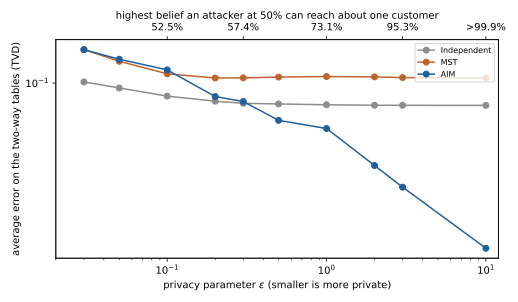
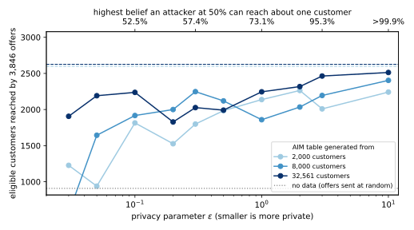

# The use case {#sec-case}

A retail bank is about to launch a premium credit card, and an outside agency will plan and run the campaign. The card only makes sense for customers who earn more than $50,000 a year. The bank does not record income, but it holds other facts about each customer, such as age, education, occupation, hours worked and marital status. The agency asks for the customer table, for two purposes. It wants to plan the campaign, which means counting the eligible customers in each segment it might target. And it wants to train its own model to pick the customers who receive an offer.

The bank's privacy policy does not let customer records leave its secure environment. What may leave is a *synthetic table*. It has the same columns, but its rows are generated by a procedure that satisfies differential privacy (DP), so that the table cannot be used to learn much about any single customer. The agency can then count, plot and train on it as it likes, because anything computed from a DP release is covered by the same guarantee. The policy does not say how strict the guarantee must be, nor which generator to use. Those two choices are the subject of this note.

A companion note, *The Privacy–Utility Trade-off, Worked Through*, took the first route for the same bank: it trained the targeting model inside the bank with DP and handed over the model alone. This note takes the second route and compares the two at the end, because the choice between a private model and a private table is the choice the bank actually faces.

We need data that behaves like the bank's records, and the standard public dataset for this is Adult. It holds 48,842 people from the 1994 US Current Population Survey, each with the attributes above and a label saying whether their income was above $50,000 ([UCI Machine Learning Repository](https://archive.ics.uci.edu/dataset/2/adult)). We use its training file of 32,561 people as the bank's customer records, which the synthetic table is generated from. Its test file of 16,281 people plays the customers who will receive the next campaign. Everything below is computed by one script, [code/notes/privacy_utility_tradeoff_synthetic.py](https://github.com/manuelvloureiro/privacy-preserving-machine-learning-book/blob/main/code/notes/privacy_utility_tradeoff_synthetic.py), which a reader can run to get the same numbers.

Each step below shows the lines of the script that carry it out. The whole experiment runs with one command, and it runs four processes at a time, because each loads JAX and PyTorch; `PRIVACY_WORKERS` changes the number:

```bash
uv run python code/notes/privacy_utility_tradeoff_synthetic.py
```

The walk-through has six steps. It states the business goal as two counts (@sec-goal), turns the privacy setting into a policy sentence (@sec-policy), and fixes everything that must not be tuned on private data, including the three generators (@sec-fixed). It then runs the experiment and reads the results, first in technical terms and then in business terms (@sec-results). The last steps look at how much the size of the dataset matters (@sec-size) and how to present the decision, including the comparison with the model route (@sec-decision).

# Step 1: state the business goal as two counts {#sec-goal}

A synthetic table is usually judged by how closely its statistics match the real table's, but that is not what the agency will get out of it. The agency will do two things with the table, and each of them produces a count the bank cares about.

The first is the plan. The agency divides the customers into segments by age band and occupation, six age bands times fifteen occupations, which makes 90 segments, and for each segment it wants to know how many eligible customers it holds. The real records hold 7,841 eligible customers, and the plan says how they are spread over the segments. A synthetic table gives a different spread, and the error that matters is how many eligible customers it puts in the wrong segment. We count that as half the sum, over the segments, of the absolute difference between the synthetic count and the real count. When the two tables hold the same number of eligible customers, that is exactly the number of customers one would have to move between segments to turn the synthetic plan into the real one.

The second is the campaign, and here we keep the companion note's metric so that the two routes can be compared. The agency trains a model on the table it was given, scores the 16,281 campaign customers, and sends 3,846 offers to the highest scores, as many offers as there are eligible customers among them. The metric is the number of eligible customers among those 3,846, and the baseline is sending the offers at random, which reaches about 909 of them. Any table worth having must beat 909.

In the script, the two counts are short functions. The first averages the error over the two-way tables for the technical view of @sec-results, and the second counts the eligible customers the plan misplaces:

```{.python excerpt="syn-metrics"}
def workload_error(real: Dataset, synth: Dataset) -> float:
    """Average over the two-way tables of the total variation distance between real and synthetic proportions."""
    errors: list[float] = []
    for pair in pairs(real.domain):
        x = np.asarray(real.project(pair).datavector(), dtype=np.float64)
        y = np.asarray(synth.project(pair).datavector(), dtype=np.float64)
        errors.append(0.5 * float(np.abs(x / x.sum() - y / y.sum()).sum()))
    return float(np.mean(errors))


def misplaced(real: Dataset, synth: Dataset) -> float:
    """Eligible customers the synthetic plan puts in the wrong segment: half the L1 distance between the plans."""
    return 0.5 * float(np.abs(plan(real) - plan(synth)).sum())
```

The script sets up the campaign the same way as the companion note. It encodes the two files of Adult as tables of discrete attributes, counts the eligible customers among the campaign customers to fix the number of offers, and counts the eligible customers in the records that the plan distributes:

```{.python excerpt="syn-campaign"}
df = practitioner_datasets.adult()
records, customers = encode(df.head(TRAIN_ROWS)), encode(df.slice(TRAIN_ROWS))
data: Data = (records, one_hot(customers), labels(customers))
eligible = int(data[2].sum())  # offers = eligible customers in the campaign, as in the companion note
baseline = eligible * eligible / customers.records  # random offers reach them at the base rate
eligible_records = int(labels(records).sum())  # the eligible customers the plan distributes over segments
```

The money follows from the counts. Write $V$ for what the bank gains from reaching one eligible customer instead of an ineligible one, which the finance team estimates. A difference of $k$ customers reached is worth $k\,V$. The plan's error is harder to price, because a misplaced customer costs the bank nothing by itself and only matters when the agency sizes a segment wrongly. So we report it as a count and as a share of the 7,841 eligible customers, and let the agency say what share it can live with.

# Step 2: turn the privacy setting into a sentence {#sec-policy}

DP is controlled by one number, $\varepsilon$, and a smaller $\varepsilon$ means stronger privacy. On its own, $\varepsilon$ means nothing to a privacy officer, so we translate it into the question an attacker would ask. Suppose an attacker wants to know whether a particular person, say Alice, is one of the bank's customers. Before seeing the synthetic table, the attacker has some belief about that. DP guarantees that seeing the table can multiply the attacker's odds by at most $e^{\varepsilon}$.

The cleanest case is an attacker who starts at even odds, a belief of 50%. The odds are then 1 to 1, and after seeing the table they are at most $e^\varepsilon$ to 1. Turned back into a probability, the attacker's belief can rise to at most

$$\text{belief ceiling} = \frac{e^{\varepsilon}}{1 + e^{\varepsilon}}.$$

At $\varepsilon = 1$ the ceiling is about 73%. At $\varepsilon = 0.1$ it is about 52.5%, so the table teaches the attacker almost nothing, and at $\varepsilon = 3$ it is about 95%, a guarantee that still holds but is weak. The privacy officer signs the same sentence as in the companion note, a ceiling of 75%, so that the two routes are priced at the same guarantee. Solving the formula for $\varepsilon$ turns the sentence into a number:

$$\frac{e^{\varepsilon}}{1+e^{\varepsilon}} \le 0.75 \quad\Longleftrightarrow\quad e^{\varepsilon} \le 3 \quad\Longleftrightarrow\quad \varepsilon \le \ln 3 \approx 1.10.$$

The script holds both directions of this translation. The first function gives the ceiling for a given $\varepsilon$, which labels the top axis of every figure below, and the second turns the officer's ceiling back into $\varepsilon$:

```{.python excerpt="syn-belief"}
def belief_ceiling(eps: float, prior: float = 0.5) -> float:
    """Highest posterior that epsilon-DP allows an attacker who starts at `prior` that one customer is in the data."""
    odds = math.exp(eps) * prior / (1 - prior)
    return odds / (1 + odds)


def epsilon_for_belief(belief: float, prior: float = 0.5) -> float:
    """The largest epsilon whose belief ceiling, from `prior`, is `belief`."""
    return math.log((belief / (1 - belief)) / (prior / (1 - prior)))
```

The policy is set before anyone looks at the results. As in the companion note, the guarantee has a second parameter, $\delta$, the small probability that it fails outright, set below one over the number of customers at $\delta = 10^{-5}$.

The generators below need one more translation, because they add Gaussian noise many times over, and the natural way to add up Gaussian noise is not in $\varepsilon$. Each Gaussian measurement is accounted in *zero-concentrated DP*, which has one parameter, $\rho$, and in which costs simply add. Write $\sigma$ for the standard deviation of the noise added to a count that one customer changes by one. That measurement costs $\rho = 1 / (2\sigma^2)$, and two measurements cost the sum of their $\rho$. A total budget $\rho$ then converts to $(\varepsilon, \delta)$ by a formula that gives the smallest $\delta$ for each $\varepsilon$. We run that conversion backwards, by bisection, and find the largest $\rho$ that the policy's $\varepsilon$ and $\delta$ allow.

```{.python excerpt="syn-zcdp"}
def zcdp_delta(rho: float, eps: float) -> float:
    """The smallest delta for which rho-zCDP implies (eps, delta)-DP (Canonne, Kamath & Steinke, 2020, Prop. 7)."""
    lo, hi = 1.01, (eps + 1) / (2 * rho) + 2  # the best order alpha lies in this range
    alpha = (lo + hi) / 2
    for _ in range(100):
        alpha = (lo + hi) / 2
        if (2 * alpha - 1) * rho - eps + math.log1p(-1 / alpha) < 0:
            lo = alpha
        else:
            hi = alpha
    return min(1.0, math.exp((alpha - 1) * (alpha * rho - eps) + alpha * math.log1p(-1 / alpha)) / (alpha - 1))


def rho_for_epsilon(eps: float, delta: float = DELTA) -> float:
    """The largest zCDP budget rho that (eps, delta)-DP allows, found by bisection."""
    lo, hi = 0.0, eps + 1
    for _ in range(100):
        rho = (lo + hi) / 2
        lo, hi = (rho, hi) if zcdp_delta(rho, eps) <= delta else (lo, rho)
    return lo
```

The budgets are small numbers, and @tbl-budgets lists them for three values of $\varepsilon$ at $\delta = 10^{-5}$. Every generator below receives $\rho$ and spends it, so each is $(\varepsilon, 10^{-5})$-DP by construction, and all of them sit on the same axis as the companion note's model.

| $\varepsilon$ | Attacker's belief ceiling | Budget $\rho$ |
| --- | --- | --- |
| 0.1 | 52.5% | 0.00043 |
| 1 | 73.1% | 0.031 |
| 3 | 95.3% | 0.22 |

: The zero-concentrated budget that the policy's $(\varepsilon, 10^{-5})$ allows. {#tbl-budgets}

# Step 3: fix everything that must not be tuned on private data {#sec-fixed}

A DP guarantee covers what the generator does with the data. It does not cover choices someone made by looking at the private data beforehand. If an engineer tried five generators on the records and kept the one whose table looked best, that choice would itself leak information. So everything apart from the generator's run is decided from public information, and the generators' own settings are those of their published reference implementations.

**The table's columns.** Every generator below works on a table of discrete attributes, so the numbers are put into bands and the categories are taken from the survey's public codebook. Age goes into six bands, from 17 to 24 up to 65 and over, and hours worked into five. Capital gains and losses, which are zero for most people, go into four bands each. The eight categorical attributes keep the codebook's lists, from work class to country of birth, with a "missing" category where the survey allows a blank. With the income label that makes 13 attributes. The survey weight and the numeric copy of education are dropped. The product of the 13 attributes' sizes is about 37 billion, so each row is one cell of a table with 37 billion cells. That is why no generator can simply count the rows in each cell and add noise to every count.

The encoding function reads only the bands and the lists, never a statistic of the data:

```{.python excerpt="syn-encode"}
def encode(df: pl.DataFrame) -> Dataset:
    """Map each row to one integer per attribute: its band, or its category's position in the codebook's list."""
    columns: dict[str, Ints] = {}
    for name, limits in BANDS.items():
        x = df[name].cast(pl.Int64).to_numpy()
        columns[name] = np.searchsorted(np.array(limits), x, side="left").astype(np.int64)
    for name, values in CATEGORIES.items():
        index = {v: i for i, v in enumerate(values)}
        missing = index.get("missing", -1)
        columns[name] = np.array([index[v] if v is not None else missing for v in df[name].to_list()], dtype=np.int64)
        assert columns[name].min() >= 0, f"a value of {name} is not in the codebook"
    return Dataset(columns, domain())
```

**What the generators measure.** All three generators work the same way at heart, and the companion note's model route does not. They measure *marginal tables*. A one-way table counts the customers with each value of one attribute. A two-way table counts them for each pair of values of two attributes, such as each combination of age band and occupation. The 13 attributes give 78 two-way tables, the largest of which, country by education, has 672 cells. One customer sits in exactly one cell of each table, so adding or removing a customer changes one count by one. That is what lets a table be measured with Gaussian noise of standard deviation $\sigma$ on every cell at a cost of $\rho = 1 / (2\sigma^2)$, whatever its number of cells. The measured tables are then handed to Private-PGM ([McKenna, Sheldon & Miklau, 2019](https://arxiv.org/abs/1901.09136)). It finds the probability distribution over whole rows whose marginals best match the noisy tables, and it samples synthetic rows from that distribution. Everything after the measurements is computation on noisy numbers and costs no privacy.

The script measures a table with one function, and chooses among candidates with another. The second is the *exponential mechanism*: it draws a candidate with probability proportional to $e^{\varepsilon \cdot \text{score} / 2}$, so a candidate with a higher score is more likely but never certain, which is what keeps the choice private when the scores depend on the data:

```{.python excerpt="syn-measure"}
def measure(data: Dataset, clique: Clique, sigma: float, rng: np.random.Generator) -> LinearMeasurement:
    """The table of counts over `clique`, with Gaussian noise of scale sigma on every cell: rho = 1 / (2 sigma^2)."""
    counts = np.asarray(data.project(clique).datavector(), dtype=np.float64)
    return LinearMeasurement(counts + rng.normal(0.0, sigma, counts.size), clique, stddev=sigma)


def exponential_mechanism(scores: dict[Clique, float], eps: float, rng: np.random.Generator) -> Clique:
    """One candidate, drawn with probability proportional to exp(eps * score / 2); each score has sensitivity 1."""
    cliques = list(scores)
    logits = np.array([eps * scores[c] / 2 for c in cliques])
    weights = np.exp(logits - logits.max())
    return cliques[rng.choice(len(cliques), p=weights / weights.sum())]
```

**The three generators.** They differ only in which tables they measure, and that is the whole trade-off within the budget. A table costs the same whether it is one-way or two-way, but there are far more two-way tables, so a generator must choose.

The first, which we call **Independent**, measures each attribute's one-way table, with the budget split equally over the 13 of them, and nothing else. Its synthetic rows have the right share of each age band and of each occupation, but age and occupation vary independently of each other, and so does income of everything. It is the generator a team might build in an afternoon, and it is here to show what the other two buy.

The second is **MST**, the generator that won the 2018 differential privacy synthetic data competition run by the US National Institute of Standards and Technology ([McKenna, Miklau & Sheldon, 2021](https://arxiv.org/abs/2108.04978)). It splits the budget in three. One third measures the one-way tables. One third chooses which two-way tables to measure. For that, MST fits a model to the one-way tables alone and scores every pair of attributes by how badly that model gets their two-way table wrong. It then picks twelve pairs with the exponential mechanism, one at a time, so that they form a tree over the 13 attributes. The last third measures those twelve two-way tables. A tree is the largest set of pairs that Private-PGM can always fit cheaply, which is why MST stops there.

```{.python excerpt="syn-mst"}
def mst(data: Dataset, rho: float, rng: np.random.Generator) -> Dataset:
    """MST: one-way tables, then a spanning tree of the two-way tables that a one-way model gets most wrong."""
    d = len(data.domain)  # a third of the budget each: the one-way tables, the choice of tree, the tree's tables
    one_way = [measure(data, (a,), math.sqrt(3 * d / (2 * rho)), rng) for a in data.domain]
    model = fit(data.domain, one_way, iters=2500)
    scores = {
        pair: float(np.abs(data.project(pair).datavector() - model.project(pair).datavector()).sum())
        for pair in pairs(data.domain)
    }
    tree: list[Clique] = []
    component = {a: a for a in data.domain}  # which tree component each attribute belongs to
    eps_round = math.sqrt(8 * (rho / 3) / (d - 1))
    for _ in range(d - 1):
        joining = {p: s for p, s in scores.items() if component[p[0]] != component[p[1]]}
        a, b = exponential_mechanism(joining, eps_round, rng)
        tree.append((a, b))
        component = {x: component[a] if c == component[b] else c for x, c in component.items()}
    two_way = [measure(data, edge, math.sqrt(3 * (d - 1) / (2 * rho)), rng) for edge in tree]
    return fit(data.domain, one_way + two_way, iters=5000).synthetic_data()
```

The third is **AIM**, an adaptive and iterative mechanism, and the generator that does best on the public benchmarks ([McKenna, Mullins, Sheldon & Miklau, 2022](https://arxiv.org/abs/2201.12677)). It is told which tables matter, here all 78 two-way tables, and it spends the budget in rounds. The budget is divided over a fixed number of rounds, 16 per attribute. Nine tenths of each round's share go to measuring and one tenth to choosing.

In each round, AIM scores every candidate table by how far its current model's answer is from the real one, minus the error that the noise alone would cause. It then picks a table with the exponential mechanism. The candidates are the one-way and two-way tables, weighted by how many of the 78 tables they inform, and a candidate is only allowed if the model stays small enough to fit. AIM measures the chosen table and refits the model with it. It then checks whether the measurement improved the model's answer by more than the noise would explain. If it did not, the noise is too large to be useful at this point, so AIM halves $\sigma$ for the rounds that remain. Each remaining round then costs four times more, and the run ends sooner. When the budget cannot cover another full round, the last round spends what is left.

```{.python excerpt="syn-aim"}
measurements = [measure(data, (a,), sigma, rng) for a in dom]
spent = len(dom) * 0.5 / sigma**2
model = fit(dom, measurements, iters=1000)
last = False
while not last:
    if rho - spent < 2 * (0.5 / sigma**2 + eps**2 / 8):  # the next round would overspend: make it the last
        sigma, eps, last = math.sqrt(1 / (2 * 0.9 * (rho - spent))), math.sqrt(8 * 0.1 * (rho - spent)), True
    spent += eps**2 / 8 + 0.5 / sigma**2
    allowed = allowed_cliques(candidates, model, max_model_size * spent / rho)
    tables = model_tables(model, allowed)  # the model's answer to every candidate, without the library's compiler
    scores = {c: candidates[c] * (l1(answers[c], tables[c]) - bias(sigma, dom, c)) for c in allowed}
    clique = exponential_mechanism(scores, eps, rng)
    measurements.append(measure(data, clique, sigma, rng))
    before = error(answers[clique], model, clique)
    measured = list(dict.fromkeys(m.clique for m in measurements))  # a table can be measured twice
    model = fit(dom, measurements, iters=1000, warm=model.potentials.expand(measured))
    if before - error(answers[clique], model, clique) <= bias(sigma, dom, clique):  # too noisy to help
        sigma, eps = sigma / 2, eps * 2
```

The generators' settings are those of the reference implementations: MST's three-way split, AIM's 16 rounds per attribute, its nine-to-one split between measuring and choosing, and its limit of 80 megabytes on the model. One simplification is ours. The reference MST first merges the rare values of each attribute, such as the countries with a handful of customers, into one. We leave the codebook's lists as they are for all three generators, so that they are compared on the same table. One shortcut is ours too, and it changes nothing in the numbers. AIM asks its model for its answer to about ninety candidate tables in every round, and the library compiles a separate program for each of them. The script computes those answers itself, by message passing over the model's junction tree in plain numpy, which gives the same tables in a fraction of the time.

**The agency's model and the model route.** The agency trains a logistic regression on whatever table it is given, with the library's default settings, on the 12 attributes other than income as 0-or-1 columns. The same model trained on the real table is the reference point for the campaign: what the agency would reach if it had the records. The model route of the companion note is stochastic gradient descent (SGD) made differentially private, DP-SGD: a logistic regression trained with clipping and noise inside the bank, and the script trains it on these same 12 attributes with the companion note's settings, so that the two routes are compared on equal terms.

The experiment then runs each generator at ten values of $\varepsilon$ from 0.03 to 10, with five random seeds each, because the generators are random and one run can be lucky or unlucky. Each run is one job, made of a technique, a value of $\varepsilon$, a number of customer records and a seed. The script lists the jobs, the slow ones first, and spreads them over the processor cores:

```{.python excerpt="syn-sweep"}
jobs: list[tuple[str, float | None, int, int, Path | None]] = [("Real table", None, TRAIN_ROWS, 0, cache)]
for technique in [*GENERATORS, "DP-SGD"]:
    jobs += [(technique, eps, TRAIN_ROWS, seed, cache) for eps in epsilons for seed in range(seeds)]
for n in SIZES[:-1]:
    jobs += [("Real table", None, n, 0, cache)]
    jobs += [("AIM", eps, n, seed, cache) for eps in epsilons for seed in range(size_seeds)]
jobs.sort(key=lambda j: (j[0] != "AIM", -(j[1] or 0.0)))  # the slow jobs first, so the cores stay busy
context = multiprocessing.get_context("spawn")  # jax must start fresh in each worker
# A worker's memory grows with every program jax compiles, so each job gets a fresh process.
pool = ProcessPoolExecutor(WORKERS, mp_context=context, initializer=_init, initargs=(data,), max_tasks_per_child=1)
with pool:
    runs = list(pool.map(evaluate, jobs))
```

# Step 4: read the results, technical first {#sec-results}

@fig-technical shows the engineer's view, which is how the synthetic data literature judges a generator. Its vertical axis is the average, over the 78 two-way tables, of the distance between the synthetic table's proportions and the real table's. The distance is the *total variation distance*, half the sum of the absolute differences of the proportions, which is the largest error the synthetic table can make on any question about that pair of attributes, as a share of the customers. The bottom axis is $\varepsilon$, and the top axis translates it into the attacker's belief ceiling of @sec-policy.

{#fig-technical}

The three generators behave very differently. AIM's error falls steadily as the budget grows, from 0.151 at $\varepsilon = 0.03$ to 0.057 at $\varepsilon = 1$ and 0.013 at $\varepsilon = 10$, because a larger budget buys more rounds and less noise in each. MST's error stops falling at about 0.11 from $\varepsilon = 0.2$ on. It measures only the 12 two-way tables of its tree, so the other 66 are guesses from the model, and no budget improves a guess. Independent measures no two-way table at all, and its error settles at 0.076, the error of treating every pair of attributes as unrelated. Up to $\varepsilon = 0.3$ that guess beats both other generators, which spread too little budget over too many tables. From $\varepsilon = 0.5$ on, AIM has the smallest error.

@fig-plan shows the first business count: the eligible customers that the synthetic plan puts in the wrong segment, out of 7,841. The shaded bands show the range from the 10th to the 90th percentile over the seeds. The plan is a three-way table, age band by occupation by income, and no generator measured it directly. AIM measured two-way tables that overlap it, and the model fills in the rest.

{#fig-plan}

The plan tells a different story from the average error. Independent misplaces about 3,000 of the 7,841 eligible customers at every budget, because a table that treats income as unrelated to age and occupation spreads the eligible customers over the segments like everyone else. MST and AIM do worse than that below $\varepsilon = 1$, misplacing between 3,290 and 5,690. Their models link income to the segment attributes, but through noisy or indirect tables, which can be worse than no link. At $\varepsilon = 1$ AIM's error drops to 484 misplaced customers, 6.2% of them, and it stays below 400 from $\varepsilon = 2$ on. With that budget AIM can afford to measure the tables that tie income to age and to occupation. So a synthetic plan is usable only from about $\varepsilon = 1$, and only with AIM.

@fig-business shows the second count, the campaign, in the bank's terms. Its vertical axis is the number of eligible customers reached by the 3,846 offers. The upper dashed line is the agency's model trained on the real table, the dotted line is no data at all, and the dashed line with square markers is the companion note's route, a DP-SGD model trained inside the bank at the same $\varepsilon$. The shaded region on the right is what the privacy policy forbids.

{#fig-business}

AIM's table gives the best campaign at most budgets: about 1,900 to 2,240 of the 3,846 eligible customers up to $\varepsilon = 0.1$, about 1,830 to 2,030 between 0.2 and 0.5, and 2,245 at $\varepsilon = 1$, rising to 2,513 at $\varepsilon = 10$. In the middle AIM does worse than at $\varepsilon = 0.1$, beyond the spread over seeds, and at $\varepsilon = 0.2$ MST beats it, 2,081 to 1,828. A larger budget makes AIM measure more tables, and the extra tables do not always help the campaign. Independent stays near random offers at every budget, between 631 and 1,125, because a model trained on a table without links between attributes has nothing to learn. The DP-SGD model of the companion note beats every synthetic table at every budget. It reaches 2,483 at $\varepsilon = 0.1$ and 2,620 at $\varepsilon = 1$, within 5 of the model trained on the real table, while the best synthetic table at $\varepsilon = 1$ is 380 short.

@tbl-frontier lists every synthetic configuration. A configuration is on the *frontier* when no other configuration is at least as private and reaches more customers, and only the frontier is worth considering.



# Step 5: check how much the data size matters {#sec-size}

The curves above depend on the bank having many customers. A measured table carries noise of a fixed size whatever the number of customers, so with fewer customers the same noise is a larger share of every count. A bank with fewer customers, or a campaign aimed at one region, pays more for the same guarantee. The script therefore runs AIM again on the first 2,000 and the first 8,000 customer records, and @fig-sizes compares the three sizes on the campaign count.

{#fig-sizes}

Fewer records cost more at the smallest budget. At $\varepsilon = 0.1$ AIM's table misses 784 eligible customers when it is generated from 2,000 records, 709 from 8,000 and 388 from all 32,561. At the larger budgets the pattern is less clear, because the smaller sizes ran with two seeds each and a single run can be far from the average. The 767 missed at 8,000 records and $\varepsilon = 1$, more than the 460 at 2,000, is that kind of noise. The lesson that holds is the first one: a bank with a few thousand customers should expect to pay about twice as much for the same guarantee, and should run the sweep at its own size before promising anything.



# Step 6: present the menu and decide {#sec-decision}

The decision maker does not need the curves. They need a few options, each with a privacy sentence and its business effect, and @tbl-menu gives them. The options are the best generator at a few privacy levels, each next to the model route at the same level, plus the two reference points, no data and the real table. The membership column gives a second privacy sentence. It bounds how often any attack that wrongly accuses 1% of non-customers can correctly identify a real customer ([Kairouz et al., 2015](https://arxiv.org/abs/1311.0776)).



The policy ceiling of @sec-policy, $\varepsilon \le 1.10$, picks the option.



The comparison with the model route is the one the bank should dwell on. If the agency needed only the targeting model, the model route would win outright: at the same guarantee it reaches 2,620 eligible customers to the table's 2,245. The table is worth its extra cost only because it also answers the planning question, and at $\varepsilon = 1$ it answers it well, with 6.2% of the eligible customers misplaced. Below $\varepsilon = 1$ the synthetic plan misplaces more than 40% of them, and the table is then hard to justify over the model. So the bank releases the AIM table at $\varepsilon = 1$ if the agency's planning matters to it. If it does not, the bank releases the DP-SGD model instead.

Three people sign the decision, each for their own part. The privacy officer signs the ceiling, which was fixed before the results were known. The engineer signs that the generator meets it, with the budget $\rho$ it was given, its conversion to $\varepsilon$ and $\delta$, and the settings of @sec-fixed. The business owner signs the cost in customers, and so in money, and the agency signs the share of the plan it accepts. All of this goes into a release record, together with the script that produced the numbers, so that the decision can be checked and revisited when the data or the policy changes.

# Doing this in another business {#sec-other}

The six steps carry over to any use case where a table rather than a model has to leave, and only the contents of each step change. The business counts are whatever the recipient will compute from the table: segment sizes, a forecast, a model's hit rate. The baseline is what the recipient would do without the table. The privacy ceiling is always a sentence about an attacker's belief, translated into $\varepsilon$ before anyone sees the results, and the generators' budget follows from it. The experiment is always a sweep over $\varepsilon$, generators and seeds, read first as error on the measured tables and then as the business counts. The output is always a short menu with a cost in the business's own units, next to the cost of releasing a model instead, which the people who own the risk and the revenue can sign.

# Sources {#sec-sources}

- Becker, B. and Kohavi, R. (1996). [Adult](https://archive.ics.uci.edu/dataset/2/adult). UCI Machine Learning Repository. Licence: Creative Commons Attribution 4.0.
- McKenna, R., Mullins, B., Sheldon, D. and Miklau, G. (2022). [AIM: An Adaptive and Iterative Mechanism for Differentially Private Synthetic Data](https://arxiv.org/abs/2201.12677). *Proceedings of the VLDB Endowment* 15(11).
- McKenna, R., Miklau, G. and Sheldon, D. (2021). [Winning the NIST Contest: A Scalable and General Approach to Differentially Private Synthetic Data](https://arxiv.org/abs/2108.04978). *Journal of Privacy and Confidentiality* 11(3). The MST generator.
- McKenna, R., Sheldon, D. and Miklau, G. (2019). [Graphical-model based estimation and inference for differential privacy](https://arxiv.org/abs/1901.09136). *ICML 2019*. Private-PGM, the inference engine behind MST and AIM, released as the `mbi` library ([github.com/ryan112358/private-pgm](https://github.com/ryan112358/private-pgm)), whose reference implementations of both generators this note follows.
- Bun, M. and Steinke, T. (2016). [Concentrated Differential Privacy: Simplifications, Extensions, and Lower Bounds](https://arxiv.org/abs/1605.02065). *TCC 2016*. Zero-concentrated DP, the accounting the generators use.
- Canonne, C., Kamath, G. and Steinke, T. (2020). [The Discrete Gaussian for Differential Privacy](https://arxiv.org/abs/2004.00010). *NeurIPS 2020*. The conversion from $\rho$ to $(\varepsilon, \delta)$ in @sec-policy.
- Tao, Y., McKenna, R., Hay, M., Machanavajjhala, A. and Miklau, G. (2021). [Benchmarking Differentially Private Synthetic Data Generation Algorithms](https://arxiv.org/abs/2112.09238). Why marginal-based generators lead the benchmarks.
- Kairouz, P., Oh, S. and Viswanath, P. (2015). [The Composition Theorem for Differential Privacy](https://arxiv.org/abs/1311.0776). *ICML 2015*. The hypothesis-testing reading of $(\varepsilon,\delta)$ behind the membership bound.
- Abadi, M. et al. (2016). [Deep Learning with Differential Privacy](https://arxiv.org/abs/1607.00133). *ACM CCS 2016*. DP-SGD, the model route.
- Near, J., Darais, D., Lefkovitz, N. and Howarth, G. (2025). [Guidelines for Evaluating Differential Privacy Guarantees](https://csrc.nist.gov/pubs/sp/800/226/final). NIST SP 800-226.
