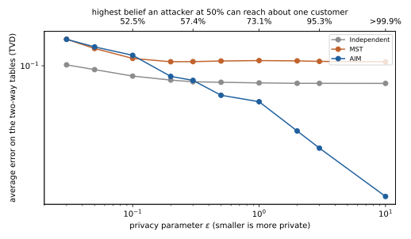
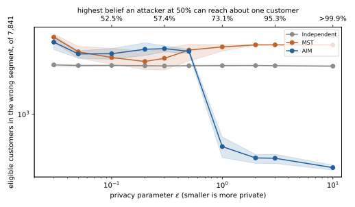
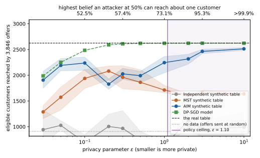
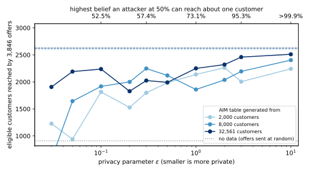

How strict should a differential privacy (DP) guarantee be, what form should the private release take, and who decides? This note answers these questions for one use case, a bank's credit-card campaign, and ends with a decision that the people who own the risk and the revenue sign. You need basic probability to follow it, such as odds, averages and percentiles. @tbl-map gives the question each section answers, and @tbl-symbols lists the symbols.

| Section | The question it answers |
|:---|:---|
| @sec-case | What does the bank want, what can it release, and which public data stands in for its records? |
| @sec-goal | Which counts does the business care about, and what must a release beat? |
| @sec-policy | What does $\varepsilon$ mean to a privacy officer, and which value does the policy allow? |
| @sec-fixed | Which choices must be fixed before anyone touches the records, so that they leak nothing? |
| @sec-model | How does the bank train a private model? |
| @sec-results | Which model technique is best at each privacy level, and what does privacy cost in customers? |
| @sec-size | How does that cost change with the number of customers? |
| @sec-syn-budget | How does a generator of synthetic data account for its privacy? |
| @sec-syn-fixed | Which three generators are compared, and how do they differ? |
| @sec-syn-results | Which generator is best for the plan and for the campaign? |
| @sec-syn-size | How does the synthetic table's cost change with the number of customers? |
| @sec-decision | Which route and which option does the policy pick, and who signs it? |
| @sec-other | How do the steps carry over to another business? |
| @sec-sources | Where do the data, the methods and the arguments come from? |

: The question each section answers. {#tbl-map}

| Symbol | Meaning |
|:---|:---|
| $\varepsilon$ | the privacy parameter of DP: a smaller value means stronger privacy |
| $e^{\varepsilon}$ | the most that seeing the release can multiply an attacker's odds by |
| $\delta$ | the small probability that the guarantee fails outright |
| $\rho$ | the privacy budget of a generator, in zero-concentrated DP |
| $\sigma$ | the standard deviation of the noise that a generator adds to each count |
| $V$ | what the bank gains when it reaches one eligible customer instead of an ineligible one |
| $k$ | a difference in the number of eligible customers reached |

: The symbols the note uses. Each is also explained where it first appears. {#tbl-symbols}

# The use case {#sec-case}

A retail bank is about to launch a premium credit card for customers who earn more than $50,000 a year, and an outside agency will run the campaign. The bank does not record income, but it holds other facts about each customer, such as age, education, occupation, hours worked and marital status. So the campaign needs a model that predicts from those facts who is likely to be eligible. The agency would also like to plan the campaign, which means to count the eligible customers in each segment it might target.

The bank's privacy policy does not let customer records leave its secure environment. Anything that does leave must be trained or generated with DP, so that nobody can use it to learn much about any one customer. The bank can meet the policy in two ways. On the *model route*, it trains the targeting model itself with DP and hands over the model alone. On the *synthetic-data route*, it hands over a *synthetic table*, which has the same columns as the records but rows that a DP procedure generates.

The agency can count, plot and train on a synthetic table as it likes, because anything computed from a DP release has the same guarantee. The policy does not say how strict the guarantee must be, nor which route to take. Those two choices are the subject of this note.

The bank's records are private, so we use a public dataset like them, called Adult. Adult holds 48,842 people from the 1994 US Current Population Survey. Each has these attributes and a label for income above $50,000 ([UCI Machine Learning Repository](https://archive.ics.uci.edu/dataset/2/adult)). Its training file of 32,561 people plays the bank's customer records, which the model or the synthetic table comes from. Its test file of 16,281 people plays the customers of the next campaign.

Two scripts compute every number below, one for each route, and each step shows their lines. [code/notes/privacy_utility_tradeoff.py](../../code/notes/privacy_utility_tradeoff.py) trains the private models in a few minutes on all of a machine's processor cores. [code/notes/privacy_utility_tradeoff_synthetic.py](../../code/notes/privacy_utility_tradeoff_synthetic.py) runs the generators. It runs four processes at a time, because each loads JAX and PyTorch, and `PRIVACY_WORKERS` changes that number:

```bash
uv run python code/notes/privacy_utility_tradeoff.py
uv run python code/notes/privacy_utility_tradeoff_synthetic.py
```

# Step 1: state the business goal as counts {#sec-goal}

Engineers usually measure a model by its accuracy or its area under the curve (AUC), and a synthetic table by how closely its statistics match the records. Neither tells the marketing team what it will get. The team cares about how many offers reach eligible customers, so this step fixes the number of offers and counts how many land well.

The bank can choose the number of offers from public data. The Census Bureau publishes the share of people who earn more than $50,000, about 24% in Adult. If the bank sends as many offers as it expects eligible customers, a perfect model wastes none. For the 16,281 campaign customers this rule gives 3,846 offers, the number of eligible customers among them, when the published share holds for the bank.

The bank sends the 3,846 offers to the customers with the highest scores. The business metric is the number of eligible customers among them, and every other offer is wasted. The script computes it with a short function:

```{.python excerpt="put-reached"}
def reached(scores: Array, y: npt.NDArray[np.int64], offers: int) -> int:
    """Eligible customers among the `offers` highest-scored; ties are broken by position, deterministically."""
    top = np.argsort(-scores, kind="stable")[:offers]
    return int(y[top].sum())
```

The metric needs a baseline, and the natural one is no model at all. If the bank sent the offers to customers picked at random, each would reach an eligible customer with probability 3,846 / 16,281, about 24%. So the expected number reached would be

$$3{,}846 \times \frac{3{,}846}{16{,}281} \approx 909.$$

Any release, a private model or a synthetic table, has to beat 909 to be worth having. The script sets up the campaign in the same way:

```{.python excerpt="put-campaign"}
df = practitioner_datasets.adult()
train, test = df.head(TRAIN_ROWS), df.slice(TRAIN_ROWS)
data = (features(train), labels(train), features(test), labels(test))
eligible = int(data[3].sum())
# Random offers reach an eligible customer at the base rate, eligible / campaign customers.
baseline = eligible * eligible / len(data[3])
```

A synthetic table also serves the agency's plan, and that gives a second count. The agency divides the customers into segments by age band and occupation, six age bands times fifteen occupations, which makes 90 segments. The records hold 7,841 eligible customers, and the plan says how many of them each segment holds. A synthetic table gives a different spread, so its error is the number of eligible customers it puts in the wrong segment. We count that as half the sum, over the segments, of the absolute difference between the synthetic count and the real count. When the two tables hold the same number of eligible customers, it is the number of customers that must move between segments to turn one plan into the other.

The second script computes this count, and also the error on the two-way tables that @sec-syn-results uses for the technical view:

```{.python excerpt="syn-metrics"}
def workload_error(real: Dataset, synth: Dataset) -> float:
    """Average over the two-way tables of the total variation distance between real and synthetic proportions."""
    errors: list[float] = []
    for pair in pairs(real.domain):
        x = np.asarray(real.project(pair).datavector(), dtype=np.float64)
        y = np.asarray(synth.project(pair).datavector(), dtype=np.float64)
        errors.append(0.5 * float(np.abs(x / x.sum() - y / y.sum()).sum()))
    return float(np.mean(errors))


def misplaced(real: Dataset, synth: Dataset) -> float:
    """Eligible customers the synthetic plan puts in the wrong segment: half the L1 distance between the plans."""
    return 0.5 * float(np.abs(plan(real) - plan(synth)).sum())
```

The counts also give the money. Write $V$ for what the bank gains when it reaches one eligible customer instead of an ineligible one. It is the chance that an eligible customer takes up the card times the card's margin, and the finance team estimates it. Every comparison below is a difference of $k$ eligible customers reached, worth $k\,V$ to the bank. So the note never needs a value for $V$, because the decision in @sec-decision only compares $k\,V$ with what the policy protects.

A misplaced customer is harder to price, because it costs the bank only when the agency sizes a segment wrongly. So we report the plan's error as a count and as a share of the 7,841, and the agency says what share it accepts.

# Step 2: turn the privacy setting into a sentence {#sec-policy}

DP is set by one number, $\varepsilon$, and a smaller $\varepsilon$ means stronger privacy. A privacy officer cannot sign a bare number, so this step translates $\varepsilon$ into an attacker's question. Suppose an attacker wants to know whether one person, say Alice, is a customer of the bank, and starts with some belief about it. DP guarantees that seeing the release, the model or the table, can multiply the attacker's odds by at most $e^{\varepsilon}$.

The simplest case is an attacker who starts at even odds, a belief of 50%. The odds are then 1 to 1, and after the attacker sees the release they are at most $e^\varepsilon$ to 1. Odds of $e^\varepsilon$ to 1 are a probability of $e^\varepsilon$ out of $1 + e^\varepsilon$, so the attacker's belief can rise to at most

$$\text{belief ceiling} = \frac{e^{\varepsilon}}{1 + e^{\varepsilon}}.$$

At $\varepsilon = 1$ the ceiling is $e/(1+e)$, about 73%. At $\varepsilon = 0.1$ it is about 52.5%, so the release teaches the attacker almost nothing. At $\varepsilon = 3$ it is about 95%, a guarantee that still holds but is weak.

The privacy officer signs this sentence, and in our use case they choose a ceiling of 75% for both routes. In other words, an attacker who thinks it is a coin flip whether Alice is a customer must not end up more than 75% sure. To turn the sentence into a number, multiply out the fraction to get a bound on $e^{\varepsilon}$, then take the logarithm:

$$\frac{e^{\varepsilon}}{1+e^{\varepsilon}} \le 0.75 \quad\Longleftrightarrow\quad e^{\varepsilon} \le 3 \quad\Longleftrightarrow\quad \varepsilon \le \ln 3 \approx 1.10.$$

The scripts hold both directions of this translation. The first function labels the top axis of every figure below with the ceiling, and `epsilon_for_belief(0.75)` returns the policy's limit of 1.10:

```{.python excerpt="put-belief"}
def belief_ceiling(eps: float, prior: float = 0.5) -> float:
    """Highest posterior that epsilon-DP allows an attacker who starts at `prior` that one customer is in the data."""
    odds = math.exp(eps) * prior / (1 - prior)
    return odds / (1 + odds)


def epsilon_for_belief(belief: float, prior: float = 0.5) -> float:
    """The largest epsilon whose belief ceiling, from `prior`, is `belief`."""
    return math.log((belief / (1 - belief)) / (prior / (1 - prior)))
```

The officer fixes the ceiling before anyone sees the results, because a ceiling chosen afterwards would drift to wherever the release does well. Both routes also have a second parameter, $\delta$, the small probability that the guarantee fails outright. A common rule sets $\delta$ below one over the number of people, so that the guarantee is not expected to fail for anyone. For 32,561 customers this gives $\delta = 10^{-5}$, and we use that value throughout.

# Step 3: fix everything that must not be tuned on private data {#sec-fixed}

A DP guarantee covers what the training run or the generator does with the data, but not choices made earlier by looking at it. If an engineer tried twenty settings on the customer records and kept the best one, that choice would itself leak information. So every choice outside the private run comes from public information.

For the model route, the preprocessing comes from the survey's public codebook, not from the data. It scales ages within 17 to 90 and years of education within 1 to 16. It scales weekly hours within 1 to 99, and capital gains and losses on a log scale up to the survey's published cap of 99,999. Each category, such as an occupation, becomes a 0-or-1 column taken from the codebook's list. So every customer's row lies in a known range, which DP needs, because that range bounds how much one customer can change the training.

The preprocessing function reads only these public ranges and lists, never a statistic of the data:

```{.python excerpt="put-features"}
def features(df: pl.DataFrame) -> Array:
    """Map each row to [0, 1]^d using only the codebook; a missing category is a row of zeros."""
    cols: list[Array] = []
    for name, (lo, hi) in LINEAR_BOUNDS.items():
        x = df[name].cast(pl.Float64).to_numpy()
        cols.append(np.clip((x - lo) / (hi - lo), 0.0, 1.0))
    for name in LOG_COLUMNS:
        x = df[name].cast(pl.Float64).to_numpy()
        cols.append(np.clip(np.log1p(np.clip(x, 0, TOP_CODE)) / math.log1p(TOP_CODE), 0.0, 1.0))
    for name, values in CATEGORIES.items():
        column = df[name].to_list()
        for value in values:
            cols.append(np.array([1.0 if v == value else 0.0 for v in column]))
    return np.column_stack(cols)
```

The synthetic-data route needs a table of discrete attributes, so the numbers go into bands and the categories again come from the codebook. Age goes into six bands, from 17 to 24 up to 65 and over, and hours worked into five. Capital gains and losses, which are zero for most people, go into four bands each. The eight categorical attributes keep the codebook's lists, with a "missing" category where the survey allows a blank. With the income label that makes 13 attributes, and the survey weight and the numeric copy of education are dropped.

The product of the 13 attributes' sizes is about 37 billion, so each row is one cell of a table with 37 billion cells. That is why no generator can simply add noise to the count in every cell. The encoding function reads only the bands and the lists:

```{.python excerpt="syn-encode"}
def encode(df: pl.DataFrame) -> Dataset:
    """Map each row to one integer per attribute: its band, or its category's position in the codebook's list."""
    columns: dict[str, Ints] = {}
    for name, limits in BANDS.items():
        x = df[name].cast(pl.Int64).to_numpy()
        columns[name] = np.searchsorted(np.array(limits), x, side="left").astype(np.int64)
    for name, values in CATEGORIES.items():
        index = {v: i for i, v in enumerate(values)}
        missing = index.get("missing", -1)
        columns[name] = np.array([index[v] if v is not None else missing for v in df[name].to_list()], dtype=np.int64)
        assert columns[name].min() >= 0, f"a value of {name} is not in the codebook"
    return Dataset(columns, domain())
```

Each route's techniques and their settings are also fixed in advance, and the next two steps describe them.

# Step 4: the model route {#sec-model}

## Train a private model {#sec-model-fixed}

The model route compares two techniques. The first is private stochastic gradient descent (SGD), known as **DP-SGD**, the standard way to train a model with DP. It trains a logistic regression, as a bank would without DP, on small random batches. At each step it caps how much each customer can move the model, which is called *clipping*, and it adds random noise to the update ([Opacus](https://opacus.ai/)).

Opacus's privacy accountant sets the noise so that the whole run meets the target $\varepsilon$ at $\delta = 10^{-5}$. From $\varepsilon$, $\delta$, the share of customers in each batch and the number of passes, it returns the noise multiplier, the size of the noise relative to the clipping norm:

```{.python excerpt="put-calibrate"}
def noise_multiplier(eps: float, n: int) -> float:
    """The noise multiplier that makes DP-SGD with these settings (eps, DELTA)-DP, by Opacus's PRV accountant."""
    return float(
        get_noise_multiplier(
            target_epsilon=eps, target_delta=DELTA, sample_rate=BATCH / n, epochs=EPOCHS, accountant="prv"
        )
    )
```

Opacus then wraps the model, the optimizer and the data loader, so that every step draws a random batch, clips each customer's contribution and adds that noise. The rest of the loop is the same as without DP:

```{.python excerpt="put-private"}
optimizer = torch.optim.SGD(layer.parameters(), lr=LR, momentum=MOMENTUM)
engine: PrivacyEngine | None = None
model: nn.Module = layer
if sigma is not None:
    engine = PrivacyEngine(accountant="prv")
    model, optimizer, loader = engine.make_private(  # Poisson sampling, per-example clipping, Gaussian noise
        module=layer, optimizer=optimizer, data_loader=loader, noise_multiplier=sigma, max_grad_norm=CLIP
    )
```

DP-SGD's settings were fixed in advance, with batches of about 1,000 customers, 10 passes over the data, a clipping norm of 1 and a learning rate of 0.5. The second technique is a **private naive Bayes** classifier from IBM's diffprivlib, which adds noise to simple averages per class ([diffprivlib](https://github.com/IBM/differential-privacy-library)). It gives the stronger pure $\varepsilon$ guarantee, with no $\delta$. A pure guarantee also meets the $(\varepsilon, 10^{-5})$ standard, so both techniques sit on the same axis.

The experiment trains each technique at ten values of $\varepsilon$ from 0.01 to 10. DP training is random, and one run can be lucky or unlucky, so each setting runs with 20 random seeds. Each model is also trained without DP, with the same settings, so that the figures show the cost of privacy directly. The script spreads these runs over the processor cores:

```{.python excerpt="put-sweep"}
jobs: list[tuple[str, float | None, int, int]] = []
for technique in COLOURS:
    jobs += [(technique, eps, TRAIN_ROWS, seed) for eps in [None, *EPSILONS] for seed in range(seeds)]
for n in SIZES[:-1]:
    jobs += [("DP-SGD", eps, n, seed) for eps in [None, *EPSILONS] for seed in range(size_seeds)]
with ProcessPoolExecutor(max_workers=WORKERS, initializer=_init, initargs=(data,)) as pool:
    runs = list(pool.map(evaluate, jobs, chunksize=4))
```

## Read the results, technical first {#sec-results}

@fig-technical shows the results in the engineer's terms. Its vertical axis is the AUC, the probability that the model scores a randomly chosen eligible customer above a randomly chosen ineligible one, so 0.5 is guessing and 1 is perfect. The bottom axis is $\varepsilon$, and the top axis gives the attacker's belief ceiling from @sec-policy. The shaded bands run from the 10th to the 90th percentile over the seeds.

{#fig-technical}

DP-SGD is better than naive Bayes at every privacy level except the smallest, $\varepsilon = 0.01$, where the two are almost tied, so naive Bayes can be dropped. DP-SGD's curve is also flat over most of the range, so from about $\varepsilon = 0.3$ upwards it is almost as good as the model trained without DP. Its quality only falls away below $\varepsilon \approx 0.1$, where the attacker's ceiling is already within a few points of 50%.

@fig-business shows them in the bank's terms. Its vertical axis is the number of eligible customers reached by the 3,846 offers. The upper dashed line is the best model without DP, the dotted line is no model at all, and the shaded region on the right is what the privacy policy forbids.

{#fig-business}

The gap between a DP curve and the upper dashed line is the cost of privacy, counted in customers. The gap between the curve and the dotted line is what the model is worth compared with random offers. @tbl-frontier lists every private configuration. A configuration is on the *frontier* when no other configuration is at least as private and reaches more customers, so only the frontier is worth considering. Here the frontier is DP-SGD at every level from $\varepsilon = 0.02$ up, with naive Bayes only at $\varepsilon = 0.01$.

The script finds the frontier with a short filter:

```{.python excerpt="put-frontier"}
def non_dominated(points: list[tuple[float, float]]) -> list[int]:
    """Indices of the (privacy loss, utility) points that no other point dominates."""
    order = sorted(range(len(points)), key=lambda i: (points[i][0], -points[i][1]))
    frontier: list[int] = []
    best = float("-inf")
    for i in order:
        if points[i][1] > best:
            frontier.append(i)
            best = points[i][1]
    return frontier
```



## Check how much the data size matters {#sec-size}

The flat curve in @fig-business depends on the bank having many customers. DP hides each person with noise, and the more customers there are, the less that noise matters next to their combined signal. So a bank with fewer customers, or a campaign aimed at one region, pays more for the same guarantee. To measure how much, the script trains DP-SGD again on the first 2,000 and the first 8,000 customers, and @fig-sizes compares the three sizes.

{#fig-sizes}

With fewer customers the curve bends down at a larger $\varepsilon$, and the gap to the model without DP is wider at every setting, as @tbl-sizes shows in numbers. For the smallest base the gap stays open even at $\varepsilon = 10$, where the noise is negligible. That part of the cost comes from the clipping settings, which suit the full dataset. So a bank in that position would first tune them on public or synthetic data. For a business this is often the most useful finding. It says whether the guarantee is cheap for this dataset, and whether more data would make a stricter policy affordable.



# Step 5: the synthetic-data route {#sec-synthetic}

## Give the generators a privacy budget {#sec-syn-budget}

The generators of this route add Gaussian noise many times over, and the natural way to add up Gaussian noise is not in $\varepsilon$. So each Gaussian measurement is accounted in *zero-concentrated differential privacy* (zCDP), which has one parameter, the budget $\rho$, and in which the costs of measurements simply add. Write $\sigma$ for the standard deviation of the noise added to a count that one customer changes by one. That measurement costs $\rho = 1 / (2\sigma^2)$, and two measurements cost the sum of their $\rho$.

A total budget $\rho$ converts to $(\varepsilon, \delta)$ by a formula that gives the smallest $\delta$ for each $\varepsilon$. The script runs that conversion backwards, by bisection, and finds the largest $\rho$ that the policy's $\varepsilon$ and $\delta$ allow:

```{.python excerpt="syn-zcdp"}
def zcdp_delta(rho: float, eps: float) -> float:
    """The smallest delta for which rho-zCDP implies (eps, delta)-DP (Canonne, Kamath & Steinke, 2020, Prop. 7)."""
    lo, hi = 1.01, (eps + 1) / (2 * rho) + 2  # the best order alpha lies in this range
    alpha = (lo + hi) / 2
    for _ in range(100):
        alpha = (lo + hi) / 2
        if (2 * alpha - 1) * rho - eps + math.log1p(-1 / alpha) < 0:
            lo = alpha
        else:
            hi = alpha
    return min(1.0, math.exp((alpha - 1) * (alpha * rho - eps) + alpha * math.log1p(-1 / alpha)) / (alpha - 1))


def rho_for_epsilon(eps: float, delta: float = DELTA) -> float:
    """The largest zCDP budget rho that (eps, delta)-DP allows, found by bisection."""
    lo, hi = 0.0, eps + 1
    for _ in range(100):
        rho = (lo + hi) / 2
        lo, hi = (rho, hi) if zcdp_delta(rho, eps) <= delta else (lo, rho)
    return lo
```

@tbl-budgets lists the budgets for three values of $\varepsilon$ at $\delta = 10^{-5}$. Every generator receives $\rho$ and spends it, so each is $(\varepsilon, 10^{-5})$-DP by construction, on the same axis as the model route.

| $\varepsilon$ | Attacker's belief ceiling | Budget $\rho$ |
| --- | --- | --- |
| 0.1 | 52.5% | 0.00043 |
| 1 | 73.1% | 0.031 |
| 3 | 95.3% | 0.22 |

: The zero-concentrated budget that the policy's $(\varepsilon, 10^{-5})$ allows. {#tbl-budgets}

## Fix three generators {#sec-syn-fixed}

All three generators measure *marginal tables*. A one-way table counts the customers with each value of one attribute. A two-way table counts them for each pair of values of two attributes, such as each combination of age band and occupation. The 13 attributes give 78 two-way tables, the largest of which, country by education, has 672 cells. One customer sits in exactly one cell of each table, so adding or removing a customer changes one count by one. So noise of standard deviation $\sigma$ on every cell costs $\rho = 1 / (2\sigma^2)$, whatever the table's number of cells.

The noisy tables then go to Private-PGM ([McKenna, Sheldon & Miklau, 2019](https://arxiv.org/abs/1901.09136)). It finds the probability distribution over whole rows whose marginals best match the noisy tables, and it samples synthetic rows from it. Everything after the measurements is computation on noisy numbers, so it costs no privacy.

The script measures a table with one function and chooses among candidate tables with another. The second is the *exponential mechanism*. It draws a candidate with probability proportional to $e^{\varepsilon \cdot \text{score} / 2}$, so a candidate with a higher score is more likely but never certain, and that keeps the choice private when the scores depend on the data:

```{.python excerpt="syn-measure"}
def measure(data: Dataset, clique: Clique, sigma: float, rng: np.random.Generator) -> LinearMeasurement:
    """The table of counts over `clique`, with Gaussian noise of scale sigma on every cell: rho = 1 / (2 sigma^2)."""
    counts = np.asarray(data.project(clique).datavector(), dtype=np.float64)
    return LinearMeasurement(counts + rng.normal(0.0, sigma, counts.size), clique, stddev=sigma)


def exponential_mechanism(scores: dict[Clique, float], eps: float, rng: np.random.Generator) -> Clique:
    """One candidate, drawn with probability proportional to exp(eps * score / 2); each score has sensitivity 1."""
    cliques = list(scores)
    logits = np.array([eps * scores[c] / 2 for c in cliques])
    weights = np.exp(logits - logits.max())
    return cliques[rng.choice(len(cliques), p=weights / weights.sum())]
```

The generators differ only in which tables they measure. A table costs the same whether it is one-way or two-way, but there are far more two-way tables, so each generator must choose. The first, which we call **Independent**, measures the 13 one-way tables with equal shares of the budget, and nothing else. Its rows have the right share of each age band and each occupation, but every attribute varies independently of the others, income included. It shows what the other two generators buy.

The second is **MST**, which won the 2018 synthetic data competition of the US National Institute of Standards and Technology ([McKenna, Miklau & Sheldon, 2021](https://arxiv.org/abs/2108.04978)). It splits the budget in three.

One third of MST's budget measures the one-way tables. One third chooses twelve two-way tables. For that, MST fits a model to the one-way tables and scores each pair of attributes by how badly that model gets their two-way table wrong. It then picks twelve pairs one at a time with the exponential mechanism, so that they form a tree over the 13 attributes. The last third measures those twelve tables. A tree is the largest set of pairs that Private-PGM can always fit cheaply, so MST stops there.

```{.python excerpt="syn-mst"}
def mst(data: Dataset, rho: float, rng: np.random.Generator) -> Dataset:
    """MST: one-way tables, then a spanning tree of the two-way tables that a one-way model gets most wrong."""
    d = len(data.domain)  # a third of the budget each: the one-way tables, the choice of tree, the tree's tables
    one_way = [measure(data, (a,), math.sqrt(3 * d / (2 * rho)), rng) for a in data.domain]
    model = fit(data.domain, one_way, iters=2500)
    scores = {
        pair: float(np.abs(data.project(pair).datavector() - model.project(pair).datavector()).sum())
        for pair in pairs(data.domain)
    }
    tree: list[Clique] = []
    component = {a: a for a in data.domain}  # which tree component each attribute belongs to
    eps_round = math.sqrt(8 * (rho / 3) / (d - 1))
    for _ in range(d - 1):
        joining = {p: s for p, s in scores.items() if component[p[0]] != component[p[1]]}
        a, b = exponential_mechanism(joining, eps_round, rng)
        tree.append((a, b))
        component = {x: component[a] if c == component[b] else c for x, c in component.items()}
    two_way = [measure(data, edge, math.sqrt(3 * (d - 1) / (2 * rho)), rng) for edge in tree]
    return fit(data.domain, one_way + two_way, iters=5000).synthetic_data()
```

The third is **AIM**, an adaptive and iterative mechanism that does best on the public benchmarks ([McKenna, Mullins, Sheldon & Miklau, 2022](https://arxiv.org/abs/2201.12677)). It is told which tables matter, here all 78 two-way tables, and it spends the budget in rounds, 16 per attribute. Nine tenths of each round's share go to measuring and one tenth to choosing. In each round, AIM scores every candidate table by how far its model's answer is from the real one, minus the error that the noise alone would cause. The candidates are the one-way and two-way tables, weighted by how many of the 78 tables they inform, and only tables that keep the model small enough to fit are allowed.

AIM then picks a table with the exponential mechanism, measures it and refits the model. If the measurement did not improve the model's answer by more than the noise explains, the noise is too large to be useful. So AIM halves $\sigma$ for the remaining rounds, each of which then costs four times more, and the run ends sooner. When the budget cannot cover another full round, the last round spends what is left.

```{.python excerpt="syn-aim"}
measurements = [measure(data, (a,), sigma, rng) for a in dom]
spent = len(dom) * 0.5 / sigma**2
model = fit(dom, measurements, iters=1000)
last = False
while not last:
    if rho - spent < 2 * (0.5 / sigma**2 + eps**2 / 8):  # the next round would overspend: make it the last
        sigma, eps, last = math.sqrt(1 / (2 * 0.9 * (rho - spent))), math.sqrt(8 * 0.1 * (rho - spent)), True
    spent += eps**2 / 8 + 0.5 / sigma**2
    allowed = allowed_cliques(candidates, model, max_model_size * spent / rho)
    tables = model_tables(model, allowed)  # the model's answer to every candidate, without the library's compiler
    scores = {c: candidates[c] * (l1(answers[c], tables[c]) - bias(sigma, dom, c)) for c in allowed}
    clique = exponential_mechanism(scores, eps, rng)
    measurements.append(measure(data, clique, sigma, rng))
    before = error(answers[clique], model, clique)
    measured = list(dict.fromkeys(m.clique for m in measurements))  # a table can be measured twice
    model = fit(dom, measurements, iters=1000, warm=model.potentials.expand(measured))
    if before - error(answers[clique], model, clique) <= bias(sigma, dom, clique):  # too noisy to help
        sigma, eps = sigma / 2, eps * 2
```

The generators' settings are those of the reference implementations, such as AIM's limit of 80 megabytes on the model. We made one change to MST. The reference MST first merges the rare values of each attribute, such as countries with a handful of customers, but we keep the codebook's lists for all three generators, so that they are compared on the same table. The script also computes AIM's model answers itself, in plain numpy, which is faster than the library and gives the same tables.

The agency trains a logistic regression on whatever table it gets, with the library's default settings, on the 12 attributes other than income as 0-or-1 columns. The same model trained on the real table is the campaign's reference point. For a fair comparison of the two routes, the script also trains DP-SGD on these 12 attributes, with the settings of @sec-model-fixed.

The experiment runs each generator at ten values of $\varepsilon$ from 0.03 to 10, with five random seeds each. Each run is one job, made of a technique, a value of $\varepsilon$, a number of customer records and a seed. The script lists the jobs, the slow ones first, and spreads them over the processor cores:

```{.python excerpt="syn-sweep"}
jobs: list[tuple[str, float | None, int, int, Path | None]] = [("Real table", None, TRAIN_ROWS, 0, cache)]
for technique in [*GENERATORS, "DP-SGD"]:
    jobs += [(technique, eps, TRAIN_ROWS, seed, cache) for eps in epsilons for seed in range(seeds)]
for n in SIZES[:-1]:
    jobs += [("Real table", None, n, 0, cache)]
    jobs += [("AIM", eps, n, seed, cache) for eps in epsilons for seed in range(size_seeds)]
jobs.sort(key=lambda j: (j[0] != "AIM", -(j[1] or 0.0)))  # the slow jobs first, so the cores stay busy
context = multiprocessing.get_context("spawn")  # jax must start fresh in each worker
# A worker's memory grows with every program jax compiles, so each job gets a fresh process.
pool = ProcessPoolExecutor(WORKERS, mp_context=context, initializer=_init, initargs=(data,), max_tasks_per_child=1)
with pool:
    runs = list(pool.map(evaluate, jobs))
```

## Read the results, technical first {#sec-syn-results}

@fig-syn-technical shows the engineer's view, which is how the literature on synthetic data judges a generator. Its vertical axis is the average, over the 78 two-way tables, of the *total variation distance* between the synthetic and the real proportions. That distance is half the sum of the absolute differences of the proportions. It is the largest error the synthetic table can make on any question about that pair of attributes, as a share of the customers.

{#fig-syn-technical}

AIM's error falls steadily as the budget grows, from 0.151 at $\varepsilon = 0.03$ to 0.057 at $\varepsilon = 1$ and 0.013 at $\varepsilon = 10$, because a larger budget buys more rounds and less noise in each. MST's error stops falling at about 0.11 from $\varepsilon = 0.2$ on. It measures only the 12 two-way tables of its tree, so the other 66 are guesses from the model, and no budget improves a guess. Independent measures no two-way table, and its error settles at 0.076, the error of treating every pair of attributes as unrelated. Up to $\varepsilon = 0.3$ that guess beats both other generators, which spread too little budget over too many tables. From $\varepsilon = 0.5$ on, AIM has the smallest error.

@fig-syn-plan shows the first business count, the eligible customers that the synthetic plan puts in the wrong segment, out of 7,841. The shaded bands run from the 10th to the 90th percentile over the seeds. The plan is a three-way table, age band by occupation by income, and no generator measures it directly.

{#fig-syn-plan}

The plan tells a different story from the average error. Independent misplaces about 3,000 of the 7,841 at every budget, because it treats income as unrelated to age and occupation. MST and AIM do worse than that below $\varepsilon = 1$, misplacing between 3,290 and 5,690. Their models link income to the segment attributes, but through noisy or indirect tables, which can be worse than no link.

At $\varepsilon = 1$ AIM's error drops to 484 misplaced customers, 6.2% of them, and it stays below 400 from $\varepsilon = 2$ on. With that budget AIM can afford the tables that tie income to age and to occupation. So a synthetic plan is usable only from about $\varepsilon = 1$, and only with AIM.

@fig-syn-business shows the campaign count. The upper dashed line is the agency's model trained on the real table, and the dotted line is no data at all. The dashed line with square markers is the model route, DP-SGD trained inside the bank on the same 12 attributes at the same $\varepsilon$.

{#fig-syn-business}

AIM's table gives the best campaign at most budgets. It reaches about 1,900 to 2,240 of the 3,846 eligible customers up to $\varepsilon = 0.1$, about 1,830 to 2,030 between 0.2 and 0.5, and 2,245 at $\varepsilon = 1$, rising to 2,513 at $\varepsilon = 10$. In the middle AIM does worse than at $\varepsilon = 0.1$, beyond the spread over seeds, and at $\varepsilon = 0.2$ MST beats it, 2,081 to 1,828. A larger budget makes AIM measure more tables, and the extra tables do not always help the campaign. Independent stays near random offers, between 631 and 1,125, because a table without links between attributes gives a model nothing to learn. The DP-SGD model beats every synthetic table at every budget. It reaches 2,620 at $\varepsilon = 1$, within 5 of the model trained on the real table, while AIM's table at $\varepsilon = 1$ is 380 short.

@tbl-syn-frontier lists every synthetic configuration, with the frontier defined as in @sec-results.



## Check how much the data size matters {#sec-syn-size}

A measured table carries noise of a fixed size whatever the number of customers, so with fewer customers the same noise is a larger share of every count. To measure the effect, the script runs AIM again on the first 2,000 and the first 8,000 customer records, and @fig-syn-sizes compares the three sizes on the campaign count.

{#fig-syn-sizes}

Fewer records cost more at the smallest budget. At $\varepsilon = 0.1$ AIM's table misses 784 eligible customers when it comes from 2,000 records, 709 from 8,000 and 388 from all 32,561, as @tbl-syn-sizes shows. At larger budgets the pattern is less clear, because the smaller sizes ran with two seeds each, and one run can be far from the average. The 767 missed at 8,000 records and $\varepsilon = 1$, more than the 460 at 2,000, is that kind of noise. So a bank with a few thousand customers should expect to pay about twice as much for the same guarantee, and it should run the sweep at its own size before it promises anything.



# Step 6: compare the routes and decide {#sec-decision}

The decision maker needs a few options, each with a privacy sentence and its business effect, and @tbl-syn-menu gives them. Each option is AIM's table at a privacy level, next to the DP-SGD model at the same level, and the two reference points are no data and the real table. Here DP-SGD is trained on the synthetic route's 12 banded attributes, not on the features of @sec-model-fixed, so its rows differ a little from @sec-results, for example 2,620 instead of 2,552 at $\varepsilon = 1$. The membership column gives a second privacy sentence. It bounds how often an attack can correctly identify a real customer, for any attack that wrongly accuses 1% of non-customers ([Kairouz et al., 2015](https://arxiv.org/abs/1311.0776)).



The policy ceiling from @sec-policy, $\varepsilon \le 1.10$, picks the option on each route. On the model route it gives this result:



On the synthetic-data route it gives this result:



If the agency needs only the targeting model, the model route wins outright, because at the same guarantee it reaches 2,620 eligible customers to the table's 2,245. The table is worth its extra cost only because it also answers the planning question, and at $\varepsilon = 1$ it answers it well, with 6.2% of the eligible customers misplaced. Below $\varepsilon = 1$ the synthetic plan misplaces more than 40% of them, so the table is then hard to justify over the model. So the bank releases the AIM table at $\varepsilon = 1$ if the agency's plan matters to it, and the DP-SGD model if it does not. In money, the table costs about $375\,V$ more per campaign than the model, and the bank compares that with the value of the plan.

Several people sign the decision, each for their own part. The privacy officer signs the ceiling, fixed before the results were known. The engineer signs that the release meets the ceiling: for a model, with the accountant's $\varepsilon$ and $\delta$, and for a table, with the budget $\rho$ and its conversion. The business owner signs the cost in customers, and so in money, and on the synthetic route the agency signs the share of the plan it accepts. A release record keeps all of this with the scripts, so that anyone can check the decision and revisit it when the data or the policy changes.

# Doing this in another business {#sec-other}

The six steps carry over to any use case, and only their contents change. The counts are whatever the decision turns on, such as fraud caught at a fixed number of reviews, or the segment sizes and forecasts that a recipient will compute from a table. The baseline is what the business does without the release. The ceiling is still a sentence about an attacker's belief, fixed before anyone sees the results, and a generator's budget follows from it. The output is still a short menu with a cost in the business's own units, which puts a model and a table side by side for the people who own the risk and the revenue to sign.

# Sources {#sec-sources}

- Becker, B. and Kohavi, R. (1996). [Adult](https://archive.ics.uci.edu/dataset/2/adult). UCI Machine Learning Repository. Creative Commons Attribution 4.0 licence.
- Abadi, M. et al. (2016). [Deep Learning with Differential Privacy](https://arxiv.org/abs/1607.00133). *ACM CCS 2016*. The DP-SGD algorithm.
- Yousefpour, A. et al. (2021). [Opacus: User-Friendly Differential Privacy Library in PyTorch](https://arxiv.org/abs/2109.12298). The library and its privacy accountant.
- Holohan, N., Braghin, S., Mac Aonghusa, P. and Levacher, K. (2019). [Diffprivlib: The IBM Differential Privacy Library](https://arxiv.org/abs/1907.02444).
- McKenna, R., Mullins, B., Sheldon, D. and Miklau, G. (2022). [AIM: An Adaptive and Iterative Mechanism for Differentially Private Synthetic Data](https://arxiv.org/abs/2201.12677). *Proceedings of the VLDB Endowment* 15(11).
- McKenna, R., Miklau, G. and Sheldon, D. (2021). [Winning the NIST Contest: A Scalable and General Approach to Differentially Private Synthetic Data](https://arxiv.org/abs/2108.04978). *Journal of Privacy and Confidentiality* 11(3). The MST generator.
- McKenna, R., Sheldon, D. and Miklau, G. (2019). [Graphical-model based estimation and inference for differential privacy](https://arxiv.org/abs/1901.09136). *ICML 2019*. Private-PGM, the inference engine behind MST and AIM, released as the `mbi` library ([github.com/ryan112358/private-pgm](https://github.com/ryan112358/private-pgm)), whose reference implementations of both generators this note follows.
- Bun, M. and Steinke, T. (2016). [Concentrated Differential Privacy: Simplifications, Extensions, and Lower Bounds](https://arxiv.org/abs/1605.02065). *TCC 2016*. Zero-concentrated DP, the accounting the generators use.
- Canonne, C., Kamath, G. and Steinke, T. (2020). [The Discrete Gaussian for Differential Privacy](https://arxiv.org/abs/2004.00010). *NeurIPS 2020*. The conversion from $\rho$ to $(\varepsilon, \delta)$ in @sec-syn-budget.
- Tao, Y., McKenna, R., Hay, M., Machanavajjhala, A. and Miklau, G. (2021). [Benchmarking Differentially Private Synthetic Data Generation Algorithms](https://arxiv.org/abs/2112.09238). Why marginal-based generators lead the benchmarks.
- Kairouz, P., Oh, S. and Viswanath, P. (2015). [The Composition Theorem for Differential Privacy](https://arxiv.org/abs/1311.0776). *ICML 2015*. The hypothesis-testing reading of $(\varepsilon,\delta)$ behind the membership bound.
- Nanayakkara, P. et al. (2023). [What Are the Chances? Explaining the Epsilon Parameter in Differential Privacy](https://www.usenix.org/conference/usenixsecurity23/presentation/nanayakkara). *USENIX Security 2023*. Evidence that odds-based explanations of $\varepsilon$ work best.
- Papernot, N. and Steinke, T. (2022). [Hyperparameter Tuning with Rényi Differential Privacy](https://arxiv.org/abs/2110.03620). *ICLR 2022*. Why tuning on private data leaks.
- Ponomareva, N. et al. (2023). [How to DP-fy ML: A Practical Guide to Machine Learning with Differential Privacy](https://arxiv.org/abs/2303.00654). *Journal of Artificial Intelligence Research* 77.
- Near, J., Darais, D., Lefkovitz, N. and Howarth, G. (2025). [Guidelines for Evaluating Differential Privacy Guarantees](https://csrc.nist.gov/pubs/sp/800/226/final). NIST SP 800-226.
