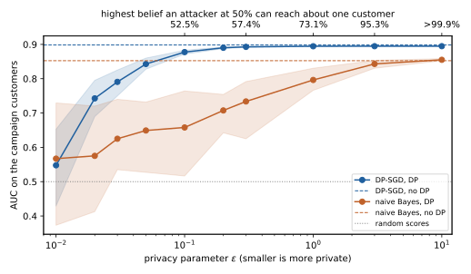
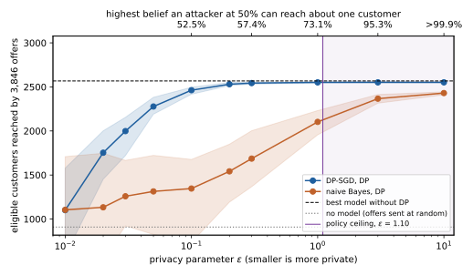
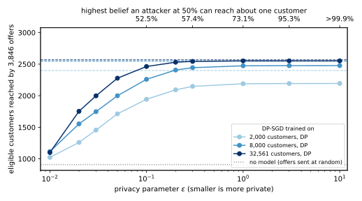

# The use case {#sec-case}

A retail bank is about to launch a premium credit card. The card only makes sense for customers who earn more than $50,000 a year, so the marketing team wants to send the offer to those customers and to nobody else. The bank does not record income directly, but it holds other facts about each customer, such as age, education, occupation, hours worked and marital status. The team wants a model that predicts from those facts who is likely to be eligible.

The model will leave the bank's secure environment, because an outside agency runs the campaign. The bank's privacy policy therefore requires the model to be trained with differential privacy (DP), so that the model cannot be used to learn much about any single customer. The policy does not say how strict the guarantee must be. That choice is the subject of this note.

We need data that behaves like the bank's records, and the standard public dataset for this is Adult. It holds 48,842 people from the 1994 US Current Population Survey, each with the attributes above and a label saying whether their income was above $50,000 ([UCI Machine Learning Repository](https://archive.ics.uci.edu/dataset/2/adult)). We use its training file of 32,561 people as the bank's customer records, which the model learns from. Its test file of 16,281 people plays the customers who will receive the next campaign. Everything below is computed by one script, [code/notes/privacy_utility_tradeoff.py](../../code/notes/privacy_utility_tradeoff.py), which a reader can run to get the same numbers.

Each step below shows the lines of the script that carry it out. The whole experiment runs with one command, and it takes a few minutes with all of a machine's processor cores:

```bash
uv run python code/notes/privacy_utility_tradeoff.py
```

The walk-through has six steps. It states the business goal as a number (@sec-goal), turns the privacy setting into a policy sentence (@sec-policy), and fixes everything that must not be tuned on private data (@sec-fixed). It then runs the experiment and reads the results, first in technical terms and then in business terms (@sec-results). The last steps look at how much the size of the dataset matters (@sec-size) and how to present the decision (@sec-decision).

# Step 1: state the business goal as a count {#sec-goal}

Engineers usually measure a model by its accuracy or its area under the curve (AUC), but neither tells the marketing team what it will get. The team cares about one thing, which is how many of the offers reach eligible customers. So we need to fix how many offers are sent and then count how many of them land well.

The number of offers is a business input, and here is how the bank can choose it without guessing. The Census Bureau publishes the share of people who earn more than $50,000, and in Adult that share is about 24%. If the bank sends as many offers as it expects to have eligible customers, a perfect model would reach every one of them and waste nothing. For the 16,281 campaign customers we send 3,846 offers, the number of eligible customers among them, which is what this rule gives when the published share holds for the bank's customers.

That choice makes the business metric easy to read. The model scores every customer, and the bank sends the 3,846 offers to the highest scores. The metric is the number of eligible customers among those 3,846. Every offer that does not reach an eligible customer is wasted, so the waste is 3,846 minus that number.

In the script, the metric is a short function. It sorts the customers by the model's score, takes the first `offers` of them and counts the eligible ones:

```{.python excerpt="put-reached"}
def reached(scores: Array, y: npt.NDArray[np.int64], offers: int) -> int:
    """Eligible customers among the `offers` highest-scored; ties are broken by position, deterministically."""
    top = np.argsort(-scores, kind="stable")[:offers]
    return int(y[top].sum())
```

The metric needs a baseline, and the natural one is to have no model at all. If the bank sent the 3,846 offers to customers picked at random, each offer would reach an eligible customer with probability 3,846 / 16,281, about 24%. The expected number reached would then be

$$3{,}846 \times \frac{3{,}846}{16{,}281} \approx 909.$$

Any model, private or not, has to beat 909 to be worth having.

The script sets up the campaign the same way. It splits Adult into the bank's records and the campaign customers, counts the eligible customers to fix the number of offers, and computes the expected reach of random offers:

```{.python excerpt="put-campaign"}
df = practitioner_datasets.adult()
train, test = df.head(TRAIN_ROWS), df.slice(TRAIN_ROWS)
data = (features(train), labels(train), features(test), labels(test))
eligible = int(data[3].sum())
# Random offers reach an eligible customer at the base rate, eligible / campaign customers.
baseline = eligible * eligible / len(data[3])
```

The money follows from the count. Write $V$ for what the bank gains from reaching one eligible customer instead of an ineligible one. It is the chance that an eligible customer takes up the card times the margin the card earns, and the finance team estimates it, not the data team. Every comparison below is a difference in eligible customers reached, so a difference of $k$ customers is worth $k\,V$ to the bank. We never need to invent a value for $V$, because the decision in @sec-decision only depends on how $k\,V$ compares with what the privacy policy protects.

# Step 2: turn the privacy setting into a sentence {#sec-policy}

DP is controlled by one number, $\varepsilon$, and a smaller $\varepsilon$ means stronger privacy. On its own, $\varepsilon$ means nothing to a privacy officer, so we translate it into the question an attacker would ask. Suppose an attacker wants to know whether a particular person, say Alice, is one of the bank's customers. Before seeing the model, the attacker has some belief about that. DP guarantees that seeing the model can multiply the attacker's odds by at most $e^{\varepsilon}$.

The cleanest case is an attacker who starts at even odds, a belief of 50%. The odds are then 1 to 1, and after seeing the model they are at most $e^\varepsilon$ to 1. Turned back into a probability, the attacker's belief can rise to at most

$$\text{belief ceiling} = \frac{e^{\varepsilon}}{1 + e^{\varepsilon}}.$$

At $\varepsilon = 1$ the ceiling is $e/(1+e)$, about 73%. At $\varepsilon = 0.1$ it is about 52.5%, so the model teaches the attacker almost nothing, and at $\varepsilon = 3$ it is about 95%. That last guarantee still holds, but it is weak.

This is the sentence the privacy officer signs, and in our use case they choose a ceiling of 75%. In other words, an attacker who thinks it is a coin flip whether Alice is a customer must not end up more than 75% sure. Solving the formula for $\varepsilon$ turns the sentence into a number:

$$\frac{e^{\varepsilon}}{1+e^{\varepsilon}} \le 0.75 \quad\Longleftrightarrow\quad e^{\varepsilon} \le 3 \quad\Longleftrightarrow\quad \varepsilon \le \ln 3 \approx 1.10.$$

The script holds both directions of this translation. The first function gives the ceiling for a given $\varepsilon$, which labels the top axis of every figure below. The second turns the officer's ceiling back into $\varepsilon$, and `epsilon_for_belief(0.75)` returns the policy's limit of 1.10:

```{.python excerpt="put-belief"}
def belief_ceiling(eps: float, prior: float = 0.5) -> float:
    """Highest posterior that epsilon-DP allows an attacker who starts at `prior` that one customer is in the data."""
    odds = math.exp(eps) * prior / (1 - prior)
    return odds / (1 + odds)


def epsilon_for_belief(belief: float, prior: float = 0.5) -> float:
    """The largest epsilon whose belief ceiling, from `prior`, is `belief`."""
    return math.log((belief / (1 - belief)) / (prior / (1 - prior)))
```

The policy is set before anyone looks at the model's results. If the ceiling were chosen after seeing the accuracy, it would drift to wherever the model happens to do well.

One technical detail completes the guarantee. The training method used below adds a second parameter, $\delta$, which is the small probability that the guarantee fails outright. A common rule sets $\delta$ below one over the number of people, so that the guarantee is not expected to fail for anyone. For 32,561 customers this gives $\delta = 10^{-5}$, and we use that value throughout.

# Step 3: fix everything that must not be tuned on private data {#sec-fixed}

A DP guarantee covers what the training run does with the data. It does not cover choices that someone made by looking at the private data beforehand. If an engineer tried twenty settings on the customer records and kept the best one, that choice would itself leak information. So everything apart from the training run is decided from public information.

The preprocessing comes from the survey's public codebook, not from the data. Ages are scaled within 17 to 90, years of education within 1 to 16 and weekly hours within 1 to 99. Capital gains and losses are scaled on a log scale up to the survey's published cap of 99,999. Each category, such as an occupation, becomes a 0-or-1 column taken from the codebook's list. Every customer's row then lies in a known range, which DP needs, because it bounds how much one customer can change the training.

The preprocessing function reads only these public ranges and lists, never a statistic of the data. Each number is clipped into $[0, 1]$, and each customer has at most one 1 per category, which is what bounds every row:

```{.python excerpt="put-features"}
def features(df: pl.DataFrame) -> Array:
    """Map each row to [0, 1]^d using only the codebook; a missing category is a row of zeros."""
    cols: list[Array] = []
    for name, (lo, hi) in LINEAR_BOUNDS.items():
        x = df[name].cast(pl.Float64).to_numpy()
        cols.append(np.clip((x - lo) / (hi - lo), 0.0, 1.0))
    for name in LOG_COLUMNS:
        x = df[name].cast(pl.Float64).to_numpy()
        cols.append(np.clip(np.log1p(np.clip(x, 0, TOP_CODE)) / math.log1p(TOP_CODE), 0.0, 1.0))
    for name, values in CATEGORIES.items():
        column = df[name].to_list()
        for value in values:
            cols.append(np.array([1.0 if v == value else 0.0 for v in column]))
    return np.column_stack(cols)
```

The two techniques we compare are also fixed in advance. The first is private stochastic gradient descent (SGD), known as **DP-SGD**, the standard way to train a model with DP. It trains a logistic regression, the same kind of model a bank would use without DP, in small random batches. It caps how much each customer can move the model at each step, which is called *clipping*, and it adds random noise to every update ([Opacus](https://opacus.ai/)). The noise is set by Opacus's privacy accountant so that the whole training run meets the target $\varepsilon$ at $\delta = 10^{-5}$.

The accountant works backwards from the target. Given $\varepsilon$, $\delta$, the share of customers in each batch and the number of passes, it returns the noise multiplier, the size of the noise relative to the clipping norm:

```{.python excerpt="put-calibrate"}
def noise_multiplier(eps: float, n: int) -> float:
    """The noise multiplier that makes DP-SGD with these settings (eps, DELTA)-DP, by Opacus's PRV accountant."""
    return float(
        get_noise_multiplier(
            target_epsilon=eps, target_delta=DELTA, sample_rate=BATCH / n, epochs=EPOCHS, accountant="prv"
        )
    )
```

Opacus then wraps the model, the optimizer and the data loader. After that, every training step draws a random batch, clips each customer's contribution and adds noise of that size, and the rest of the training loop is the same as without DP:

```{.python excerpt="put-private"}
optimizer = torch.optim.SGD(layer.parameters(), lr=LR, momentum=MOMENTUM)
engine: PrivacyEngine | None = None
model: nn.Module = layer
if sigma is not None:
    engine = PrivacyEngine(accountant="prv")
    model, optimizer, loader = engine.make_private(  # Poisson sampling, per-example clipping, Gaussian noise
        module=layer, optimizer=optimizer, data_loader=loader, noise_multiplier=sigma, max_grad_norm=CLIP
    )
```

DP-SGD's settings were fixed before training and never tuned on the customer records. It uses batches of about 1,000 customers, 10 passes over the data, a clipping norm of 1 and a learning rate of 0.5. The second technique is a **private naive Bayes** classifier from IBM's diffprivlib, which adds noise to simple averages per class ([diffprivlib](https://github.com/IBM/differential-privacy-library)). It gives the stronger pure $\varepsilon$ guarantee, with no $\delta$, so it also meets the $(\varepsilon, 10^{-5})$ standard, and both techniques can be placed on the same axis.

The experiment then trains each technique at ten values of $\varepsilon$ from 0.01 to 10. It repeats each setting with 20 random seeds, because DP training is random and one run can be lucky or unlucky. It also trains each model without DP, with the same settings, so that the cost of privacy can be read off directly.

Each training run is one job, made of a technique, a value of $\varepsilon$ (or none, for no DP), a number of customers and a seed. The script lists the jobs and spreads them over the processor cores:

```{.python excerpt="put-sweep"}
jobs: list[tuple[str, float | None, int, int]] = []
for technique in COLOURS:
    jobs += [(technique, eps, TRAIN_ROWS, seed) for eps in [None, *EPSILONS] for seed in range(seeds)]
for n in SIZES[:-1]:
    jobs += [("DP-SGD", eps, n, seed) for eps in [None, *EPSILONS] for seed in range(size_seeds)]
with ProcessPoolExecutor(max_workers=WORKERS, initializer=_init, initargs=(data,)) as pool:
    runs = list(pool.map(evaluate, jobs, chunksize=4))
```

# Step 4: read the results, technical first {#sec-results}

@fig-technical shows the engineer's view. Its vertical axis is the AUC, the probability that the model scores a randomly chosen eligible customer above a randomly chosen ineligible one. An AUC of 0.5 is guessing, and 1 is perfect. The bottom axis is $\varepsilon$, and the top axis translates it into the attacker's belief ceiling of @sec-policy. The shaded bands show the range from the 10th to the 90th percentile over the seeds.

{#fig-technical}

Two things stand out. DP-SGD is better than naive Bayes at every privacy level, so naive Bayes can be dropped. And DP-SGD's curve is flat over most of the range, which means that from about $\varepsilon = 0.3$ upwards it is almost as good as the model trained without DP. The quality only falls away below $\varepsilon \approx 0.1$, where the attacker's ceiling is already within a few points of 50%.

@fig-business shows the same experiment in the bank's terms. Its vertical axis is the number of eligible customers reached by the 3,846 offers, and it adds the two lines that matter to the business. The upper dashed line is the best model without DP, and the dotted line is no model at all. The shaded region on the right is what the privacy policy forbids.

{#fig-business}

The gap between a DP curve and the upper dashed line is the cost of privacy, counted in customers. The gap between the curve and the dotted line is what the model is worth compared with sending offers at random. @tbl-frontier lists every private configuration. A configuration is on the *frontier* when no other configuration is at least as private and reaches more customers. Only the frontier is worth considering, and here it consists of DP-SGD alone.

The frontier comes from a short filter. It sorts the configurations from most to least private and keeps each one that reaches more customers than every more private configuration before it:

```{.python excerpt="put-frontier"}
def non_dominated(points: list[tuple[float, float]]) -> list[int]:
    """Indices of the (privacy loss, utility) points that no other point dominates."""
    order = sorted(range(len(points)), key=lambda i: (points[i][0], -points[i][1]))
    frontier: list[int] = []
    best = float("-inf")
    for i in order:
        if points[i][1] > best:
            frontier.append(i)
            best = points[i][1]
    return frontier
```



# Step 5: check how much the data size matters {#sec-size}

The flat curve in @fig-business depends on the bank having many customers. DP hides each individual by adding noise, and the more customers there are, the less that noise matters relative to the signal they provide together. A bank with fewer customers, or a campaign aimed at one region, pays more for the same guarantee. The script therefore trains DP-SGD again on the first 2,000 and the first 8,000 customers, and @fig-sizes compares the three sizes.

{#fig-sizes}

With fewer customers the curve bends down at a larger $\varepsilon$, and the gap to the model without DP is wider at every setting. @tbl-sizes puts numbers on it. For the smallest base the gap stays open even at $\varepsilon = 10$, where the noise is negligible. That part of the cost comes from clipping with settings chosen for the full dataset, and a bank in that position would tune the clipping norm and learning rate on public or synthetic data before paying it. For a business this is often the most useful finding, because it says whether the guarantee is cheap for this dataset, and whether pooling data or waiting for more customers would make a stricter policy affordable.



# Step 6: present the menu and decide {#sec-decision}

The decision maker does not need the curves. They need a few options, each with a privacy sentence and its business effect, and @tbl-menu gives them. The options are the best technique at a few privacy levels, plus the two reference points, no model and no DP. The membership column gives a second privacy sentence. It bounds how often any attack that wrongly accuses 1% of non-customers can correctly identify a real customer ([Kairouz et al., 2015](https://arxiv.org/abs/1311.0776)).



The policy ceiling of @sec-policy, $\varepsilon \le 1.10$, picks the option.



The decision then comes down to one comparison that the business can make. The finance team supplies $V$, and the cost of privacy in money follows from the count above. The bank compares that cost with what the policy buys, which is the ability to hand the model to an outside agency at all, and a defensible answer if a regulator or a customer asks what the model reveals about them. In this use case the cost is small enough that the comparison is easy. In another use case, with fewer customers or a stricter ceiling, @tbl-sizes shows how quickly it can stop being easy.

Three people sign the decision, each for their own part. The privacy officer signs the ceiling, which was fixed before the results were known. The engineer signs that the configuration meets it, with the accountant's $\varepsilon$ and $\delta$ and the settings of @sec-fixed. The business owner signs the cost in customers, and so in money. All of this goes into a release record, together with the script that produced the numbers, so that the decision can be checked and revisited when the data or the policy changes.

# Doing this in another business {#sec-other}

The six steps carry over to any use case, and only the contents of each step change. The business metric is whatever count the decision turns on, such as fraud caught at a fixed number of reviews, customers retained by a fixed number of calls, or forecast error in units of stock. The baseline is always what the business would do without the model. The privacy ceiling is always a sentence about an attacker's belief, translated into $\varepsilon$ before anyone sees the results. The experiment is always a sweep over $\varepsilon$, techniques and seeds, read first as model quality and then as the business count. And the output is always a short menu with a cost in the business's own units, which the people who own the risk and the revenue can sign.

# Sources {#sec-sources}

- Becker, B. and Kohavi, R. (1996). [Adult](https://archive.ics.uci.edu/dataset/2/adult). UCI Machine Learning Repository. Creative Commons Attribution 4.0 licence.
- Abadi, M. et al. (2016). [Deep Learning with Differential Privacy](https://arxiv.org/abs/1607.00133). *ACM CCS 2016*. The DP-SGD algorithm.
- Yousefpour, A. et al. (2021). [Opacus: User-Friendly Differential Privacy Library in PyTorch](https://arxiv.org/abs/2109.12298). The library and its privacy accountant.
- Holohan, N., Braghin, S., Mac Aonghusa, P. and Levacher, K. (2019). [Diffprivlib: The IBM Differential Privacy Library](https://arxiv.org/abs/1907.02444).
- Kairouz, P., Oh, S. and Viswanath, P. (2015). [The Composition Theorem for Differential Privacy](https://arxiv.org/abs/1311.0776). *ICML 2015*. The hypothesis-testing reading of $(\varepsilon,\delta)$ behind the membership bound.
- Nanayakkara, P. et al. (2023). [What Are the Chances? Explaining the Epsilon Parameter in Differential Privacy](https://www.usenix.org/conference/usenixsecurity23/presentation/nanayakkara). *USENIX Security 2023*. Evidence that odds-based explanations of $\varepsilon$ work best.
- Papernot, N. and Steinke, T. (2022). [Hyperparameter Tuning with Rényi Differential Privacy](https://arxiv.org/abs/2110.03620). *ICLR 2022*. Why tuning on private data leaks.
- Ponomareva, N. et al. (2023). [How to DP-fy ML: A Practical Guide to Machine Learning with Differential Privacy](https://arxiv.org/abs/2303.00654). *Journal of Artificial Intelligence Research* 77.
- Near, J., Darais, D., Lefkovitz, N. and Howarth, G. (2025). [Guidelines for Evaluating Differential Privacy Guarantees](https://csrc.nist.gov/pubs/sp/800/226/final). NIST SP 800-226.
