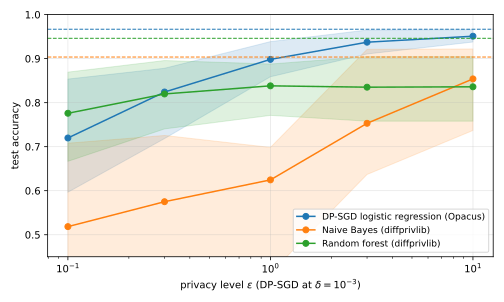
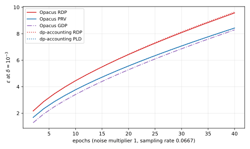

Differential privacy (DP) is the standard guarantee for publishing a statistic or a model computed from personal data, and @sec-need defines it. More than a dozen Python packages implement it, and many more do related jobs. They do not all do the same job. Some release counts and averages, some train neural networks, and some only add up the privacy cost of a long computation. Others sit outside DP altogether: they encrypt the computation, distribute it, or measure the leakage of a finished model. A practitioner who picks the wrong family loses days, and one who picks the right family but misreads its assumptions ships a guarantee that the code does not deliver.

This note answers two questions. The first is what exists, and for that @sec-landscape lists every package worth knowing, with its maintainer, its latest release, its licence, what it needs to run and the design idea that sets it apart. The second question is what the differences feel like in code. For that, four of the packages are installed in the environment that builds this note, with their versions pinned, and each gets the same three jobs on the same data. The jobs are to release a count and a mean, to train a classifier, and to add up the privacy cost of one training run. OpenDP and diffprivlib, versions 0.16.0 and 0.6.6, release statistics and the second also trains simple models. Opacus 1.6.0 trains neural networks with stochastic gradient descent (SGD) made private, called DP-SGD, and dp-accounting 0.6.0 only does the adding up. Everything is run by one script, [code/notes/python_privacy_libraries.py](https://github.com/manuelvloureiro/privacy-preserving-machine-learning-book/blob/main/code/notes/python_privacy_libraries.py), which prints every number quoted below:

```bash
uv run python code/notes/python_privacy_libraries.py
```

You need basic probability to follow the note, and nothing about privacy. @sec-need defines what a privacy library has to get right, and proves the two results that every library relies on. @tbl-map shows the question each section answers, and @tbl-symbols lists the symbols for reference.

| Section | The question it answers |
|:---|:---|
| @sec-need | What must a privacy library do for you, and what can it not do? |
| @sec-landscape | Which packages exist, who maintains them, and what does each need? |
| @sec-release | How do three implementations release the same count and mean, and where do they differ? |
| @sec-training | What does the same classifier cost at each privacy level in two training libraries? |
| @sec-accounting | How far apart are the privacy accountants on one training run? |
| @sec-beyond | What do the auditing, encryption, federated and anonymization packages do? |
| @sec-choose | Which package for which job, and what to check before trusting it? |

: The question each section answers. {#tbl-map}

| Symbol | Meaning |
|:---|:---|
| $D$, $D'$; $D \simeq D'$ | two neighbouring datasets: one is the other with one person's record added or removed |
| $n$ | the number of records |
| $M$ | a mechanism, the random procedure that computes the released output |
| $f$, $\Delta f$ | a statistic, and its sensitivity: the most one record can change it |
| $\varepsilon$, $\delta$ | the two parameters of a differential-privacy guarantee |
| $b$ | the scale of Laplace noise |
| $\sigma$ | the noise multiplier of Gaussian noise, its standard deviation in units of the sensitivity |
| $C$ | the clipping norm of DP-SGD |
| $q$, $T$ | the sampling rate of DP-SGD, and its number of steps |

: The symbols the note uses. Each is also explained where it first appears. {#tbl-symbols}

# What a privacy library has to get right {#sec-need}

Before comparing packages, you need to know what you are asking them to do. This section defines the guarantee they all implement, derives the two facts that every one of them relies on, and turns those facts into the four duties of a privacy library. Those four duties are the axes along which @sec-release, @sec-training and @sec-accounting compare the packages.

## The guarantee

Take a dataset $D$ of $n$ records, one per person. The running example of this note is a public dataset of 569 breast-tumour biopsies, one record per patient, each with 30 measurements and a label saying whether the tumour was malignant. A hospital that holds such records might want to publish how many patients it saw and the average size of the tumours. Each of those numbers reveals a little about every patient, and differential privacy limits how much.

The limit is stated by comparing two datasets that differ in one person. Two datasets are **neighbouring**, written $D \simeq D'$, when one of them is the other with one person's record added or removed. Some libraries instead define neighbours by replacing one record with another, and that choice changes the numbers, so a library must say which it uses. This note uses add or remove unless it says otherwise.

A **mechanism** $M$ is a randomized procedure that takes a dataset and returns an output. Because it is random, its output has a probability distribution, and the guarantee says that the distribution barely depends on whether any one person is present. The guarantee has two parameters. The privacy parameter $\varepsilon$ bounds the ratio between the probability of any set of outputs with one person in the data and without, and the slack $\delta$ is a small amount by which that bound may be exceeded.

::: {#def-dp name="Differential privacy"}
A mechanism $M$ is $(\varepsilon, \delta)$-differentially private if for every pair of neighbouring datasets $D \simeq D'$ and every set $S$ of outputs,
$$\Pr[M(D) \in S] \le e^{\varepsilon}\,\Pr[M(D') \in S] + \delta.$$
When $\delta = 0$ it is $\varepsilon$-differentially private, also called pure DP.
:::

Read the inequality as a bound on what an observer can learn. Whatever an observer concludes from the output, they conclude it because the output fell in some set $S$. That set is at most $e^\varepsilon$ times more likely with the person in the data than without, up to the slack $\delta$. The inequality is stated for every ordered pair of neighbours, so it bounds the ratio in both directions. A small $\varepsilon$ is strong privacy. At $\varepsilon = 1$ the factor is $e \approx 2.7$. At $\varepsilon = 0.1$ it is about 1.1, so the output is almost equally likely either way. The parameter $\delta$ should be far smaller than $1/n$. To see why, take a mechanism that picks one of the $n$ records uniformly at random and publishes it in full. For the person whose record is added, the set of outputs that reveal their record has probability $1/n$ with them in the data and zero without. No factor $e^\varepsilon$ times zero can cover $1/n$, so the slack must absorb it. That mechanism satisfies @def-dp with $\varepsilon = 0$ and $\delta = 1/n$ and still exposes someone completely.

The guarantee is about the procedure, not about any one output. That is why it survives anything done afterwards: a function of a private output, computed without looking at the data again, is at most as revealing as the output itself, since the observer could have applied the function themselves. Libraries rely on this **post-processing** property when they round, clip or truncate what they release.

## The noise a statistic needs

A mechanism hides a person by adding noise, and the amount of noise depends on the most that one person can move the statistic.

::: {#def-sensitivity name="Sensitivity"}
The sensitivity of a statistic $f$, written $\Delta f$, is the most it can change between neighbouring datasets,
$$\Delta f = \max_{D \simeq D'} \lvert f(D) - f(D') \rvert.$$
The maximum runs over every pair of neighbouring datasets, not only the one you hold.
:::

The count of patients has sensitivity 1, because adding or removing one patient changes it by exactly one. The average tumour radius has no finite sensitivity on its own, since the maximum runs over every possible dataset, and a dataset with one absurd value moves the average arbitrarily. Every library therefore makes you **clamp** the values first, which means replacing any value below a lower bound $\ell$ by $\ell$ and any value above an upper bound $u$ by $u$. The bounds must be **public**, chosen from knowledge of the measurement and not from the records, because the largest value in the data is one person's value and a bound read from it has already revealed something. After clamping, replacing one of $n$ values by another moves the sum by at most $u - \ell$ and the average by at most $(u - \ell)/n$, so that is the sensitivity when $n$ is known. If $n$ is not known, the average has to be released as a noisy sum divided by a noisy count, and the libraries differ in how they handle that.

With the sensitivity in hand, the oldest mechanism adds Laplace noise. The Laplace distribution has one parameter, its scale $b$, which is also the mean absolute value of a draw from it. Its density at a value $z$ is $\frac{1}{2b} e^{-\lvert z \rvert / b}$, so it is symmetric around zero and its tails fall off exponentially. The noise has to grow with the sensitivity, because it must hide a larger change, and it has to grow as $\varepsilon$ shrinks, because a stronger guarantee allows less difference between the two output distributions. The next theorem says exactly how much, and its proof is short enough to show in full. Every library's Laplace mechanism is an implementation of this proof, so the proof is also the specification that @sec-release checks the libraries against.

::: {#thm-laplace name="Laplace mechanism"}
Let $f$ be a statistic with sensitivity $\Delta f$, and let $M(D) = f(D) + Z$ with $Z$ drawn from the Laplace distribution of scale $b = \Delta f / \varepsilon$. Then $M$ is $\varepsilon$-differentially private.
:::

::: {.proof}
The plan is to compare the output densities under $D$ and $D'$ at every output, show that their ratio never exceeds $e^\varepsilon$, and then integrate over any set.

1. Adding the constant $f(D)$ shifts the Laplace density by $f(D)$. Write $p(y)$ for the density of $M(D)$ at an output $y$. It is the Laplace density evaluated at the distance from $y$ to the true answer,
   $$p(y) = \frac{1}{2b} \exp\!\left(-\frac{\lvert y - f(D) \rvert}{b}\right).$$
   The density $p'(y)$ of $M(D')$ is the same expression with $f(D')$ in place of $f(D)$.
2. Both densities have the same normalizing constant, so it cancels in their ratio. What is left is a ratio of two exponentials, and its logarithm is the difference of the exponents, with the exponent of $p'$ first because it is the one being divided by:
   $$\ln \frac{p(y)}{p'(y)} = \frac{\lvert y - f(D') \rvert - \lvert y - f(D) \rvert}{b}.$$
3. The top of that fraction compares how far $y$ lies from each of the two true answers. Take the two distances $a = y - f(D')$ and $c = y - f(D)$. The triangle inequality in the form $\lvert a \rvert - \lvert c \rvert \le \lvert a - c \rvert$ says that this difference never exceeds $\lvert f(D) - f(D') \rvert$, the distance between the two answers themselves, which is at most $\Delta f$ by @def-sensitivity. So
   $$\ln \frac{p(y)}{p'(y)} \le \frac{\Delta f}{b} = \varepsilon.$$
4. Step 3 says $p(y) \le e^\varepsilon p'(y)$ at every output $y$. Integrating both sides over any set $S$ gives $\Pr[M(D) \in S] \le e^\varepsilon \Pr[M(D') \in S]$, which is @def-dp with $\delta = 0$ for this ordered pair. The argument never used which of the two datasets is larger, so it holds for the pair in the other order too.
:::

The theorem fixes the error of a release before any data is seen. The noise is a Laplace variable of scale $b$, and integrating its density from $t$ outwards on both sides gives the probability $e^{-t/b}$ that it exceeds $t$ in absolute value. Setting that probability to 5% and solving for $t$ gives $t = b \ln 20$. Since $\ln 20 \approx 3.0$, a 95% interval around the released value has half-width about $3b$. @sec-release releases a count at $\varepsilon = 0.5$, half of a budget of 1, so its scale is 2. Its half-width is then $2 \ln 20$, about 6 patients. That scale and that half-width are the first things the section checks in each library.

Gaussian noise is the other standard choice, for two reasons that the rest of the note returns to. Its cost over many releases grows more slowly. And a statistic with many coordinates, such as the gradient of a model, is naturally measured by the Euclidean length of its change, which is what Gaussian noise matches. For such a statistic, define the sensitivity as in @def-sensitivity but with the Euclidean length in place of the absolute value. The Gaussian mechanism adds normal noise to every coordinate, with a standard deviation of $\sigma$ times the sensitivity, and the factor $\sigma$ is called the **noise multiplier**.

Write $\Phi$ for the standard normal distribution function. The mechanism is $(\varepsilon, \delta)$-differentially private exactly when
$$\delta \ge \Phi\!\left(\frac{1}{2\sigma} - \varepsilon\sigma\right) - e^{\varepsilon}\,\Phi\!\left(-\frac{1}{2\sigma} - \varepsilon\sigma\right),$$ {#eq-gaussian}
which is Theorem 8 of Balle and Wang (2018). The proof writes down the **privacy loss**, the logarithm of the ratio of the two output densities at the released output. For Gaussian noise that is a normal random variable, and the proof computes the probability that it exceeds $\varepsilon$. A normal variable exceeds any threshold with positive probability, so that probability is never zero and a Gaussian mechanism always carries a $\delta$. In practice a library solves @eq-gaussian numerically for $\sigma$ given the $\varepsilon$ and $\delta$ you want, and the accountants of @sec-accounting extend that computation to many steps.

## Many releases

One release is rarely the end, and the cost of several adds up. The total $\varepsilon$ that a set of releases is allowed to spend is called the **privacy budget**, and the basic rule for spending it is the simplest possible one. Its proof shows why.

::: {#thm-composition name="Basic composition"}
Let $M_1$ and $M_2$ be two mechanisms run on the same dataset, and let the second be chosen after the first's output $y_1$ is known. If $M_1$ is $\varepsilon_1$-differentially private, and $M_2$ is $\varepsilon_2$-differentially private for every value of $y_1$, then the mechanism that releases both outputs is $(\varepsilon_1 + \varepsilon_2)$-differentially private.
:::

::: {.proof}
1. A joint density of two stages is the density of the first stage times the conditional density of the second. So the density of the pair at outputs $(y_1, y_2)$ is the density of $M_1$ at $y_1$ times the density of $M_2$ at $y_2$ given $y_1$.
2. Under $D$ and $D'$, the first factor differs by at most $e^{\varepsilon_1}$ by the hypothesis on $M_1$, and the second by at most $e^{\varepsilon_2}$ by the hypothesis on $M_2$ at the fixed $y_1$.
3. The product therefore differs by at most $e^{\varepsilon_1 + \varepsilon_2}$ at every pair of outputs, and integrating over any set of pairs gives @def-dp with $\varepsilon_1 + \varepsilon_2$ and $\delta = 0$.
:::

Adding the $\varepsilon$ of every release is correct but pessimistic, because it charges every release its worst case at once, and the worst cases of independent noise draws rarely line up. A procedure that computes a tighter total from the mechanisms actually run is called an **accountant**. The accountants in @sec-accounting compute, for Gaussian noise, the distribution of the total privacy loss over all the steps, and over a number $k$ of steps the $\varepsilon$ they find grows like $\sqrt{k}$ rather than like $k$. For a training run with hundreds of steps the plain sum is too loose to use, so the accountant a library ships decides what $\varepsilon$ you can report.

The training algorithm those accountants serve is **DP-SGD**, stochastic gradient descent made private. Training a model means adjusting its parameters step by step to reduce its error on the training records, and each step moves the parameters along the **gradient**, the direction in which that error falls fastest.

DP-SGD runs a fixed number $T$ of such steps. At each one it draws a random batch in which every record appears independently with probability $q$, the **sampling rate**, which is called Poisson sampling. It computes one gradient per record in the batch, shrinks each to a Euclidean length of at most $C$, the **clipping norm**, sums them, and adds Gaussian noise with standard deviation $\sigma C$ to every coordinate. Clipping fixes the sensitivity of the sum at $C$, since adding or removing one record changes it by one clipped gradient. Sampling makes each step cost less than @eq-gaussian says, because a record only takes part with probability $q$, an effect called amplification by subsampling. The accountant turns $\sigma$, $q$ and $T$ into one $\varepsilon$ for the whole run.

## The four duties of a library

The results above, together with what is known to go wrong in implementing them, give a library four duties. Each is a place where hand-written code fails.

The first duty is to **bound the sensitivity**: clamp values into public bounds, know or bound $n$, and, when a person can contribute several records, bound how many. The last matters because the neighbouring relation then has to cover all of that person's records at once. A library that infers the bounds from the data has already leaked, for the reason given under @def-sensitivity, and diffprivlib warns you when you let it.

The second duty is to **sample the noise correctly**. A computer's floating-point numbers are a finite set with gaps between them, so a floating-point Laplace sample is not a real-valued one. Mironov (2012) showed that the pattern of which outputs can occur at all depends on the true answer, and that an attacker who knows the pattern can tell $f(D)$ from $f(D')$ exactly, in a mechanism that is $\varepsilon$-private on paper. OpenDP's noise mechanisms are implemented against that attack, and diffprivlib's documentation says its Laplace mechanism is too. Neither claim is tested in this note. A hand-written `rng.laplace(scale=b)` makes no such claim at all.

The third duty is to **account**: to add up what has been spent across releases or steps, with the tightest theorem that applies to what the code actually did. This is where the libraries differ most, and @sec-accounting measures it.

The fourth duty is to **refuse**. A privacy budget is a limit, and a library that keeps answering after the limit is reached is only a noise generator. @sec-release spends a budget on two queries and then asks each library for a third.

# The packages that exist {#sec-landscape}

This section lists the packages by the job they do. Every version, date and licence was read from the Python Package Index, the public catalogue that `pip install` draws from, and from the project's repository, on 23 October 2026. A date is the date of the latest release, not of the latest commit. A package can be released rarely and still be alive, so the text under each table says what the repository's recent activity looks like.

## Differential privacy for statistics

@tbl-pkg-stats lists the packages that release counts, sums, means, quantiles and histograms. The Needs column says where each runs, and the last column says what it offers; the prose below adds how each treats a person with many records, which the tables cannot show.

| Package | Maintainer | Latest release | Licence | Needs | What it gives you |
|:---------------|:----------|:---------|:--------|:-------------|:------------------------------|
| `opendp` | The OpenDP project | 0.16.0, October 2026 | MIT | Python 3.10 or later; Polars optional | Transformations and measurements with written proofs in a Rust core; a `Context` that holds the budget; DP queries on Polars dataframes |
| `diffprivlib` | IBM | 0.6.6, April 2025 | MIT | NumPy, scikit-learn 1.4 or later | NumPy-style tools, a dozen mechanisms, scikit-learn-style models and a `BudgetAccountant` |
| `pipeline-dp` | OpenMined and Google | 0.3.1, June 2026 | Apache-2.0 | Python 3.11 to 3.13; Apache Beam or Spark optional | Pipeline aggregations with contribution bounding and partition selection built in |
| `tmlt.analytics` | OpenDP, originally Tumult Labs | 0.21.0, June 2026 | Apache-2.0 | PySpark and Java; Python 3.10 to 3.12 | A `QueryBuilder` over Spark dataframes, with private joins and stability tracking in `tmlt.core` |
| `python-dp` | OpenMined | 1.1.5, May 2026 | Apache-2.0 | Linux x86-64 or macOS wheels; Python 3.11 or later | Bindings to Google's C++ building blocks: bounded mean, sum and quantiles with Laplace noise |
| `smartnoise-sql` | OpenDP | 1.0.10, April 2026 | MIT | OpenDP 0.14, pandas or a SQL connection | DP SQL queries over a schema file, with a per-session budget |

: Packages that release statistics. {#tbl-pkg-stats}

OpenDP is the one with a formal programming framework behind it. Every operation is either a **transformation**, a step from data to data such as clamping, which comes with a proof of how much one record can change its output, or a **measurement**, a step that releases a noisy output, which comes with a proof of its privacy cost. Chaining steps composes the proofs, which is how its `Context` knows the cost of a query it has never seen before. A person with many records is handled by naming an identifier column, after which the proofs count all of that person's records as one change. Its repository took a commit the day this note was written, and its README commits to named maintainers and response times. Tumult Analytics has the same framework idea on Spark, with the same identifier mechanism. Its history matters for anyone choosing it: Tumult Labs' engineering team joined LinkedIn in 2025, and in October 2025 the OpenDP project took over the maintenance of Tumult's open-source libraries, whose repositories remain active.

The library that looks most like NumPy, diffprivlib, assumes one record per person and leaves any bounding of contributions to the caller. It has not had a release since April 2025. Its repository merged an import fix for scikit-learn 1.9 in October 2026, but the model failure that @sec-training reports is still on its main branch. Its README says the public release is for research and education. PipelineDP and PyDP bound contributions as arguments of every aggregation. PipelineDP's README still calls the project experimental and advises against production use, while Google's own repository lists it among the tools suitable for production; this note takes the README's word, since it is the maintainers'. PyDP is maintained thinly: it had one release in 2026 and depends on wheels that exist only for Linux x86-64 and macOS. SmartNoise SQL pins OpenDP below 0.15, so it cannot be installed next to the OpenDP 0.16.0 that this note runs.

## Differential privacy for training and accounting

@tbl-pkg-training lists the packages that train models with DP-SGD and the one that only does the accounting. Their table cells name techniques that @sec-training and @sec-accounting explain where they are used; a reader choosing a library needs the Needs column first.

| Package | Maintainer | Latest release | Licence | Needs | What it gives you |
|:---------------|:----------|:---------|:--------|:-------------|:------------------------------|
| `opacus` | Meta | 1.6.0, May 2026 | Apache-2.0 | PyTorch 2.6 or later | A `PrivacyEngine` that wraps model, optimizer and loader: Poisson sampling, per-example clipping, Gaussian noise, three accountants; memory-saving clipping for large models |
| `tensorflow-privacy` | Google | 0.9.0, February 2024 | Apache-2.0 | TensorFlow 2.4 to 2.15, Python 3.9 to 3.11 | DP optimizers and Keras models, adaptive clipping, tree aggregation, Rényi accounting |
| `jax-privacy` | Google DeepMind | 2.0.0, April 2026 | Apache-2.0 | JAX 0.7.1 or later | DP-SGD building blocks with independent or correlated noise, batch selection, accounting through `dp-accounting`, auditing with canaries |
| `dp-accounting` | Google | 0.6.0, February 2026 | Apache-2.0 | NumPy and SciPy only | `DpEvent` descriptions of mechanisms and compositions; Rényi and privacy-loss-distribution accountants that turn them into $(\varepsilon, \delta)$ |

: Packages that train models and account for training. {#tbl-pkg-training}

Opacus is the library of choice for PyTorch, and it keeps moving: its 1.6.0 release added support for training split across many devices and for low-precision arithmetic, which matter for large models. The fact to remember about TensorFlow Privacy is its age. Its repository is active, but its last release was in February 2024. That release requires a TensorFlow no newer than 2.15 and a Python no newer than 3.11, so it does not install on a current stack. A pull request to support newer TensorFlow versions was open and unmerged when this note was written. Its membership-inference module was split into a separate package, `tensorflow-empirical-privacy`, in the same release. JAX Privacy was rewritten for its 2.0 release, and its documentation recommends installing from the repository head rather than from the package index, because the head has features the release lacks. The accounting library dp-accounting is shared infrastructure: TensorFlow Privacy and JAX Privacy delegate their accounting to it, while Opacus has its own, which is what makes dp-accounting an independent check on Opacus in @sec-accounting.

## Synthetic data, auditing, encryption, federation and anonymity

The remaining families are listed in @tbl-pkg-rest and described in @sec-beyond, after the three jobs, because none of them was run for this note.

| Package | Family | Maintainer | Latest release | Licence | Needs |
|:------------------------|:--------------|:--------------|:--------------|:-------------|:------------------|
| `smartnoise-synth` | DP synthetic data | OpenDP | 1.0.8, April 2026 | MIT | Opacus below 0.15, `mbi`, PyTorch |
| `synthcity` | Synthetic data, some DP | van der Schaar lab | 0.2.12, May 2025 | Apache-2.0 | PyTorch 2.1 or 2.2, NumPy 1 |
| `tensorflow-empirical-privacy` | Membership-inference tests | Google | 0.1.0, February 2024 | Apache-2.0 | TensorFlow 2.4 to 2.15, Python 3.9 to 3.11 |
| `privacy-meter` | Membership-inference audits | National University of Singapore | 1.0.1, July 2023; the repository is newer | MIT | PyTorch |
| `adversarial-robustness-toolbox` | Attacks, including inference | IBM, now under the Linux Foundation | 1.20.1, July 2025 | MIT | Any of the major frameworks |
| `tenseal` | Homomorphic encryption | OpenMined | 0.3.18, September 2026 | Apache-2.0 | Python 3.11 or later |
| `crypten` | Secure multi-party computation | Meta | 0.4.1, December 2022; repository archived | MIT | PyTorch, Linux or macOS |
| `concrete-ml` | Fully homomorphic encryption for ML | Zama | 1.9.0, April 2025 | BSD-3-Clause-Clear, plus a patent licence for commercial use | Python 3.8 to 3.12 |
| `syft` | Remote data science | OpenMined | 0.10.0, August 2026 | Apache-2.0 | Python 3.10 or later; Google Drive as transport |
| `flwr` | Federated learning | Flower Labs | 1.42.0, October 2026 | Apache-2.0 | Python 3.11 or later; any framework |
| `tensorflow-federated` | Federated learning | Google | 0.87.0, September 2024 | Apache-2.0 | Python 3.9 to 3.11 on the index |
| `nvflare` | Federated learning | NVIDIA | 2.9.0, September 2026 | Apache-2.0 | Python 3.10 or later |
| `anjana` | k-anonymity and relatives | Instituto de Física de Cantabria | 1.2.3, August 2026 | Apache-2.0 | pandas |
| `pycanon` | Anonymity measurement | Instituto de Física de Cantabria | 1.3.6, August 2026 | Apache-2.0 | pandas |

: Packages for synthetic data, auditing, encrypted and federated computation, and anonymization. {#tbl-pkg-rest}

# Job 1: release a count and a mean {#sec-release}

The first job is the one @sec-need worked through. Release how many patients the dataset holds and the average of the `mean radius` column, with a total budget of $\varepsilon = 1$ and no $\delta$, half to each query. The bounds of the column come from the dataset's published description, which lists the minimum and maximum of every feature; for the radius they are 6.981 and 28.11. That description is, for a public benchmark, the nearest thing to the domain knowledge a hospital would have, such as the range of tumour sizes its instruments can measure. It is not a perfect stand-in, because the published summary was computed from these very records, and a real release must take its bounds from knowledge that is independent of them.

The scales of @thm-laplace follow. The count has sensitivity 1, so at $\varepsilon = 0.5$ its scale is 2. The mean has sensitivity $21.129/569$, the width of the bounds over the number of records, so its scale is $21.129/(569 \times 0.5) \approx 0.0743$. Three implementations do the job. The first is the textbook formula written by hand with NumPy, the standard numerical library of Python. It is the baseline, because a library has to offer something beyond this arithmetic to be worth its dependency. The other two are OpenDP and diffprivlib.

The hand-written version computes the two scales from @thm-laplace and draws the noise:

```{.python excerpt="ppl-by-hand"}
def by_hand(values: Array, bounds: tuple[float, float], eps: float, rng: np.random.Generator) -> Release:
    """Textbook Laplace mechanism in NumPy: half the budget to the count, half to the clamped mean."""
    n = len(values)
    count_scale, mean_scale = laplace_scales(n, bounds, eps / 2)
    count = n + rng.laplace(scale=count_scale)
    mean = float(np.clip(values, *bounds).mean()) + rng.laplace(scale=mean_scale)
    return Release(count, mean, count_scale, mean_scale)
```

OpenDP works differently. You declare the data, the unit of privacy and the total budget once, in a `Context`, and say how many queries will share the budget, which is the `split_evenly_over` argument. Each query is then a chain of transformations ending in a noise mechanism whose scale you leave blank, and OpenDP finds the scale that spends exactly the query's share:

```{.python excerpt="ppl-opendp"}
def with_opendp(values: Array, bounds: tuple[float, float], eps: float) -> Release:
    """OpenDP's Context API: the budget is declared once, and each query takes an even share of it."""
    context = dp.Context.compositor(
        data=[float(v) for v in values],
        privacy_unit=dp.unit_of(contributions=1),  # neighbours add or remove one person's record
        privacy_loss=dp.loss_of(epsilon=eps),
        split_evenly_over=2,
        domain=dp.vector_domain(dp.atom_domain(T=float, nan=False)),
    )
    count = vector_query(context).count().laplace()  # OpenDP picks the scale that spends exactly eps/2
    mean = vector_query(context).clamp(bounds).resize(size=len(values), constant=bounds[0]).mean().laplace()
    return Release(count.release(), mean.release(), count.param(), mean.param())
```

Two arguments deserve attention. The `domain` declares that the data are floats with no missing values, and OpenDP refuses to build the mean without it. A missing value, which floating point represents as a `NaN`, would pass through clamping unchanged and break its proof. The `resize` step is how OpenDP learns $n$. It pads the data with a constant or truncates it to the declared size, so that the proofs can treat the size as fixed, and after that the mean has the sensitivity $(u - \ell)/n$ of @sec-need. The size is public here, since the published dataset has 569 records, and the script passes the length it already holds. Without that step OpenDP would not accept a Laplace mean at all, because a mean of an unknown number of records has no finite sensitivity. Its Polars interface instead releases a noisy sum and a noisy count, which the next pages return to.

diffprivlib looks like NumPy. Each function, which its documentation calls a tool, takes its own $\varepsilon$, and an optional `BudgetAccountant` adds them up and refuses a call that would overspend. Its count of all records is written as a count of the records that satisfy a condition every record satisfies:

```{.python excerpt="ppl-diffprivlib"}
def with_diffprivlib(values: Array, bounds: tuple[float, float], eps: float, seed: int) -> Release:
    """diffprivlib's NumPy-like tools: each call takes its own epsilon, and a BudgetAccountant adds them up."""
    accountant = BudgetAccountant(epsilon=eps)  # refuses a query once the total would pass eps
    rng = np.random.RandomState(seed)
    count = dp_tools.count_nonzero(values > -np.inf, epsilon=eps / 2, random_state=rng, accountant=accountant)
    mean = dp_tools.mean(values, epsilon=eps / 2, bounds=bounds, random_state=rng, accountant=accountant)
    count_scale, mean_scale = laplace_scales(len(values), bounds, eps / 2)  # what its mechanisms use
    return Release(float(count), float(mean), count_scale, mean_scale)
```

Nothing tells diffprivlib what $n$ is: its `mean` reads the length of the array and uses the sensitivity $(u - \ell)/n$. That is correct only if $n$ is public. The caller has to know that assumption, because the library's documentation does not state it, although it does warn when the bounds are missing.

## The arithmetic agrees



@tbl-release shows that all three implementations arrive at the same scales, 2 for the count and 0.0743 for the mean, the values computed above. OpenDP's scale for the mean is larger than the textbook value by a few parts in a trillion, a difference the script prints and the table rounds away. Its floating-point mechanism rounds the scale up to cover the rounding of the arithmetic, which is part of the second duty of @sec-need. OpenDP also reports the accuracy of a release before it is made, and its 95% half-width for the count is 5.99, which is $2 \ln 20$, the value @sec-need called about 6.

The script then makes 2,000 releases with each implementation and measures the error, the released value minus the true one. For each query it prints the mean absolute error and then the 95th percentile of the absolute error, and the textbook values for Laplace noise of scale $b$ are $b$ and $b \ln 20$. OpenDP's noise cannot be seeded, so the output below is one run, and the OpenDP row changes from run to run within sampling error:

```text
== empirical errors over 2000 releases (mean |error|, 95th percentile), textbook b and b ln 20
textbook: count 2.000 5.991  mean 0.0743 0.2225
By hand (NumPy)  count 2.035 6.082  mean 0.0746 0.2337
OpenDP           count 1.881 6.000  mean 0.0743 0.2225
diffprivlib      count 0.969 5.000  mean 0.0736 0.2252
```

The mean behaves the same everywhere. The count does not, and the differences are instructive. OpenDP's count carries integer noise from the discrete Laplace distribution, whose mass at each integer $k$ is proportional to $e^{-\lvert k \rvert / b}$. Its quantiles are whole numbers, and its mean absolute value at scale 2 is $2e^{-1/2}/(1 - e^{-1}) \approx 1.92$ rather than 2, which the run's 1.88 matches within sampling error. diffprivlib's count error is half of everyone else's. The reason is that its counting mechanism clips its output to the range from 0 to $n$, so that a count can never be negative or larger than the data, and a count of every record sits exactly at $n$. Every positive noise draw is therefore clipped back to the true value. Clipping the output is post-processing, so the guarantee holds, but the released count can never exceed the truth, which an analyst who assumes symmetric noise will misread. The lesson is not that one library is wrong. It is that the noise a library adds is a design decision you have to read about, not a formula you can assume.

## Where the libraries diverge: what they make you say

The real difference between the implementations is in what they force you to declare. The hand-written version needed the formula and nothing else. Had its author forgotten to clamp, it would have computed a mean with the wrong sensitivity and said nothing. diffprivlib needed the bounds, and warns when you omit them, but it silently assumed $n$ public. OpenDP needed the bounds, $n$, the domain and the unit of privacy, and refused to proceed without each.

That strictness has a flip side. OpenDP checks that your declarations are consistent, not that they are true, so a wrong declaration is accepted and proved from. OpenDP's Polars interface, which runs DP queries on dataframes, lets you state facts about the data that it may use without charge, such as the number of records; it calls such a fact an `invariant` of a `Margin`, its term for what is known about a grouping of the rows. Declaring the size public is the right thing to do when it is already published, as it is here. The script does that while keeping one contribution per person:

```{.python excerpt="ppl-opendp-length"}
def opendp_public_length(values: Array, bounds: tuple[float, float], eps: float, contributions: int) -> float:
    """The noise scale OpenDP's Polars plan gives the sum inside a mean when the number of records is declared
    public (`invariant="lengths"`), for a privacy unit of `contributions` rows."""
    frame = pl.DataFrame({COLUMN: values}).lazy()
    context = dp.Context.compositor(
        data=frame,
        privacy_unit=dp.unit_of(contributions=contributions),
        privacy_loss=dp.loss_of(epsilon=eps),
        split_evenly_over=1,
        margins=[dp.polars.Margin(by=[], max_length=len(values), invariant="lengths")],
    )
    column: Any = pl.col(COLUMN)  # typed Any because OpenDP adds the `.dp` namespace to Polars expressions at run time
    query = context.query().select(column.dp.mean(bounds))
    plan = query.summarize()  # one row per noisy quantity: the sum and the length
    return float(plan.filter(pl.col("aggregate") == "Sum")["scale"].item())
```

```text
== OpenDP with the number of records declared public: scale of the sum inside the mean
contributions=1: sum scale 4.042e-09  (as a mean: 7.103e-12; textbook (high-low)/(n eps) = 0.03713)
contributions=2: sum scale 21.13  (as a mean: 0.03713; textbook (high-low)/(n eps) = 0.03713)
```

The script prints the noise scale of the sum inside the mean, and divides it by $n$ to give the scale on the mean itself, next to the textbook scale $(u - \ell)/(n\varepsilon)$ at the full $\varepsilon = 1$ of this one query. With one contribution and a public length, OpenDP adds noise of scale $4 \times 10^{-9}$ to a sum in the thousands, which is no noise at all. The guarantee it states is true, and that is the trap.

If the number of records is fixed, no dataset of the same size can differ from this one by the addition or removal of a single record. The set of neighbours is empty, so any claim about them holds. The declaration that matches a public length is that neighbours differ by replacing one record. OpenDP measures the distance between two datasets by the number of records added plus the number removed, and a replacement is one of each, so that declaration is two contributions. With it the sum's scale at $\varepsilon = 1$ is 21.13, the width of the bounds, because replacing one clamped value by another moves the sum by at most $u - \ell$, which is its sensitivity under @def-sensitivity. OpenDP's documentation warns that the facts declared about a margin should be set conservatively. The point for a comparison is that a framework which proves everything from your declarations is exactly as safe as your declarations.

## Where the libraries diverge: refusing

The last duty of @sec-need is to stop. The script spends the whole budget on two queries and then asks each library a third:

```text
== a third query after the budget is spent
OpenDP: ValueError: Privacy allowance has been exhausted
diffprivlib: BudgetError: Privacy spend of (0.5,0) not permissible; will exceed remaining privacy budget.
```

Both refuse. The difference is where the budget lives. In OpenDP it belongs to the `Context`, which holds the data, so there is no way to query the data outside it. In diffprivlib it belongs to an accountant object that you must remember to pass to every call, and a call without it spends from a default accountant with an infinite budget. The hand-written version, of course, never refuses.

## The same release in the libraries not run here

Two of the statistics packages of @tbl-pkg-stats were not run. Tumult Analytics needs Spark and Java, and PipelineDP needs a pipeline runtime or its own local backend. Their code for this job still shows their design. Tumult Analytics declares the unit of privacy as what it calls a protected change, here `AddOneRow`, on a session that holds the dataframe, and it spends the budget query by query, with the bounds given to the aggregation. The following is written against its documentation for version 0.21.0 and was not run:

```text
from tmlt.analytics import AddOneRow, PureDPBudget, QueryBuilder, Session

session = Session.from_dataframe(
    privacy_budget=PureDPBudget(epsilon=1), source_id="patients", dataframe=frame, protected_change=AddOneRow()
)
count = session.evaluate(QueryBuilder("patients").count(), PureDPBudget(epsilon=0.5))
mean = session.evaluate(
    QueryBuilder("patients").average("radius", low=6.981, high=28.11), PureDPBudget(epsilon=0.5)
)
```

PipelineDP asks for the same facts in a different vocabulary. It wants to know how to extract a person's identifier from a row, which group the row belongs to, called its partition, and the value to aggregate. It then enforces the contribution bounds you give it, here one row per person in one partition. This is written against its documentation for version 0.3.1 and was not run:

```text
import pipeline_dp

budget = pipeline_dp.NaiveBudgetAccountant(total_epsilon=1, total_delta=1e-6)
engine = pipeline_dp.DPEngine(budget, pipeline_dp.LocalBackend())
params = pipeline_dp.AggregateParams(
    metrics=[pipeline_dp.Metrics.COUNT, pipeline_dp.Metrics.MEAN],
    max_partitions_contributed=1, max_contributions_per_partition=1, min_value=6.981, max_value=28.11,
)
extractors = pipeline_dp.DataExtractors(
    privacy_id_extractor=lambda row: row.patient, partition_extractor=lambda row: "all",
    value_extractor=lambda row: row.radius,
)
result = engine.aggregate(rows, params, extractors, public_partitions=["all"])
budget.compute_budgets()
```

Both make the unit of privacy a required argument, the protected change in one and the identifier extractor in the other, which is the design choice that OpenDP shares and that diffprivlib leaves to the caller.

# Job 2: train a classifier {#sec-training}

The second job is to predict whether a tumour is malignant from its 30 measurements, with a model trained under differential privacy. The data are split once, with a fixed seed, into 455 training and 114 test records. Every feature is scaled into the unit interval with the published minimum and maximum of that feature, the same stand-in for domain knowledge that @sec-release used, with the same caveat. Fourteen raw values fall outside their published bounds, because the published summary is rounded, and clamping moves them onto the bounds, which is what clamping is for.

The value of $\delta$ follows a rule rather than a habit. With $n$ records, this note takes $\delta$ at most $1/n^{1.1}$, rounded down to a power of ten, which is the convention of Ponomareva et al. (2023). For 455 records that gives $10^{-3}$. It is below $1/n$, which is $2.2 \times 10^{-3}$, but not far below. That is the price of a small dataset, and a hospital releasing a real model would want more patients or a stricter $\delta$. Three models are compared, a logistic regression trained with DP-SGD, a naive Bayes classifier and a random forest. Each is trained at five privacy levels, from $\varepsilon = 0.1$ to $\varepsilon = 10$, and twenty times at each level with different random seeds, because DP training is random and one run can be lucky.

## DP-SGD in Opacus

Opacus turns an ordinary PyTorch training loop into DP-SGD with one call. The model here is a logistic regression, the simplest classifier, which scores a record by a weighted sum of its features. It is trained for 20 epochs, which are passes over the training records, in batches whose expected size is 32 records, with a clipping norm of 1 and a learning rate of 0.5, which is the size of each step along the gradient:

```{.python excerpt="ppl-opacus"}
def train_dp_sgd(data: Data, sigma: float | None, seed: int, delta: float) -> tuple[float, float | None]:
    """A logistic regression trained by SGD in PyTorch; with a noise multiplier, Opacus makes it DP-SGD."""
    torch.manual_seed(seed)
    x = torch.tensor(data.x_train, dtype=torch.float32)
    y = torch.tensor(data.y_train)
    loader = torch.utils.data.DataLoader(torch.utils.data.TensorDataset(x, y), batch_size=BATCH, shuffle=True)
    model: nn.Module = nn.Linear(x.shape[1], 2)
    optimizer: torch.optim.Optimizer = torch.optim.SGD(model.parameters(), lr=LR, momentum=MOMENTUM)
    engine: PrivacyEngine | None = None
    if sigma is not None:
        engine = PrivacyEngine(accountant="prv")
        model, optimizer, loader = engine.make_private(  # Poisson sampling, per-example clipping, Gaussian noise
            module=model, optimizer=optimizer, data_loader=loader, noise_multiplier=sigma, max_grad_norm=CLIP
        )
    for _ in range(EPOCHS):
        for xb, yb in loader:
            optimizer.zero_grad()
            nn.functional.cross_entropy(model(xb), yb).backward()
            optimizer.step()
    with torch.no_grad():
        predicted = model(torch.tensor(data.x_test, dtype=torch.float32)).argmax(dim=1).numpy()
    return float((predicted == data.y_test).mean()), engine.get_epsilon(delta) if engine else None
```

The call `make_private` returns replacements for the model, the optimizer and the loader. The wrapped model keeps one gradient per record instead of only their sum, the optimizer clips those gradients and adds the noise, and the loader draws Poisson batches, so that each record joins a batch independently and the batch size varies from step to step, which is the sampling the accountant assumes. The noise multiplier is not chosen by hand. A helper of Opacus, `get_noise_multiplier`, searches for the $\sigma$ that makes 20 epochs at this sampling rate meet the target $\varepsilon$ at $\delta = 10^{-3}$, using the numerical accountant that @sec-accounting describes. Opacus sets the sampling rate to one over the number of batches per epoch, $1/\lceil 455/32 \rceil = 1/15$, so an epoch is 15 steps and the run is 300 steps. The search gives a noise multiplier of 3.145 for $\varepsilon = 1$. At $\varepsilon = 0.1$ it rises to 22.5, and at $\varepsilon = 10$ it falls below 1, since more privacy needs more noise.

## Models in diffprivlib

diffprivlib offers scikit-learn-style models whose `fit` is private: naive Bayes, logistic regression, linear regression, k-means, principal components, decision trees and a random forest. Its logistic regression would be the natural comparison with DP-SGD, because it trains the same model by objective perturbation. That method adds a random linear term to the loss instead of noise to each gradient. It cannot be run for this note. Its constructor passes an argument named `multi_class` to scikit-learn, which deprecated that argument in its 1.5 release and announced its removal in 1.8, and with the scikit-learn 1.8.0 pinned for this note the model fails before it sees any data:

```text
diffprivlib LogisticRegression with scikit-learn 1.8.0: TypeError: LogisticRegression.__init__() got an
unexpected keyword argument 'multi_class'
```

The repository's main branch, read the day this note was written, still passes the argument, so the failure is not fixed in the released version or in the unreleased one. This is what a slow release cadence costs a library that wraps a fast-moving one. The two diffprivlib models that do run are its naive Bayes and its random forest. A naive Bayes classifier describes each class by the mean and variance of every feature within it, and diffprivlib's version adds Laplace noise to each of those numbers. A random forest votes among many decision trees, each a sequence of threshold tests on single features, and diffprivlib's version builds the trees with random tests that never look at the data and lets each leaf vote with noisy class counts:

```{.python excerpt="ppl-diffprivlib-models"}
def train_naive_bayes(data: Data, eps: float | None, seed: int) -> float:
    """scikit-learn's Gaussian naive Bayes, or diffprivlib's, which perturbs each class's means and variances."""
    d = data.x_train.shape[1]
    if eps is None:
        return GaussianNB().fit(data.x_train, data.y_train).score(data.x_test, data.y_test)
    model = DPGaussianNB(epsilon=eps, bounds=(np.zeros(d), np.ones(d)), random_state=seed)  # public bounds
    return model.fit(data.x_train, data.y_train).score(data.x_test, data.y_test)


def train_random_forest(data: Data, eps: float | None, seed: int) -> float:
    """scikit-learn's random forest, or diffprivlib's, whose trees are built blind and whose leaves vote with noise."""
    d = data.x_train.shape[1]
    if eps is None:
        return RandomForestClassifier(random_state=seed).fit(data.x_train, data.y_train).score(data.x_test, data.y_test)
    model = DPRandomForest(epsilon=eps, bounds=(np.zeros(d), np.ones(d)), classes=[0, 1], random_state=seed)
    return model.fit(data.x_train, data.y_train).score(data.x_test, data.y_test)
```

Both models give pure $\varepsilon$-DP. A guarantee with $\delta = 0$ is also a guarantee with $\delta = 10^{-3}$, since @def-dp only gets weaker as $\delta$ grows, so the three models can be placed on one axis.

## What the same budget buys

@fig-training shows the test accuracy of each model against $\varepsilon$, averaged over the twenty seeds, with a band from the 10th to the 90th percentile, and each model's accuracy without any privacy as a dashed line. @tbl-training gives the averages.

{#fig-training}



Three things stand out, and none of them is about arithmetic. The first is the shape of the DP-SGD curve. It climbs from 0.720 at $\varepsilon = 0.1$ to 0.951 at $\varepsilon = 10$, against 0.967 without privacy. At $\varepsilon = 1$ it reaches 0.898, seven points below. On 455 records that is the expected price. The noise is added to the sum of a batch's gradients and then divided by the batch size, so a larger batch dilutes it. But a larger batch is a larger sampling rate, which costs more privacy per step, and a small dataset leaves little room. One more number is worth noting. For every run calibrated to $\varepsilon = 1$, Opacus's accountant reports an $\varepsilon$ of 0.995, because the search for $\sigma$ stops once it is within a tolerance of the target. The value to report is the accountant's, not the target.

The second is how badly the naive Bayes model does, at every privacy level. A classifier that always predicts the majority class scores 0.632 on this test set, and the private naive Bayes stays below that until $\varepsilon = 3$. The reason is in how it spends the budget. diffprivlib gives one third of $\varepsilon$ to the class counts, one third to the feature means and one third to the feature variances, and divides each of the last two among the 30 features, so each mean and each variance is released at $\varepsilon/90$. The two classes do not split it further, because each record belongs to one class, so the two classes' statistics are computed on disjoint data and the same budget covers both.

Even so, thirty noisy means and thirty noisy variances per class are many more things to protect than one model, and the method has no way to concentrate the budget where it matters. The band around its curve is also the widest, because sixty independent noise draws per class give many more ways for a run to go wrong than one noisy model.

The third is the random forest's plateau. From $\varepsilon = 1$ upwards it sits near 0.84, eleven points below the same forest without privacy, and more budget does not help. The library builds each of its ten trees with random tests that never look at the data, divides the training records among the trees so that each tree sees a tenth of them, and spends the budget only on noisy class counts in the leaves. The structure is fixed before the data are seen, which makes the guarantee easy to prove, since only the leaf counts touch the data. But the ceiling is the accuracy of a forest of random trees, and no budget lifts it. DP-SGD spends its budget on the model's parameters directly, and that is why it wins here by a wide margin. The comparison is not between libraries but between the methods they implement, and a library's catalogue of methods matters more than its interface.

## DP-SGD in the libraries not run here

TensorFlow Privacy does the same job as Opacus for Keras models, Keras being TensorFlow's model-building interface, and its shape is worth seeing because it is the older design. Instead of wrapping the model, it replaces the optimizer with one that clips and adds noise. It needs the loss, the error the training reduces, to be computed per record rather than averaged over the batch, which the `reduction` argument arranges. The accounting is a separate function call. This is written against its documentation for version 0.9.0 and was not run, because that version does not install with the TensorFlow and Python versions used here:

```text
from tensorflow_privacy.privacy.analysis.compute_dp_sgd_privacy_lib import compute_dp_sgd_privacy_statement
from tensorflow_privacy.privacy.optimizers.dp_optimizer_keras import DPKerasSGDOptimizer

optimizer = DPKerasSGDOptimizer(l2_norm_clip=1.0, noise_multiplier=3.145, num_microbatches=32, learning_rate=0.5)
model.compile(optimizer=optimizer, loss=tf.keras.losses.BinaryCrossentropy(reduction=tf.losses.Reduction.NONE))
model.fit(x_train, y_train, epochs=20, batch_size=32)
print(compute_dp_sgd_privacy_statement(number_of_examples=455, batch_size=32, num_epochs=20,
                                       noise_multiplier=3.145, delta=1e-3))
```

Two things differ from Opacus in substance. The optimizer clips in microbatches, groups of records whose gradients are averaged before clipping. With the number of microbatches equal to the batch size, as above, each group is one record and the guarantee holds; a smaller number saves memory but no longer bounds one record's influence, and the library leaves that choice to the user.

The privacy statement assumes Poisson sampling while `model.fit` shuffles the records and takes fixed batches, so the number it prints describes a different algorithm from the one that ran. Opacus closes that gap by replacing the loader. JAX Privacy is the most recent design of the three. It separates the batch selection, the clipping, the noise and the accounting into components you compose, which makes room for newer methods such as noise that is correlated across steps. It also ships an auditing module, which plants made-up records, called canaries, in the training data and measures how well they can be recovered from the model. Its 2.0 release is on the package index, and its authors recommend the repository head.

# Job 3: account one training run {#sec-accounting}

The third job has no data in it. Take one DP-SGD run, with a noise multiplier of 1, a sampling rate of one in fifteen and 300 steps, and ask every accountant the two libraries offer what its $\varepsilon$ is at $\delta = 10^{-3}$. The run has one true $\varepsilon$, the smallest value for which @def-dp holds, and it has no closed form. Each accountant is a theorem that bounds it from above, or a numerical method that brackets it, so the spread between them is the spread of the methods, not of the run.

```{.python excerpt="ppl-accountants"}
def accountants(sigma: float, q: float, steps: int, delta: float, grid: float = PLD_GRID) -> dict[str, float]:
    """Epsilon for one DP-SGD run (noise multiplier sigma, sampling rate q, `steps` steps) by every accountant the
    two libraries offer, plus the PLD's lower estimate, which no valid upper bound may fall below."""
    out: dict[str, float] = {}
    for name, accountant in [("Opacus RDP", RDPAccountant()), ("Opacus PRV", PRVAccountant())]:
        accountant.history = [(sigma, q, steps)]  # what `steps` calls of .step() would have recorded
        out[name] = accountant.get_epsilon(delta)
    gdp = GaussianAccountant()
    gdp.history = [(sigma, q, steps)]
    out["Opacus GDP"] = gdp.get_epsilon(delta)
    run = SelfComposedDpEvent(PoissonSampledDpEvent(q, GaussianDpEvent(sigma)), steps)
    out["dp-accounting RDP"] = RdpAccountant().compose(run).get_epsilon(delta)
    out["dp-accounting PLD"] = PLDAccountant(value_discretization_interval=grid).compose(run).get_epsilon(delta)
    optimistic = privacy_loss_distribution.from_gaussian_mechanism(
        sigma, sampling_prob=q, pessimistic_estimate=False, value_discretization_interval=grid, use_connect_dots=False
    )
    out["PLD lower estimate"] = optimistic.self_compose(steps).get_epsilon_for_delta(delta)
    return out
```

The two libraries describe a run differently. Opacus's accountants keep a history of steps, each a triple of noise multiplier, sampling rate and step count, and the privacy engine appends to that history as training proceeds. dp-accounting describes the run as an event, built from the inside out: a Gaussian mechanism, applied to a Poisson sample at rate $q$, composed with itself for the number of steps. It then hands the event to an accountant. The event vocabulary is richer, and that matters when a run is not plain DP-SGD, since it can also describe Laplace steps, sampling without replacement, the replace-one neighbouring relation, and the composition of unrelated mechanisms.



The accountants fall into three groups, and all of them work with the privacy loss of @sec-need, the logarithm of the ratio of the two output densities at the released output, summed over the steps. The Rényi differential privacy (RDP) accountants, one per library, summarize that random variable by a family of moments indexed by an order $\alpha$, add the moments across steps, and convert the best order into an $\varepsilon$ at the given $\delta$. Both give about 6.4, with a small difference because they try different sets of orders.

The privacy loss distribution (PLD) accountant of dp-accounting and the privacy loss random variable (PRV) accountant of Opacus form the second group. Each computes the distribution of the total privacy loss numerically, on a grid of values, and reads off the $\varepsilon$ at which the mass beyond it is $\delta$. Both give 5.56 to 5.57, and these are the tight ones. Rounding every value onto the grid can go up or down. Rounding up gives a certified upper bound, which is what the accountant reports; rounding down gives a certified lower bound, and the PLD's lower estimate of 5.545 is that. The true $\varepsilon$ therefore lies between 5.545 and 5.560, and the RDP bound is 16% above it.

The third group has one member. Opacus's Gaussian differential privacy (GDP) accountant gives 5.28, which is below the certified lower bound, so it cannot be an upper bound on the run's $\varepsilon$. It approximates the total privacy loss by a normal distribution, by a central limit argument that holds only in a limit the run has not reached, and Opacus's documentation and the warning it prints both say so. A paper that reported it would claim a guarantee the run does not have.

{#fig-accounting}

@fig-accounting asks whether the picture changes with a longer run, and extends the comparison to 40 epochs, with the numerical accountants on a coarser grid for speed. It does not change. The two RDP curves stay together, the two numerical curves stay together, the gap between the two groups widens slowly, and the GDP approximation stays below the numerical curves from the first epoch to the last. The practical rule is short. Calibrate and report with a numerical accountant, cross-check it with the other library's, and never report the GDP accountant's value. Opacus's privacy engine defaults to the PRV accountant, but its `get_noise_multiplier` defaults to RDP, so passing `accountant="prv"` to the calibration, as the script does, avoids adding more noise than the reported guarantee needs.

# The rest of the toolbox {#sec-beyond}

The packages in @tbl-pkg-rest were not run for this note, so this section says what each is for and what its documentation discloses, which is enough to decide whether to open it.

## Synthetic data

A synthetic dataset generated under differential privacy can be shared and analysed without further accounting. SmartNoise Synth, from the OpenDP project, wraps the generators that have won the public benchmarks for tabular data. MST and AIM, and the older multiplicative weights exponential mechanism, fit noisy low-order marginals. The deep generators are there too, built on generative adversarial networks (GANs), some trained with the private aggregation of teacher ensembles (PATE): PATE-GAN, DP-CTGAN and PATE-CTGAN. Its continuous columns must be discretized first, and its documentation warns that the discretization must not be learned from the data. Its release of April 2026 pins Opacus below version 0.15, which is years old, so it cannot be installed next to the Opacus used here. OpenDP's own 0.16.0 release added AIM through an optional extra, which may become the maintained path.

The synthcity toolkit is a research toolkit with dozens of generators, of which DP-GAN, PATE-GAN, PrivBayes and a few others carry a privacy parameter, and it pins PyTorch below 2.3 and NumPy below 2, so it too lives in its own environment.

## Auditing

An auditing package attacks a trained model to measure, rather than bound, what it leaks. The standard attack is membership inference: given a record, decide whether it was in the training set, typically from the model's loss on it. TensorFlow Privacy's module for this, now the separate package `tensorflow-empirical-privacy`, runs a set of simple attacks on losses or logits and reports their area under the curve and an empirical lower bound on $\varepsilon$. Its single release dates from February 2024 and carries the same TensorFlow and Python limits as its parent.

ML Privacy Meter, from the National University of Singapore, is the research tool for the stronger attacks that train shadow models, and its current form audits DP lower bounds as well. But its package on the index is from 2023, and its repository tells you to clone it. The Adversarial Robustness Toolbox covers membership, attribute and model-inversion attacks across every major framework, as one part of a much larger security library. Google's DP-Auditorium, which tests a mechanism rather than a model by searching for neighbouring datasets that violate the claimed divergence, lives in the same repository as dp-accounting and is not on the package index.

## Encrypted computation

Encryption protects a computation from the party that runs it, which differential privacy does not do, and it protects nothing about what the result reveals, which differential privacy does. The two are complementary. TenSEAL exposes Microsoft SEAL's homomorphic encryption on tensors, with the integer scheme BFV and the approximate scheme CKKS, and had a release in September 2026. Its parameters carry their SEAL meaning, and the user sets the ones that fix the security level and the depth of computation they allow. CrypTen made secure multi-party computation look like PyTorch, but its repository is archived, its last release was in 2022, and its README calls it a research framework that is not production ready. 

Concrete ML compiles quantized scikit-learn and PyTorch models to fully homomorphic circuits. Its licence allows research and prototyping and requires a commercial patent licence from Zama for commercial use, which rules it out of many deployments before any technical question arises.

PySyft was once a federated-learning library. In its version 0.10 it is a system for submitting computations that a data owner runs on data the scientist never sees, with cloud storage as the transport. Its README tells users of the old API to pin the old version. MP-SPDZ is the research framework for running one program under many multi-party protocols. It is distributed as source and binaries rather than as a package, and its README says it has not had the security review that production code needs.

## Federated learning

Federated learning keeps data on the devices or sites that hold it and trains on model updates instead. On its own it is not a privacy guarantee, because gradient-inversion attacks recover training data from updates, so a federated library is judged by the protections it adds. Flower is the most active of the three. It ships central differential privacy with fixed or adaptive clipping on the server or the client, and a local differential privacy module for the client. It also has an RDP accountant and secure aggregation, which hides individual updates from the server. It works with any training framework and releases often. TensorFlow Federated has had no release since September 2024, and that release supports Python no newer than 3.11, although its repository still receives automated commits. NVIDIA FLARE is an enterprise framework with filters for percentile-based and sparse-vector differential privacy, homomorphic encryption and private set intersection.

## Anonymization

The older approach to releasing a dataset is to generalize and suppress its values until each person hides in a group. anjana applies $k$-anonymity, $\ell$-diversity, $t$-closeness and their relatives to a pandas dataframe. You give it the quasi-identifiers and a hierarchy of generalizations for each. pyCANON measures which of those properties a dataset already has. Both come from the Instituto de Física de Cantabria, a Spanish research institute, and had releases in August 2026. Neither offers the guarantee of @def-dp, which holds against any attacker with any side information. That difference is why the rest of this note is about differential privacy. Syntactic anonymity is still what some regulations name, and these are the maintained Python tools for it.

# How to choose {#sec-choose}

@tbl-choose gives the choice by job, for someone starting today. The second column is the default, and the third is the condition under which to look elsewhere.

| Job | Start with | Look elsewhere when |
|:----------------|:--------------------|:---------------------------------|
| Statistics and tables on one machine | OpenDP, through its `Context` and Polars interfaces | You need Spark, in which case Tumult Analytics; or Beam, in which case PipelineDP |
| Quick experiments and teaching with NumPy arrays | diffprivlib | Anything that ships, because its release says research and education, and because of @sec-training's failure |
| Training a PyTorch model | Opacus | Your stack is JAX, in which case JAX Privacy from its repository; TensorFlow Privacy only if you can stay on TensorFlow 2.15 |
| Reporting or reviewing an $\varepsilon$ | dp-accounting's PLD accountant, cross-checked against Opacus's PRV | The mechanism is not Gaussian noise on Poisson samples, in which case describe it as a `DpEvent` and check that the accountant supports it |
| Private synthetic tabular data | SmartNoise Synth in its own environment, or OpenDP's AIM extra | Your columns are continuous and you cannot discretize them from public knowledge |
| Measuring what a finished model leaks | ML Privacy Meter from its repository, or the Adversarial Robustness Toolbox | You need a bound rather than a measurement, in which case an accountant |
| Computation that the server must not see | TenSEAL for encrypted inference on tensors | You need multi-party protocols, in which case MP-SPDZ, with its own security review |
| Training across sites | Flower with its central DP strategy and secure aggregation | You already run NVIDIA FLARE |
| A $k$-anonymous release that a regulation names | anjana, measured with pyCANON | The release must hold against side information, in which case differential privacy |

: Which package for which job. {#tbl-choose}

Whatever you pick, the three jobs above suggest five checks before the first release.

1. **Find where the unit of privacy is declared**, and read what the library does with it. OpenDP, Tumult and PipelineDP make it an argument. diffprivlib and Opacus assume one record per person, and if a person contributes several records you must bound that yourself.
2. **Find where the bounds and the size come from.** Every bound must be public. A mean needs a public $n$ or a noisy count, and @sec-release showed that declaring $n$ public with the wrong neighbouring relation removes the noise entirely.
3. **Read the noise mechanism's documentation**, not only its scale. Integer noise, truncation, and floating-point safety all change what a release looks like, and @sec-release found two of the three in a two-query job.
4. **Name the accountant and its version** in anything you report, calibrate with the one you will report, and cross-check it with the other library. @sec-accounting found a 16% spread between valid bounds and one accountant that is not a bound.
5. **Check the release date against your stack.** A library that wraps PyTorch, TensorFlow or scikit-learn ages with them. Of the packages in this note, three on the package index cannot be installed with a current Python, and one that installs cannot construct its main model.

# Sources {#sec-sources}

- Wolberg, W., Street, N. and Mangasarian, O. (1995). [Breast Cancer Wisconsin (Diagnostic)](https://archive.ics.uci.edu/dataset/17/breast+cancer+wisconsin+diagnostic). UCI Machine Learning Repository. Licence CC BY 4.0. Loaded through scikit-learn, whose description supplies the public bounds.
- Dwork, C., McSherry, F., Nissim, K. and Smith, A. (2006). [Calibrating Noise to Sensitivity in Private Data Analysis](https://doi.org/10.1007/11681878_14). *TCC 2006*. Differential privacy, sensitivity and the Laplace mechanism.
- Balle, B. and Wang, Y.-X. (2018). [Improving the Gaussian Mechanism for Differential Privacy: Analytical Calibration and Optimal Denoising](https://arxiv.org/abs/1805.06530). *ICML 2018*. The exact condition @eq-gaussian.
- Mironov, I. (2012). [On Significance of the Least Significant Bits for Differential Privacy](https://doi.org/10.1145/2382196.2382264). *ACM CCS 2012*. The floating-point attack on the Laplace mechanism.
- Abadi, M. et al. (2016). [Deep Learning with Differential Privacy](https://arxiv.org/abs/1607.00133). *ACM CCS 2016*. DP-SGD and the moments accountant.
- Gaboardi, M., Hay, M. and Vadhan, S. (2020). [A Programming Framework for OpenDP](https://projects.iq.harvard.edu/files/opendp/files/opendp_programming_framework_11may2020_1_01.pdf). The transformations-and-measurements framework behind OpenDP and Tumult Core.
- Holohan, N., Braghin, S., Mac Aonghusa, P. and Levacher, K. (2019). [Diffprivlib: The IBM Differential Privacy Library](https://arxiv.org/abs/1907.02444).
- Yousefpour, A. et al. (2021). [Opacus: User-Friendly Differential Privacy Library in PyTorch](https://arxiv.org/abs/2109.12298).
- Gopi, S., Lee, Y. T. and Wutschitz, L. (2021). [Numerical Composition of Differential Privacy](https://arxiv.org/abs/2106.02848). *NeurIPS 2021*. The PRV accountant.
- Koskela, A., Jälkö, J. and Honkela, A. (2020). [Computing Tight Differential Privacy Guarantees Using FFT](https://arxiv.org/abs/1906.03049). *AISTATS 2020*. The PLD accountant.
- Mironov, I. (2017). [Rényi Differential Privacy](https://arxiv.org/abs/1702.07476). *IEEE CSF 2017*. The RDP accountant.
- Ponomareva, N. et al. (2023). [How to DP-fy ML: A Practical Guide to Machine Learning with Differential Privacy](https://arxiv.org/abs/2303.00654). *Journal of Artificial Intelligence Research* 77. The $\delta$ rule and what to report.
- Near, J., Darais, D., Lefkovitz, N. and Howarth, G. (2025). [Guidelines for Evaluating Differential Privacy Guarantees](https://csrc.nist.gov/pubs/sp/800/226/final). NIST SP 800-226. What a reviewer asks of a claim.
- Balle, B. et al. (2026). [JAX Privacy: Algorithms for Privacy-Preserving Machine Learning in JAX](https://arxiv.org/abs/2602.17861). The library's design.
- The package pages on the Python Package Index and the repositories of each package, read on 23 October 2026: [opendp](https://github.com/opendp/opendp), [diffprivlib](https://github.com/IBM/differential-privacy-library), [opacus](https://github.com/pytorch/opacus), [differential-privacy](https://github.com/google/differential-privacy) (dp-accounting and DP-Auditorium), [PipelineDP](https://github.com/OpenMined/PipelineDP), [tumult-analytics](https://github.com/opendp/tumult-analytics), [PyDP](https://github.com/OpenMined/PyDP), [smartnoise-sdk](https://github.com/opendp/smartnoise-sdk), [tensorflow/privacy](https://github.com/tensorflow/privacy), [jax_privacy](https://github.com/google-parfait/jax_privacy), [synthcity](https://github.com/vanderschaarlab/synthcity), [ml_privacy_meter](https://github.com/privacytrustlab/ml_privacy_meter), [adversarial-robustness-toolbox](https://github.com/Trusted-AI/adversarial-robustness-toolbox), [TenSEAL](https://github.com/OpenMined/TenSEAL), [CrypTen](https://github.com/facebookresearch/CrypTen), [concrete-ml](https://github.com/zama-ai/concrete-ml), [PySyft](https://github.com/OpenMined/PySyft), [MP-SPDZ](https://github.com/data61/MP-SPDZ), [flower](https://github.com/flwrlabs/flower), [tensorflow-federated](https://github.com/google-parfait/tensorflow-federated), [NVFlare](https://github.com/NVIDIA/NVFlare), [anjana](https://github.com/IFCA-Advanced-Computing/anjana) and [pycanon](https://github.com/IFCA-Advanced-Computing/pycanon).
